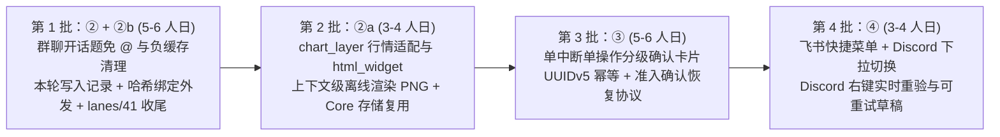

# 渠道第二阶段设计方案（飞书 / Discord / 个人微信，r3 修订版）

> **基线分支**：`docs/channel-phase2`（基于 `dalton/main` `305400a37`）  
> **前置分支**：`fix/channel-sandbox-links`（`lanes/41`，工作区沙箱路径改写登录深链）、`feat/external-member-perms-final`（外部成员服务端权限守卫）  
> **关联文档**：`docs/dalton/features/standalone-core.md`、`docs/dalton/features/external-member-permissions.md`（前置分支 `feat/external-member-perms-final` 新增）、`docs/dalton/features/weixin-multi-account.md`、`docs/dalton/features/cos-delivery-confirmation.md`  
> **文档状态**：r3 修订版（已按 r2 两份独立设计审查意见与十项定案收口，第七章方案待用户最终确认）

---

## 目录

- [一、背景、范围与架构准则](#一背景范围与架构准则)
  - [1.1 现状与演进顺序](#11-现状与演进顺序)
  - [1.2 范围边界](#12-范围边界)
  - [1.3 双形态部署、能力门控与上游钩子规范](#13-双形态部署能力门控与上游钩子规范)
  - [1.4 后续演进事项（本阶段范围之外）](#14-后续演进事项本阶段范围之外)
- [二、各项功能在三渠道的实现方案与接口契约](#二各项功能在三渠道的实现方案与接口契约)
  - [2.1 三渠道承载与降级总览](#21-三渠道承载与降级总览)
  - [2.2 功能 ②：群聊 `@机器人` 自动开话题与话题内免 `@` 继续对话](#22-功能-群聊-机器人-自动开话题与话题内免--继续对话)
  - [2.3 功能 ②a：交互图表与图表图层转图片并附网页交互版链接](#23-功能-a交互图表与图表图层转图片并附网页交互版链接)
  - [2.4 功能 ②b：回答生成文件自动附带与 `lanes/41` 链接收尾事项](#24-功能-b回答生成文件自动附带与-lanes41-链接收尾事项)
  - [2.5 功能 ③：可交互卡片与单中断单操作原生按钮总览](#25-功能-可交互卡片与单中断单操作原生按钮总览)
  - [2.6 功能 ④：机器人快捷菜单与 Discord 右键「转入 `<品牌名>` 研判」](#26-功能-机器人快捷菜单与-discord-右键转入-品牌名-研判)
- [三、确认卡片风险分级、身份核验与回调接入（功能 ③ 详设）](#三确认卡片风险分级身份核验与回调接入功能--详设)
  - [3.1 单中断单操作允许清单与风险四级分类表（L0–L3）](#31-单中断单操作允许清单与风险四级分类表l0l3)
  - [3.2 卡片身份核验、门禁登记与私密详情卡短期令牌协议](#32-卡片身份核验门禁登记与私密详情卡短期令牌协议)
  - [3.3 三端提交统一竞争、准入确认与幂等恢复协议](#33-三端提交统一竞争准入确认与幂等恢复协议)
  - [3.4 飞书 `card.action.trigger` 与 Discord 组件/弹窗回调接入](#34-飞书-cardactiontrigger-与-discord-组件弹窗回调接入)
- [四、安全、权限与文件过滤规则](#四安全权限与文件过滤规则)
  - [4.1 跨工作区持久来源追踪与绑定内容哈希的接收群外发授权](#41-跨工作区持久来源追踪与绑定内容哈希的接收群外发授权)
  - [4.2 外部成员发起交互时的权限范围](#42-外部成员发起交互时的权限范围)
  - [4.3 双路径白名单过滤、离线子资源准入与发送前哈希复核](#43-双路径白名单过滤离线子资源准入与发送前哈希复核)
- [五、数据库变更设计（Dalton 迁移链）](#五数据库变更设计dalton-迁移链)
  - [5.1 群聊机器人话题登记表与文件跨区来源表（第 1 批新增）](#51-群聊机器人话题登记表与文件跨区来源表第-1-批新增)
  - [5.2 渠道交互令牌表与中断恢复竞争表（第 3 批新增）](#52-渠道交互令牌表与中断恢复竞争表第-3-批新增)
  - [5.3 Discord 右键研判草稿与可重试派发表 `dalton_channel_context_menu_drafts`（第 4 批新增）](#53-discord-右键研判草稿与可重试派发表-dalton_channel_context_menu_drafts第-4-批新增)
  - [5.4 存量表边界、迁移链顺接与滚动升级回退方案](#54-存量表边界迁移链顺接与滚动升级回退方案)
- [六、分批实施计划、测试与上线验收](#六分批实施计划测试与上线验收)
  - [6.1 批次划分总表](#61-批次划分总表)
  - [6.2 各批实施细节、测试用例与验收标准](#62-各批实施细节测试用例与验收标准)
- [七、已定方案（待用户最终确认）](#七已定方案待用户最终确认)

---

## 一、背景、范围与架构准则

### 1.1 现状与演进顺序

渠道网关（`integrations/dalton-channel-gateway/`，基于 TypeScript〔带静态类型的 JavaScript 超集语言〕独立进程运行，默认监听本机回环地址 `127.0.0.1:8962`，通过部署级单行租约 `dalton_channel_gateway_lease` 保持单活）负责衔接智能体对话后端与飞书、Discord、个人微信三个聊天端。目前已上线处理中表情与输入状态反馈（#499，`src/processing-feedback.ts`）以及个人微信多账号管理（#506/#507，`d049_weixin_multi_account.py`），前置分支 `fix/channel-sandbox-links`（`lanes/41`）完成了回复正文内工作区沙箱路径向网页登录深链的基础改写，前置分支 `feat/external-member-perms-final` 完成了外部成员在网页端的服务端访问守卫。

本设计覆盖渠道第二阶段的五项建设内容：

1. **② 群聊自动开话题与发起人免 `@` 追问**：在飞书群与 Discord 频道顶层 `@机器人` 提问时自动开启独立话题或 Thread（子区，Discord 频道内的独立讨论串），话题发起人在该话题内直接发送消息即可连续对话。
2. **②a 图表与图层转图片附网页交互链接**：将交互组件（`html_widget`）与专业看盘图表图层（`chart_layer`）在服务端浏览器上下文级离线隔离环境中渲染为高清 PNG（便携式网络图形无损图片格式）随回答发出，并附上打开网页交互视图的登录深链。
3. **②b 回答生成文件自动附带与链接收尾**：以本轮工具写入记录为准识别本轮新写入的可交付文件，经接收地址与内容哈希绑定授权、跨工作区持久来源核查及发送前哈希复核后自动附带，同时完成 `lanes/41` 留待本批处理的引用式链接展开、自动化报告与数据任务通知携带会话与工作区编号生成深链、自动化完成摘要改写并保留工作区文件链接三项改造。
4. **③ 可交互卡片与单中断单操作原生按钮**：将澄清提问卡片升级为原生单选按钮、下拉框或弹窗输入；对命中「单中断、单操作」明确允许清单的低中风险确认操作提供渠道原生按钮，使用稳定 UUIDv5（基于命名空间与名称哈希的第五版通用唯一识别码）请求键与两阶段准入确认机制统一协调按钮点击、文字回复与网页提交，其余操作及额度暂停（`credit_pause`）沿用网页端与现有文字入口。
5. **④ 机器人快捷菜单与 Discord 消息右键研判**：提供飞书单聊输入框快捷菜单、Discord `/workspace` 下拉切换菜单与消息右键命令「转入 `<品牌名>` 研判」。

### 1.2 范围边界

为保持群聊阅读秩序、个人微信连接稳定性与团队数据隔离，第二阶段执行以下明确边界：

- **群聊采用整卡定稿投递**：群聊过程态统一展示轻量表情回应（飞书 `Typing`〔正在输入状态表情〕、Discord `⏳`），待本轮回答生成完毕后一次性发出排版完整的卡片。
- **个人微信采用单轮整条回复**：基于腾讯 iLink（腾讯面向个人智能体开放的微信连接协议）长轮询单聊通道，配合 `sendtyping`（正在输入状态信令）发送完整结论与精选附件。
- **后台任务统一在系统内管理**：研究进度、定时唤醒（`schedule_wakeup`）与自动化状态统一以 Dalton PostgreSQL（开源关系型数据库）记录为准。
- **按用户显式交互读取消息**：仅处理用户 `@机器人`、话题发起人在机器人已登记话题（携带实际话题标识）内跟帖、显式合并转发或右键选中的单条消息；网关在入站解析阶段直接略过其余普通群聊消息。

### 1.3 双形态部署、能力门控与上游钩子规范

全部实现严格遵循 `docs/dalton/features/standalone-core.md` 的双部署形态规范：

1. **统一形态解析与能力开关门控**：
   - 部署形态判断统一调用 `src.dalton.profile`（`resolve_profile()` 与 `DeploymentProfile.EVERFLOW` / `DeploymentProfile.CORE`）；能力启停判断统一调用 `src.dalton.capabilities`（`has_capability()`、`require_capability()`、`require_channel_platform_capability()`），前端统一调用 `web/src/hooks/useCapabilities.ts` 的 `useCapabilities()` 与 `web/src/config/brand.ts`。
   - 各子链路按最小所需能力精确门控：
     - 后端新增的 `channels_router.py` 内部端点全部登记入 `src/dalton/capabilities.py` 的 `DALTON_ROUTE_CAPABILITY_REGISTRY`：通用渠道端点绑定 `CapabilityId.CHANNEL_GATEWAY`，Discord 右键菜单草稿端点绑定 `(CapabilityId.CHANNEL_GATEWAY, CapabilityId.CHANNEL_DISCORD)`，并通过 `test_core_capabilities_gate.py` 门禁测试；
     - 运行期 `turn_deliverables` 工具写入记录汇总、图表快照渲染、`/messages/replay` 渠道元数据输出与浏览器会话 `hitl_response` 占位仅在 `has_capability(CapabilityId.CHANNEL_GATEWAY)` 为真时执行；
     - 数据任务通知关联监控面板深链（读取 `src/dalton/monitors/data_job_registry.py`）仅在 `CapabilityId.CHANNEL_GATEWAY` 与 `CapabilityId.DATA_JOBS` 同时启用时加载并输出。
   - 在核心安装形态（`DALTON_PROFILE=core` / `APP_ENV=core`）下渠道能力默认关闭；当部署者显式开启对应渠道能力并填入机器人凭据时，图表快照自动复用 Core 默认内置的 `DALTON_CHAT_UPLOAD_STORAGE_*` MinIO（兼容 S3 协议的开源对象存储服务）配置，本阶段全部能力开箱即用。
2. **网页地址与品牌名称全配置化**：
   - 后端统一通过 `src/dalton/settings.py` 的 `get_dalton_public_app_url()` 拼装深链；渠道网关在启动及健康对账中从后端内部状态接口同步公网地址，使网关 `src/config.ts` 的 `webBaseUrl` 与后端保持一致。
   - 当部署处于本机回环试用状态（公网地址为空，或主机名为 `localhost` / `127.0.0.1`）时，网关将链接展示为「请在网页端对应会话或工作区查看」文字指引。
   - 卡片标题、提示词与右键菜单文案统一通过 `src/dalton/settings.py` 的 `get_brand_name()`（读取环境变量 `BRAND_NAME`，`core` 形态默认 `Dalton`，`everflow` 形态默认 `Everflow`）动态生成。
3. **上游改动标记与路径登记**：
   - 触及上游共享源码文件（包括 `src/server/`、`src/ptc_agent/`、`src/tools/`、`libs/`、`web/` 下非 Dalton 专属文件）的每一处修改，均须附带 `# DALTON-HOOK(<topic>): <reason>` 或 `// DALTON-HOOK(<topic>): <reason>` 注释，并将新增钩子标识登记入 `scripts/dalton/check_hooks.sh`。
   - 新增 Dalton 专属文件若位于 `scripts/dalton/dalton_paths.txt` 既有前缀之外，须同步补登记路径，且**每一开发批次**均执行并通过 `bash scripts/dalton/check_hooks.sh --strict`。

### 1.4 后续演进事项（本阶段范围之外）

结合审查意见与范围收敛决议，以下扩展项归入后续迭代评估，本阶段四个批次保持聚焦交付：

1. **定时报告外发配置（`dalton_report_delivery`）的渠道按钮确认**：`src/dalton/tools/report_delivery_tools.py` 的 `action="set"` 当前通过模型参数流转，待 `docs/dalton/features/cos-delivery-confirmation.md` 将其改造为服务端 `hitl_confirm("dalton_report_delivery_set", ...)` 并落地多目标 `confirm_token` 后，再在后续迭代评估接入渠道 L2 确认卡片。
2. **CLI（Command-Line Interface，命令行工具）跨电脑审批的渠道按钮接入**：`src/server/dependencies/cli_approval.py` 与 `src/server/services/cli_approvals.py` 基于 Redis（内存键值数据库）待批记录与专用接口 `POST /api/v1/cli/approvals/{approval_id}/decision`（`src/server/app/cli_approvals.py:55`）独立运作，本阶段继续在网页端审批，后续按需评估独立渠道审批适配。
3. **单次暂停含多中断或多操作槽位的复合渠道卡片**：同一暂停内包含多个中断或单个中断内包含多个 `action_requests`（以及带批量 `order_decisions` 槽位的复合操作）时，本阶段统一引导至网页端 `answerBoard.ts` 完整面板处理；渠道端多槽位分步收集留待后续体验迭代。
4. **群话题全员免 `@` 开关与按核验结果细分的研报发布渠道审批**：本阶段固定执行「话题内仅发起人免 `@`」与「正式研报发布（`publish_approval`）固定网页端确认」；群级自定义免 `@` 策略与零疑问研报草稿移动端快捷审批留作后续治理演进方向。
5. **独立操作系统网络命名空间渲染容器**：本阶段在无特权后端容器内通过专用离线 Chromium 进程参数（`--host-resolver-rules="MAP * ~NOTFOUND"`）、`BrowserContext`（浏览器上下文）全量路由拦截与禁用 Service Worker（浏览器后台服务工作线程）实现零外网渲染，保持容器最小权限配置；独立无网卡渲染微服务容器留待后续大规模渲染负载演进时评估。

---

## 二、各项功能在三渠道的实现方案与接口契约

### 2.1 三渠道承载与降级总览

| 功能项 | 飞书（Feishu）实现与降级 | Discord 实现与降级 | 个人微信（Weixin iLink）实现与降级 |
| --- | --- | --- | --- |
| **② 群聊开话题与发起人免 `@` 追问** | 前置开启 `im:message.group_msg` 权限；群顶层 `@` 回复携带稳定去重 `uuid` 与 `reply_in_thread: true` 创建话题（`omt_xxx`），登记后即刻清除该话题负缓存；发起人在携带 `thread_id` 的话题内免 `@` 追问；原消息撤回（`230011`/`231003`/`230110`）时回退为普通群消息 | 频道顶层 `@` 分离会话键与父频道投递地址，首轮在父频道从原消息建公开子区，发起人在子区内免 `@` 追问；权限或活跃子区满额（`50013`/`160006`/`160007`）回退父频道引用回复，原消息已删除（`10008`）发无引用简短提示 | 面向单聊（`weixin:@me`），群消息记为 `weixin_group_unsupported` 归档略过；单聊直接连续收发 |
| **②a 图表与图层转图片** | Schema 2.0（飞书第二代交互卡片规范）内嵌从 Dalton 对象存储拉取的高清 PNG（`tag: "img"`）+ 底部 `open_url` 按钮 `[打开网页交互版]`；超 10 MB（兆字节）自动使用 1x 缩放或转 WebP（高压缩率网页图片格式） | `multipart/form-data`（多部分表单上传格式）附带高清 PNG + `ActionRow`（操作组件行容器）`Link Button`（外链按钮）`[打开网页交互版]`；对象存储、渲染器未就绪或子资源受限时仅发文字与网页深链 | 正文后追加加密上传的 `IMAGE` 图片消息，公网地址可达时附纯文本交互深链；对象存储、渲染器未就绪或子资源受限时仅发文字与深链 |
| **②b 本轮写入文件自动附带与深链** | 限本轮工具写入确认文件（`turn_deliverables`），经接收地址与内容哈希绑定授权并在发送时复核哈希后，≤10 MB 图片走 `im.image.create`，≤20 MB 文档走 `im.file.create`（`.html`〔HTML，HyperText Markup Language，超文本标记语言〕离线转 PDF〔Portable Document Format，便携式文档格式〕）；超限、哈希变化、子资源受限或来源跨区时只发登录深链 | 限本轮工具写入确认文件，经接收地址与内容哈希绑定授权并在发送时复核哈希后，≤20 MB 可交付文件作为附件发送（`.html` 离线转 PDF）；超限、超 50 MB 总量、哈希变化、子资源受限或来源跨区时只发登录深链 | 限本轮工具写入的自有工作区可交付文件（≤20 MB，单轮最多 3 个），校验内容哈希后经 AES-128-ECB（128 位高级加密标准电子密码本模式，`src/channels/weixin/cdn.ts`）加密上传 CDN（内容分发网络）作为 `IMAGE`/`FILE` 发送；其余只发登录深链 |
| **③ 提问与单中断单操作按钮** | 所有交互卡初始即附独立网页入口；L0 提问渲染按钮组或 `form` 表单；允许清单内单中断单操作 L1 直接发 `[批准]` `[拒绝]` 按钮；L2 **群内只展示动作名称与网页确认入口**，完整参数卡发往发起人飞书私聊；其余、`credit_pause` 与 L3 走网页/文字入口 | 所有交互卡初始即附独立网页入口；L0 渲染 `Button` / `StringSelect` + `Modal`；允许清单内单中断单操作 L1 发按钮卡；L2 **群频道只展示动作名称、网页确认入口与 `[查看详情并确认]` 门禁按钮**，点击签发绑定私密消息 ID 的短期令牌并返回 `flags: 64` Ephemeral（仅点击者可见临时消息）详情卡；凭证过期或 L3 只给网页入口 | L0 输出数字编号列表供直接回复；`credit_pause` 沿用现有回复 `继续` / `/stop` 文字入口与网页入口；其余确认统一发送中文说明与网页端确认深链 |
| **④ 快捷菜单与右键研判** | 订阅 `application.bot.menu_v6` 响应单聊输入框上方 4 个固定菜单（返回研究总监、切换工作区卡片、新建对话、停止任务），保留 v7 `/` 命令 | 升级无参 `/workspace` 返回下拉切换菜单；注册消息右键命令（`type = 3`）「转入 `<品牌名>` 研判」，独立首次同步弹 `Modal`，提交时重验源消息实时访问权与公开目的地发帖权限，并与可重试派发记录同事务核销 | 在 `/help` 与扫码成功欢迎语列出快捷指令，发送 `/workspace` 返回编号列表供回复切换 |

---

### 2.2 功能 ②：群聊 `@机器人` 自动开话题与话题内免 `@` 继续对话

#### （1）飞书实现、前置权限、入站精确过滤与回执幂等

1. **平台权限前置条件（`im:message.group_msg`）**：
   - 飞书群内接收未显式 `@机器人` 的话题跟帖消息，依赖飞书开放平台应用开启群消息权限 **`im:message.group_msg`**（获取群组中所有消息）并发布应用版本审批生效，列为第 1 批上线前置条件。
   - 在权限生效前的过渡期内，群顶层 `@机器人` 自动创建话题以及在话题内继续通过 `@机器人` 追问均正常运作并归入同一话题会话。
2. **入站前置过滤与负缓存即时清除（持久化和下载附件前直接略过无关消息）**：
   - 开启 `im:message.group_msg` 后，飞书长连接（`src/channels/feishu/monitor.ts`）在调用 `getMessageFeishu`、`downloadMessageResourceFeishu` 或后端 `I-1`（`register-and-resolve`）之前执行两步内存快速筛选：
     - **仅按实际话题标识匹配免 `@` 跟帖**：飞书普通群中对某条消息执行主聊区普通引用回复（`reply_in_thread: false`）时，消息也会携带 `root_id` 而无 `thread_id`。因此，凡群消息未 `@机器人` 且 `message.thread_id` 为空（无论是否携带 `root_id`），一律视为群主聊区普通发言或普通引用回复，直接在内存中略过（零落库、零下载、零后端请求）；
     - 当群消息未 `@机器人` 且携带非空 `message.thread_id`（`omt_xxx`）时，先查网关内存 LRU（Least Recently Used，最近最少使用缓存，分别维护已登记机器人话题正缓存与短时效非机器人话题负缓存），未命中时调用轻量只读接口 `/internal/topics/lookup`（**新增**，按 `(platform='feishu', chat_address, external_topic_id=message.thread_id)` 精确查询）。仅当命中已登记机器人话题且 `senderOpenId === initiatorPlatformUserId`（话题发起人本人，见第七章定案 1）时，将 `event.threadScopeKey` 归一为已登记的 `canonical_scope_key` 并置 `event.isGroupTrigger = true` 进入后续流程；其余情形在内存中直接略过。
   - **话题登记成功时清除负缓存**：当用户在已有普通话题内先做日常交流（此时该 `omt_xxx` 进入短时效负缓存），随后在该话题内首次 `@机器人` 提问并成功写入 `dalton_channel_bot_topics` 时，网关与 `I-1` / `I-7` 回执处理立即清除该 `(chat_address, external_topic_id)`（及对应 `root_message_id`）的负缓存条目并写入正缓存，使发起人紧接着发出的免 `@` 追问立即生效。
3. **普通群顶层 `@` 自动创建话题、去重 `uuid` 与回执找回**：
   - 在普通群中，用户首次顶层 `@机器人` 发送消息 `om_root`（无 `thread_id`）时，飞书适配器 `src/channels/feishu/inbound-parse.ts` 与 `src/channels/feishu/targets.ts` 将初始 `threadScopeKey` 构造为 `chat:<chat_id>:topic:<om_root>`；在话题群或已有话题中 `@机器人`（自带 `message.thread_id = omt_xxx`），`threadScopeKey` 为 `chat:<chat_id>:thread:<omt_xxx>`。
   - **首次回复稳定 `uuid` 与未知结果回执找回**：首条回复发出前，网关按 `delivery_key` 通过固定命名空间派生确定性飞书回复幂等键 `reply_uuid = UUIDv5(DALTON_FEISHU_REPLY_NAMESPACE, delivery_key)` 并随投递进度预记录。`src/channels/feishu/send.ts` 调用 `client.im.message.reply` 时同时传入 `reply_in_thread: true` 与 `uuid: reply_uuid`。若飞书已接收首条回复但网关在调用 `I-7` 保存话题回执前退出或遇到网络超时，重启重试再次以同一 `uuid: reply_uuid` 调用 `im.message.reply` 时，飞书服务端按 `uuid` 幂等返回原回复 `message_id`，再配合 `getMessageFeishu(first_reply_message_id)` 读取 `thread_id`（`omt_xxx`）补齐回执。
   - **话题回执持久化与同轮多片/附件复用**：拿到 `first_reply_message_id` 与 `external_topic_id = omt_xxx` 后，网关通过 `I-7`（`deliveries/progress`）将 `bot_topic_registration` 同事务写入新增表 **`dalton_channel_bot_topics`**（记录 `external_topic_id`、`root_message_id = om_root`、`first_reply_message_id`、`canonical_scope_key` 与发起人身份），立即清除该 `omt_xxx` 的负缓存，并保持 `dalton_channel_deliveries.confirmed_thread_address` 专供 Discord 使用。同轮后续文本分片、自动附带文件（②b）、图表卡片（②a）以及异常重试均通过 `dalton_channel_bot_topics`（出站侧可按 `root_message_id` 或 `external_topic_id` 定位 `first_reply_message_id`）以 `reply_in_thread: true` 投递至同一话题。
   - 话题发起人在已登记话题内直接发送 `/new`、`/stop`、`/workspace`、`/main` 斜杠指令同样免 `@` 生效。
4. **原消息撤回与建话题受限回退**：
   - 调整 `src/channels/feishu/send.ts:531` 的 `sendReplyOrFallbackDirect`：当首轮建话题请求遇到原消息已撤回或已移除（飞书错误码 `230011`、`231003`、`230110`）或群设置限制创建话题时，自动回退调用 `im.message.create`（携带去重 `uuid`）在群内直接发送回答，保持 `dalton_channel_bot_topics` 仅记录真实创建成功的话题。

#### （2）Discord 实现、会话键与投递地址分离及降级

1. **会话键与已确认投递地址严格分离**：
   - 在已登记的服务器文字频道（`GuildText = 0`）或公告频道（`GuildAnnouncement = 5`）收到顶层 `<@botId>` 消息时，Discord 适配器 `src/channels/discord/inbound.ts` 将逻辑会话键 `threadScopeKey` 构造为 `chat:<guildId>/<channelId>:topic:<messageId>`（采用 `:topic:` 前缀标识顶层新开会话），同时保持出站 `targetAddress` 为父频道地址 `discord:<guildId>/<channelId>`，并标记 `inboundInExistingThread: false`。
   - 改造 `src/channels/discord/send.ts` 的 `sendMessageDiscord`：当 `params.newThread === true` 且 `confirmedThreadAddress` 为空时，直接对父频道 `parsed.channelId` 调用 `src/channels/discord/threading.ts` 的 `createThreadDiscord`（子区名称取清洗后的用户问题首行，按 UTF-16〔16 位统一码字符编码〕安全截断至 `100` 字符以内，自动归档时长 `60` 分钟）。
   - `createThreadDiscord` 确认子区创建成功后，先通过 `onConfirmedThread` 走现有 `d036` 两阶段确认账本写入 `dalton_channel_deliveries.confirmed_thread_address = "discord:<guildId>/<parentChannelId>/thread/<threadId>"` 及 `discord_body_phase`，同步通过 `I-7` 将 `(platform='discord', chat_address, external_topic_id=thread.id, root_message_id=messageId, canonical_scope_key)` 写入 `dalton_channel_bot_topics` 并清除该子区负缓存；确认落库后再向新子区发送首条消息与后续附件。
   - 论坛频道（`GuildForum = 15`）与媒体频道（`GuildMedia = 16`）内的帖子本身已是子区（`type = 11`，`inboundInExistingThread: true`），直接在该子区内回复并登记 `dalton_channel_bot_topics`（清除负缓存）。
2. **子区内发起人免 `@` 继续对话**：
   - Discord 适配器 `src/channels/discord/index.ts` 收到子区消息（`type = 10 / 11 / 12`）且未包含 `<@botId>` 时，先查内存话题缓存或调用 `/internal/topics/lookup` 按 `(platform='discord', chat_address, external_topic_id=channel.id)` 查询 `dalton_channel_bot_topics`；仅当确认为已登记机器人子区且发送者为子区发起人（`author.id === initiatorPlatformUserId`）时，将 `threadScopeKey` 归一为表内 `canonical_scope_key` 并置 `isGroupTrigger = true`；回复前若子区已自动归档，`ensureThreadUnarchived` 自动解封。其余子区的未 `@` 消息在入站前直接略过。
3. **建帖失败分类回退与未知结果复用**：
   - **确定性建帖拒绝回退**：复用 `src/channels/discord/threading.ts` 的 `isDefiniteThreadPostFailure`（HTTP〔超文本传输协议〕4xx 确定性错误）：
     - 当缺少 `CREATE_PUBLIC_THREADS` 权限（`403` / Discord 错误码 `50013`）或活跃子区数量达到上限（`400` / Discord 错误码 `160006` 或 `160007`）且原消息仍在时，自动回退在父频道携带 `message_reference: { message_id: replyToMessageId }` 引用回复；
     - 当原触发消息已被删除（`404` / Discord 错误码 `10008`）时，省略 `message_reference`，在已授权父频道按权限发送一条简短完成提示（附网页会话登录深链），保持投递正常结案。
   - **超时与 5xx 结果未知保护**：当建帖请求遇到网络超时、连接中断或 HTTP 5xx 时，沿用 `threading.ts` 现有的 `adoptUnconfirmedThread(() => findThreadStartedFromMessage(...))` 查找复用与 `outcome: "unknown"` 持久化重试机制，确保同一回复在单一目标位置发出。

#### （3）接口契约与群会话代数失效同步

- **扩展 `POST /api/v1/dalton/channels/internal/inbound/register-and-resolve`（`I-1`，已有端点新增可选字段）**：
  - 请求体新增可选字段：`external_topic_id?: string | null`、`root_message_id?: string | null`。
  - 当 `external_topic_id` 非空且 `(platform, chat_address, external_topic_id)` 命中 `dalton_channel_bot_topics` 时，后端在事务内将 `scope_key` 归一为表内 `canonical_scope_key` 并刷新 `last_active_at`；当用户在已有话题内首次显式 `@机器人` 触发时，同事务登记话题并返回 `topic_newly_registered: boolean` 供网关即时清除负缓存；响应新增返回 `resolved_scope_key: string` 与 `topic_initiator_platform_user_id: string | null`。
- **扩展 `POST /api/v1/dalton/channels/internal/deliveries/progress`（`I-7`，已有端点新增可选字段）**：
  - 请求体新增可选字段 `feishu_reply_uuid?: string | null` 与 `bot_topic_registration?: { external_topic_id: string; root_message_id?: string | null; first_reply_message_id?: string | null; canonical_scope_key: string; initiator_platform_user_id: string }`，在首条回复确认话题后同事务 `INSERT ... ON CONFLICT DO UPDATE` 写入 `dalton_channel_bot_topics`，网关收到成功响应后同步清除该话题负缓存。
- **新增 `POST /api/v1/dalton/channels/internal/topics/lookup`（新增端点，登记 `CapabilityId.CHANNEL_GATEWAY`）**：
  - 请求：`{ platform: "feishu" | "discord", chat_address: string, external_topic_id?: string | null, root_message_id?: string | null, match_mode: "inbound_followup" | "outbound_delivery" }`（入站免 `@` 跟帖固定使用 `inbound_followup` 且仅按非空 `external_topic_id` 匹配；出站分片/附件补发使用 `outbound_delivery`，支持按 `external_topic_id` 或 `root_message_id` 查询已建话题回执）；
  - 响应：`{ found: boolean, canonical_scope_key: string | null, external_topic_id: string | null, first_reply_message_id: string | null, initiator_platform_user_id: string | null, initiator_dalton_user_id: string | null }`。
- **群会话代数失效覆盖 `:topic:` 作用域**：
  - 同步更新 `src/dalton/database/channel_gateway.py:4086-4122` 的 `_advance_group_chat_generations_in_tx` 及群解绑清理逻辑，将匹配条件扩展为 `scope_key = 'chat:' || %s OR scope_key LIKE 'chat:' || %s || ':thread:%%' OR scope_key LIKE 'chat:' || %s || ':topic:%%'`，使群绑定移除或重置时同步推进全部 `:thread:` 与 `:topic:` 话题会话代数并清理挂起中断。

---

### 2.3 功能 ②a：交互图表与图表图层转图片并附网页交互版链接

采用服务端无头 Chromium（开源无头浏览器渲染内核）**浏览器上下文级离线隔离渲染**高清 PNG 快照 + Dalton 对象存储持久化 + 网页交互版登录深链的统一架构，一次建设覆盖飞书、Discord、个人微信三端。

#### （1）浏览器上下文级离线渲染、双形态存储与行情数据供给

1. **复用双形态对象存储配置（覆盖 Core 默认 MinIO 与 Everflow S3/R2）**：
   - 新增快照存储辅助模块 `src/dalton/channel_snapshot_storage.py`（**新增**），直接复用 `src/dalton/chat_upload_storage.py` 的双形态凭据解析与客户端池：优先读取 `DALTON_CHAT_UPLOAD_STORAGE_*`（`docker-compose.core.yml:213-216` 已为 `DALTON_PROFILE=core` 默认配置 `http://minio:9000` 与 `chat-uploads` 存储桶），未配置时自动回退读取 Everflow 生产已有的 `DALTON_ASR_STORAGE_*`（`src/dalton/transcription_storage.py`），并在服务启动时复用桶就绪探测。
   - 快照对象统一存放在键前缀 `channel-snapshots/{thread_id}/{sha256[:16]}/` 下，与 `chat-uploads/` 聊天附件前缀相互独立，支持多后端 worker 进程直接跨进程读写。
2. **看盘图表图层（`chart_layer`）同步与后台双入口快照及行情供给**：
   - 复用 `libs/chartkit/chartkit/_renderer.py` 的工作线程渲染器 `RENDERER` 与离线打包页面 `chart-render.html`（运行在虚拟源 `https://chart-snapshot.invalid`，并在 `RENDERER` 的 `browser.new_context` 中显式启用 `service_workers="block"`、弹窗拦截与 `context.route("**/*", ...)` 全量上下文级路由）。
   - **服务端行情供给与权限核验**：`SnapshotJob`（`libs/chartkit/chartkit/_renderer.py:82`）所需的 `ChartBars`（`_bars_source.py:61`）在后端服务侧传入专用的 `backend_market_bars_tool` 适配器（**新增**），内部直接调用后端现有的行情缓存服务 `src/server/services/cache/daily_cache_service.py`（`DailyCacheService`）与 `src/server/services/cache/intraday_cache_service.py`（`IntradayCacheService`），并以回合发起人的行情读取身份（对齐 `src/server/app/market_data.py:12` `DataReadUserId`）获取与前端看盘面板一致的 OHLCV（开盘价、最高价、最低价、收盘价与成交量）序列。
   - 同时接入两处图层落库出口（均标注 `DALTON-HOOK(channel-chart-snapshot)`，仅在 `has_capability(CapabilityId.CHANNEL_GATEWAY)` 为真且当前会话关联渠道或渠道投递自动化时触发）：
     1) **同步工具出口**：`src/tools/chart_annotation/layers.py` 的 `_publish`（`:159`）完成 `add_layers` 落库后；
     2) **后台命令结算出口**：`src/server/services/commands/settle.py`（`:230-241`）中脱离前台等待的后台命令通过 `cr_db.finalize` 持久化 `outbox_layers` 后。
   - 渲染出的 PNG（默认尺寸 `1200×720`）写入 `channel-snapshots/{thread_id}/{sha256[:16]}/chart_{layer_id}.png`，并将快照元数据 `{ snapshot_key, sha256, size_bytes, width, height, artifact_type: "chart_layer", chart_id, layer_id, title }` 持久化写入运行记录元数据。
3. **交互式 HTML 组件（`ShowWidget` / `html_widget`）`data_files` 来源核查与离线渲染**：
   - **`data_files` 来源与路径准入检查**：`src/ptc_agent/agent/tools/show_widget.py` 的 `_resolve_data_files`（`:172`）在读取沙箱文件注入组件前（标注 `DALTON-HOOK(channel-widget-snapshot)`），逐一校验每个 `data_files` 条目的原始相对路径与沙箱解析符号链接后的 `realpath` 均严格位于本回合工作区根目录之内、满足 §4.3 双路径排除规则（排除隐藏文件、排除目录及凭据后缀），且查询 `dalton_channel_file_provenance`（§4.1）确认无跨工作区或同事来源标记。若任一 `data_files` 条目来源跨区、来源未明或命中排除路径，则将该组件产物标记为 `outbound_restricted = True`，跳过渠道图片外发并仅输出网页交互登录深链。
   - **浏览器上下文级零外网隔离渲染**：在 `src/server/services/pdf_render.py`（标注 `DALTON-HOOK(channel-offline-render)`）中维护专用的离线 Chromium 实例（启动参数附加 `--host-resolver-rules="MAP * ~NOTFOUND"`、`--disable-background-networking`、`--disable-extensions`、`--disable-sync`），新增 `render_widget_png(html, resolved_data, *, width=1200, max_height=2400, scale=2.0) -> bytes`（**新增**）：
     - 创建隔离上下文时固定设置 `browser.new_context(..., service_workers="block")`，从引擎层禁用 Service Worker 注册与拦截；
     - 在**浏览器上下文级**注册 `await context.route("**/*", ...)` 与 `await context.route_web_socket("**/*", ...)`（覆盖主页面、全部内嵌框架及任何新窗口的首个请求），注入 `await context.add_init_script("window.open = () => null;")` 并监听 `context.on("page", ...)` 在检测到除主渲染页外的任何弹窗页面时立即关闭并标记本次渲染违规（`subresource_rejected = True`）；
     - 页面仅允许加载后端镜像内置并经哈希校验的**本地可信前端库静态副本**（`chart.js`、`echarts`、`lightweight-charts`、`d3`、`katex` 常见 CDN 标准路径映射至容器本地磁盘文件）以及 `data:` / `blob:` 内联资源；**任何其他子资源请求、WebSocket 请求或弹窗行为一旦被拦截拒绝，立即中止整张组件快照的外发，渠道端只发送网页登录深链**。
   - 通过校验渲染生成的 PNG 存入 `channel-snapshots/{thread_id}/{sha256[:16]}/widget_{artifact_id}.png`，快照引用持久化写入组件产物记录与运行元数据。
4. **跨 worker 并发预算与内部快照读取鉴权**：
   - 本地 `_RENDER_SEMAPHORE` 配合 Redis / PostgreSQL 轻量槽位将部署级离线渲染总并发控制在上限以内（默认全局上限 `2`，单张超时 `25` 秒，单回合最多自动渲染前 `4` 张图表）；对象存储未配置、未安装 Chromium、超时或子资源被拒时，网关平稳发送文字结论与网页交互登录深链。
   - 在 `src/dalton/app/channels_router.py` 新增 `GET /api/v1/dalton/channels/internal/snapshots/{snapshot_key:path}`（**新增**，登记 `CapabilityId.CHANNEL_GATEWAY`）：校验路径匹配正则 `^channel-snapshots/([0-9a-f]{8}-[0-9a-f]{4}-[0-9a-f]{4}-[0-9a-f]{4}-[0-9a-f]{12})/([0-9a-f]{16})/[A-Za-z0-9_.-]+\.png$`（拒绝 `..`、反斜杠与二次编码），核验 `thread_id` 归属、运行持久化快照清单、`outbound_restricted` 为假，并通过第四章 `channel_outbound_guard` 接收地址授权与内容 `sha256` 复核后返回字节流。
   - **网页交互深链定位**：
     - `html_widget`：`${WEB_BASE_URL}/chat/t/${threadId}?widget=${encodeURIComponent(artifactId)}`（若已发布为对目标受众可见的监控看板则使用 `/monitors/${slug}`）；
     - `chart_layer`：`${WEB_BASE_URL}/chat/t/${threadId}?chart=${encodeURIComponent(chartId)}&layer=${encodeURIComponent(layerId)}`；
     - 前端 `web/src/pages/ChatAgent/components/ChatView.tsx`（**新增参数解析**，标注 `// DALTON-HOOK(channel-deep-links)`）识别 `?widget=` 自动滚动高亮对应组件卡片，识别 `?chart=&layer=` 自动展开右侧看盘面板并定位到指定图层。

#### （2）网关收集与三渠道投递

- `src/orchestrator.ts` 在实时流（`consumeTurnSseStream`）、断线回放流（`deliverReplayFallback` / `consumeInFlightReplayRunStream`，读取 `/messages/replay` 返回的持久化快照清单）及后台唤醒/命令回报流（`consumeBackgroundRunStream`）中按 `artifact_id` 去重收集本轮可外发快照。
- 在回合结算时（覆盖默认整轮回复与显式 `send_message` 后的图表补发）：
  - **飞书**：构造 Schema 2.0 卡片（`src/channels/feishu/format.ts`），调 `im.image.create` 上传 PNG（超过 `10 MB` 时自动使用 1x 尺寸或转 WebP 并复核体积），嵌入 `tag: "img"`（`preview: true`），底部放置 `open_url` 按钮 `[打开网页交互版]`。
  - **Discord**：将 PNG 作为消息附件上传，并附加含 `Link Button`（`style = 5`，标签 `打开网页交互版`）的 `ActionRow`。
  - **个人微信**：正文发出后，将 PNG 经 iLink CDN 加密上传并以 `IMAGE` 消息发出；公网 `webBaseUrl` 可达时在正文中附上 `网页交互版：<链接>`。

---

### 2.4 功能 ②b：回答生成文件自动附带与 `lanes/41` 链接收尾事项

#### （1）基于本轮工具写入记录的产物识别、哈希绑定与离线 HTML 转 PDF

1. **以本轮工具写入记录为准持久化 `turn_deliverables`（新增）**：
   - 自动附带范围严格限定为**能确认由本轮运行写入本回合自有工作区的文件**，直接以本轮工具写入记录为准（摒弃基于工作区目录差异推断的做法，避免将同一工作区并发回合写入的文件或历史旧文件归入本轮产物）。
   - 在渠道回合（`has_capability(CapabilityId.CHANNEL_GATEWAY)` 为真）执行以下记录流程（标注 `DALTON-HOOK(channel-deliverables)`）：
     - 在 `src/server/handlers/chat/ptc_run.py:1056` 构建图实例时，为本回合主工作区 `SandboxBackend` 注入按 `(thread_id, run_id, workspace_id)` 隔离的写入记录回调 `operation_callback`（衔接 `src/ptc_agent/agent/tools/file_ops.py:447, 524` 的 `Write`、`Edit` 及本轮工具调用 `SandboxBackend.awrite_text` / `aedit_text` / `aupload_files` 成功回调）；
     - 每次本轮工具成功写入本工作区文件时，同步校验该路径通过 §4.3 双路径白名单（原始相对路径与沙箱 `realpath` 均落在当前工作区内且满足可交付后缀与排除规则）、查询 `dalton_channel_file_provenance` 确认无跨区来源污染（若当前运行已触发 `colleague_source_touched` 或 `is_run_outbound_blocked`，则同步在 `dalton_channel_file_provenance` 为该写入路径打上受限来源标记），并计算写入后文件字节的 `sha256` 与 `size_bytes` 记入本轮内存账本；
     - 回合结算写入 `event: run_end`（`src/server/services/runs/stream_writer.py` 与 `src/server/services/runs/sse_producer.py`）前，将本轮写入账本按路径最新一次写入固化至运行记录元数据 `turn_deliverables: Array<{ workspace_id: string; path: string; size_bytes: number; sha256: string }>`。
     - 实时流终点事件 `event: run_end` 与断线回放接口 `GET /api/v1/threads/{thread_id}/messages/replay`（`src/server/app/threads/messaging.py:1376`）**读取同一份持久化 `turn_deliverables` 清单**。
2. **自动附带候选筛选与显式发送分工**：
   - 自动附带（②b）仅从本轮持久化 **`turn_deliverables`** 中选取（剔除本轮已由 `send_message(files=[...])` 显式发出的文件及 ②a 图表快照）：
     - **私聊**：在本轮 `turn_deliverables` 内，按「最终回复正文显式点名的文件优先 -> 其余本轮工具新写文件次之」排序进入外发授权；
     - **群聊/频道**：仅当文件同时位于本轮 `turn_deliverables` 内且在最终回复正文（围栏代码块与行内代码之外）被显式引用点名时，才进入群外发授权；
     - 回复正文中引用的其他工作区历史文件、通过脚本生成但未经文件写入工具登记的文件、跨工作区引用（`__wsref__/<workspaceId>/<path>`）以及来源未明文件，统一改写为需登录鉴权的网页深链（模型需直接外发脚本生成的合规工作区文件时，按提示词调用显式工具 `send_message(files=[...])`，同样经过 §4.1 持久来源表、接收地址授权与内容哈希校验）。
3. **`.html` 报告浏览器上下文级离线转 PDF 与全量退回深链规则**：
   - 命中本轮 `turn_deliverables` 内的 `.html` / `.htm` 可交付报告文件时，后端先读取文件字节核对当前 `sha256` 与 `turn_deliverables.sha256` 一致，再调用 `src/server/services/pdf_render.py` 新增的渠道离线渲染入口 `render_workspace_pdf_offline`（**新增**，标注 `DALTON-HOOK(channel-offline-render)`）：
     - 复用 §2.3（1）同一套专用离线 Chromium（`--host-resolver-rules="MAP * ~NOTFOUND"`）、`browser.new_context(..., service_workers="block")`、上下文级 `context.route("**/*", ...)` 与 `context.route_web_socket("**/*", ...)` 以及弹窗拦截（`window.open = () => null` + `context.on("page")` 关闭并判败）；
     - 页面引用的子资源**仅放行两类**：① 后端内置的本地可信前端库静态副本；② 严格位于当前工作区内、**通过 §4.3 同一套双路径排除规则（无隐藏文件/目录、无排除目录、无排除后缀如 `.env`/`.json`/`.py`/`.key`/`.svg`、`realpath` 落在工作区根目录内）且在 `dalton_channel_file_provenance` 中无跨区受限来源标记**的工作区静态文件（由路由处理器直接校验字节并返回）；
     - **一旦任何子资源请求、WebSocket 或弹窗被拦截拒绝，立即中止并判定整份报告不外发附件，渠道端只发送网页登录深链**。
   - 渲染成功后计算输出 `.pdf` 字节流的 `rendered_sha256`、核验 `%PDF-` 魔数与体积上限：单文件 `≤ 20 MB`（飞书内联图片 `≤ 10 MB`，`10–20 MB` 图片走 `im.file.create` 文件消息）、飞书/Discord 单轮自动附带最多 `5` 个（个人微信最多 `3` 个）、整轮总附件 `≤ 50 MB`。超出配额、哈希变化或子资源受限的文件在回复末尾附上：`📎 <文件名> — 请前往网页查看：<登录深链>`。
4. **渠道提示词同步说明**：
   - 更新网关 `src/types.ts` 的 `buildSurfaceRules`：清晰说明通过 `Write` / `Edit` 在本工作区写入并在回复正文中用工作区相对路径引用的可交付文件会自动附上网页登录深链并按规则附带文件；由代码脚本生成的图表或文档如需作为聊天附件直接发出，可调用 `send_message(files=[...])` 指定文件相对路径。合入前执行提示词语言审查。

#### （2）纳入 `lanes/41` 推迟的三项链接收尾改造

1. **Markdown（轻量级纯文本标记语法）引用式链接展开与跨工作区目标保留**：
   - 在 `sandbox-links.ts`（跳过围栏代码块与行内代码）新增引用式链接解析器：提取正文中的链接定义行 `[ref]: destination "optional title"`（标签长度上限 `512` 字符）。
   - **完整复用 `lanes/41` 的路径分类、编码与降级规则**：当 `destination` 为跨工作区引用 `__wsref__/<targetWorkspaceId>/<path>` 时，保留目标工作区标识并改写为 `${WEB_BASE_URL}/chat/${targetWorkspaceId}?file=${encodedPath}`；当命中本回合工作区路径时改写为 `${WEB_BASE_URL}/chat/t/${threadId}?file=${encodedPath}`（无 `threadId` 但有 `workspaceId` 时生成 `/chat/${workspaceId}?file=${encodedPath}`）；将正文中引用的 `[文字][ref]`、`[ref][]` 原地展开为标准内联链接 `[文字](深链)`，兼容飞书富文本与微信文本过滤器。
2. **自动化报告与数据任务通知全链路透传会话/工作区编号及服务端卡片前置改写**：
   - **已保存报告卡片入库校验前改写**：`src/dalton/database/automation_reports.py:1121-1167` 的 `_validate_card` / `_scan_string` 在报告提交保存阶段即校验卡片字段并拒绝相对路径与本地引用。因此在报告提交准备阶段（`lock_report_execution` `:1407` 已锁定取出 `automation_executions.conversation_thread_id` 与 `automations.workspace_id`），先调用后端 `rewrite_workspace_links_for_external` 将卡片正文与受支持链接字段中的合规工作区路径（含 `__wsref__` 与引用式链接）改写为 `https://...` 登录深链（公网地址为回环或未配置时转为纯文件名文本），再执行现有的 `_validate_card` 安全扫描（继续拦截原始 `file://`、`IMG:` 或宿主机敏感路径）。
   - **报告与通知授权响应全量透传已有 `thread_id` 与 `workspace_id`**：
     - 在 `src/dalton/database/automation_notifications.py` 的 `decide_automation_notification_plan`（`:406`）中关联查询 `automation_executions.conversation_thread_id` 与 `automations.workspace_id`，在返回计划顶层新增 `thread_id: string | null` 与 `workspace_id: string | null`；
     - 在 `src/dalton/database/automation_reports.py` 的 `authorize_saved_report_target`（`:2872`）及 `src/dalton/database/data_task_notifications.py` 的 `_authorized_target_from_report`（`:396`）与统一授权出口 `authorize_data_task_notification_plan`（`:1247`，`plan_payload` `:1335`）中同步透传 `thread_id: string | null` 与 `workspace_id: string | null`（自动化报告分支填入执行关联的 `conversation_thread_id` 与 `workspace_id`；独立宿主机脚本任务 `dalton_data_runs` 本身运行在会话与工作区之外，两字段返回 `null`）。网关 `src/automation-notifications.ts` 与 `src/data-task-notifications.ts` 将收到的 `threadId` 与 `workspaceId` 传入 `sandbox-links.ts` 统一完成文本与卡片段落深链改写。
   - **脚本数据任务监控看板链接**：在 `src/dalton/database/data_task_notifications.py` 中，当 `CapabilityId.CHANNEL_GATEWAY` 与 `CapabilityId.DATA_JOBS` 同时启用、任务已在 `src/dalton/monitors/data_job_registry.py` 绑定监控看板、公网地址已配置且通过 `src/dalton/monitors/permissions.py` 受众可见性校验时，在 `plan_payload` 中附带 `monitor_url`（新增字段）供卡片底部生成「查看监控面板」链接；宿主机本地路径统一展示为纯文件名文本。
3. **自动化完成摘要保留并改写工作区文件链接**：
   - 在 `src/dalton/notify/dispatch.py`（现行 `_strip_non_http_markdown_links` 位于 `:705`）新增 `rewrite_workspace_links_for_external(text, *, public_base, thread_id=None, workspace_id=None)`（**新增函数**）：在构造自动化完成通知摘要卡片与纯文本时，复用同一路径分类器将合规工作区文件链接（含引用式链接与 `__wsref__`）改写为对应登录深链；当 `public_base` 未配置或命中排除目录时转为纯文本标签。
   - 同步调整 `dispatch.py` 的 `_truncate_section_body`（`:845`）与 `_truncate_line_at_punct`（`:792`）：按链接的可见显示文字长度计入摘要字数预算，并通过 `truncate_preserving_markdown_links`（`:672`）保持截断位置落在完整链接边界之外。

---

### 2.5 功能 ③：可交互卡片与单中断单操作原生按钮总览

- **全卡片常驻独立网页入口**：飞书与 Discord 发出的每一张提问或确认卡片（L0–L3），在公网 `webBaseUrl` 已配置时均在初始发送时附带独立的网页会话跳转按钮（飞书 `open_url`、Discord `Link Button`），确保令牌过期、交互凭证超期或服务回退后用户始终可一键进入网页端处理。
- **提问卡片（`AskUserQuestion`，`src/ptc_agent/agent/middleware/ask_user.py`）**：
  - **飞书**：构造 Schema 2.0 卡片。单题单选且选项数 `≤ 5`、每项字数 `≤ 20` 时，渲染一组 `button`；多选（`allow_multiple: true`）或选项数 `> 5` 时，渲染 `form` 容器包裹 `select_static` / `multi_select_static` 下拉框 + 1 个可选补充说明 `input` + 提交按钮，旁配 `[跳过]` 与 `[前往网页端查看]`。
  - **Discord**：单题单选 `≤ 5` 项渲染 `ActionRow` `Button`；多选或 `6–25` 项渲染 `StringSelect`（设置 `min_values` / `max_values`）；附 `[填写其他回答]` 按钮（弹出 `Modal` 多行文本框）、`[跳过]` 与 `[前往网页端查看]`。
  - **个人微信与全端文字兼容**：微信继续输出清晰的编号列表（`1. ... 2. ...`）；飞书与 Discord 在发出按钮卡片的同时，继续支持用户直接打字回复序号或自由文本作答，与按钮点击在后端竞争同一待确认主键（§3.3）。
- **确认卡片（收窄为「单中断、单操作」允许清单，`credit_pause` 沿用网页与文字入口）**：
  - 当当前暂停仅含 **1 个待处理中断**、该中断满足 `len(action_requests) == 1` 且 `action_requests[0].type` 命中 §3.1 明确允许清单时，按后端判定的 L1（当前会话按钮确认）或 L2（群内仅显示动作名称与网页入口，完整参数放入飞书发起人私聊卡或 Discord 私密详情卡）渲染渠道原生按钮；
  - 额度暂停（`credit_pause`）沿用现有的网页端恢复/停止入口及聊天文字回复 `继续` / `/stop` 入口；其余所有单操作与多中断/多操作复合暂停统一归入 L3，渲染 `[前往网页端核对并确认]` 登录深链入口。

---

### 2.6 功能 ④：机器人快捷菜单与 Discord 右键「转入 `<品牌名>` 研判」

#### （1）机器人快捷菜单

1. **飞书机器人单聊自定义菜单**：
   - 在飞书开发者后台配置单聊输入框上方 4 个快捷菜单项（菜单键统一为 `dalton:menu:<action>`）：
     - `返回研究总监`（`dalton:menu:main`）：切回个人 `Home` 研究总监会话；
     - `切换工作区`（`dalton:menu:workspace`）：查询用户名下可访问工作区，返回带工作区下拉框与快捷按钮的 Schema 2.0 卡片，点击完成 `/workspace <id>` 切换；
     - `新建对话`（`dalton:menu:new`）：在当前工作区推进会话代数（`generation + 1`）开启新对话；
     - `停止当前任务`（`dalton:menu:stop`）：停止当前会话正在运行的回合。
   - 网关在 `src/channels/feishu/monitor.ts` 的 `eventDispatcher.register` 中订阅 `"application.bot.menu_v6"`（复用现有 `WSClient` 长连接），提取 `operator.operator_id.open_id` 与 `event_key`，通过 `I-3`（`internal/session/command`）执行并向单聊返回反馈。`src/native-commands/feishu-registrar.ts` 已有的 4 个飞书 v7 `/` 命令保持并存，并在同步命令输出中附带自定义菜单配置自检提示。
2. **Discord 斜杠菜单增强**：
   - 在现有 `/main`、`/workspace`（含实时自动补全）、`/new`、`/stop` 基础上，当用户无参数执行 `/workspace` 时，在 `flags: 64` Ephemeral 响应中附带 `StringSelect` 工作区下拉菜单（展示最近活跃的最多 25 个可写工作区），支持点选一键切换。
3. **个人微信快捷指引**：
   - 在扫码连接成功欢迎语与 `/help` 回复中列出 `/main`、`/workspace`、`/new`、`/stop`、`/unbind` 指令说明；发送无参 `/workspace` 时返回带序号的工作区列表，支持回复 `/workspace <序号或名称>` 切换。

#### （2）Discord 右键消息菜单「转入 `<品牌名>` 研判」

1. **命令声明、复合键幂等同步与定向撤销命令**：
   - 在 `src/native-commands/manifest.ts` 与 `src/native-commands/discord-registrar.ts` 新增一条消息上下文菜单命令（`ApplicationCommandType.Message = 3`，全局 `contexts: [0, 1]` 覆盖服务器频道与机器人私聊）。命令名称按 `get_brand_name()` 动态生成：默认 `转入 Dalton 研判`（Everflow 环境按配置生成 `转入 Everflow 研判` 或自定义 `转入 <BRAND_NAME> 研判`，按 UTF-16 安全截断至 32 字符以内）。
   - 扩展 `discord-registrar.ts` 的 `indexRemoteDiscordCommands`（`:484`）按 `(name, commandType)` 复合键索引，常规同步走定向 `POST` / `PATCH`；同时为 `dalton-native-commands` 新增显式撤销参数 `--revoke-context-menu`（**新增**），仅针对已登记的 `type = 3` Dalton 右键命令发起定向 `DELETE /applications/{app_id}/commands/{cmd_id}`，供停用或回退前精确下线右键菜单而完整保留其余 `CHAT_INPUT` 斜杠命令。
2. **首次同步弹 `MODAL`、提交时源消息实时权限重验与可重试草稿核销**：
   - Discord 消息右键命令首次回调（`INTERACTION_CREATE`，`type = 2, data.type = 3`）携带 `data.target_id` 与 `data.resolved.messages[target_id]`，后续弹窗提交回调（`MODAL_SUBMIT`，`type = 5`）携带 `custom_id`、表单输入值以及提交时刻实时计算的 `interaction.member.permissions` 与 `interaction.app_permissions`。建立两步持久化与可重试派发协议：
   - **第 1 步（独立解析与同步弹框前预备）**：
     - 在 `src/channels/discord/interactions.ts` 新增解析分支 `kind: "message_context_command"`；在 `src/channels/discord/index.ts` 的 `dispatchInteraction`（`:675` 通用延迟应答之前）设置专门处理分支，在 `2.0` 秒预算内调用后端新增接口 **`POST /api/v1/dalton/channels/internal/context-menu/prepare`**（登记 `(CapabilityId.CHANNEL_GATEWAY, CapabilityId.CHANNEL_DISCORD)`）。
     - 后端核验点击者在 `dalton_channel_identities` 的绑定状态与成员等级（`src/dalton/access_tiers.py::get_user_tier`）：未绑定账号时同步返回 `flags: 64` 绑定引导提示；外部成员（`tier == "external"`）在服务器频道触发时同步返回 `flags: 64` 提示「外部成员请通过机器人私聊使用」；校验通过时，核查源频道归属（仅当源频道为 `dalton_channel_chat_bindings` 已授权公开文字/公告频道或公开子区、排除私有子区 `PrivateThread = 12` 时置 `allow_public_thread = True`），生成 128 位随机 `draft_nonce`，将点击者、源频道 ID 与类型、`target_message_id`、被选消息快照与附件描述列表写入 **`dalton_channel_context_menu_drafts`**（**新增**，`dispatch_status = 'draft'`，有效期 `15` 分钟，见 §5.3）。
     - 网关在 3 秒窗口内直接同步返回 `MODAL`（`type = 9`，`custom_id = "dlt:ctx:<draft_nonce>"`），含可选多行输入框「补充研判问题（留空则核查事实并提炼要点）」；`allow_public_thread` 为真时展示投递位置选择项，**默认选中「发到我的机器人私聊」**，可选「在当前频道新建子区公开讨论」（其余频道固定发往本人私聊，见第七章定案 2）。
   - **第 2 步（提交时源消息实时访问权与目的地发帖权复核、同事务可重试核销与结果回执）**：
     - 收到 `MODAL_SUBMIT`（`type = 5`）时，网关先同步返回 `DEFERRED_CHANNEL_MESSAGE_WITH_SOURCE`（`type = 5, flags = 64`）私密延迟占位响应，并在核销前执行**平台侧实时访问与发帖权限复核**：
       1) **源消息当前访问权复核**（针对服务器频道/子区来源）：校验 `interaction.channel_id === draft.source_channel_id`；校验提交时刻 `interaction.member.permissions` 同时包含 `VIEW_CHANNEL`（`1 << 10`）与 `READ_MESSAGE_HISTORY`（`1 << 16`）；当源频道为私有子区（`PrivateThread = 12`）时，额外调用 `GET /channels/{source_channel_id}/thread-members/{clicker_user_id}` 确认点击者当前仍在该私有子区成员列表内（或具备 `MANAGE_THREADS`）；当机器人具备 `READ_MESSAGE_HISTORY` 权限时，实时调用 `GET /channels/{source_channel_id}/messages/{target_message_id}` 确认原消息未被删除且获取最新有效附件签名地址。任一复核未通过时拒绝使用缓存快照，更新私密响应告知「原消息访问权限已变更或消息已移除」并终止流程。
       2) **公开投递目的地可见范围与发帖权限核查**：当用户选择「在当前频道新建子区公开讨论」时，核验源频道类型为公开频道或公开子区（非私有子区），且点击者 `interaction.member.permissions` 与机器人 `interaction.app_permissions` 均具备目标频道的 `VIEW_CHANNEL`、`SEND_MESSAGES` 及 `CREATE_PUBLIC_THREADS`（子区内则为 `SEND_MESSAGES_IN_THREADS`）权限。
     - 平台权限复核通过后，网关调用后端 **`POST /api/v1/dalton/channels/internal/context-menu/consume`**（**新增**）：后端在**同一数据库事务**内按 `draft_nonce_hash` 校验 `consumed_at IS NULL AND expires_at > NOW()`，重验点击者平台身份、当前 `dalton_channel_identities` 绑定、成员等级及 `dalton_channel_chat_bindings` 目标频道白名单，解析目标会话 `resolved_scope_key` 与目标工作区 `resolved_workspace_id`，生成稳定幂等键 `request_key = UUIDv5(DALTON_CTX_MENU_NAMESPACE, draft_nonce_hash)`，并同事务写入 `consumed_at = NOW()`、`dispatch_status = 'pending_dispatch'` 与 `submitted_payload`（将一次性核销与可重试派发记录原子绑定）。
     - 网关将合规附件下载上传至 `resolved_workspace_id`，以该 `request_key` 调用 `I-1` 与 `POST /api/v1/threads/{thread_id}/messages` 启动回合；后端接纳运行（或网关重启重放收到 `409 duplicate_request` 确认已有运行）后，调用 **`POST /api/v1/dalton/channels/internal/context-menu/ack`**（**新增**）将 `dispatch_status` 更新为 `'admitted'`。若网关在 `consume` 提交后、上传或回合接纳前意外退出，启动恢复流程（`/internal/recover` `mode=startup`）自动拉取未超期的 `pending_dispatch` 草稿（重放前再次执行上述源消息访问权复核）以同一 `request_key` 完成派发。
     - **回合创建后补发深链与私信关闭兜底**：回合接纳后，网关调用 `PATCH /webhooks/{app_id}/{interaction_token}/messages/@original` 将点击者私密响应更新为含精确登录深链 `${WEB_BASE_URL}/chat/t/${thread_id}` 的确认提示；当发往本人私聊遇到用户关闭服务器成员私信（Discord 错误码 `50007`）时，利用该次 `MODAL_SUBMIT` 的 `interaction_token` 更新 `flags: 64` 私密响应附上网页会话深链。

---

## 三、确认卡片风险分级、身份核验与回调接入（功能 ③ 详设）

### 3.1 单中断单操作允许清单与风险四级分类表（L0–L3）

1. **后端权威分类与「单中断、单操作」准入规则**：
   - 改造网关 `src/orchestrator.ts` 的 `handleInterruptEvent`（`:7187-7261`）：当飞书或 Discord 会话收到中断事件时，网关将原始中断载荷提交至后端 `POST /api/v1/dalton/channels/internal/action-tokens/mint`（**新增**），由后端统一完成准入判定与风险定级。
   - **单中断、单操作准入条件**：仅当目标 `(thread_id, run_id)` 当前挂起的中断总数为 **`1`**，且该中断满足 `len(action_requests) == 1`（槽位索引固定为 `0`）且 `action_requests[0].type` 命中下表 L0 / L1 / L2 允许清单时，后端签发渠道交互令牌并返回对应级别；同一暂停包含多个中断、单个中断包含多个 `action_requests`、命中 `credit_pause` 或类型位于允许清单之外的暂停，后端统一不签发按钮令牌（`credit_pause` 沿用现有网页与文字 `继续` / `/stop` 入口，其余返回 `L3` 渲染网页端确认深链，交由前端 `web/src/pages/ChatAgent/session/interrupts/answerBoard.ts` 处理）。

2. **真实中断类型与风险四级分类表**：

| 风险级别 | 精确中断类型标识与后端代码位置 | 分级判定条件（签发与核销双端校验） | 飞书承载方式（均附独立网页入口） | Discord 承载方式（均附独立网页入口） | 个人微信承载方式 | 快捷按钮有效期（TTL） |
| --- | --- | --- | --- | --- | --- | --- |
| **L0 澄清提问** | `ask_user_question`（`src/ptc_agent/agent/middleware/ask_user.py:60`，工具 `AskUserQuestion`） | 单题澄清提问（`action_requests[0].type == "ask_user_question"`） | Schema 2.0 按钮组或 `form` 下拉/输入框 + `[跳过]` + `[前往网页端查看]`（兼容打字回复） | `Button` / `StringSelect` + `[填写其他回答]` `Modal` + `[跳过]` + `[前往网页端查看]`（兼容打字回复） | 数字编号文本列表，回复序号或文字作答 | **6 小时**（随会话代数有效） |
| **L1 低风险确认** | 1. `ptc_agent`（`src/tools/secretary/dispatch.py:366`，对应 `chief_of_staff.py` 工具 `delegate_to_analyst`）<br>2. `create_workspace`（`src/tools/secretary/tools.py:388`，对应 `manage_workspaces(action="create")`）<br>3. `dalton_notify_add_personal_target`（`src/dalton/tools/notify_tools.py:715`，工具 `dalton_notify_settings`）<br>4. `dalton_notify_test`（`src/dalton/tools/notify_tools.py:852`，工具 `dalton_notify_settings`） | 1. `ptc_agent`：目标 `workspace_id` 属于**调用者本人自有工作区**（`workspace.user_id == dalton_user_id`）；<br>2. `create_workspace`：单工作区创建归入 L1；<br>3. `dalton_notify_add_personal_target`：目标地址属于**调用者本人已绑定私信集合**；<br>4. `dalton_notify_test`：解析出的 `targets` 全部属于**调用者本人已绑定私信集合** | 当前会话直接发卡片：`[批准]`、`[拒绝]`、`[拒绝并附言]` + `[前往网页端查看]` | 当前会话直接发组件卡：`[批准]`、`[拒绝]`、`[拒绝并附言]` + `[前往网页端查看]` | 发送中文摘要 + 网页端确认深链 | **30 分钟** |
| **L2 中风险确认** | 1. `delete_thread`（`src/tools/secretary/tools.py:812`，对应 `manage_threads(action="delete")`）<br>2. `ptc_agent`（`delegate_to_analyst`）<br>3. `dalton_notify_set_route`（`src/dalton/tools/notify_tools.py:537`，工具 `dalton_notify_settings`）<br>4. `dalton_notify_add_personal_target` / `dalton_notify_test`（含群聊或他人目标时） | 1. `delete_thread`：单会话删除；<br>2. `ptc_agent`：目标工作区属于**同事共享可写工作区**（`cos_access == "rw"`）；<br>3. `dalton_notify_set_route`：设置任务推送路由；<br>4. `dalton_notify_add_personal_target` 或 `dalton_notify_test` 的目标包含**群聊/频道或他人目标** | **私聊**：发完整参数卡 + 带原生 `confirm` 二次确认弹窗的 `[批准]` 按钮；<br>**群聊/话题**：**群内只显示动作名称和 `[前往网页端核对并确认]` 按钮**；任务名、目标地址、工作区名与参数只放进发往发起人飞书私聊（`feishu:user:<open_id>`）的确认卡（私聊送达失败时保留群内网页确认入口） | **私聊**：发完整参数卡 + `[确认执行]` `[取消]` `[拒绝并附言]`；<br>**群频道/子区**：**群内只显示动作名称、`[查看详情并确认]` 门禁按钮与 `[前往网页端核对并确认]` 外链**；任务名、目标地址、工作区名与参数只放进点击门禁后签发短期令牌返回的 `flags: 64` 私密详情卡 | 发送中文动作名称提示 + 网页端确认深链 | **10 分钟** |
| **L3 固定网页端确认** | 1. `order_approval`（`src/ptc_agent/agent/middleware/order_governance.py:331` 全部下单/改单/撤单/期权行权）<br>2. `delete_workspace`（`src/tools/secretary/tools.py:641`）、电脑移除、删除定时任务<br>3. `publish_approval` / `publish_report`（`src/dalton/publish/service.py:2340`，见第七章定案 3）、公开分享与监控受众放开（`src/server/app/artifacts/records.py`、`src/dalton/monitors/`）<br>4. OAuth（开放授权协议）与外部连接器授权，以及全部多中断/多操作暂停 | 命中任一高风险类型、位于允许清单之外，或单次暂停含多中断/多 `action_requests` | 发送动作说明卡片（群内隐去敏感目标地址）+ 原生外链按钮 `[前往网页端核对并确认]` | 发送动作说明卡片（群内隐去敏感目标地址）+ `Link Button` `[前往网页端核对并确认]` | 发送中文说明 + 网页端确认深链 | 网页端登录会话内确认 |

- **三类专门中断规则说明**：
  - **`credit_pause`（`src/ptc_agent/agent/middleware/credit_gate.py:633, 704`）保持网页与文字入口**：`CreditGateMiddleware` 恢复时通过运行准入重查账户额度并忽略 `interrupt()` 返回值（无「拒绝」分支语义）。因此 `credit_pause` 移出渠道按钮允许清单，继续沿用现有三渠道文字回复 `继续`（可附补充说明）与 `/stop` 停止命令，以及卡片/提示附带的网页端继续与停止入口。
  - **`dalton_notify_settings` 三项动作全量托管 `confirm_token`**：`dalton_notify_set_route`（`notify_tools.py:559`）、`dalton_notify_add_personal_target`（`:731`）与 `dalton_notify_test`（`:876`）在工具恢复后均会重算并校验 `decisions[0].confirm_token`。后端在签发上述三项动作的 L1 / L2 令牌时，统一将中断载荷中的 `confirm_token` 存入表列 `server_confirm_token`，并在批准恢复时写入 `hitl_response[interrupt_id].decisions[0].confirm_token`（同时对齐 `web/src/pages/ChatAgent/session/interrupts/toolApprovalCard.ts:138` 填入 `order_decisions[action_type]`），完整通过工具侧二次重算校验。
  - **CLI 跨电脑审批与 `dalton_report_delivery`**：CLI 跨电脑审批继续通过网页端专用接口 `POST /api/v1/cli/approvals/{approval_id}/decision` 处理；定时报告外发配置 `dalton_report_delivery` 归入后续迭代（§1.4）。

---

### 3.2 卡片身份核验、门禁登记与私密详情卡短期令牌协议

1. **客户端按钮零业务载荷编码**：
   - 按钮回调标识仅携带 128 位随机 `approval_nonce`（Base64URL 编码，22 字符）与动作枚举，总长度控制在 40 字符以内（满足 Discord `custom_id` 100 字符上限）：
     - 确认动作：`dlt:apv:<approval_nonce>:<approve|reject|gate|reason>`
     - 提问动作：`dlt:ask:<approval_nonce>:<opt_idx|submit|skip|custom>`
2. **飞书群聊卡与私聊卡核验规则（投递地址与回调核验解耦）**：
   - `dalton_channel_action_tokens` 分别记录原会话来源（`origin_chat_type`、`origin_chat_address`、`origin_scope_key`、`session_generation`）与卡片承载信息（`card_chat_type`、`card_delivery_address`、`card_message_id`）。卡片发出后网关立即调用 `POST /api/v1/dalton/channels/internal/action-tokens/bind-card`（**新增**）写入平台返回的真实 `card_message_id`。
   - **飞书私聊卡核验（含单聊直接触发与群聊 L2 转私聊卡）**：飞书单聊入站地址在网关内部统一记为 `feishu:@me`（`src/channels/feishu/targets.ts:296-309`），而 `card.action.trigger` 长连接回调提供的是操作者 `operator.open_id`、卡片消息 ID `context.open_message_id` 与实际单聊会话 ID `context.open_chat_id`。因此，表列 `card_delivery_address = "feishu:user:<open_id>"` **仅用于网关出站投递**，回调核验时（`card_chat_type == 'dm'`）直接以回调中的操作者 **`operator.open_id` 对齐 `row.initiator_platform_user_id`**、以 **`context.open_message_id` 对齐 `row.card_message_id`**（跳过与 `feishu:@me` 或 `feishu:user:<open_id>` 的会话字符串比较）。
   - **飞书群内卡核验（`card_chat_type == 'group'`，仅限 L0 / L1）**：同时对齐 `operator.open_id == row.initiator_platform_user_id`、`context.open_message_id == row.card_message_id` 以及 `f"feishu:{context.open_chat_id}" == row.card_delivery_address`。
   - **飞书群内 L2 最小化内容与私聊送达受限回退**：群内提示卡只展示本地化动作名称（如「设置任务推送路由」「删除会话」「派发共享工作区任务」）与 `[前往网页端核对并确认]` 外链按钮；任务名、目标地址、工作区名与参数只放入发往 `feishu:user:<open_id>` 的发起人私聊确认卡。若向发起人私聊发送卡片返回权限或送达错误，网关将私聊令牌置为 `superseded`，群内最小化卡片上的网页确认入口继续供发起人点击完成确认。
3. **Discord 群内 L2 门禁登记（写 `gate_verified_at`）与私密详情卡独立短期令牌**：
   - **群内门禁卡（`token_role = 'gate'`）**：群频道/子区内发出的门禁卡同样只显示动作名称、`[查看详情并确认]`（`dlt:apv:<gate_nonce>:gate`）与 `[前往网页端核对并确认]` 外链按钮。
   - **点击 `:gate` 校验并签发私密详情卡短期令牌（`POST /api/v1/dalton/channels/internal/action-tokens/inspect-gate`，新增）**：
     - 后端核验 `platform == 'discord'`、`row.token_role == 'gate'`、点击者 `clicker_platform_user_id == row.initiator_platform_user_id`、回调频道与消息 ID 匹配 `row.card_delivery_address` 及 `row.card_message_id`、当前 `dalton_channel_identities` 仍绑定同一 `dalton_user_id`、成员等级为 `admin` 或 `internal`、`origin_chat_address` 仍在群白名单中、`expires_at > NOW()`、`consumed_at IS NULL` 且底层检查点中断仍挂起；
     - 校验通过后，在事务内**将门禁令牌行的 `gate_verified_at` 更新为 `NOW()`**（保持 `consumed_at IS NULL` 且保持回合处于暂停待确认态），同时**新签发一枚绑定该点击者、原会话（`origin_chat_address`、`origin_scope_key`、`session_generation`）与父门禁令牌（`parent_token_hash = gate_row.token_hash`）的短期私密卡令牌**（`token_role = 'ephemeral_confirm'`，TTL 取 `min(10 分钟, 门禁令牌剩余有效期)`，不超过 Discord 交互凭证 15 分钟上限），连同 `prompt_summary`（含任务名、目标地址、工作区名与完整参数）一并返回；
     - 网关向点击者返回 `flags: 64` 私密详情卡（含 `[确认执行]`、`[取消]`、`[拒绝并附言]` 与 `[前往网页端核对并确认]`，按钮携带新签发的 `ephemeral_nonce`），通过 `GET /webhooks/{app_id}/{interaction_token}/messages/@original`（或交互响应回执）拿到该私密消息的实际 `message.id`，立即调用 `/action-tokens/bind-card` 将其绑定至该短期令牌的 `card_message_id`。发起人可多次点击门禁按钮重新唤出最新短期私密卡（旧的未消费短期私密卡令牌可并存或置为 `superseded`，提交时统一竞争同一暂停主键）。
   - **私密卡刷新与交互凭证过期处理**：点击私密详情卡上的决定按钮时，网关使用该次按钮点击自带的有效 `interaction_token` 更新私密卡状态，并通过机器人 REST 接口更新群内原门禁卡（移除 `[查看详情并确认]` 按钮，保留网页查看入口）；若交互凭证已超过 15 分钟有效期或网关重启导致无法刷新历史私密消息，网关仅提供并保留网页端登录入口。
4. **提交决定时的六步全量复核（`POST /api/v1/dalton/channels/internal/action-tokens/consume`，新增）**：
   - **第 1 步（提取平台可信身份与校验令牌角色/卡片归属）**：仅允许 `row.token_role IN ('direct', 'ephemeral_confirm')` 进入决定核销（`gate` 角色仅用于 `inspect-gate`）；飞书按上文规则对齐 `operator.open_id` 与 `context.open_message_id == row.card_message_id`（群卡同时核对 `open_chat_id`）；Discord 对齐已验明 `application_id` 的 Gateway 事件用户 ID、回调频道匹配 `row.origin_chat_address`（或子区）且回调 `interaction.message.id == row.card_message_id`（当 `token_role == 'ephemeral_confirm'` 时同时核验关联 `parent_token_hash` 行的 `gate_verified_at IS NOT NULL`）。
   - **第 2 步（重验发起人身份与当前账号绑定）**：核对 `clicker_platform_user_id == row.initiator_platform_user_id`，并在同事务内反查 `dalton_channel_identities` 确认该平台账号当前仍绑定于同一个 `row.dalton_user_id`。身份不一致时返回 `403 clicker_mismatch`，仅向点击者返回私密轻提示「此项操作由发起人本人确认」，原卡片维持待确认状态。
   - **第 3 步（重验原群权限与成员等级）**：当 `row.origin_chat_type == 'group'`（包括在飞书私聊点击群 L2 卡或在 Discord 点击 `ephemeral_confirm` 私密卡）时，同事务重查 `src/dalton/access_tiers.py::get_user_tier(dalton_user_id)` 确认仍为 `admin` 或 `internal`，并重查 `dalton_channel_chat_bindings` 确认 `row.origin_chat_address` 仍处于启用状态。
   - **第 4 步（校验过期时间与会话代数）**：以数据库时钟核对 `expires_at > NOW()`，并核对 `dalton_channel_session_generations` 中 `(platform, origin_scope_key, dalton_user_id)` 的当前 `generation == row.session_generation`。超期记录更新为 `consumed_via = 'expired'` 并返回 `410 token_expired`，网关将可更新的卡片提示切换为网页端登录入口。
   - **第 5 步（校验实时检查点分支、待确认参数摘要与动态归属）**：读取 `thread_id` 当前分支最新检查点（对齐 `src/server/handlers/checkpoint_handler.py::settle_resume_request`），确认当前分支尖端仍挂起 `(row.run_id, row.interrupt_id)`，重算挂起中断参数摘要校验 `live_args_sha256 == row.args_sha256`（L0 选项索引同时核对 `options_snapshot` 边界），并对 `ptc_agent` 重新核查目标工作区当前归属与共享写权限仍符合 `row.risk_tier`。
   - **第 6 步（竞争同一暂停主键并写入 `pending_dispatch`）**：在同一数据库事务内写入 `dalton_channel_interrupt_resumes`（§3.3）抢占 `(thread_id, run_id, interrupt_id)` 决定权，将该中断下当前令牌标为 `consumed_via = 'channel'`、同中断其他未消费令牌（含父 `gate` 令牌与其他短期令牌）标为 `consumed_via = 'superseded'`，返回稳定 UUIDv5 `request_key` 与完整 `resume_payload`。

---

### 3.3 三端提交统一竞争、准入确认与幂等恢复协议

为确保恢复请求满足 `POST /api/v1/threads/{thread_id}/messages` 的 UUID 校验（`src/server/models/chat.py:28` `RequestKey`），并消除渠道重放自锁、网页准入失败锁死以及接纳后网关退出导致的重复冲突，后端以 **`(thread_id, run_id, interrupt_id)`** 为主键建立 **`dalton_channel_interrupt_resumes`**（**新增**，见 §5.2），执行以下统一协议：

1. **按暂停标识生成稳定 UUIDv5 `request_key`**：
   - 定义固定常量命名空间 `DALTON_HITL_RESUME_NAMESPACE`（UUID 常量，后端与网关共用同一派生函数），对每个待恢复中断按输入字符串 `f"{thread_id}:{run_id}:{interrupt_id}"` 生成确定性 **UUIDv5** 作为 `request_key`（数据库列类型为 `UUID NOT NULL`），原生通过 `ChatRequest.request_key` 的 `uuid_text` 校验。
2. **三端统一以 `pending_dispatch` 抢占并持久化完整 `hitl_response`**：
   - **渠道按钮提交**（`/internal/action-tokens/consume`）：完成 §3.2 六步校验后，在事务内执行 `INSERT INTO dalton_channel_interrupt_resumes (thread_id, run_id, interrupt_id, settled_via, ..., request_key, resume_payload, resume_status) VALUES (..., 'channel_button', ..., <uuidv5>, <full_hitl_response_json>, 'pending_dispatch') ON CONFLICT (thread_id, run_id, interrupt_id) DO NOTHING RETURNING *`。
   - **渠道文字回复提交**（L0 打字回复选项/文本，或 `credit_pause` 打字回复 `继续`）：网关派发前调用 **`POST /api/v1/dalton/channels/internal/interrupt-resumes/claim-text`**（**新增**），在后端事务内校验当前分支与会话代数后，以 `settled_via = 'channel_text'`、`resume_status = 'pending_dispatch'` 及完整 `hitl_response`（写入 `resume_payload`）抢占同一主键，同事务将关联未消费 `dalton_channel_action_tokens` 标为 `consumed_via = 'text_reply'`。
   - **网页浏览器会话提交与网关重放直通**（在 `src/server/app/threads/messaging.py` 与 `src/server/handlers/chat/ptc_run.py` 标注 `DALTON-HOOK(channel-interrupt-settle)`，当 `has_capability(CapabilityId.CHANNEL_GATEWAY)` 为真且请求携带 `hitl_response` 时生效）：
     - **仅交互式浏览器会话占 `web` 行**：通过 `src/dalton/colleague_outbound_guard.py:76` 的 `is_interactive_owner_session`（无 `X-Service-Token` 的浏览器登录会话）识别网页提交，对 `hitl_response` 覆盖的每个 `interrupt_id` 以 **`settled_via = 'web'`、`resume_status = 'pending_dispatch'`** 及完整 `hitl_response`（写入 `resume_payload`，`request_key` 取浏览器请求的合法 UUID 或派生 UUIDv5）执行同表抢占，并暂标关联渠道令牌为 `consumed_via = 'web'`。若该中断已被渠道抢占，网页收到 `409 already_settled_in_channel` 提示刷新会话；
     - **网关重放带着该行 `request_key` 直接进入准入**：当请求来自渠道网关服务令牌（`messaging.py:394` `_is_service_request(raw_request)` 为真）且 `request.request_key` 匹配 `dalton_channel_interrupt_resumes` 中该中断已登记的 `request_key` 时，跳过网页占位分支，直接进入 `_settle_against_branch` 与 `ptc_run.py` 运行准入。
3. **运行准入成功后再转 `admitted`，准入失败删除占位并恢复令牌**：
   - **准入成功确认**：无论网页提交、渠道按钮还是渠道文字回复，只有在通过 `_settle_against_branch` 分支核验并在 `ptc_run.py` 正式完成运行准入（持久化创建恢复运行记录）后，才将该 `dalton_channel_interrupt_resumes` 行的 `resume_status` 更新为 **`'admitted'`**（同步清理 `dalton_channel_session_generations.pending_interrupt`）。网关在确认接纳并调用 **`POST /api/v1/dalton/channels/internal/interrupt-resumes/ack`**（**新增**）幂等确认 `'admitted'` 后，再将飞书/Discord 卡片更新为终态（`已批准` / `已拒绝` / `已提交回答`）。
   - **准入失败回滚释放（含 429 与分支变更）**：若准入阶段返回确定性或配额拒绝——包括账户额度仍不足或触发速率限制返回 `429`、检查点分支已变化返回 `409`、参数校验失败返回 `422`、或浏览器请求在运行准入落库前断开——后端回滚清理逻辑在同一事务内**删除本次 `pending_dispatch` 占位行，并将本次抢占关联修改的 `dalton_channel_action_tokens` 恢复为未消费状态（`consumed_at = NULL, consumed_via = NULL`，只要 `expires_at > NOW()`）**。这样用户在充值恢复额度后可在网页或渠道立即重试提交，渠道卡片在收到 `429` 时也恢复可操作按钮并提示稍后重试或前往网页端处理。
4. **接纳后进程退出自愈与 `duplicate_request` 改接现有运行流**：
   - 若网关在发送 `/messages` 且后端已完成运行准入之后、调用 `ack` 之前意外退出重启（或网络响应丢失），网关启动恢复（`/internal/recover` `mode=startup`）与周期重试协程读取仍处于 `pending_dispatch` 的渠道恢复行，带着该行原封不动的 UUIDv5 `request_key` 与 `resume_payload` 重放 `POST /api/v1/threads/{thread_id}/messages`。
   - 后端 `messaging.py:400` 的 `_reject_duplicate_request`（或 `ptc_run.py:352` 的 `dedup_retransmit_or_raise`）按同一 `request_key` 查出已创建的运行记录并返回 `409 duplicate_request`（携带 `thread_id`、`run_id`、`run_status`）。**网关在渠道恢复流中收到 `duplicate_request` 且 `run_status` 显示该运行正在进行（`in_progress` 等活跃状态）或已完成时，直接视为已被后端正式接纳**：改接该 `run_id` 的现有运行事件流（已完成则走 `/messages/replay` 投递结果），随即调用 `/internal/interrupt-resumes/ack` 将 `resume_status` 置为 `'admitted'` 并把渠道卡片刷新为终态。
   - 若遇到后端瞬时容量繁忙（`503` / `writer_capacity`，尚未创建运行），保留 `pending_dispatch` 按指数退避以同一 `request_key` 重试。
5. **渠道停用期间网页恢复零阻塞**：
   - 当部署未启用 `CapabilityId.CHANNEL_GATEWAY` 时，网页恢复跳过全部渠道表钩子；当 `CapabilityId.CHANNEL_GATEWAY` 开启而渠道网关进程处于停机维护状态时，网页浏览器会话的 `pending_dispatch -> 运行准入 -> admitted`（及失败时删除占位）全程在后端单次请求内独立闭环完成。

---

### 3.4 飞书 `card.action.trigger` 与 Discord 组件/弹窗回调接入

#### （1）飞书 `card.action.trigger` 长连接接入

- **平台配置**：在飞书开发者后台「事件与回调 -> 回调配置」开启**使用长连接接收回调**并添加 `card.action.trigger`，直接复用现有出站 `WSClient` 长连接（应用版本变更由租户管理员审批发布生效）。发出的交互卡片统一声明 `config.update_multi: true`，使全群或单聊视图同步展示最新状态。
- **3 秒回调时限与两阶段卡片刷新**：
  - 在 `src/channels/feishu/monitor.ts` 的 `eventDispatcher.register` 中注册 `"card.action.trigger"` 处理器，提取 `event.operator.open_id` 与 `event.context.open_message_id`（群卡片附加提取 `event.context.open_chat_id`）。
  - 点击「拒绝并附言」按钮时，卡片内展开带原因 `input` 的 `form` 表单提交；点击确认/单选/表单提交时，处理器在 `2.2` 秒窗口内调用 `/action-tokens/consume`：核销写入 `pending_dispatch` 后先同步返回过渡态卡片 `{ toast: { type: "info", content: "已记录，正在恢复执行…" }, card: { type: "raw", data: resumingCard } }`（保留独立网页跳转按钮）；待后台 `dispatchHitlResumeTurn` 确认后端已接纳运行（或 `duplicate_request` 改接现有运行）并完成 `ack` 后，调用 `PATCH /open-apis/im/v1/messages/:open_message_id` 将卡片更新为终态（若准入因 `429` 等释放占位，则将卡片恢复为可点击原状并弹出提示）。

#### （2）Discord `MESSAGE_COMPONENT` 与 `MODAL_SUBMIT` 接入

- **连接与鉴权**：复用现有 Gateway WebSocket 的 `INTERACTION_CREATE` 事件与 `verifiedApplicationId` 核验。
- **解析与三类响应分流**：
  - 在 `src/channels/discord/interactions.ts` 扩展 `parseDiscordInteractionCreate`，在 `type = 2`（应用命令，含新增 `data.type = 3` 消息右键命令）与 `type = 4`（自动补全）之外，新增解析 `type = 3`（`MESSAGE_COMPONENT`）与 `type = 5`（`MODAL_SUBMIT`）。
  - 在 `src/channels/discord/interaction-response.ts` 补齐对应响应路径：
    1) **点击确认 / 单选 / 下拉提交**：先在 1.5 秒内返回 `DEFERRED_UPDATE_MESSAGE`（`type = 6`）或过渡态 `UPDATE_MESSAGE`（`type = 7`），完成 `/action-tokens/consume`、后端运行接纳与 `ack` 后编辑卡片为终态禁用态（私密详情卡使用当前有效 `interaction_token` 更新 `@original` 并通过机器人 REST 更新群内门禁卡；交互凭证已过期时只给网页端登录入口）；
    2) **点击「拒绝并附言」或「填写其他回答」**：首次回调经只读校验未消费后，直接同步返回 `MODAL`（`type = 9`）弹出私密输入框；收到 `MODAL_SUBMIT` 后执行核销、等待运行接纳并刷新卡片；
    3) **点击群频道 L2 门禁按钮（`:gate`）**：调用 `/action-tokens/inspect-gate` 校验通过（写下 `gate_verified_at` 并取得新签发的短期 `ephemeral_confirm` 令牌）后，返回 `CHANNEL_MESSAGE_WITH_SOURCE`（`type = 4, flags = 64`）向发起人本人展示含完整参数与独立网页入口的私密详情卡，并立即将返回的私密消息 ID 通过 `bind-card` 绑定至该短期令牌。

---

## 四、安全、权限与文件过滤规则

### 4.1 跨工作区持久来源追踪与绑定内容哈希的接收群外发授权

发入飞书群/话题或 Discord 频道/子区的原生图片（②a）与原生文件附件（②b），对该群或频道内的全体成员（含未绑定 Dalton 账号的平台成员）直接可见。现有 `src/dalton/colleague_outbound_guard.py:388` 的 `is_run_outbound_blocked` 面向受限分析师（`analyst`）轮次，对研究总监（`chief_of_staff`）返回 `False`（`:400`）。为此在后端新增**渠道资源外发授权模块 `src/dalton/channel_outbound_guard.py`**（**新增**）、跨工作区文件来源持久化表 **`dalton_channel_file_provenance`**（**新增**，见 §5.1）、内部授权端点 **`POST /api/v1/dalton/channels/internal/outbound/authorize-resources`**（**新增**）与绑定哈希的内部读取端点 **`POST /api/v1/dalton/channels/internal/outbound/fetch-resource`**（**新增**，均登记 `CapabilityId.CHANNEL_GATEWAY`），覆盖**实时回复、断线回放、后台唤醒/命令/分析师回报以及建帖失败回退投递**全部四条出站路径：

1. **跨回合持久化的文件路径级来源追踪（覆盖 `copy_file`、研究总监跨区工具与 `ShowWidget`）**：
   - **运行级跨区标记**：在保留现有 `is_run_outbound_blocked`（分析师轮次）基础上，在研究总监跨区工具入口（`src/tools/secretary/chief_of_staff.py` 与 `src/tools/secretary/tools.py` 的 `list_files`、`read_file`、`copy_file` 及读取非本人工作区线程的 `agent_output`，标注 `DALTON-HOOK(channel-outbound-guard)`）以及 `colleague_workspace` 工具上，为当前运行持久化写入 `colleague_source_touched = True`。
   - **目标路径持久来源标记（`dalton_channel_file_provenance`）**：每当跨工作区 `copy_file`（含 `chief_of_staff`、`colleague_workspace` 及 `src/ptc_agent/agent/tools/copy_file.py`）将非当前自有工作区（含同事共享工作区或兄弟工作区）的文件拷入 `Home` 或本人工作区时，以及在已标记 `is_run_outbound_blocked` 或 `colleague_source_touched` 的轮次中通过工具写入文件时，同事务以 `(workspace_id, normalized_dest_path)` 为主键写入持久化表 **`dalton_channel_file_provenance`**（记录 `source_workspace_id`、`source_owner_id`、`is_colleague_or_cross_ws = TRUE`、`recorded_by_run_id`）。后续任意回合外发或渲染引用该文件时，直接按目标路径（同时查询原始相对路径与解析符号链接后的工作区相对 `realpath`）核查持久来源表，跨回合依然准确识别跨区拷贝文件。
   - **`ShowWidget` 组件输入文件纳入来源检查**：`show_widget.py` 读取 `data_files`（`:172`）时同步核查本轮跨区标记与每个 `data_files` 路径在 `dalton_channel_file_provenance` 中的持久来源记录；任一输入文件带跨区受限来源或超出当前工作区边界时，组件快照标为 `outbound_restricted = True`，渠道端只发送网页登录深链。
2. **绑定实际接收地址与已校验文件内容哈希的外发授权与发送复核**：
   - **个人私聊目标（`chat_type == 'dm'`）**：接收人为已验证绑定的 `dalton_user_id` 本人。自动附带（②b）仅放行位于本轮 `turn_deliverables` 内、属主为本人自有工作区、无同事受限来源标记且发送时字节 `sha256` 与本轮写入记录一致的文件；跨工作区引用（`__wsref__/<otherWorkspaceId>/<path>`）、同事来源拷贝文件或哈希已变化的文件统一输出需登录鉴权的网页深链。
   - **群聊/频道目标（`chat_type == 'group'`）**：同时满足以下五项条件时，才签发绑定接收地址与内容哈希的短期外发授权凭证 `outbound_grant_token`（HMAC-SHA256〔基于哈希的消息认证码〕签名，绑定 `(dalton_user_id, thread_id, run_id, platform, target_chat_address, workspace_id, path, verified_sha256, output_kind)`）；任一条件未满足时只发送网页登录深链：
     1) **实际接收群地址实时有效**：请求传入的实际投递目标 `(platform, target_chat_address)`（含建帖回退后的实际父频道地址）在 `dalton_channel_chat_bindings` 中处于已绑定启用状态，且发起人当前等级为 `admin` 或 `internal`（公司级自动化按任务绑定的已授权群路由校验）；
     2) **严格本轮工具写入与本工作区自有来源**：自动附带文件必须命中本轮持久化 `turn_deliverables`（`workspace_id == turn_workspace_id` 且工作区属主为发起人本人或公司级任务工作区），并在最终回复正文中显式点名；一切 `__wsref__` 跨工作区路径与来源未明文件统一只输出网页登录深链；
     3) **本轮与持久路径双零跨区污染**：本轮运行的 `is_run_outbound_blocked` 与 `colleague_source_touched` 均为 `False`，且按原始路径与 `realpath` 查询 `dalton_channel_file_provenance` 均无跨区或同事来源记录；
     4) **通过双路径白名单与离线子资源全量准入**（`.html` 离线转 PDF 过程中全部子资源均通过 §4.3 规则，零拒绝记录）；
     5) **授权时与发送读取时双端内容哈希一致**：`authorize-resources` 核验当前文件字节 `actual_sha256 == turn_deliverables.sha256`（对 `.html` 额外锁定转换后 PDF 的 `rendered_sha256` 并短期缓存已校验字节或内容寻址对象）后签发绑定 `target_chat_address` 与 `verified_sha256` 的 `outbound_grant_token`；网关实际上传渠道前调用 `fetch-resource`（传入 `outbound_grant_token` 与实际 `target_chat_address`），后端与网关在发送字节流前再次复核 `sha256(bytes) == verified_sha256`，一旦文件在授权后被替换修改导致哈希变化，立即中止附件上传并退回只发网页登录深链。
   - **群内 L2 确认卡字段隔离**：群聊或频道内发出的 L2 卡片只包含动作名称与网页确认链接（Discord 另含门禁触发按钮），任务名、推送目标地址、工作区名与工具参数一律隔离在飞书发起人私聊卡或 Discord `flags: 64` 私密详情卡内。
3. **网页深链与监控看板的登录鉴权边界**：
   - 渠道发出的会话深链（`/chat/t/<threadId>?...`）与工作区深链（`/chat/<workspaceId>?...`）均为前端路由地址，群成员点击后统一经过 Dalton 登录认证（核心安装 `local` 会话或 Everflow `supabase` 会话）并由后端逐请求核验会话或目标工作区读取权限。
   - 监控看板链接（`/monitors/<slug>`）严格对齐 `src/dalton/monitors/models.py:22` 的四档可见性枚举（**`own`、`members`、`company`、`public`**）及 `src/dalton/monitors/permissions.py` 的服务端权限校验。

### 4.2 外部成员发起交互时的权限范围

严格对齐前置分支 `feat/external-member-perms-final`（`docs/dalton/features/external-member-permissions.md`）与 `src/dalton/database/channel_gateway.py` 现有隔离模型：

1. **群聊交互面向内部成员与管理员开放**：飞书群/话题与 Discord 频道/子区内的机器人对话、免 `@` 话题跟帖、群斜杠命令、群卡片按钮与服务器频道消息右键研判统一面向管理员（`admin`）与内部成员（`internal`）开放；外部成员（`tier == "external"`）在群聊场景触发时，后端记录 `external_member_group_forbidden`，交互回调仅向其本人返回「外部成员请通过机器人私聊使用」提示。
2. **外部成员私聊交互边界**：
   - 外部成员可在已绑定的飞书私聊、Discord 私聊或开启 `allow_external` 的个人微信私聊中正常发起对话、接收本人自有工作区本轮写入的图表快照 PNG 与 `≤ 20 MB` 可交付文件、使用 L0 提问按钮与本人自有工作区的 L1 确认按钮，以及使用私聊快捷菜单。
   - 外部成员访问网页深链与监控看板时，统一受 `feat/external-member-perms-final` 落地的服务端守卫约束（仅可访问本人自有工作区/会话及显式授权给其 `members` 名单或 `public` 的看板）。

### 4.3 双路径白名单过滤、离线子资源准入与发送前哈希复核

后端在记录 `turn_deliverables`、执行离线渲染子资源准入与外发读取文件时，统一执行同一套双路径（原始路径 + 解析符号链接后真实路径）准入规则与发送前哈希/魔数复核：

1. **原始路径与符号链接解析路径双重校验**：
   - 同时对**请求传入的工作区相对路径**与**沙箱/工作区根目录下解析全部符号链接后的真实路径（`realpath`）**执行边界与目录/后缀检查：要求 `realpath` 严格落在当前工作区根目录之内，原始路径与 `realpath` 的任一层级均避开隐藏项与排除目录，且双方扩展名均满足准入白名单。
2. **可交付文件扩展名白名单与离线渲染子资源准入（小写匹配）**：
   - **自动附带可交付扩展名**（参考 `web/src/pages/ChatAgent/utils/filePaths.ts` 并做渠道安全收紧）：
     - 文档：`.pdf`、`.docx`、`.doc`、`.md`、`.markdown`、`.txt`、`.rtf`、`.odt`
     - 表格：`.xlsx`、`.xlsm`、`.xls`、`.csv`、`.tsv`（收紧排除二进制中间列存 `.parquet`）
     - 演示文稿：`.pptx`、`.ppt`（收紧排除与私钥同后缀的 `.key`）
     - 图片：`.png`、`.jpg`、`.jpeg`、`.gif`、`.webp`、`.bmp`（收紧排除可含脚本的原始 `.svg`）
     - 网页报告：`.html`、`.htm`（经 §2.4 浏览器上下文级离线渲染转为 `.pdf` 后发送，并在正文中附网页端预览深链）
   - **离线渲染工作区子资源准入**：HTML 转 PDF 期间页面请求的工作区本地子资源（如样式表 `.css`、字体 `.woff2`/`.woff`/`.ttf` 及上述白名单图片 `.png`/`.jpg`/`.jpeg`/`.gif`/`.webp`/`.bmp`），必须完整通过下方第 3 项排除目录、隐藏文件、排除后缀、`realpath` 工作区边界及 `dalton_channel_file_provenance` 核查；前端脚本库仅由容器内置的本地可信前端库副本提供；任何子资源请求一旦被拒，整份渲染结果终止外发并退回只发网页登录深链。
3. **排除目录与排除后缀清单（原始路径或 `realpath` 任一命中即拦截）**：
   - **排除目录与隐藏项**：`.agents/`、`_internal/`、`uploads/`、`.git/`、`node_modules/`、`__pycache__/`、`.venv/`、`.pytest_cache/`、任何以 `.` 开头的隐藏文件或隐藏目录（如 `.env`、`.env.*`、`.DS_Store`），以及任何含 `..` 或控制字符的路径。
   - **排除后缀**：`.py`、`.sh`、`.bash`、`.zsh`、`.js`、`.mjs`、`.cjs`、`.ts`、`.tsx`、`.jsx`、`.sql`、`.ipynb`、`.r`、`.go`、`.rs`、`.json`、`.jsonl`、`.yaml`、`.yml`、`.toml`、`.ini`、`.cfg`、`.conf`、`.lock`、`.log`、`.pem`、`.key`、`.crt`、`.parquet`、`.feather`、`.arrow`、`.pkl`、`.pickle`、`.db`、`.sqlite`、`.sqlite3`、`.duckdb`、`.h5`、`.npz`、`.zip`、`.tar`、`.gz`、`.tgz`、`.7z`、`.svg`。
4. **发送前内容哈希、文件魔数与体积复核**：
   - 实际上传渠道前，对最终字节流同时复核 `sha256(bytes) == verified_sha256`、文件头魔数（如 PDF `%PDF-`、PNG/JPEG/WebP 魔数）与体积配额（单文件 `≤ 20 MB`，飞书内联图片 `≤ 10 MB`，整轮合计 `≤ 50 MB`，飞书/Discord 单轮自动附带最多 `5` 个、个人微信最多 `3` 个）；任一复核未通过即退回只发网页登录深链。

---

## 五、数据库变更设计（Dalton 迁移链）

所有数据库变更均写入 Dalton Alembic（数据库表结构版本迁移工具）迁移链 `src/dalton/migrations/versions/`。当前 `dalton/main` 头节点为 `d052`（`d052_embedding_metadata_and_dimension.py`），具体迁移版本号在各批开发合入时顺接当时的唯一 `head` 确定。全部迁移遵循纯增量建表（`SET LOCAL lock_timeout = '5s'`），共新增 **5 张自有表**（第 1 批 2 张、第 3 批 2 张、第 4 批 1 张）：

### 5.1 群聊机器人话题登记表与文件跨区来源表（第 1 批新增）

1. **群聊机器人话题登记表 `dalton_channel_bot_topics`（新增）**：持久化飞书自动创建的话题（`omt_xxx`、根消息 `om_xxx` 与首条回复 `first_reply_message_id`）及 Discord 自动创建的子区：

```sql
CREATE TABLE IF NOT EXISTS dalton_channel_bot_topics (
    platform VARCHAR(32) NOT NULL,                    -- 'feishu' | 'discord'
    chat_address VARCHAR(255) NOT NULL,               -- 如 'feishu:oc_xxx' | 'discord:<guild>/<parent>'
    external_topic_id VARCHAR(255) NOT NULL,          -- 飞书 omt_xxx 或 Discord thread_id（入站免 @ 仅按此列精确匹配）
    root_message_id VARCHAR(255) NULL,                -- 触发开帖的原消息 ID，仅供出站同轮分片/附件补发定位
    first_reply_message_id VARCHAR(255) NULL,         -- 首条成功落入话题的回复消息 ID
    canonical_scope_key VARCHAR(255) NOT NULL,        -- 归一后的会话 scope_key
    initiator_dalton_user_id VARCHAR(255) NOT NULL,   -- 话题发起人 Dalton user_id
    initiator_platform_user_id VARCHAR(255) NOT NULL, -- 话题发起人平台 ID (open_id / user.id)
    created_at TIMESTAMPTZ NOT NULL DEFAULT NOW(),
    last_active_at TIMESTAMPTZ NOT NULL DEFAULT NOW(),
    PRIMARY KEY (platform, chat_address, external_topic_id)
);

CREATE INDEX IF NOT EXISTS idx_dalton_channel_bot_topics_root
    ON dalton_channel_bot_topics (platform, chat_address, root_message_id)
    WHERE root_message_id IS NOT NULL;
```

2. **工作区文件跨区来源持久表 `dalton_channel_file_provenance`（新增）**：随目标路径持久保存跨工作区 `copy_file` 与同事资料参与轮次写入文件的来源记录，供跨回合外发与离线渲染按路径查询：

```sql
CREATE TABLE IF NOT EXISTS dalton_channel_file_provenance (
    workspace_id UUID NOT NULL,                       -- 目标文件所在工作区（含个人 Home 工作区 UUID）
    path TEXT NOT NULL,                               -- 规范化工作区相对路径
    source_workspace_id UUID NULL,                    -- 跨区拷贝的源工作区 ID（受限轮次工具写入时可为 NULL）
    source_owner_id VARCHAR(255) NULL,                -- 源工作区属主 user_id
    is_colleague_or_cross_ws BOOLEAN NOT NULL DEFAULT TRUE,
    recorded_by_run_id VARCHAR(255) NOT NULL,         -- 写入或拷贝该路径的运行 ID
    updated_at TIMESTAMPTZ NOT NULL DEFAULT NOW(),
    PRIMARY KEY (workspace_id, path)
);
```

### 5.2 渠道交互令牌表与中断恢复竞争表（第 3 批新增）

1. **渠道交互令牌表 `dalton_channel_action_tokens`（新增）**：支持直接确认卡（`direct`）、Discord 群内门禁卡（`gate`，记录 `gate_verified_at`）与 Discord 私密详情卡独立短期令牌（`ephemeral_confirm`，通过 `parent_token_hash` 关联门禁并绑定私密消息 ID），飞书私聊投递地址存入 `card_delivery_address` 专供投递：

```sql
CREATE TABLE IF NOT EXISTS dalton_channel_action_tokens (
    token_hash VARCHAR(64) PRIMARY KEY,               -- SHA-256(approval_nonce)
    token_role VARCHAR(32) NOT NULL DEFAULT 'direct' CHECK (
        token_role IN ('direct', 'gate', 'ephemeral_confirm')
    ),
    parent_token_hash VARCHAR(64) NULL,               -- ephemeral_confirm 关联的父 gate token_hash
    platform VARCHAR(32) NOT NULL,                    -- 'feishu' | 'discord'
    dalton_user_id VARCHAR(255) NOT NULL,
    initiator_platform_user_id VARCHAR(255) NOT NULL, -- 飞书回调对齐 operator.open_id，Discord 对齐 user.id
    origin_chat_type VARCHAR(16) NOT NULL CHECK (origin_chat_type IN ('dm', 'group')),
    origin_chat_address VARCHAR(255) NOT NULL,        -- 触发中断的原会话地址
    origin_scope_key VARCHAR(255) NOT NULL,           -- 触发中断的原会话 scope_key
    session_generation INTEGER NOT NULL,
    card_chat_type VARCHAR(16) NOT NULL CHECK (card_chat_type IN ('dm', 'group')),
    card_delivery_address VARCHAR(255) NOT NULL,      -- 出站投递地址（飞书私聊为 'feishu:user:<open_id>'，仅用于投递）
    card_message_id VARCHAR(255) NULL,                -- 已发卡片或 Discord 私密消息 ID，回调对齐 open_message_id / message.id
    gate_verified_at TIMESTAMPTZ NULL,                -- Discord gate 令牌校验通过时间戳（不写 consumed_at、不恢复回合）
    thread_id UUID NOT NULL,
    run_id VARCHAR(255) NOT NULL,
    interrupt_id VARCHAR(255) NOT NULL,
    risk_tier VARCHAR(8) NOT NULL CHECK (risk_tier IN ('L0', 'L1', 'L2')),
    action_type VARCHAR(128) NOT NULL,
    args_sha256 VARCHAR(64) NOT NULL,
    server_confirm_token VARCHAR(128) NULL,           -- 托管 dalton_notify_set_route / add_personal_target / test 的 confirm_token
    options_snapshot JSONB NULL,                      -- L0 提问选项快照
    prompt_summary JSONB NOT NULL DEFAULT '{}'::jsonb,
    expires_at TIMESTAMPTZ NOT NULL,
    consumed_at TIMESTAMPTZ NULL,
    consumed_via VARCHAR(32) NULL CHECK (
        consumed_via IS NULL
        OR consumed_via IN ('channel', 'web', 'text_reply', 'superseded', 'expired')
    ),
    created_at TIMESTAMPTZ NOT NULL DEFAULT NOW()
);

CREATE INDEX IF NOT EXISTS idx_dalton_channel_action_tokens_interrupt
    ON dalton_channel_action_tokens (thread_id, run_id, interrupt_id);

CREATE INDEX IF NOT EXISTS idx_dalton_channel_action_tokens_expires
    ON dalton_channel_action_tokens (expires_at)
    WHERE consumed_at IS NULL;
```

2. **待确认中断统一竞争与恢复表 `dalton_channel_interrupt_resumes`（新增）**：使用稳定 UUIDv5 `request_key`（`UUID NOT NULL`），网页、文字与按钮三端均以 `pending_dispatch` 写入完整 `hitl_response`，运行准入成功后再转 `admitted`（准入失败删除占位并恢复令牌）：

```sql
CREATE TABLE IF NOT EXISTS dalton_channel_interrupt_resumes (
    thread_id UUID NOT NULL,
    run_id VARCHAR(255) NOT NULL,
    interrupt_id VARCHAR(255) NOT NULL,
    settled_via VARCHAR(32) NOT NULL CHECK (settled_via IN ('channel_button', 'channel_text', 'web')),
    settled_by_user_id VARCHAR(255) NOT NULL,
    platform VARCHAR(32) NULL,                        -- 'feishu' | 'discord' | 'weixin'（浏览器会话 web 占位为 NULL）
    token_hash VARCHAR(64) NULL,
    request_key UUID NOT NULL,                        -- 稳定 UUIDv5(DALTON_HITL_RESUME_NAMESPACE, 'thread_id:run_id:interrupt_id')
    resume_payload JSONB NOT NULL,                    -- 完整 hitl_response 与恢复载荷（三端抢占时统一写入）
    card_delivery_address VARCHAR(255) NULL,
    card_message_id VARCHAR(255) NULL,
    resume_status VARCHAR(32) NOT NULL CHECK (
        resume_status IN ('pending_dispatch', 'admitted', 'terminal_failed')
    ),
    attempt_count INTEGER NOT NULL DEFAULT 0,
    next_retry_at TIMESTAMPTZ NULL,
    last_error TEXT NULL,
    created_at TIMESTAMPTZ NOT NULL DEFAULT NOW(),
    updated_at TIMESTAMPTZ NOT NULL DEFAULT NOW(),
    PRIMARY KEY (thread_id, run_id, interrupt_id)
);

CREATE INDEX IF NOT EXISTS idx_dalton_channel_interrupt_resumes_pending
    ON dalton_channel_interrupt_resumes (next_retry_at, created_at)
    WHERE resume_status = 'pending_dispatch' AND settled_via <> 'web';
```

### 5.3 Discord 右键研判草稿与可重试派发表 `dalton_channel_context_menu_drafts`（第 4 批新增）

同事务保存一次性核销时间戳与可重试派发状态（`dispatch_status`、稳定 UUIDv5 `request_key` 与已解析目标工作区），消除核销后、回合接纳前网关退出的丢失窗口：

```sql
CREATE TABLE IF NOT EXISTS dalton_channel_context_menu_drafts (
    draft_nonce_hash VARCHAR(64) PRIMARY KEY,         -- SHA-256(draft_nonce)
    platform VARCHAR(32) NOT NULL DEFAULT 'discord' CHECK (platform = 'discord'),
    dalton_user_id VARCHAR(255) NOT NULL,
    clicker_platform_user_id VARCHAR(255) NOT NULL,
    source_chat_type VARCHAR(16) NOT NULL CHECK (source_chat_type IN ('dm', 'group')),
    source_chat_address VARCHAR(255) NOT NULL,
    source_guild_id VARCHAR(255) NULL,
    source_channel_id VARCHAR(255) NOT NULL,
    source_channel_type INTEGER NULL,                 -- Discord ChannelType（排除 PrivateThread = 12 公开建帖）
    target_message_id VARCHAR(255) NOT NULL,
    allow_public_thread BOOLEAN NOT NULL DEFAULT FALSE,
    message_snapshot JSONB NOT NULL,                  -- 被选消息正文、作者显示名、时间戳与附件元数据列表
    dispatch_status VARCHAR(32) NOT NULL DEFAULT 'draft' CHECK (
        dispatch_status IN ('draft', 'pending_dispatch', 'admitted', 'terminal_failed')
    ),
    request_key UUID NULL,                            -- consume 同事务生成的稳定 UUIDv5 请求键
    submitted_payload JSONB NULL,                     -- 补充问题与所选投递模式
    resolved_scope_key VARCHAR(255) NULL,             -- consume 解析锁定的目标会话 scope_key
    resolved_workspace_id UUID NULL,                  -- consume 解析锁定的目标工作区 ID（附件上传与运行一致）
    expires_at TIMESTAMPTZ NOT NULL,                  -- 默认 NOW() + INTERVAL '15 minutes'
    consumed_at TIMESTAMPTZ NULL,
    created_at TIMESTAMPTZ NOT NULL DEFAULT NOW(),
    updated_at TIMESTAMPTZ NOT NULL DEFAULT NOW()
);

CREATE INDEX IF NOT EXISTS idx_dalton_channel_ctx_drafts_expires
    ON dalton_channel_context_menu_drafts (expires_at)
    WHERE consumed_at IS NULL;

CREATE INDEX IF NOT EXISTS idx_dalton_channel_ctx_drafts_pending
    ON dalton_channel_context_menu_drafts (updated_at)
    WHERE dispatch_status = 'pending_dispatch';
```

### 5.4 存量表边界、迁移链顺接与滚动升级回退方案

1. **存量表职责边界（逐项对照代码核实）**：
   - `dalton_channel_deliveries.confirmed_thread_address` 与 `discord_body_phase`（`d036_discord_confirmed_thread.py`、`channel_gateway.py:7993`）：保持专用于 Discord 两阶段建帖确认；飞书话题回执独立存入 `dalton_channel_bot_topics`。
   - `dalton_channel_deliveries.files_status`（`d030_channel_gateway.py`）：继续记录出站附件投递状态。
   - `dalton_notify_deliveries`（`src/dalton/database/automation_reports.py:307`）、`automations`、`automation_executions`：在报告保存前改写合规工作区链接，并在通知与报告授权接口中透传 `automations.workspace_id` 与 `automation_executions.conversation_thread_id`。
   - `dalton_channel_inbound_events`、`dalton_channel_session_generations`、`dalton_channel_gateway_lease`（`d049_weixin_multi_account.py`）：本阶段新增网关内部写接口同样纳入部署级租约 `epoch` 校验体系。
2. **标准启用顺序与分批有序停用回退流程**：
   - **每批上线顺序**：① 执行纯增量 Alembic 迁移建表 → ② 部署新版后端（新增请求与响应字段设为可选向后兼容，迁移后至网关重启前旧网关正常收发） → ③ 部署并重启新版渠道网关 → ④ 应用对应批次的平台后台配置或执行一次 `dalton-native-commands` 命令同步。
   - **分批有序停用与回退顺序**（数据库保留增量新表，零破坏存量读写）：
     - **第 1 / 2 批回退**：直接切回上一版网关镜像（必要时回退后端），自动恢复普通群回复与纯网页链接交付。
     - **第 3 批回退**：① 先关闭渠道交互按钮签发配置开关（新产生的中断直接发出纯网页确认链接），等待数秒排空 `dalton_channel_interrupt_resumes` 中正在派发的 `pending_dispatch` 记录 → ② 再回退网关与后端版本；由于所有已发出的历史 L0/L1/L2 卡片在发出时即自带独立网页会话外链按钮（`open_url` / `Link Button`），回退后用户点击历史卡片上的网页链接仍可直接进入网页端完成处理。
     - **第 4 批回退**：① 先使用当前新版命令工具执行 `dalton-native-commands --revoke-context-menu` 定向删除已注册的 Discord `type = 3` 消息右键命令，并在飞书开发者后台关闭单聊自定义菜单后发布版本 → ② 排空 `dalton_channel_context_menu_drafts` 中少量的 `pending_dispatch` 记录 → ③ 再回退网关与后端至旧版本，旧版网关继续平稳处理原有的 4 个斜杠命令。

---

## 六、分批实施计划、测试与上线验收

### 6.1 批次划分总表

按「**第 1 批（② + ②b 含 `lanes/41` 收尾项）→ 第 2 批（②a）→ 第 3 批（③）→ 第 4 批（④）**」分 4 批顺序推进，每批均可独立合入主分支并独立上线：



| 批次 | 覆盖范围 | 数据库迁移（顺接合入时 `head`） | 平台后台配置变更 | 预估工作量 | 前置依赖 |
| --- | --- | --- | --- | --- | --- |
| **第 1 批** | **②** 群聊自动开话题、去重 `uuid`、发起人按 `thread_id` 免 `@` 与负缓存清理 + **②b** 本轮工具写入记录、持久来源表、接收地址+哈希绑定外发、上下文级离线 HTML 转 PDF + `lanes/41` 三项收尾 | 新增 `dalton_channel_bot_topics` 与 `dalton_channel_file_provenance` 表 | 飞书后台开启 `im:message.group_msg` 权限并发布应用版本 | **5–6 人日** | `fix/channel-sandbox-links`（`lanes/41`）与 `feat/external-member-perms-final` 合入 |
| **第 2 批** | **②a** `chart_layer`（双入口 + 后端行情缓存供给）与 `html_widget`（含 `data_files` 来源核查）浏览器上下文级离线转 PNG（复用 `DALTON_CHAT_UPLOAD_STORAGE_*`）+ 网页交互深链 | 无 | 无（复用现有图片上传权限） | **3–4 人日** | 第 1 批 |
| **第 3 批** | **③** `AskUserQuestion` 原生按钮/表单 + 单中断单操作 L1/L2 原生按钮（移除 `credit_pause`、群内 L2 仅动作名+网页入口、Discord 私密卡短期令牌）+ UUIDv5 准入确认恢复协议 | 新增 `dalton_channel_action_tokens` 与 `dalton_channel_interrupt_resumes` 表 | 飞书后台开启长连接回调 `card.action.trigger` 并发布应用版本；Discord 复用现有连接 | **5–6 人日** | 第 2 批 |
| **第 4 批** | **④** 飞书单聊菜单 + Discord `/workspace` 下拉切换 + Discord 右键「转入 `<品牌名>` 研判」（提交时源权限实时重验、同事务可重试草稿、`--revoke-context-menu`） | 新增 `dalton_channel_context_menu_drafts` 表 | 飞书配置机器人菜单并订阅 `application.bot.menu_v6` 发布版本；Discord 执行 `dalton-native-commands` 同步 | **3–4 人日** | 第 3 批 |

---

### 6.2 各批实施细节、测试用例与验收标准

#### 第 1 批：群聊自动开话题免 `@`（②）+ 持久来源外发守卫、本轮产物自动附带与链接收尾（②b）

- **主要改动文件**：
  - **后端 Dalton 文件**：迁移脚本 `src/dalton/migrations/versions/d05X_channel_topics_and_provenance.py`（**新增**）、`src/dalton/channel_outbound_guard.py`（**新增**）、`src/dalton/app/channels_router.py`（新增 `/topics/lookup`、`/outbound/authorize-resources`、`/outbound/fetch-resource`）、`src/dalton/capabilities.py`、`src/dalton/database/channel_gateway.py`、`src/dalton/notify/dispatch.py`、`src/dalton/database/automation_notifications.py`、`src/dalton/database/automation_reports.py`、`src/dalton/database/data_task_notifications.py`。
  - **后端上游文件（均加 `DALTON-HOOK`）**：`src/server/services/pdf_render.py`（专用离线 Chromium、上下文级路由、`service_workers="block"`、弹窗阻断与子资源双路径排除）、`src/server/handlers/chat/ptc_run.py`（注入本轮工具写入回调）、`src/server/services/runs/sse_producer.py` 与 `src/server/services/runs/stream_writer.py`（`run_end` 持久化 `turn_deliverables`）、`src/server/app/threads/messaging.py`（`/messages/replay` 返回 `turn_deliverables`）、`src/tools/secretary/chief_of_staff.py` / `src/tools/secretary/tools.py` / `src/ptc_agent/agent/tools/copy_file.py`（写入 `colleague_source_touched` 与 `dalton_channel_file_provenance`）。
  - **网关文件**：`src/sandbox-links.ts`、`src/types.ts`、`src/config.ts`、`src/backend-client.ts`、`src/orchestrator.ts`、`src/delivery-service.ts`、`src/data-task-notifications.ts`、`src/automation-notifications.ts`、飞书端 `inbound-parse.ts` / `targets.ts` / `send.ts` / `monitor.ts`、Discord 端 `inbound.ts` / `index.ts` / `send.ts` / `threading.ts`。
- **测试覆盖（Vitest〔TypeScript 单元测试框架〕+ `pytest`〔Python 单元测试框架〕）**：
  1. **飞书话题、回执恢复、引用区分与负缓存清理**：普通群顶层 `@` 携带稳定 `uuid` 与 `reply_in_thread: true` 写入 `dalton_channel_bot_topics`；模拟平台已收件但 `I-7` 前网关退出重启，验证按同一 `uuid` 找回唯一回执；验证主聊区仅携带 `root_id`（缺省 `thread_id`）的话题外普通引用回复在入站前直接略过；验证普通话题先命中负缓存、随后 `@机器人` 登记成功时立即清除负缓存，紧接着的发起人免 `@` 跟帖正常触发；原消息撤回（`230011`/`231003`）回退普通群消息；群会话失效覆盖 `:topic:` 作用域。
  2. **Discord 建帖与分类回退**：首轮顶层 `@` 分离 `:topic:` 会话键与父频道投递地址，`createThreadDiscord` 确认后再发正文并清除负缓存；`403`/`50013` 与 `160006`/`160007` 回退父频道引用回复；原消息已删除（`404`/`10008`）发无引用简短提示；超时与 5xx 保持 `adoptUnconfirmedThread` 查找复用。
  3. **通知与报告全链路深链**：引用式链接展开并保留 `__wsref__` 目标工作区深链；`automation_reports` 保存阶段在 `_validate_card` 前完成工作区相对链接改写并通过卡片校验；`authorize_saved_report_target` 与 `authorize_data_task_notification_plan` 准确透传报告的 `thread_id` 与 `workspace_id`（宿主机脚本任务返回 `null` 并按 `DATA_JOBS` 门控输出 `monitor_url`）；完整覆盖报告保存、授权与投递闭环。
  4. **本轮写入记录、跨回合来源表、哈希复核与离线 HTML 转 PDF**：模拟同一工作区并发回合写入其他文件，验证仅本轮工具写入记录中的文件进入 `turn_deliverables`；模拟上一轮 `copy_file` 拷入 `Home` 后下一轮群聊点名该文件，验证 `dalton_channel_file_provenance` 拦截并退回只发登录深链；模拟 `authorize-resources` 通过后至 `fetch-resource` 发送前文件被替换修改，验证按内容 `sha256` 复核拦截并只发登录深链；离线 HTML 转 PDF 专项补测 **`window.open` 弹出窗口、注册 Service Worker、以及子资源引用 `.env` / `.json` / 隐藏目录 / 越界符号链接**，验证任一子资源被拒时整份 PDF 终止外发并只发登录深链。
- **上线验收标准**：
  - 飞书群与 Discord 频道 `@机器人` 自动创建话题/子区，发起人免 `@` 追问零漏接，话题外引用回复零误触；
  - 仅本轮确认写入且哈希一致的自有工作区可交付文件随回答附带，跨区与异常子资源文件严格输出登录深链；
  - `DALTON_PROFILE=core` 与 `test_core_capabilities_gate.py`、`bash scripts/dalton/check_hooks.sh --strict` 全绿。

#### 第 2 批：交互图表与图表图层转图片附网页交互版链接（②a）

- **主要改动文件**：
  - **后端 Dalton 文件**：`src/dalton/channel_snapshot_storage.py`（**新增**，复用 `DALTON_CHAT_UPLOAD_STORAGE_*` / `DALTON_ASR_STORAGE_*`）、`src/dalton/app/channels_router.py`（新增 `/internal/snapshots/{snapshot_key:path}`）、`src/dalton/capabilities.py`、`src/dalton/channel_outbound_guard.py`。
  - **后端与前端上游文件（均加 `DALTON-HOOK`）**：`src/server/services/pdf_render.py`（新增 `render_widget_png`）、`src/ptc_agent/agent/tools/show_widget.py`（`data_files` 来源与双路径核查）、`src/tools/chart_annotation/layers.py`、`src/server/services/commands/settle.py`、`libs/chartkit/chartkit/_renderer.py`（上下文级路由、`service_workers="block"` 与后端行情缓存适配器）、`web/src/pages/ChatAgent/components/ChatView.tsx`（解析 `?widget=` 与 `?chart=&layer=`）。
  - **网关文件**：`src/orchestrator.ts`、`src/delivery-service.ts`、`src/backend-client.ts`、飞书端 `format.ts`、Discord 端 `send.ts`、微信端 `send.ts`。
- **测试覆盖**：
  1. **默认 Core 存储与双入口图层行情快照**：在默认 `DALTON_PROFILE=core`（仅配置 `DALTON_CHAT_UPLOAD_STORAGE_*` MinIO）环境下验证 `layers.py::_publish` 同步入口与 `commands/settle.py` 后台命令入口均能通过 `DailyCacheService` / `IntradayCacheService` 拉取行情生成 PNG 并跨双 worker 读取；同时验证未配置对象存储时平稳回退为文字与登录深链；
  2. **组件 `data_files` 来源核查与离线隔离**：验证 `ShowWidget` 传入跨工作区拷贝文件、排除路径或越界符号链接作为 `data_files` 时标记 `outbound_restricted` 并只发登录深链；专项测试组件内发起**弹出窗口、注册 Service Worker、公网/内网请求、CDN 查询串外带与 WebSocket** 全部被拦截且整张快照不外发；
  3. **严格键校验与断流回放**：验证 `/internal/snapshots/{snapshot_key:path}` 拦截 `..`、编码绕过与非本人 `thread_id`；验证 SSE 断流重连回放与三渠道交互深链精准定位。
- **上线验收标准**：
  - 默认 Core 安装与 Everflow 环境下三渠道均直接收到高清图表图片并可跳转网页交互视图；`bash scripts/dalton/check_hooks.sh --strict` 全绿。

#### 第 3 批：可交互卡片与单中断单操作原生按钮（③）

- **主要改动文件**：
  - **后端 Dalton 文件**：迁移脚本 `src/dalton/migrations/versions/d05Y_channel_action_tokens.py`（**新增**）、`src/dalton/app/channels_router.py`（新增 `mint` / `bind-card` / `inspect-gate` / `consume` / `claim-text` / `ack`）、`src/dalton/capabilities.py`、`src/dalton/database/channel_gateway.py`。
  - **后端上游文件（加 `DALTON-HOOK`）**：`src/server/app/threads/messaging.py` 与 `src/server/handlers/chat/ptc_run.py`（仅浏览器会话以 `settled_via='web'` 写 `pending_dispatch`、网关重放直通、准入成功转 `admitted`、准入失败删除占位并恢复令牌）。
  - **网关文件**：`src/types.ts`、`src/channels/adapter.ts`、`src/backend-client.ts`、`src/orchestrator.ts`、飞书端 `monitor.ts` / `format.ts` / `send.ts`、Discord 端 `interactions.ts` / `interaction-response.ts` / `send.ts` / `index.ts`。
- **测试覆盖**：
  1. **UUIDv5 请求键、恢复幂等与异常自愈（必测四场景）**：
     - **真实请求模型首次恢复与重复提交**：通过真实 `ChatRequest` 模型校验 UUIDv5 `request_key` 首次恢复成功，以及按钮连点、按钮与文字回复、按钮与网页并发重复提交仅唯一一方执行；
     - **网页 `429` 后重试**：模拟浏览器提交 `hitl_response` 在运行准入阶段因额度不足或限流返回 `429`（以及分支已变更返回 `409`），验证 `pending_dispatch` 占位行已自动删除且渠道令牌已恢复未消费态，额度补充后网页重试或渠道点击均可成功恢复；
     - **接纳后进程退出**：模拟后端已接纳恢复运行并创建 `run_id`，网关在调用 `ack` 前退出重启，验证重放同一 UUIDv5 `request_key` 收到 `409 duplicate_request`（运行进行中或已完成）时自动视为已接纳、改接现有运行流完成投递并补记 `ack` 更新卡片终态；
     - **渠道停用期间网页恢复**：验证 `CHANNEL_GATEWAY` 能力关闭以及渠道网关进程停机两种状态下，浏览器网页端提交 `hitl_response` 均正常准入恢复；
  2. **允许清单与 `credit_pause` 边界**：核对 `credit_pause` 不签发渠道按钮令牌，继续通过网页或文字 `继续` / `/stop` 运作；验证 `ptc_agent`、`create_workspace`、`delete_thread` 与 `dalton_notify_settings` 三动作（含 `confirm_token` 托管）分级准确，多中断/多操作与 L3 走网页入口；
  3. **飞书私聊核验、Discord 私密卡短期令牌与群内脱敏**：验证飞书群 L2 私聊卡仅按回调 `operator.open_id` 与 `open_message_id` 精确核验通过（`feishu:user:<open_id>` 仅用于投递）；验证 Discord 点击 `:gate` 写下 `gate_verified_at` 并签发绑定私密消息 ID 的短期 `ephemeral_confirm` 令牌，提交时竞争同一暂停，且交互凭证过期时只给网页入口；验证群内 L2 卡片只含动作名称与网页入口（任务名、目标地址、工作区名与参数仅出现在发起人私聊卡或私密卡内），以及服务回退后历史卡片自带的独立网页跳转入口可用。
- **上线验收标准**：
  - 飞书与 Discord 单中断单操作确认与提问在手机端顺畅完成，三端并发与故障重启零锁死、零重复执行；`bash scripts/dalton/check_hooks.sh --strict` 全绿。

#### 第 4 批：机器人快捷菜单与 Discord 右键「转入 `<品牌名>` 研判」（④）

- **主要改动文件**：
  - **后端 Dalton 文件**：迁移脚本 `src/dalton/migrations/versions/d05Z_channel_context_menu_drafts.py`（**新增**）、`src/dalton/app/channels_router.py`（新增 `context-menu/prepare`、`context-menu/consume`、`context-menu/ack`）、`src/dalton/capabilities.py`、`src/dalton/database/channel_gateway.py`。
  - **网关与命令同步器**：`src/native-commands/manifest.ts` / `types.ts` / `discord-registrar.ts`（新增 `--revoke-context-menu`） / `feishu-registrar.ts`、飞书端 `monitor.ts`、Discord 端 `interactions.ts` / `interaction-response.ts` / `index.ts`、`src/orchestrator.ts`、`src/commands.ts`。
- **测试覆盖**：
  1. `CHAT_INPUT`（`type = 1`）与 `MESSAGE`（`type = 3`）复合键幂等同步、`get_brand_name()` 动态品牌替换与 32 字符截断；验证执行 `dalton-native-commands --revoke-context-menu` 定向撤销右键命令后，旧版网关仍正常处理原有 4 个斜杠命令；
  2. 飞书 `application.bot.menu_v6` 四个单聊菜单项执行 `I-3` 命令，点「切换工作区」返回可交互切换卡片；Discord 无参 `/workspace` 返回下拉切换菜单；
  3. Discord 右键草稿**源权限撤销与重启自愈专项测试**：模拟用户打开弹窗后、点击提交前**失去源频道/私有子区访问权限或原消息被删除**，验证提交时实时权限复核拦截并拒绝读取缓存快照；模拟选择公开投递时复核目的地可见范围（排除私有子区）与双方发帖权限；模拟 **`consume` 提交后、上传附件或回合接纳前网关进程退出重启**，验证同事务保存的 `pending_dispatch` 记录以同一 UUIDv5 `request_key` 完成恢复且不重复建回合；验证关闭私信（`50007`）时通过私密响应给出网页深链。
- **上线验收标准**：
  - 飞书单聊菜单与 Discord `/workspace` 下拉菜单点选即生效；Discord 右键消息研判权限边界严密、跨重启可靠恢复、支持一键有序撤销回退；`bash scripts/dalton/check_hooks.sh --strict` 全绿。

---

## 七、已定方案（待用户最终确认）

> **定案说明**：以下三项交互与治理方案已按第一轮设计默认方案定案，正文各章节已统一按此口径编写，**待用户最终确认**。

1. **群聊机器人话题内「免 `@` 继续对话」的触发人范围（功能 ②）**
   - **已定方案**：话题内**仅话题发起人本人**（且消息携带实际话题标识 `thread_id`）免 `@` 直接连续追问；群内其他已绑定的内部成员或管理员在该话题内需要向机器人提问时，通过显式 `@机器人` 触发其本人工作区会话（自动附带话题首楼与被回复消息作为上下文），保证群友在话题楼内的人际讨论自然顺畅。

2. **Discord 右键消息「转入 `<品牌名>` 研判」的默认回复去向（功能 ④）**
   - **已定方案**：点击右键菜单后同步弹出轻量输入框（可填写补充研判问题，由 Postgres 一次性可重试草稿关联原消息）；当源频道属于已授权公开 Dalton 频道时提供投递位置选择项且**默认选中「发到我的机器人私聊」**（可选「在当前频道新建子区公开讨论」，提交时复核源消息当前访问权与目的地发帖权），其余频道与私有子区固定发往本人私聊；回合创建后向点击者返回私密网页深链，私信受限时通过仅点击者可见响应提示网页查看入口。

3. **正式研报发布审批（`publish_approval` / `publish_report`）的确认终端（功能 ③）**
   - **已定方案**：全部正式研报发布审批固定归入 **L3（网页端确认）**。渠道卡片展示核验统计摘要与 `[前往网页端核对并确认]` 跳转按钮，审批人在浏览器内完整审阅数字核验明细、审稿意见与排版后完成发布确认。
