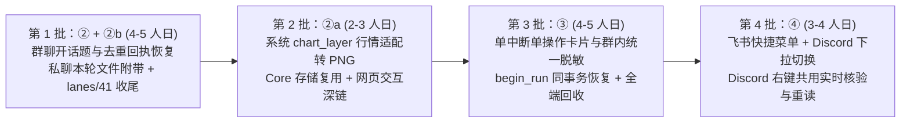

# 渠道第二阶段设计方案（飞书 / Discord / 个人微信，r4 收口版）

> **基线分支**：`docs/channel-phase2`（基于 `dalton/main` `305400a37`）  
> **前置分支**：`fix/channel-sandbox-links`（`lanes/41`，工作区沙箱路径改写登录深链）、`feat/external-member-perms-final`（外部成员服务端权限守卫）  
> **关联文档**：`docs/dalton/features/standalone-core.md`、`docs/dalton/features/external-member-permissions.md`（前置分支 `feat/external-member-perms-final` 新增）、`docs/dalton/features/weixin-multi-account.md`、`docs/dalton/features/cos-delivery-confirmation.md`  
> **文档状态**：r4 收口版（已按三轮独立设计审查与范围收窄决议收口，第七章方案待用户最终确认）

---

## 目录

- [一、背景、范围与架构准则](#一背景范围与架构准则)
  - [1.1 现状与演进顺序](#11-现状与演进顺序)
  - [1.2 范围边界](#12-范围边界)
  - [1.3 双形态部署、能力门控与上游钩子规范](#13-双形态部署能力门控与上游钩子规范)
  - [1.4 后续演进事项（本阶段范围之外）](#14-后续演进事项本阶段范围之外)
- [二、各项功能在三渠道的实现方案与接口契约](#二各项功能在三渠道的实现方案与接口契约)
  - [2.1 三渠道承载与降级总览](#21-三渠道承载与降级总览)
  - [2.2 功能 ②：群聊 `@机器人` 自动开话题与话题内免 `@` 继续对话](#22-功能-群聊-机器人-自动开话题与话题内免--继续对话)
  - [2.3 功能 ②a：系统看盘图表图层转图片并附网页交互版链接](#23-功能-a系统看盘图表图层转图片并附网页交互版链接)
  - [2.4 功能 ②b：私聊回答生成文件自动附带与 `lanes/41` 链接收尾事项](#24-功能-b私聊回答生成文件自动附带与-lanes41-链接收尾事项)
  - [2.5 功能 ③：可交互卡片与单中断单操作原生按钮总览](#25-功能-可交互卡片与单中断单操作原生按钮总览)
  - [2.6 功能 ④：机器人快捷菜单与 Discord 右键「转入 `<品牌名>` 研判」](#26-功能-机器人快捷菜单与-discord-右键转入-品牌名-研判)
- [三、确认卡片风险分级、身份核验与回调接入（功能 ③ 详设）](#三确认卡片风险分级身份核验与回调接入功能--详设)
  - [3.1 单中断单操作允许清单与风险四级分类表（L0–L3）](#31-单中断单操作允许清单与风险四级分类表l0l3)
  - [3.2 卡片身份核验、门禁登记与私密详情卡短期令牌协议](#32-卡片身份核验门禁登记与私密详情卡短期令牌协议)
  - [3.3 三端提交统一竞争、同事务准入确认与幂等恢复协议](#33-三端提交统一竞争同事务准入确认与幂等恢复协议)
  - [3.4 飞书 `card.action.trigger` 与 Discord 组件/弹窗回调接入](#34-飞书-cardactiontrigger-与-discord-组件弹窗回调接入)
- [四、安全、权限与文件过滤规则](#四安全权限与文件过滤规则)
  - [4.1 系统图表外发、私聊文件附带与群卡片可见字段规则](#41-系统图表外发私聊文件附带与群卡片可见字段规则)
  - [4.2 外部成员发起交互时的权限范围](#42-外部成员发起交互时的权限范围)
  - [4.3 私聊自动附带文件的双路径白名单与配额过滤规则](#43-私聊自动附带文件的双路径白名单与配额过滤规则)
- [五、数据库变更设计（Dalton 迁移链）](#五数据库变更设计dalton-迁移链)
  - [5.1 群聊机器人话题登记表与飞书回复去重字段（第 1 批新增）](#51-群聊机器人话题登记表与飞书回复去重字段第-1-批新增)
  - [5.2 渠道交互令牌表与中断恢复竞争表（第 3 批新增）](#52-渠道交互令牌表与中断恢复竞争表第-3-批新增)
  - [5.3 Discord 右键研判草稿与可重试派发表 `dalton_channel_context_menu_drafts`（第 4 批新增）](#53-discord-右键研判草稿与可重试派发表-dalton_channel_context_menu_drafts第-4-批新增)
  - [5.4 存量表边界、迁移链顺接与滚动升级回退方案](#54-存量表边界迁移链顺接与滚动升级回退方案)
- [六、分批实施计划、测试与上线验收](#六分批实施计划测试与上线验收)
  - [6.1 批次划分总表](#61-批次划分总表)
  - [6.2 各批实施细节、测试用例与验收标准](#62-各批实施细节测试用例与验收标准)
- [七、已定方案（待用户最终确认）](#七已定方案待用户最终确认)

---

## 一、背景、范围与架构准则

### 1.1 现状与演进顺序

渠道网关（`integrations/dalton-channel-gateway/`，基于 TypeScript〔带静态类型的 JavaScript 超集语言〕独立进程运行，默认监听本机回环地址 `127.0.0.1:8962`，通过部署级单行租约 `dalton_channel_gateway_lease` 保持单活）负责衔接智能体对话后端与飞书、Discord、个人微信三个聊天端。目前已上线处理中表情与输入状态反馈（#499，`src/processing-feedback.ts`）以及个人微信多账号管理（#506/#507，`d049_weixin_multi_account.py`），前置分支 `fix/channel-sandbox-links`（`lanes/41`）完成了回复正文内工作区沙箱路径向网页登录深链的基础改写，前置分支 `feat/external-member-perms-final` 完成了外部成员在网页端的服务端访问守卫。

本设计聚焦收窄后的渠道第二阶段五项交付内容：

1. **② 群聊自动开话题与发起人免 `@` 追问**：在飞书群与 Discord 频道顶层 `@机器人` 提问时自动开启独立话题或 Thread（子区，Discord 频道内的独立讨论串），话题发起人在该话题内直接发送消息即可连续对话。
2. **②a 系统看盘图表图层转图片附网页交互链接**：将系统内置渲染页承载的看盘图表图层（`chart_layer`，页面仅消费后端行情数据与强校验图层结构化数据）渲染为高清 PNG（便携式网络图形无损图片格式），在群聊与私聊中随回答发出并附上网页交互版登录深链；自定义交互组件（`ShowWidget` / `html_widget`）统一输出网页交互版登录深链。
3. **②b 私聊回答生成文件自动附带与链接收尾**：在发起人与机器人的私聊会话中，自动附带本轮工具写入本人自有工作区且通过类型白名单与排除规则的可交付文件；群聊与频道会话以及 `.html`（HTML，HyperText Markup Language，超文本标记语言）网页报告统一输出网页登录深链；同时完成 `lanes/41` 留待本批处理的引用式链接展开、自动化报告与数据任务通知携带会话与工作区编号生成深链、自动化完成摘要改写并保留工作区文件链接三项改造。
4. **③ 可交互卡片与单中断单操作原生按钮**：将澄清提问卡片升级为原生单选按钮、下拉框或弹窗输入；对命中「单中断、单操作」明确允许清单的 L1 / L2 确认操作提供渠道原生按钮（群内 L1 与 L2 卡片统一仅展示动作名称与网页 / 私聊或私密卡确认入口，完整参数放入飞书发起人私聊卡或 Discord 私密详情卡）；通过 `begin_run(in_start=...)` 同事务提交准入状态与恢复运行，并由统一 UUIDv5（基于命名空间与名称哈希的第五版通用唯一识别码）请求键与后端未准入回收任务协调按钮点击、文字回复与网页提交；其余操作及额度暂停（`credit_pause`）沿用网页端与现有文字入口。
5. **④ 机器人快捷菜单与 Discord 消息右键研判**：提供飞书单聊输入框快捷菜单、Discord `/workspace` 下拉切换菜单与消息右键命令「转入 `<品牌名>` 研判」（首次派发与重启恢复共用实时权限检查与原消息实时重读）。

### 1.2 范围边界

为保持群聊阅读秩序、个人微信连接稳定性与团队数据隔离，第二阶段执行以下明确边界：

- **群聊采用整卡定稿投递与深链交付**：群聊过程态统一展示轻量表情回应（飞书 `Typing`〔正在输入状态表情〕、Discord `⏳`），待本轮回答生成完毕后一次性发出排版完整的卡片与系统图表快照；工作区生成文档与表格在群聊中统一输出需登录鉴权的网页深链。
- **个人微信采用单轮整条回复**：基于腾讯 iLink（腾讯面向个人智能体开放的微信连接协议）长轮询单聊通道，配合 `sendtyping`（正在输入状态信令）向发起人本人私聊发送完整结论、系统图表图片与本轮写入的精选附件。
- **后台任务统一在系统内管理**：研究进度、定时唤醒（`schedule_wakeup`）与自动化状态统一以 Dalton PostgreSQL（开源关系型数据库）记录为准。
- **按用户显式交互读取消息**：仅处理用户 `@机器人`、话题发起人在机器人已登记话题（携带实际话题标识）内跟帖、显式合并转发或右键选中的单条消息；网关在入站解析阶段直接略过其余普通群聊消息。

### 1.3 双形态部署、能力门控与上游钩子规范

全部实现严格遵循 `docs/dalton/features/standalone-core.md` 的双部署形态规范：

1. **统一形态解析与能力开关门控**：
   - 部署形态判断统一调用 `src.dalton.profile`（`resolve_profile()` 与 `DeploymentProfile.EVERFLOW` / `DeploymentProfile.CORE`）；能力启停判断统一调用 `src.dalton.capabilities`（`has_capability()`、`require_capability()`、`require_channel_platform_capability()`），前端统一调用 `web/src/hooks/useCapabilities.ts` 的 `useCapabilities()` 与 `web/src/config/brand.ts`。
   - 各子链路按最小所需能力精确门控：
     - 后端新增的 `channels_router.py` 内部端点全部登记入 `src/dalton/capabilities.py` 的 `DALTON_ROUTE_CAPABILITY_REGISTRY`：通用渠道端点绑定 `CapabilityId.CHANNEL_GATEWAY`，Discord 右键菜单草稿端点绑定 `(CapabilityId.CHANNEL_GATEWAY, CapabilityId.CHANNEL_DISCORD)`，并通过 `test_core_capabilities_gate.py` 门禁测试；
     - 运行期私聊 `turn_deliverables` 工具写入记录汇总、`chart_layer` 系统图表快照渲染、`/messages/replay` 渠道元数据输出与浏览器会话 `hitl_response` 协同占位仅在 `has_capability(CapabilityId.CHANNEL_GATEWAY)` 为真时执行；
     - 数据任务通知关联监控面板深链（读取 `src/dalton/monitors/data_job_registry.py`）仅在 `CapabilityId.CHANNEL_GATEWAY` 与 `CapabilityId.DATA_JOBS` 同时启用时加载并输出。
   - 在核心安装形态（`DALTON_PROFILE=core` / `APP_ENV=core`）下渠道能力默认关闭；当部署者显式开启对应渠道能力并填入机器人凭据时，系统图表快照自动复用 Core 默认内置的 `DALTON_CHAT_UPLOAD_STORAGE_*` MinIO（兼容 S3 协议的开源对象存储服务）配置，本阶段全部能力开箱即用。
2. **网页地址与品牌名称全配置化**：
   - 后端统一通过 `src/dalton/settings.py` 的 `get_dalton_public_app_url()` 拼装深链；渠道网关在启动及健康对账中从后端内部状态接口同步公网地址，使网关 `src/config.ts` 的 `webBaseUrl` 与后端保持一致。
   - 当部署处于本机回环试用状态（公网地址为空，或主机名为 `localhost` / `127.0.0.1`）时，网关将链接展示为「请在网页端对应会话或工作区查看」文字指引。
   - 卡片标题、提示词与右键菜单文案统一通过 `src/dalton/settings.py` 的 `get_brand_name()`（读取环境变量 `BRAND_NAME`，`core` 形态默认 `Dalton`，`everflow` 形态默认 `Everflow`）动态生成。
3. **上游改动标记与路径登记**：
   - 触及上游共享源码文件（包括 `src/server/`、`src/ptc_agent/`、`src/tools/`、`libs/`、`web/` 下非 Dalton 专属文件）的每一处修改，均须附带 `# DALTON-HOOK(<topic>): <reason>` 或 `// DALTON-HOOK(<topic>): <reason>` 注释，并将新增钩子标识登记入 `scripts/dalton/check_hooks.sh`。
   - 新增 Dalton 专属文件若位于 `scripts/dalton/dalton_paths.txt` 既有前缀之外，须同步补登记路径，且**每一开发批次**均执行并通过 `bash scripts/dalton/check_hooks.sh --strict`。

### 1.4 后续演进事项（本阶段范围之外）

为确保本阶段四个批次边界清晰、安全闭环可靠，以下扩展项移入后续阶段建设，本阶段正文不再展开其机制设计：

1. **群聊与频道自动附带本轮生成文件（含跨工作区持久来源表、研究总监跨区标记与发送前哈希复核）**：
   - **移出原因**：群聊与频道消息面向群内全体成员（含未绑定平台账号成员）直接可见。在多回合协作场景下，研究总监（`chief_of_staff`）跨工作区读取、跨回合文件拷贝、命令行脚本派生新文件以及同一工作区并发回合写入同名文件，单靠应用层路径来源表与事后重读路径哈希难以形成完备的无竞态隔离闭环；本阶段群聊统一输出需登录鉴权的网页深链，自动附带文件仅面向发起人本人的私聊开放。
   - **后续开启前提**：① 在 PostgreSQL 运行记录中持久化研究总监与分析师统一的跨工作区资料触碰标志；② 在沙箱文件写入层捕获当次写入的不可变字节摘要并与文件级来源元数据原子落盘，同时覆盖工具写入与命令行脚本派生文件；③ 建立绑定实际接收群地址与不可变内容版本的群外发授权复核链路。
2. **自定义交互组件（`ShowWidget` / `html_widget`）转图片与 `.html` 报告转 PDF（Portable Document Format，便携式文档格式）附件**：
   - **移出原因**：`ShowWidget` 组件与 `.html` 报告均包含模型或脚本生成的自定义 HTML 与 JavaScript 代码。在常规应用容器内，仅凭 Chromium（开源浏览器内核）DNS（Domain Name System，域名系统）参数、禁用 Service Worker（浏览器后台服务工作线程）及 Playwright（浏览器自动化测试与渲染框架）上下文路由拦截，仍存在 WebRTC（网页实时通信协议）等独立于常规 HTTP（超文本传输协议）栈的底层外联通道；同时 HTML 页面脚本或内嵌框架可读取同工作区内其他文本与表格文件画入导出画面。本阶段二者统一输出网页交互或预览深链。
   - **后续开启前提**：① 部署具备操作系统级网络命名空间隔离（仅保留本机回环网卡、零外网与零宿主机内网路由）的独立无特权渲染沙箱服务；② 为 HTML 转 PDF 建立沙箱外置子资源供给机制，将本地可读子资源严格限定为样式表、字体与白名单静态位图，并在底层拦截弹窗创建与任意脚本越界读取。
3. **定时报告外发配置（`dalton_report_delivery`）的渠道按钮确认**：
   - **移出原因**：`src/dalton/tools/report_delivery_tools.py` 的 `action="set"` 当前通过模型参数流转，尚未接入服务端中断确认。
   - **后续开启前提**：完成 `docs/dalton/features/cos-delivery-confirmation.md` 的服务端 `hitl_confirm("dalton_report_delivery_set", ...)` 与多目标 `confirm_token` 改造。
4. **CLI（Command-Line Interface，命令行工具）跨电脑审批的渠道按钮接入**：
   - **移出原因**：`src/server/dependencies/cli_approval.py` 与 `src/server/services/cli_approvals.py` 基于 Redis（内存键值数据库）待批记录与专用接口 `POST /api/v1/cli/approvals/{approval_id}/decision`（`src/server/app/cli_approvals.py:55`）独立运作，与 LangGraph 检查点 `hitl_response` 分属两条审批链路；本阶段继续在网页端审批。
   - **后续开启前提**：为 CLI 待批记录补充持久化渠道令牌映射、卡片脱敏门禁与幂等审批回调适配层。
5. **单次暂停含多中断或多操作槽位的复合渠道卡片**：
   - **移出原因**：同一暂停内包含多个中断或单个中断内包含多个 `action_requests`（以及批量 `order_decisions`）时，手机端单卡分步收集容易引发状态混淆；本阶段统一引导至网页端 `answerBoard.ts` 完整面板处理。
   - **后续开启前提**：设计渠道端多步骤表单状态机与分项草稿暂存机制。
6. **群话题全员免 `@` 开关与按核验结果细分的研报发布渠道审批**：
   - **移出原因**：保障群聊人际讨论秩序，并确保正式研报数字核验明细经浏览器完整审阅后再发布；本阶段固定执行「话题内仅发起人免 `@`」与「正式研报发布（`publish_approval`）固定网页端确认」。
   - **后续开启前提**：落地群级管理员可配置的免 `@` 触发策略开关，以及面向零疑问研报草稿的移动端精简核验摘要规范。

---

## 二、各项功能在三渠道的实现方案与接口契约

### 2.1 三渠道承载与降级总览

| 功能项 | 飞书（Feishu）实现与降级 | Discord 实现与降级 | 个人微信（Weixin iLink）实现与降级 |
| --- | --- | --- | --- |
| **② 群聊开话题与发起人免 `@` 追问** | 前置开启 `im:message.group_msg` 权限；群顶层 `@` 回复预落库去重 `uuid` 与发送时间戳，以 `reply_in_thread: true` 创建话题（`omt_xxx`），登记后清除负缓存；未知回执先只读查根消息与话题历史，50 分钟去重窗内才带原 `uuid` 重试，超期未确认保持未知态；原消息撤回（`230011`/`231003`/`230110`）回退普通群消息 | 频道顶层 `@` 分离会话键与父频道投递地址，首轮在父频道从原消息建公开子区，确认地址沿用 `discord:<guild>/<parent>:thread:<thread>`，按父频道核验权限；权限或活跃子区满额（`50013`/`160006`/`160007`）回退父频道引用回复，原消息已删除（`10008`）发无引用简短提示 | 面向单聊（`weixin:@me`），群消息记为 `weixin_group_unsupported` 归档略过；单聊直接连续收发 |
| **②a 系统看盘图表转图片** | 针对系统 `chart_layer` 生成 Schema 2.0（飞书第二代交互卡片规范）卡片，内嵌从 Dalton 对象存储拉取的高清 PNG（`tag: "img"`）+ 底部 `open_url` 按钮 `[打开网页交互版]`（超 10 MB〔兆字节〕自动使用 1x 缩放或转 WebP〔高压缩率网页图片格式〕）；`ShowWidget` 或存储/渲染器未就绪时发网页深链 | 针对系统 `chart_layer` 以 `multipart/form-data`（多部分表单上传格式）附带高清 PNG + `ActionRow`（操作组件行容器）`Link Button`（外链按钮）`[打开网页交互版]`（私聊与群聊均适用）；`ShowWidget` 或存储/渲染器未就绪时发网页深链 | 针对系统 `chart_layer` 在正文后追加加密上传的 `IMAGE` 图片消息，公网地址可达时附纯文本交互深链；`ShowWidget` 或存储/渲染器未就绪时发文字与深链 |
| **②b 私聊本轮文件附带与深链** | **发起人私聊**：限本轮工具写入本人自有工作区的确认文件（`turn_deliverables`），经双路径白名单校验后，≤10 MB 图片走 `im.image.create`，≤20 MB 文档/表格走 `im.file.create`；**群聊**、`.html` 报告及超限文件统一发网页登录深链 | **发起人私聊**：限本轮工具写入本人自有工作区的确认文件，≤20 MB 合规文件作为私聊附件发送（整轮 ≤50 MB，最多 5 个）；**群频道/子区**、`.html` 报告及超限文件统一发网页登录深链 | **发起人私聊**：限本轮工具写入本人自有工作区的合规文件（≤20 MB，单轮最多 3 个），经 AES-128-ECB（128 位高级加密标准电子密码本模式，`src/channels/weixin/cdn.ts`）加密上传 CDN（内容分发网络）作为 `IMAGE`/`FILE` 发送；其余发网页登录深链 |
| **③ 提问与单中断单操作按钮** | 所有交互卡常驻独立网页入口；L0 提问渲染按钮组或 `form` 表单；**私聊** L1/L2 发完整参数确认卡（L2 附二次确认框）；**群聊 L1 与 L2 一致**：群卡只显示动作名称与网页入口，完整参数与按钮发往发起人飞书私聊；`credit_pause` 保持文字/网页入口，L3 发网页入口 | 所有交互卡常驻独立网页入口；L0 渲染 `Button` / `StringSelect` + `Modal`；**私聊** L1/L2 发完整参数按钮卡；**群频道/子区 L1 与 L2 一致**：群卡只显示动作名称、网页入口与 `[查看详情并确认]` 门禁按钮，点击签发短期令牌返回 `flags: 64` Ephemeral（仅点击者可见临时消息）详情卡；凭证过期或 L3 给网页入口 | L0 输出数字编号列表供直接回复；`credit_pause` 沿用现有回复 `继续` / `/stop` 文字入口与网页入口；其余确认统一发送动作说明与网页端确认深链 |
| **④ 快捷菜单与右键研判** | 订阅 `application.bot.menu_v6` 响应单聊输入框上方 4 个固定菜单（返回研究总监、切换工作区卡片、新建对话、停止任务），保留 v7 `/` 命令 | 升级无参 `/workspace` 返回下拉切换菜单；注册消息右键命令（`type = 3`）「转入 `<品牌名>` 研判」，首次同步弹 `Modal`，首次派发与重启恢复共用实时权限检查与原消息实时重读，核验公开目的地可见范围与发帖权，无法核验即终止并提示重新操作 | 在 `/help` 与扫码成功欢迎语列出快捷指令，发送 `/workspace` 返回编号列表供回复切换 |

---

### 2.2 功能 ②：群聊 `@机器人` 自动开话题与话题内免 `@` 继续对话

#### （1）飞书实现、前置权限、入站精确过滤与去重期回执恢复

1. **平台权限前置条件（`im:message.group_msg`）**：
   - 飞书群内接收未显式 `@机器人` 的话题跟帖消息，依赖飞书开放平台应用开启群消息权限 **`im:message.group_msg`**（获取群组中所有消息）并发布应用版本审批生效，列为第 1 批上线前置条件。
   - 在权限生效前的过渡期内，群顶层 `@机器人` 自动创建话题以及在话题内继续通过 `@机器人` 追问均正常运作并归入同一话题会话。
2. **入站前置过滤与负缓存即时清除（持久化和下载附件前直接略过无关消息）**：
   - 开启 `im:message.group_msg` 后，飞书长连接（`src/channels/feishu/monitor.ts`）在调用 `getMessageFeishu`、`downloadMessageResourceFeishu` 或后端 `I-1`（`register-and-resolve`）之前执行两步内存快速筛选：
     - **按实际话题标识 `thread_id` 精确匹配免 `@` 跟帖**：飞书普通群中对某条消息执行主聊区普通引用回复（`reply_in_thread: false`）时，消息仅携带 `root_id` 而 `thread_id` 为空。因此，凡群消息未 `@机器人` 且 `message.thread_id` 为空，直接在内存中作为主聊区普通发言略过（零落库、零下载、零后端请求）；
     - 当群消息未 `@机器人` 且携带非空 `message.thread_id`（`omt_xxx`）时，先查网关内存 LRU（Least Recently Used，最近最少使用缓存，分别维护已登记机器人话题正缓存与短时效非机器人话题负缓存），缓存未命中时调用轻量只读接口 `/internal/topics/lookup`（**新增**，按 `(platform='feishu', chat_address, external_topic_id=message.thread_id)` 精确查询）。当命中已登记机器人话题且 `senderOpenId === initiatorPlatformUserId`（话题发起人本人，见第七章定案 1）时，将 `event.threadScopeKey` 归一为已登记的 `canonical_scope_key` 并置 `event.isGroupTrigger = true` 进入后续流程；其余情形直接在内存中略过。
   - **话题登记成功时清除负缓存**：当用户在已有普通话题内先做日常交流（此时该 `omt_xxx` 记入短时效负缓存），随后在该话题内首次 `@机器人` 提问并写入 `dalton_channel_bot_topics` 时，网关与 `I-1` / `I-7` 回执处理同步清除该 `(chat_address, external_topic_id)` 的负缓存条目并写入正缓存，使发起人紧接着发出的免 `@` 追问立即生效。
3. **普通群顶层 `@` 自动创建话题、去重窗口约束与只读回执核实恢复**：
   - 在普通群中，用户首次顶层 `@机器人` 发送消息 `om_root`（无 `thread_id`）时，飞书适配器 `src/channels/feishu/inbound-parse.ts` 与 `src/channels/feishu/targets.ts` 将初始 `threadScopeKey` 构造为 `chat:<chat_id>:topic:<om_root>`；在话题群或已有话题中 `@机器人`（自带 `message.thread_id = omt_xxx`），`threadScopeKey` 为 `chat:<chat_id>:thread:<omt_xxx>`。
   - **首次回复稳定 `uuid` 预落库与 1 小时去重期限规则**：首条建话题回复发出前，网关按 `delivery_key` 派生确定性飞书回复幂等键 `reply_uuid = UUIDv5(DALTON_FEISHU_REPLY_NAMESPACE, delivery_key)`，并通过 `I-7`（`deliveries/progress`）预先写入 `dalton_channel_deliveries.feishu_reply_uuid` 与首次发往飞书的时间戳 `feishu_reply_dispatched_at`（**新增可空列**，见 §5.1）。`src/channels/feishu/send.ts` 调用 `client.im.message.reply` 时传入 `reply_in_thread: true` 与 `uuid: reply_uuid`。
   - **未知结果时的只读回执核实与超期保护**：飞书开放平台对 `im.message.reply` 同一 `uuid` 的服务端去重承诺窗口为 **1 小时**。当首条回复请求遇到超时、连接中断、响应缺失 `message_id`（`send.ts:482`）或网关在保存话题回执前退出重启时，恢复流程按以下顺序处理：
     1) **优先只读核实平台回执**：先调用 `getMessageFeishu(om_root)`（`im.message.get`，`send.ts:731`）读取根消息最新详情；若根消息已携带非空 `thread_id`（`omt_xxx`），再调用飞书 `im.message.list`（`container_id_type = "thread"`, `container_id = omt_xxx`）检索该话题内由当前机器人账号发出的回复消息。一旦定位到机器人首条回复，直接提取其 `message_id` 与 `omt_xxx` 补写 `dalton_channel_bot_topics`，无需重发消息；
     2) **去重有效期内带原 `uuid` 重试**：当只读核实确认话题尚未生成或话题内尚无机器人回复，且当前时间距 `feishu_reply_dispatched_at` **在 `50 分钟` 以内**（预留 10 分钟时钟与网络余量，严格处于飞书 1 小时 `uuid` 去重窗口内）时，携带同一 `uuid: reply_uuid` 重试 `im.message.reply`；拿到 `first_reply_message_id` 后调用 `getMessageFeishu(first_reply_message_id)` 读取 `omt_xxx`；
     3) **超期未确认保持未知保护态**：若距 `feishu_reply_dispatched_at` **已超过 `50 分钟`** 且只读核实无法确认回复是否已送达（例如消息查询受限或返回异常），投递记录保持结果未知状态（`outcome: "unknown"`）并停止自动重发 `im.message.reply`，避免跨过飞书 1 小时去重期后重复建帖。
   - **话题回执持久化与同轮多片/图表复用**：确认 `first_reply_message_id` 与 `external_topic_id = omt_xxx` 后，网关通过 `I-7` 将 `bot_topic_registration` 同事务写入新增表 **`dalton_channel_bot_topics`**，立即清除该 `omt_xxx` 负缓存，并保持 `dalton_channel_deliveries.confirmed_thread_address` 专供 Discord 使用。同轮后续文本分片与系统图表卡片（②a）均通过 `dalton_channel_bot_topics` 以 `reply_in_thread: true` 投递至同一话题。
   - 话题发起人在已登记话题内直接发送 `/new`、`/stop`、`/workspace`、`/main` 斜杠指令同样免 `@` 生效。
4. **原消息撤回与建话题受限回退**：
   - 调整 `src/channels/feishu/send.ts:531` 的 `sendReplyOrFallbackDirect`：当首轮建话题请求在去重窗内收到确定性撤回或限制错误（飞书错误码 `230011`、`231003`、`230110` 或群设置限制创建话题）时，自动回退调用 `im.message.create`（携带确定性去重 `uuid`）在群内发送回答，保持 `dalton_channel_bot_topics` 仅记录已成功创建的话题。

#### （2）Discord 实现、子区地址规范与父频道权限核验

1. **会话键与已确认子区地址严格对齐 `I-7` 现有格式**：
   - 在已登记的服务器文字频道（`GuildText = 0`）或公告频道（`GuildAnnouncement = 5`）收到顶层 `<@botId>` 消息时，Discord 适配器 `src/channels/discord/inbound.ts` 将逻辑会话键 `threadScopeKey` 构造为 `chat:<guildId>/<channelId>:topic:<messageId>`（采用 `:topic:` 前缀标识顶层新开会话），同时保持初始出站 `targetAddress` 为父频道地址 `discord:<guildId>/<channelId>`，并标记 `inboundInExistingThread: false`。
   - 改造 `src/channels/discord/send.ts` 的 `sendMessageDiscord`：当 `params.newThread === true` 且 `confirmedThreadAddress` 为空时，对父频道 `parsed.channelId` 调用 `src/channels/discord/threading.ts` 的 `createThreadDiscord`（子区名称取清洗后的用户问题首行，按 UTF-16〔16 位统一码字符编码〕安全截断至 `100` 字符以内，自动归档时长 `60` 分钟）。
   - `createThreadDiscord` 确认子区创建成功后，沿用现有 `src/dalton/database/channel_gateway.py:7926, 8018`（`_DISCORD_CONFIRMED_THREAD`）格式，通过 `onConfirmedThread` 写入 **`dalton_channel_deliveries.confirmed_thread_address = "discord:<guildId>/<parentChannelId>:thread:<threadId>"`** 及 `discord_body_phase`，同步通过 `I-7` 将 `(platform='discord', chat_address='discord:<guildId>/<parentChannelId>', external_topic_id=thread.id, root_message_id=messageId, canonical_scope_key)` 写入 `dalton_channel_bot_topics` 并清除该子区负缓存；落库确认后再向新子区发送首条消息与系统图表图片。
   - **子区投递权限统一按父频道登记与用户渠道设置核验**：服务端在核验 Discord 子区投递或后续交互权限（含 `I-6`、系统图表快照读取及确认卡片门禁校验）时，凡遇到匹配 `_DISCORD_CONFIRMED_THREAD`（`discord:<guild>/<parent>:thread:<thread>`）的子区地址，统一提取其父频道地址 `discord:<guild>/<parent>` 传入 `src/dalton/database/channel_gateway.py:529` 的 `_verify_group_target_deliverable`，核验 `dalton_channel_chat_bindings` 父频道登记与发起人 `dalton_channel_user_settings.apps.discord.chats` 配置，同时以完整子区地址绑定当次实际投递目标；若建帖失败回退至父频道，则直接按父频道 `discord:<guild>/<parent>` 核验。
   - 论坛频道（`GuildForum = 15`）与媒体频道（`GuildMedia = 16`）内的帖子本身为子区（`type = 11`，`inboundInExistingThread: true`），直接在该子区内回复并以父频道地址作为 `chat_address` 登记 `dalton_channel_bot_topics`（清除负缓存）。
2. **子区内发起人免 `@` 继续对话**：
   - Discord 适配器 `src/channels/discord/index.ts` 收到子区消息（`type = 10 / 11 / 12`）且未包含 `<@botId>` 时，解析父频道地址 `discord:<guildId>/<parentChannelId>` 后先查内存话题缓存，未命中则调用 `/internal/topics/lookup` 按 `(platform='discord', chat_address='discord:<guildId>/<parentChannelId>', external_topic_id=channel.id)` 查询 `dalton_channel_bot_topics`；当确认为已登记机器人子区且发送者为子区发起人（`author.id === initiatorPlatformUserId`）时，将 `threadScopeKey` 归一为表内 `canonical_scope_key` 并置 `isGroupTrigger = true`；回复前若子区已自动归档，`ensureThreadUnarchived` 自动解封。其余子区的未 `@` 消息在入站前直接略过。
3. **建帖失败分类回退与未知结果复用**：
   - **确定性建帖拒绝回退**：复用 `src/channels/discord/threading.ts` 的 `isDefiniteThreadPostFailure`（HTTP 4xx 确定性错误）：
     - 当缺少 `CREATE_PUBLIC_THREADS` 权限（`403` / Discord 错误码 `50013`）或活跃子区数量达到上限（`400` / Discord 错误码 `160006` 或 `160007`）且原消息仍在时，自动回退在已授权父频道携带 `message_reference: { message_id: replyToMessageId }` 引用回复；
     - 当原触发消息已被删除（`404` / Discord 错误码 `10008`）时，省略 `message_reference`，在已授权父频道发送一条简短完成提示（附网页会话登录深链），正常结案。
   - **超时与 5xx 结果未知保护**：当建帖请求遇到网络超时、连接中断或 HTTP 5xx 时，沿用 `threading.ts` 现有的 `adoptUnconfirmedThread(() => findThreadStartedFromMessage(...))` 查找复用与 `outcome: "unknown"` 持久化重试机制，确保同一回复在唯一目标位置发出。

#### （3）接口契约与群会话代数失效同步

- **扩展 `POST /api/v1/dalton/channels/internal/inbound/register-and-resolve`（`I-1`，已有端点新增可选字段）**：
  - 请求体新增可选字段：`external_topic_id?: string | null`、`root_message_id?: string | null`。
  - 当 `external_topic_id` 非空且 `(platform, chat_address, external_topic_id)` 命中 `dalton_channel_bot_topics` 时，后端在事务内将 `scope_key` 归一为表内 `canonical_scope_key` 并刷新 `last_active_at`；当用户在已有话题内首次显式 `@机器人` 触发时，同事务登记话题并返回 `topic_newly_registered: boolean` 供网关即时清除负缓存；响应新增返回 `resolved_scope_key: string` 与 `topic_initiator_platform_user_id: string | null`。
- **扩展 `POST /api/v1/dalton/channels/internal/deliveries/progress`（`I-7`，已有端点新增可选字段）**：
  - 请求体新增可选字段 `feishu_reply_uuid?: string | null`、`feishu_reply_dispatched_at?: string | null` 与 `bot_topic_registration?: { external_topic_id: string; root_message_id?: string | null; first_reply_message_id?: string | null; canonical_scope_key: string; initiator_platform_user_id: string }`：发往飞书前先持久化 `feishu_reply_uuid` 与 `feishu_reply_dispatched_at`；首条回复确认话题后同事务 `INSERT ... ON CONFLICT DO UPDATE` 写入 `dalton_channel_bot_topics`，网关收到成功响应后同步清除该话题负缓存。
- **新增 `POST /api/v1/dalton/channels/internal/topics/lookup`（新增端点，登记 `CapabilityId.CHANNEL_GATEWAY`）**：
  - 请求：`{ platform: "feishu" | "discord", chat_address: string, external_topic_id?: string | null, root_message_id?: string | null, match_mode: "inbound_followup" | "outbound_delivery" }`（入站免 `@` 跟帖固定使用 `inbound_followup` 并按非空 `external_topic_id` 匹配；出站分片或图表补发使用 `outbound_delivery`，支持按 `external_topic_id` 或 `root_message_id` 查询已建话题回执）；
  - 响应：`{ found: boolean, canonical_scope_key: string | null, external_topic_id: string | null, first_reply_message_id: string | null, initiator_platform_user_id: string | null, initiator_dalton_user_id: string | null }`。
- **群会话代数失效覆盖 `:topic:` 作用域**：
  - 同步更新 `src/dalton/database/channel_gateway.py:4086-4122` 的 `_advance_group_chat_generations_in_tx` 及群解绑清理逻辑，将匹配条件扩展为 `scope_key = 'chat:' || %s OR scope_key LIKE 'chat:' || %s || ':thread:%%' OR scope_key LIKE 'chat:' || %s || ':topic:%%'`，使群绑定移除或重置时同步推进全部 `:thread:` 与 `:topic:` 话题会话代数并清理挂起中断。

---

### 2.3 功能 ②a：系统看盘图表图层转图片并附网页交互版链接

本阶段聚焦渲染**系统内置看盘图表图层（`chart_layer`）**：渲染页 `libs/chartkit/chartkit/render/chart-render.html`（由 `cd web && pnpm build:chart-render` 构建产物提供，见 `libs/chartkit/chartkit/_renderer.py:32-33`）仅接收后端行情 K 线序列与经 `chartkit.schema.parse_layer` 强类型校验的绘图结构数据（页面内仅运行系统自有绘图代码，无用户自定义脚本），生成的 PNG 快照存入 Dalton 对象存储，在**私聊与群聊**中均可发送高清图片并附网页交互版登录深链；自定义交互组件（`ShowWidget` / `html_widget`）在本阶段直接输出网页交互版登录深链（组件离线渲染移入 §1.4 后续事项）。

#### （1）系统看盘图表渲染、双形态存储与行情数据供给

1. **复用双形态对象存储配置（覆盖 Core 默认 MinIO 与 Everflow S3/R2）**：
   - 新增快照存储辅助模块 `src/dalton/channel_snapshot_storage.py`（**新增**），直接复用 `src/dalton/chat_upload_storage.py` 的双形态凭据解析与客户端池：优先读取 `DALTON_CHAT_UPLOAD_STORAGE_*`（`docker-compose.core.yml:213-216` 已为 `DALTON_PROFILE=core` 默认配置 `http://minio:9000` 与 `chat-uploads` 存储桶），未配置时自动回退读取 Everflow 生产已有的 `DALTON_ASR_STORAGE_*`（`src/dalton/transcription_storage.py`），并在服务启动时复用桶就绪探测。
   - 快照对象统一存放在键前缀 `channel-snapshots/{thread_id}/{sha256[:16]}/` 下，与 `chat-uploads/` 聊天附件前缀相互独立，支持多后端 worker 进程直接跨进程读写。
2. **看盘图表图层（`chart_layer`）双出口快照与服务端行情供给**：
   - 复用 `libs/chartkit/chartkit/_renderer.py` 的工作线程渲染器 `RENDERER` 与离线打包页面 `chart-render.html`（运行在虚拟源 `https://chart-snapshot.invalid`，`_renderer.py:224` 已内置 `service_workers="block"`；在 `_launch` `:364` 启动参数补加 `--host-resolver-rules="MAP * ~NOTFOUND"`，并将 `:229` 的路由注册提升至 `context.route("**/*", handle)`，仅响应本地 `RENDER_DIR` 静态资源与内存 `api()` 路由）。
   - **服务端行情供给与权限核验**：`SnapshotJob`（`libs/chartkit/chartkit/_renderer.py:82`）所需的 `ChartBars`（`_bars_source.py:61`）在后端服务侧传入专用的 `backend_market_bars_tool` 适配器（**新增**），内部直接调用后端现有的行情缓存服务 `src/server/services/cache/daily_cache_service.py`（`DailyCacheService`）与 `src/server/services/cache/intraday_cache_service.py`（`IntradayCacheService`），并以回合发起人的行情读取身份（对齐 `src/server/app/market_data.py:12` `DataReadUserId`）获取与前端看盘面板一致的 OHLCV（开盘价、最高价、最低价、收盘价与成交量）序列。
   - 同时接入两处图层落库出口（均标注 `DALTON-HOOK(channel-chart-snapshot)`，在 `has_capability(CapabilityId.CHANNEL_GATEWAY)` 为真、当前会话关联渠道或渠道投递自动化、且非受限分析师轮次 `is_run_outbound_blocked == False` 时触发）：
     1) **同步工具出口**：`src/tools/chart_annotation/layers.py` 的 `_publish`（`:159`）完成 `add_layers` 落库后；
     2) **后台命令结算出口**：`src/server/services/commands/settle.py`（`:230-241`）中脱离前台等待的后台命令通过 `cr_db.finalize` 持久化 `outbox_layers` 后。
   - 渲染出的 PNG（默认尺寸 `1200×720`）写入 `channel-snapshots/{thread_id}/{sha256[:16]}/chart_{layer_id}.png`，并将快照元数据 `{ snapshot_key, sha256, size_bytes, width, height, artifact_type: "chart_layer", chart_id, layer_id, title }` 持久化写入运行记录元数据 `chart_snapshots`（若当前轮次 `is_run_outbound_blocked == True`，则跳过快照外发，仅保留网页深链）。
3. **跨 worker 并发预算、内部快照读取鉴权与网页交互深链**：
   - 本地 `_RENDER_SEMAPHORE` 配合轻量槽位将部署级图表快照渲染总并发控制在上限以内（默认全局上限 `2`，单张超时 `25` 秒，单回合最多自动渲染前 `4` 张系统图表）；对象存储未配置、未安装 Chromium 或超时时，网关平稳发送文字结论与网页交互登录深链。
   - 在 `src/dalton/app/channels_router.py` 新增 `GET /api/v1/dalton/channels/internal/snapshots/{snapshot_key:path}`（**新增**，登记 `CapabilityId.CHANNEL_GATEWAY`，接收查询参数 `target_address`）：
     - 校验 `snapshot_key` 严格匹配正则 `^channel-snapshots/([0-9a-f]{8}-[0-9a-f]{4}-[0-9a-f]{4}-[0-9a-f]{4}-[0-9a-f]{12})/([0-9a-f]{16})/chart_[A-Za-z0-9_.-]+\.png$`（拦截路径穿越与编码绕过）；
     - 核验 `snapshot_key` 位于该 `thread_id` 对应运行的持久化 `chart_snapshots` 清单内、会话归属有效且该运行 `is_run_row_outbound_blocked`（`src/dalton/colleague_outbound_guard.py:418`）为 `False`；
     - 当 `target_address` 为群聊或频道地址时，调用 `_verify_group_target_deliverable` 核验目标群投递权限（Discord 子区地址 `discord:<guild>/<parent>:thread:<thread>` 提取父频道 `discord:<guild>/<parent>` 核验父频道绑定与用户渠道设置；公司级自动化按任务已授权群路由核验），校验通过并核对对象 `sha256` 一致后返回 PNG 字节流。
   - **网页交互深链定位**：
     - `chart_layer`：`${WEB_BASE_URL}/chat/t/${threadId}?chart=${encodeURIComponent(chartId)}&layer=${encodeURIComponent(layerId)}`（连同高清 PNG 一并发出）；
     - `html_widget`（`ShowWidget`）：本阶段直接输出网页深链 `${WEB_BASE_URL}/chat/t/${threadId}?widget=${encodeURIComponent(artifactId)}`（若已发布为对目标受众可见的监控看板则输出 `/monitors/${slug}`）；
     - 前端 `web/src/pages/ChatAgent/components/ChatView.tsx`（**新增参数解析**，标注 `// DALTON-HOOK(channel-deep-links)`）识别 `?chart=&layer=` 自动展开右侧看盘面板并定位到指定图层，识别 `?widget=` 自动滚动高亮对应组件卡片。

#### （2）网关收集与三渠道投递

- `src/orchestrator.ts` 在实时流（`consumeTurnSseStream`）、断线回放流（`deliverReplayFallback` / `consumeInFlightReplayRunStream`，读取 `/messages/replay` 返回的持久化 `chart_snapshots` 清单）及后台唤醒/命令回报流（`consumeBackgroundRunStream`）中按 `layer_id` 去重收集本轮系统图表快照（以及 `html_widget` 的网页深链信息）。
- 在回合结算时（覆盖私聊与群聊默认整轮回复，以及显式 `send_message` 后的图表补发）：
  - **飞书**：构造 Schema 2.0 卡片（`src/channels/feishu/format.ts`），调 `im.image.create` 上传 PNG（超过 `10 MB` 时自动使用 1x 尺寸或转 WebP 并复核体积），嵌入 `tag: "img"`（`preview: true`），底部放置 `open_url` 按钮 `[打开网页交互版]`；对 `ShowWidget` 附加 `[打开网页交互组件]` 外链按钮。
  - **Discord**：将 PNG 作为消息附件上传，并附加含 `Link Button`（`style = 5`，标签 `打开网页交互版`）的 `ActionRow`；对 `ShowWidget` 发送说明与 `[打开网页交互组件]` `Link Button`。
  - **个人微信**：正文发出后，将 PNG 经 iLink CDN 加密上传并以 `IMAGE` 消息发出；公网 `webBaseUrl` 可达时在正文中附上 `网页交互版：<链接>`。

---

### 2.4 功能 ②b：私聊回答生成文件自动附带与 `lanes/41` 链接收尾事项

#### （1）仅限发起人私聊的本轮写入产物自动附带

1. **自动附带范围限定于发起人与机器人的私聊（`chat_type == 'dm'`）**：
   - **发起人本人私聊（飞书私聊、Discord 私聊、个人微信私聊）**：接收人即为已验证绑定的会话发起人 `dalton_user_id` 本人。当本回合运行于发起人**本人自有工作区**（`workspace.user_id == dalton_user_id` 且 `is_run_outbound_blocked == False`）时，自动附带本轮工具写入记录中的合规可交付文件。
   - **群聊与频道会话（`chat_type == 'group'`）**：回复中涉及的工作区文件统一改写或附加为需登录鉴权的网页深链，由群成员点击后经服务端登录与工作区权限校验查看。
2. **以本轮工具写入记录为准持久化 `turn_deliverables`（新增）**：
   - 自动附带候选严格限定为本轮运行通过文件写入工具写入本人自有工作区的文件（排除工作区历史旧文件与同一工作区其他回合写入的文件）。
   - 在渠道私聊回合（`has_capability(CapabilityId.CHANNEL_GATEWAY)` 为真且工作区属主为发起人本人）执行以下记录流程（标注 `DALTON-HOOK(channel-deliverables)`）：
     - 在 `src/server/handlers/chat/ptc_run.py:1056` 构建图实例时，为本回合主工作区 `SandboxBackend` 注入按 `(thread_id, run_id, workspace_id)` 隔离的写入记录回调 `operation_callback`（衔接 `src/ptc_agent/agent/tools/file_ops.py:447, 524` 的 `Write`、`Edit` 成功回调）；
     - 每次本轮工具成功写入本工作区文件时，同步校验该路径通过 §4.3 双路径白名单（原始相对路径与沙箱解析符号链接后的 `realpath` 均落在当前工作区根目录之内，命中可交付文档/表格/演示文稿/图片扩展名且避开排除目录与排除后缀），将规范化相对路径记入本轮内存清单；
     - 回合结算写入 `event: run_end`（`src/server/services/runs/stream_writer.py` 与 `src/server/services/runs/sse_producer.py`）前，若 `is_run_outbound_blocked == False`，将该清单去重固化至运行记录元数据 `turn_deliverables: Array<{ workspace_id: string; path: string }>`。
     - 实时流终点事件 `event: run_end` 与断线回放接口 `GET /api/v1/threads/{thread_id}/messages/replay`（`src/server/app/threads/messaging.py:1376`）**读取同一份持久化 `turn_deliverables` 清单**。
3. **私聊附件筛选、下载读取与配额规则**：
   - 在私聊回合结算时，网关从本轮持久化 `turn_deliverables` 中按「最终回复正文（围栏代码块与行内代码之外）显式点名的文件优先 -> 其余本轮工具新写文件次之」排序选取候选文件（剔除本轮已由 `send_message(files=[...])` 显式发出的文件）：
     - 网关复用现有的 `backend-client.ts:2698` `downloadWorkspaceFile(userId, workspaceId, path)`（调用 `GET /api/v1/workspaces/{workspace_id}/files/download`，`src/server/app/workspace_files/crud.py:1074`）读取文件字节流；
     - 经 §4.3 双路径白名单、文件头魔数与体积配额检查（单文件 `≤ 20 MB`；飞书内联图片 `≤ 10 MB`，`10–20 MB` 图片走 `im.file.create` 文件消息；飞书/Discord 私聊单轮自动附带最多 `5` 个、个人微信单轮最多 `3` 个；整轮总附件 `≤ 50 MB`）后随私聊回复发出；
     - `.html` / `.htm` 网页报告、跨工作区引用（`__wsref__/<workspaceId>/<path>`）、同事共享工作区文件以及超出体积或数量配额的文件，统一在回复中展示需登录鉴权的网页预览深链：`📎 <文件名> — 请前往网页查看：<登录深链>`。
4. **渠道提示词同步说明**：
   - 更新网关 `src/types.ts` 的 `buildSurfaceRules`：清晰说明在个人私聊中，通过 `Write` / `Edit` 在本工作区写入并在回复正文中用工作区相对路径引用的合规文档、表格或图片会自动附带文件并附网页登录深链（由代码脚本生成的合规文件如需在私聊作为附件发出，可调用 `send_message(files=[...])` 指定相对路径）；在群聊与频道中，使用工作区相对路径引用文件会自动改写为网页登录深链供成员登录后查看。合入前执行提示词语言审查。

#### （2）纳入 `lanes/41` 推迟的三项链接收尾改造

1. **Markdown（轻量级纯文本标记语法）引用式链接展开与跨工作区目标保留**：
   - 在 `src/sandbox-links.ts`（前置分支 `lanes/41` 新增，跳过围栏代码块与行内代码）新增引用式链接解析器：提取正文中的链接定义行 `[ref]: destination "optional title"`（标签长度上限 `512` 字符）。
   - **完整复用 `lanes/41` 的路径分类、编码与降级规则**：当 `destination` 为跨工作区引用 `__wsref__/<targetWorkspaceId>/<path>` 时，保留目标工作区标识并改写为 `${WEB_BASE_URL}/chat/${targetWorkspaceId}?file=${encodedPath}`；当命中本回合工作区路径时改写为 `${WEB_BASE_URL}/chat/t/${threadId}?file=${encodedPath}`（无 `threadId` 但有 `workspaceId` 时生成 `/chat/${workspaceId}?file=${encodedPath}`）；将正文中引用的 `[文字][ref]`、`[ref][]` 原地展开为标准内联链接 `[文字](深链)`，兼容飞书富文本与微信文本过滤器。
2. **自动化报告与数据任务通知全链路透传会话/工作区编号及服务端卡片前置改写**：
   - **已保存报告卡片入库校验前改写**：`src/dalton/database/automation_reports.py:1121-1167` 的 `_validate_card` / `_scan_string` 在报告提交保存阶段即校验卡片字段并拦截相对路径与本地引用。因此在报告提交准备阶段（`lock_report_execution` `:1407` 已锁定取出 `automation_executions.conversation_thread_id` 与 `automations.workspace_id`），先调用后端 `rewrite_workspace_links_for_external` 将卡片正文与受支持链接字段中的合规工作区路径（含 `__wsref__` 与引用式链接）改写为 `https://...` 登录深链（公网地址为回环或未配置时转为纯文件名文本），再执行现有的 `_validate_card` 安全扫描（继续拦截原始 `file://`、`IMG:` 或宿主机敏感路径）。
   - **报告与通知授权响应全量透传已有 `thread_id` 与 `workspace_id`**：
     - 在 `src/dalton/database/automation_notifications.py` 的 `decide_automation_notification_plan`（`:406`）中关联查询 `automation_executions.conversation_thread_id` 与 `automations.workspace_id`，在返回计划顶层新增 `thread_id: string | null` 与 `workspace_id: string | null`；
     - 在 `src/dalton/database/automation_reports.py` 的 `authorize_saved_report_target`（`:2872`）及 `src/dalton/database/data_task_notifications.py` 的 `_authorized_target_from_report`（`:396`）与统一授权出口 `authorize_data_task_notification_plan`（`:1247`，`plan_payload` `:1335`）中同步透传 `thread_id: string | null` 与 `workspace_id: string | null`（自动化报告分支填入执行关联的 `conversation_thread_id` 与 `workspace_id`；独立宿主机脚本任务 `dalton_data_runs` 运行在会话与工作区之外，两字段返回 `null`）。网关 `src/automation-notifications.ts` 与 `src/data-task-notifications.ts` 将收到的 `threadId` 与 `workspaceId` 传入 `sandbox-links.ts` 统一完成文本与卡片段落深链改写。
   - **脚本数据任务监控看板链接**：在 `src/dalton/database/data_task_notifications.py` 中，当 `CapabilityId.CHANNEL_GATEWAY` 与 `CapabilityId.DATA_JOBS` 同时启用、任务已在 `src/dalton/monitors/data_job_registry.py` 绑定监控看板、公网地址已配置且通过 `src/dalton/monitors/permissions.py` 受众可见性校验时，在 `plan_payload` 中附带 `monitor_url`（新增字段）供卡片底部生成「查看监控面板」链接；宿主机本地路径统一展示为纯文件名文本。
3. **自动化完成摘要保留并改写工作区文件链接**：
   - 在 `src/dalton/notify/dispatch.py`（现行 `_strip_non_http_markdown_links` 位于 `:705`）新增 `rewrite_workspace_links_for_external(text, *, public_base, thread_id=None, workspace_id=None)`（**新增函数**）：在构造自动化完成通知摘要卡片与纯文本时，复用同一路径分类器将合规工作区文件链接（含引用式链接与 `__wsref__`）改写为对应登录深链；当 `public_base` 未配置或命中排除目录时转为纯文本标签。
   - 同步调整 `dispatch.py` 的 `_truncate_section_body`（`:845`）与 `_truncate_line_at_punct`（`:792`）：按链接的可见显示文字长度计入摘要字数预算，并通过 `truncate_preserving_markdown_links`（`:672`）保持截断位置落在完整链接边界之外。

---

### 2.5 功能 ③：可交互卡片与单中断单操作原生按钮总览

- **全卡片常驻独立网页入口**：飞书与 Discord 发出的每一张提问或确认卡片（L0–L3），在公网 `webBaseUrl` 已配置时均在初始发送时附带独立的网页会话跳转按钮（飞书 `open_url`、Discord `Link Button`），确保令牌过期、交互凭证超期或服务回退后用户始终可一键进入网页端处理。
- **提问卡片（`AskUserQuestion`，`src/ptc_agent/agent/middleware/ask_user.py`）**：
  - **飞书**：构造 Schema 2.0 卡片。单题单选且选项数 `≤ 5`、每项字数 `≤ 20` 时，渲染一组 `button`；多选（`allow_multiple: true`）或选项数 `> 5` 时，渲染 `form` 容器包裹 `select_static` / `multi_select_static` 下拉框 + 1 个可选补充说明 `input` + 提交按钮，旁配 `[跳过]` 与 `[前往网页端查看]`（受限分析师轮次 `is_run_outbound_blocked` 在群内仅发通用提示与网页查看入口）。
  - **Discord**：单题单选 `≤ 5` 项渲染 `ActionRow` `Button`；多选或 `6–25` 项渲染 `StringSelect`（设置 `min_values` / `max_values`）；附 `[填写其他回答]` 按钮（弹出 `Modal` 多行文本框）、`[跳过]` 与 `[前往网页端查看]`（受限分析师轮次在群内仅发通用提示与网页查看入口）。
  - **个人微信与全端文字兼容**：微信继续输出清晰的编号列表（`1. ... 2. ...`）；飞书与 Discord 在发出按钮卡片的同时，继续支持用户直接打字回复序号或自由文本作答，通过统一的 UUIDv5 `request_key` 与按钮点击在后端竞争同一待确认主键（§3.3）。
- **确认卡片（「单中断、单操作」允许清单，群内 L1 与 L2 统一只展示动作名称与确认入口）**：
  - 当当前暂停仅含 **1 个待处理中断**、该中断满足 `len(action_requests) == 1` 且 `action_requests[0].type` 命中 §3.1 明确允许清单时，按后端判定的 L1 或 L2 签发渠道原生按钮：
    - **私聊会话**：直接在当前私聊展示完整参数与确认按钮（飞书 L2 附加原生 `confirm` 二次确认框）；
    - **群聊与频道会话（L1、L2 规则一致）**：**群内卡片只显示本地化动作名称与网页 / 私聊确认入口**；目标地址、参数、任务名与工作区名统一只放进飞书发起人私聊确认卡或 Discord `flags: 64` 私密详情卡内。
  - 额度暂停（`credit_pause`）沿用现有的网页端恢复/停止入口及聊天文字回复 `继续` / `/stop` 入口；其余所有单操作与多中断/多操作复合暂停归入 L3，渲染动作名称与 `[前往网页端核对并确认]` 登录深链入口。

---

### 2.6 功能 ④：机器人快捷菜单与 Discord 右键「转入 `<品牌名>` 研判」

#### （1）机器人快捷菜单

1. **飞书机器人单聊自定义菜单**：
   - 在飞书开发者后台配置单聊输入框上方 4 个快捷菜单项（菜单键统一为 `dalton:menu:<action>`）：
     - `返回研究总监`（`dalton:menu:main`）：切回个人 `Home` 研究总监会话；
     - `切换工作区`（`dalton:menu:workspace`）：查询用户名下可访问工作区，返回带工作区下拉框与快捷按钮的 Schema 2.0 卡片，点击完成 `/workspace <id>` 切换；
     - `新建对话`（`dalton:menu:new`）：在当前工作区推进会话代数（`generation + 1`）开启新对话；
     - `停止当前任务`（`dalton:menu:stop`）：停止当前会话正在运行的回合。
   - 网关在 `src/channels/feishu/monitor.ts` 的 `eventDispatcher.register` 中订阅 `"application.bot.menu_v6"`（复用现有 `WSClient` 长连接），提取 `operator.operator_id.open_id` 与 `event_key`，通过 `I-3`（`internal/session/command`）执行并向单聊返回反馈。`src/native-commands/feishu-registrar.ts` 已有的 4 个飞书 v7 `/` 命令保持并存，并在同步命令输出中附带自定义菜单配置自检提示。
2. **Discord 斜杠菜单增强**：
   - 在现有 `/main`、`/workspace`（含实时自动补全）、`/new`、`/stop` 基础上，当用户无参数执行 `/workspace` 时，在 `flags: 64` Ephemeral 响应中附带 `StringSelect` 工作区下拉菜单（展示最近活跃的最多 25 个可写工作区），支持点选一键切换。
3. **个人微信快捷指引**：
   - 在扫码连接成功欢迎语与 `/help` 回复中列出 `/main`、`/workspace`、`/new`、`/stop`、`/unbind` 指令说明；发送无参 `/workspace` 时返回带序号的工作区列表，支持回复 `/workspace <序号或名称>` 切换。

#### （2）Discord 右键消息菜单「转入 `<品牌名>` 研判」

1. **命令声明、复合键幂等同步与定向撤销命令**：
   - 在 `src/native-commands/manifest.ts` 与 `src/native-commands/discord-registrar.ts` 新增一条消息上下文菜单命令（`ApplicationCommandType.Message = 3`，全局 `contexts: [0, 1]` 覆盖服务器频道与机器人私聊）。命令名称按 `get_brand_name()` 动态生成：默认 `转入 Dalton 研判`（Everflow 环境按配置生成 `转入 Everflow 研判` 或自定义 `转入 <BRAND_NAME> 研判`，按 UTF-16 安全截断至 32 字符以内）。
   - 扩展 `discord-registrar.ts` 的 `indexRemoteDiscordCommands`（`:484`）按 `(name, commandType)` 复合键索引，常规同步走定向 `POST` / `PATCH`；同时为 `dalton-native-commands` 新增显式撤销参数 `--revoke-context-menu`（**新增**），定向针对已登记的 `type = 3` Dalton 右键命令发起 `DELETE /applications/{app_id}/commands/{cmd_id}`，在停用或回退时精确下线右键菜单并完整保留其余 `CHAT_INPUT` 斜杠命令。
2. **首次同步弹 `MODAL`、首次派发与重启恢复共用实时权限检查及原消息重读**：
   - 建立「轻量目标登记 -> 弹窗提交原子核销 -> 首次与重启恢复共用实时权限检查与原消息重读」协议：
   - **第 1 步（独立解析与同步弹框前登记目标标识，零正文快照存储）**：
     - 在 `src/channels/discord/interactions.ts` 新增解析分支 `kind: "message_context_command"`；在 `src/channels/discord/index.ts` 的 `dispatchInteraction`（`:675` 通用延迟应答之前）设置专门分支，在 `2.0` 秒预算内调用后端新增接口 **`POST /api/v1/dalton/channels/internal/context-menu/prepare`**（登记 `(CapabilityId.CHANNEL_GATEWAY, CapabilityId.CHANNEL_DISCORD)`）。
     - 后端校验 `DALTON_CHANNEL_CONTEXT_MENU_ENABLED` 开关为真，核验点击者在 `dalton_channel_identities` 的绑定状态与成员等级（`src/dalton/access_tiers.py::get_user_tier`）：未绑定账号时同步返回 `flags: 64` 绑定引导；外部成员（`tier == "external"`）在服务器频道触发时同步返回 `flags: 64` 提示「外部成员请通过机器人私聊使用」。
     - 校验通过时，解析源频道所属父频道：仅当源频道为已通过 `_verify_group_target_deliverable` 授权的公开文字/公告频道（`GuildText = 0`、`GuildAnnouncement = 5`），或其下属公开/公告子区（`AnnouncementThread = 10`、`PublicThread = 11`，其父频道为已授权的 `0` 或 `5`；显式排除私有子区 `PrivateThread = 12` 及论坛/媒体频道）时置 `allow_public_thread = True`。生成 128 位随机 `draft_nonce`，仅将点击者身份、源服务器 `source_guild_id`、源频道 `source_channel_id` 与类型、父频道 `source_parent_channel_id` 及 `target_message_id` 写入 **`dalton_channel_context_menu_drafts`**（**新增**，`dispatch_status = 'draft'`，有效期 `15` 分钟，**表内只记录标识，待派发核验通过并成功重读原消息后才读取正文与附件**，见 §5.3）。
     - 网关在 3 秒窗口内直接同步返回 `MODAL`（`type = 9`，`custom_id = "dlt:ctx:<draft_nonce>"`），含可选多行输入框「补充研判问题（留空则核查事实并提炼要点）」；`allow_public_thread` 为真时展示投递位置选择项，**默认选中「发到我的机器人私聊」**，可选「在所属公开频道新建子区讨论」（其余频道固定发往本人私聊，见第七章定案 2）。
   - **第 2 步（弹窗提交同事务核销，首次派发与重启恢复共用实时权限检查与原消息重读）**：
     - 收到 `MODAL_SUBMIT`（`type = 5`）时，网关先同步返回 `DEFERRED_CHANNEL_MESSAGE_WITH_SOURCE`（`type = 5, flags = 64`）私密延迟占位响应，随即调用后端 **`POST /api/v1/dalton/channels/internal/context-menu/consume`**（**新增**）：
       - 后端在同一数据库事务内校验 `DALTON_CHANNEL_CONTEXT_MENU_ENABLED` 开启、`consumed_at IS NULL AND expires_at > NOW()`，重验点击者平台身份、当前 `dalton_channel_identities` 绑定与成员等级；若所选投递模式为公开建帖，解析实际目的地父频道地址 `discord:<source_guild_id>/<dest_parent_channel_id>`（顶层频道取 `source_channel_id`，公开子区取 `source_parent_channel_id`）并通过 `_verify_group_target_deliverable` 核验父频道绑定与点击者渠道设置；生成稳定幂等键 `request_key = UUIDv5(DALTON_CTX_MENU_NAMESPACE, draft_nonce_hash)`，同事务写入 `consumed_at = NOW()`、`dispatch_status = 'pending_dispatch'`、`submitted_payload`、`resolved_scope_key`、`resolved_workspace_id` 与 `target_delivery_address`。
     - **共用实时权限检查与原消息重读函数（`verifyAndFetchContextMenuSource`）**：无论是首次 `MODAL_SUBMIT` 派发，还是网关在 `consume` 后退出重启、由 `/internal/recover`（`mode=startup`）拉取未超期 `pending_dispatch` 草稿执行恢复派发（当后端尚无该 `request_key` 对应的已创建运行记录时），网关均执行**完全相同的实时 Discord REST 权限检查与原消息重读**：
       1) **源频道当前权限与私有子区成员资格实时核验**：
          - 服务器来源（`source_chat_type == 'group'`）：按草稿保存的 `source_guild_id`、`clicker_platform_user_id`、`source_channel_id` 实时调用 Discord REST 接口获取频道及父频道详情（`GET /channels/{source_channel_id}`，子区同步获取 `GET /channels/{parent_id}` 并核对 `guild_id === source_guild_id`）、服务器角色（`GET /guilds/{source_guild_id}/roles`）以及点击者与机器人的当前成员角色（`GET /guilds/{source_guild_id}/members/{user_id}`），结合频道/父频道 `permission_overwrites` 实时计算当前有效权限位，确认**点击者与机器人双方当前均具备源频道的 `VIEW_CHANNEL`（`1 << 10`）与 `READ_MESSAGE_HISTORY`（`1 << 16`）**；当源频道为私有子区（`PrivateThread = 12`）时，额外调用 `GET /channels/{source_channel_id}/thread-members/{clicker_user_id}` 确认点击者当前仍在该私有子区成员列表内（或具备父频道 `MANAGE_THREADS` `1 << 34`）；
          - 私聊来源（`source_chat_type == 'dm'`）：调用 `GET /channels/{source_channel_id}` 确认 `type === 1`（单聊）且接收人为 `clicker_platform_user_id` 本人。
       2) **公开投递实际目的地可见范围与发帖权限核验**：当投递模式为公开建帖时，解析实际目的地父频道 `dest_channel_id`（源为 `GuildText = 0` / `GuildAnnouncement = 5` 时取 `source_channel_id`；源为已有公开/公告子区 `10` / `11` 时取其实时 `parent_id`，并确认其类型为 `0` 或 `5` 且非私有子区 `12`），核对 `discord:<source_guild_id>/<dest_channel_id> === draft.target_delivery_address`（确保目的地与源消息处于同一公开频道可见边界），并确认**点击者与机器人双方在 `dest_channel_id` 上实时具备 `VIEW_CHANNEL`、`SEND_MESSAGES`（`1 << 11`）、`CREATE_PUBLIC_THREADS`（`1 << 35`）与 `SEND_MESSAGES_IN_THREADS`（`1 << 38`）**（从顶层消息触发时从原消息或独立子区建帖；从已有公开子区触发时调用 `threading.ts` 的 `createThreadDiscord` 在父频道 `dest_channel_id` 新建带恢复标记的独立公开子区）。
       3) **成功重读原消息后读取正文与附件**：上述权限核验全部通过后，实时调用 `GET /channels/{source_channel_id}/messages/{target_message_id}`；**仅在该请求成功返回原消息对象后，才提取其当前最新正文与有效附件地址**下载上传至 `resolved_workspace_id`，并以 `request_key` 调用 `I-1` 与 `POST /api/v1/threads/{thread_id}/messages` 启动回合。
       4) **无法核验时终止派发并提示重新操作**：若任一权限检查未通过（含机器人缺少 `READ_MESSAGE_HISTORY`、点击者失去频道权限或私有子区成员资格、公开目的地权限不足）或原消息无法读取（含消息已删除 `404`/`10008`、REST 校验失败），网关立即调用 **`POST /api/v1/dalton/channels/internal/context-menu/ack`**（传入 `status = 'terminal_failed'`）终止派发，并告知用户「无法核验原消息访问权限或原消息已移除，请重新操作」（首次提交更新 `@original` 私密响应；重启恢复时若交互凭证已过期则通过机器人私聊发送简短告知）。
     - **已创建运行的幂等收敛与结果回执**：当 `POST /api/v1/threads/{thread_id}/messages` 接纳运行（或网关在运行创建后、`ack` 前重启，重放收到 `409 duplicate_request` 且运行进行中或已完成）时，调用 `/internal/context-menu/ack`（`status = 'admitted'`）结案，并将点击者私密响应更新为含登录深链 `${WEB_BASE_URL}/chat/t/${thread_id}` 的确认提示（若 `duplicate_request` 显示该运行已失败或已取消，则标为 `terminal_failed` 并附上网页深链）；发往本人私聊遇到用户关闭服务器成员私信（Discord 错误码 `50007`）时，更新 `flags: 64` 私密响应附上网页会话深链。

---

## 三、确认卡片风险分级、身份核验与回调接入（功能 ③ 详设）

### 3.1 单中断单操作允许清单与风险四级分类表（L0–L3）

1. **后端权威分类与「单中断、单操作」准入规则**：
   - 改造网关 `src/orchestrator.ts` 的 `handleInterruptEvent`（`:7187-7261`）：当飞书或 Discord 会话收到中断事件时，网关将原始中断载荷提交至后端 `POST /api/v1/dalton/channels/internal/action-tokens/mint`（**新增**），由后端统一完成准入判定与风险定级。
   - **单中断、单操作准入条件**：当 `DALTON_CHANNEL_INTERACTIVE_ACTIONS_ENABLED` 开启、目标 `(thread_id, run_id)` 当前挂起的中断总数为 **`1`**、且该中断满足 `len(action_requests) == 1`（槽位索引固定为 `0`）并命中下表 L0 / L1 / L2 允许清单时，后端签发渠道交互令牌并返回对应级别；`credit_pause` 沿用现有网页与文字 `继续` / `/stop` 入口，其余单操作及多中断/多操作暂停统一返回 `L3`，渲染网页端确认深链交由前端 `web/src/pages/ChatAgent/session/interrupts/answerBoard.ts` 处理。
2. **群聊卡片统一脱敏准则（L1、L2、L3 一致）**：
   - 在飞书群/话题与 Discord 频道/子区（`origin_chat_type == 'group'`）中，**所有确认卡片（L1、L2、L3 规则完全一致）在群内只展示固定本地化动作名称与网页 / 私聊（或 Discord 私密卡）确认入口**；工作区名称、派发问题、任务名称、个人私信地址（如 `feishu:user:ou_...`、`discord:user:...`）、群目标地址及工具参数全部放入飞书发起人私聊确认卡、Discord `flags: 64` 私密详情卡或登录后的网页端。

3. **真实中断类型与风险四级分类表**：

| 风险级别 | 精确中断类型标识与后端代码位置 | 分级判定条件（签发与核销双端校验） | 飞书承载方式（均附独立网页入口） | Discord 承载方式（均附独立网页入口） | 个人微信承载方式 | 快捷按钮有效期（TTL） |
| --- | --- | --- | --- | --- | --- | --- |
| **L0 澄清提问** | `ask_user_question`（`src/ptc_agent/agent/middleware/ask_user.py:60`，工具 `AskUserQuestion`） | 单题澄清提问（`action_requests[0].type == "ask_user_question"`） | Schema 2.0 按钮组或 `form` 下拉/输入框 + `[跳过]` + `[前往网页端查看]`（兼容打字回复；受限分析师轮次群内仅发通用提示 + 网页入口） | `Button` / `StringSelect` + `[填写其他回答]` `Modal` + `[跳过]` + `[前往网页端查看]`（兼容打字回复；受限分析师轮次群内仅发通用提示 + 网页入口） | 数字编号文本列表，回复序号或文字作答 | **6 小时**（随会话代数有效） |
| **L1 低风险确认** | 1. `ptc_agent`（`src/tools/secretary/dispatch.py:366`，对应 `chief_of_staff.py` 工具 `delegate_to_analyst`）<br>2. `create_workspace`（`src/tools/secretary/tools.py:388`，对应 `manage_workspaces(action="create")`）<br>3. `dalton_notify_add_personal_target`（`src/dalton/tools/notify_tools.py:715`，工具 `dalton_notify_settings`）<br>4. `dalton_notify_test`（`src/dalton/tools/notify_tools.py:852`，工具 `dalton_notify_settings`） | 1. `ptc_agent`：目标 `workspace_id` 属于**调用者本人自有工作区**（`workspace.user_id == dalton_user_id`）；<br>2. `create_workspace`：单工作区创建；<br>3. `dalton_notify_add_personal_target`：目标地址属于**调用者本人已绑定私信集合**；<br>4. `dalton_notify_test`：解析出的 `targets` 全部属于**调用者本人已绑定私信集合** | **私聊**：发完整参数卡 + `[批准]`、`[拒绝]`、`[拒绝并附言]` + `[前往网页端查看]`；<br>**群聊/话题**：**群内只显示动作名称与 `[前往网页端核对并确认]` 外链（提示已发私聊确认卡）**；工作区名、问题、任务名、目标地址与按钮只放进发往发起人飞书私聊（`feishu:user:<open_id>`）的确认卡 | **私聊**：发完整参数卡 + `[批准]`、`[拒绝]`、`[拒绝并附言]` + `[前往网页端查看]`；<br>**群频道/子区**：**群内只显示动作名称、`[查看详情并确认]` 门禁按钮与 `[前往网页端核对并确认]` 外链**；工作区名、问题、任务名、目标地址与操作按钮只放进点击门禁签发短期令牌返回的 `flags: 64` 私密详情卡 | 发送中文动作提示 + 网页端确认深链 | **30 分钟** |
| **L2 中风险确认** | 1. `delete_thread`（`src/tools/secretary/tools.py:812`，对应 `manage_threads(action="delete")`）<br>2. `ptc_agent`（`delegate_to_analyst`）<br>3. `dalton_notify_set_route`（`src/dalton/tools/notify_tools.py:537`，工具 `dalton_notify_settings`）<br>4. `dalton_notify_add_personal_target` / `dalton_notify_test`（含群聊或他人目标时） | 1. `delete_thread`：单会话删除；<br>2. `ptc_agent`：目标工作区属于**同事共享可写工作区**（`cos_access == "rw"`）；<br>3. `dalton_notify_set_route`：设置任务推送路由；<br>4. `dalton_notify_add_personal_target` 或 `dalton_notify_test` 的目标包含**群聊/频道或他人目标** | **私聊**：发完整参数卡 + 带原生 `confirm` 二次确认弹窗的 `[批准]`、`[拒绝]`、`[拒绝并附言]`；<br>**群聊/话题**：**群内只显示动作名称与 `[前往网页端核对并确认]` 外链**；完整参数与带 `confirm` 二次确认弹窗的按钮只放进发起人飞书私聊卡（私聊送达受限时保留群内网页入口） | **私聊**：发完整参数卡 + `[确认执行]`、`[取消]`、`[拒绝并附言]`；<br>**群频道/子区**：**群内只显示动作名称、`[查看详情并确认]` 门禁按钮与 `[前往网页端核对并确认]` 外链**；完整参数与操作按钮只放进点击门禁签发短期令牌返回的 `flags: 64` 私密详情卡 | 发送中文动作名称提示 + 网页端确认深链 | **10 分钟** |
| **L3 固定网页端确认** | 1. `order_approval`（`src/ptc_agent/agent/middleware/order_governance.py:331` 全部下单/改单/撤单/期权行权）<br>2. `delete_workspace`（`src/tools/secretary/tools.py:641`）、电脑移除、删除定时任务<br>3. `publish_approval` / `publish_report`（`src/dalton/publish/service.py:2340`，见第七章定案 3）、公开分享与监控受众放开（`src/server/app/artifacts/records.py`、`src/dalton/monitors/`）<br>4. OAuth（开放授权协议）与外部连接器授权，以及全部多中断/多操作暂停 | 命中任一高风险类型、位于允许清单之外，或单次暂停含多中断/多 `action_requests` | **私聊**：动作摘要 + `[前往网页端核对并确认]` 外链；<br>**群聊/话题**：**只显示固定动作名称** + `[前往网页端核对并确认]` 外链 | **私聊**：动作摘要 + `Link Button` `[前往网页端核对并确认]`；<br>**群频道/子区**：**只显示固定动作名称** + `Link Button` `[前往网页端核对并确认]` | 发送中文动作名称提示 + 网页端确认深链 | 网页端登录会话内确认 |

- **三类专门中断规则说明**：
  - **`credit_pause`（`src/ptc_agent/agent/middleware/credit_gate.py:633, 704`）保持网页与文字入口**：`CreditGateMiddleware` 恢复时通过运行准入重查账户额度并忽略 `interrupt()` 返回值。`credit_pause` 维持现有三渠道文字回复 `继续`（可附补充说明）与 `/stop` 停止命令，以及提示附带的网页端继续与停止入口。
  - **`dalton_notify_settings` 三项动作全量托管 `confirm_token`**：`dalton_notify_set_route`（`notify_tools.py:559`）、`dalton_notify_add_personal_target`（`:731`）与 `dalton_notify_test`（`:876`）在工具恢复后均会重算并校验 `decisions[0].confirm_token`。后端在签发上述三项动作的 L1 / L2 令牌时，统一将中断载荷中的 `confirm_token` 存入表列 `server_confirm_token`，并在批准恢复时写入 `hitl_response[interrupt_id].decisions[0].confirm_token`（同时对齐 `web/src/pages/ChatAgent/session/interrupts/toolApprovalCard.ts:138` 填入 `order_decisions[action_type]`），完整通过工具侧二次重算校验。
  - **CLI 跨电脑审批与 `dalton_report_delivery`**：CLI 跨电脑审批继续通过网页端专用接口 `POST /api/v1/cli/approvals/{approval_id}/decision` 处理；定时报告外发配置 `dalton_report_delivery` 归入后续迭代（§1.4）。

---

### 3.2 卡片身份核验、门禁登记与私密详情卡短期令牌协议

1. **客户端按钮零业务载荷编码**：
   - 按钮回调标识仅携带 128 位随机 `approval_nonce`（Base64URL 编码，22 字符）与动作枚举，总长度控制在 40 字符以内（满足 Discord `custom_id` 100 字符上限）：
     - 确认动作：`dlt:apv:<approval_nonce>:<approve|reject|gate|reason>`
     - 提问动作：`dlt:ask:<approval_nonce>:<opt_idx|submit|skip|custom>`
2. **飞书群聊卡与私聊卡核验规则（投递地址与回调核验解耦）**：
   - `dalton_channel_action_tokens` 分别记录原会话来源（`origin_chat_type`、`origin_chat_address`、`origin_scope_key`、`session_generation`）与卡片承载信息（`card_chat_type`、`card_delivery_address`、`card_message_id`）。卡片发出后网关立即调用 `POST /api/v1/dalton/channels/internal/action-tokens/bind-card`（**新增**）写入平台返回的真实 `card_message_id`。
   - **飞书私聊卡核验（含单聊直接触发与群聊 L1 / L2 转私聊卡）**：飞书单聊入站地址在网关内部统一记为 `feishu:@me`（`src/channels/feishu/targets.ts:296-309`），而 `card.action.trigger` 长连接回调提供的是操作者 `operator.open_id`、卡片消息 ID `context.open_message_id` 与实际单聊会话 ID `context.open_chat_id`。因此，表列 `card_delivery_address = "feishu:user:<open_id>"` **专用于网关出站投递**，回调核验时（`card_chat_type == 'dm'`）直接以回调中的操作者 **`operator.open_id` 对齐 `row.initiator_platform_user_id`**、以 **`context.open_message_id` 对齐 `row.card_message_id`**。
   - **飞书群内 L0 提问卡核验（`card_chat_type == 'group'`）**：同时对齐 `operator.open_id == row.initiator_platform_user_id`、`context.open_message_id == row.card_message_id` 以及 `f"feishu:{context.open_chat_id}" == row.card_delivery_address`。
   - **飞书群内 L1 / L2 最小化内容与私聊送达受限回退**：群内提示卡只展示固定本地化动作名称（如「派发工作区分析师任务」「新建工作区」「添加个人通知目标」「发送测试通知」「设置任务推送路由」「删除会话」）与 `[前往网页端核对并确认]` 外链按钮；任务名、目标地址、工作区名、问题与参数只放入发往 `feishu:user:<open_id>` 的发起人私聊确认卡。若向发起人私聊发送卡片返回权限或送达错误，网关将私聊令牌置为 `superseded`，群内卡片上的网页确认入口继续供发起人点击完成确认。
3. **Discord 群内 L1 / L2 门禁登记（写 `gate_verified_at`）与私密详情卡独立短期令牌**：
   - **群内门禁卡（`token_role = 'gate'`，覆盖群内 L1 与 L2）**：群频道/子区内发出的门禁卡统一只显示固定本地化动作名称、`[查看详情并确认]`（`dlt:apv:<gate_nonce>:gate`）与 `[前往网页端核对并确认]` 外链按钮。
   - **点击 `:gate` 校验并签发私密详情卡短期令牌（`POST /api/v1/dalton/channels/internal/action-tokens/inspect-gate`，新增）**：
     - 后端核验 `DALTON_CHANNEL_INTERACTIVE_ACTIONS_ENABLED` 为真、`platform == 'discord'`、`row.token_role == 'gate'`、点击者 `clicker_platform_user_id == row.initiator_platform_user_id`、回调频道与消息 ID 匹配 `row.card_delivery_address` 及 `row.card_message_id`、当前 `dalton_channel_identities` 仍绑定同一 `dalton_user_id`、成员等级为 `admin` 或 `internal`、`origin_chat_address`（子区提取父频道 `discord:<guild>/<parent>`）通过 `_verify_group_target_deliverable` 校验、`expires_at > NOW()`、`consumed_at IS NULL` 且底层检查点中断仍挂起；
     - 校验通过后，在事务内**将门禁令牌行的 `gate_verified_at` 更新为 `NOW()`**（保持 `consumed_at IS NULL` 且保持回合处于暂停待确认态），同时**新签发一枚绑定该点击者、原会话（`origin_chat_address`、`origin_scope_key`、`session_generation`）与父门禁令牌（`parent_token_hash = gate_row.token_hash`）的短期私密卡令牌**（`token_role = 'ephemeral_confirm'`，TTL 取 `min(门禁等级 TTL, 门禁令牌剩余有效期, 14 分钟)`，在 Discord 交互凭证 15 分钟有效期内），连同 `prompt_summary`（含任务名、目标地址、工作区名与完整参数）一并返回；
     - 网关向点击者返回 `flags: 64` 私密详情卡（含决定按钮与 `[前往网页端核对并确认]`，按钮携带新签发的 `ephemeral_nonce`），通过交互响应回执或 `GET /webhooks/{app_id}/{interaction_token}/messages/@original` 拿到该私密消息的实际 `message.id`，立即调用 `/action-tokens/bind-card` 将其绑定至该短期令牌的 `card_message_id`。发起人可多次点击门禁按钮重新唤出最新短期私密卡，提交时统一竞争同一暂停主键。
   - **私密卡刷新与交互凭证过期处理**：点击私密详情卡上的决定按钮时，网关使用该次按钮点击自带的有效 `interaction_token` 更新私密卡状态，并通过机器人 REST 接口更新群内原门禁卡（移除 `[查看详情并确认]` 按钮，保留网页查看入口）；若交互凭证已超过 15 分钟有效期或网关重启导致历史私密消息无法刷新，网关提供并保留网页端登录入口。
4. **提交决定时的六步全量复核（`POST /api/v1/dalton/channels/internal/action-tokens/consume`，新增）**：
   - **第 1 步（校验接纳开关、平台可信身份与令牌角色/卡片归属）**：核对 `DALTON_CHANNEL_INTERACTIVE_ACTIONS_ENABLED` 为真，且 `row.token_role IN ('direct', 'ephemeral_confirm')`；飞书对齐 `operator.open_id` 与 `context.open_message_id == row.card_message_id`（群 L0 卡同时核对 `open_chat_id`）；Discord 对齐已验明 `application_id` 的 Gateway 事件用户 ID、回调频道匹配 `row.origin_chat_address`（或已登记子区）且回调 `interaction.message.id == row.card_message_id`（当 `token_role == 'ephemeral_confirm'` 时同时核验关联 `parent_token_hash` 行的 `gate_verified_at IS NOT NULL`）。
   - **第 2 步（重验发起人身份与当前账号绑定）**：核对 `clicker_platform_user_id == row.initiator_platform_user_id`，并在同事务内反查 `dalton_channel_identities` 确认该平台账号当前仍绑定于同一个 `row.dalton_user_id`。身份不一致时返回 `403 clicker_mismatch`，仅向点击者返回私密轻提示「此项操作由发起人本人确认」，原卡片维持待确认状态。
   - **第 3 步（重验原群权限与成员等级）**：当 `row.origin_chat_type == 'group'`（包括在飞书私聊点击群 L1/L2 卡或在 Discord 点击 `ephemeral_confirm` 私密卡）时，同事务重查 `src/dalton/access_tiers.py::get_user_tier(dalton_user_id)` 确认仍为 `admin` 或 `internal`，并按父频道通过 `_verify_group_target_deliverable` 确认原群绑定与用户渠道设置有效。
   - **第 4 步（校验过期时间与会话代数）**：以数据库时钟核对 `expires_at > NOW()`，并核对 `dalton_channel_session_generations` 中 `(platform, origin_scope_key, dalton_user_id)` 的当前 `generation == row.session_generation`。超期记录更新为 `consumed_via = 'expired'` 并返回 `410 token_expired`，网关将可更新的卡片切换为网页端登录入口。
   - **第 5 步（校验实时检查点分支、待确认参数摘要与动态归属）**：读取 `thread_id` 当前分支最新检查点（对齐 `src/server/handlers/checkpoint_handler.py::settle_resume_request`），确认当前分支尖端仍挂起 `(row.run_id, row.interrupt_id)`，重算挂起中断参数摘要校验 `live_args_sha256 == row.args_sha256`（L0 选项索引同时核对 `options_snapshot` 边界），并对 `ptc_agent` 重新核查目标工作区当前归属与共享写权限仍符合 `row.risk_tier`。
   - **第 6 步（竞争同一暂停主键并写入带租约期限的 `pending_dispatch`）**：在同一数据库事务内写入 `dalton_channel_interrupt_resumes`（§3.3，附可回收期限 `lease_expires_at`）抢占 `(thread_id, run_id, interrupt_id)` 决定权，将该中断下当前令牌标为 `consumed_via = 'channel'`、同中断其他未消费令牌标为 `consumed_via = 'superseded'`，**返回确定性 UUIDv5 `request_key` 与完整 `resume_payload`**。

---

### 3.3 三端提交统一竞争、同事务准入确认与幂等恢复协议

为确保恢复请求满足 `POST /api/v1/threads/{thread_id}/messages` 的 UUID 校验（`src/server/models/chat.py:28` `RequestKey`），并彻底闭合进程在任意时点被杀、请求键不一致、网页 429 重试以及运行失败后的终态收敛，后端以 **`(thread_id, run_id, interrupt_id)`** 为主键建立 **`dalton_channel_interrupt_resumes`**（**新增**，见 §5.2），执行以下统一协议：

1. **统一 UUIDv5 `request_key`：按钮、文字与重放全程共用同一把键**：
   - 定义固定常量命名空间 `DALTON_HITL_RESUME_NAMESPACE`，对每个待恢复中断按输入字符串 `f"{thread_id}:{run_id}:{interrupt_id}"` 生成确定性 **UUIDv5** 作为 `request_key`（数据库列类型为 `UUID NOT NULL`）。
   - **双入口返回同一 `request_key`**：按钮核销接口 `/internal/action-tokens/consume` 与文字回复抢占接口 **`POST /api/v1/dalton/channels/internal/interrupt-resumes/claim-text`**（**新增**，覆盖 L0 打字作答与 `credit_pause` 打字回复 `继续`）**均在响应中返回这把表内 UUIDv5 `request_key` 与持久化 `resume_payload`**。
   - **首次派发与重放固定单键**：网关 `src/orchestrator.ts`（改造原 `:2888`、`:2918`、`:2941` 与 `:4042`）在首次调用 `dispatchHitlResumeTurn` / `dispatchCreditPauseResumeWithSupplement` 以及启动或周期恢复重放时，**全程固定使用 `consume` 或 `claim-text` 返回的 `request_key`**（恢复流在遇到 `duplicate_request` 失败运行时直接按第 5 项转入 `terminal_failed`，保持单键到底，跳过 `:retry:` 派生与 `/retry` 分支）。
   - **`credit_pause` 补充说明随 `resume_payload` 持久化**：当用户在 `credit_pause` 回复 `继续` 并附带补充说明或附件时，`claim-text` 将 `{ hitl_response, credit_supplement: { text, content } }` 一并写入 `dalton_channel_interrupt_resumes.resume_payload`；首次派发与重启恢复均从 `resume_payload` 读取补充说明，在恢复运行启动后按原顺序发送补充 `steer` 并通过 `I-7 steer/reconcile` 对账。
2. **三端先行占位均携带可回收租约期限（`lease_expires_at`）**：
   - **渠道按钮提交**（`/internal/action-tokens/consume`）：以 `settled_via = 'channel_button'`、`resume_status = 'pending_dispatch'`、`lease_expires_at = NOW() + INTERVAL '5 minutes'` 抢占主键；
   - **渠道文字回复提交**（`/internal/interrupt-resumes/claim-text`）：校验接纳开关、当前检查点分支与会话代数后，以 `settled_via = 'channel_text'`、`resume_status = 'pending_dispatch'`、`lease_expires_at = NOW() + INTERVAL '5 minutes'` 抢占主键，同事务将关联未消费令牌标为 `consumed_via = 'text_reply'`；
   - **网页浏览器会话提交与网关重放直通**（在 `src/server/app/threads/messaging.py` 与 `src/server/handlers/chat/ptc_run.py` 标注 `DALTON-HOOK(channel-interrupt-settle)`，当 `has_capability(CapabilityId.CHANNEL_GATEWAY)` 为真且请求携带 `hitl_response` 时生效）：
     - **交互式浏览器会话占 `web` 行**：通过 `src/dalton/colleague_outbound_guard.py:76` 的 `is_interactive_owner_session` 识别浏览器会话，对每个 `interrupt_id` 以 **`settled_via = 'web'`、`resume_status = 'pending_dispatch'`、`lease_expires_at = NOW() + INTERVAL '90 seconds'`**（`request_key` 取浏览器请求的合法 UUID 或派生 UUIDv5）执行同表抢占，并暂标关联渠道令牌为 `consumed_via = 'web'`。若该中断已被抢占，若现有行已过期未准入则先触发同事务回收判定，否则返回 `409 already_settled_in_channel` 提示刷新会话；
     - **网关派发与重放直通**：当请求来自渠道网关服务令牌（`messaging.py:394` `_is_service_request(raw_request)` 为真）且 `request.request_key` 匹配 `dalton_channel_interrupt_resumes` 中该中断已登记的 `request_key` 时，刷新 `lease_expires_at` 后直接进入 `_settle_against_branch` 与 `ptc_run.py` 运行准入。
3. **「标记已接纳」与「创建恢复运行」在 `begin_run(in_start=...)` 同一事务提交**：
   - 在 `src/server/handlers/chat/ptc_run.py`（`:735-778`）传入 `src/server/services/runs/admission.py:467` **`begin_run(..., in_start=_on_start)`** 的 `_on_start(conn)` 回调中（运行于 `START` 创建 `conversation_responses` 恢复运行记录的同一个 PostgreSQL 事务连接内）：
     - 同事务将对应 `dalton_channel_interrupt_resumes` 行更新为 **`resume_status = 'admitted', admitted_run_id = run_id, lease_expires_at = NULL, updated_at = NOW()`**（当 `settled_via = 'web'` 且无关联待刷新渠道卡片时同步置 `channel_ack_at = NOW()`；渠道发起行保持 `channel_ack_at IS NULL`，供网关完成结果投递与卡片更新后调用 **`POST /api/v1/dalton/channels/internal/interrupt-resumes/ack`**〔**新增**〕写入 `channel_ack_at = NOW()`）；
     - 同事务清理 `dalton_channel_session_generations.pending_interrupt`。
   - **请求内准入失败即时释放（含网页 429 后重试）**：若在 `begin_run` 提交前遇到确定性或配额拒绝——包括账户额度仍不足或速率限制返回 `429`、检查点分支已变更返回 `409`、参数校验失败返回 `422`、权限变更返回 `403` 或客户端提前断开——请求内清理逻辑立即**删除本次 `pending_dispatch` 占位行，并将本次暂标的未过期 `dalton_channel_action_tokens`（`expires_at > NOW()`）恢复为未消费状态（`consumed_at = NULL, consumed_via = NULL`）**，使用户补充额度后在网页或渠道均可立即重试。
4. **后端恢复任务统一回收所有超时未准入行（含网页 `web` 行）与网关未 `ack` 续接**：
   - **后端未准入回收扫描**（挂入后端启动与周期恢复任务 `src/server/services/runs/recovery.py`，扫描**全部** `resume_status = 'pending_dispatch' AND lease_expires_at < NOW()` 的记录，**同时覆盖 `settled_via = 'web'`、`channel_button` 与 `channel_text`**）：
     - 按 `(thread_id, str(row.request_key))` 调用 `admission.py` 的 `run_named_by_key` 核查运行账本：
       1) **已有运行记录**：若该运行处于活跃或已完成/再次中断状态（`in_progress`、`completed`、`success`、`interrupted`），将该行补记为 `resume_status = 'admitted', admitted_run_id = existing_run_id, lease_expires_at = NULL`（渠道行保留 `channel_ack_at IS NULL` 供网关接上现有运行）；若该运行已处于失败或已取消状态（`error`、`failed`、`cancelled`），将该行记为 `resume_status = 'terminal_failed', lease_expires_at = NULL`；
       2) **无运行记录**（例如后端进程在提交 `pending_dispatch` 占位后、执行 `begin_run` 提交前被强制杀死，或渠道派发超期仍未创建运行）：在同一事务内**删除该 `pending_dispatch` 占位行，并将关联且未过期的 `dalton_channel_action_tokens`（`expires_at > NOW()`）恢复为未消费状态（`consumed_at = NULL, consumed_via = NULL`）**，彻底消除网页或渠道占位遗留导致的暂停锁死。
   - **网关扫描未完成渠道处理的记录（覆盖 `pending_dispatch` 与已 `admitted` 未 `ack`）**：
     - 网关启动恢复（`/internal/recover` `mode=startup`）与周期重试协程扫描 `settled_via IN ('channel_button', 'channel_text') AND channel_ack_at IS NULL` 的记录：
       - 当 `resume_status == 'pending_dispatch'` 时：以该行固定的 `request_key` 与 `resume_payload` 发送 `POST /api/v1/threads/{thread_id}/messages`（遇到后端瞬时容量繁忙 `503` / `writer_capacity` 时续期 `lease_expires_at` 并按指数退避重试）；
       - 当 `resume_status == 'admitted'`（例如后端 `begin_run(in_start=...)` 已同事务提交运行与 `admitted`，而网关在调用 `ack` 前退出重启；或重放收到 `409 duplicate_request` 且运行进行中/已完成）时：网关直接按 `admitted_run_id` 接上现有运行实时流或 `/messages/replay` 完成结果投递（含按序补发 `resume_payload.credit_supplement`），刷新飞书/Discord 卡片为终态，并调用 `/internal/interrupt-resumes/ack` 写入 `channel_ack_at = NOW()`。
5. **`terminal_failed` 进入条件与终态收敛动作**：
   - **进入 `terminal_failed` 的条件**：
     1) 首次派发或重放收到 `409 duplicate_request`，且返回的已有运行 `run_status` 为失败或已取消（`error`、`failed`、`cancelled`、`stale_recovery`）；
     2) 后端恢复扫描或网关续接 `admitted_run_id` 时发现该恢复运行在完成投递前已以失败/已取消终态结束且无法交付；
     3) 重放时底层检查点分支已推进（目标中断已不存在且无该 `request_key` 对应的运行记录），或重放重试次数达到上限（默认 `5` 次）。
   - **进入后的处理**：将 `resume_status` 更新为 `'terminal_failed'`，结束自动重试；渠道侧将关联的飞书/Discord 交互卡片移除操作按钮、改留 `[前往网页端查看]` 登录深链入口（文字恢复发送简短状态提示并附网页会话深链），随即写入 `channel_ack_at = NOW()` 结案。
6. **渠道停用期间网页恢复独立闭环**：
   - 当部署未启用 `CapabilityId.CHANNEL_GATEWAY` 时，网页恢复跳过渠道表逻辑；当 `CapabilityId.CHANNEL_GATEWAY` 开启而渠道网关停机维护时，网页提交通过 `begin_run(in_start=...)` 同事务完成 `admitted`（若进程异常退出亦由后端自身的未准入回收任务自动清理），全程在后端独立闭环。

---

### 3.4 飞书 `card.action.trigger` 与 Discord 组件/弹窗回调接入

#### （1）飞书 `card.action.trigger` 长连接接入

- **平台配置**：在飞书开发者后台「事件与回调 -> 回调配置」开启**使用长连接接收回调**并添加 `card.action.trigger`，直接复用现有出站 `WSClient` 长连接（应用版本变更由租户管理员审批发布生效）。发出的交互卡片统一声明 `config.update_multi: true`，使会话视图同步展示最新状态。
- **3 秒回调时限与两阶段卡片刷新**：
  - 在 `src/channels/feishu/monitor.ts` 的 `eventDispatcher.register` 中注册 `"card.action.trigger"` 处理器，提取 `event.operator.open_id` 与 `event.context.open_message_id`（群 L0 卡片附加提取 `event.context.open_chat_id`）。
  - 点击「拒绝并附言」按钮时，卡片内展开带原因 `input` 的 `form` 表单提交；点击确认/单选/表单提交时，处理器在 `2.2` 秒窗口内调用 `/action-tokens/consume`：核销写入 `pending_dispatch` 后先同步返回过渡态卡片 `{ toast: { type: "info", content: "已记录，正在恢复执行…" }, card: { type: "raw", data: resumingCard } }`（保留独立网页跳转按钮）；待后台 `dispatchHitlResumeTurn` 确认后端运行已准入完成结果衔接并调用 `/interrupt-resumes/ack` 后，调用 `PATCH /open-apis/im/v1/messages/:open_message_id` 将卡片更新为终态（若因 `429` 释放占位则恢复可点击按钮并弹出提示；若进入 `terminal_failed` 则改留网页查看入口）。

#### （2）Discord `MESSAGE_COMPONENT` 与 `MODAL_SUBMIT` 接入

- **连接与鉴权**：复用现有 Gateway WebSocket 的 `INTERACTION_CREATE` 事件与 `verifiedApplicationId` 核验。
- **解析与三类响应分流**：
  - 在 `src/channels/discord/interactions.ts` 扩展 `parseDiscordInteractionCreate`，在 `type = 2`（应用命令，含新增 `data.type = 3` 消息右键命令）与 `type = 4`（自动补全）之外，新增解析 `type = 3`（`MESSAGE_COMPONENT`）与 `type = 5`（`MODAL_SUBMIT`）。
  - 在 `src/channels/discord/interaction-response.ts` 补齐对应响应路径：
    1) **点击确认 / 单选 / 下拉提交**：先在 1.5 秒内返回 `DEFERRED_UPDATE_MESSAGE`（`type = 6`）或过渡态 `UPDATE_MESSAGE`（`type = 7`），完成 `/action-tokens/consume`、后端运行准入衔接与 `ack` 后编辑卡片为终态禁用态（私密详情卡使用当前有效 `interaction_token` 更新 `@original` 并通过机器人 REST 更新群内门禁卡；进入 `terminal_failed` 或交互凭证过期时只留网页端登录入口）；
    2) **点击「拒绝并附言」或「填写其他回答」**：首次回调经只读校验未消费后，直接同步返回 `MODAL`（`type = 9`）弹出私密输入框；收到 `MODAL_SUBMIT` 后执行核销、等待运行准入并刷新卡片；
    3) **点击群频道 L1 / L2 门禁按钮（`:gate`）**：调用 `/action-tokens/inspect-gate` 校验通过（写下 `gate_verified_at` 并取得新签发的短期 `ephemeral_confirm` 令牌）后，返回 `CHANNEL_MESSAGE_WITH_SOURCE`（`type = 4, flags = 64`）向发起人本人展示含完整参数与独立网页入口的私密详情卡，并立即将返回的私密消息 ID 通过 `bind-card` 绑定至该短期令牌。

---

## 四、安全、权限与文件过滤规则

### 4.1 系统图表外发、私聊文件附带与群卡片可见字段规则

针对聊天渠道与团队协作边界，按私聊与群聊明确划分数据外发范围：

1. **系统看盘图表快照（②a `chart_layer`）的私聊与群聊外发规则**：
   - `chart_layer` 快照由系统内置纯数据页面渲染，私聊与群聊外发须同时通过以下校验（由 `GET /api/v1/dalton/channels/internal/snapshots/{snapshot_key:path}` 统一强制执行）：
     1) **本运行持久化清单匹配**：`snapshot_key` 严格匹配路径正则且位于对应 `(thread_id, run_id)` 运行持久化的 `chart_snapshots` 清单内，对象字节 `sha256` 与清单一致；
     2) **同事工作区受限轮次守卫**：检查该运行在 PostgreSQL 中的权威状态 `is_run_row_outbound_blocked`（`src/dalton/colleague_outbound_guard.py:418`）为 `False`；受限分析师轮次只输出网页登录深链；
     3) **群聊父频道登记与用户渠道设置核验**：当投递目标为群聊或频道时，调用 `src/dalton/database/channel_gateway.py:529` 的 `_verify_group_target_deliverable` 校验发起人等级为 `admin` 或 `internal` 且目标群在 `dalton_channel_chat_bindings` 与 `dalton_channel_user_settings` 中已启用（对 Discord 已确认子区 `discord:<guild>/<parent>:thread:<thread>`，提取父频道 `discord:<guild>/<parent>` 核验；建帖失败回退父频道时按父频道核验；公司级自动化按任务绑定的已授权群路由校验）。
2. **私聊本轮文件自动附带（②b）与群聊深链边界**：
   - **自动附带文件严格限发起人与机器人的私聊（`chat_type == 'dm'`）**：仅当接收人为发起人 `dalton_user_id` 本人、回合工作区属主为发起人本人（`workspace.user_id == dalton_user_id`）、`is_run_outbound_blocked == False`、且文件路径位于本轮 `turn_deliverables` 清单并通过 §4.3 双路径白名单与配额校验时，才作为私聊原生附件发出。
   - **群聊与频道会话统一输出网页登录深链**：群聊与频道回复中的全部工作区文档、表格、报告及跨工作区引用（`__wsref__/<workspaceId>/<path>`）统一输出需登录鉴权的网页深链。
3. **群聊交互卡片可见字段白名单（覆盖 L0–L3）**：
   - **群内 L1、L2、L3 确认卡（统一最小可见字段）**：群聊与频道内发出的确认卡片只包含**固定本地化动作名称**与**确认跳转入口**（飞书群内为 `[前往网页端核对并确认]` 外链及已发私聊提示；Discord 群内为 `[查看详情并确认]` 门禁按钮与 `[前往网页端核对并确认]` 外链）；工作区名称、派发问题、任务名称、个人私信目标地址、群推送地址及工具参数全部仅在飞书发起人私聊卡、Discord `flags: 64` 私密详情卡或登录后的网页端展示。
   - **群内 L0 澄清提问卡**：当 `is_run_outbound_blocked == False` 时，展示提问文本、选项标签、交互控件与 `[前往网页端查看]` 按钮；当 `is_run_outbound_blocked == True` 时，群内仅展示「需要补充确认问题」通用提示与 `[前往网页端查看]` 外链入口。
4. **网页深链与监控看板的登录鉴权边界**：
   - 渠道发出的会话深链（`/chat/t/<threadId>?...`）与工作区深链（`/chat/<workspaceId>?...`）均为前端路由地址，用户点击后统一经过 Dalton 登录认证（核心安装 `local` 会话或 Everflow `supabase` 会话）并由后端逐请求核验会话或目标工作区读取权限。
   - 监控看板链接（`/monitors/<slug>`）严格对齐 `src/dalton/monitors/models.py:22` 的四档可见性枚举（**`own`、`members`、`company`、`public`**）及 `src/dalton/monitors/permissions.py` 的服务端权限校验。

### 4.2 外部成员发起交互时的权限范围

严格对齐前置分支 `feat/external-member-perms-final`（新增 `docs/dalton/features/external-member-permissions.md`）与 `src/dalton/database/channel_gateway.py` 现有隔离模型：

1. **群聊交互面向内部成员与管理员开放**：飞书群/话题与 Discord 频道/子区内的机器人对话、免 `@` 话题跟帖、群斜杠命令、群卡片按钮与服务器频道消息右键研判统一面向管理员（`admin`）与内部成员（`internal`）开放；外部成员（`tier == "external"`）在群聊场景触发时，后端记录 `external_member_group_forbidden`，交互回调仅向其本人返回「外部成员请通过机器人私聊使用」提示。
2. **外部成员私聊交互边界**：
   - 外部成员可在已绑定的飞书私聊、Discord 私聊或开启 `allow_external` 的个人微信私聊中正常发起对话、接收本人自有工作区生成的 `chart_layer` 图表快照 PNG 与本轮工具写入的 `≤ 20 MB` 合规可交付文件、使用 L0 提问按钮与本人自有工作区的 L1 确认按钮，以及使用私聊快捷菜单。
   - 外部成员访问网页深链与监控看板时，统一受 `feat/external-member-perms-final` 落地的服务端守卫约束（仅可访问本人自有工作区/会话及显式授权给其 `members` 名单或 `public` 的看板）。

### 4.3 私聊自动附带文件的双路径白名单与配额过滤规则

后端记录私聊 `turn_deliverables` 与网关下载发送私聊附件时，统一执行双路径（原始路径 + 解析符号链接后真实路径）准入规则与魔数/体积校验：

1. **原始路径与符号链接解析路径双重校验**：
   - 同时对**请求传入的工作区相对路径**与**沙箱/工作区根目录下解析全部符号链接后的真实路径（`realpath`）**执行边界与目录/后缀检查：要求 `realpath` 严格落在当前本人自有工作区根目录之内，原始路径与 `realpath` 的任一层级均避开隐藏项与排除目录，且双方扩展名均命中下方可交付白名单。
2. **私聊自动附带可交付文件扩展名白名单（小写匹配）**：
   - 参考 `web/src/pages/ChatAgent/utils/filePaths.ts` 并做渠道安全收紧：
     - 文档：`.pdf`、`.docx`、`.doc`、`.md`、`.markdown`、`.txt`、`.rtf`、`.odt`
     - 表格：`.xlsx`、`.xlsm`、`.xls`、`.csv`、`.tsv`（收紧排除二进制中间列存 `.parquet`）
     - 演示文稿：`.pptx`、`.ppt`（收紧排除与私钥同后缀的 `.key`）
     - 位图图片：`.png`、`.jpg`、`.jpeg`、`.gif`、`.webp`、`.bmp`（`.html`、`.htm` 网页报告与 `.svg` 矢量图统一输出网页登录深链）
3. **排除目录与排除后缀清单（原始路径或 `realpath` 任一命中即改发深链）**：
   - **排除目录与隐藏项**：`.agents/`、`_internal/`、`uploads/`、`.git/`、`node_modules/`、`__pycache__/`、`.venv/`、`.pytest_cache/`、以 `.` 开头的隐藏文件或隐藏目录（如 `.env`、`.env.*`、`.DS_Store`），以及含 `..` 或控制字符的路径。
   - **排除后缀**：`.html`、`.htm`、`.svg`、`.py`、`.sh`、`.bash`、`.zsh`、`.js`、`.mjs`、`.cjs`、`.ts`、`.tsx`、`.jsx`、`.sql`、`.ipynb`、`.r`、`.go`、`.rs`、`.json`、`.jsonl`、`.yaml`、`.yml`、`.toml`、`.ini`、`.cfg`、`.conf`、`.lock`、`.log`、`.pem`、`.key`、`.crt`、`.parquet`、`.feather`、`.arrow`、`.pkl`、`.pickle`、`.db`、`.sqlite`、`.sqlite3`、`.duckdb`、`.h5`、`.npz`、`.zip`、`.tar`、`.gz`、`.tgz`、`.7z`。
4. **发送前文件魔数与体积配额校验**：
   - 网关上传渠道前，核验二进制文件头魔数（如 PDF `%PDF-`、PNG/JPEG/GIF/WebP/BMP 魔数）与体积配额：单文件 `≤ 20 MB`（飞书内联图片 `≤ 10 MB`，`10–20 MB` 图片走 `im.file.create`），整轮合计 `≤ 50 MB`，飞书/Discord 私聊单轮自动附带最多 `5` 个、个人微信私聊单轮最多 `3` 个；超出配额的文件统一附上网页登录深链。

---

## 五、数据库变更设计（Dalton 迁移链）

所有数据库变更均写入 Dalton Alembic（数据库表结构版本迁移工具）迁移链 `src/dalton/migrations/versions/`。当前 `dalton/main` 头节点为 `d052`（`d052_embedding_metadata_and_dimension.py`），具体迁移版本号在各批开发合入时顺接当时的唯一 `head` 确定。全部迁移遵循纯增量建表与可空列扩展（`SET LOCAL lock_timeout = '5s'`），共新增 **4 张自有表**（第 1 批 1 张、第 2 批 0 张、第 3 批 2 张、第 4 批 1 张）：

### 5.1 群聊机器人话题登记表与飞书回复去重字段（第 1 批新增）

1. **群聊机器人话题登记表 `dalton_channel_bot_topics`（新增）**：持久化飞书自动创建的话题（`omt_xxx`、根消息 `om_xxx` 与首条回复 `first_reply_message_id`）及 Discord 自动创建的子区（`chat_address` 固定存父频道地址 `discord:<guild>/<parent>`）：

```sql
CREATE TABLE IF NOT EXISTS dalton_channel_bot_topics (
    platform VARCHAR(32) NOT NULL,                    -- 'feishu' | 'discord'
    chat_address VARCHAR(255) NOT NULL,               -- 如 'feishu:oc_xxx' | 'discord:<guild>/<parent>'
    external_topic_id VARCHAR(255) NOT NULL,          -- 飞书 omt_xxx 或 Discord thread_id（入站免 @ 仅按此列精确匹配）
    root_message_id VARCHAR(255) NULL,                -- 触发开帖的原消息 ID，供出站同轮分片/图表补发与回执核实定位
    first_reply_message_id VARCHAR(255) NULL,         -- 首条成功落入话题的回复消息 ID
    canonical_scope_key VARCHAR(255) NOT NULL,        -- 归一后的会话 scope_key
    initiator_dalton_user_id VARCHAR(255) NOT NULL,   -- 话题发起人 Dalton user_id
    initiator_platform_user_id VARCHAR(255) NOT NULL, -- 话题发起人平台 ID (open_id / user.id)
    created_at TIMESTAMPTZ NOT NULL DEFAULT NOW(),
    last_active_at TIMESTAMPTZ NOT NULL DEFAULT NOW(),
    PRIMARY KEY (platform, chat_address, external_topic_id)
);

CREATE INDEX IF NOT EXISTS idx_dalton_channel_bot_topics_root
    ON dalton_channel_bot_topics (platform, chat_address, root_message_id)
    WHERE root_message_id IS NOT NULL;
```

2. **`dalton_channel_deliveries` 新增飞书去重窗口追踪可空列（对齐 `d036` 纯增量模式）**：

```sql
ALTER TABLE dalton_channel_deliveries
    ADD COLUMN IF NOT EXISTS feishu_reply_uuid VARCHAR(64) NULL,
    ADD COLUMN IF NOT EXISTS feishu_reply_dispatched_at TIMESTAMPTZ NULL;
```

### 5.2 渠道交互令牌表与中断恢复竞争表（第 3 批新增）

1. **渠道交互令牌表 `dalton_channel_action_tokens`（新增）**：覆盖私聊直接确认卡（`direct`）、Discord 群内 L1/L2 门禁卡（`gate`，记录 `gate_verified_at`）与 Discord 私密详情卡独立短期令牌（`ephemeral_confirm`，通过 `parent_token_hash` 关联门禁并绑定私密消息 ID）；飞书群内 L1/L2 确认卡统一投递至发起人私聊 `card_delivery_address = 'feishu:user:<open_id>'`：

```sql
CREATE TABLE IF NOT EXISTS dalton_channel_action_tokens (
    token_hash VARCHAR(64) PRIMARY KEY,               -- SHA-256(approval_nonce)
    token_role VARCHAR(32) NOT NULL DEFAULT 'direct' CHECK (
        token_role IN ('direct', 'gate', 'ephemeral_confirm')
    ),
    parent_token_hash VARCHAR(64) NULL,               -- ephemeral_confirm 关联的父 gate token_hash
    platform VARCHAR(32) NOT NULL,                    -- 'feishu' | 'discord'
    dalton_user_id VARCHAR(255) NOT NULL,
    initiator_platform_user_id VARCHAR(255) NOT NULL, -- 飞书回调对齐 operator.open_id，Discord 对齐 user.id
    origin_chat_type VARCHAR(16) NOT NULL CHECK (origin_chat_type IN ('dm', 'group')),
    origin_chat_address VARCHAR(255) NOT NULL,        -- 触发中断的原会话地址
    origin_scope_key VARCHAR(255) NOT NULL,           -- 触发中断的原会话 scope_key
    session_generation INTEGER NOT NULL,
    card_chat_type VARCHAR(16) NOT NULL CHECK (card_chat_type IN ('dm', 'group')),
    card_delivery_address VARCHAR(255) NOT NULL,      -- 出站投递地址（飞书私聊为 'feishu:user:<open_id>'，专用于投递）
    card_message_id VARCHAR(255) NULL,                -- 已发卡片或 Discord 私密消息 ID，回调对齐 open_message_id / message.id
    gate_verified_at TIMESTAMPTZ NULL,                -- Discord gate 令牌校验通过时间戳（保持待确认态）
    thread_id UUID NOT NULL,
    run_id VARCHAR(255) NOT NULL,
    interrupt_id VARCHAR(255) NOT NULL,
    risk_tier VARCHAR(8) NOT NULL CHECK (risk_tier IN ('L0', 'L1', 'L2')),
    action_type VARCHAR(128) NOT NULL,
    args_sha256 VARCHAR(64) NOT NULL,
    server_confirm_token VARCHAR(128) NULL,           -- 托管 dalton_notify_set_route / add_personal_target / test 的 confirm_token
    options_snapshot JSONB NULL,                      -- L0 提问选项快照
    prompt_summary JSONB NOT NULL DEFAULT '{}'::jsonb,
    expires_at TIMESTAMPTZ NOT NULL,
    consumed_at TIMESTAMPTZ NULL,
    consumed_via VARCHAR(32) NULL CHECK (
        consumed_via IS NULL
        OR consumed_via IN ('channel', 'web', 'text_reply', 'superseded', 'expired')
    ),
    created_at TIMESTAMPTZ NOT NULL DEFAULT NOW()
);

CREATE INDEX IF NOT EXISTS idx_dalton_channel_action_tokens_interrupt
    ON dalton_channel_action_tokens (thread_id, run_id, interrupt_id);

CREATE INDEX IF NOT EXISTS idx_dalton_channel_action_tokens_expires
    ON dalton_channel_action_tokens (expires_at)
    WHERE consumed_at IS NULL;
```

2. **待确认中断统一竞争与恢复表 `dalton_channel_interrupt_resumes`（新增）**：使用稳定 UUIDv5 `request_key`（`UUID NOT NULL`），先行占位携带 `lease_expires_at` 供后端恢复任务统一回收所有未准入行（含 `web` 行），`begin_run(in_start=...)` 同事务写入 `admitted` 与 `admitted_run_id`，`channel_ack_at` 保留未完成渠道处理的扫描状态：

```sql
CREATE TABLE IF NOT EXISTS dalton_channel_interrupt_resumes (
    thread_id UUID NOT NULL,
    run_id VARCHAR(255) NOT NULL,
    interrupt_id VARCHAR(255) NOT NULL,
    settled_via VARCHAR(32) NOT NULL CHECK (settled_via IN ('channel_button', 'channel_text', 'web')),
    settled_by_user_id VARCHAR(255) NOT NULL,
    platform VARCHAR(32) NULL,                        -- 'feishu' | 'discord' | 'weixin'（浏览器会话 web 占位为 NULL）
    token_hash VARCHAR(64) NULL,
    request_key UUID NOT NULL,                        -- 稳定 UUIDv5(DALTON_HITL_RESUME_NAMESPACE, 'thread_id:run_id:interrupt_id')
    resume_payload JSONB NOT NULL,                    -- 完整 hitl_response 及可选 credit_supplement（三端抢占时统一写入）
    admitted_run_id VARCHAR(255) NULL,                -- begin_run(in_start=...) 同事务写入的恢复运行 ID
    card_delivery_address VARCHAR(255) NULL,
    card_message_id VARCHAR(255) NULL,
    resume_status VARCHAR(32) NOT NULL CHECK (
        resume_status IN ('pending_dispatch', 'admitted', 'terminal_failed')
    ),
    lease_expires_at TIMESTAMPTZ NULL,                -- pending_dispatch 可回收期限（后端扫描所有超时未准入行，含 web 行）
    channel_ack_at TIMESTAMPTZ NULL,                  -- 渠道结果投递与卡片刷新完成确认时间（NULL 表示渠道处理尚未完成）
    attempt_count INTEGER NOT NULL DEFAULT 0,
    next_retry_at TIMESTAMPTZ NULL,
    last_error TEXT NULL,
    created_at TIMESTAMPTZ NOT NULL DEFAULT NOW(),
    updated_at TIMESTAMPTZ NOT NULL DEFAULT NOW(),
    PRIMARY KEY (thread_id, run_id, interrupt_id)
);

-- 供后端恢复任务扫描全部超时未准入占位行（含 settled_via = 'web'）
CREATE INDEX IF NOT EXISTS idx_dalton_channel_interrupt_resumes_unadmitted
    ON dalton_channel_interrupt_resumes (lease_expires_at, created_at)
    WHERE resume_status = 'pending_dispatch';

-- 供渠道网关扫描尚未完成渠道结果衔接或卡片刷新的记录（含 pending_dispatch、已 admitted 未 ack、待刷卡 terminal_failed）
CREATE INDEX IF NOT EXISTS idx_dalton_channel_interrupt_resumes_unacked
    ON dalton_channel_interrupt_resumes (next_retry_at, updated_at)
    WHERE settled_via <> 'web' AND channel_ack_at IS NULL;
```

### 5.3 Discord 右键研判草稿与可重试派发表 `dalton_channel_context_menu_drafts`（第 4 批新增）

仅保存成员、源频道/父频道与目标消息标识（零消息正文快照存储），确保首次派发与重启恢复均在实时权限核验并成功重读原消息后才使用正文和附件：

```sql
CREATE TABLE IF NOT EXISTS dalton_channel_context_menu_drafts (
    draft_nonce_hash VARCHAR(64) PRIMARY KEY,         -- SHA-256(draft_nonce)
    platform VARCHAR(32) NOT NULL DEFAULT 'discord' CHECK (platform = 'discord'),
    dalton_user_id VARCHAR(255) NOT NULL,
    clicker_platform_user_id VARCHAR(255) NOT NULL,
    source_chat_type VARCHAR(16) NOT NULL CHECK (source_chat_type IN ('dm', 'group')),
    source_chat_address VARCHAR(255) NOT NULL,
    source_guild_id VARCHAR(255) NULL,
    source_channel_id VARCHAR(255) NOT NULL,
    source_channel_type INTEGER NULL,                 -- Discord ChannelType
    source_parent_channel_id VARCHAR(255) NULL,       -- 源为子区时记录其父频道 ID
    target_message_id VARCHAR(255) NOT NULL,          -- 被选原消息 ID（派发时实时重读正文与附件）
    allow_public_thread BOOLEAN NOT NULL DEFAULT FALSE,
    dispatch_status VARCHAR(32) NOT NULL DEFAULT 'draft' CHECK (
        dispatch_status IN ('draft', 'pending_dispatch', 'admitted', 'terminal_failed')
    ),
    request_key UUID NULL,                            -- consume 同事务生成的稳定 UUIDv5 请求键
    submitted_payload JSONB NULL,                     -- 补充问题与所选投递模式
    resolved_scope_key VARCHAR(255) NULL,             -- consume 解析锁定的目标会话 scope_key
    resolved_workspace_id UUID NULL,                  -- consume 解析锁定的目标工作区 ID（附件上传与运行一致）
    target_delivery_address VARCHAR(255) NULL,        -- consume 解析锁定的实际投递目标地址
    expires_at TIMESTAMPTZ NOT NULL,                  -- 默认 NOW() + INTERVAL '15 minutes'
    consumed_at TIMESTAMPTZ NULL,
    created_at TIMESTAMPTZ NOT NULL DEFAULT NOW(),
    updated_at TIMESTAMPTZ NOT NULL DEFAULT NOW()
);

CREATE INDEX IF NOT EXISTS idx_dalton_channel_ctx_drafts_expires
    ON dalton_channel_context_menu_drafts (expires_at)
    WHERE consumed_at IS NULL;

CREATE INDEX IF NOT EXISTS idx_dalton_channel_ctx_drafts_pending
    ON dalton_channel_context_menu_drafts (updated_at)
    WHERE dispatch_status = 'pending_dispatch';
```

### 5.4 存量表边界、迁移链顺接与滚动升级回退方案

1. **存量表职责边界（逐项对照代码核实）**：
   - `dalton_channel_deliveries.confirmed_thread_address` 与 `discord_body_phase`（`d036_discord_confirmed_thread.py`、`channel_gateway.py:7993`）：保持专用于 Discord 两阶段建帖确认，子区地址统一使用 `discord:<guild>/<parent>:thread:<thread>`；新增可空列 `feishu_reply_uuid` 与 `feishu_reply_dispatched_at` 记录飞书首轮建话题回复去重窗口，飞书已确认话题回执存入 `dalton_channel_bot_topics`。
   - `dalton_channel_deliveries.files_status`（`d030_channel_gateway.py`）：继续记录私聊出站附件投递状态。
   - `dalton_notify_deliveries`（`src/dalton/database/automation_reports.py:307`）、`automations`、`automation_executions`：在报告保存前改写合规工作区链接，并在通知与报告授权接口中透传 `automations.workspace_id` 与 `automation_executions.conversation_thread_id`。
   - `dalton_channel_inbound_events`、`dalton_channel_session_generations`、`dalton_channel_gateway_lease`（`d049_weixin_multi_account.py`）：本阶段新增网关内部写接口同样纳入部署级租约 `epoch` 校验体系。
2. **标准启用顺序与分批有序排水回退流程**：
   - **每批上线顺序**：① 执行纯增量 Alembic 迁移 → ② 部署新版后端（新增请求与响应字段设为可选向后兼容，迁移后至网关重启前旧网关正常收发） → ③ 部署并重启新版渠道网关 → ④ 应用对应批次的平台后台配置或执行一次 `dalton-native-commands` 命令同步。
   - **分批有序停用与回退顺序**（数据库保留增量新表与可空列，先在后端停接新提交、处理完已接收记录至终态后再切回旧版本）：
     - **第 1 / 2 批回退**：直接切回上一版网关镜像（必要时回退后端），自动恢复普通群回复与纯网页链接交付。
     - **第 3 批有序排水回退**：① 先将后端配置 `DALTON_CHANNEL_INTERACTIVE_ACTIONS_ENABLED` 设为 `false`：后端停止签发新交互按钮令牌（新中断直接返回纯网页确认入口），同时在 `inspect-gate`、`consume`、`claim-text` 拒绝接纳历史已发出卡片的按钮新提交（引导点击卡片常驻的 `[前往网页端查看]` 外链按钮），**并继续处理已写入 `dalton_channel_interrupt_resumes` 的在途记录（含运行准入、未准入回收、结果衔接与 `ack`）** → ② 查询确认 `dalton_channel_interrupt_resumes` 中 `resume_status = 'pending_dispatch'` 及 `settled_via <> 'web' AND channel_ack_at IS NULL` 的记录数全部降为 `0`（所有已接收记录均已到达终态） → ③ 再回退网关与后端镜像。
     - **第 4 批有序排水回退**：① 先执行 `dalton-native-commands --revoke-context-menu` 定向撤销 Discord `type = 3` 右键命令、在飞书后台关闭单聊菜单，并将后端配置 `DALTON_CHANNEL_CONTEXT_MENU_ENABLED` 设为 `false`：后端拒绝新的 `context-menu/prepare` 以及已打开 `Modal` 弹窗后续提交的 `context-menu/consume`（返回友好私密提示并附网页入口），**同时继续处理已进入 `pending_dispatch` 的在途记录直至全部到达 `admitted` 或 `terminal_failed` 终态** → ② 查询确认 `dalton_channel_context_menu_drafts` 中 `dispatch_status = 'pending_dispatch'` 的记录数降为 `0` → ③ 再回退网关与后端至旧版本，旧版网关继续平稳处理原有的 4 个斜杠命令。

---

## 六、分批实施计划、测试与上线验收

### 6.1 批次划分总表

按收窄后的范围分「**第 1 批（② + ②b 私聊附带及 `lanes/41` 收尾项）→ 第 2 批（②a 系统看盘图表转图片）→ 第 3 批（③）→ 第 4 批（④）**」4 批顺序推进，每批均可独立合入主分支并独立上线：



| 批次 | 覆盖范围 | 数据库迁移（顺接合入时 `head`） | 平台后台配置变更 | 预估工作量 | 前置依赖 |
| --- | --- | --- | --- | --- | --- |
| **第 1 批** | **②** 群聊自动开话题、飞书 50 分钟去重窗与只读回执核实、Discord `discord:<guild>/<parent>:thread:<thread>` 子区地址与父频道鉴权、发起人按 `thread_id` 免 `@` 及负缓存清理 + **②b** 发起人私聊本轮写入文件自动附带（群聊与 `.html` 统一发登录深链）+ `lanes/41` 三项链接收尾 | 新增 `dalton_channel_bot_topics` 表；`dalton_channel_deliveries` 新增 `feishu_reply_uuid`、`feishu_reply_dispatched_at` 可空列 | 飞书后台开启 `im:message.group_msg` 权限并发布应用版本 | **4–5 人日** | `fix/channel-sandbox-links`（`lanes/41`）与 `feat/external-member-perms-final` 合入 |
| **第 2 批** | **②a** 系统 `chart_layer`（同步 + 后台命令双出口 + 后端行情缓存供给）转高清 PNG（复用 `DALTON_CHAT_UPLOAD_STORAGE_*`，群聊与私聊均发图片 + 网页交互深链；`ShowWidget` 只发网页链接） | 无 | 无（复用现有图片上传权限） | **2–3 人日** | 第 1 批 |
| **第 3 批** | **③** `AskUserQuestion` 原生按钮/表单 + 单中断单操作 L1/L2 原生按钮（群内 L1/L2 统一只显示动作名称与确认入口）+ `begin_run(in_start=...)` 同事务准入确认、统一 UUIDv5 请求键、全端未准入回收与 `terminal_failed` 收敛协议 | 新增 `dalton_channel_action_tokens` 与 `dalton_channel_interrupt_resumes` 表 | 飞书后台开启长连接回调 `card.action.trigger` 并发布应用版本；Discord 复用现有连接 | **4–5 人日** | 第 2 批 |
| **第 4 批** | **④** 飞书单聊菜单 + Discord `/workspace` 下拉切换 + Discord 右键「转入 `<品牌名>` 研判」（首次与重启共用实时权限核验及原消息重读、公开目的地可见范围与发帖权核验、`--revoke-context-menu`） | 新增 `dalton_channel_context_menu_drafts` 表 | 飞书配置机器人菜单并订阅 `application.bot.menu_v6` 发布版本；Discord 执行 `dalton-native-commands` 同步 | **3–4 人日** | 第 3 批 |

---

### 6.2 各批实施细节、测试用例与验收标准

#### 第 1 批：群聊自动开话题免 `@`（②）+ 私聊本轮产物自动附带与链接收尾（②b）

- **主要改动文件**：
  - **后端 Dalton 文件**：迁移脚本 `src/dalton/migrations/versions/d05X_channel_bot_topics.py`（**新增**）、`src/dalton/app/channels_router.py`（新增 `/topics/lookup`，扩展 `I-1`、`I-7`）、`src/dalton/capabilities.py`、`src/dalton/database/channel_gateway.py`、`src/dalton/notify/dispatch.py`、`src/dalton/database/automation_notifications.py`、`src/dalton/database/automation_reports.py`、`src/dalton/database/data_task_notifications.py`。
  - **后端上游文件（均加 `DALTON-HOOK`）**：`src/server/handlers/chat/ptc_run.py`（私聊本人工作区注入本轮工具写入回调）、`src/server/services/runs/sse_producer.py` 与 `src/server/services/runs/stream_writer.py`（`run_end` 持久化 `turn_deliverables`）、`src/server/app/threads/messaging.py`（`/messages/replay` 返回 `turn_deliverables`）。
  - **网关文件**：`src/sandbox-links.ts`（前置分支 `lanes/41` 新增）、`src/types.ts`、`src/config.ts`、`src/backend-client.ts`、`src/orchestrator.ts`、`src/delivery-service.ts`、`src/data-task-notifications.ts`、`src/automation-notifications.ts`、飞书端 `inbound-parse.ts` / `targets.ts` / `send.ts` / `monitor.ts`、Discord 端 `inbound.ts` / `index.ts` / `send.ts` / `threading.ts`。
- **测试覆盖（Vitest〔TypeScript 单元测试框架〕+ `pytest`〔Python 单元测试框架〕）**：
  1. **飞书话题、只读回执核实、1 小时去重边界与负缓存清理**：普通群顶层 `@` 预落库 `feishu_reply_uuid` 与 `feishu_reply_dispatched_at` 并以 `reply_in_thread: true` 写入 `dalton_channel_bot_topics`；模拟回复响应缺失 `message_id` 或 `I-7` 前进程退出，验证先通过 `getMessageFeishu(om_root)` + 话题历史只读核实找回回执，未找到且在 50 分钟去重窗内才带原 `uuid` 重试，以及**超过 1 小时未确认回执时保持未知状态不重发**；验证主聊区仅带 `root_id`（缺省 `thread_id`）的普通引用回复在入站前直接略过；验证普通话题先命中负缓存、随后 `@机器人` 登记成功时立即清除负缓存，紧接着的发起人免 `@` 跟帖正常触发；原消息撤回（`230011`/`231003`）回退普通群消息；群会话失效覆盖 `:topic:` 作用域。
  2. **Discord 子区地址规范、父频道鉴权与分类回退**：验证 `confirmed_thread_address` 采用 `discord:<guild>/<parent>:thread:<thread>` 通过 `I-7` 校验，且仅登记父频道时按父频道通过 `_verify_group_target_deliverable` 授权（回退父频道时按父频道授权）；验证 `403`/`50013` 与 `160006`/`160007` 回退父频道引用回复、原消息已删除（`404`/`10008`）发无引用简短提示、超时与 5xx 保持 `adoptUnconfirmedThread` 查找复用。
  3. **通知与报告全链路深链**：引用式链接展开并保留 `__wsref__` 目标工作区深链；`automation_reports` 保存阶段在 `_validate_card` 前完成工作区相对链接改写并通过卡片校验；`authorize_saved_report_target` 与 `authorize_data_task_notification_plan` 准确透传报告的 `thread_id` 与 `workspace_id`（宿主机脚本任务返回 `null` 并按 `DATA_JOBS` 门控输出 `monitor_url`）。
  4. **私聊本轮文件自动附带与群聊纯深链隔离**：验证发起人本人私聊仅附带本轮 `Write`/`Edit` 写入记录中的双路径白名单文件（排除工作区历史旧文件、并发其他回合写入文件、隐藏/排除路径、同事受限轮次及 `.html` 报告）；验证飞书群与 Discord 频道/子区一律只发网页登录深链、零文件附带。
- **上线验收标准**：
  - 飞书群与 Discord 频道 `@机器人` 自动创建话题/子区，发起人免 `@` 追问零漏接，回执异常与超期恢复无重复建帖；
  - 发起人私聊顺畅收到本轮写入的合规文件，群聊统一输出登录深链；
  - `DALTON_PROFILE=core` 与 `test_core_capabilities_gate.py`、`bash scripts/dalton/check_hooks.sh --strict` 全绿。

#### 第 2 批：系统看盘图表图层转图片附网页交互版链接（②a）

- **主要改动文件**：
  - **后端 Dalton 文件**：`src/dalton/channel_snapshot_storage.py`（**新增**，复用 `DALTON_CHAT_UPLOAD_STORAGE_*` / `DALTON_ASR_STORAGE_*`）、`src/dalton/app/channels_router.py`（新增 `/internal/snapshots/{snapshot_key:path}`）、`src/dalton/capabilities.py`。
  - **后端与前端上游文件（均加 `DALTON-HOOK`）**：`src/tools/chart_annotation/layers.py`（`_publish` 同步快照出口）、`src/server/services/commands/settle.py`（后台命令 `outbox_layers` 快照出口）、`libs/chartkit/chartkit/_renderer.py`（`--host-resolver-rules`、`context.route` 与后端行情缓存适配器 `backend_market_bars_tool`）、`web/src/pages/ChatAgent/components/ChatView.tsx`（解析 `?chart=&layer=` 与 `?widget=`）。
  - **网关文件**：`src/orchestrator.ts`、`src/delivery-service.ts`、`src/backend-client.ts`、飞书端 `format.ts`、Discord 端 `send.ts`、微信端 `send.ts`。
- **测试覆盖**：
  1. **默认 Core 存储与双入口图层行情快照**：在默认 `DALTON_PROFILE=core`（配置 `DALTON_CHAT_UPLOAD_STORAGE_*` MinIO）环境下验证 `layers.py::_publish` 同步出口与 `commands/settle.py` 后台命令出口均能通过 `DailyCacheService` / `IntradayCacheService` 拉取行情生成 PNG 并跨双 worker 读取；验证未配置对象存储或渲染器缺失时平稳发送文字与登录深链；
  2. **私聊与群聊快照鉴权及 `ShowWidget` 深链边界**：验证私聊与已授权群聊（含 Discord 子区提取父频道校验）均可正常获取 `chart_layer` PNG 快照，而 `is_run_outbound_blocked == True` 的受限轮次只发登录深链；验证 `ShowWidget`（`html_widget`）仅输出网页交互深链、零自定义脚本快照渲染；
  3. **严格键校验与断流回放**：验证 `/internal/snapshots/{snapshot_key:path}` 拦截 `..`、编码绕过与非本运行 `snapshot_key`；验证 SSE 断流重连回放与前端 `?chart=&layer=`、`?widget=` 精准定位。
- **上线验收标准**：
  - 默认 Core 安装与 Everflow 环境下，群聊与私聊均直接收到高清系统看盘图表图片并可一键打开网页交互视图；`bash scripts/dalton/check_hooks.sh --strict` 全绿。

#### 第 3 批：可交互卡片与单中断单操作原生按钮（③）

- **主要改动文件**：
  - **后端 Dalton 文件**：迁移脚本 `src/dalton/migrations/versions/d05Y_channel_action_tokens.py`（**新增**）、`src/dalton/app/channels_router.py`（新增 `mint` / `bind-card` / `inspect-gate` / `consume` / `claim-text` / `ack`）、`src/dalton/capabilities.py`、`src/dalton/settings.py`（`DALTON_CHANNEL_INTERACTIVE_ACTIONS_ENABLED`）、`src/dalton/database/channel_gateway.py`。
  - **后端上游文件（加 `DALTON-HOOK`）**：`src/server/app/threads/messaging.py`、`src/server/handlers/chat/ptc_run.py`（`begin_run(in_start=_on_start)` 同事务提交 `admitted` 与恢复运行、请求内失败释放占位）与 `src/server/services/runs/recovery.py`（扫描回收全部超时未准入 `pending_dispatch` 行，含 `web` 行）。
  - **网关文件**：`src/types.ts`、`src/channels/adapter.ts`、`src/backend-client.ts`、`src/orchestrator.ts`、飞书端 `monitor.ts` / `format.ts` / `send.ts`、Discord 端 `interactions.ts` / `interaction-response.ts` / `send.ts` / `index.ts`。
- **测试覆盖**：
  1. **同事务准入、单键重放与故障自愈（必测场景）**：
     - **占位已提交后进程被杀**：分别模拟浏览器网页提交（`settled_via = 'web'`）与渠道提交已落库 `pending_dispatch` 后、`begin_run` 提交前后端进程被强制终止，验证租约到期后后端恢复任务扫描全部未准入行、确认无运行记录后删除占位并恢复未过期令牌，用户再次从网页或渠道提交正常恢复；同时模拟 `begin_run(in_start=...)` 同事务提交成功瞬间进程退出，验证恢复运行与 `admitted` 状态原子一致；
     - **已接纳未 `ack` 时退出**：模拟后端 `begin_run(in_start=...)` 已写 `admitted` 与 `admitted_run_id`、网关尚未调用 `ack` 时退出重启，验证网关按 `channel_ack_at IS NULL` 扫描到该 `admitted` 记录、直接接上 `admitted_run_id` 完成结果投递（含 `credit_pause` 持久化在 `resume_payload` 中的补充说明按原顺序补发 steer）、更新卡片终态并补记 `ack`；
     - **重复提交与失败运行转 `terminal_failed`**：验证 `claim-text` 与 `consume` 返回同一把 UUIDv5 `request_key`、首次派发与重放全程固定该键；按钮连点、按钮与文字回复、按钮与网页并发重复提交仅唯一一方胜出；模拟重放收到 `409 duplicate_request` 且对应运行处于 `error` 或 `cancelled` 状态，验证恢复流不派生 `:retry:` 新键，直接将该行置为 `terminal_failed`、卡片改留网页入口并停止重试；
     - **网页 `429` 后重试**：模拟浏览器提交 `hitl_response` 因额度不足或限流返回 `429`（及分支变更返回 `409`），验证请求内立即删除占位并恢复未过期渠道令牌，补充额度后网页重试或渠道点击均成功；
  2. **群内 L1 / L2 / L3 统一脱敏与允许清单边界**：验证群内 L1（含 `ptc_agent` 自有工作区、`dalton_notify_add_personal_target` 与 `dalton_notify_test` 个人私聊目标）与 L2 一样，群卡片只显示固定动作名称与网页/私聊或私密卡入口，工作区名、派发问题、任务名与私聊地址仅出现在飞书发起人私聊卡或 Discord 私密详情卡内；验证 `credit_pause` 维持文字与网页入口，`dalton_notify_settings` 三动作托管 `confirm_token` 通过校验；
  3. **有序排水回退测试**：模拟关闭 `DALTON_CHANNEL_INTERACTIVE_ACTIONS_ENABLED` 后点击历史已发出卡片按钮，验证后端拒绝新提交并提示使用网页入口，同时已在途记录正常推进至终态结案。
- **上线验收标准**：
  - 飞书与 Discord 单中断单操作确认与提问顺畅可用，群聊零敏感参数外露，任意进程退出时点与并发冲突下零锁死、零重复执行；`bash scripts/dalton/check_hooks.sh --strict` 全绿。

#### 第 4 批：机器人快捷菜单与 Discord 右键「转入 `<品牌名>` 研判」（④）

- **主要改动文件**：
  - **后端 Dalton 文件**：迁移脚本 `src/dalton/migrations/versions/d05Z_channel_context_menu_drafts.py`（**新增**）、`src/dalton/app/channels_router.py`（新增 `context-menu/prepare`、`context-menu/consume`、`context-menu/ack`）、`src/dalton/capabilities.py`、`src/dalton/settings.py`（`DALTON_CHANNEL_CONTEXT_MENU_ENABLED`）、`src/dalton/database/channel_gateway.py`。
  - **网关与命令同步器**：`src/native-commands/manifest.ts` / `types.ts` / `discord-registrar.ts`（新增 `--revoke-context-menu`） / `feishu-registrar.ts`、飞书端 `monitor.ts`、Discord 端 `interactions.ts` / `interaction-response.ts` / `index.ts`、`src/orchestrator.ts`、`src/commands.ts`。
- **测试覆盖**：
  1. `CHAT_INPUT`（`type = 1`）与 `MESSAGE`（`type = 3`）复合键幂等同步、`get_brand_name()` 动态品牌替换与 32 字符截断；验证执行 `dalton-native-commands --revoke-context-menu` 定向撤销右键命令后，旧版网关仍正常处理原有 4 个斜杠命令；
  2. 飞书 `application.bot.menu_v6` 四个单聊菜单项执行 `I-3` 命令，点「切换工作区」返回可交互切换卡片；Discord 无参 `/workspace` 返回下拉切换菜单；
  3. **Discord 右键首次派发与重启恢复共用实时核验专项测试**：
     - 分别在首次 `MODAL_SUBMIT` 与 `consume` 后网关重启恢复两种路径下，模拟**点击者失去源频道权限、被移出私有子区、机器人缺少 `READ_MESSAGE_HISTORY` 权限、以及原消息已被删除**，验证两条路径调用同一实时检查函数，无法核验或读不到原消息时立即标为 `terminal_failed`、终止派发并告知用户重新操作；
     - 模拟**从已有公开子区发起公开投递**，验证解析实际父频道目的地、核验父频道可见范围及点击者与机器人双方发帖/建公开子区权限，并在父频道新建独立公开子区；验证关闭私信（`50007`）时通过私密响应给出网页深链；
     - 模拟回退排水期间关闭 `DALTON_CHANNEL_CONTEXT_MENU_ENABLED` 后提交已打开的右键 `Modal` 弹窗，验证新提交被平稳拒绝并给网页入口，已在途记录到达终态结案。
- **上线验收标准**：
  - 飞书单聊菜单与 Discord `/workspace` 下拉菜单点选即生效；Discord 右键消息研判在首次提交与重启恢复下均通过实时权限核验与原消息重读后才派发，支持有序排水回退；`bash scripts/dalton/check_hooks.sh --strict` 全绿。

---

## 七、已定方案（待用户最终确认）

> **定案说明**：以下三项交互与治理方案已按第一轮设计默认方案定案，正文各章节已统一按此口径编写，**待用户最终确认**。

1. **群聊机器人话题内「免 `@` 继续对话」的触发人范围（功能 ②）**
   - **已定方案**：话题内**仅话题发起人本人**（且消息携带实际话题标识 `thread_id`）免 `@` 直接连续追问；群内其他已绑定的内部成员或管理员在该话题内需要向机器人提问时，通过显式 `@机器人` 触发其本人工作区会话（自动附带话题首楼与被回复消息作为上下文），保证群友在话题楼内的人际讨论自然顺畅。

2. **Discord 右键消息「转入 `<品牌名>` 研判」的默认回复去向（功能 ④）**
   - **已定方案**：点击右键菜单后同步弹出轻量输入框（可填写补充研判问题，由 PostgreSQL 草稿记录源频道与目标消息标识）；当源消息位于已授权公开 Dalton 频道（或其公开子区）时提供投递位置选择项且**默认选中「发到我的机器人私聊」**（可选「在所属公开频道新建子区讨论」），其余频道与私有子区固定发往本人私聊；首次提交与重启恢复共用实时源权限核验、公开目的地权限核验与原消息实时重读，无法核验时终止派发并提示重新操作；回合创建后向点击者返回私密网页深链，私信受限时通过仅点击者可见响应提示网页查看入口。

3. **正式研报发布审批（`publish_approval` / `publish_report`）的确认终端（功能 ③）**
   - **已定方案**：全部正式研报发布审批固定归入 **L3（网页端确认）**。渠道卡片在私聊展示核验摘要、在群聊仅展示固定动作名称，并统一提供 `[前往网页端核对并确认]` 跳转按钮，审批人在浏览器内完整审阅数字核验明细、审稿意见与排版后完成发布确认。
