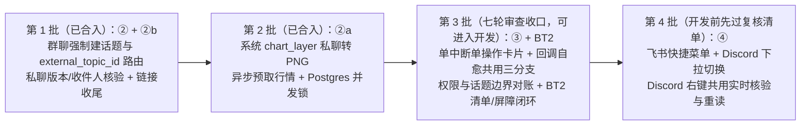

# 渠道第二阶段设计方案（飞书 / Discord / 个人微信，r13 第 3 批设计 r10 定稿版）

> **基线分支**：`feat/channel-phase2-b3`（基于已含渠道第二阶段第 1、2 批代码的分支快照；集成分支迁移链已演进至 `d055` 且观察名单第 1 批占用 `d056`，第 3 批迁移按合入时唯一 `head`〔迁移链最新头版本〕顺接）  
> **前置分支**：`fix/channel-sandbox-links`（`lanes/41`，已合入 `src/shared/sandbox-links.ts` 工作区沙箱路径改写登录深链）、`feat/external-member-perms-final`（外部成员服务端权限守卫）、`cos-settings-tools`（#513，`create_workspace` / `archive_workspace` 服务端确认快照校验）  
> **关联文档**：`docs/dalton/features/standalone-core.md`、`docs/dalton/features/external-member-permissions.md`、`docs/dalton/features/weixin-multi-account.md`、`docs/dalton/features/cos-settings-tools.md`、`docs/dalton/features/cos-delivery-confirmation.md`  
> **文档状态**：r13 版（第 1 批、第 2 批已开发合入；**第 3 批：复核清单与九轮设计审查意见已全部收口，新增 BT2 补发链接崩溃恢复设计，定稿进入开发**；第 4 批保留设计并附「开发前设计复核清单」，轮到第 4 批开发前对照当时代码复核收口；第七章方案待用户最终确认；第八章附 r10 全局一致性自查表与 B 类实施备忘）

---

## 目录

- [一、背景、范围与架构准则](#一背景范围与架构准则)
  - [1.1 现状与演进顺序](#11-现状与演进顺序)
  - [1.2 范围边界](#12-范围边界)
  - [1.3 双形态部署、能力门控与上游钩子规范](#13-双形态部署能力门控与上游钩子规范)
  - [1.4 后续演进事项（本阶段范围之外）](#14-后续演进事项本阶段范围之外)
- [二、各项功能在三渠道的实现方案与接口契约](#二各项功能在三渠道的实现方案与接口契约)
  - [2.1 三渠道承载与降级总览](#21-三渠道承载与降级总览)
  - [2.2 功能 ②：群聊 `@机器人` 自动开话题与话题内免 `@` 继续对话](#22-功能-群聊-机器人-自动开话题与话题内免--继续对话)
  - [2.3 功能 ②a：系统看盘图表图层转图片并附网页交互版链接](#23-功能-a系统看盘图表图层转图片并附网页交互版链接)
  - [2.4 功能 ②b：私聊回答生成文件自动附带与 `lanes/41` 链接收尾事项](#24-功能-b私聊回答生成文件自动附带与-lanes41-链接收尾事项)
  - [2.5 功能 ③：可交互卡片与单中断单操作原生按钮总览](#25-功能-可交互卡片与单中断单操作原生按钮总览)
  - [2.6 功能 ④：机器人快捷菜单与 Discord 右键「转入 `<品牌名>` 研判」](#26-功能-机器人快捷菜单与-discord-右键转入-品牌名-研判)
- [三、确认卡片风险分级、回调接入与补发链接崩溃恢复（功能 ③ 与 BT2 详设）](#三确认卡片风险分级回调接入与补发链接崩溃恢复功能--与-bt2-详设)
  - [3.1 单中断单操作允许清单与风险四级分类表（L0–L3）](#31-单中断单操作允许清单与风险四级分类表l0l3)
  - [3.2 卡片身份核验、门禁登记与私密详情卡短期令牌协议](#32-卡片身份核验门禁登记与私密详情卡短期令牌协议)
  - [3.3 三端提交统一竞争、同事务准入确认与幂等恢复协议](#33-三端提交统一竞争同事务准入确认与幂等恢复协议)
  - [3.4 飞书 `card.action.trigger` 与 Discord 组件/弹窗回调接入](#34-飞书-cardactiontrigger-与-discord-组件弹窗回调接入)
  - [3.5 BT2：交付物补发链接的崩溃恢复协议（第 3 批新增）](#35-bt2交付物补发链接的崩溃恢复协议第-3-批新增)
- [四、安全、权限与文件过滤规则](#四安全权限与文件过滤规则)
  - [4.1 系统图表外发、私聊文件附带与群卡片可见字段规则](#41-系统图表外发私聊文件附带与群卡片可见字段规则)
  - [4.2 外部成员发起交互时的权限范围](#42-外部成员发起交互时的权限范围)
  - [4.3 私聊自动附带文件的双路径白名单与配额过滤规则](#43-私聊自动附带文件的双路径白名单与配额过滤规则)
- [五、数据库变更设计（Dalton 迁移链）](#五数据库变更设计dalton-迁移链)
  - [5.1 群聊机器人话题登记表 `dalton_channel_bot_topics`（第 1 批新增）](#51-群聊机器人话题登记表-dalton_channel_bot_topics第-1-批新增)
  - [5.2 渠道交互令牌表、运行时屏障表、中断恢复竞争表与补发链接恢复索引（第 3 批新增）](#52-渠道交互令牌表运行时屏障表中断恢复竞争表与补发链接恢复索引第-3-批新增)
  - [5.3 Discord 右键研判草稿与可重试派发表 `dalton_channel_context_menu_drafts`（第 4 批新增）](#53-discord-右键研判草稿与可重试派发表-dalton_channel_context_menu_drafts第-4-批新增)
  - [5.4 存量表边界、迁移链顺接与滚动升级回退方案](#54-存量表边界迁移链顺接与滚动升级回退方案)
- [六、分批实施计划、测试与上线验收](#六分批实施计划测试与上线验收)
  - [6.1 批次划分总表](#61-批次划分总表)
  - [6.2 各批实施细节、测试用例与验收标准](#62-各批实施细节测试用例与验收标准)
- [七、已定方案（待用户最终确认）](#七已定方案待用户最终确认)
- [八、r10 一致性自查](#八r10-一致性自查)

---

## 一、背景、范围与架构准则

### 1.1 现状与演进顺序

渠道网关（`integrations/dalton-channel-gateway/`，基于 TypeScript〔带静态类型的 JavaScript 超集语言〕独立进程运行，默认监听本机回环地址 `127.0.0.1:8962`，通过部署级单行租约 `dalton_channel_gateway_lease` 保持单活）负责衔接智能体对话后端与飞书、Discord、个人微信三个聊天端。目前已上线处理中表情与输入状态反馈（#499，`src/processing-feedback.ts`）以及个人微信多账号管理（#506/#507，`d049_weixin_multi_account.py`），前置分支 `fix/channel-sandbox-links`（`lanes/41`）完成了回复正文内工作区沙箱路径向网页登录深链的基础改写，前置分支 `feat/external-member-perms-final` 完成了外部成员在网页端的服务端访问守卫。

本设计聚焦收窄后的渠道第二阶段五项交付内容（按 4 个批次推进，其中**第 1、2 批已开发合入，第 3 批已完成开发前复核清单收口并可直接进入开发**，第 4 批在启动开发前先完成 §6.2 对应批次的设计复核清单）：

1. **② 群聊自动开话题与发起人免 `@` 追问（第 1 批，已合入）**：在飞书群与 Discord 频道顶层 `@机器人` 提问时，首轮由网关直接创建独立话题或 Thread（子区，Discord 频道内的独立讨论串）并锁定 `canonical_scope_key`，话题发起人在该话题内直接发送消息即可连续对话，后续轮次统一按已登记平台话题号 `external_topic_id` 投递回同一话题。
2. **②a 系统看盘图表图层转图片附网页交互链接（第 2 批，已合入）**：将系统内置渲染页承载的看盘图表图层（`chart_layer`，页面仅消费后端行情数据与强校验图层结构化数据）渲染为高清 PNG（便携式网络图形无损图片格式），**仅在发起人本人私聊中**随回答发出并附上网页交互版登录深链；群聊与频道会话以及自定义交互组件（`ShowWidget` / `html_widget`）统一输出网页交互版登录深链。
3. **②b 私聊回答生成文件自动附带与链接收尾（第 1 批，已合入）**：在发起人与机器人的私聊会话中，工具写入本人自有工作区成功时同步在 `turn_deliverables` 记录当次 `FileStamp`（`size`、`mtime`、`ctime`、`inode`）与内容 SHA-256（256 位安全哈希算法）哈希；下载接口按已授权 `delivery_key` 在 PostgreSQL 核对运行归属、私聊类型、实际收件人与当前有效平台绑定（个人微信复用账号 ID、机器人代数及上传后复核），并通过 `read_contained_sandbox_file_versioned`（离线回退核对 `workspace_files.sandbox_modified_at` 与 `content_hash` / `blob_sha256`）确认当前文件版本与哈希一致后随私聊发出（版本缺失或存在差异时发网页登录深链）；私聊附件独立于正文发送状态结算并按已确认 `files_status` 去重；群聊与频道会话（含 `/agent/send` 显式传入的 `files`）及 `.html`（HTML，HyperText Markup Language，超文本标记语言）网页报告统一转为网页登录深链；同时扩展已合入的 `src/shared/sandbox-links.ts` 完成引用式链接分片前展开、`workspaceId` 回退，以及后端通知摘要剥离前深链改写与报告入库前改写。
4. **③ 可交互卡片与单中断单操作原生按钮 + BT2 交付物补发链接崩溃恢复（第 3 批，复核清单与七轮审查已收口，可进入开发）**：将澄清提问卡片升级为原生单选按钮、下拉框或 Modal（模态输入弹窗）输入；对命中「单中断、单操作」明确允许清单的 L1 / L2 确认操作提供渠道原生按钮（群内 L1 与 L2 卡片统一仅展示动作名称与网页 / 私聊或私密卡确认入口，完整参数放入飞书发起人私聊卡或 Discord 私密详情卡；飞书处理中状态由回调同步返回 Toast〔轻提示弹层〕展示，REST〔Representational State Transfer，表述性状态转移接口〕卡片 `PATCH`〔局部更新请求方法〕专门写入终态）；单独持久化优雅重启（`'graceful_restart'`）、停机（`'server_shutdown'`）、断连（`'client_disconnect'`）与陈旧工作区淘汰（`'stale_workspace'`）取消来源并保留显式停止覆盖优先级，对可重试断连/停机/优雅重启轮换 `(claim_id, request_key)` 重派，对显式停止、陈旧工作区及无来源 `cancelled` 收敛至终态并恢复用户入口；通过 `begin_run(in_start=...)` 锁行核对 `claim_id` 与 `pending_dispatch` 恰好更新 1 行提交准入状态；拆分后端运行消费时间戳 `run_consumed_at`、投递结算标记 `delivery_settled`、待网关处理标记 `requires_gateway_ack` 与渠道收尾时间戳 `channel_ack_at`（`bind-card(confirm_bound)` 与点击回调自愈补绑共用同一三分支事务函数 `_apply_confirm_bound_in_tx`：账本开启期间全部未消费占位收到首次绑卡或先到点击回调均走分支 2 / `T-6` 登记 `card_targets` 并重置 `delivery_settled = FALSE, channel_ack_at = NULL` 提交落库，**点击回调 `consume` / `inspect-gate`、`/internal/recover` 普通 `card_targets` 拉取与逐卡 `ack` 三路共用「已消费检查点或进入 `terminal_failed` 且 `delivery_settled = TRUE`」统一刷卡门禁，门禁通过前点击回调只回处理中提示、保持卡片按钮原状**；发卡前先持久化可对账的 `'send_in_flight'`〔发卡请求在途待对账状态〕记录，掉线后经平台历史分页对账收敛——**Discord 先核实机器人具备有效 `VIEW_CHANNEL` 与 `READ_MESSAGE_HISTORY` 权限后再采信 `< 100` 条（含空页），飞书话题按创建时间倒序翻页并由网关判断窗口边界，仅在有效权限下翻完对账时间窗全部历史消息或收到明确容器永久删除错误码（Discord `10003`、飞书群已解散 `232005`）时才判定 `'send_failed'`**，飞书机器人退群（`230002`）、权限受限、单页未覆盖全窗口、缺页或超时重试耗尽一律转为 `'send_unknown'`〔发卡结果未知待核实状态〕留在排水集合，仅尚未发起发卡的 `'pending_bind'` 超 90 秒转为 `'bind_expired'`；`credit_supplement`〔额度暂停恢复附带补充内容〕进入 `pending_resubmit`〔待新回合补发状态〕后原渠道 `ack` 保留补发状态与补发键，交由补发回合写入站终态；原渠道投递结算与逐卡 `ack` 鉴权分离，有卡网页/直连行转 `terminal_failed` 同事务置 `delivery_settled = TRUE`，支持 `terminal_failed` 后由网页或新文字以同构字段原地接管）；**同步纳入 BT2 交付物补发链接崩溃恢复（§3.5）：首次 `I-6` 认领同事务持久化完整待发项清单 `deliverable_manifest`、原授权目的地 `authorized_target_meta` 与单次尝试租约，按 `(workspace_id, normalized_path)` 派生确定性子键逐条推进链接状态机，恢复时复用原投递目标授权并实时重验权限，按单次尝试标识与租约回收滞留 `in_flight` 认领，父键在 `I-7` 按持久化清单逐项核对结算，为重试耗尽与确定性拒绝定义显式失败结案、补救入口及原回合状态更新，恢复扫描与排水验零共用同一「未结清」谓词并通过 `7b-0` `bt2_link_recovery_enabled` 建立回退入账屏障**；全部 12 类事务遵循同一张全局单调锁序表（涉及微信入站/监听/恢复行先在 `3a` 取 `FOR KEY SHARE`〔行级键值共享锁〕，锁住 `7a inbound_events` 后、锁 `thread_watches` 前即核对 `weixin_account_id` 在 `3a` 锁集内，缺失或 `claim_id` 失配一律回滚重试，接管 `UPDATE` 的 `rowcount`〔受影响行数〕异于 `1` 时整笔回滚，`/internal/recover` 对关联表保留 `FOR UPDATE SKIP LOCKED`〔锁定空闲行并跳过已加锁行的查询子句〕）；只关 `interactive_actions_enabled` 的事务仅更新单行屏障表 `dalton_channel_interrupt_runtime_config`（`7b-0` `FOR SHARE`〔行级共享锁〕/ `FOR UPDATE`〔行级排他更新锁〕），仅回退停产排水事务将三项运行时开关同置 `FALSE` 过期未消费令牌并阻断新 BT2 入账，确保跨 worker（后端工作进程）待排空存量真实单调归零；其余操作及额度暂停（`credit_pause`）沿用网页端与现有文字入口。
5. **④ 机器人快捷菜单与 Discord 消息右键研判（第 4 批）**：提供飞书单聊输入框快捷菜单、Discord `/workspace` 下拉切换菜单与消息右键命令「转入 `<品牌名>` 研判」（首次派发与重启恢复共用实时权限检查与原消息实时重读）。

### 1.2 范围边界

为保持群聊阅读秩序、个人微信连接稳定性与团队数据隔离，第二阶段执行以下明确边界：

- **群聊采用整卡定稿投递与深链交付**：群聊过程态统一展示轻量表情回应（飞书 `Typing`〔正在输入状态表情〕、Discord `⏳`），待本轮回答生成完毕后一次性发出排版完整的卡片；系统看盘图表、自定义交互组件及工作区生成文档与表格在群聊中统一输出需登录鉴权的网页深链。
- **个人微信采用单轮整条回复**：基于腾讯 iLink（腾讯面向个人智能体开放的微信连接协议）长轮询单聊通道，配合 `sendtyping`（正在输入状态信令）向发起人本人私聊发送完整结论、系统图表图片与本轮写入的精选附件。
- **后台任务统一在系统内管理**：研究进度、定时唤醒（`schedule_wakeup`）与自动化状态统一以 Dalton PostgreSQL（开源关系型数据库）记录为准。
- **按用户显式交互读取消息**：仅处理用户 `@机器人`、话题发起人在机器人已登记话题（携带实际话题标识）内跟帖、显式合并转发或右键选中的单条消息；网关在入站解析阶段直接略过其余普通群聊消息。

### 1.3 双形态部署、能力门控与上游钩子规范

全部实现严格遵循 `docs/dalton/features/standalone-core.md` 的双部署形态规范：

1. **统一形态解析与能力开关门控**：
   - 部署形态判断统一调用 `src.dalton.profile`（`resolve_profile()` 与 `DeploymentProfile.EVERFLOW` / `DeploymentProfile.CORE`）；能力启停判断统一调用 `src.dalton.capabilities`（`has_capability()`、`require_capability()`、`require_channel_platform_capability()`），前端统一调用 `web/src/hooks/useCapabilities.ts` 的 `useCapabilities()` 与 `web/src/config/brand.ts`。
   - 各子链路按最小所需能力精确门控：
     - 后端新增的 `channels_router.py` 内部端点全部登记入 `src/dalton/capabilities.py` 的 `DALTON_ROUTE_CAPABILITY_REGISTRY`：通用渠道端点在路由层绑定 `CapabilityId.CHANNEL_GATEWAY`，并在请求处理函数及后台恢复任务先将 `platform` 限定于受支持枚举白名单（`feishu`、`discord` 或 `weixin`）后，调用 `require_channel_platform_capability(platform)` 核验对应平台子能力（`CapabilityId.CHANNEL_FEISHU`、`CapabilityId.CHANNEL_DISCORD` 或 `CapabilityId.CHANNEL_WEIXIN`，且在查询加锁与写入前排除已关闭平台）；Discord 右键菜单草稿端点直接在路由层绑定 `(CapabilityId.CHANNEL_GATEWAY, CapabilityId.CHANNEL_DISCORD)`，全部通过 `test_core_capabilities_gate.py` 门禁测试；
     - 运行期私聊 `turn_deliverables` 工具写入记录汇总、`chart_layer` 系统图表私聊快照渲染、`/messages/replay` 渠道元数据输出与浏览器会话 `hitl_response` 协同占位仅在 `has_capability(CapabilityId.CHANNEL_GATEWAY)` 为真时执行；
     - 数据任务通知关联监控面板深链（读取 `src/dalton/monitors/data_job_registry.py`）仅在 `CapabilityId.CHANNEL_GATEWAY` 与 `CapabilityId.DATA_JOBS` 同时启用时加载并输出。
   - 在核心安装形态（`DALTON_PROFILE=core` / `APP_ENV=core`）下渠道能力默认保持关闭；当部署者显式开启 `CHANNEL_GATEWAY` 及对应平台子能力、另行部署渠道网关进程（`integrations/dalton-channel-gateway/`）并配置服务令牌、双向可达地址与机器人凭据后，系统图表私聊快照直接复用 Core 默认内置的 `DALTON_CHAT_UPLOAD_STORAGE_*` MinIO（兼容 S3 协议的开源对象存储服务）配置，本阶段全部能力可用。
2. **网页地址与品牌名称全配置化**：
   - 后端统一通过 `src/dalton/settings.py` 的 `get_dalton_public_app_url()` 拼装深链；渠道网关在启动及健康对账中从后端内部状态接口同步公网地址，使网关 `src/config.ts` 的 `webBaseUrl` 与后端保持一致。
   - 当部署处于本机回环试用状态（公网地址为空，或主机名为 `localhost` / `127.0.0.1`）时，网关将链接展示为「请在网页端对应会话或工作区查看」文字指引。
   - 卡片标题、提示词与右键菜单文案统一通过 `src/dalton/settings.py` 的 `get_brand_name()`（读取环境变量 `BRAND_NAME`，`core` 形态默认 `Dalton`，`everflow` 形态默认 `Everflow`）动态生成。
3. **上游改动标记与路径登记**：
   - 触及上游共享源码文件（包括 `src/server/`、`src/ptc_agent/`、`src/tools/`、`libs/`、`web/` 下非 Dalton 专属文件）的每一处修改，均须附带 `# DALTON-HOOK(<topic>): <reason>` 或 `// DALTON-HOOK(<topic>): <reason>` 注释，并将新增钩子标识登记入 `scripts/dalton/check_hooks.sh`。
   - 新增 Dalton 专属文件若位于 `scripts/dalton/dalton_paths.txt` 既有前缀之外，须同步补登记路径，且**每一开发批次**均执行并通过 `bash scripts/dalton/check_hooks.sh --strict`。

### 1.4 后续演进事项（本阶段范围之外）

为保持本阶段四个批次边界清晰、权限隔离闭环可靠，以下扩展项归入后续阶段独立规划：

1. **群聊与频道自动附带本轮生成文件及图表图片（含跨工作区持久来源表、研究总监跨区标记与发送前哈希复核）**：
   - **归入后续原因**：群聊与频道消息面向群内全体成员（含未绑定平台账号成员）直接可见。在多回合协作场景下，研究总监（`chief_of_staff`）读取同事资料生成自由文本或数值序列图层、跨回合文件拷贝、命令行脚本派生新文件以及同一工作区并发回合写入同名文件，需要数据库级跨区来源标记与沙箱写入层不可变字节版本共同形成群外发隔离闭环；本阶段群聊统一输出需登录鉴权的网页深链，系统图表图片与文件自动附带专门面向发起人本人的私聊开放。
   - **后续开启前提**：① 在 PostgreSQL 运行记录中持久化研究总监与分析师统一的跨工作区资料触碰标志；② 在沙箱文件写入层捕获当次写入的不可变字节摘要并与文件级来源元数据原子落盘，同时覆盖工具写入与命令行脚本派生文件；③ 建立绑定实际接收群地址与不可变内容版本的群外发授权复核链路。
2. **自定义交互组件（`ShowWidget` / `html_widget`）转图片与 `.html` 报告转 PDF（Portable Document Format，便携式文档格式）附件**：
   - **归入后续原因**：`ShowWidget` 组件与 `.html` 报告均包含模型或脚本生成的自定义 HTML 与 JavaScript 代码。在常规应用容器内，除 Chromium（开源浏览器内核）DNS（Domain Name System，域名系统）参数、Service Worker（浏览器后台服务工作线程）限制及 Playwright（浏览器自动化测试与渲染框架）上下文路由拦截外，WebRTC（网页实时通信协议）等独立通道与同工作区子资源读取需要操作系统级网络命名空间与文件系统双重隔离；本阶段二者统一输出网页交互或预览深链。
   - **后续开启前提**：① 部署具备操作系统级网络命名空间隔离（仅保留本机回环网卡）的独立无特权渲染沙箱服务；② 为 HTML 转 PDF 建立沙箱外置子资源供给机制，将本地可读子资源限定为样式表、字体与白名单静态位图，并在底层收敛弹窗创建与脚本跨文件读取。
3. **定时报告外发配置（`dalton_report_delivery`）的渠道按钮确认**：
   - **归入后续原因**：`src/dalton/tools/report_delivery_tools.py` 的 `action="set"` 当前通过模型参数流转，待接入服务端中断确认。
   - **后续开启前提**：完成 `docs/dalton/features/cos-delivery-confirmation.md` 的服务端 `hitl_confirm("dalton_report_delivery_set", ...)` 与多目标 `confirm_token` 改造。
4. **CLI（Command-Line Interface，命令行工具）跨电脑审批的渠道按钮接入**：
   - **归入后续原因**：`src/server/dependencies/cli_approval.py` 与 `src/server/services/cli_approvals.py` 基于 Redis（内存键值数据库）待批记录与专用接口 `POST /api/v1/cli/approvals/{approval_id}/decision`（`src/server/app/cli_approvals.py:55`）独立运作，与 LangGraph 检查点 `hitl_response` 分属两条审批链路；本阶段继续在网页端审批。
   - **后续开启前提**：为 CLI 待批记录补充持久化渠道令牌映射、卡片脱敏门禁与幂等审批回调适配层。
5. **单次暂停含多中断或多操作槽位的复合渠道卡片**：
   - **归入后续原因**：同一暂停内包含多个中断或单个中断内包含多个 `action_requests`（以及批量 `order_decisions`）时，桌面与移动浏览器面板能够更清晰地统筹分项确认；本阶段统一引导至网页端 `answerBoard.ts` 完整面板处理。
   - **后续开启前提**：设计渠道端多步骤表单状态机与分项草稿暂存机制。
6. **群话题全员免 `@` 开关与按核验结果细分的研报发布渠道审批**：
   - **归入后续原因**：保障群聊人际讨论秩序，并确保正式研报数字核验明细经浏览器完整审阅后再发布；本阶段固定执行「话题内仅发起人免 `@`」与「正式研报发布（`publish_approval`）固定网页端确认」。
   - **后续开启前提**：落地群级管理员可配置的免 `@` 触发策略开关，以及面向零疑问研报草稿的移动端精简核验摘要规范。
7. **网关重启后未结算普通正文与建帖回复的平台历史回执核实与自动补发**：
   - **归入后续原因**：飞书话题内跟帖回复的 `root_id` 与 `parent_id` 均指向话题根消息，且普通多片长正文回复涉及跨重启分片回执核对；第 1 批重启时普通正文与建帖回复的未结算 `in_flight` 投递保持 `status = 'unknown'`（含 Discord `before_body`），用户可在网页端查看完整回答（**注：交付物网页深链补发 `deliverables-links:` 与交互卡片发卡在途记录 `send_in_flight` 已在第 3 批分别通过 §3.5 BT2 逐项崩溃恢复协议与 §3.2 平台历史分页对账落地**）。
   - **后续开启前提**：结合网关租约 `epoch`、`delivery_attempt`、持久化的待发正文分片摘要及飞书/Discord 话题历史分页对账机制，支持普通正文分片在重启后核实平台回执并从断点续发。
8. **非发起人在群话题内显式 `@机器人` 时自动附带话题首楼与被回复消息上下文**：
   - **归入后续原因**：跨成员在他人发起的话题内 `@机器人` 时，首楼与被回复消息可能包含长文本或附件，需单独约定拉取范围、截断预算与入站结构化字段；第 1 批中其他已绑定内部成员或管理员在话题内 `@机器人` 时，按现有群内 `@` 行为触发其本人会话并传入当前消息内容。
   - **后续开启前提**：明确话题首楼与被回复消息的拉取边界、长度截断规则、入站载荷字段及工作区上下文隔离策略。

---

## 二、各项功能在三渠道的实现方案与接口契约

### 2.1 三渠道承载与降级总览

| 功能项 | 飞书（Feishu）实现与降级 | Discord 实现与降级 | 个人微信（Weixin iLink）实现与降级 |
| --- | --- | --- | --- |
| **② 群聊开话题与发起人免 `@` 追问** | 前置开启 `im:message.group_msg` 与 `im:message:readonly` 权限；群顶层 `@` 首轮由网关强制以 `reply_in_thread: true` 创建话题（`omt_xxx`），`canonical_scope_key` 固定为 `chat:<chat_id>:topic:<om_root>`（已有话题内 `@` 沿用 `chat:<chat_id>:thread:<omt_xxx>`），登记 `dalton_channel_bot_topics` 并清除负缓存；后轮出站按表内 `external_topic_id` 带 `reply_in_thread: true` 投递；重启时未结算首条回复沿用现有行为标 `unknown`（网页查看完整回答）；原消息撤回（`230011`/`231003`/`230110`）回退普通群消息 | 频道顶层 `@` 首轮由网关强制在父频道从原消息建公开子区，`canonical_scope_key` 固定为 `chat:<guild>/<parent>:topic:<msg>`（已有子区内 `@` 沿用 `chat:<guild>/<parent>:thread:<thread>`），确认地址沿用 `discord:<guild>/<parent>:thread:<thread>` 并登记 `dalton_channel_bot_topics`；后轮出站按表内 `external_topic_id` 先 `ensureThreadUnarchived` 再发入该子区，按父频道核验权限；权限或活跃子区满额（`50013`/`160006`/`160007`）回退父频道引用回复，原消息已删除（`10008`）发无引用简短提示；重启未确认建帖沿用现有 `unknown` 保护 | 面向单聊（`weixin:@me`），群消息记为 `weixin_group_unsupported` 归档略过；单聊直接连续收发 |
| **②a 系统看盘图表转图片** | **发起人私聊**：针对系统 `chart_layer` 生成 Schema 2.0（飞书第二代交互卡片规范）卡片，内嵌从 Dalton 对象存储拉取的高清 PNG（`tag: "img"`）+ 底部 `open_url` 按钮 `[打开网页交互版]`（超 10 MB〔兆字节〕自动使用 1x 缩放或转 WebP〔高压缩率网页图片格式〕）；**群聊/话题**、`ShowWidget` 或存储/渲染器未就绪时统一发网页登录深链 | **发起人私聊**：针对系统 `chart_layer` 以 `multipart/form-data`（多部分表单上传格式）附带高清 PNG + `ActionRow`（操作组件行容器）`Link Button`（外链按钮）`[打开网页交互版]`；**群频道/子区**、`ShowWidget` 或存储/渲染器未就绪时统一发网页登录深链 | **发起人私聊**：针对系统 `chart_layer` 在正文后追加加密上传的 `IMAGE` 图片消息，公网地址可达时附纯文本交互深链；`ShowWidget` 或存储/渲染器未就绪时发文字与深链 |
| **②b 私聊本轮文件附带与深链** | **发起人私聊**：限本轮工具写入本人自有工作区的确认文件（`turn_deliverables` 记录写入时 `FileStamp` 与内容 SHA-256），按已授权 `delivery_key` 在 PostgreSQL 核对运行、私聊类型、收件人与当前有效绑定，并经双路径白名单及 `read_contained_sandbox_file_versioned`（离线核对 `workspace_files` 备份）确认版本/哈希一致后，≤10 MB 图片走 `im.image.create`、≤20 MB 文档/表格走 `im.file.create`；私聊附件独立结算并按 `files_status` 去重；**群聊（含显式 `send_message(files=...)`）**、`.html` 报告及版本差异/缺失文件统一发网页登录深链 | **发起人私聊**：限本轮工具写入本人自有工作区、通过 `delivery_key` 收件人与绑定核验且当前 `FileStamp`/哈希一致的 ≤20 MB 合规文件作为私聊附件发送（整轮 ≤50 MB，最多 5 个），独立于正文结算并按 `files_status` 去重；**群频道/子区（含显式 `send_message(files=...)`）**、`.html` 报告及版本差异/缺失文件统一发网页登录深链 | **发起人私聊**：限本轮工具写入本人自有工作区、通过 `delivery_key` 微信账号 ID/机器人代数核验（含上传后复核）且当前 `FileStamp`/哈希一致的合规文件（≤20 MB，单轮最多 3 个），经 AES-128-ECB（128 位高级加密标准电子密码本模式，`src/channels/weixin/cdn.ts`）加密上传 CDN（内容分发网络）作为 `IMAGE`/`FILE` 发送；其余发网页登录深链 |
| **③ 提问与单中断单操作按钮** | 所有交互卡常驻独立网页入口；L0 提问渲染按钮组或 `form` 表单；**私聊** L1/L2 发完整参数确认卡（L2 附二次确认框）；**群聊 L1 与 L2 一致**：群卡只显示动作名称与网页入口，完整参数与按钮发往发起人飞书私聊；`credit_pause` 保持文字/网页入口，L3 发网页入口 | 所有交互卡常驻独立网页入口；L0 渲染 `Button` / `StringSelect` + `Modal`；**私聊** L1/L2 发完整参数按钮卡；**群频道/子区 L1 与 L2 一致**：群卡只显示动作名称、网页入口与 `[查看详情并确认]` 门禁按钮，点击签发短期令牌返回 `flags: 64` Ephemeral（仅点击者可见临时消息）详情卡；凭证过期或 L3 给网页入口 | L0 输出数字编号列表供直接回复；`credit_pause` 沿用现有回复 `继续` / `/stop` 文字入口与网页入口；其余确认统一发送动作说明与网页端确认深链 |
| **④ 快捷菜单与右键研判** | 订阅 `application.bot.menu_v6` 响应单聊输入框上方 4 个固定菜单（返回研究总监、切换工作区卡片、新建对话、停止任务），保留 v7 `/` 命令 | 升级无参 `/workspace` 返回下拉切换菜单；注册消息右键命令（`type = 3`）「转入 `<品牌名>` 研判」，首次同步弹 `Modal`，首次派发与重启恢复共用实时权限检查与原消息实时重读，核验公开目的地可见范围与发帖权，未通过核验时终止并提示重新操作 | 在 `/help` 与扫码成功欢迎语列出快捷指令，发送 `/workspace` 返回编号列表供回复切换 |

---

### 2.2 功能 ②：群聊 `@机器人` 自动开话题与话题内免 `@` 继续对话

#### （1）飞书实现、前置权限、入站精确过滤与话题出站路由

1. **平台权限前置条件（`im:message.group_msg` 与 `im:message:readonly`）**：
   - 飞书群内接收未显式 `@机器人` 的话题跟帖消息，依赖飞书开放平台应用开启群消息权限 **`im:message.group_msg`**（获取群组中所有消息）；建话题首条回复后通过 `getMessageFeishu`（`src/channels/feishu/send.ts:731`，调用 `im.message.get`）读取回复消息所属 `thread_id`（`omt_xxx`）依赖 **`im:message:readonly`**（获取单聊、群组消息）权限，两项权限发布应用版本审批生效列为第 1 批上线前置条件。
   - 在权限生效前的过渡期内，群顶层 `@机器人` 自动创建话题以及在话题内继续通过 `@机器人` 追问均正常运作并归入对应会话。
2. **入站前置过滤、`canonical_scope_key` 保持与负缓存即时清除**：
   - 开启 `im:message.group_msg` 后，飞书长连接（`src/channels/feishu/monitor.ts`）在调用 `getMessageFeishu`、`downloadMessageResourceFeishu` 或后端 `I-1`（`register-and-resolve`）之前执行两步内存快速筛选：
     - **按实际话题标识 `thread_id` 精确匹配免 `@` 跟帖**：飞书普通群中主聊区普通引用回复（`reply_in_thread: false`）仅携带 `root_id` 而 `thread_id` 为空；凡群消息未 `@机器人` 且 `message.thread_id` 为空，直接在内存中作为主聊区普通发言略过（零落库、零下载、零后端请求）；
     - 当群消息未 `@机器人` 且携带非空 `message.thread_id`（`omt_xxx`）时，先查网关内存 LRU（Least Recently Used，最近最少使用缓存，分别维护已登记机器人话题正缓存与短时效非机器人话题负缓存），未命中时调用轻量只读接口 `/internal/topics/lookup`（**新增**，`match_mode: "inbound_followup"`，按 `(platform='feishu', chat_address, external_topic_id=message.thread_id)` 精确查询）。当命中已登记机器人话题且 `senderOpenId === initiatorPlatformUserId`（话题发起人本人，见第七章定案 1）时，**直接采用表内已锁定的 `canonical_scope_key` 作为 `event.threadScopeKey`（保持触发轮生成的 `chat:<chat_id>:topic:<om_root>` 或 `chat:<chat_id>:thread:<omt_xxx>` 原值，跳过 `buildDaltonFeishuThreadScopeKey` `src/channels/feishu/targets.ts:317` 向另一种 `:thread:` 键的重拼）**，在入站事件上记录 `externalTopicId = message.thread_id` 并置 `event.isGroupTrigger = true`；其余未 `@` 情形直接在内存中略过。
   - **话题内显式 `@机器人` 与指令路由**：话题发起人在已登记话题内显式 `@机器人` 或直接发送 `/new`、`/stop`、`/workspace`、`/main` 斜杠指令时，同样复用表内同一 `canonical_scope_key`（斜杠指令免 `@` 生效）；群内其他已绑定的内部成员或管理员在该话题内显式 `@机器人` 时，按现有群内 `@` 规则触发其本人会话（`threadScopeKey` 保持 `chat:<chat_id>:thread:<omt_xxx>`，仅传入当前 `@` 消息内容，见 §7 定案 1）。
   - **话题登记成功时清除负缓存**：当用户在普通话题内首次 `@机器人` 提问并写入 `dalton_channel_bot_topics` 时，网关收到 `I-1` 或 `I-7` 响应后同步清除该 `(chat_address, external_topic_id)` 的负缓存条目并写入正缓存，使发起人紧接着发出的免 `@` 追问立即生效。
3. **顶层 `@` 首轮网关强制建话题、后轮按 `external_topic_id` 出站投递与重启保护**：
   - **`canonical_scope_key` 确定规则**：普通群顶层 `@机器人` 发送消息 `om_root`（`message.thread_id` 为空）时，`src/channels/feishu/inbound-parse.ts` 与 `src/channels/feishu/targets.ts` 将初始 `threadScopeKey`（即登记时的 `canonical_scope_key`）构造为 `chat:<chat_id>:topic:<om_root>`；已在平台现有话题内首次 `@机器人`（自带 `message.thread_id = omt_xxx`）时，`canonical_scope_key` 沿用现有 `chat:<chat_id>:thread:<omt_xxx>`。
   - **顶层 `@` 首轮由网关强制建话题（独立于模型 `new_thread`）**：当触发入站为群顶层 `@`（`:topic:` 作用域且尚未登记话题）时，`I-6` 在授权认领同事务内先按「群地址 + 触发消息 ID」在 `dalton_channel_bot_topics` 写入 `status = 'pending'` 待确认预留行（锁定发起人与 `canonical_scope_key`），并从已核验的原入站记录返回 `root_message_id`。网关在 `src/orchestrator.ts` 与 `src/delivery-service.ts` 对该回合首条发往当前群会话的出站投递（涵盖实时回复、`/agent/send` 显式发送与断线回放）共用该 `root_message_id` 直接置位建话题标志，无需等待模型传入 `new_thread=true`。`FeishuChannelAdapter.sendTextChunk`（`src/channels/feishu/monitor.ts:878`）及 `sendMessageFeishu` / `sendStructuredCardFeishu`（`src/channels/feishu/send.ts:609`）向 `im.message.reply` 传入 `reply_in_thread: true`，从响应或 `getMessageFeishu(first_reply_message_id)` 取得 `omt_xxx` 后，通过 `I-7`（`deliveries/progress`）在同一数据库事务内更新 `platform_message_ids`、`sent_chunks` 并按预留行补全 `external_topic_id = omt_xxx` 与 `first_reply_message_id` 将话题转为 `status = 'confirmed'`，收到响应后立即清除该 `omt_xxx` 负缓存。
   - **同轮后续分片与后轮出站统一按 `dalton_channel_bot_topics.external_topic_id` 投递**：已登记话题的同轮后续分片，以及后续轮次的实时回复、断线回放（`deliverReplayFallback`）、后台唤醒/命令回报（`consumeBackgroundRunStream`）与当前会话 `send_message`，统一按表内 `external_topic_id` 投递进该飞书话题——携带当前轮触发消息 `replyToMessageId` 时对该入站消息调用 `im.message.reply(..., reply_in_thread: true)`；无当前触发消息的分片、回放或后台回报通过 `I-6` 返回的话题信息或 `/internal/topics/lookup`（`match_mode: "outbound_delivery"`，按 `canonical_scope_key` 查询）取得 `first_reply_message_id`（或 `root_message_id`）并以 `reply_in_thread: true` 回复，始终落在同一 `omt_xxx` 话题内。
   - **重启与未知回执统一保持 `unknown` 不续发**：单次请求超时或响应缺失 `message_id`（`send.ts:482`）时按现有流程记为 `status = "unknown"`；网关在结算前退出重启时，启动恢复将所有未结算的 `in_flight` 投递统一标为 `status = 'unknown', error_code = 'gateway_restarted'` 且不续发，用户可在网页端查看完整回答（重启后拉取平台历史核实回执并自动补发归入 §1.4 后续演进）。
4. **原消息撤回与建话题受限回退**：
   - 调整 `src/channels/feishu/send.ts:531, 587, 595` 的 `sendReplyOrFallbackDirect`：当首轮建话题请求收到确定性撤回或群设置限制错误（飞书错误码 `230011`、`231003`、`230110`）时，自动回退调用 `im.message.create` 在群内发送回答，保持 `dalton_channel_bot_topics` 仅记录已成功创建的话题。

#### （2）Discord 实现、子区出站路由与父频道权限核验

1. **`canonical_scope_key` 锁定、首轮网关强制建子区与后轮子区投递**：
   - **入站 `canonical_scope_key` 确定规则**：在已登记的服务器文字频道（`GuildText = 0`）或公告频道（`GuildAnnouncement = 5`）收到顶层 `<@botId>` 消息时，Discord 适配器 `src/channels/discord/inbound.ts` 将逻辑会话键 `threadScopeKey`（即登记时的 `canonical_scope_key`）构造为 `chat:<guildId>/<channelId>:topic:<messageId>`，保持初始出站 `targetAddress` 为父频道地址 `discord:<guildId>/<channelId>`；已在平台现有子区（`type = 10 / 11 / 12`，含论坛 `GuildForum = 15` 与媒体频道 `GuildMedia = 16` 下的帖子子区 `11`）内首次 `<@botId>` 时，`canonical_scope_key` 沿用现有 `chat:<guildId>/<parentChannelId>:thread:<threadId>`，并以父频道地址作为 `chat_address` 登记 `dalton_channel_bot_topics`。
   - **顶层 `@` 首轮由网关强制建子区（独立于模型 `new_thread`，必传触发消息 `messageId`）**：当触发入站为频道顶层 `@`（`:topic:` 作用域且尚未登记子区）时，`I-6` 在授权认领同事务内先按「父频道地址 + 触发消息 ID」在 `dalton_channel_bot_topics` 预留发起人与 `canonical_scope_key`（`status = 'pending'`），并从已核验的原入站记录返回 `root_message_id`。网关在 `src/orchestrator.ts` 与 `src/delivery-service.ts` 对该回合首条发往当前频道会话的出站投递（涵盖实时回复、`/agent/send` 显式发送与断线回放）共用该 `root_message_id` 直接打开建子区标志，无需等待模型传入 `new_thread=true`。在 `src/channels/discord/send.ts` 中，`threadIdFromScopeKey`（`:64-68`）仅用于解析 `:thread:` 作用域键；对于 `:topic:` 作用域键，首轮在 `confirmedThreadAddress` 与已登记 `external_topic_id` 均为空时对父频道 `parsed.channelId` 调用 `src/channels/discord/threading.ts` 的 `createThreadDiscord` 时**必须将触发消息 ID 作为 `messageId` 传入**（使 Discord 子区 ID 绑定该触发消息且支持 `10008` 回退；子区名称取清洗后的用户问题或回答首行，按 UTF-16〔16 位统一码字符编码〕安全截断至 `100` 字符以内，自动归档时长 `60` 分钟）。
   - **确认子区落库与后轮按 `external_topic_id` 投递**：
     - 首轮 `createThreadDiscord` 创建成功后，沿用现有 `src/dalton/database/channel_gateway.py:8783`（`_DISCORD_CONFIRMED_THREAD`）格式，通过 `onConfirmedThread` 在 `I-7` 同事务写入 `confirmed_thread_address = "discord:<guildId>/<parentChannelId>:thread:<threadId>"`、`discord_body_phase = 'before_body'`，并按预留行补全 `external_topic_id = thread.id` 将 `dalton_channel_bot_topics` 转为 `status = 'confirmed'`、清除该子区负缓存，随后向新子区发送首条消息与同轮后续分片；
     - **后轮出站路由**：同一话题后续轮次（含发起人免 `@` 跟帖、发起人在子区内显式 `@`、断线回放、后台唤醒/命令回报及当前会话 `send_message`）统一按 `dalton_channel_bot_topics.external_topic_id` 投递——网关通过入站关联、`I-6` 当前会话授权返回或 `/internal/topics/lookup`（按 `canonical_scope_key` 查询）取得 `external_topic_id`，在 `sendMessageDiscord` 中先调用 `getDiscordChannel(rest, external_topic_id)` 与 `ensureThreadUnarchived(rest, channel)`（`threading.ts:148`）确保已自动归档的子区解封，再将消息发入该 `external_topic_id` 子区。
   - **子区投递权限统一按父频道登记与用户渠道设置核验**：服务端在核验 Discord 子区投递或后续交互权限（含 `I-6` 及确认卡片门禁校验）时，凡遇到匹配 `_DISCORD_CONFIRMED_THREAD`（`discord:<guild>/<parent>:thread:<thread>`）或投递至已登记 `external_topic_id` 的子区目标，统一提取其父频道地址 `discord:<guild>/<parent>` 传入 `src/dalton/database/channel_gateway.py:1203` 的 `_verify_group_target_deliverable`，核验 `dalton_channel_chat_bindings` 父频道登记与发起人 `dalton_channel_user_settings.apps.discord.chats` 配置；若首轮建帖失败回退至父频道，则直接按父频道 `discord:<guild>/<parent>` 核验。
2. **子区内发起人免 `@` 继续对话与非发起人 `@` 分流**：
   - Discord 适配器 `src/channels/discord/index.ts`（Gateway 连接已声明 `MessageContent = 32768` 意图，见 `src/channels/discord/gateway.ts:21`）收到子区消息（`type = 10 / 11 / 12`）且未包含 `<@botId>` 时，解析父频道地址 `discord:<guildId>/<parentChannelId>` 后先查内存话题缓存，未命中则调用 `/internal/topics/lookup`（`match_mode: "inbound_followup"`）按 `(platform='discord', chat_address='discord:<guildId>/<parentChannelId>', external_topic_id=channel.id)` 查询 `dalton_channel_bot_topics`；当确认为已登记机器人子区且发送者为子区发起人（`author.id === initiatorPlatformUserId`）时，**直接采用表内 `canonical_scope_key` 作为 `threadScopeKey`（跳过 `buildDiscordThreadScopeKey` `src/channels/discord/inbound.ts:134` 向 `:thread:` 的重拼）**，保留 `externalTopicId = channel.id` 并置 `isGroupTrigger = true`；其余未 `@` 子区消息在入站前直接略过。
   - 子区发起人在已登记子区内发送斜杠命令或显式 `<@botId>` 时同样复用表内 `canonical_scope_key`；其他已绑定的内部成员或管理员在该子区内显式 `<@botId>` 时，按现有群内 `@` 规则触发其本人会话（`chat:<guildId>/<parentChannelId>:thread:<channel.id>`，仅含当前消息）并在该子区内回复。
3. **建帖失败分类回退与重启保护**：
   - **确定性建帖拒绝回退**：复用 `src/channels/discord/threading.ts` 的确定性 HTTP 4xx 错误分类：
     - 当缺少 `CREATE_PUBLIC_THREADS` 权限（`403` / Discord 错误码 `50013`）或活跃子区数量达到上限（`400` / Discord 错误码 `160006` 或 `160007`）且原消息仍在时，自动回退在已授权父频道携带 `message_reference: { message_id: replyToMessageId }` 引用回复；
     - 当原触发消息已被删除（`404` / Discord 错误码 `10008`）时，省略 `message_reference`，在已授权父频道发送一条简短完成提示（附网页会话登录深链），正常结案。
   - **超时、5xx 与网关重启保护**：建帖请求在同次尝试中遇到网络超时、连接中断或 HTTP 5xx 时，沿用 `threading.ts` 现有的同次查找复用与 `outcome: "unknown"` 保护；网关重启时所有未结算的在途投递统一保持 `status = 'unknown'` 且不续发（含 `discord_body_phase = 'before_body'` 的投递），用户在网页端查看完整回答。

#### （3）接口契约与登记归属预留锁定

- **扩展 `POST /api/v1/dalton/channels/internal/inbound/register-and-resolve`（`I-1`，已有端点新增可选字段）**：
  - 请求体新增可选字段：`external_topic_id?: string | null`、`root_message_id?: string | null`。
  - 当 `external_topic_id` 非空且 `(platform, chat_address, external_topic_id)` 命中 `dalton_channel_bot_topics`（`status = 'confirmed'`）时：若 `platform_user_id == initiator_platform_user_id`（发起人本人），后端在事务内将会话键固定为表内 `canonical_scope_key` 并刷新 `last_active_at`；若为其他成员显式 `@机器人`，保持该成员自身的 `chat:<id>:thread:<external_topic_id>` 会话键并仅刷新 `last_active_at`（表内原 `initiator_*` 与 `canonical_scope_key` 保持不变）。
  - **开帖预留窗口归属锁定（`I-1` 先于 `I-7`）**：若按 `external_topic_id` 未命中已确认话题，后端先按 `(platform, chat_address, root_message_id)`（飞书取入站 `root_id`，Discord 取 `root_message_id` 或 `external_topic_id`）查询 `dalton_channel_bot_topics` 是否存在待确认预留行（`status = 'pending'`）。一旦命中预留行：不插入新发起人；若发送者即预留发起人本人，沿用预留 `canonical_scope_key`；若为其他成员显式 `@机器人`，保持该成员自身的 `chat:<id>:thread:<external_topic_id>` 会话键，并返回预留行 `topic_initiator_platform_user_id` 且 `topic_newly_registered = false`。
  - 仅当既未命中已确认话题、又未命中同一根消息的预留行时，用户在未登记的普通已有话题内首次显式 `@机器人` 触发，同事务以 `status = 'confirmed'`、`canonical_scope_key = chat:<id>:thread:<external_topic_id>` 登记 `dalton_channel_bot_topics` 并返回 `topic_newly_registered: true` 供网关即时清除负缓存；响应新增返回 `resolved_scope_key: string`、`external_topic_id: string | null` 与 `topic_initiator_platform_user_id: string | null`。
- **扩展 `I-6`（`authorize-and-claim`）与 `I-7`（`deliveries/progress`）（维持单次发送与重启 `unknown` 不续发）**：
  - `I-6` 在授权当前群会话投递时：① 从已核验的原入站记录（及 `dalton_channel_bot_topics`）返回 `root_message_id: string | null`、`external_topic_id: string | null` 与 `first_reply_message_id: string | null`，供实时回复、`/agent/send` 显式发送、断线回放与后台回报共用；② 当投递属于顶层 `:topic:<root_msg>` 且尚无已确认话题时，在同事务先向 `dalton_channel_bot_topics` 写入 `status = 'pending'` 预留行（固定 `canonical_scope_key`、`root_message_id` 与发起人）；③ 对重启后标为 `status = 'unknown'` 的记录（含 Discord `before_body`）统一返回 `in_flight_or_unknown` 不续发；④ 核验 Discord 子区目标时提取父频道地址调用 `_verify_group_target_deliverable`；⑤ 对私聊当前会话投递，在 `dalton_channel_deliveries.dm_recipient_platform_user_id` 固定原入站私聊实际平台收件人，并返回同 `run_id` 下已记录的 `prior_run_files` 供网关去重。
  - `I-7` 请求体新增可选字段 `bot_topic_registration?: { external_topic_id: string; root_message_id?: string | null; first_reply_message_id?: string | null; canonical_scope_key: string; initiator_platform_user_id: string }`：在投递处于 `in_flight` 确认飞书首片回执或确认 Discord 子区地址时，于同一数据库事务内按预留行（或新建）补全 `external_topic_id` / `first_reply_message_id` 并将 `status` 置为 `'confirmed'`（首次预留或写入的 `canonical_scope_key` 与 `initiator_*` 保持固定），网关收到成功响应后同步清除该话题负缓存。
- **新增 `POST /api/v1/dalton/channels/internal/topics/lookup`（新增端点，路由登记 `CapabilityId.CHANNEL_GATEWAY` 并调用 `require_channel_platform_capability(platform)`）**：
  - 请求：`{ platform: "feishu" | "discord", chat_address: string, match_mode: "inbound_followup" | "outbound_delivery", external_topic_id?: string | null, canonical_scope_key?: string | null, root_message_id?: string | null }`：
    - `inbound_followup`：供入站免 `@` 跟帖按非空 `(platform, chat_address, external_topic_id)` 精确查询 `status = 'confirmed'` 的已登记话题 `canonical_scope_key` 与发起人身份；
    - `outbound_delivery`：供后轮出站与分片发送优先按 `(platform, chat_address, canonical_scope_key)`（同时兼容按 `external_topic_id` 或 `root_message_id`）精确查询 `status = 'confirmed'` 的平台话题号 `external_topic_id` 与 `first_reply_message_id`；
  - 响应：`{ found: boolean, canonical_scope_key: string | null, external_topic_id: string | null, root_message_id: string | null, first_reply_message_id: string | null, initiator_platform_user_id: string | null, initiator_dalton_user_id: string | null }`。
- **群会话代数行为**：与现有 `:thread:` 作用域保持一致，群解绑不推进个人会话代数；话题内 `/new`、`/stop`、`/workspace`、`/main` 指令在 `execute_session_command` 中直接按归一后的 `canonical_scope_key` 生效。

---

### 2.3 功能 ②a：系统看盘图表图层转图片并附网页交互版链接

> **推进说明**：本节对应第 2 批，第 2 批开发前复核清单 2 条已由负责人拍板收口并直接落入本节与 §6.2。

本阶段聚焦渲染**系统内置看盘图表图层（`chart_layer`）**：渲染页 `libs/chartkit/chartkit/render/chart-render.html`（由 `cd web && pnpm build:chart-render` 构建产物提供，见 `libs/chartkit/chartkit/_renderer.py:32-33`）接收后端行情 K 线序列与经 `chartkit.schema.parse_layer` 强类型校验的绘图结构数据（页面内仅运行系统自有绘图代码）。由于研究总监在读取同事资料时生成的图层标注或序列可能带有跨工作区分析信息，生成的 PNG 快照存入 Dalton 对象存储后**仅在发起人本人私聊（`chat_type == 'dm'`）中发送图片**并附网页交互版登录深链；**群聊与频道会话（`chat_type == 'group'`）**以及自定义交互组件（`ShowWidget` / `html_widget`）统一输出需登录鉴权的网页交互版深链。

#### （1）系统看盘图表渲染、异步行情预取、跨进程状态持久化与私聊快照鉴权

1. **复用双形态对象存储配置（覆盖 Core 默认 MinIO 与 Everflow S3/R2）**：
   - 新增快照存储辅助模块 `src/dalton/channel_snapshot_storage.py`（**新增**），直接复用 `src/dalton/chat_upload_storage.py` 的双形态凭据解析与客户端池：优先读取 `DALTON_CHAT_UPLOAD_STORAGE_*`（`docker-compose.core.yml:213-216` 已为 `DALTON_PROFILE=core` 默认配置 `http://minio:9000` 与 `chat-uploads` 存储桶），未配置时自动回退读取 Everflow 生产已有的 `DALTON_ASR_STORAGE_*`（`src/dalton/transcription_storage.py`），并在服务启动时复用桶就绪探测。
   - 快照对象统一存放在键前缀 `channel-snapshots/{thread_id}/{sha256[:16]}/` 下，与 `chat-uploads/` 聊天附件前缀相互独立，支持多后端 worker 进程直接跨进程读写。
2. **主异步循环行情预取、双出口同事务写 `pending` 与后台渲染（已收口复核清单 #1）**：
   - 复用 `libs/chartkit/chartkit/_renderer.py` 的单工作线程渲染器 `RENDERER`（`_renderer.py:302-320`）与离线打包页面 `chart-render.html`（运行在虚拟源 `https://chart-snapshot.invalid`，`_renderer.py:224` 已内置 `service_workers="block"`；在 `_launch` `:364` 启动参数补加 `--host-resolver-rules=MAP * ~NOTFOUND`，并将 `:229` 的路由注册提升至 `context.route("**/*", handle)`，仅响应本地 `RENDER_DIR` 静态资源与内存 `api()` 路由）。
   - **主事件循环异步取数 + 纯内存同步闭包供给渲染线程**：现有 `ChartBars`（`libs/chartkit/chartkit/_bars_source.py:40-58`）在无事件循环的 `chartkit-bars` 守护线程中同步调用 `tool(start, end)`，且 `Renderer` 每进程仅维护一条渲染工作线程。因此，在提交 `SnapshotJob`（`_renderer.py:82`）之前，先在后端**主异步事件循环**上按回合发起人 `user_id`（对齐 `src/server/app/market_data.py:12` `DataReadUserId`）调用 `src/server/services/cache/daily_cache_service.py`（`DailyCacheService`）或 `src/server/services/cache/intraday_cache_service.py`（`IntradayCacheService`）取好图层所需窗口的 OHLCV（开盘价、最高价、最低价、收盘价与成交量）数据，封装为纯内存同步闭包 `backend_market_bars_tool`（直接返回 `fetch_bars` 契约所需的 `{data, timezone, source}` 字典）交给 `SnapshotJob`。渲染超时或异常全部在快照后台任务内部捕获并记录日志，将该项标记为 `failed`，确保 `layers.py::_publish` 与 `commands/settle.py` 主结算流程正常完成。
   - **PostgreSQL 跨进程状态机（同事务先写 `pending`，后台任务更新 `ready` / `failed`，10 分钟滞留清理）**：
     - 运行记录 `conversation_responses.metadata.chart_snapshots` 每项持久化 `status: "pending" | "ready" | "failed"`（连同 `artifact_type: "chart_layer"`、`workspace_id`、`chart_id`、`symbol`、`timeframe`、`layer_id`、`title`、`command_id`、`pending_since`、`updated_at`；就绪后写入 `snapshot_key`、`sha256`、`size_bytes`、`width`、`height`；失败写入 `error`）。
     - 同时接入两处图层落库出口（均标注 `DALTON-HOOK(channel-chart-snapshot)`，在 `has_capability(CapabilityId.CHANNEL_GATEWAY)` 为真、当前会话关联发起人本人私聊渠道或私聊投递自动化、且 `is_run_outbound_blocked == False` 时触发，单回合最多自动渲染前 `4` 张系统图表）：
       1) **同步工具出口**：`src/tools/chart_annotation/layers.py` 的 `_publish`（`:159`）在提交图层落库的**同一数据库事务内**先向 `conversation_responses.metadata.chart_snapshots` 写入 `status = "pending"`，随后投递后台异步渲染任务；
       2) **后台命令结算出口**：`src/server/database/runs/command_runs.py` 的 `finalize` 在提交 `outbox_layers` 与回报任务的**同一数据库事务内**先向关联运行记录 `chart_snapshots` 写入 `status = "pending"`（带 `command_id`，回报回合按 `report_source.command_id` 关联可见），随后 `src/server/services/commands/settle.py`（`:230-241`）在提交成功后投递后台异步渲染任务；
     - 渲染出的 PNG（默认尺寸 `1200×720`）写入 `channel-snapshots/{thread_id}/{sha256[:16]}/chart_{layer_id}.png` 后，原子将对应项更新为 `status = "ready"`（失败或跳过则更新为 `status = "failed"`）。
     - **滞留 `pending` 自动清理**：后端 `RecoveryScanner` 周期清理任务将 `pending_since` 超过 **10 分钟（600 秒）**仍处于 `status = "pending"` 的记录（例如图层提交后渲染进程异常退出导致长期 `pending`）原子标记为 `status = "failed"`。
3. **PostgreSQL 部署级并发锁、跨进程状态轮询、私聊快照读取鉴权与网页交互深链**：
   - **部署级并发采用 PostgreSQL 锁控制**：结合进程内 `_RENDER_SEMAPHORE` 与 **PostgreSQL 顾问锁槽位**协调多后端 worker 间的全局 Chromium 渲染并发（默认部署级总并发上限 `2`，单张超时 `25` 秒，单回合最多自动渲染前 `4` 张系统图表），避免多 worker 各自独立拉起超额浏览器实例；对象存储未配置、未安装 Chromium 或等待锁超时时，条目落为 `failed`，网关平稳发送文字结论与网页交互登录深链。
   - 在 `src/dalton/app/channels_router.py` 新增两处内部端点（均登记 `CapabilityId.CHANNEL_GATEWAY`，解析目标平台后调用 `require_channel_platform_capability(platform)`，且静态路径 `/internal/snapshots/status` 注册在通配下载路径之前）：
     1) **`GET /api/v1/dalton/channels/internal/snapshots/status`（新增）**：接收查询参数 `run_id`、`thread_id` 与可选 `platform`，直接以 PostgreSQL 为准返回该运行（含关联 `command_report` 后台命令）当前的 `chart_snapshots` 清单与 `has_pending` 标志，供跨进程网关轮询；
     2) **`GET /api/v1/dalton/channels/internal/snapshots/{snapshot_key:path}`（新增）**：接收查询参数 `run_id` 与 `target_address`：
        - 校验 `snapshot_key` 严格匹配正则 `^channel-snapshots/([0-9a-f]{8}-[0-9a-f]{4}-[0-9a-f]{4}-[0-9a-f]{4}-[0-9a-f]{12})/([0-9a-f]{16})/chart_[A-Za-z0-9_.-]+\.png$`（拦截路径穿越与编码绕过）；
        - 核验路径提取出的快照 `thread_id` 与本次 `run_id` 所属运行的 `conversation_thread_id` 完全一致，`snapshot_key` 位于该 `(thread_id, run_id)`（含关联 `command_report` 命令）持久化的 `chart_snapshots` 清单内且 `status == "ready"`，会话归属有效且该运行 `is_run_row_outbound_blocked`（`src/dalton/colleague_outbound_guard.py:418`）为 `False`；
        - **严格核对本人私聊目标**：核对 `target_address` 为私聊地址，且属于该 `thread_id` 发起人当前已有效绑定的本人私聊目标（飞书匹配 `dalton_channel_identities` 本人 `open_id` 单聊、Discord 匹配本人 `user_id` 私聊、微信匹配当前活跃绑定账号本人单聊）；凡群聊目标或目标地址与发起人本人私聊不一致的请求均拒绝返回图片字节，由网关改发网页交互版登录深链；核对通过并校验对象 `sha256` 一致后返回 PNG 字节流。
   - **网页交互深链定位**：
     - `chart_layer`：`${WEB_BASE_URL}/chat/t/${threadId}?chart=${encodeURIComponent(chartId)}&layer=${encodeURIComponent(layerId)}`（私聊连同高清 PNG 一并发出；群聊直接发送该交互深链）；
     - `html_widget`（`ShowWidget`）：本阶段统一输出网页深链 `${WEB_BASE_URL}/chat/t/${threadId}?widget=${encodeURIComponent(artifactId)}`（若已发布为对目标受众可见的监控看板则输出 `/monitors/${slug}`）；
     - 前端 `web/src/pages/ChatAgent/components/ChatView.tsx`（**新增参数解析**，标注 `// DALTON-HOOK(channel-deep-links)`）识别 `?chart=&layer=` 自动展开右侧看盘面板并定位到指定图层，识别 `?widget=` 自动滚动高亮对应组件卡片。

#### （2）网关收集、20 秒就绪等待与三渠道投递

- `src/orchestrator.ts` 在实时流（`consumeTurnSseStream`）、断线回放流（`deliverReplayFallback` / `consumeInFlightReplayRunStream`，读取 `/messages/replay` 返回的持久化 `chart_snapshots` 清单）及后台唤醒/命令回报流（`consumeBackgroundRunStream`）中按 `layer_id` 去重收集本轮系统图表元数据（以及 `html_widget` 的网页深链信息）。
- **跨进程 `pending` 最多等待 20 秒规则**：网关在私聊结算投递图表前，对已 `ready` 的快照直接拉取图片；对仍为 `pending` 的快照按 `run_id` / `thread_id` 轮询后端 `GET /internal/snapshots/status`（以数据库为准），**最多等待 20 秒**；期间转为 `ready` 则发送 PNG 图片，超时仍为 `pending`（含渲染进程异常退出场景）或状态为 `failed` 则平稳发送网页交互深链。
- 在回合结算时（群聊与频道会话对 `chart_layer` 与 `ShowWidget` 统一附网页交互登录深链；发起人本人私聊执行图片投递）：
  - **飞书私聊**：构造 Schema 2.0 卡片（`src/channels/feishu/format.ts`），调 `im.image.create` 上传 PNG（超过 `10 MB` 时自动使用 1x 尺寸或转 WebP 并复核体积），嵌入 `tag: "img"`（`preview: true`），底部放置 `open_url` 按钮 `[打开网页交互版]`；群聊或 `ShowWidget` 放置网页交互深链按钮。
  - **Discord 私聊**：将 PNG 作为私聊消息附件上传，并附加含 `Link Button`（`style = 5`，标签 `打开网页交互版`）的 `ActionRow`；群频道/子区或 `ShowWidget` 发送说明与 `[打开网页交互版]` / `[打开网页交互组件]` `Link Button`。
  - **个人微信单聊**：正文发出后，将 PNG 经 iLink CDN 加密上传并以 `IMAGE` 消息发出；公网 `webBaseUrl` 可达时在正文中附上 `网页交互版：<链接>`。

---

### 2.4 功能 ②b：私聊回答生成文件自动附带与 `lanes/41` 链接收尾事项

#### （1）发起人私聊产物版本与收件人核验、独立结算去重及群聊文件统一转深链

1. **私聊附件与群聊深链边界（含 `/agent/send` 显式发送统一拦截）**：
   - **发起人本人私聊（飞书私聊、Discord 私聊、个人微信私聊）**：接收人须经 PostgreSQL 核验为原私聊会话发起人当前有效绑定的本人账号；当本回合运行于发起人**本人自有工作区**（`workspace.user_id == dalton_user_id` 且非共享持有者，`is_run_outbound_blocked == False`）时，通过写入版本/哈希比对与文件校验的可交付文件随私聊发出。
   - **群聊与频道会话统一输出网页登录深链（覆盖显式 `send_message(files=[...])`，单路径交由 BT2 父子键投递）**：在 `src/delivery-service.ts` 的 `executeDelivery`（衔接 `src/agent-routes.ts:81` `POST /agent/send`）发起源投递 `src_key` 首次 `I-6` 认领时即传入完整 `requested_files`，在同一数据库事务持久化 `deliverable_manifest`、原授权目的地 `authorized_target_meta` 与初始 `"pending"` 文件状态；取得实际授权投递目标 `targetAddress` 后统一判定——凡实际投递目标为群聊或频道/子区，`src_key` 仅结算正文分片（纯文件发送含 `0` 个正文分片时同样经 `I-7` 写 `status = 'sent'` 并原样保留 `files_status` 中的 `"pending"` 条目），`options.files` 中的全部文件统一交由 §3.5 BT2 确定性父键 `deliverables-links:${src_key}` 与 `:item:` 子键逐条输出需登录鉴权的网页深链（零文件下载、零平台二进制上传；子键确认后记录 `{ workspace_id, path, status: "linked", reason: "group_target_deep_link" }`，正文 `I-7` 已写 `'sent'` 后父键创建失败或中途重启均由 §3.5 扫描源行恢复补建），由群成员点击后经服务端登录与工作区权限校验查看。
2. **`turn_deliverables` 在工具写入成功时记录 `FileStamp` 与内容 SHA-256（新增）**：
   - 自动附带候选严格限定为本轮运行通过文件写入工具写入本人自有工作区的确认文件（排除工作区历史旧文件与同一工作区其他回合或外部进程写入的文件）。
   - 在渠道私聊回合（`has_capability(CapabilityId.CHANNEL_GATEWAY)` 为真且工作区属主为发起人本人）执行以下记录流程（标注 `DALTON-HOOK(channel-deliverables)`）：
     - 在 `src/server/handlers/chat/ptc_run.py:1056` 构建图实例时，为本回合主工作区 `SandboxBackend` 注入按 `(thread_id, run_id, workspace_id)` 隔离的写入记录回调 `operation_callback`（衔接 `src/ptc_agent/core/sandbox/files.py:720` `aedit_file_text` 返回实际写入字节的 `written_sha256` / `written_size`、`src/ptc_agent/agent/tools/file_ops.py:447, 524` 的 `Write` / `Edit` 成功回调及 `src/ptc_agent/agent/backends/sandbox.py:331`）；
     - 每次本轮工具成功写入本工作区文件且通过 §4.3 双路径白名单（原始相对路径与沙箱解析符号链接后的 `realpath` 均落在当前工作区根目录之内，命中可交付扩展名且避开排除目录与排除后缀）时，**用实际写入的字节计算 SHA-256 哈希与字节长度**；随后通过 `read_contained_sandbox_file_versioned` 读取写入后的沙箱 `FileStamp`（`src/ptc_agent/core/sandbox/file_version.py:55`：`size`、`mtime`、`ctime`、`inode` 及按沙箱自身时钟判定的 `settled`）与当前文件字节，**仅当读取到的字节长度与 SHA-256 与实际写入字节完全一致且 `FileStamp` 有效时才登记为本轮文件**；若写入返回与回调读取之间被并发覆盖导致无法确认，则不登记（若同路径早先已登记亦同时清除），之后只发网页登录深链。同一回合内对同一路径多次调用工具写入时，按规范化相对路径保留本回合最后一次确认成功写入的版本记录；
     - 回合结算在 `finalize_run`（`src/server/database/runs/lifecycle.py:776`）提交运行终态并写入 `event: run_end`（`src/server/services/runs/stream_writer.py` 与 `src/server/services/runs/sse_producer.py`）前，当 `is_run_outbound_blocked == False` 时，将该清单固化至 `conversation_responses.metadata` 的 `turn_deliverables: Array<{ workspace_id: string; path: string; size: number; sha256: string; stamp: { size: number; mtime: string; ctime: string; inode: string } | null; stamp_settled: boolean }>`。
     - 实时流终点事件 `event: run_end` 与断线回放接口 `GET /api/v1/threads/{thread_id}/messages/replay`（`src/server/app/threads/messaging.py:1376`）**读取同一份持久化 `turn_deliverables` 清单**。
3. **私聊附件独立结算、`files_status` 去重、收件人核验与版本比对下载接口**：
   - **私聊附件结算独立于正文是否已发送，并按已确认 `files_status` 去重**：
     - 在网关 `src/orchestrator.ts`（覆盖实时流 `:5285`、断线回放 `:6866` 与后台运行结算 `:8350`）中，私聊 `turn_deliverables` 自动附带作为独立结算步骤执行，与 `settleTurnFallbackAndPartialNotice`（`:10004`）中 `sentToCurrentCount === 0` 的正文补发分支解耦：无论本轮正文已由 `/agent/send` 发出（`sent_to_current_count > 0`）还是由 `fallback:${runId}` 发出，只要当前私聊回合存在待处理的 `turn_deliverables`，均以确定性投递键 `deliverables:${runId}` 走 `I-6` 认领与 `I-7` 进度结算；
     - **首次认领同事务持久化完整待发清单、按 `(workspace_id, normalized_path)` 去重，并通过 §3.5 BT2 保障补发链接崩溃可恢复**：每次认领含文件的投递时（涵盖显式 `send_message(files=...)`、`deliverables:${runId}` 与补发父键 `deliverables-links:`），先在首次 `I-6` 同一数据库事务持久化完整待发清单 `deliverable_manifest`、原授权目的地 `authorized_target_meta` 与初始 `{ workspace_id, path, status: "pending" }` 状态，平台确认每项后再经 `I-7` 更新为 `"sent"` / `"linked"`。选取候选文件前，通过 `I-6` 返回的该 `run_id` 下 `is_current = TRUE` 全部投递 `files_status` 按 `(workspace_id, normalized_path)` 去重：已为 `"sent"` 或 `"linked"` 的文件直接跳过；处于 `"pending"` 或 `"unknown"`（含平台已接收但进度未落库前网关退出被标为 `unknown` 的二进制投递）的文件保持二进制单次发送原则，转为通过独立补发父键 `deliverables-links:${runId}`（显式发送为 `deliverables-links:${sourceDeliveryKey}`）与确定性逐项子键发送网页登录深链（清单持久化、目标授权复用、滞留尝试回收、显式失败结案与排水屏障详设见 **§3.5 BT2**）；剩余候选按「最终回复正文（围栏代码块与行内代码之外）显式点名的文件优先 -> 其余本轮工具新写文件次之」排序发送。
   - **内部下载接口 `GET /api/v1/dalton/channels/internal/deliverables/download` 与发送前收件人复核**：
     - 在 `src/dalton/app/channels_router.py` 新增 `GET /api/v1/dalton/channels/internal/deliverables/download` 与 `POST /api/v1/dalton/channels/internal/deliveries/{delivery_key}/verify-dm-recipient`（均登记 `CapabilityId.CHANNEL_GATEWAY`，携带 `X-Service-Token` 与 `X-Gateway-Epoch` 请求头，接收 `delivery_key`、`delivery_attempt` 及下载所需的 `workspace_id`、`path`）：
       1) **在 Postgres 固定实际平台收件人、发送前复核与飞书上传后复核**：
          - `I-6` 认领私聊当前会话投递时，从已核验的原入站记录（`dalton_channel_inbound_events` 的私聊发送者，或微信后台回合的 `weixin_recipient_id`）将实际平台收件人持久化写入源投递行 `dalton_channel_deliveries.dm_recipient_platform_user_id`；二进制附件下载严格要求具备该原入站凭据——当后台私聊回合缺少原私聊入站记录时，源投递行 `dm_recipient_platform_user_id` 保持为空，下载接口对源投递返回 `403 deliverable_recipient_denied` 并改为只发网页登录深链；针对飞书后台私聊，首次 `I-6` 授权在核实 `dalton_channel_identities` 本人绑定与在册状态后，将当次核实的飞书 `open_id`（飞书用户开放标识）单独固定至 `authorized_target_meta.link_dm_recipient_open_id` 供 §3.5 BT2 深链父子键写入并复核同一绑定，而 Discord 等生产未启用平台在后台回合缺少原私聊入站时进入 BT2 直接按「失败，已在网页通知」结案（见 §3.5）；
          - 下载接口从 PostgreSQL `dalton_channel_deliveries` 读取 `delivery_key` 对应源投递行（显式要求 `delivery_key NOT LIKE 'deliverables-links:%'`，仅供二进制源投递使用），先按行内 `platform` 调用 `require_channel_platform_capability(platform)` 并校验网关租约 `epoch`，核对 `status == 'in_flight'`、`delivery_attempt` 匹配当前尝试、`kind IN ('agent_send', 'fallback')`、`is_current == TRUE`、`_is_dm_address(platform, target_address)` 为真且源行 `dm_recipient_platform_user_id` 非空；关联核对原触发会话 `chat_type == 'dm'`、工作区为发起人本人自有工作区（`workspace.user_id == user_id` 且非共享持有者）且 `is_run_row_outbound_blocked == False`；
          - **发送前与上传后复核当前有效平台绑定**：飞书与 Discord 在二进制下载后、发文件消息前调用 `verify-dm-recipient` 复核 `dalton_channel_identities` 中 `(user_id, platform)` 仍有效绑定且 `platform_user_id == dm_recipient_platform_user_id`、成员在册状态有效（飞书 BT2 `:item:` 深链子键同样调用 `verify-dm-recipient` 复核首次授权固定的同一 `open_id`）；**飞书在调用 `im.image.create` / `im.file.create` 上传完毕后、发出文件消息前再复核一次**；个人微信沿用 `src/dalton/database/weixin_multi_account.py:3973`（`preflight_weixin_send`）与 `src/channels/weixin/send.ts:381` 上传后 `refreshAfterUpload` 二次复核。任一环节核验未通过均终止发送。
       2) **比对当前文件 `FileStamp` / 内容哈希（与数据库时间戳解耦）**：
          - 确认规范化 `(workspace_id, path)` 位于本轮 `conversation_responses.metadata->'turn_deliverables'` 清单内且具备记录的 `sha256` 与 `size`；
          - **在线沙箱读取**：调用 `src/server/services/workspace_file_containment.py:585` 的 `read_contained_sandbox_file_versioned` 完成双路径包含校验并取得当前原始字节、`FileStamp` 及沙箱自身时钟判定的 `settled`；核对读取期间文件未被并发改写（`read.stamp` 非空）、原始字节长度与 `sha256` 严格等于 `turn_deliverables` 记录值，且当记录含 `stamp` 时当前 `read.stamp`（`size`、`mtime`、`ctime`、`inode`）一致；
          - **离线备份回退**：当沙箱已停止回退数据库备份时，查询 `src/server/database/workspace_file.py:354`（`workspace_files` 表）的 `sandbox_modified_at`、`file_size` 与 `content_hash` / `blob_sha256` 及备份原始字节（`http_file_bytes`），核对 `file_size`、`content_hash` / `blob_sha256`（及原始字节 SHA-256）与 `turn_deliverables.sha256` 一致，且 `sandbox_modified_at` 微秒时间戳与记录的 `stamp.mtime` 对齐；
          - **版本一致后脱敏返回，缺失或差异统一转登录深链**：原始字节通过上述版本与哈希核对后，对 UTF-8 文本执行一致的凭据脱敏（`redact_bytes`），并通过文件头魔数与体积配额检查（单文件 `≤ 20 MB`；飞书内联图片 `≤ 10 MB`，`10–20 MB` 图片走 `im.file.create` 文件消息；飞书/Discord 私聊单轮自动附带最多 `5` 个、个人微信单轮最多 `3` 个；整轮总附件 `≤ 50 MB`）后返回字节流；凡版本记录缺失、文件不存在、读取中途被改写、或当前 `FileStamp` / 内容哈希（含离线 `sandbox_modified_at` / `content_hash` / `blob_sha256`）与记录存在差异时，接口返回 `409 deliverable_version_mismatch`（或 `404`），网关将该文件改为在私聊回复中附上网页登录深链。
     - `.html` / `.htm` 网页报告、跨工作区引用（`__wsref__/<workspaceId>/<path>`）、同事共享工作区文件以及超出体积/数量配额或版本不一致的文件，统一在回复中展示需登录鉴权的网页预览深链：`📎 <文件名> — 请前往网页查看：<登录深链>`。
4. **渠道提示词同步说明**：
   - 更新网关 `src/types.ts` 的 `buildSurfaceRules`：说明在个人私聊中，通过 `Write` / `Edit` 在本工作区写入并在回复正文中用工作区相对路径引用的合规文档、表格或图片会自动附带文件并附网页登录深链（由代码脚本生成的合规文件如需在私聊作为附件发出，可调用 `send_message(files=[...])` 指定相对路径）；在群聊与频道中，引用工作区相对路径或通过 `send_message` 指定文件均统一输出网页登录深链供成员登录后查看。合入前执行提示词语言审查。

#### （2）纳入 `lanes/41` 推迟的三项链接收尾改造

1. **扩展已合入 `src/shared/sandbox-links.ts` 的 `rewriteSandboxLinks`（分片前展开引用式链接并增加 `workspaceId`）**：
   - 直接在已合入的 `integrations/dalton-channel-gateway/src/shared/sandbox-links.ts` 现有 `rewriteSandboxLinks`（基于 mdast 语法树，保留围栏代码块与行内代码跳过、以及有根路径 `deepLinkPath` 编码逻辑）上原地扩展，复用同一套解析与路径分类管线：
     - **增加可选 `workspaceId` 参数**：扩展签名为 `rewriteSandboxLinks(text, webBaseUrl, threadId?, workspaceId?)`；当命中本工作区路径时，有 `threadId` 生成 `${WEB_BASE_URL}/chat/t/${threadId}?file=${encodedPath}`，缺少 `threadId` 但有 `workspaceId` 时生成 `${WEB_BASE_URL}/chat/${workspaceId}?file=${encodedPath}`；当目标为跨工作区引用 `__wsref__/<targetWorkspaceId>/<path>` 时，保留目标工作区标识生成 `${WEB_BASE_URL}/chat/${targetWorkspaceId}?file=${encodedPath}`；
     - **分片前将引用式链接展开为内联深链**：对语法树识别出的工作区 `linkReference` 与 `imageReference`（完整覆盖简写 `[ref]`、折叠 `[ref][]` 与完整 `[文字][ref]` 三种 Markdown 引用式写法），在消息文本分片（`splitTextChunks`）之前直接原地展开为标准内联深链 `[显示文字](深链)`（公网地址未配置/回环或缺少会话与工作区标识时展开为纯文本显示名），并将对应的工作区 `[ref]: destination` 定义行同步改写为深链或直接删除，确保长消息分片后每片内联链接均完整可点且兼容飞书富文本与微信文本过滤。
2. **自动化报告与数据任务通知全链路透传会话/工作区编号及服务端卡片前置改写**：
   - **已保存报告卡片入库校验前改写**：在 `src/dalton/database/automation_reports.py` 的 `submit_automation_report`（`:795`）完成 `lock_report_execution`（`:1407`，已取出 `automation_executions.conversation_thread_id` 与 `automations.workspace_id`）之后、调用 `prepare_automation_report_content`（`:570`）及 `_validate_card` / `_scan_string`（`:1121-1167`）之前，先调用后端 `rewrite_workspace_links_for_external` 将卡片正文与受支持链接字段中的合规工作区路径（含 `__wsref__` 与 `[ref]` / `[ref][]` / `[文字][ref]` 引用式链接）改写为 `https://...` 登录深链；当公网地址为本机回环或未配置时，卡片 Markdown 正文中的工作区链接转为纯文件名文本，卡片结构化链接控件（含 `_URL_KEYS` 字段）若指向工作区相对路径则移除跳转动作或转为普通文本元素，随后执行 `_validate_card` 安全扫描（继续拦截原始 `file://`、`IMG:` 或宿主机敏感路径）。
   - **报告与通知授权响应全量透传已有 `thread_id` 与 `workspace_id`**：
     - 在 `src/dalton/database/automation_notifications.py` 的 `decide_automation_notification_plan`（`:406`）中关联查询 `automation_executions.conversation_thread_id` 与 `automations.workspace_id`，在返回计划顶层新增 `thread_id: string | null` 与 `workspace_id: string | null`；
     - 在 `src/dalton/database/automation_reports.py` 的 `authorize_saved_report_target`（`:2872`）及 `src/dalton/database/data_task_notifications.py` 的 `_authorized_target_from_report`（`:396`）与统一授权出口 `authorize_data_task_notification_plan`（`:1247`，`plan_payload` `:1335`）中同步透传 `thread_id: string | null` 与 `workspace_id: string | null`（自动化报告分支填入执行关联的 `conversation_thread_id` 与 `workspace_id`；独立宿主机脚本任务 `dalton_data_runs` 运行在会话与工作区之外，两字段返回 `null`）。网关 `src/automation-notifications.ts` 与 `src/data-task-notifications.ts` 将收到的 `threadId` 与 `workspaceId` 传入 `src/shared/sandbox-links.ts` 的 `rewriteSandboxLinks` 统一完成深链改写。
   - **脚本数据任务监控看板链接**：在 `src/dalton/database/data_task_notifications.py` 中，当 `CapabilityId.CHANNEL_GATEWAY` 与 `CapabilityId.DATA_JOBS` 同时启用、任务已在 `src/dalton/monitors/data_job_registry.py` 绑定监控看板、公网地址已配置且通过 `src/dalton/monitors/permissions.py` 受众可见性校验时，在 `plan_payload` 中附带 `monitor_url`（新增字段）供卡片底部生成「查看监控面板」链接；宿主机本地路径统一展示为纯文件名文本。
3. **Python 端按同一套分类实现外发链接改写，并在 `dispatch.py` 剥离链接前替换**：
   - 在 `src/dalton/notify/dispatch.py` 按与网关 `src/shared/sandbox-links.ts` **同一套路径分类、排除目录、`__wsref__` 解析、引用式链接（`[ref]`、`[ref][]`、`[文字][ref]`）展开及 `deepLinkPath` 编码规则**独立实现 `rewrite_workspace_links_for_external(text, *, public_base, thread_id=None, workspace_id=None)`（**新增函数**）：当 `public_base` 可达时将合规工作区链接改写为对应登录深链，当 `public_base` 未配置/回环或命中排除目录时转为纯文本标签。
   - **在剥离非 HTTP 链接前先行替换**：在 `dispatch.py` 的 `extract_summary_lines`（`:957`）与 `extract_card_sections`（`:1089`）（及调用二者的 `format_notify_message` 等通知构造入口透传 `thread_id`、`workspace_id`）中，**先调用 `rewrite_workspace_links_for_external` 将工作区链接替换为 `https://...` 深链，再执行现有的 `_strip_non_http_markdown_links`（`:705`）剥离其余本地引用**；同步调整 `extract_summary_lines` 选行预算、`_truncate_section_body`（`:845`）与 `_truncate_line_at_punct`（`:792`）按链接可见文字计入摘要字数预算，保留完整链接，并通过 `truncate_preserving_markdown_links`（`:672`）保持截断位置落在完整链接边界之外。

---

### 2.5 功能 ③：可交互卡片与单中断单操作原生按钮总览

> **推进说明**：本节与第三章对应第 3 批。§6.2「第 3 批开发前设计复核清单」（共 6 条）、七轮设计审查意见及 BT2 补发链接崩溃恢复设计已对照当前集成分支代码全部收口并落入本节、§3.1–§3.5、§5.2、§5.4、§6.2 与第八章一致性自查表，可直接进入编码开发。

- **全卡片常驻独立网页入口**：飞书与 Discord 发出的每一张提问或确认卡片（L0–L3），在公网 `webBaseUrl` 已配置时均在初始发送时附带独立的网页会话跳转按钮（飞书 `open_url`、Discord `Link Button`），确保令牌过期、交互凭证超期或服务回退后用户始终可一键进入网页端处理。
- **提问卡片（`AskUserQuestion`，`src/ptc_agent/agent/middleware/ask_user.py:61`）**：
  - **飞书**：构造 Schema 2.0 卡片。单题单选且选项数 `≤ 5`、每项字数 `≤ 20` 时，渲染一组 `button`；多选（`allow_multiple: true`）或选项数 `> 5` 时，渲染 `form` 容器包裹 `select_static` / `multi_select_static` 下拉框 + 1 个可选补充说明 `input` + 提交按钮，旁配 `[跳过]` 与 `[前往网页端查看]`（受限分析师轮次 `is_run_outbound_blocked` 在群内仅发通用提示与网页查看入口）。
  - **Discord**：单题单选 `≤ 5` 项渲染 `ActionRow` `Button`；多选或 `6–25` 项渲染 `StringSelect`（设置 `min_values` / `max_values`）；附 `[填写其他回答]` 按钮（弹出 `Modal` 多行文本框）、`[跳过]` 与 `[前往网页端查看]`（受限分析师轮次在群内仅发通用提示与网页查看入口）。
  - **个人微信与全端文字兼容**：微信继续输出清晰的编号列表（`1. ... 2. ...`）；飞书与 Discord 在发出按钮卡片的同时，继续支持用户直接打字回复序号或自由文本作答，通过 `claim-text` 关联原入站事件并与按钮点击、网页提交在后端竞争同一待确认主键（§3.3）。回退关闭 `DALTON_CHANNEL_INTERACTIVE_ACTIONS_ENABLED` 时，仅停用原生按钮签发与点击核销，三渠道文字答复与 `credit_pause` 回复「继续」保持常驻可用。
- **确认卡片（「单中断、单操作」允许清单，群内 L1 与 L2 统一只展示动作名称与确认入口）**：
  - 当当前暂停仅含 **1 个待处理中断**、该中断满足 `len(action_requests) == 1` 且 `action_requests[0].type` 命中 §3.1 明确允许清单时，按后端判定的 L1 或 L2 签发渠道原生按钮：
    - **私聊会话**：直接在当前私聊展示完整参数与确认按钮（飞书 L2 附加原生 `confirm` 二次确认框）；
    - **群聊与频道会话（L1、L2 规则一致）**：**群内卡片只显示本地化动作名称与网页 / 私聊确认入口**；目标地址、参数、任务名与工作区名统一只放进飞书发起人私聊确认卡或 Discord `flags: 64` 私密详情卡内。
  - 额度暂停（`credit_pause`）沿用现有的网页端恢复/停止入口及聊天文字回复 `继续` / `/stop` 入口；其余所有单操作（含自有 SSH〔Secure Shell，远程安全登录协议〕电脑上的 `create_workspace` 及整机归档 `archive_workspace`）与多中断/多操作复合暂停归入 L3，渲染动作名称与 `[前往网页端核对并确认]` 登录深链入口。

---

### 2.6 功能 ④：机器人快捷菜单与 Discord 右键「转入 `<品牌名>` 研判」

> **推进说明**：本节对应第 4 批，进入编码开发前先完成 §6.2「第 4 批开发前设计复核清单」核实收口。

#### （1）机器人快捷菜单

1. **飞书机器人单聊自定义菜单**：
   - 在飞书开发者后台配置单聊输入框上方 4 个快捷菜单项（菜单键统一为 `dalton:menu:<action>`）：
     - `返回研究总监`（`dalton:menu:main`）：切回个人 `Home` 研究总监会话；
     - `切换工作区`（`dalton:menu:workspace`）：查询用户名下可访问工作区，返回带工作区下拉框与快捷按钮的 Schema 2.0 卡片，点击完成 `/workspace <id>` 切换；
     - `新建对话`（`dalton:menu:new`）：在当前工作区推进会话代数（`generation + 1`）开启新对话；
     - `停止当前任务`（`dalton:menu:stop`）：停止当前会话正在运行的回合。
   - 网关在 `src/channels/feishu/monitor.ts` 的 `eventDispatcher.register` 中订阅 `"application.bot.menu_v6"`（复用现有 `WSClient` 长连接），提取 `operator.operator_id.open_id` 与 `event_key`，通过 `I-3`（`internal/session/command`）执行并向单聊返回反馈。`src/native-commands/feishu-registrar.ts` 已有的 4 个飞书 v7 `/` 命令保持并存，并在同步命令输出中附带自定义菜单配置自检提示。
2. **Discord 斜杠菜单增强**：
   - 在现有 `/main`、`/workspace`（含实时自动补全）、`/new`、`/stop` 基础上，当用户无参数执行 `/workspace` 时，在 `flags: 64` Ephemeral 响应中附带 `StringSelect` 工作区下拉菜单（展示最近活跃的最多 25 个可写工作区），支持点选一键切换。
3. **个人微信快捷指引**：
   - 在扫码连接成功欢迎语与 `/help` 回复中列出 `/main`、`/workspace`、`/new`、`/stop`、`/unbind` 指令说明；发送无参 `/workspace` 时返回带序号的工作区列表，支持回复 `/workspace <序号或名称>` 切换。

#### （2）Discord 右键消息菜单「转入 `<品牌名>` 研判」

1. **命令声明、复合键幂等同步与定向撤销命令**：
   - 在 `src/native-commands/manifest.ts` 与 `src/native-commands/discord-registrar.ts` 新增一条消息上下文菜单命令（`ApplicationCommandType.Message = 3`，全局 `contexts: [0, 1]` 覆盖服务器频道与机器人私聊）。命令名称按 `get_brand_name()` 动态生成：默认 `转入 Dalton 研判`（Everflow 环境按配置生成 `转入 Everflow 研判` 或自定义 `转入 <BRAND_NAME> 研判`，按 UTF-16 安全截断至 32 字符以内）。
   - 扩展 `discord-registrar.ts` 的 `indexRemoteDiscordCommands`（`:484`）按 `(name, commandType)` 复合键索引，常规同步走定向 `POST` / `PATCH`；同时为 `dalton-native-commands` 新增显式撤销参数 `--revoke-context-menu`（**新增**），定向针对已登记的 `type = 3` Dalton 右键命令发起 `DELETE /applications/{app_id}/commands/{cmd_id}`，在停用或回退时精确下线右键菜单并完整保留其余 `CHAT_INPUT` 斜杠命令。
2. **首次同步弹 `MODAL`、首次派发与重启恢复共用实时权限检查及原消息重读**：
   - 建立「轻量目标登记 -> 弹窗提交原子核销 -> 首次与重启恢复共用实时权限检查与原消息重读」协议：
   - **第 1 步（独立解析与同步弹框前登记目标标识，零正文快照存储）**：
     - 在 `src/channels/discord/interactions.ts` 新增解析分支 `kind: "message_context_command"`；在 `src/channels/discord/index.ts` 的 `dispatchInteraction`（`:675` 通用延迟应答之前）设置专门分支，在 `2.0` 秒预算内调用后端新增接口 **`POST /api/v1/dalton/channels/internal/context-menu/prepare`**（登记 `(CapabilityId.CHANNEL_GATEWAY, CapabilityId.CHANNEL_DISCORD)`）。
     - 后端校验 `DALTON_CHANNEL_CONTEXT_MENU_ENABLED` 开关为真，核验点击者在 `dalton_channel_identities` 的绑定状态与成员等级（`src/dalton/access_tiers.py::get_user_tier`）：未绑定账号时同步返回 `flags: 64` 绑定引导；外部成员（`tier == "external"`）在服务器频道触发时同步返回 `flags: 64` 提示「外部成员请通过机器人私聊使用」。
     - 校验通过时，解析源频道所属父频道：仅当源频道为已通过 `_verify_group_target_deliverable` 授权的公开文字/公告频道（`GuildText = 0`、`GuildAnnouncement = 5`），或其下属公开/公告子区（`AnnouncementThread = 10`、`PublicThread = 11`，其父频道为已授权的 `0` 或 `5`；显式排除私有子区 `PrivateThread = 12` 及论坛/媒体频道）时置 `allow_public_thread = True`。生成 128 位随机 `draft_nonce`，仅将点击者身份、源服务器 `source_guild_id`、源频道 `source_channel_id` 与类型、父频道 `source_parent_channel_id` 及 `target_message_id` 写入 **`dalton_channel_context_menu_drafts`**（**新增**，`dispatch_status = 'draft'`，有效期 `15` 分钟，**表内只记录标识，待派发核验通过并成功重读原消息后才读取正文与附件**，见 §5.3）。
     - 网关在 3 秒窗口内直接同步返回 `MODAL`（`type = 9`，`custom_id = "dlt:ctx:<draft_nonce>"`），含可选多行输入框「补充研判问题（留空则核查事实并提炼要点）」；`allow_public_thread` 为真时展示投递位置选择项，**默认选中「发到我的机器人私聊」**，可选「在所属公开频道新建子区讨论」（其余频道固定发往本人私聊，见第七章定案 2）。
   - **第 2 步（弹窗提交同事务核销，首次派发与重启恢复共用实时权限检查与原消息重读）**：
     - 收到 `MODAL_SUBMIT`（`type = 5`）时，网关先同步返回 `DEFERRED_CHANNEL_MESSAGE_WITH_SOURCE`（`type = 5, flags = 64`）私密延迟占位响应，随即调用后端 **`POST /api/v1/dalton/channels/internal/context-menu/consume`**（**新增**）：
       - 后端在同一数据库事务内校验 `DALTON_CHANNEL_CONTEXT_MENU_ENABLED` 开启、`consumed_at IS NULL AND expires_at > NOW()`，重验点击者平台身份、当前 `dalton_channel_identities` 绑定与成员等级；若所选投递模式为公开建帖，解析实际目的地父频道地址 `discord:<source_guild_id>/<dest_parent_channel_id>`（顶层频道取 `source_channel_id`，公开子区取 `source_parent_channel_id`）并通过 `_verify_group_target_deliverable` 核验父频道绑定与点击者渠道设置；生成稳定幂等键 `request_key = UUIDv5(DALTON_CTX_MENU_NAMESPACE, draft_nonce_hash)`（UUIDv5，基于命名空间与名称哈希的第五版通用唯一识别码），同事务写入 `consumed_at = NOW()`、`dispatch_status = 'pending_dispatch'`、`submitted_payload`、`resolved_scope_key`、`resolved_workspace_id` 与 `target_delivery_address`。
     - **共用实时权限检查与原消息重读函数（`verifyAndFetchContextMenuSource`）**：无论是首次 `MODAL_SUBMIT` 派发，还是网关在 `consume` 后退出重启、由 `/internal/recover`（`mode=startup`）拉取未超期 `pending_dispatch` 草稿执行恢复派发（当后端尚无该 `request_key` 对应的已创建运行记录时），网关均执行**完全相同的实时 Discord REST（Representational State Transfer，表述性状态转移 HTTP 接口）权限检查与原消息重读**：
       1) **源频道当前权限与私有子区成员资格实时核验**：
          - 服务器来源（`source_chat_type == 'group'`）：按草稿保存的 `source_guild_id`、`clicker_platform_user_id`、`source_channel_id` 实时调用 Discord REST 接口获取频道及父频道详情（`GET /channels/{source_channel_id}`，子区同步获取 `GET /channels/{parent_id}` 并核对 `guild_id === source_guild_id`）、服务器角色（`GET /guilds/{source_guild_id}/roles`）以及点击者与机器人的当前成员角色（`GET /guilds/{source_guild_id}/members/{user_id}`），结合频道/父频道 `permission_overwrites` 实时计算当前有效权限位，确认**点击者与机器人双方当前均具备源频道的 `VIEW_CHANNEL`（`1 << 10`）与 `READ_MESSAGE_HISTORY`（`1 << 16`）**；当源频道为私有子区（`PrivateThread = 12`）时，额外调用 `GET /channels/{source_channel_id}/thread-members/{clicker_user_id}` 确认点击者当前仍在该私有子区成员列表内（或具备父频道 `MANAGE_THREADS` `1 << 34`）；
          - 私聊来源（`source_chat_type == 'dm'`）：调用 `GET /channels/{source_channel_id}` 确认 `type === 1`（单聊）且接收人为 `clicker_platform_user_id` 本人。
       2) **公开投递实际目的地可见范围与发帖权限核验**：当投递模式为公开建帖时，解析实际目的地父频道 `dest_channel_id`（源为 `GuildText = 0` / `GuildAnnouncement = 5` 时取 `source_channel_id`；源为已有公开/公告子区 `10` / `11` 时取其实时 `parent_id`，并确认其类型为 `0` 或 `5` 且非私有子区 `12`），核对 `discord:<source_guild_id>/<dest_channel_id> === draft.target_delivery_address`（确保目的地与源消息处于同一公开频道可见边界），并确认**点击者与机器人双方在 `dest_channel_id` 上实时具备 `VIEW_CHANNEL`、`SEND_MESSAGES`（`1 << 11`）、`CREATE_PUBLIC_THREADS`（`1 << 35`）与 `SEND_MESSAGES_IN_THREADS`（`1 << 38`）**（从顶层消息触发时从原消息或独立子区建帖；从已有公开子区触发时调用 `threading.ts` 的 `createThreadDiscord` 在父频道 `dest_channel_id` 新建带恢复标记的独立公开子区）。
       3) **成功重读原消息后读取正文与附件**：上述权限核验全部通过后，实时调用 `GET /channels/{source_channel_id}/messages/{target_message_id}`；**仅在该请求成功返回原消息对象后，才提取其当前最新正文与有效附件地址**下载上传至 `resolved_workspace_id`，并以 `request_key` 调用 `I-1` 与 `POST /api/v1/threads/{thread_id}/messages` 启动回合。
       4) **无法核验时终止派发并提示重新操作**：若任一权限检查未通过（含机器人缺少 `READ_MESSAGE_HISTORY`、点击者失去频道权限或私有子区成员资格、公开目的地权限不足）或原消息无法读取（含消息已删除 `404`/`10008`、REST 校验失败），网关立即调用 **`POST /api/v1/dalton/channels/internal/context-menu/ack`**（传入 `status = 'terminal_failed'`）终止派发，并告知用户「无法核验原消息访问权限或原消息已移除，请重新操作」（首次提交更新 `@original` 私密响应；重启恢复时若交互凭证已过期则通过机器人私聊发送简短告知）。
     - **已创建运行的幂等收敛与结果回执**：当 `POST /api/v1/threads/{thread_id}/messages` 接纳运行（或网关在运行创建后、`ack` 前重启，重放收到 `409 duplicate_request` 且运行进行中或已完成）时，调用 `/internal/context-menu/ack`（`status = 'admitted'`）结案，并将点击者私密响应更新为含登录深链 `${WEB_BASE_URL}/chat/t/${thread_id}` 的确认提示（若 `duplicate_request` 显示该运行已失败或已取消，则标为 `terminal_failed` 并附上网页深链）；发往本人私聊遇到用户关闭服务器成员私信（Discord 错误码 `50007`）时，更新 `flags: 64` 私密响应附上网页会话深链。

---

## 三、确认卡片风险分级、回调接入与补发链接崩溃恢复（功能 ③ 与 BT2 详设）

### 3.1 单中断单操作允许清单与风险四级分类表（L0–L3）

1. **后端权威分类与「单中断、单操作」准入规则**：
   - 改造网关 `src/orchestrator.ts` 的 `handleInterruptEvent`（`:7537-7728`）：当飞书或 Discord 会话收到 HITL（Human-in-the-Loop，人工介入确认）中断事件时，网关将原始中断载荷提交至后端 `POST /api/v1/dalton/channels/internal/action-tokens/mint`（**新增**，实现于 `src/dalton/channel_action_tokens.py` 并由 `src/dalton/app/channels_router.py` 暴露），由后端统一完成准入判定与风险定级。
   - **同时核对外层 `kind` 与内层 `action_requests[0].type` 的准入条件**：当 `is_channel_interactive_actions_enabled()`（`src/dalton/settings.py`，读取环境变量 `DALTON_CHANNEL_INTERACTIVE_ACTIONS_ENABLED` 与 `dalton.yaml` `channels.interactive_actions_enabled`，默认 `true`）开启，且目标 `(thread_id, run_id)` 当前挂起的中断总数为 **`1`** 时，后端按两层顺序定级：
     1) **先核验外层 `value.get("kind")`**：若 `kind == "credit_pause"`（或 `action_requests[0].type == "credit_pause"`，对齐常量 `INTERRUPT_REASON_CREDIT_PAUSE` `src/server/contracts/status.py:205`），走现有文字 `继续` / `/stop` 与网页入口；若 `kind` 非空且属于高风险或专用审批种类（如 `order_approval` `src/ptc_agent/agent/middleware/order_governance.py:52, 331-334`、`publish_approval` `src/dalton/publish/service.py:2333-2338`，或位于 `("ask_user_question", "tool_approval", "hitl_confirm")` 集合之外的其他 `kind`），直接定为 **`L3`**；
     2) **再核验单槽位与内层 `action_requests[0].type`**：仅当 `len(action_requests) == 1`（槽位索引固定为 `0`）且 `action_requests[0].get("type")` 命中下表 L0 / L1 / L2 允许清单及对应分级条件时，后端签发渠道交互令牌并返回对应级别；其余所有单操作、未知类型及多中断/多操作暂停统一返回 **`L3`**，渲染网页端确认深链交由前端 `web/src/pages/ChatAgent/session/interrupts/answerBoard.ts:218`（`createAnswerBoard`）处理。
2. **群聊卡片统一脱敏准则（L1、L2、L3 一致）**：
   - 在飞书群/话题与 Discord 频道/子区（`origin_chat_type == 'group'`）中，**所有确认卡片（L1、L2、L3 规则完全一致）在群内只展示固定本地化动作名称与网页 / 私聊（或 Discord 私密卡）确认入口**；工作区名称、派发问题、任务名称、个人私信地址（如 `feishu:user:ou_...`、`discord:user:...`）、群目标地址及工具参数全部放入飞书发起人私聊确认卡、Discord `flags: 64` 私密详情卡或登录后的网页端。

3. **真实中断类型与风险四级分类表（TTL，Time To Live，存活有效期）**：

| 风险级别 | 精确中断类型标识与后端代码位置 | 分级判定条件（签发与核销双端校验） | 飞书承载方式（均附独立网页入口） | Discord 承载方式（均附独立网页入口） | 个人微信承载方式 | 快捷按钮有效期（TTL） |
| --- | --- | --- | --- | --- | --- | --- |
| **L0 澄清提问** | `ask_user_question`（`src/ptc_agent/agent/middleware/ask_user.py:61`，工具 `AskUserQuestion`） | 单题澄清提问（外层 `kind` 为空或 `"ask_user_question"`，且 `action_requests[0].type == "ask_user_question"`） | Schema 2.0 按钮组或 `form` 下拉/输入框 + `[跳过]` + `[前往网页端查看]`（兼容打字回复；受限分析师轮次群内仅发通用提示 + 网页入口） | `Button` / `StringSelect` + `[填写其他回答]` `Modal` + `[跳过]` + `[前往网页端查看]`（兼容打字回复；受限分析师轮次群内仅发通用提示 + 网页入口） | 数字编号文本列表，回复序号或文字作答 | **6 小时**（随会话代数有效） |
| **L1 低风险确认** | 1. `ptc_agent`（`src/tools/secretary/dispatch.py:365-366`，对应 `chief_of_staff.py` 工具 `delegate_to_analyst`）<br>2. `create_workspace`（`src/tools/secretary/tools.py:533, 549`，对应 `manage_workspaces(action="create")`）<br>3. `dalton_notify_add_personal_target`（`src/dalton/tools/notify_tools.py:716`，工具 `dalton_notify_settings`）<br>4. `dalton_notify_test`（`src/dalton/tools/notify_tools.py:853`，工具 `dalton_notify_settings`） | 1. `ptc_agent`：目标 `workspace_id` 属于**调用者本人自有工作区**（`workspace.user_id == dalton_user_id`）；<br>2. `create_workspace`：单工作区创建，挂起请求与检查点 `approval_snapshots[tool_call_id]` 两处的 `computer_is_own_machine` **均显式为布尔 `False`**（缺失或 `null` 归入 L3），且快照明确指向托管云端电脑（有效非空 `computer_id` 经 `computers` 表核实归属发起人且为云端类型，或 `computer_id is None` 且两处 `bootstrap_cloud_primary is True`）；<br>3. `dalton_notify_add_personal_target`：目标地址属于**调用者本人已绑定私信集合**；<br>4. `dalton_notify_test`：解析出的 `targets` 全部属于**调用者本人已绑定私信集合** | **私聊**：发完整参数卡 + `[批准]`、`[拒绝]`、`[拒绝并附言]` + `[前往网页端查看]`；<br>**群聊/话题**：**群内只显示动作名称与 `[前往网页端核对并确认]` 外链（提示已发私聊确认卡）**；工作区名、问题、任务名、目标地址与按钮只放进发往发起人飞书私聊（`feishu:user:<open_id>`）的确认卡 | **私聊**：发完整参数卡 + `[批准]`、`[拒绝]`、`[拒绝并附言]` + `[前往网页端查看]`；<br>**群频道/子区**：**群内只显示动作名称、`[查看详情并确认]` 门禁按钮与 `[前往网页端核对并确认]` 外链**；工作区名、问题、任务名、目标地址与操作按钮只放进点击门禁签发短期令牌返回的 `flags: 64` 私密详情卡 | 发送中文动作提示 + 网页端确认深链 | **30 分钟** |
| **L2 中风险确认** | 1. `delete_thread`（`src/tools/secretary/tools.py:1138-1139`，对应 `manage_threads(action="delete")`）<br>2. `ptc_agent`（`delegate_to_analyst`）<br>3. `dalton_notify_set_route`（`src/dalton/tools/notify_tools.py:538`，工具 `dalton_notify_settings`）<br>4. `dalton_notify_add_personal_target` / `dalton_notify_test`（含群聊或他人目标时） | 1. `delete_thread`：单会话删除；<br>2. `ptc_agent`：目标工作区属于**同事共享可写工作区**（`cos_access == "rw"`）；<br>3. `dalton_notify_set_route`：设置任务推送路由；<br>4. `dalton_notify_add_personal_target` 或 `dalton_notify_test` 的目标包含**群聊/频道或他人目标** | **私聊**：发完整参数卡 + 带原生 `confirm` 二次确认弹窗的 `[批准]`、`[拒绝]`、`[拒绝并附言]`；<br>**群聊/话题**：**群内只显示动作名称与 `[前往网页端核对并确认]` 外链**；完整参数与带 `confirm` 二次确认弹窗的按钮只放进发起人飞书私聊卡（私聊送达受限时保留群内网页入口） | **私聊**：发完整参数卡 + `[确认执行]`、`[取消]`、`[拒绝并附言]`；<br>**群频道/子区**：**群内只显示动作名称、`[查看详情并确认]` 门禁按钮与 `[前往网页端核对并确认]` 外链**；完整参数与操作按钮只放进点击门禁签发短期令牌返回的 `flags: 64` 私密详情卡 | 发送中文动作名称提示 + 网页端确认深链 | **10 分钟** |
| **L3 固定网页端确认** | 1. 外层 `kind == "order_approval"`（`src/ptc_agent/agent/middleware/order_governance.py:52, 331-334` 全部下单/改单/撤单/期权行权）<br>2. `delete_workspace`（`src/tools/secretary/tools.py:967-968`）、`archive_workspace`（整机冷归档，`src/server/handlers/checkpoint_handler.py:280-282`）、自有 SSH 电脑上的 `create_workspace`（`computer_is_own_machine == True` 或缺少快照）、电脑移除、删除定时任务<br>3. 外层 `kind == "publish_approval"` / 内层 `publish_report`（`src/dalton/publish/service.py:2333-2338`，见第七章定案 3）、公开分享与监控受众放开（`src/server/app/artifacts/records.py`、`src/dalton/monitors/`）<br>4. OAuth（开放授权协议）与外部连接器授权，以及全部多中断/多操作暂停 | 命中任一高风险外层 `kind` 或内层 `type`、位于允许清单之外，或单次暂停含多中断/多 `action_requests` | **私聊**：动作摘要 + `[前往网页端核对并确认]` 外链；<br>**群聊/话题**：**只显示固定动作名称** + `[前往网页端核对并确认]` 外链 | **私聊**：动作摘要 + `Link Button` `[前往网页端核对并确认]`；<br>**群频道/子区**：**只显示固定动作名称** + `Link Button` `[前往网页端核对并确认]` | 发送中文动作名称提示 + 网页端确认深链 | 网页端登录会话内确认 |

4. **专门中断与托管云端 `create_workspace` 严格快照/令牌衔接说明**：
   - **`credit_pause`（`src/server/contracts/status.py:205`、`src/ptc_agent/agent/middleware/credit_gate.py:642, 704`）保持网页与文字入口**：`CreditGateMiddleware` 恢复时通过运行准入重查账户额度并忽略 `interrupt()` 返回值。`credit_pause` 维持现有三渠道文字回复 `继续`（可附补充说明）与 `/stop` 停止命令，以及提示附带的网页端继续与停止入口。
   - **`dalton_notify_settings` 三项动作全量托管 `confirm_token`**：`dalton_notify_set_route`（`src/dalton/tools/notify_tools.py:559`）、`dalton_notify_add_personal_target`（`:731`）与 `dalton_notify_test`（`:876`）在工具恢复后均通过 `notify_tools.py:90-107` 重算并校验 `decisions[0].confirm_token`。后端在签发上述三项动作的 L1 / L2 令牌时，统一将中断载荷中的 `confirm_token` 存入表列 `server_confirm_token`，并在批准恢复时写入 `hitl_response[interrupt_id].decisions[0].confirm_token`（同时对齐 `web/src/pages/ChatAgent/session/interrupts/toolApprovalCard.ts:138` 的 `attemptId` 映射与 `answerBoard.ts:64` 的 `order_decisions` 组装写入 `order_decisions[action_type]`），完整通过工具侧二次重算校验。
   - **托管云端电脑 `create_workspace` 的严格服务令牌认证、服务端保存决定回填与快照核验（已收口设计审查高 #1）**：
     - **严格渠道服务令牌核验（与 OSS〔Open Source Software，开源单机模式〕无密回退隔离）**：现有 `src/server/app/threads/messaging.py:350-372` 的 `_is_service_request` 在未配置 `INTERNAL_SERVICE_TOKEN` 的 `HOST_MODE == "oss"` 且 `DALTON_AUTH_MODE == "oss"` 模式下会对本机 `is_owner` 请求返回 `True`。因此，所有渠道网关恢复直通与 `create_workspace` 渠道按钮豁免**统一调用与渠道路由 `require_channel_service_token`（`src/dalton/app/channels_router.py:65-76`）同源的 `is_dalton_service_request(sent_token, configured_token)`（`src/dalton/auth/__init__.py:433-440`）**——要求服务端配置了长度 `>= 32` 的 `INTERNAL_SERVICE_TOKEN` 且请求头 `X-Service-Token` 常量时间精确匹配（未配置服务令牌的 OSS 本机模式固定返回 `False`）。
     - **按占位读取并执行服务端保存的 `resume_payload`**：当网关携带严格验证通过的 `X-Service-Token` 与 `X-Channel-Resume-Claim-Id` 请求 `POST /api/v1/threads/{thread_id}/messages` 时，后端在事务内按占位行 `row.resume_payload["hitl_response"]` **直接覆盖 `request.hitl_response`**，确保实际送入 `_verify_web_confirm_resume` 与 LangGraph 执行的决定 100% 为核销落库的服务端决定。
     - **`_verify_web_confirm_resume`（`src/server/handlers/checkpoint_handler.py:377-508`）受限渠道按钮分支与显式托管云端电脑快照核验（已收口云端快照审查意见）**：将 `archive_workspace` 与自有 SSH 电脑（或缺少有效云端快照的）`create_workspace` 固定留在 L3 网页端确认。签发（`mint`）、核销（`consume`）与恢复（`_verify_web_confirm_resume`）三处统一通过 `is_verified_managed_cloud_create_workspace(action_req, snap, initiator)` 校验；在 `_verify_web_confirm_resume` 中，仅当以下条件**全部同时满足**时走渠道按钮验证分支（替代第 1 步 `:408-447` 针对浏览器 `session`、无 `X-Service-Token`、无 `request.platform`/`external_thread_id` 的拦截）：
       1) `has_capability(CapabilityId.CHANNEL_GATEWAY)` 为真，且 `is_dalton_service_request` 严格令牌验证通过；
       2) 本次恢复仅含 **1 个待处理中断**（`len(answers) == 1` 且 `len(guarded_by_id) == 1`），挂起中断满足 `len(action_requests) == 1`、`action_req.get("type") == "create_workspace"` 且 **`action_req.get("computer_is_own_machine") is False`**（严格校验布尔字面量 `False`，缺失字段或 `None` 直接拒绝）；
       3) 请求头 `X-Channel-Resume-Claim-Id` 与 `request.request_key` 精确匹配 `dalton_channel_interrupt_resumes` 当前活跃占位行（`settled_via == 'channel_button'`、`resume_status == 'pending_dispatch'`），行内权威 `row.platform` 在 `("feishu", "discord")` 内且通过 `require_channel_platform_capability(row.platform)` 核验，第 2 步发起人核验满足 **`str(row.settled_by_user_id) == str(initiator)` 且与认证 `user_id` 一致**，且当前 `answers` 已替换为表内已核销的 `row.resume_payload["hitl_response"]`；
       4) 检查点 `approval_snapshots[tool_call_id]` 存在有效字典快照，满足 `snap.get("action") == "create_workspace"`、**`snap.get("computer_is_own_machine") is False`**（严格校验布尔字面量 `False`）、`_snapshot_matches_action(snap, action_req)`（`:345-368`）为 `True`，**且明确命中托管云端目标电脑或云端主电脑初始化快照**（满足二选一：① `isinstance(snap.get("computer_id"), str) and bool(snap["computer_id"].strip())`，与 `action_req.get("computer_id")` 一致，`snap.get("computer_kind") != "ssh"`，并实时查询 `computers` 表确认该电脑归属 `initiator` 本人且沙箱提供方为托管云端类型 `daytona` / `e2b` / `docker`；或 ② `snap.get("computer_id") is None` 且 `snap.get("bootstrap_cloud_primary") is True` 且 `action_req.get("bootstrap_cloud_primary") is True`，对齐 `src/tools/secretary/tools.py:393-404, 531-535`）——若批准时快照缺失、目标电脑变成自有机器或发生漂移，渠道分支**在进入运行前直接抛出 `HTTPException(status_code=409, detail={"code": "scope_changed", ...})`**（显式 `reject` 仍按拒绝结算）。其余任何 `archive_workspace`、自有 SSH 电脑 `create_workspace`、缺失 `computer_is_own_machine` 字段、多中断/多操作或裸 `service` 请求均维持 `:408-447` 原校验返回 `403 web_session_required`。
   - **CLI 跨电脑审批与 `dalton_report_delivery`**：CLI 跨电脑审批继续通过网页端专用接口 `POST /api/v1/cli/approvals/{approval_id}/decision` 处理；定时报告外发配置 `dalton_report_delivery` 归入后续迭代（§1.4）。

5. **运行与排水共享数据库屏障、只关按钮与停产排水分离、点击回调/拉取/逐卡 `ack` 三路共用门禁与平台分页历史对账规则（已收口复核清单 #6 及七轮审查意见）**：
   - **三开关分层控制与单行数据库屏障 `dalton_channel_interrupt_runtime_config`（分离「只关按钮」与「回退停产排水」）**：
     - 除静态环境变量与 YAML（YAML Ain't Markup Language，结构化配置文件格式）配置项外，数据库新增单行运行时屏障表 **`dalton_channel_interrupt_runtime_config (singleton_id = 1)`**（含 `interactive_actions_enabled`、`interrupt_ledger_enabled`、`bt2_link_recovery_enabled`、`config_revision`，见 §5.2）。有效开关取静态配置与数据库屏障行的逻辑与（`AND`），所有签发、发卡预登记、绑卡、核销、文字抢占、网页/直连占位、换键重派及含文件出站 `I-6` 写事务均在 **`Level 7b-0` 对该单行执行 `FOR SHARE` 加锁并读取当前已提交值**，运行时配置变更与停产排水操作在 **`Level 7b-0` 对该单行执行 `FOR UPDATE` 加锁**，按目标开关组合分两条独立事务路径执行：
       - **路径 A——仅调整交互按钮开关 `interactive_actions_enabled`（`set_interrupt_runtime_config`，环境变量 `DALTON_CHANNEL_INTERACTIVE_ACTIONS_ENABLED`，默认 `true`；此时 `interrupt_ledger_enabled` 与 `bt2_link_recovery_enabled` 均保持 `TRUE`）**：**事务仅在 `Level 7b-0` 锁定并更新 `dalton_channel_interrupt_runtime_config` 屏障行本身（递增 `config_revision`），保持 `dalton_channel_action_tokens` 全部令牌与 BT2 恢复开关原状态**。当 `interactive_actions_enabled` 置为 `FALSE` 且 `interrupt_ledger_enabled` 为 `TRUE` 时：`mint` 在 `7b-0 FOR SHARE` 下返回 `{ interactive_enabled: false, effective_tier: "text_or_web_fallback", token: null }`，尚未向平台发卡的 `prepare_send` 终止发卡并引导文本/深链回退，`inspect-gate` 与未消费令牌的首次 `consume`（若首次命中未绑卡先经 `_apply_confirm_bound_in_tx` 提交补绑）返回 `409 interactive_actions_disabled`（轻提示引导点击卡片常驻网页链接，保持卡片原状）；已在途的已核销按钮恢复（`consumed_via = 'channel'`）与 BT2 补发链接恢复照常推进完成，账本开启期间未消费占位的晚到绑卡及先到回调统一走 §3.2 分支 2 / `T-6` 登记入 `interrupt_resumes.card_targets`，`claim-text`、`ack`、`/internal/recover` 与后端 `RecoveryScanner` 持续承载三渠道文字答复与 `credit_pause` 回复「继续」。
       - **路径 B——三开关同置 `FALSE` 进入回退停产排水（`enter_interrupt_drain_mode`，将 `interactive_actions_enabled`、`interrupt_ledger_enabled`〔环境变量 `DALTON_CHANNEL_INTERRUPT_LEDGER_ENABLED`〕与 `bt2_link_recovery_enabled`〔环境变量 `DALTON_CHANNEL_BT2_LINK_RECOVERY_ENABLED`〕同时置为 `FALSE`）**：专用于完整回退至旧版镜像前的在线排水阶段（见 §5.4 第 3 批）。**仅在进入回退停产排水时**，停产屏障事务（锁序表第 ⑫ 行第二支）同步建立中断账本与 BT2 补发入账屏障：① 在 `7b-0 FOR UPDATE` 等待全集群所有在途 `FOR SHARE` 入账事务（含正在认领文件投递的 `I-6` 事务）结束后写入 `FALSE / FALSE / FALSE` 与新 `config_revision`，同事务在 `7b-3` 按 `token_hash ASC` 将当时 `bind_status = 'bound' AND consumed_at IS NULL` 的持久化卡片令牌标为 `consumed_via = 'expired', consumed_at = NOW()` 并写入 `late_patch_status = 'pending'`（已关闭平台写 `'skipped_platform_disabled'`），将当时 `bind_status IN ('pending_bind', 'send_in_flight', 'send_unknown') AND consumed_at IS NULL` 的令牌标为 `consumed_via = 'expired', consumed_at = NOW()`（保留各自 `bind_status` 继续参与对账与排水计数）；后到含文件源投递在 `I-6` 的 `7b-0 FOR SHARE` 读到 `bt2_link_recovery_enabled == FALSE` 时写入 `bt2_enrolled = FALSE`，且 `I-6` 仅放行屏障前已入账（`bt2_enrolled == TRUE`）源投递及其关联 `deliverables-links:%` 父子键完成剩余续发，对屏障后未入账投递拒绝新建 `deliverables-links:%` 行（返回 `claim_status = 'denied', code = 'bt2_drain_disabled'`）；后到 `claim-text` 读到 `FALSE` 即回滚保持新入站原 `status = 'pending'` 并返回 `{ ledger_enabled: false, fallback_direct_dispatch: true }` 改走 `legacy_direct = TRUE` 直连 `/messages`；② **网页提交（`settled_via = 'web'`）与 `legacy_direct = TRUE` 直连文字恢复在 `messaging.py` 创建新占位行（或接管无待刷卡旧行）的当场事务内，直接写入 `requires_gateway_ack = FALSE, delivery_settled = TRUE, card_targets = '[]'::jsonb, channel_ack_at = NOW()`**（接管含存量 `'pending'` 卡片的旧行时原样保留 `existing.card_targets` 与待收尾状态）；③ 屏障前已在途的发卡记录经绑卡、回调自愈或平台历史对账转为 `bind_status = 'bound'` 与 `late_patch_status = 'pending'`（或核实有效权限翻完窗口确认未落卡转 `'send_failed'`，退群/缺权限/未覆盖全窗口转 `'send_unknown'` 留在排水集合），保持 `interrupt_resumes` 原值定格；④ 超时未准入或消费前取消的渠道在途行先收敛为 `'terminal_failed'` 停止派发，待刷卡与屏障前已入账 BT2 义务全部收尾后归零。
   - **限定平台枚举白名单、早于租约代数的平台子能力核验、及原渠道投递确认与逐卡 `ack` 鉴权分离（共用检查点已消费/终态门禁）**：
     - 鉴于 `require_channel_platform_capability`（`src/dalton/capabilities.py:593-599`）对未知字符串仅检查总能力 `CHANNEL_GATEWAY`，后端新增 `require_known_channel_platform(platform, *, allowed)` 先强制校验平台值落在受支持枚举白名单内（卡片端点限定 `("feishu", "discord")`，`inspect-gate` 限定 `("discord",)`，文字与恢复端点限定 `("feishu", "discord", "weixin")`，非法入参返回 `422`/`400 invalid_platform`、异常库行返回 `409 invalid_platform`）；
     - 新增路由（含运行时屏障配置端点）在 `src/dalton/capabilities.py:1004` 的 `DALTON_ROUTE_CAPABILITY_REGISTRY` 统一登记 `CapabilityId.CHANNEL_GATEWAY`，且全部对齐 `src/dalton/database/weixin_multi_account.py:3987-4015`（`preflight_weixin_send`）范式——**先确定合法权威 `platform` 并调用 `require_channel_platform_capability(platform)`，通过后再调用 `_parse_gateway_epoch` 与 `verify_gateway_epoch_in_tx`（`weixin_multi_account.py:521`）**：
       1) `POST /internal/action-tokens/mint`：校验 `body.platform in ("feishu", "discord")` 后调用 `require_channel_platform_capability(body.platform)`；
       2) `POST /internal/action-tokens/bind-card`（覆盖发卡前预登记 `phase = "prepare_send"` 与发卡/对账结果上报 `phase = "confirm_bound" | "send_failed" | "send_unknown"`）：先按 `SHA-256(approval_nonce)` 只读查询 `dalton_channel_action_tokens` 取得权威 `row.platform`（校验属于 `("feishu", "discord")` 且与请求平台一致），调用 `require_channel_platform_capability(row.platform)`；
       3) `POST /internal/action-tokens/inspect-gate`：先按 `SHA-256(approval_nonce)` 只读查询 `row.platform`（校验等于 `'discord'`），调用 `require_channel_platform_capability("discord")`；
       4) `POST /internal/action-tokens/consume`：先按 `SHA-256(approval_nonce)` 只读查询权威 `row.platform`（校验属于 `("feishu", "discord")` 且与请求平台一致），调用 `require_channel_platform_capability(row.platform)`；
       5) `POST /internal/interrupt-resumes/claim-text`：入口校验 `body.platform in ("feishu", "discord", "weixin")` 并调用 `require_channel_platform_capability(body.platform)`，事务内再与 `dalton_channel_inbound_events.platform` 执行 `_enforce_db_platform`（`src/dalton/database/channel_gateway.py:11955`）二次核对；
       6) **`POST /internal/interrupt-resumes/ack`（原渠道派发/投递确认与逐卡刷卡确认显式分离鉴权，且普通 `card_results` 强制校验恢复已消费检查点或进入 `terminal_failed`）**：
          - **原渠道派发推进或原渠道投递结算分支**（携带 `outcome IN ("retry_scheduled", "rekey_cancelled_before_consume", "terminal_failed")`，或携带 `settle_delivery: true` 将满足 `row.resume_status == 'terminal_failed' OR (row.resume_status == 'admitted' AND row.run_consumed_at IS NOT NULL)` 的渠道行从 `delivery_settled = FALSE` 置为 `TRUE`）：先只读定位恢复行，校验 `row.platform in ("feishu", "discord", "weixin")` 并调用 `require_channel_platform_capability(row.platform)`；结算关联 `dalton_channel_inbound_events` 时，对 `credit_supplement` 已进入 `pending_resubmit` 补发接管的入站行原样保留其 `pending_resubmit` 状态与补发键（见 §3.3 第 4 项）；
          - **纯逐卡终态确认分支与点击回调统一刷卡门禁**（提交 `card_results` 更新 `interrupt_resumes.card_targets`，或提交 `late_card_results` 更新 `dalton_channel_action_tokens.late_patch_status`）：**按本次上报的每一张卡片在数据库内的权威 `card.platform`（限定 `("feishu", "discord")`）逐一调用 `require_channel_platform_capability(card.platform)` 鉴权**；对关联恢复行的普通卡片，**点击回调（`/action-tokens/consume` 与 `/action-tokens/inspect-gate` 响应的 `can_patch_terminal`）、`/internal/recover` 待刷卡拉取、以及纯逐卡 `ack(card_results)` 三路共用同一刷卡门禁——要求恢复行同时满足 `row.delivery_settled == TRUE` 且 `(row.resume_status == 'terminal_failed' OR (row.resume_status == 'admitted' AND row.run_consumed_at IS NOT NULL))`**（仍处于 `pending_dispatch`、`admitted AND run_consumed_at IS NULL` 或 `delivery_settled == FALSE` 时，点击回调返回 `can_patch_terminal: false` 仅回处理中提示并保持卡片按钮原状，提前调用逐卡 `ack` 返回 `409 resume_not_ready_for_card_ack`），通过门禁后更新 `card_targets` 并在全部卡片达终态时写入 `channel_ack_at = NOW()`。
   - **聚合恢复 SQL 前置平台过滤、刷卡统一门禁、共用 BT2 未结清谓词拉取 + 已关闭平台与发卡状态可重入收尾**：
     - `GET /internal/recover`（`src/dalton/app/channels_router.py:1308` 与 `src/dalton/database/channel_gateway.py:14015`，允许列表扩充为 `("startup", "watch_reconnect", "interrupt_resumes")`）在解析 `X-Gateway-Epoch` 之前先计算当前已启用子能力的平台列表 `enabled_platforms = [p for p in ("feishu", "discord", "weixin") if has_capability(platform_to_channel_capability(p))]`：
       - **当三个平台子能力全部关闭时（`len(enabled_platforms) == 0`）**：在调用 `_parse_gateway_epoch` 前直接抛出 `HTTPException(status_code=404)`（零租约解析、零数据库查询）；
       - **当部分平台子能力开启时**：校验 `X-Gateway-Epoch` 后，所有 SQL（Structured Query Language，结构化查询语言）查询与行锁均在 `WHERE` 子句中限定已启用平台——`interrupt_resumes` 同时覆盖两类记录：① 原渠道 `row.platform = ANY(enabled_platforms)` 的未结案派发/投递行；② **满足统一刷卡门禁 `delivery_settled = TRUE AND (resume_status = 'terminal_failed' OR (resume_status = 'admitted' AND run_consumed_at IS NOT NULL)) AND channel_ack_at IS NULL` 且 `card_targets` 中含有 `patch_status = 'pending' AND (elem->>'platform') = ANY(enabled_platforms)` 的逐卡待刷行**；同时从 `dalton_channel_action_tokens` 返回 `late_patch_status = 'pending' AND platform = ANY(enabled_platforms)` 的晚到补刷任务与 `bind_status = 'send_in_flight' AND platform = ANY(enabled_platforms)` 的发卡对账任务，并从 `dalton_channel_deliveries` 按与回退验零完全一致的「BT2 未结清」谓词返回 `platform = ANY(enabled_platforms)` 的待恢复记录（含滞留或未结清的 `deliverables-links:` 父键，以及 `bt2_enrolled = TRUE`、`deliverable_manifest` 有未确认文件且父键 `deliverables-links:${src_key}` 尚不存在的源行——同时覆盖源行处于 `in_flight`、`sent`〔含 `0` 个正文分片的纯文件发送〕、`partial`、`unknown` 与可重试 `failed`，详见 §3.5 BT2；`CHANNEL_WEIXIN` 关闭时跳过 `dalton_channel_weixin_accounts` 加锁及全部微信表读写）。
     - **已关闭平台历史卡片、晚到卡、未发卡令牌与 BT2 滞留/终态行的后端可重入自收敛结案**：① 汇总 `card_targets` 时，将已启用子能力平台的持久化卡片设为 `'pending'`，已关闭平台的卡片直接设为终态 `'skipped_platform_disabled'`；② 后端 `RecoveryScanner` 主路径（`reconcile_stale_interrupt_resumes`）每轮扫描相关表：**仅将创建超过 `90` 秒且仍处于 `bind_status = 'pending_bind'`（从未进入 `'send_in_flight'` 向平台发卡）的令牌收敛为 `'bind_expired'`**（已发起发卡的 `'send_in_flight'` 交由网关对账，对账未决转为 `'send_unknown'` 并留在排水集合），将已关闭平台的 `bind_status IN ('pending_bind', 'send_in_flight', 'send_unknown')` 令牌与 `late_patch_status = 'pending'` 令牌收敛为 `'skipped_platform_disabled'`；对 `dalton_channel_deliveries` 中单次尝试租约已到期（`status = 'in_flight' AND claim_lease_expires_at < NOW()`，无论网关整体租约是否仍在续期）的 BT2 父子键与 `bt2_enrolled = TRUE` 源投递原子置为 `status = 'unknown', error_code = 'attempt_lease_expired'` 交网关接管续发，将已关闭平台或满 `8` 次尝试耗尽的 BT2 记录显式收敛为终态 `'failed'`（`error_code = 'skipped_platform_disabled' | 'max_attempts_exceeded'`）并同步更新关联原回合状态（见 §3.5）；对 `dalton_channel_interrupt_resumes` 按 `requires_gateway_ack = TRUE AND channel_ack_at IS NULL` 扫描原渠道平台已关闭、含已关闭平台卡片、或卡片均已达终态的行——将已关闭平台卡片幂等置为 `'skipped_platform_disabled'`，对满足 `(settled_via = 'web' OR legacy_direct = TRUE) AND (resume_status = 'terminal_failed' OR run_consumed_at IS NOT NULL)`、`settled_via = 'channel_button' AND resume_status = 'terminal_failed'`、或原渠道 `platform` 已关闭且满足 `resume_status = 'terminal_failed' OR run_consumed_at IS NOT NULL` 的行，**在同一事务内显式置 `delivery_settled = TRUE`（原渠道为已关闭平台的 `claim-text` 行对未进入 `pending_resubmit` 的关联 `inbound_events` 同步结算），随后核验满足表级 `CHECK` 约束的全部条件（`resume_status IN ('admitted', 'terminal_failed')`、`resume_status = 'terminal_failed' OR run_consumed_at IS NOT NULL`、`delivery_settled = TRUE` 且全部 `card_targets` 处于终态集合）时同事务写入 `channel_ack_at = NOW()`**（其余启用平台仍有 `'pending'` 卡片或启用原渠道投递待结算时保持 `channel_ack_at IS NULL`，后续周期持续重入或交由网关逐卡 `ack` 收尾）。

---

### 3.2 卡片身份核验、门禁登记与私密详情卡短期令牌协议

1. **客户端按钮零业务载荷编码**：
   - 按钮回调标识仅携带 128 位随机 `approval_nonce`（Base64URL〔URL 安全型 Base64 编码〕，22 字符）与动作枚举，总长度控制在 40 字符以内（满足 Discord `custom_id` 100 字符上限）：
     - 确认动作：`dlt:apv:<approval_nonce>:<approve|reject|gate|reason>`
     - 提问动作：`dlt:ask:<approval_nonce>:<opt_idx|submit|skip|custom>`
2. **持久化可对账发卡记录、有效权限与话题边界分页对账、共用三分支绑卡事务与晚到卡补刷（已收口七轮审查意见）**：
   - **发卡生命周期与发卡前持久化可对账记录（`prepare_send -> send_in_flight -> bound / send_failed / send_unknown`）**：
     - `dalton_channel_action_tokens` 分别记录原会话来源（`origin_chat_type`、`origin_chat_address`、`origin_scope_key`、`session_generation`）、实际卡片承载位置（`card_chat_type`、`card_delivery_address`、**`card_channel_id`**、`card_message_id`）、**发卡与绑卡状态 `bind_status`（`direct`/`gate` 签发初值为 `'pending_bind'`，向平台发起发卡请求前预登记为 `'send_in_flight'`，拿到消息 ID 或回调自愈绑卡成功转为 `'bound'`，发卡前中止、当次确定性拒绝、或在核实有效历史读取权限后翻完整个对账窗口全部历史〔或目标容器明确永久删除〕确认零落卡转为 `'send_failed'`，从未发起发卡超 `90` 秒转为 `'bind_expired'`，发卡后掉线且缺少历史权限、机器人已退群、单页未覆盖全窗口、缺容器/缺页或超时重试耗尽转为 `'send_unknown'`，平台能力停用转为 `'skipped_platform_disabled'`；`ephemeral_confirm` 固定为 `'ephemeral'`）**、可对账元数据（`send_attempt_started_at`、`send_gateway_epoch`、`send_reconcile_meta`）与晚到补刷状态 `late_patch_status`。
     - **第 1 阶段——发卡前持久化 `send_in_flight`（`POST /api/v1/dalton/channels/internal/action-tokens/bind-card`，传入 `phase = "prepare_send"`）**：对持久化卡片（`token_role IN ('direct', 'gate')`），网关在调用飞书（`im.message.reply` / `im.message.create`）或 Discord（`POST /channels/{id}/messages`）**之前**，先确定目标容器与幂等对账锚点（Discord 私聊先幂等调用 `POST /users/@me/channels` 解析出真实 DM `channel.id`，群/子区取目标子区或父频道 ID 及 `guild_id`；飞书群/话题取 `open_chat_id` 与 `external_topic_id` / `reply_to_message_id`，飞书私聊取 `mint` 从历史单聊记录返回的已知 `p2p_chat_id` 并生成确定性请求去重键 `client_msg_uuid = f"dlt-card-{token_hash[:32]}"`），调用 `bind-card(phase="prepare_send", send_reconcile_meta=...)`。后端按锁序 `0b-2 (gateway_lease FOR SHARE) → 7b-0 (interrupt_runtime_config FOR SHARE) → 7b-3 (action_tokens FOR UPDATE)` 加锁：若令牌已是 `'send_in_flight'`（如网关因响应超时重入），直接幂等返回当前状态；对仍处于 `'pending_bind'` 的令牌核验有效 `interactive_actions_enabled` 与 `interrupt_ledger_enabled` 均为真且未过期未消费（若任一开关已关，当场将该 `'pending_bind'` 令牌置为 `bind_status = 'send_failed', consumed_via = 'expired', consumed_at = NOW()` 并返回 `{ abort_card_send: true }`，网关改发纯文本/网页深链），通过后同事务写入 **`bind_status = 'send_in_flight', send_attempt_started_at = NOW(), send_gateway_epoch = current_epoch, send_reconcile_meta = ...`**，随后网关再向平台发起卡片发送。
     - **第 2 阶段——发卡响应确认与掉线平台历史分页对账（`phase = "confirm_bound" | "send_failed" | "send_unknown"`）**：
       - 平台返回消息 ID 时，网关立即调用 `bind-card(phase="confirm_bound", card_channel_id, card_message_id)` 执行下方三分支事务 `_apply_confirm_bound_in_tx` 转为 `bind_status = 'bound'`（已处于 `'bound'` 且 `(card_channel_id, card_message_id)` 相同时幂等返回当前状态，不同消息 ID 返回 `409 card_already_bound`）；平台在发卡当次同步返回确定性拒绝（未落卡的 `4xx`）时调用 `bind-card(phase="send_failed")` 置为 `bind_status = 'send_failed', consumed_via = COALESCE(consumed_via, 'superseded'), consumed_at = COALESCE(consumed_at, NOW())`；
       - 若平台已收件而网关在提交 `confirm_bound` 前掉线退出（或单次请求超时返回未知结果），记录保持 `bind_status = 'send_in_flight'`（`RecoveryScanner` 的 90 秒超期规则仅作用于从未发卡的 `'pending_bind'`，保持 `'send_in_flight'` 在排水集合内）。网关通过 `/internal/recover` 拉取新租约 `epoch` 之前或发卡逾 `30` 秒且本进程无在途发卡协程的 `'send_in_flight'` 记录执行平台历史分页对账，严格遵循**「先核实有效历史读取权限、再翻完整个对账时间窗全部历史消息（或确认目标容器已永久删除）后才判定 `send_failed`，退群与权限受限一律保留 `send_unknown`」**准则：
         1) **Discord 有效历史权限核验与分页对账**：按 `send_reconcile_meta.target_channel_id` 执行对账前，若目标为服务器频道或子区（`card_chat_type == 'group'`），网关先通过 Discord REST 实时拉取频道（子区同步拉取父频道 `parent_id`）、服务器角色与机器人成员角色计算机器人在 `target_channel_id` 上的当前有效权限位（复用 §2.6（2）同一权限位算法，拥有 `ADMINISTRATOR`〔`1 << 3`〕或同时具备 **`VIEW_CHANNEL`〔`1 << 10`〕与 `READ_MESSAGE_HISTORY`〔`1 << 16`〕**方视为历史可见；由于 Discord 在缺少 `READ_MESSAGE_HISTORY` 时对历史接口返回 HTTP `200` 空数组 `[]`，**仅在实时核实具备上述有效历史权限后才采信空页与不足页结果**；私聊目标先经 `GET /channels/{target_channel_id}` 核实 `type === 1`）。权限核验通过后调用 `GET /channels/{target_channel_id}/messages?limit=100`（若当前时间超过窗口上界 `window_end = send_attempt_started_at + 120s`，首请求 `before` 游标定位于 `window_end` 对应的 Discord Snowflake〔64 位雪花时间序列消息编号〕，否则从最新消息起查），以每页最旧消息 ID 作为下一页 `before` 游标连续向历史翻页（单轮最多翻 `10` 页共 `1000` 条），逐条检查机器人消息组件按钮 `custom_id` 中的 `approval_nonce`——命中即携带真实 `(card_channel_id, card_message_id)` 调用 `bind-card(phase="confirm_bound")`；**仅在已核实有效历史权限（或私聊 `type === 1`）且各页请求全部成功、翻至某页返回消息数 `< 100`（已抵达频道最早边界）或本页最旧消息时间戳严格早于 `send_attempt_started_at - 10s`（已完整覆盖整个发卡时间窗）而零匹配，或 Discord 明确返回错误码 `10003`（`Unknown Channel`，频道/子区已被永久删除）时，才调用 `bind-card(phase="send_failed")` 收敛**；缺少 `VIEW_CHANNEL` / `READ_MESSAGE_HISTORY` 权限时直接调用 `bind-card(phase="send_unknown")`；
         2) **飞书容器分类翻页、原始卡片内容请求与网关时间窗边界判定（纳入 `im:message.group_msg` 与 `im:message:readonly` 部署验收权限）**：飞书应用部署与第 3 批验收清单明确要求同时开启 **`im:message.group_msg`**（读取群聊与话题历史消息必备）与 **`im:message:readonly`** 权限。对具备容器标识的记录（已登记话题取 `container_id_type = "thread", container_id = omt_xxx`；群顶层首轮建帖尚未落库 `omt_xxx` 时先调 `im.message.get(root_message_id)` 解析话题 `thread_id` 并一并覆盖可能回退的主群 `oc_xxx`；私聊取已知 `p2p_chat_id` `oc_xxx`），对 `chat` 与 `thread` 两类容器调用 `im.message.list` 时**均显式传入查询参数 `card_msg_content_type = "user_card_content"`**（`card_msg_content_type` 为飞书卡片消息内容返回格式参数，`user_card_content` 为返回发送时原始卡片 JSON 内容模式，对齐 `getMessageFeishu` `src/channels/feishu/send.ts:823`），单轮最多翻 `20` 页共 `1000` 条，逐条解析机器人 `msg_type == "interactive"` 消息的原始 Schema 2.0 卡片结构读取按钮 `nonce`（一次性随机标识，对应表内 `approval_nonce`），命中即携带真实 `(card_channel_id, card_message_id)` 调用 `bind-card(phase="confirm_bound")`：
            - **`chat` 容器（主群或单聊 `oc_xxx`）**：显式传入 `container_id_type = "chat"`、`container_id = oc_xxx`、**`card_msg_content_type = "user_card_content"`**、`start_time = floor(send_attempt_started_at - 10s)`、`end_time = ceil(window_end)`、`page_size = 50`，循环携带 `page_token` 翻页直至 `data.has_more == false`；
            - **`thread` 话题容器（`omt_xxx`，平台接口无 `start_time` / `end_time` 过滤）**：显式传入 `container_id_type = "thread"`、`container_id = omt_xxx`、**`card_msg_content_type = "user_card_content"`**、`sort_type = "ByCreateTimeDesc"`、`page_size = 50`（省略 `start_time` / `end_time` 参数），按消息创建时间倒序循环携带 `page_token` 翻页，**由网关逐条解析消息 `create_time`（毫秒时间戳）判断时间窗边界**：继续越过晚于 `window_end` 的新消息向旧消息扫描，直至某页成功返回（`code == 0`）且页内出现 `create_time < send_attempt_started_at - 10s` 的消息（已完整穿过发卡时间窗下界）或 `data.has_more == false`（已抵达话题首条消息）；
            - **Schema 2.0 卡片 `nonce` 读取与不可核实保留 `send_unknown` 规则**：对时间窗内的机器人 `msg_type == "interactive"` 消息，网关将 `item.body.content` 解析为 JSON 对象并校验 `schema == "2.0"` 且 `body.elements` 为数组，递归检查 `body.elements`（含 `button`、`form`、`column_set` / `column`、`action` 子树中回调按钮 `behaviors[].value` 及 `value` 字段）提取 `dlt:(apv|ask):<approval_nonce>:` 标识；**一旦窗口内任一机器人 `interactive` 消息出现 `body.content` 字段缺失、JSON 解析异常、结构与 Schema 2.0 原始格式不符（如返回简化卡片结构致 `schema != "2.0"` 或 `body.elements` 缺失），或包含回调按钮 / `form` 表单控件却读不到 `dlt:(apv|ask):<nonce>:` 标识，一律保留为 `bind-card(phase="send_unknown")` 留在排水集合**；
            - **飞书 `send_failed` 与退群/权限/读不到 `nonce` 的 `send_unknown` 边界**：**唯有在所查目标容器每一页均返回 `code == 0`、窗口内全部机器人 `interactive` 卡片均成功解析为可核实的 Schema 2.0 原始结构且零目标 `approval_nonce` 匹配、并满足上述窗口覆盖终点（`chat` 翻至 `has_more == false`，`thread` 翻至 `create_time < send_attempt_started_at - 10s` 或 `has_more == false`），或飞书明确返回群聊已解散错误码 `232005` 时，才调用 `bind-card(phase="send_failed")` 收敛；当读不到卡片 `nonce`（字段缺失或结构不符）、飞书返回机器人已不在群内（`230002`）或应用缺少 `im:message.group_msg` / `im:message:readonly` 等权限类错误时，一律调用 `bind-card(phase="send_unknown")` 保守留集**；
         3) **未覆盖全窗口或无法核实时保持未决并留在排水集**：凡单轮达到翻页上限仍未覆盖至窗口起点（Discord 最旧消息仍 `>= send_attempt_started_at - 10s`、飞书 `chat` 仍 `has_more == true`、或飞书 `thread` 最旧消息仍 `>= send_attempt_started_at - 10s` 且 `has_more == true`）、`has_more == true` 时缺少 `page_token`、消息缺失可解析 `create_time`、窗口内飞书卡片字段缺失或结构不符读不到 `nonce`、缺少飞书首次单聊 `oc_xxx` 容器 ID、缺少 Discord `READ_MESSAGE_HISTORY`、遇到飞书机器人退群 `230002` 或权限/不明错误（HTTP `401`/`403`、非 `10003` 的 `404`、限流 `429`、平台 `5xx` 或网络超时），瞬时错误阶段保留 `'send_in_flight'` 指数退避重试，读不到 `nonce`、退群/权限类不可核实错误或满 `8` 次对账仍未覆盖确认时调用 `bind-card(phase="send_unknown")` 更新为 **`bind_status = 'send_unknown', consumed_via = COALESCE(consumed_via, 'expired'), consumed_at = COALESCE(consumed_at, NOW())`，持续留在 §5.4 排水计数集合 `remaining_drain_items` 内**（用户点击未绑卡片时，回调携带平台认证的消息 ID 经同一三分支事务 `_apply_confirm_bound_in_tx` 自愈补绑并按门禁刷为终态卡）。
   - **首次完成绑卡（`bind_status -> 'bound'`）在统一锁序下的共用三分支事务函数 `_apply_confirm_bound_in_tx`（由 `bind-card(confirm_bound)`、`inspect-gate` 回调自愈与 `consume` 回调自愈统一调用）**：无论是网关上报 `bind-card(phase="confirm_bound")` 还是点击回调（`consume` / `inspect-gate`）在 `confirm_bound` 到达前携带平台认证的 `(card_channel_id, card_message_id)` 触发自愈补绑，后端均在持有 `0b-2 (gateway_lease FOR SHARE)` → `7b-0 (interrupt_runtime_config FOR SHARE)` → `7b-1 (hitl_resume 顾问锁)` → `7b-2 (interrupt_resumes FOR UPDATE)` → `7b-3 (action_tokens FOR UPDATE)` 的同一事务内调用 **`_apply_confirm_bound_in_tx`**，将本令牌更新为 `bind_status = 'bound'`、`card_channel_id`、`card_message_id`，并对持久化卡片（`token_role IN ('direct', 'gate')`）按以下互斥完备的三分支处置（**回调自愈触发分支 2、分支 3，或触发分支 1 后命中只关按钮/过期返回 `409`/`410` 时，均先提交该绑卡事务再返回对应 HTTP 响应，确保后续晚到的同 ID `confirm_bound` 幂等返回且待刷卡零漏登**）：
     1) **分支 1——账本开启且尚无恢复行（`interrupt_ledger_enabled == True AND resume_row IS NULL`）**：保持 `consumed_at = NULL, late_patch_status = NULL`（`interactive_actions_enabled == True` 时正常继续核销或开门禁卡；若仅关闭了 `interactive_actions_enabled == False`，提交 `bind_status = 'bound'` 后返回 `409 interactive_actions_disabled`，后续由网页或 `claim-text` 恢复时纳入 `card_targets` 统一刷终态，或进入停产排水时由 `enter_interrupt_drain_mode` 统一转入 `late_patch_status`）；
     2) **分支 2（对应 `T-6`）——账本开启且恢复行尚未消费检查点（`interrupt_ledger_enabled == True AND resume_row IS NOT NULL AND resume_row.run_consumed_at IS NULL AND resume_row.resume_status IN ('pending_dispatch', 'admitted')`，涵盖只关 `interactive_actions_enabled` 而账本仍开，以及「网页占位后点击回调先于 `confirm_bound` 到达」的场景）**：**完整覆盖 `START` 前的无卡网页/`legacy_direct` `pending_dispatch` 占位（含创建时已写初始 `delivery_settled = TRUE, channel_ack_at = NOW()` 的行）、渠道 `pending_dispatch` 占位、以及 `START` 后尚未消费检查点的 `admitted` 占位**——同事务按 `resume_row.settled_via` 将本令牌标为 `'web'` / `'text_reply'` / `'superseded'`（若 `resume_row.token_hash == row.token_hash` 保持 `'channel'`）、写入 `consumed_at = COALESCE(consumed_at, NOW())` 并将该 `token_hash` 去重追加进 `resume_row.superseded_token_hashes`，将该卡片去重追加进 `resume_row.card_targets`（本令牌平台子能力开启时 `patch_status = 'pending'`，关闭时 `'skipped_platform_disabled'`），并在 `patch_status == 'pending'` 时同步更新 **`resume_row.requires_gateway_ack = TRUE, resume_row.delivery_settled = FALSE, resume_row.channel_ack_at = NULL, resume_row.next_retry_at = NOW(), resume_row.updated_at = NOW()`** 并提交事务；此后在恢复运行消费检查点（置 `run_consumed_at = NOW(), delivery_settled = TRUE`）或转入 `terminal_failed` 之前，**点击回调（`consume` / `inspect-gate`）、`/internal/recover` 与逐卡 `ack` 均受统一刷卡门禁保护保持卡片按钮原状（若 `START` 失败删除网页/直连占位，按 `superseded_token_hashes` 恢复 `consumed_at = NULL` 继续供用户点击；若 `START` 成功推进检查点打戳 `run_consumed_at = NOW()`，即使后到的同 ID `confirm_bound` 幂等返回，网关与 `/internal/recover` 仍从已登记的 `card_targets` 自动将该卡刷至终态并写入 `channel_ack_at = NOW()`）**；
     3) **分支 3（对应 `T-7`）——恢复行已消费检查点/已转 `terminal_failed`，或停产排水模式（`not interrupt_ledger_enabled OR (resume_row IS NOT NULL AND (resume_row.resume_status == 'terminal_failed' OR resume_row.run_consumed_at IS NOT NULL))`）**：**保持 `resume_row`（若存在）的 `channel_ack_at`、`delivery_settled`、`requires_gateway_ack` 与 `card_targets` 原值定格不变**；在同一事务内将本令牌标为已消费（有 `resume_row` 时按 `settled_via` 标为 `'web'` / `'text_reply'` / `'superseded'`，无 `resume_row` 的排水期标为 `'expired'`），并在本令牌行持久化写入 **`late_patch_status = CASE WHEN platform_enabled THEN 'pending' ELSE 'skipped_platform_disabled' END, late_patch_attempts = 0, late_patch_next_retry_at = NOW()`** 并提交事务（`confirm_bound` 返回 `{ ok: true, reopen_refused: true, should_patch_terminal_immediately: platform_enabled, late_patch_queued: platform_enabled, resume_status, settled_via }`；回调自愈后进入第 4 步返回 `can_patch_terminal: platform_enabled, patch_ack_mode: "late_card_results"`）——在线网关立即对该卡片执行终态 REST `PATCH` 并通过 `ack` 的 `late_card_results` 将 `late_patch_status` 更新为 `'patched'`；若网关在提交后、`PATCH` 或 `ack` 完成前掉线重启，`/internal/recover` 与 `10s` 周期扫描持续从 `idx_dalton_channel_action_tokens_late_patch` 拉取补刷直至终态。
   - **飞书私聊卡与群聊卡核验规则**：飞书单聊入站地址在网关内部记为 `feishu:@me`（`src/channels/feishu/targets.ts:301-310`），表列 `card_delivery_address = "feishu:user:<open_id>"`（`targets.ts:344-359`）专用于网关出站投递；私聊卡（`card_chat_type == 'dm'`）回调核验以 `operator.open_id == row.initiator_platform_user_id` 且 `context.open_message_id == row.card_message_id` 对齐（若 `row.card_channel_id` 非空则同时对齐 `context.open_chat_id`）；群内 L0 提问卡（`card_chat_type == 'group'`）同时对齐 `operator.open_id`、`context.open_message_id == row.card_message_id` 及 `context.open_chat_id == row.card_channel_id`（`f"feishu:{context.open_chat_id}" == row.card_delivery_address`）。
   - **Discord 私聊卡与群/私密卡核验规则**：Discord 单聊入站 `origin_chat_address` 固定为 `'discord:@me'`（`src/channels/discord/inbound.ts:164`），因此 `bind-card` 在发出私聊卡、群门禁卡或私密详情卡时将 Discord 返回的真实频道 ID（私聊私信〔Direct Message〕`channel.id` 或群频道/子区 `channel_id`）存入 `row.card_channel_id`、真实消息 ID 存入 `row.card_message_id`；回调时统一核对 **`interaction.channel_id == row.card_channel_id` 且 `interaction.message.id == row.card_message_id`**，准确适配私聊、群频道、子区与私密卡。
   - **飞书群内 L1 / L2 最小化内容与私聊送达受限回退**：群内提示卡只展示固定本地化动作名称（如「派发工作区分析师任务」「新建工作区」「添加个人通知目标」「发送测试通知」「设置任务推送路由」「删除会话」）与 `[前往网页端核对并确认]` 外链按钮；任务名、目标地址、工作区名、问题与参数只放入发往 `feishu:user:<open_id>` 的发起人私聊确认卡。若向发起人私聊发送卡片返回确定性权限或送达错误，网关调用 `bind-card(phase="send_failed")` 将私聊令牌置为 `bind_status = 'send_failed', consumed_via = 'superseded'`，群内卡片上的网页确认入口继续供发起人点击完成确认。
3. **Discord 群内 L1 / L2 门禁登记（写 `gate_verified_at`）与私密详情卡独立短期令牌**：
   - **群内门禁卡（`token_role = 'gate'`，覆盖群内 L1 与 L2）**：群频道/子区内发出的门禁卡统一只显示固定本地化动作名称、`[查看详情并确认]`（`dlt:apv:<gate_nonce>:gate`）与 `[前往网页端核对并确认]` 外链按钮。
   - **点击 `:gate` 校验、共用三分支回调自愈、统一刷卡门禁与签发私密详情卡短期令牌（`POST /api/v1/dalton/channels/internal/action-tokens/inspect-gate`，新增）**：
     - 后端先只读定位 `row.platform`（限定 `'discord'`），调用 `require_channel_platform_capability('discord')`，再解析租约代数并调用 `verify_gateway_epoch_in_tx`（`src/dalton/database/weixin_multi_account.py:521`），按锁序获取 `7b-0` `dalton_channel_interrupt_runtime_config FOR SHARE`、`7b-1`、`7b-2 interrupt_resumes FOR UPDATE` 与 `7b-3 action_tokens FOR UPDATE`：核对 `row.token_role == 'gate'` 与点击者 `clicker_platform_user_id == row.initiator_platform_user_id`；**若 `row.bind_status IN ('send_in_flight', 'send_unknown', 'send_failed')` 且 `row.card_message_id IS NULL` 且 `send_reconcile_meta.target_channel_id` 与 `interaction.channel_id` 一致，先在同一事务调用与 `confirm_bound` 共用的 `_apply_confirm_bound_in_tx` 完成三分支补绑登记（未消费恢复行自动走分支 2 / `T-6` 写入 `card_targets` 并重置 `delivery_settled = FALSE, channel_ack_at = NULL`，已消费恢复行或停产排水期走分支 3 / `T-7` 写入 `late_patch_status = 'pending'`）**；随后核对回调 `interaction.channel_id == row.card_channel_id` 且 `interaction.message.id == row.card_message_id`。当门禁令牌已消费（`row.consumed_at IS NOT NULL`，含刚由自愈分支 2 / 分支 3 置为已消费）或已过期时，**先提交本次自愈/过期状态更新，再按第 4 项第 4 步同一刷卡门禁计算 `can_patch_terminal` 返回 `409 already_settled` / `410 token_expired`（关联恢复行未通过刷卡门禁时 `can_patch_terminal: false`，网关仅返回 `flags: 64` 私密处理中提示，保持群门禁卡按钮原状；通过门禁时 `can_patch_terminal: true`，网关刷群门禁卡为终态并按 `patch_ack_mode` 上报 `card_results` 或 `late_card_results`）**；当 `row.consumed_at IS NULL` 时，核验有效 `interactive_actions_enabled` 与 `interrupt_ledger_enabled` 均开启（任一关闭时保留已提交的自愈补绑状态并返回 `409 interactive_actions_disabled` 且 `can_patch_terminal: false`）、当前 `dalton_channel_identities` 仍绑定同一 `dalton_user_id`、成员等级为 `admin` 或 `internal`、`origin_chat_address`（子区提取父频道 `discord:<guild>/<parent>`）通过 `_verify_group_target_deliverable`（`src/dalton/database/channel_gateway.py:1203`）校验、`expires_at > NOW()` 且底层检查点中断仍挂起；
     - 校验通过后，在事务内**将门禁令牌行的 `gate_verified_at` 更新为 `NOW()`**（保持 `consumed_at IS NULL` 且保持回合处于暂停待确认态），同时**新签发一枚绑定该点击者、原会话（`origin_chat_address`、`origin_scope_key`、`session_generation`）、回调频道 `card_channel_id = interaction.channel_id` 与父门禁令牌（`parent_token_hash = gate_row.token_hash`）的短期私密卡令牌**（`token_role = 'ephemeral_confirm', bind_status = 'ephemeral'`，TTL 取 `min(门禁等级 TTL, 门禁令牌剩余有效期, 14 分钟)`，在 Discord 交互凭证 15 分钟有效期内），连同 `prompt_summary`（含任务名、目标地址、工作区名与完整参数）一并返回；
     - 网关向点击者返回 `flags: 64` 私密详情卡（含决定按钮与 `[前往网页端核对并确认]`，按钮携带新签发的 `ephemeral_nonce`），通过交互响应回执或 REST `GET /webhooks/{app_id}/{interaction_token}/messages/@original` 拿到该私密消息的实际 `channel_id` 与 `message.id`，立即调用 `/action-tokens/bind-card` 写入该短期令牌的 `card_channel_id` 与 `card_message_id`。发起人可多次点击门禁按钮重新唤出最新短期私密卡，提交时统一竞争同一暂停主键。
   - **私密卡刷新与交互凭证过期处理**：点击私密详情卡上的决定按钮时，网关使用该次按钮点击自带的有效 `interaction_token` 更新私密卡状态，并通过机器人 REST 接口更新群内原门禁卡（移除 `[查看详情并确认]` 按钮，保留网页查看入口，将群门禁卡结果计入 `card_targets`）；若交互凭证已超过 15 分钟有效期或网关重启导致历史私密消息无法刷新，网关提供并保留网页端登录入口。
4. **提交决定时的六步复核、全局 12 类事务统一锁序表与重复回调幂等响应（`POST /api/v1/dalton/channels/internal/action-tokens/consume`，新增，已收口全部锁序、微信账号补写竞态、`claim_id` 与回调自愈三分支审查项）**：
   - **锁外预读快照 + 全局单一单调递增锁层级（消除租约心跳、旧入站接管、微信账号补写与解绑外键、及停产屏障全部竞态）**：
     - 为保障飞书 `2.2` 秒回调响应预算，`consume`、`claim-text`、`ack`、网页接管、`legacy_direct`、提交前释放与 `RecoveryScanner` 在开启写事务之前，先无锁预读令牌/入站元数据、目标 `(thread_id, run_id, interrupt_id)` 当前的 `dalton_channel_interrupt_resumes` 快照 `preview_resume`（记录 `preview_claim_id = preview_resume["claim_id"] if preview_resume else None`、关联旧 `channel_text` 入站键 `(old_platform, old_inbound_message_id)` 及 `preview_resume.weixin_account_id`）、线程监听行 `preview_watch`（记录 `preview_watch.platform` 与 `preview_watch.weixin_account_id`）、涉及微信时的用户名下 `weixin_account_id` 以及线程最新检查点快照；写事务内设 `SET LOCAL lock_timeout = '2s'` 与 `statement_timeout = '2s'`，仅做内存比对与索引行读写。
     - **全部 12 类事务共用单一严格递增锁层级（同步对齐 `channel_gateway.py` 既有 `I-1`/`I-3`/`I-6`/`reconcile_steer`、`weixin_multi_account.py:3331-3518` 与 `recover_channel_state` `:14144-14384`）**：
       - **Level 0a**：`dalton_user_roles`（按 `user_id ASC FOR UPDATE`） → `dalton_credential_holder`（`FOR SHARE`）；
       - **Level 0b-1（入站与线程平台顾问锁，严格早于租约表行锁）**：将单笔事务涉及的全部入站消息键（含新入站与预读待结算旧入站）去重后**按 `(platform, message_id) ASC` 依次获取 `pg_advisory_xact_lock(hashtext('dalton_inbound:' || platform || ':' || message_id))`** → 按 `thread_id ASC` 获取 `pg_advisory_xact_lock(hashtext('dalton_thread_platform:' || thread_id))`；
       - **Level 0b-2（网关单活租约表行锁）**：`dalton_channel_gateway_lease`（租约抢占/心跳/释放取 `FOR UPDATE`；网关写与恢复调用 `verify_gateway_epoch_in_tx` 取 `FOR SHARE`）；
       - **Level 0b-3（出站投递顾问锁）**：`pg_advisory_xact_lock(hashtext('dalton_delivery:' || delivery_key))`；
       - **Level 0c（仅 `START` 事务持有）**：`conversation_threads (WHERE conversation_thread_id = %s FOR UPDATE)`（`src/server/database/runs/lifecycle.py:572-579`）；
       - **Level 1**：个人设置顾问锁与 `dalton_channel_user_settings`（按 `user_id ASC FOR UPDATE`）；
       - **Level 2**：群聊顾问锁 `_acquire_group_chat_lock`（按 `platform, chat_address ASC`） → 机器人话题顾问锁 `_acquire_bot_topic_lock`；
       - **Level 3a（微信账号先行锁，消除解绑删除外键 `ON DELETE SET NULL` 与 `7a`/`7b` 锁环）**：`dalton_channel_weixin_accounts`（按 `account_id ASC`：变更/解绑取 `FOR UPDATE`；**凡涉及微信入站行、微信监听行 `thread_watches` 或 `weixin_account_id` 非空恢复行的 `claim-text`、`consume`、原渠道 `ack`、网页接管、`legacy_direct`、`_on_start`/提交前释放、`RecoveryScanner` 与 `/internal/recover`，均在进入 `Level 6` 与 `Level 7a` 之前先对预读汇总的非空微信 `account_id` 集合按升序取 `FOR KEY SHARE`**），随后为 `3b` / `4` / `5` 微信登录与上下文锁；
       - **Level 6**：`dalton_channel_chat_bindings` → `dalton_channel_identities` → `dalton_channel_session_generations`（按主键 `(platform, scope_key, dalton_user_id) ASC FOR UPDATE`）；
       - **Level 7a（全链路统一四表顺序 + 锁住入站后、锁监听前即时复核微信 `3a` 锁集）**：**`dalton_channel_inbound_events`（按主键 `(platform, message_id) ASC FOR UPDATE`；加锁后、在请求 `dalton_channel_thread_watches` 锁及任何后续锁之前，当即核对每一已锁入站行的非空 `locked_inbound.weixin_account_id` 均位于 `Level 3a` 已锁集合内——一旦发现预读为空而后被补写如 `channel_gateway.py:7104` 导致不在 `3a` 锁集内，立即抛出 `_ResumeInboundLockSetChanged` 回滚整笔事务重试） → `dalton_channel_thread_watches`（按主键 `thread_id ASC FOR UPDATE`；加锁后、进入后续表前同样核对非空 `locked_watch.weixin_account_id` 位于 `Level 3a` 锁集内，缺失即抛 `_ResumeInboundLockSetChanged` 回滚重试） → `dalton_channel_background_runs`（按 `(thread_id, run_id) ASC`） → `dalton_channel_deliveries`（按 `delivery_key ASC`）** → `dalton_channel_weixin_audit_logs`；
       - **Level 7b（本批新增四子级固定顺序）**：
         - **`7b-0`**：`dalton_channel_interrupt_runtime_config (WHERE singleton_id = 1)`（所有签发、发卡预登记、绑卡、核销、文字/网页/直连入账、换键重派及含文件/BT2 出站 `I-6` 事务取 **`FOR SHARE`**；运行时开关变更与停产排水屏障事务取 **`FOR UPDATE`**）；
         - **`7b-1`**：中断级事务顾问锁 `pg_advisory_xact_lock(hashtext('dalton_hitl_resume:' || thread_id::text || ':' || run_id || ':' || interrupt_id))`（多中断按 `(thread_id, run_id, interrupt_id) ASC`）；
         - **`7b-2`**：`dalton_channel_interrupt_resumes`（按主键 `(thread_id, run_id, interrupt_id) ASC FOR UPDATE`）；
         - **`7b-3`**：`dalton_channel_action_tokens`（按主键 `token_hash ASC FOR UPDATE`）；
       - **Level 8**：`dalton_channel_weixin_config (singleton_id = 1 FOR UPDATE)`（始终最后）。
     - **统一的「`claim_id` 与微信锁集严格复核 + 接管 `rowcount == 1` 强校验」守卫（§3.2、§3.3 与 §6.2 完全同一规则）**：
       1) **锁定 `7b-2` 后无条件复核 `claim_id` 与 `weixin_account_id`**：在 `claim-text`、`consume`、网页接管、`legacy_direct`、原渠道 `ack`、提交前释放及 `RecoveryScanner` 中，锁定 `7b-2` `dalton_channel_interrupt_resumes FOR UPDATE` 后，**当即比对 `(locked_resume["claim_id"] if locked_resume else None) != preview_claim_id`（且若 `locked_resume` 非空且 `locked_resume.weixin_account_id` 非空，同时核对其位于 `Level 3a` 锁集内）**——凡存在失配（涵盖预读无行而加锁后已有行、预读有行而加锁后已删除、断连换键重派仅更换 `claim_id` 而 `inbound_message_id` 未变、网页或按钮接管更换 `claim_id` 并将 `inbound_message_id` 置为 `NULL`、切换为另一条入站行或补写了未锁微信账号），**一律立即抛出内部可重试异常 `_ResumeInboundLockSetChanged` 回滚整笔事务，交由 `_run_tx_with_retry` 重新预读最新快照重试**；
       2) **首次插入与接管 `UPDATE` 严格要求 `cur.rowcount == 1`**：执行首次占位 `INSERT ... ON CONFLICT DO NOTHING` 或接管条件 `UPDATE dalton_channel_interrupt_resumes ... WHERE thread_id = %s AND run_id = %s AND interrupt_id = %s AND claim_id = %s`（传入 `preview_claim_id`）后，**必须核验受影响行数 `cur.rowcount == 1`；一旦 `cur.rowcount != 1`，当即抛出异常回滚整笔事务，仅在确认 `cur.rowcount == 1` 后才在同一事务更新新入站 `status = 'hitl_claimed'`、结算旧入站或更新令牌 `consumed_at`**；
       3) **重试后已被有效占据时返回 `409`（保留自愈补绑状态）**：`_run_tx_with_retry` 重新预读加锁后，若恢复行已是未过期的 `pending_dispatch`（`lease_expires_at >= NOW()`）或已被网页、按钮、其他文字消息占住（处于四类合法占位/接管情形之外）：`claim-text` 与网页接管直接回滚事务并返回 HTTP `409 Conflict`（`code: "already_settled"` / `"already_settled_in_channel"`），**本次新 `dalton_channel_inbound_events` 记录保持调用前的原状态（`status = 'pending'`）**；`consume` 若在本次事务第 1 步刚对未绑卡执行了 `_apply_confirm_bound_in_tx` 自愈登记（已通过分支 2 / 分支 3 更新 `bind_status = 'bound'` 及 `card_targets` 或 `late_patch_status`），则提交该绑卡状态更新后按第 4 步返回 `409 already_settled`。
     - **全部 12 类涉及事务的统一加锁顺序对照表（严格单调递增）**：

       | 事务 / 代码路径 | 严格加锁层级序列 |
       | --- | --- |
       | ① 网关租约抢占 / 心跳 / 释放（`weixin_multi_account.py:429`） | `0b-2 (gateway_lease FOR UPDATE)` |
       | ② `update_inbound_progress`（`channel_gateway.py:12140`）/ `I-1` / `I-3` / `I-6`（含文件与 BT2 入账读 `7b-0`）/ `reconcile_steer`（`:13608`） | `0b-1 (dalton_inbound → dalton_thread_platform)` → `0b-2 (gateway_lease FOR SHARE)` → `[1]` → `[2]` → `[3a weixin_accounts]` → `[5]` → `[6 chat_bindings / identities / session_generations]` → `7a (inbound_events → thread_watches → background_runs → deliveries)` → `[7b-0 interrupt_runtime_config FOR SHARE（含文件投递及 deliverables-links:% 入账核验）]` → `[8 weixin_config]` |
       | ③ 文字恢复抢占 `claim-text`（`channel_action_tokens.py`，预读新旧入站、监听与微信账号） | `0b-1 (按主键 ASC 锁齐新旧入站 dalton_inbound)` → `0b-2 (gateway_lease FOR SHARE)` → `[3a 涉及微信时按 account_id ASC 锁齐 weixin_accounts FOR KEY SHARE]` → `6 (session_generations 按主键 FOR UPDATE)` → **`7a (按主键 ASC 锁齐新旧 inbound_events FOR UPDATE 并当即复核 weixin_account_id 在 3a 锁集内，再去锁 thread_watches 按 thread_id FOR UPDATE 并复核微信锁集)`** → `7b-0 (interrupt_runtime_config FOR SHARE)` → `7b-1 (hitl_resume 顾问锁)` → `7b-2 (interrupt_resumes FOR UPDATE，(locked.claim_id if locked else None) != preview_claim_id 一律回滚重试，UPDATE/INSERT 校验 rowcount == 1)` → `7b-3 (action_tokens 按 token_hash ASC FOR UPDATE)` |
       | ④ 令牌签发与核销 `mint` / `inspect-gate` / `consume`（`consume` 预读待接管旧入站、监听与微信账号；回调未绑卡共用 `_apply_confirm_bound_in_tx`） | `[0b-1 待接管旧入站 dalton_inbound]` → `0b-2 (gateway_lease FOR SHARE)` → `[2 群顾问锁]` → `[3a 待接管旧行/监听涉微信时 weixin_accounts 按 account_id ASC FOR KEY SHARE]` → `6 (chat_bindings → identities → session_generations)` → **`[7a 待接管旧 inbound_events FOR UPDATE 并当即复核 weixin_account_id 在 3a 锁集内]`** → `7b-0 (interrupt_runtime_config FOR SHARE)` → `7b-1 (hitl_resume 顾问锁)` → `7b-2 (interrupt_resumes FOR UPDATE，claim_id 失配一律回滚重试，校验 rowcount == 1)` → `7b-3 (action_tokens 按 token_hash ASC FOR UPDATE)` |
       | ⑤ 发卡预登记/绑卡 `bind-card` 与收尾确认 `ack`（原渠道分支预读入站/监听/微信账号；纯逐卡 `ack` 仅走 `0b-2 → 7b`） | `bind-card(prepare_send / send_failed / send_unknown)`：`0b-2 (gateway_lease FOR SHARE)` → `7b-0 (FOR SHARE)` → `7b-3 (action_tokens FOR UPDATE)`；`bind-card(confirm_bound)`：`0b-2` → `7b-0 (FOR SHARE)` → `7b-1` → `7b-2 (interrupt_resumes FOR UPDATE)` → `7b-3 (action_tokens FOR UPDATE)`；原渠道 `ack`：`[0b-1 关联入站 dalton_inbound]` → `0b-2 (gateway_lease FOR SHARE)` → **`[3a 涉及微信入站/监听/恢复行时 weixin_accounts 按 account_id ASC FOR KEY SHARE]`** → `[6 session_generations FOR UPDATE（重挂入口时）]` → **`[7a inbound_events FOR UPDATE 并当即复核 weixin_account_id 在 3a 锁集内，再去锁 thread_watches FOR UPDATE 并复核微信锁集]`** → `[7b-0 FOR SHARE（换键重派时）]` → `7b-1` → `7b-2 (interrupt_resumes FOR UPDATE 并无条件复核 claim_id 与微信锁集)` → `7b-3 (action_tokens FOR UPDATE)`；满足统一刷卡门禁的纯逐卡/晚到卡 `ack`：`0b-2 (gateway_lease FOR SHARE)` → `[7b-1 → 7b-2 interrupt_resumes FOR UPDATE 核对已消费或 terminal_failed 且 delivery_settled = TRUE]` → `7b-3 (action_tokens 按 token_hash ASC FOR UPDATE)` |
       | ⑥ 网关恢复 `/internal/recover`（`startup` / `watch_reconnect` / `interrupt_resumes`，对齐 `channel_gateway.py:14144-14384`，含共用谓词拉取 BT2 未结清记录） | `0b-2 (gateway_lease FOR SHARE)` → `[3a weixin_accounts ORDER BY account_id ASC FOR KEY SHARE]` → `7a (inbound_events 按主键 ASC FOR UPDATE SKIP LOCKED → thread_watches 按 thread_id ASC FOR UPDATE SKIP LOCKED → background_runs 按主键 ASC FOR UPDATE SKIP LOCKED → deliveries 按 delivery_key ASC FOR UPDATE SKIP LOCKED)` → `7b-2 (interrupt_resumes 按主键 ASC FOR UPDATE SKIP LOCKED)` → `7b-3 (action_tokens late_patch/send_in_flight 按 token_hash ASC FOR UPDATE SKIP LOCKED)` |
       | ⑦ 网页抢占/接管短事务 & ⑧ 旧网关/排水 `legacy_direct` 内联占位 | `[0b-1 待接管旧入站 dalton_inbound]` → `[3a 待接管旧行涉微信时 weixin_accounts 按 account_id ASC FOR KEY SHARE]` → **`[7a 待接管旧 inbound_events 按主键 FOR UPDATE 并当即复核 weixin_account_id 在 3a 锁集内]`** → `7b-0 (interrupt_runtime_config FOR SHARE)` → `7b-1 (hitl_resume 顾问锁)` → `7b-2 (interrupt_resumes FOR UPDATE，claim_id 失配一律回滚重试，校验 rowcount == 1)` → `7b-3 (action_tokens 按 token_hash ASC FOR UPDATE)` |
       | ⑨ `START` 事务 `_on_start`（`lifecycle.py:572` + `ptc_run.py:747`）及提交前释放 `release_unadmitted_interrupt_claims` | `_on_start`：`0c (conversation_threads FOR UPDATE)` → `[3a 涉及微信时按用户及预读集合锁 weixin_accounts FOR KEY SHARE]` → `[6 session_generations 按主键 FOR UPDATE]` → `7a (thread_watches 按 thread_id FOR UPDATE 并复核微信锁集)` → `7b-1` → `7b-2 (interrupt_resumes FOR UPDATE 核 claim_id 校验 rowcount == 1)`；提交前释放：`[0b-1 dalton_inbound]` → `[3a 涉及微信时 weixin_accounts FOR KEY SHARE]` → `[6 session_generations]` → **`[7a inbound_events FOR UPDATE 即时复核微信锁集 → thread_watches FOR UPDATE 即时复核微信锁集]`** → `7b-0 (FOR SHARE)` → `7b-1` → `7b-2 (interrupt_resumes 核 claim_id)` → `7b-3 (action_tokens)` |
       | ⑩ `RecoveryScanner` 主路径单行回收（`recovery.py:163`，覆盖超时、优雅重启/无来源取消、停用平台、BT2 尝试租约回收与终态结案及晚到卡） | 预读候选后逐行开短事务：`[0b-1 dalton_inbound]` → **`[3a 涉及微信入站/监听/恢复行时 weixin_accounts 按 account_id ASC FOR KEY SHARE]`** → `[6 session_generations 按主键 FOR UPDATE]` → **`[7a inbound_events 按主键 FOR UPDATE 并当即复核 weixin_account_id 在 3a 锁集内 → thread_watches 按 thread_id FOR UPDATE 并复核微信锁集 → background_runs → deliveries]`** → `7b-0 (interrupt_runtime_config FOR SHARE)` → `7b-1 (hitl_resume 顾问锁)` → `7b-2 (interrupt_resumes FOR UPDATE 并无条件复核 claim_id 与微信锁集)` → `7b-3 (action_tokens 按 token_hash ASC FOR UPDATE)` |
       | ⑪ 微信账号解绑 `unbind_weixin_account`（`weixin_multi_account.py:3350`） | `0a` → `0b-2` → `1` → `3a (weixin_accounts FOR UPDATE)` → `3b` → `4` → `6 (identities / session_generations)` → `7a (thread_watches / deliveries)` → `DELETE weixin_accounts`（触发 `7a` 与 `7b-2 interrupt_resumes` 外键〔Foreign Key〕`ON DELETE SET NULL`） → `7a (weixin_audit_logs)` → `8 (weixin_config)` |
       | ⑫ 运行时开关调整 `set_interrupt_runtime_config` vs 回退停产排水屏障 `enter_interrupt_drain_mode` | **只改按钮开关或开启开关（`set_interrupt_runtime_config`）**：仅锁并修改 **`7b-0 (interrupt_runtime_config WHERE singleton_id = 1 FOR UPDATE)`** 单行（保持 `7b-3` 令牌与 BT2 入账开关原态）；**回退停产排水（`enter_interrupt_drain_mode`，三开关 `interactive_actions_enabled`、`interrupt_ledger_enabled`、`bt2_link_recovery_enabled` 同置 `FALSE`）**：`7b-0 (interrupt_runtime_config WHERE singleton_id = 1 FOR UPDATE，等待全集群在途 FOR SHARE 入账与含文件 I-6 事务结束)` → `7b-3 (action_tokens 按 token_hash ASC FOR UPDATE，过期未消费令牌并将已绑卡置为 late_patch_status = 'pending' / 'skipped_platform_disabled')` |

     - **必测真实 PostgreSQL 并发交错测试矩阵（共 11 条，每条逐一落入真实连接池测试套件）**：① `claim-text` + `update_inbound_progress` + `heartbeat_gateway_lease (FOR UPDATE)` 三方交错；② 新 `claim-text` 接管旧 `channel_text`（覆盖 `new_mid < old_mid`、`new_mid > old_mid` 双向主键序及换入站键重试） + 旧 `ack` 交错；③ 网页 / `consume` 接管旧 `channel_text` + 旧 `ack` 交错；④ `claim-text` + `/internal/recover`（`startup` 与 `interrupt_resumes`）交错；⑤ `/internal/recover`（`startup` 与 `interrupt_resumes`） + `unbind_weixin_account` 交错；⑥ 微信 `claim-text` + `unbind_weixin_account` 交错；⑦ 同一中断 `consume`、`claim-text`、网页 `/messages` 与 `START` `_on_start` 并发抢占交错；**⑧ 断连换键重派（`claim_id` 轮换、`inbound_message_id` 保持原值） + 新 `claim-text` 并发交错（验证 `claim_id` 失配回滚重试、重试见未过期 `pending_dispatch` 返回 `409`、新入站保持原 `status = 'pending'`）；⑨ 网页接管（`claim_id` 轮换、`inbound_message_id` 被置为 `NULL`） + 新 `claim-text` 并发交错（验证 `claim_id` 失配回滚重试、返回 `409`、新入站保持原 `status = 'pending'`）；⑩ 微信 `ack` / `claim-text` / `RecoveryScanner` + 并发补写 `weixin_account_id` + `unbind_weixin_account` 交错（同时覆盖「预读时账号已存在」与「预读时入站行 `weixin_account_id` 为 `NULL`、进入 `7a` 加锁前被并发补写微信账号 ID」，验证锁住 `inbound_events` 后、锁 `thread_watches` 前即抛出 `_ResumeInboundLockSetChanged` 回滚重试，全程零死锁）；⑪ 跨 worker 入账（`consume` / `claim-text` / 含文件 `I-6` 通过外层检查后暂停于 `7b-0 FOR SHARE` 前） + 三开关停产排水屏障 `enter_interrupt_drain_mode (7b-0 FOR UPDATE)`（对比只关按钮 `set_interrupt_runtime_config` 仅改屏障行不过期令牌） + `REPEATABLE READ`〔可重复读事务隔离级别〕验零查询交错（验证屏障等待在途入账结束、后到事务获锁读到 `FALSE` 阻断新待排水项与新 BT2 父键）**。
   - **第 1 步（校验平台可信身份与令牌角色/卡片频道及消息归属，回调自愈与 `confirm_bound` 共用 `_apply_confirm_bound_in_tx` 三分支事务）**：核对 `row.token_role IN ('direct', 'ephemeral_confirm')`；**若持久化卡片（`row.token_role == 'direct'`）处于 `row.bind_status IN ('send_in_flight', 'send_unknown', 'send_failed')` 且 `row.card_message_id IS NULL`，且点击者 `clicker_platform_user_id == row.initiator_platform_user_id`（非空 `send_reconcile_meta.target_channel_id` 同时与回调频道 ID 一致），先在同一事务调用与 `bind-card(phase="confirm_bound")` 共用的 `_apply_confirm_bound_in_tx` 完成三分支补绑登记——无恢复行时走分支 1 置 `bind_status = 'bound'` 继续核销；存在未消费恢复行（如网页占位刚创建、`confirm_bound` 尚未到达）时走分支 2（`T-6`）置 `bind_status = 'bound'`、追加 `superseded_token_hashes` 与 `card_targets` 并重置 `requires_gateway_ack = TRUE, delivery_settled = FALSE, channel_ack_at = NULL`；恢复行已消费/失败或处于停产排水期时走分支 3（`T-7`）置 `bind_status = 'bound'` 与 `late_patch_status = 'pending'`**；随后核对 `row.card_message_id IS NOT NULL`——飞书对齐 `operator.open_id` 与 `context.open_message_id == row.card_message_id`（群 L0 卡同时对齐 `context.open_chat_id == row.card_channel_id`）；Discord 对齐已验明 `application_id` 的 Gateway 事件用户 ID、**`interaction.channel_id == row.card_channel_id` 且 `interaction.message.id == row.card_message_id`**（当 `token_role == 'ephemeral_confirm'` 时同时核验关联 `parent_token_hash` 门禁行的 `gate_verified_at IS NOT NULL`）。
   - **第 2 步（重验发起人身份与当前账号绑定）**：核对 `clicker_platform_user_id == row.initiator_platform_user_id`，并在同事务内反查 `dalton_channel_identities` 确认该平台账号当前仍绑定于同一个 `row.dalton_user_id`。身份不一致时返回 `403 clicker_mismatch`，仅向点击者返回私密轻提示「此项操作由发起人本人确认」，原卡片维持待确认状态。
   - **第 3 步（重验原群权限与成员等级）**：当 `row.origin_chat_type == 'group'`（包括在飞书私聊点击群 L1/L2 卡或在 Discord 点击 `ephemeral_confirm` 私密卡）时，同事务重查 `src/dalton/access_tiers.py::get_user_tier(dalton_user_id)` 确认仍为 `admin` 或 `internal`，并按父频道通过 `_verify_group_target_deliverable`（`channel_gateway.py:1203`）确认原群绑定与用户渠道设置有效。
   - **第 4 步（已消费令牌的幂等重放判定与点击回调统一刷卡门禁——提交自愈状态并与 `recover` 及逐卡 `ack` 共用同一门禁）**：
     - 后端对任何关联 `resume_row` 的普通卡片统一计算刷卡门禁布尔标志 **`can_patch_terminal = bool(resume_row is not None and resume_row.delivery_settled and (resume_row.resume_status == 'terminal_failed' or (resume_row.resume_status == 'admitted' and resume_row.run_consumed_at is not None)))`**（与 `/internal/recover` 拉取及纯逐卡 `ack(card_results)` 门禁逐字一致）：**凡 `can_patch_terminal == False`，点击回调一律只向用户返回处理中提示（飞书 `toast` / Discord `flags: 64` 私密提示），保持平台卡片按钮原状；仅当 `can_patch_terminal == True`（或无活跃未消费恢复行的过期/排水晚到卡命中 `late_patch_status = 'pending'`）时，网关才执行终态 REST `PATCH` 并调用对应 `ack`**。
     - 当锁定的 `row.consumed_at IS NOT NULL`（含第 1 步 `_apply_confirm_bound_in_tx` 分支 2 / 分支 3 刚完成自愈登记并置为已消费的情形，此时提交本次事务使自愈登记落库）时，按关联的 `dalton_channel_interrupt_resumes` 行精确分流：
       1) **同一 `approval_nonce` 赢得决定权**（`row.consumed_via == 'channel'` 且 `resume_row is not None` 且 `resume_row.token_hash == row.token_hash`）：
          - 满足统一刷卡门禁 `can_patch_terminal == True` 且 `resume_row.resume_status == 'admitted'`：返回 HTTP `200` 及 `{ ok: true, idempotent_replay: true, outcome: "completed", can_patch_terminal: true, patch_ack_mode: "card_results", claim_id, request_key, admitted_run_id, resume_payload }`；
          - 满足统一刷卡门禁 `can_patch_terminal == True` 且 `resume_row.resume_status == 'terminal_failed'`：返回 HTTP `409`（`code: "resume_terminal_failed", can_patch_terminal: true, patch_ack_mode: "card_results"`），网关执行终态 REST `PATCH` 将卡片切换为仅保留 `[前往网页端查看]` 外链入口并上报 `card_results`；
          - 尚未满足统一刷卡门禁（`can_patch_terminal == False`，涵盖 `pending_dispatch`、`admitted AND run_consumed_at IS NULL` 或原渠道投递尚未结算 `delivery_settled == FALSE`）：返回 HTTP `200` 及 `{ ok: true, idempotent_replay: true, outcome: "in_progress", can_patch_terminal: false, claim_id, request_key, resume_status, admitted_run_id, resume_payload, prompt_summary }`，回调仅返回处理中提示；
       2) **已被其他入口或新卡片抢占**（`row.consumed_via IN ('web', 'text_reply', 'superseded')` 或 `resume_row.token_hash != row.token_hash`）：返回 HTTP `409`（`code: "already_settled", settled_via, can_patch_terminal: can_patch_terminal or row.late_patch_status == 'pending', patch_ack_mode: "late_card_results" if row.late_patch_status == 'pending' else ("card_results" if can_patch_terminal else null)`）——**若关联恢复行尚在 `START` 前、检查点消费前或投递结算前（如网页占位后回调先到触发分支 2 自愈，`can_patch_terminal == false`），提交分支 2 登记后网关仅返回「该请求正在其他入口处理中，请稍候」提示并完整保留原卡片按钮（若后续 `START` 失败回退释放占位则恢复 `consumed_at = NULL` 供用户再点；若后续 `START` 成功推进打戳 `run_consumed_at = NOW()`，即使晚到的同 ID `confirm_bound` 幂等返回，系统仍按已落库的 `card_targets` 自动将该卡刷为终态）**；
       3) **已标记过期或停产排水回收**（`row.consumed_via == 'expired'` 且 `resume_row is None` 或 `row.late_patch_status IS NOT NULL`）：对已绑定的持久化卡片确保 `late_patch_status = COALESCE(late_patch_status, 'pending')` 并提交事务，返回 HTTP `410`（`code: "token_expired", can_patch_terminal: row.bind_status == 'bound', patch_ack_mode: "late_card_results"`），网关将卡片切换为网页端登录入口并上报 `late_card_results`。
     - 当 `row.consumed_at IS NULL` 时，以 `7b-0 FOR SHARE` 锁定的 `dalton_channel_interrupt_runtime_config` 联合静态配置核对有效 `interactive_actions_enabled` 与 `interrupt_ledger_enabled` 均为真（任一为假时保留第 1 步已提交的 `bind_status = 'bound'` 补绑状态，返回 `409 interactive_actions_disabled, can_patch_terminal: false` 引导前往网页端，保持卡片原状）。
   - **第 5 步（校验过期时间、会话代数与实时检查点快照）**：以数据库时钟核对 `expires_at > NOW()`，核对 `dalton_channel_session_generations` 中 `(platform, origin_scope_key, dalton_user_id)` 的当前 `generation == row.session_generation`（超期记录在同事务更新为 `consumed_via = 'expired', consumed_at = NOW()`，对已绑定持久化卡同步置 `late_patch_status = COALESCE(late_patch_status, 'pending')`，返回 `410 token_expired, can_patch_terminal: row.bind_status == 'bound', patch_ack_mode: "late_card_results"`）；确认最新检查点尖端仍挂起 `(row.run_id, row.interrupt_id)`，重算挂起中断参数摘要校验 `live_args_sha256 == row.args_sha256`（L0 选项索引同时核对 `options_snapshot` 边界，托管云端 `create_workspace` 同步调用 `is_verified_managed_cloud_create_workspace` 核对两处 `computer_is_own_machine is False` 及目标云端电脑或 `bootstrap_cloud_primary is True` 快照），并对 `ptc_agent` 重新核查目标工作区当前归属与共享写权限仍符合 `row.risk_tier`。
   - **第 6 步（锁定 `7b-2` 复核 `preview_claim_id` + 严格校验 `rowcount == 1`，记录 `superseded_token_hashes` 与 `card_targets`）**：在同一事务内已按 `7b-2` 锁定当前暂停行的前提下，先执行 `(locked_resume["claim_id"] if locked_resume else None) != preview_claim_id` 复核（失配抛 `_ResumeInboundLockSetChanged` 回滚重试）；校验通过后生成全新 UUID（通用唯一识别码）`claim_id = uuid4()` 与绑定该 `claim_id` 的确定性 `UUIDv5` `request_key`，写入 `requires_gateway_ack = TRUE, delivery_settled = FALSE, channel_ack_at = NULL`：`locked_resume is None` 时执行 `INSERT INTO dalton_channel_interrupt_resumes (...) VALUES (...) ON CONFLICT (thread_id, run_id, interrupt_id) DO NOTHING`，`locked_resume` 满足超时未准入或 `terminal_failed` 可接管条件时执行与网页接管同构的全字段条件 `UPDATE ... WHERE thread_id = %s AND run_id = %s AND interrupt_id = %s AND claim_id = %s`（其余已被有效占据情形直接回滚并返回 `409 already_settled`）；**确认 `cur.rowcount == 1`（若 `cur.rowcount != 1` 立即回滚整笔事务）后**，同事务将预锁的待接管旧 `channel_text` 入站行置为 `completed`，汇总同中断已绑定 `card_message_id` 的持久化卡片（`token_role IN ('direct', 'gate') AND bind_status = 'bound'`，已开启子能力平台设为 `patch_status = 'pending'`、已关闭子能力平台设为 `'skipped_platform_disabled'`，保留历史已达终态卡片状态）写入 `card_targets`，将当前令牌标为 `consumed_via = 'channel', consumed_at = NOW()`、同中断其他当时 `consumed_at IS NULL` 的 `direct`/`ephemeral_confirm` 令牌标为 `consumed_via = 'superseded', consumed_at = NOW()`，并将本次事务实际改动的令牌哈希写入 `superseded_token_hashes`，返回 `claim_id`、`request_key` 与完整 `resume_payload`。

---

### 3.3 三端提交统一竞争、同事务准入确认与幂等恢复协议

> **推进说明**：本节对应第 3 批，§6.2 复核清单与七轮设计审查全部 A 类项已收口并落入下列协议条款与第 7 项统一状态转换对照表。后端所有查询 `conversation_responses.status` 的 SQL 统一只使用 `src/server/contracts/status.py:34, 48-56` 定义的真实数据库列值（活跃/已推进集合为 `('in_progress', 'completed', 'interrupted')`，未推进失败/取消集合为 `('error', 'cancelled')`；公开词汇 `'failed'` 与网关内部结果枚举仅在接口展示或网关编排分支中使用）。

为确保恢复请求满足 `POST /api/v1/threads/{thread_id}/messages` 的 UUID 校验（`src/server/models/chat.py:28` `RequestKey`），并闭合 `claim_id` 并发失配、优雅重启 `settle_declined` 抹标与无来源取消恢复、刷卡门禁与发卡可对账排水、额度暂停补充内容补发接管、微信账号补写与解绑锁序、跨平台逐卡 `ack` 鉴权及停产排水屏障等全路径场景，后端以 **`(thread_id, run_id, interrupt_id)`** 为主键建立 **`dalton_channel_interrupt_resumes`**（**新增**，见 §5.2），执行以下统一协议：

1. **独立占位标识 `claim_id`、完备取消来源持久化（含独立优雅重启标记与陈旧工作区区分）与 `credit_pause` 补充插话键双写及补发接管规则（已收口复核清单 #1–#3 及七轮审查意见）**：
   - **每次占位、接管及可重试断连/重启重派均生成唯一 `claim_id`**：在首次插入占位行、旧占位超时接管、**渠道运行于 `START` 后消费检查点前因可重试断连、进程停机或优雅重启被取消（`run_consumed_at IS NULL` 且 `is_retryable_disconnect_cancel` 为真）重派**、以及 `terminal_failed` 后由网页或新文字消息原地接管同一 `(thread_id, run_id, interrupt_id)` 主键时，事务均显式生成全新的 `claim_id = uuid4()`（表列 `claim_id UUID NOT NULL`）。渠道网关调用 `POST /api/v1/threads/{thread_id}/messages` 时通过内部请求头 **`X-Channel-Resume-Claim-Id`** 携带该最新 `claim_id`；浏览器请求在同一进程内将 `interrupt_resume_claims: dict[str, str]`（`{interrupt_id: claim_id}`）传入 `astream_ptc_workflow`。
   - **单独持久化全量运行取消来源（保留显式停止最高优先级，隔离 `restart_resume.settle_declined` 与 `cancel_stale_workflow`）**：
     - 对照现有源码：当原中断仍挂起在检查点尖端时，优雅重启任务 `execute_restart_resume`（`src/server/services/report_back/restart.py:170, 265`）会因 `waits_on_user == True` 调用 `settle_declined`（`src/server/database/runs/restart_resume.py:150-158`）从 `metadata` 中删除 `interrupted_by_restart` 键；同时 `cancel_stale_workflow`（`src/server/services/runs/executor.py:1738-1772`，由 `ptc_run.py:416` 在沙箱会话被淘汰时调用）也会触发非用户、非重启的显式取消。因此后端在 `LocalRunExecution` 内存态增加显式 `cancel_source: Optional[str] = None` 字段，并在 `conversation_responses.metadata` 上持久化独立键 **`dalton_cancel_source`**：
       1) **客户端或网关连接断开**（`src/server/services/runs/admission.py:762` `_settle_after_start` 与 `src/server/handlers/chat/ptc_run.py:1595` `scope.fail_open`）：传入 `metadata={"dalton_cancel_source": "client_disconnect"}`；
       2) **进程优雅重启排水**（`src/server/services/runs/restart_drain.py:129` 与 `executor.py:751` 调用 `signal_cancel(..., user_initiated=False, restart=True)`）：在 `task_info` 记录 `cancel_source = "graceful_restart"`，`finalization.py:172-174` `assemble_finalize_artifacts` 在写入 `interrupted_by_restart = True` 的同时**单独写入 `persist_metadata["dalton_cancel_source"] = "graceful_restart"`**——后续即使 `restart_resume.py:154` `settle_declined` 先于渠道扫描执行并移除了 `interrupted_by_restart` 键，`dalton_cancel_source = "graceful_restart"` 仍持久保留在行内；
       3) **进程停机非排水退出**（**仅限 `executor.py:414` `LocalRunExecutor.shutdown`** 显式传入 `signal_cancel(..., user_initiated=False, cancel_source="server_shutdown")`）：写入 `persist_metadata["dalton_cancel_source"] = "server_shutdown"`；
       4) **陈旧工作区沙箱淘汰取消**（`executor.py:1738` `cancel_stale_workflow`）：设置 `task_info.cancel_source = "stale_workspace"`，`finalization.py:172` 精确写入 `persist_metadata["dalton_cancel_source"] = "stale_workspace"`（仅按 `task_info.cancel_source` 显式值落库，避免把其他未知取消笼统标为 `"server_shutdown"`）；
       5) **显式停止最高覆盖优先级**（`src/server/database/runs/lifecycle.py:820-843` `finalize_run` 原子更新）：凡 `cancel_requested_at IS NOT NULL`（存在先落库的 `request_run_cancel` 显式停止意图，涵盖用户点击停止或发送 `/stop`、共享工作区成员停止、智能体停止、账户停用停止），除既有 `cancelled_by_user` 标记与清除 `interrupted_by_restart` 外，**同步按停止者覆盖写入 `dalton_cancel_source` 为 `'user_stop'` / `'member_stop'` / `'agent_stop'` / `'account_suspension'`**（确保显式停止优先于断连、停机与优雅重启）。
     - **可重试重派判定与其余全量取消完备兜底**：
       - `is_retryable_disconnect_cancel(run_row)` **仅当 `run_row["status"] == "cancelled"`、`stopper_of(run_row) is None`（`src/server/contracts/status.py:151`）且（`metadata.get("dalton_cancel_source") in ("client_disconnect", "server_shutdown", "graceful_restart")` 或 `is_restart_interrupted(run_row)` 为真）时返回 `True`**；
       - **其余一切未消费检查点的 `cancelled` 运行**——包括显式停止（`asked_for(run_row) == True`）、陈旧工作区淘汰（`dalton_cancel_source == "stale_workspace"`）以及**缺少来源标记的无来源取消（如孤儿运行恢复 `recovery.py:543` 或历史异常行）**——统一走非重试终态收敛分支：正式渠道行直接转为 `resume_status = 'terminal_failed'`、结算原入站行，有卡网页/直连行转 `terminal_failed` 并置 `delivery_settled = TRUE`（无卡网页/直连行删除占位恢复未过期令牌），且只要检查点尖端仍挂起原中断，同事务重建摘要写回双表 `pending_interrupt` 恢复用户入口。
   - **行内 `request_key` 严格绑定当前 `claim_id` 及 `messaging.py:592-601` 早期去重衔接**：
     - 定义固定常量命名空间 `DALTON_HITL_RESUME_NAMESPACE`。渠道 `/internal/action-tokens/consume`、`/internal/interrupt-resumes/claim-text` 以及**通过 `is_retryable_disconnect_cancel` 校验的渠道运行重派换键事务**（见第 4 项），统一由后端按 **`UUIDv5(DALTON_HITL_RESUME_NAMESPACE, f"{thread_id}:{run_id}:{interrupt_id}:{claim_id}")`** 派生全新 `request_key` 写入表列并返回给网关提交，在 `messaging.py:592` 早期去重处作为全新请求通过。
     - **浏览器请求在早期去重处区分活跃重连与旧失败键接管**：`src/server/app/threads/messaging.py:592-601` 在进入占位前会调用 `_reject_duplicate_request`（`:429-480`）。在该早期去重处对携带 `request.hitl_response` 的浏览器请求分流：当 `run_named_by_key`（`src/server/services/runs/admission.py:301-321`）命中状态属于 `('in_progress', 'completed', 'interrupted')` 的已有运行时，**原样保留 `409 duplicate_request` 重连语义**；当命中状态属于 `('error', 'cancelled')` 的旧失败/已取消运行，且线程最新检查点尖端仍挂起本次 `hitl_response` 指定的目标中断时，放行早期去重并标记 `rekey_failed_hitl_request = True`，交由下方占位事务按新生成的 `claim_id` 派生上述 `UUIDv5` **同时写入占位行 `request_key` 并通过 `request.model_copy(update={"request_key": derived_key})` 替换 `ChatRequest.request_key`**（客户端未传 `request_key` 时同样按新 `claim_id` 派生回填）。
   - **`credit_pause` 补充说明持久化、`reconcile_steer` 真实读取键对齐与 `pending_resubmit` 补发接管规则**：当用户在 `credit_pause` 回复 `继续` 并附带补充说明或附件时，`claim-text` 将 `{ hitl_response, credit_supplement: { text, content } }` 存入 `dalton_channel_interrupt_resumes.resume_payload`。在恢复运行产生 `admitted_run_id`（首次流式收到 `metadata`/`turn_start` 或重启恢复读取 `row.admitted_run_id`）后，网关按原入站 `(platform, inbound_message_id)` 计算确定性插话键 `steerKey = makeCreditSupplementSteerKey(platform, inbound_message_id, admitted_run_id)`（`src/uuid.ts:108-114`），**先通过 `updateInboundProgress`（对齐 `src/orchestrator.ts:3257-3269`）将 `steered_into_run_id = admitted_run_id` 以及 `raw_payload.credit_steer_request_key = steerKey`、`raw_payload.credit_steer_run_id = admitted_run_id`、`raw_payload.credit_steer_state = "pending"` 落入 `dalton_channel_inbound_events`**，再发送 `steer_only: true` 并调用 `I-7 steers/reconcile`（`src/dalton/database/channel_gateway.py:13584`，其 `:13649-13652` 直接读取 `raw_payload["credit_steer_request_key"]` 与 `steered_into_run_id`）。**当补充插话未被恢复运行吸收而进入新回合补发时**——涵盖后端 `reconcile_steer`（`channel_gateway.py:13749-13766`）写入 `status = 'pending_resubmit'`、`resubmitted_request_key` 与 `raw_payload.credit_steer_state = 'resubmitted'`，或网关命中 `steerHitNotRunning`（`orchestrator.ts:3378`）/ `reconcile_status == "not_found"`（`:3507`）通过 `updateInboundProgress` 同步将入站行从 `'hitl_claimed'` 显式更新为 **`status = 'pending_resubmit'`**、写入 `resubmitted_request_key` 与 `raw_payload.credit_steer_state = 'resubmitted'`——网关在完成该步对账后再调用原渠道 `ack(settle_delivery: true)` 结算恢复账本，**后端原渠道 `ack` 保留该入站行的 `pending_resubmit`（及其后续补发运行状态）、`resubmitted_request_key`、`fallback_pending` 与已上传附件原值，交由现有补发流程（首次 `dispatchConversationTurn` 或重启恢复 `orchestrator.ts:10131`）发出补充文字与附件后写入站终态**。

2. **三端先行占位、`claim_id` 无条件复核与 `rowcount == 1` 强校验、同构字段接管 `terminal_failed` 及排水屏障衔接规则（与 §3.2 第 4 项及 §6.2 完全同一条件）**：
   - **渠道按钮提交**（`/internal/action-tokens/consume`）：按 §3.2 第 4 项在 `7b-0` 核验屏障开关开启、在 `7b-2` 无条件复核 `(locked_resume["claim_id"] if locked_resume else None) == preview_claim_id`（失配抛 `_ResumeInboundLockSetChanged` 回滚重试），生成新 `claim_id` 执行插入或同构条件 `UPDATE` 并**强制核验 `cur.rowcount == 1`（异于 `1` 整笔回滚）**，通过后再写入 `settled_via = 'channel_button'`、`requires_gateway_ack = TRUE`、`delivery_settled = FALSE`、`channel_ack_at = NULL`、`superseded_token_hashes` 与初始 `card_targets`。
   - **渠道文字回复提交**（`POST /api/v1/dalton/channels/internal/interrupt-resumes/claim-text`，**新增**，独立于按钮开关常驻开启）：
     - 网关在 `src/orchestrator.ts` 的 `handlePendingInterruptReply`（`:2833`）、`dispatchHitlResumeTurn`（`:3083`）与 `dispatchCreditPauseResumeWithSupplement`（`:3161`）完成 `I-1` 入站登记与附件上传后，携带 `(platform, message_id, dalton_user_id, scope_key, generation, thread_id, run_id, interrupt_id, resume_payload)` 调用 `claim-text`；
     - **事务外预读快照 + 统一单调加锁 + 锁入站后先复核微信锁集 + 无条件复核 `claim_id`**：后端先在事务外读取本次新入站行（含 `weixin_account_id`）、目标 `(thread_id, run_id, interrupt_id)` 当前的 `dalton_channel_interrupt_resumes` 快照 `preview_resume`（记录 `preview_claim_id = preview_resume["claim_id"] if preview_resume else None`、待结算旧 `channel_text` 入站键 `old_inbound_key = (preview_resume.platform, preview_resume.inbound_message_id)` 及 `preview_resume.weixin_account_id`）、监听行 `preview_watch` 及最新检查点快照；开启写事务后严格按 §3.2 第 4 项锁序表第 ③ 行依次获取：**`Level 0b-1` 按 `(platform, message_id) ASC` 依次获取新旧入站 `dalton_inbound` 顾问锁 → `Level 0b-2` `dalton_channel_gateway_lease (FOR SHARE)` → `Level 3a` 对新旧入站、监听与恢复行涉及的非空微信账号集合按 `account_id ASC` 执行 `FOR KEY SHARE` → `Level 6` `dalton_channel_session_generations (FOR UPDATE)` → `Level 7a` 将新入站键与非空 `old_inbound_key` 合并去重后按 `(platform, message_id) ASC` 一次锁齐 `dalton_channel_inbound_events FOR UPDATE`（锁住入站后、锁监听前当即核对非空 `locked_inbound.weixin_account_id` 全部位于 `3a` 锁集内，缺失即抛 `_ResumeInboundLockSetChanged` 回滚重试），再按 `thread_id` 锁 `dalton_channel_thread_watches FOR UPDATE`（核对非空 `locked_watch.weixin_account_id` 已在 `3a` 锁集内，缺失即抛 `_ResumeInboundLockSetChanged` 回滚重试） → `Level 7b-0` `dalton_channel_interrupt_runtime_config (FOR SHARE)`（若有效 `interrupt_ledger_enabled` 为 `False`，当即回滚事务使新入站保持原 `status = 'pending'`，返回 `{ ledger_enabled: false, fallback_direct_dispatch: true }` 引导网关改走下方 `legacy_direct = TRUE` 直连 `/messages`） → `Level 7b-1` 中断顾问锁 → `Level 7b-2` `dalton_channel_interrupt_resumes FOR UPDATE`（当即校验 `(locked_resume["claim_id"] if locked_resume else None) != preview_claim_id` 及微信锁集：无论预读无行变有行、有行变无行、断连换键重派仅改变 `claim_id` 而 `inbound_message_id` 未变、网页/按钮接管将 `inbound_message_id` 置为 `NULL` 或换成另一条入站，一律立即抛出 `_ResumeInboundLockSetChanged` 由 `_run_tx_with_retry` 回滚整笔事务重新预读重试） → `Level 7b-3` `dalton_channel_action_tokens (ORDER BY token_hash ASC FOR UPDATE)`**；
     - **四元归属核验、允许类型限制、`rowcount == 1` 强校验与重试后 `409` 保原入站状态规则**：在同一事务内：① 核对 `in_row.dalton_user_id == dalton_user_id`、`in_row.thread_scope_key == scope_key`、`gen_row.generation == generation`，且 `(thread_id, run_id, interrupt_id)` 与会话/线程监听记录的 `pending_interrupt` 及实时检查点尖端一致；② **限定挂起中断属于 `ask_user_question`（L0 澄清提问）或 `credit_pause`（额度暂停恢复）**——L1 / L2 / L3 工具审批中断调用 `claim-text` 直接回滚并返回 `403 text_reply_not_allowed`；③ 微信分支对齐 `src/dalton/database/channel_gateway.py:2208-2297` 实时核对 `dalton_channel_weixin_accounts.status == 'active'`、机器人代数一致、成员在册 `"active"` 且 `evaluate_weixin_member_access` 通过；④ 对已锁定的 `locked_resume` 判定 **4 种合法情形**：
       - （a）`locked_resume is None`（主键尚无记录）：执行 `INSERT INTO dalton_channel_interrupt_resumes (...) VALUES (...) ON CONFLICT (thread_id, run_id, interrupt_id) DO NOTHING`，**严格核验 `cur.rowcount == 1`（若 `cur.rowcount != 1` 立即抛出 `_ResumeInboundLockSetChanged` 回滚整笔事务）**；
       - （b）`locked_resume.resume_status == 'pending_dispatch'` 且 `locked_resume.lease_expires_at < NOW()`，同连接核查 `locked_resume.request_key` 无 `('in_progress', 'completed', 'interrupted')` 运行；
       - （c）`locked_resume.platform == platform` 且 `locked_resume.inbound_message_id == message_id`（同一入站消息的幂等重放，直接返回当前 `claim_id`、`request_key` 与状态）；
       - （d）**`locked_resume.resume_status == 'terminal_failed'` 且本次为新一条用户消息（`message_id != locked_resume.inbound_message_id`）**，同连接核查当前 `thread_id` 无 `in_progress` 运行、原 `locked_resume.admitted_run_id` 与 `locked_resume.request_key` 无 `('in_progress', 'completed', 'interrupted')` 有效恢复运行，且实时检查点尖端仍挂起该 `ask_user_question` 或 `credit_pause` 中断；
       - **规则（b）与规则（d）统一使用与网页接管完全同构的一组字段赋值执行条件更新**：`UPDATE dalton_channel_interrupt_resumes SET claim_id = %s, settled_via = 'channel_text', settled_by_user_id = %s, platform = %s, token_hash = NULL, inbound_message_id = %s, legacy_direct = FALSE, origin_scope_key = %s, session_generation = %s, origin_chat_address = %s, weixin_account_id = %s, weixin_bot_id = %s, weixin_bot_generation = %s, weixin_recipient_id = %s, request_key = %s, resume_payload = %s, admitted_run_id = NULL, resume_status = 'pending_dispatch', lease_expires_at = NOW() + INTERVAL '90 seconds', run_consumed_at = NULL, requires_gateway_ack = TRUE, delivery_settled = FALSE, channel_ack_at = NULL, superseded_token_hashes = %s, card_targets = %s, attempt_count = 0, next_retry_at = NULL, last_error = NULL, updated_at = NOW() WHERE thread_id = %s AND run_id = %s AND interrupt_id = %s AND claim_id = %s`（传入 `preview_claim_id`），**执行后严格核验 `cur.rowcount == 1`；若 `cur.rowcount != 1`，当即抛出异常回滚整笔事务（确保恢复行未成功更新为 1 行时绝无 `hitl_claimed` 写入）**；确认 `cur.rowcount == 1` 后，同事务将规则（b）预锁的旧 `channel_text` 入站行置为 `status = 'completed', fallback_pending = FALSE`，将当时 `consumed_at IS NULL` 的令牌标为 `'text_reply'` 记入 `superseded_token_hashes`；
       - **其余情形（如重试重新预读后发现恢复行已是未过期的 `pending_dispatch`〔含刚完成断连换键重派〕，或已被网页、按钮、其他文字入口有效占住）**：直接回滚事务并返回 HTTP **`409 Conflict`（`code: "already_settled"`）**，**数据库内本次新入站行保持调用前的原状态（`status = 'pending'`）**；
     - ⑤ **仅在情形（a）、（b）或（d）确认 `cur.rowcount == 1`（或情形（c）原本即指向本消息）时**，同事务将本次新 `dalton_channel_inbound_events` 的 `status` 更新为 `'hitl_claimed'`（`fallback_pending = FALSE`，`raw_payload` 记录 `managed_by_interrupt_resume: true` 与 `claim_id`）；
     - **实时入站重投与启动恢复双路识别 `hitl_claimed`**：在网关普通实时入站入口 `src/orchestrator.ts:870`（`executeRegisteredInboundTurn` 去重分支，**拟接入位置**）新增 `resolved.existing_status === "hitl_claimed"` 分支——平台重投同一消息时直接按 `(platform, message_id)` 合流至中断恢复协程（已结案则直接返回），跳过普通新回合派发；启动恢复 `/internal/recover?mode=startup` 同步在 `inbound_events` 列表中排除 `status = 'hitl_claimed'` 记录。
   - **网页浏览器会话抢占/接管与渠道网关直通/排水兼容规则**（在 `src/server/app/threads/messaging.py` 与 `src/server/handlers/chat/ptc_run.py` 标注 `DALTON-HOOK(channel-interrupt-settle)`）：
     - **交互式浏览器会话四类合法抢占/接管、锁入站即时复核微信锁集、无条件复核 `claim_id` 与 `rowcount == 1` 强校验**：在 `_settle_against_branch`（`messaging.py:726-733`）通过后，对通过 `is_interactive_owner_session`（`src/dalton/colleague_outbound_guard.py:76`）校验的浏览器请求先无锁预读已有恢复行的 `(preview_claim_id, old_inbound_key, old_weixin_account_id)`，开启独立短事务按锁序表第 ⑦ 行 `[0b-1 → 3a weixin_accounts FOR KEY SHARE → 7a inbound_events FOR UPDATE 并当即复核 weixin_account_id 在 3a 锁集内] → 7b-0 (interrupt_runtime_config FOR SHARE) → 7b-1 → 7b-2 (interrupt_resumes FOR UPDATE，当即复核 (locked_resume["claim_id"] if locked_resume else None) != preview_claim_id 失配一律抛 _ResumeInboundLockSetChanged 回滚重试) → 7b-3 (action_tokens ORDER BY token_hash ASC FOR UPDATE)` 加锁。在下列 **4 种状态**下生成新 `claim_id` 执行插入或条件更新并**严格核验 `cur.rowcount == 1`（异于 `1` 当即回滚整笔事务）**（当 `7b-0` 读到有效 `interrupt_ledger_enabled` 为 `True` 时汇总已开启子能力平台的已绑持久化待刷卡写入 `card_targets`〔接管时保留原卡片已有终态〕；当为 `False` 时，新建行或无待刷卡旧行写入 `card_targets = '[]'::jsonb`，接管含存量 `'pending'` 卡片的旧行保留 `existing.card_targets`；按 `has_pending_cards = EXISTS (SELECT 1 FROM jsonb_array_elements(card_targets) elem WHERE elem->>'patch_status' = 'pending')` 在当场事务设置 `requires_gateway_ack = has_pending_cards, delivery_settled = NOT has_pending_cards, channel_ack_at = CASE WHEN has_pending_cards THEN NULL ELSE NOW() END`）：
       `UPDATE dalton_channel_interrupt_resumes SET claim_id = %s, settled_via = 'web', settled_by_user_id = %s, platform = NULL, token_hash = NULL, inbound_message_id = NULL, legacy_direct = FALSE, request_key = %s, resume_payload = %s, admitted_run_id = NULL, resume_status = 'pending_dispatch', lease_expires_at = NOW() + INTERVAL '90 seconds', run_consumed_at = NULL, requires_gateway_ack = %s, delivery_settled = %s, channel_ack_at = %s, superseded_token_hashes = %s, card_targets = %s, attempt_count = 0, next_retry_at = NULL, last_error = NULL, updated_at = NOW() WHERE thread_id = %s AND run_id = %s AND interrupt_id = %s AND claim_id = %s`：
       1) 主键尚无记录；
       2) 现有记录处于 `resume_status == 'pending_dispatch'` 且 `lease_expires_at < NOW()`，同连接核查 `existing.request_key` 在 `conversation_responses` 中无 `status IN ('in_progress', 'completed', 'interrupted')` 的运行（确认 `cur.rowcount == 1` 后，若旧行为 `channel_text` 且 `inbound_message_id IS NOT NULL`，同事务将已在 `Level 7a` 锁定的原入站行置为 `status = 'completed', fallback_pending = FALSE`）；
       3) **现有记录处于 `resume_status == 'terminal_failed'`**，同连接核查当前 `thread_id` 无 `status = 'in_progress'` 运行，原 `existing.admitted_run_id` 与 `existing.request_key` 在 `conversation_responses` 中无 `status IN ('in_progress', 'completed', 'interrupted')` 有效恢复运行，且实时检查点尖端仍挂起 `(paused_run_id, interrupt_id)`（`superseded_token_hashes` 记录本次接管时仍为 `consumed_at IS NULL` 的令牌）；
       4) 现有记录处于 `resume_status == 'admitted' AND settled_via == 'web' AND run_consumed_at IS NULL`，且关联 `admitted_run_id` 在 `conversation_responses` 中处于 `status IN ('cancelled', 'error')` 而实时检查点仍挂起该中断。
       其余已被有效占据的情形直接回滚并返回 `409 Conflict`（`code: "already_settled_in_channel"`）提示刷新会话。
     - **新版网关带 `X-Channel-Resume-Claim-Id` 直通与失配硬拦截**：当请求通过严格令牌校验 `is_dalton_service_request`（`src/dalton/auth/__init__.py:433-440`）且携带 `X-Channel-Resume-Claim-Id` 时，事务内核对 `row.claim_id == header_claim_id`、`row.request_key == request.request_key`、`row.resume_status == 'pending_dispatch'` 且 `require_channel_platform_capability(row.platform)` 通过——匹配时用表内 `row.resume_payload["hitl_response"]` 覆盖 `request.hitl_response`、续期 `lease_expires_at = NOW() + INTERVAL '5 minutes'` 并构造 `interrupt_resume_claims` 进入流生成器；**任一条件失配固定返回 `409`（`code: "interrupt_claim_mismatch"`），直接终止请求**。
     - **滚动升级与回退期间无 `X-Channel-Resume-Claim-Id` 文字恢复兼容（`legacy_direct = TRUE`）**：当请求通过 `is_dalton_service_request` 严格令牌校验、携带 `request.hitl_response` 且未携带 `X-Channel-Resume-Claim-Id` 头（对应滚动发布或切回旧版网关，以及排水模式下的直连文字恢复）时，后端对挂起中断属于 **`ask_user_question` 或 `credit_pause`** 且 `request.platform` 对应平台子能力开启的请求开放兼容内联占位（L1/L2/L3 工具确认返回 `403 web_session_required`）：按锁序表第 ⑧ 行 `[0b-1 → 3a → 7a] → 7b-0 (FOR SHARE) → 7b-1 → 7b-2 (复核 claim_id，校验 rowcount == 1) → 7b-3` 生成内部 `claim_id` 写入 `settled_via = 'channel_text', inbound_message_id = NULL, legacy_direct = TRUE`，**采用与上方网页占位完全相同的 `has_pending_cards` 规则当场赋值 `requires_gateway_ack`、`delivery_settled` 与 `channel_ack_at`**（排水屏障关闭后所有既有令牌已在屏障事务置为已消费，新建占位恒为 `requires_gateway_ack = FALSE, delivery_settled = TRUE, card_targets = '[]'::jsonb, channel_ack_at = NOW()`）。

3. **流生成器无条件挂载 `begin_run(in_start=...)`、按待刷卡状态维护结案标记、三阶段退出清理与完备取消来源分流（已收口复核清单 #1、#4 及七轮审查意见）**：
   - **流生成器无条件传入 `_on_start` 回调**：在 `src/server/handlers/chat/ptc_run.py`（`:747-862`）中，将 `:849-860` 传入 `src/server/services/runs/admission.py:467` **`begin_run(..., in_start=home.in_start(..., _on_start if (...) else None))`** 的启用条件扩充为包含 `bool(interrupt_resume_claims)`，使无附件的普通渠道/网页 HITL 恢复 100% 在 `START` 同一数据库事务内执行 `_on_start(conn)`。
   - **`_on_start(conn)` 内双表按主键清理 `pending_interrupt`、按「无 `pending` 卡片」维护结案标记与 `claim_id` 单行 CAS**：
     - 此时 `START` 已持有 `Level 0c` `conversation_threads` 行锁（`lifecycle.py:572-579`）；`_on_start(conn)` 继续按锁序表第 ⑨ 行严格升序：
       1) 若恢复或监听涉及微信账号，在 `Level 3a` 按 `account_id ASC` 获取 `dalton_channel_weixin_accounts FOR KEY SHARE`；
       2) 若恢复行携带 `(platform, origin_scope_key, settled_by_user_id)`（或按 `settled_by_user_id` 查得当前会话主键），按主键 `(platform, scope_key, dalton_user_id) ASC` 更新 `dalton_channel_session_generations`（`d030_channel_gateway.py:95-104`），将匹配 `(thread_id, paused_run_id, interrupt_id)` 的 `pending_interrupt` JSON（JavaScript 对象表示法）置为 `NULL`；
       3) 按主键 `thread_id` 更新 `dalton_channel_thread_watches`（`d031_channel_session_selection.py:72-74`），同步将匹配同一 `(thread_id, paused_run_id, interrupt_id)` 的 `pending_interrupt` JSON 置为 `NULL`；
       4) 获取 `Level 7b-1` 中断顾问锁后，按 `(thread_id, paused_run_id, interrupt_id) ASC` 执行带 **`claim_id`** 条件的 CAS（Compare-And-Swap，比较并交换条件原子更新）：
          ```sql
          UPDATE dalton_channel_interrupt_resumes
          SET resume_status = 'admitted',
              admitted_run_id = %s,
              lease_expires_at = NULL,
              requires_gateway_ack = CASE
                  WHEN (settled_via = 'web' OR legacy_direct = TRUE)
                       AND NOT (card_targets @> '[{"patch_status": "pending"}]'::jsonb)
                  THEN FALSE
                  ELSE TRUE
              END,
              delivery_settled = CASE
                  WHEN (settled_via = 'web' OR legacy_direct = TRUE)
                       AND NOT (card_targets @> '[{"patch_status": "pending"}]'::jsonb)
                  THEN TRUE
                  ELSE FALSE
              END,
              channel_ack_at = CASE
                  WHEN (settled_via = 'web' OR legacy_direct = TRUE)
                       AND NOT (card_targets @> '[{"patch_status": "pending"}]'::jsonb)
                  THEN COALESCE(channel_ack_at, NOW())
                  ELSE NULL
              END,
              updated_at = NOW()
          WHERE thread_id = %s
            AND run_id = %s
            AND interrupt_id = %s
            AND claim_id = %s
            AND request_key = %s
            AND resume_status = 'pending_dispatch'
          ```
       - **衔接创建期直结与未消费期全部晚到绑卡及回调自愈**：上述更新同时覆盖四类场景：① 无待刷卡的网页或 `legacy_direct` 恢复直接结案；② 停产排水期新建占位（`card_targets = '[]'::jsonb`）或仅含 `'skipped_platform_disabled'` 卡片的恢复直接结案；③ 接管 `terminal_failed` 行且其历史 `card_targets` 均已处于终态集合时直接结案；④ **若在 `START` 前（`pending_dispatch`）或 `START` 后检查点消费前（`admitted AND run_consumed_at IS NULL`）且 `interrupt_ledger_enabled == True` 下到达了晚到 `bind-card` 或先到点击回调自愈（§3.2 第 2 项 `_apply_confirm_bound_in_tx` 分支 2 已写入 `'pending'` 卡片并置 `requires_gateway_ack = TRUE, delivery_settled = FALSE, channel_ack_at = NULL`）**，本 SQL 保持 `requires_gateway_ack = TRUE, delivery_settled = FALSE, channel_ack_at = NULL`，待检查点消费（写入 `run_consumed_at = NOW(), delivery_settled = TRUE`）或转入 `terminal_failed` 后再进入待刷卡队列。
     - **断言 `cur.rowcount == 1` 与 `interrupt_claim_lost` SSE（Server-Sent Events，服务端推送事件流）错误协议**：若更新行数为 `0`，立即抛出 `HTTPException(status_code=409, detail={"code": "interrupt_claim_lost", "message": "该确认请求已被其他操作接管或已过期"})` 回滚整笔 `START` 事务；同时在 `src/server/handlers/chat/admission_gate.py:44`（**拟接入位置**）将 `"interrupt_claim_lost"` 加入 `ADMISSION_CONFLICT_CODES`——后台派发路径（`dispatched and run_handle is None`，`ptc_run.py:1610`）直接返回 HTTP `409`，前台 SSE 流路径由 `handle_workflow_error`（`src/server/handlers/chat/error_handling.py:440-478`）输出标准协议帧 `event: error`（`{"type": "workflow_error", "error_type": "admission_conflict", "code": "interrupt_claim_lost", "thread_id": ...}`）并正常结束流。
   - **覆盖预检阶段、流生成器阶段及检查点消费前取消/失败的三阶段完备清理规则（带卡网页/直连行转 `terminal_failed` 同步写 `delivery_settled = TRUE`）**：
     - **阶段 A（`messaging.py:1107` 预检异常）**：当请求在构造 `astream_ptc_workflow` 之前因权限 `403`、参数 `422`、分支变更 `409` 或额度 `429`（`messaging.py:1027`）抛错退出时，网页请求在 `:1107` `except BaseException:` 中通过 `asyncio.shield` 调用 `release_unadmitted_interrupt_claims(thread_id, interrupt_resume_claims)`——按锁序表第 ⑨ 行 `[0b-1 → 3a → 6 → 7a] → 7b-0 → 7b-1 → 7b-2 (复核 claim_id) → 7b-3` 加锁核对 `row.claim_id == expected_claim_id AND row.resume_status == 'pending_dispatch'` 且 `conversation_responses` 无该 `request_key` 运行：若该网页/`legacy_direct` 占位在正常模式下（`interrupt_ledger_enabled == True`）且无历史接管存量卡，删除该行并**对 `token_hash = ANY(row.superseded_token_hashes)` 且平台子能力开启、`expires_at > NOW()` 的令牌恢复 `consumed_at = NULL, consumed_via = NULL`**；**若排水期接管了含存量 `'pending'` 卡片的旧行，则将该行在同一事务更新为 `resume_status = 'terminal_failed', delivery_settled = TRUE` 并重挂双表 `pending_interrupt`**（无 `'pending'` 卡片则同时写 `channel_ack_at = NOW()`，有启用平台 `'pending'` 卡片则保留 `channel_ack_at = NULL` 交网关刷完或停用平台扫描结案）；渠道请求遇到 `429`/`503` 瞬时错误时保留 `pending_dispatch` 行记录退避供网关重试，遇到 `403`/`422` 确定性拒绝时转 `terminal_failed`（`channel_button` 同步置 `delivery_settled = TRUE`）并重挂 `pending_interrupt`；
     - **阶段 B（`ptc_run.py:1589-1650` 流生成器内 `START` 前异常与断连）**：当流生成器在 `begin_run` 提交前（`run_handle is None`，如命中 `wait_or_steer` 忙碌 `409`、`lifecycle.py:580` `StaleForkError` 或客户端在 `START` 前断连 `CancelledError`/`GeneratorExit`）退出时，在生成器 `finally` 中通过 `asyncio.shield` 执行同一 `release_unadmitted_interrupt_claims` 清理；
     - **阶段 C（`begin_run` 内 `START` 已提交后、消费检查点前进入 `'cancelled'` 或 `'error'`——完备二分法覆盖全部取消来源）**：
       1) **可重试断连、停机或优雅重启取消**（`is_retryable_disconnect_cancel(run_row) == True`，涵盖 `client_disconnect`、`server_shutdown`、以及即使已被 `restart_resume.settle_declined` 清除 `interrupted_by_restart` 仍保留 `dalton_cancel_source == "graceful_restart"` 的重启取消）：网页/`legacy_direct` 无待刷卡占位按 `claim_id` 删除并恢复未过期令牌（有存量待刷卡且处于排水期则转 `terminal_failed` 并同步置 `delivery_settled = TRUE`）；**正式渠道占位（`settled_via IN ('channel_button', 'channel_text') AND legacy_direct = FALSE`）在 `7b-0` 屏障开启、平台子能力开启且 `attempt_count < 5` 时通过第 4 项原子轮换 `(claim_id, request_key)` 回到 `pending_dispatch` 重派**；
       2) **其余全部取消与错误情形（显式停止 `asked_for(run_row) == True`、陈旧工作区淘汰 `stale_workspace`、缺失取消来源的无来源 `cancelled`、运行 `'error'`、重派满 `5` 次或排水/平台关闭）**：正式渠道占位统一收敛为 `resume_status = 'terminal_failed'`（`last_error` 按原因记录 `'cancelled_by_user'` / `'stale_workspace'` / `'cancelled_unclassified'` / `'run_error'` / `'max_attempts_exceeded'`；`channel_button`、显式停止的 `channel_text` 及平台已关闭行**同步置 `delivery_settled = TRUE`**；关联 `claim-text` 原入站行在显式停止时置 `status = 'completed'`、其余错误/无来源取消时置 `status = 'failed'` 且 `fallback_pending = FALSE`），网页/`legacy_direct` 无待刷卡占位按 `claim_id` 删除并恢复未过期令牌（带存量待刷卡则转 **`resume_status = 'terminal_failed', delivery_settled = TRUE`**）；同时只要线程最新检查点尖端仍挂起原 `(paused_run_id, interrupt_id)`，同事务重建摘要写回双表 `pending_interrupt` 恢复网页端与文字答复入口。
   - **检查点推进时即时写入 `run_consumed_at = NOW()` + 结算尾部核验兜底**：
     - **推进即时打戳**：在恢复运行流式执行首步推进线程检查点（原 `(paused_run_id, interrupt_id)` 已离开最新检查点 `pending_writes`）时，立即按索引 `WHERE admitted_run_id = %s AND run_consumed_at IS NULL` 幂等更新 `run_consumed_at = NOW()`（对 `settled_via = 'web' OR legacy_direct = TRUE` 同步置 `delivery_settled = TRUE`）并触发网关刷卡通知，使长耗时研究任务刚恢复推进即可将历史渠道卡片更新为「已在网页端处理」；
     - **结算尾部兜底**：在 `src/server/services/runs/coordinator.py`（`finalize_run` `:490-500` 与 `finalize_detached_run` `:596-598`）及网关恢复探针中，当运行状态为 `'interrupted'`（产生了新中断）或状态为 `'completed'` 且实时检查点尖端已消费原 `(paused_run_id, interrupt_id)` 时，幂等补写 `run_consumed_at = NOW()`（网页/直连行同步置 `delivery_settled = TRUE`）。

4. **`RecoveryScanner` 主路径每次扫描回收、完备取消分流、三路共用刷卡门禁、有效权限分页发卡对账、BT2 单次尝试回收与显式结案及 `credit_supplement` 补发接管保护（已收口七轮审查全部恢复与排水意见）**：
   - **后端 `RecoveryScanner` 放入 `scan_once` 主路径每次扫描（拟接入位置：`src/server/services/runs/recovery.py:163`）**：
     - 将 `reconcile_stale_interrupt_resumes()` 放在 `RecoveryScanner.scan_once` 的 `heal_task_chains()`（`:162`）之后、`:170` 十分频计费/图表清理块与 `:195` 空运行提前返回之前，**每轮扫描（默认约 `30` 秒）均执行**，所有单行事务严格遵循锁序表第 ⑩ 行（预读候选后按 `[0b-1 → 3a weixin_accounts FOR KEY SHARE → 6 session_generations → 7a inbound_events FOR UPDATE 并当即复核微信锁集 → thread_watches FOR UPDATE 并当即复核微信锁集] → 7b-0 (interrupt_runtime_config FOR SHARE) → 7b-1 → 7b-2 (无条件复核 claim_id 与微信锁集) → 7b-3` 加锁）：
       1) **超时未准入占位行（停止派发与完成刷卡解耦）**（局部索引 `idx_dalton_channel_interrupt_resumes_unadmitted`）：复核 `locked.claim_id == candidate.claim_id AND locked.resume_status == 'pending_dispatch' AND locked.lease_expires_at < NOW()`：
          - 同连接先按 `locked.request_key` 查 `conversation_responses`：若存在 `status IN ('in_progress', 'completed', 'interrupted')` 运行，补记为 `admitted`（若检查点已消费同步补写 `run_consumed_at = NOW()`，网页/直连行同步置 `delivery_settled = TRUE`）；
          - **当 `7b-0` 读到账本排水开关关闭（`not interrupt_ledger_enabled`）或该行所属平台子能力已关闭时**：将 `resume_status` 更新为 `'terminal_failed'` 停止继续派发（原中断仍挂起时重挂双表 `pending_interrupt`；**网页/`legacy_direct` 行、`channel_button` 行及平台已关闭的 `channel_text` 行同步写入 `delivery_settled = TRUE`**，平台仍开启的 `channel_text` 行保留 `delivery_settled = FALSE` 供运行中的新版网关发送简短网页深链提示；平台已关闭且未进入 `pending_resubmit` 的关联 `inbound_events` 同步置为 `failed`），将 `card_targets` 中已关闭平台卡片置为 `'skipped_platform_disabled'`，满足 `delivery_settled == TRUE` 且全部 `card_targets` 已达终态时同事务直接写入 `channel_ack_at = NOW()`，否则保持 `channel_ack_at = NULL, next_retry_at = NOW()` 留在刷卡队列；
          - 当处于账本开启模式且存在未消费检查点的已有 `('cancelled', 'error')` 运行时：按下方规则（2）的同一完备二分法执行换键重派或终态收敛；
          - 若尚无任何运行记录（或账本开启模式下网页/`legacy_direct` 无存量待刷卡占位）：按 `claim_id` 删除该行，对 `token_hash = ANY(locked.superseded_token_hashes)` 且平台子能力开启、`expires_at > NOW()` 的令牌恢复 `consumed_at = NULL, consumed_via = NULL`，结算关联 `inbound_events`（置 `failed`）并重挂双表 `pending_interrupt`；
       2) **已 `admitted` 但 `run_consumed_at IS NULL` 的未消费运行记录（覆盖优雅重启 `graceful_restart` 重派与陈旧工作区/无来源取消终态收敛）**（局部索引 `idx_dalton_channel_interrupt_resumes_unconsumed`）：关联查询 `conversation_responses` 中 `admitted_run_id` 的状态——若最新检查点已消费原 `(run_id, interrupt_id)` 则补写 `run_consumed_at = NOW()`（网页/直连行同步置 `delivery_settled = TRUE`）；若运行已处于 `status IN ('cancelled', 'error')` 且最新检查点尖端仍挂起原 `(run_id, interrupt_id)`：
          - 对网页（`settled_via = 'web'`）或 `legacy_direct = TRUE` 行：无存量 `'pending'` 卡片（或账本开启模式下可恢复本轮取代的卡片）时按 `claim_id` 删除占位、恢复 `superseded_token_hashes` 未过期令牌并重挂双表 `pending_interrupt`；**持有存量待刷卡时同事务更新为 `resume_status = 'terminal_failed', delivery_settled = TRUE` 并重挂双表 `pending_interrupt`**（卡片全终态则同事务写 `channel_ack_at = NOW()`）；
          - **对正式渠道发起行（`settled_via IN ('channel_button', 'channel_text')` 且 `legacy_direct = FALSE`，涵盖在线网关调用 `/interrupt-resumes/ack` 的 `outcome = "rekey_cancelled_before_consume"` 分支与扫描器兜底）**：
            - **分支 A（可重试重派）**：当 `is_retryable_disconnect_cancel(run_row) == True`（含 `dalton_cancel_source in ("client_disconnect", "server_shutdown", "graceful_restart")`，不受 `restart_resume.settle_declined` 清除 `interrupted_by_restart` 影响）、线程无其他 `('in_progress', 'completed', 'interrupted')` 恢复运行、行所属平台子能力与 `7b-0` 账本开关 `interrupt_ledger_enabled` 均开启且 `attempt_count < 5` 时，在同一事务内生成全新的 `new_claim_id = uuid4()` 与 `new_request_key = UUIDv5(DALTON_HITL_RESUME_NAMESPACE, f"{thread_id}:{run_id}:{interrupt_id}:{new_claim_id}")`，执行 `UPDATE dalton_channel_interrupt_resumes SET claim_id = new_claim_id, request_key = new_request_key, admitted_run_id = NULL, resume_status = 'pending_dispatch', lease_expires_at = NOW() + INTERVAL '5 minutes', attempt_count = attempt_count + 1, next_retry_at = NOW() + backoff, updated_at = NOW() WHERE thread_id = %s AND run_id = %s AND interrupt_id = %s AND claim_id = old_claim_id`（核验 `cur.rowcount == 1`）；
            - **分支 B（其余全量取消/错误完备终态收敛）**：当不满足分支 A 的任一条件——**包含显式停止 `asked_for(run_row) == True`、`cancel_stale_workflow` 产生的 `stale_workspace`、缺失取消来源的无来源 `cancelled`、运行 `'error'`、重派已满 `5` 次、平台停用或账本排水关闭**——一律在同一事务收敛为 **`resume_status = 'terminal_failed'`**（`channel_button`、显式停止的 `channel_text` 及平台已关闭行同步置 `delivery_settled = TRUE`；关联 `claim-text` 入站行按显式停止置 `completed`、其余置 `failed`；重挂双表 `pending_interrupt` 恢复网页与文字入口；满足 `delivery_settled == TRUE` 且无启用平台 `'pending'` 卡片时同事务写入 `channel_ack_at = NOW()`）；
       3) **令牌表未发卡超期/停用平台清理（保留发卡未知记录在排水集）、BT2 单次尝试租约回收与显式终态结案，及恢复表停用平台投递与卡片可重入结案（严格对齐 §5.2 `CHECK` 约束）**：
          - **令牌表与补发链接表清理**（局部索引 `idx_dalton_channel_action_tokens_pending_bind`、`idx_dalton_channel_action_tokens_late_patch` 与 `idx_dalton_channel_deliveries_links_recovery`）：**仅将 `created_at < NOW() - INTERVAL '90 seconds' AND bind_status = 'pending_bind'`（从未调用 `prepare_send` 向平台发起发卡请求）的持久化卡片令牌更新为 `bind_status = 'bind_expired', consumed_via = COALESCE(consumed_via, 'expired'), consumed_at = COALESCE(consumed_at, NOW())`**；已发起发卡的 `'send_in_flight'` 保持待对账状态交由网关分页核查完整对账窗口，窗口未覆盖、缺权限、退群或无法核实的 `'send_unknown'` 持续保留在排水集合内；对平台子能力已关闭的记录，将令牌表 `bind_status IN ('pending_bind', 'send_in_flight', 'send_unknown')` 更新为 `bind_status = 'skipped_platform_disabled', consumed_via = COALESCE(consumed_via, 'expired'), consumed_at = COALESCE(consumed_at, NOW())`，将 `late_patch_status = 'pending'` 更新为 `late_patch_status = 'skipped_platform_disabled'`；对 `dalton_channel_deliveries` 中的 BT2 `deliverables-links:%` 父子键及 `bt2_enrolled = TRUE` 源投递，**按单次投递尝试租约（`status = 'in_flight' AND claim_lease_expires_at < NOW()`，无需等待网关整体租约失效）将滞留 `in_flight` 行按 `claim_attempt_id` 条件更新为 `status = 'unknown', error_code = 'attempt_lease_expired'`** 交由网关续发，将已关闭平台的未结清 BT2 父子键收敛为显式失败终态 `status = 'failed', error_code = 'skipped_platform_disabled'`，将真实投递尝试 `delivery_attempt >= 8` 且已非活跃在途（`status != 'in_flight'` 或 `claim_lease_expires_at < NOW()`）仍未结清的父子键收敛为显式失败终态 `status = 'failed', error_code = 'max_attempts_exceeded'`（写告警日志并同步推进仅等待该补发结案的原回合 `fallback_pending = FALSE` / `delivery_settled = TRUE`，见 §3.5）；
          - **恢复表可重入收尾**（局部索引 `idx_dalton_channel_interrupt_resumes_unacked`）：扫描满足 **`requires_gateway_ack = TRUE AND channel_ack_at IS NULL`** 且命中以下任一条件的行——① 原渠道 `platform IS NOT NULL AND NOT (platform = ANY(enabled_platforms))`，或 ② `card_targets` 含有非启用平台条目（无论当前 `patch_status` 为 `'pending'` 还是 `'skipped_platform_disabled'`），或 ③ 全部 `card_targets` 均已处于终态集合。每轮扫描在同一事务内：第一步将已关闭平台的 `card_targets` 条目幂等置为 `'skipped_platform_disabled'`；**第二步对满足 `(settled_via = 'web' OR legacy_direct = TRUE) AND (resume_status = 'terminal_failed' OR run_consumed_at IS NOT NULL)`、`settled_via = 'channel_button' AND resume_status = 'terminal_failed'`、或（原渠道 `platform` 已关闭且满足 `resume_status = 'terminal_failed' OR run_consumed_at IS NOT NULL`）的行显式置 `delivery_settled = TRUE`**（原渠道已关闭的 `claim-text` 行对未进入 `pending_resubmit` 的关联 `inbound_events` 按 `admitted`/`terminal_failed` 置为 `completed`/`failed`，已进入 `pending_resubmit` 的保留补发状态）；**第三步仅当同时满足 `resume_status IN ('admitted', 'terminal_failed')`、`(resume_status = 'terminal_failed' OR run_consumed_at IS NOT NULL)`、`delivery_settled = TRUE` 且 `NOT (card_targets @> '[{"patch_status": "pending"}]'::jsonb)`（与 §5.2 `CHECK` 约束逐项完全一致）时，同一事务写入 `channel_ack_at = NOW()`**（若另一启用平台仍有 `'pending'` 卡片，则保留 `delivery_settled = TRUE, channel_ack_at = NULL` 交由网关刷完启用平台卡片后通过逐卡 `ack` 结案）。
   - **网关分批扫描（`next_retry_at` + `LIMIT 100`，覆盖恢复行、共用门禁的待刷卡行、令牌表晚到补刷卡、`send_in_flight` 有效权限分页对账与共用谓词的 BT2 未结清记录）及逐卡终态结算**：
     - `GET /internal/recover`（`mode = "startup" | "interrupt_resumes"`）在事务内严格遵循锁序表第 ⑥ 行（`0b-2` → `[3a weixin_accounts FOR KEY SHARE]` → `7a FOR UPDATE SKIP LOCKED` → `7b-2 interrupt_resumes FOR UPDATE SKIP LOCKED` → `7b-3 action_tokens FOR UPDATE SKIP LOCKED`），按 `LIMIT 100` 分批返回六类工作：
       1) **启用原渠道的待派发或待结果投递行**（`row.platform = ANY(enabled_platforms)` 且 `resume_status IN ('pending_dispatch', 'admitted')`）：`pending_dispatch` 行携带 `X-Channel-Resume-Claim-Id: row.claim_id` 与 `row.request_key` 调用 `/messages`（瞬时错误调用原渠道 `ack` `outcome = "retry_scheduled"` 退避顺延租约）；`admitted` 行若在消费检查点前已 `cancelled`，调用原渠道 `ack` `outcome = "rekey_cancelled_before_consume"` 由后端按第 1 项完备分流（可重试换键重派，其余转 `terminal_failed`）；**已消费检查点（`run_consumed_at IS NOT NULL`）**的 `admitted` 行在完成原渠道正文投递、私聊交付物与补发链接终态结算（`settleDmTurnDeliverables` 在全部送达 `'sent'` 或达成 BT2 显式失败终态时返回已结算，见 §3.5）及 `credit_supplement` 补充插话对账（未吸收时先持久化 `status = 'pending_resubmit'` 与 `resubmitted_request_key`）后，调用原渠道 `ack`（`settle_delivery: true`）持久化 `delivery_settled = TRUE`，并对本网关已开启平台的 `'pending'` 卡片执行终态 REST `PATCH` 后上报 `card_results`；
       2) **未结案 `terminal_failed` 行**（`resume_status = 'terminal_failed' AND channel_ack_at IS NULL`）：若 `settled_via == 'channel_text' AND delivery_settled == FALSE` 且 `row.platform = ANY(enabled_platforms)`，网关发送简短失败/网页查看深链提示并调用原渠道 `ack`（`settle_delivery: true`）置 `delivery_settled = TRUE`；随后对 `card_targets` 中属于已开启平台的 `'pending'` 卡片执行终态 REST `PATCH`，调用逐卡 `ack`（`card_results`）更新卡片状态并在全部卡片终态时写入 `channel_ack_at = NOW()`；
       3) **满足统一门禁的跨平台/网页/直连逐卡待刷行**（**`delivery_settled = TRUE AND (resume_status = 'terminal_failed' OR (resume_status = 'admitted' AND run_consumed_at IS NOT NULL)) AND channel_ack_at IS NULL`** 且 `card_targets` 含已开启平台 `'pending'` 卡片——**与点击回调 `can_patch_terminal` 及逐卡 `ack` 三路共用同一门禁，涵盖检查点已消费的网页/`legacy_direct` 行及原渠道停用而另一启用平台仍有待刷卡的渠道行**）：网关逐张对已开启平台的 `'pending'` 卡片调用飞书 `patchTerminalCardFeishu` 或 Discord 机器人 REST `PATCH /channels/:card_channel_id/messages/:card_message_id`，完成后调用 **`POST /internal/interrupt-resumes/ack` 的纯逐卡确认分支**（传入 `{ thread_id, run_id, interrupt_id, card_results: [{ token_hash, patch_status, error }] }`，后端核对同一刷卡门禁并按每张卡片自身 `card.platform` 校验子能力）：
          - 刷新成功记 `patch_status = 'patched'`；
          - 原卡片消息已被撤回或删除（HTTP `404`、Discord `10008`、飞书 `230011`/`230110`）记 `patch_status = 'deleted'`（终态）；
          - 机器人凭证失效、被移出群聊或无频道权限（HTTP `401`/`403`、Discord `50001`/`50013`）记 `patch_status = 'uneditable_expired'`（终态并写告警日志）；
          - 速率限制 `429`、平台 `5xx` 或网络超时：保持该卡 `'pending'`，递增尝试次数并写入指数退避 `next_retry_at`（满 `8` 次标为 `'failed_exhausted'` 终态并告警）；
          - **当同时满足 `resume_status IN ('admitted', 'terminal_failed')`、`(resume_status = 'terminal_failed' OR run_consumed_at IS NOT NULL)`、`delivery_settled == TRUE` 且 `NOT (card_targets @> '[{"patch_status": "pending"}]'::jsonb)` 时，后端在同一事务内写入 `channel_ack_at = NOW()`**；
       4) **令牌表已结案/停产排水期晚到补刷卡片**（`dalton_channel_action_tokens` 中 `late_patch_status = 'pending' AND platform = ANY(enabled_platforms)`）：网关使用同一终态卡片渲染函数执行飞书或 Discord REST `PATCH`，随后调用 `POST /internal/interrupt-resumes/ack`（传入 `{ late_card_results: [{ token_hash, patch_status, error }] }`，按令牌 `platform` 鉴权）：命中终态集合时更新 `late_patch_status` 为 `'patched'` / `'deleted'` / `'uneditable_expired'`，可重试错误递增 `late_patch_attempts` 与退避 `late_patch_next_retry_at`（满 `8` 次置为 `'failed_exhausted'`）；
       5) **令牌表发卡在途待对账记录**（`dalton_channel_action_tokens` 中 `bind_status = 'send_in_flight' AND platform = ANY(enabled_platforms)` 且属历史网关 `epoch` 或已逾单次发卡超时窗）：网关按 `send_reconcile_meta` 执行 §3.2 第 2 项的平台分页历史对账——飞书对 `chat` 与 `thread` 均显式传 `card_msg_content_type = "user_card_content"` 读取原始 Schema 2.0 卡片结构，查到已落地的卡片即调 `bind-card(phase="confirm_bound")` 补完成绑卡（命分支 3 时当场补刷终态卡并报 `late_card_results`）；**唯有在核实有效历史读取权限、窗口内机器人卡片结构完整可读且翻完对账窗口内全部历史消息（飞书 `thread` 倒序翻至越过窗口下界或 `has_more = false`）确认零匹配，或平台返回明确的目标容器永久删除错误码（Discord `10003`、飞书群已解散 `232005`）时才报 `phase="send_failed"`**；飞书读不到卡片 `nonce`（字段缺失或结构不符）、返回机器人退群 `230002` 或权限类错误、Discord 缺少 `READ_MESSAGE_HISTORY`、单轮翻页未覆盖全窗口、缺少容器标识或满 `8` 次对账仍无法核实时一律报 `phase="send_unknown"` 留在排水集合；
       6) **BT2 未结清交付物补发链接记录**（`dalton_channel_deliveries` 中 `platform = ANY(enabled_platforms)` 且命中与排水验零共用的未结清条件——含 `in_flight`〔经单次 `claim_attempt_id` 判定本进程无活跃尝试或尝试租约已到期〕、`partial`、`unknown`、可重试 `failed` 的 `deliverables-links:` 父键，以及 `bt2_enrolled = TRUE`、`deliverable_manifest` 有未确认文件且父键 `deliverables-links:${src_key}` 尚不存在的源行，覆盖源行处于 `in_flight`、`sent`〔含 `0` 分片纯文件发送〕、`partial`、`unknown` 或可重试 `failed`）：回退排水验零继续计入活跃 `in_flight` 源行，**恢复端仅在源行当次尝试已结束（`src.status` 为 `'sent'`、`'partial'`、`'unknown'` 或可重试 `'failed'`）或确认源尝试已失效（`src.claim_lease_expires_at < NOW()`、`src.claim_gateway_epoch != current_epoch` 或本进程 `activeLinkAttemptIds` 无该 `src.claim_attempt_id`）后才回收源行并在重读最新 `src.files_status` 后补建父键**（持有有效租约且在本进程活跃上传中的源行直接跳过，交由原上传协程完成）；父子键认领按源投递 `authorized_target_meta.auth_mode` 复用首次 `I-6` 同一实时目标授权检查函数（显式外发实时复核 `agent_messages.enabled` 与目标白名单 `allowed`，私聊深链子键经 `verify-dm-recipient` BT2 分支复核原投递授权类型并校验实际发送地址对应固定 `open_id`），按源键及其子键独立核对显式发送（回合级 `prior_run_files` 去重专用于私聊自动附带），全部子项确认送达后经 `I-7` 结成 `'sent'`，或在重试耗尽/权限复核拒绝（含显式外发撤权及 Discord 后台私聊缺原入站结案为「失败，已在网页通知」）时显式结成终态 `'failed'`、发出补救指引（`max_attempts_exceeded` 时）并推进关联原回合收尾。
   - **各退出路径对原入站行 `dalton_channel_inbound_events` 与 `pending_interrupt` 的闭环处置规则（含 `credit_supplement` 补发接管保护与微信 `3a` 锁 + `7a` 先行复核）**：
     1) **文字恢复正常完成原渠道投递结算，或用户在检查点消费前显式停止（`asked_for == True`）**：在 `Level 3a` 微信账号锁（涉微信时）与 `Level 7a` 入站行锁（锁后即复核微信锁集）保护下，先检查已锁原入站行：**若该入站行已由 `credit_supplement` 进入补发接管（满足 `in_row.status == 'pending_resubmit'` 或 `in_row.resubmitted_request_key IS NOT NULL` 或 `in_row.raw_payload->>'credit_steer_state' == 'resubmitted'`），原渠道 `ack` 保留该入站行的 `status`、`resubmitted_request_key`、`fallback_pending`、`uploaded_attachments` 与 `credit_steer_state` 原值（仅在 `raw_payload` 补记 `hitl_resume_settled = True`），交由补发流程（`orchestrator.ts:3387, 3516, 10131`）在发完补充回合回答与附件后写入入站终态**；其余未进入补发接管的文字恢复入站行更新为 `status = 'completed', fallback_pending = FALSE`（显式停止且原中断仍挂起时同步重挂双表 `pending_interrupt`）；
     2) **文字恢复在超时后或 `terminal_failed` 后被网页/按钮/新文字消息接管**：在确认接管 `UPDATE` 满足 `cur.rowcount == 1` 的同一事务内，将已在 `Level 7a` 预锁并复核过微信锁集的旧入站行更新为 `status = 'completed', fallback_pending = FALSE`（`raw_payload.hitl_superseded_by = 'web_or_button_or_newer_text'`）；
     3) **`claim-text` 占位超时删除、提交前确定性拒绝、或因错误/陈旧工作区/无来源取消/重试超限进入 `terminal_failed`**：同事务将关联 `claim-text` 原入站行置为 `status = 'failed', fallback_pending = FALSE`；同时当线程最新检查点尖端仍挂起该 `(thread_id, run_id, interrupt_id)` 且对应会话当前 `generation` 未变时，从检查点挂起记录重建标准摘要并按主键幂等写回 `dalton_channel_session_generations.pending_interrupt` 与 `dalton_channel_thread_watches.pending_interrupt`，同步恢复文字与网页双入口。

5. **`terminal_failed` 进入条件、终态刷卡收敛与网页/新文字同构字段接管闭环（已收口七轮审查意见）**：
   - **进入 `terminal_failed` 的条件**：
     1) 渠道派发或重放收到 `409 duplicate_request`，且返回的已有运行 `run_status`（原始数据库列值）为 `'error'`，或为 `'cancelled'` 且不满足 `is_retryable_disconnect_cancel`（含显式停止、`stale_workspace`、无来源取消）、已消费检查点或重试已满 `5` 次；
     2) 后端恢复扫描或网关续接渠道 `admitted_run_id` 时发现该恢复运行以 `status == 'error'`、不满足 `is_retryable_disconnect_cancel` 的 `'cancelled'`（含显式停止、`stale_workspace`、无来源取消）或消费检查点后 `'cancelled'` 结束；
     3) 渠道重放时底层检查点分支已推进（目标中断已消费且无该 `request_key` 对应的运行记录），渠道派发瞬时错误重试次数达到上限（默认 `5` 次），排水期/平台关闭将超时渠道行停止派发，或带存量待刷卡的网页/`legacy_direct` 行在消费检查点前失败/取消。
   - **进入后的终态刷卡收尾与双通道同构接管**：将当前 `claim_id` 行的 `resume_status` 更新为 `'terminal_failed'`（网页/直连/`channel_button`/显式停止/停用平台行同步置 `delivery_settled = TRUE`，原检查点中断仍挂起时重挂双表 `pending_interrupt`）；存在已开启平台 `'pending'` 卡片（或启用平台待发失败提示）时保持 `channel_ack_at = NULL`，待投递结算与全部卡片终态完成后写入 `channel_ack_at = NOW()`（已结案后到达的晚到 `bind-card` 或回调自愈在令牌表排队 `late_patch_status = 'pending'` 补刷，保持恢复行定格）；此后只要原检查点中断仍挂起且无有效恢复运行，**用户既可在网页端确认（按第 2 项网页规则 3 接管），也可在 `ask_user_question` / `credit_pause` 会话中发送下一条新文字回复（按第 2 项 `claim-text` 规则 d 以与网页接管同一组完整字段重置 `resume_status = 'pending_dispatch'`、`attempt_count = 0`、`lease_expires_at`、`settled_via` 等并校验 `cur.rowcount == 1` 原地接管）完成恢复**。

6. **渠道停用期间网页恢复独立闭环**：
   - 当部署未启用 `CapabilityId.CHANNEL_GATEWAY` 时，网页恢复跳过渠道表逻辑；当 `CapabilityId.CHANNEL_GATEWAY` 开启而渠道网关停机维护时，无卡 `web` 行在创建即满足 `requires_gateway_ack = FALSE` 与 `channel_ack_at = NOW()` 直接结案，有卡 `web` 行先独立完成后端恢复运行并打戳 `run_consumed_at = NOW(), delivery_settled = TRUE`、待网关恢复上线后自动补刷历史渠道卡片，进程异常退出或客户端断连亦由后端 `RecoveryScanner` 主路径每 `30` 秒独立回收。

7. **第 3 批核心竞争、恢复与排水状态转换对照总表（与 §3.2 锁序表、§6.2 测试清单逐行一一对应）**：

| 状态转换编号 | 触发场景与前置状态 | 关联锁序表行号 | 原子状态转换（`interrupt_resumes` / `action_tokens` / `inbound_events` / 双表 `pending_interrupt`） | 对应必测用例 |
| --- | --- | --- | --- | --- |
| **T-1** | `claim-text` / `consume` / 网页接管加锁后发现 `(locked.claim_id if locked else None) != preview_claim_id`（含换键重派仅改 `claim_id`、网页接管置空 `inbound_message_id`、换入站键），或接管 `UPDATE`/`INSERT` 的 `cur.rowcount != 1` | ③、④、⑦、⑧ | 当即抛出可重试异常回滚整笔事务（零 `hitl_claimed`、零 `consumed_at` 提交）并重新预读重试；重试后若目标已是未过期 `pending_dispatch` 或已被其他入口占住，回滚返回 `409`，新 `inbound_events` 保持原 `status = 'pending'` | §3.2 交错 ②③⑧⑨；§6.2 步骤 2 |
| **T-2** | 首次占位或合法接管超时 `pending_dispatch` / `terminal_failed` 行，校验 `cur.rowcount == 1` 通过 | ③、④、⑦、⑧ | 生成新 `claim_id` 与派生 `request_key`，重置 `resume_status = 'pending_dispatch'`、`attempt_count = 0`、`lease_expires_at = NOW() + 90s`、`admitted_run_id = NULL`、`run_consumed_at = NULL`、`last_error = NULL`；`claim-text` 同事务置新入站 `'hitl_claimed'`，旧文字入站置 `'completed'` | §3.2 交错 ②③⑦；§6.2 步骤 2 |
| **T-3** | `START` `_on_start(conn)` 准入成功（`cur.rowcount == 1`） | ⑨ | 双表清除匹配 `pending_interrupt`；`resume_status: 'pending_dispatch' -> 'admitted'`，写 `admitted_run_id`；无 `'pending'` 卡片的 `web`/`legacy_direct` 行置 `requires_gateway_ack = FALSE, delivery_settled = TRUE, channel_ack_at = COALESCE(channel_ack_at, NOW())`，其余置 `requires_gateway_ack = TRUE, delivery_settled = FALSE, channel_ack_at = NULL` | §3.2 交错 ⑦；§6.2 步骤 3 |
| **T-4** | 正式渠道 `admitted` 行在 `run_consumed_at IS NULL` 时因客户端断连（`client_disconnect`）、停机（`server_shutdown`）或优雅重启（`dalton_cancel_source = 'graceful_restart'`，即使 `restart_resume.settle_declined` 已先清除 `interrupted_by_restart`）被取消，且无显式停止、账本开关 `interrupt_ledger_enabled` 与平台开启、`attempt_count < 5` | ⑤（原渠道 `ack`）、⑩（`RecoveryScanner`） | 轮换全新 `new_claim_id` 与 `new_request_key`，`resume_status: 'admitted' -> 'pending_dispatch'`，`admitted_run_id = NULL`，`attempt_count + 1`，写退避 `next_retry_at` 与新租约，原入站保持 `'hitl_claimed'` 继续重派 | §3.2 交错 ⑧；§6.2 步骤 3 必测 ① |
| **T-5** | 未消费 `admitted` 行遇显式停止（`user_stop` 等）、`cancel_stale_workflow`（`stale_workspace`）、**缺失取消来源的无来源 `cancelled`**、运行 `'error'`、重试满 `5` 次或平台/排水关闭 | ⑤、⑨（阶段 C）、⑩ | 正式渠道行收敛为 `resume_status = 'terminal_failed'`（`channel_button`/显式停止/停用平台置 `delivery_settled = TRUE`，入站按显式停止置 `'completed'`、其余置 `'failed'`）；无卡 `web`/`legacy_direct` 删除并恢复未过期令牌；检查点仍挂起时重挂双表 `pending_interrupt` | §6.2 步骤 3 必测 ①② |
| **T-6** | 账本开启模式（`interrupt_ledger_enabled = True`，含只关 `interactive_actions_enabled = False` 场景）下，未消费占位（`run_consumed_at IS NULL AND resume_status IN ('pending_dispatch', 'admitted')`，含 `START` 前已有初始结案戳的无卡网页/`legacy_direct` 行）收到首次 `bind-card(confirm_bound)` **或先于 `confirm_bound` 到达的点击回调（`consume` / `inspect-gate` 自愈）** | ④（`consume`/`inspect-gate`）、⑤（`bind-card`）、⑥ | 共用 `_apply_confirm_bound_in_tx` 将 `action_tokens.bind_status -> 'bound'`、标已消费并去重追加至 `superseded_token_hashes` 与 `card_targets`（启用平台 `'pending'`），同事务置 **`requires_gateway_ack = TRUE, delivery_settled = FALSE, channel_ack_at = NULL, next_retry_at = NOW()`** 并提交落库；**点击回调（`can_patch_terminal`）、`recover` 与逐卡 `ack` 三路共用同一刷卡门禁**：门禁通过前点击回调只回处理中提示、保持平台按钮原状（若 `START` 失败删除占位则恢复 `consumed_at = NULL`；若回调先到且后续 `START` 成功推进检查点，晚到同 ID `confirm_bound` 幂等返回后仍按 `card_targets` 自动刷终态卡） | §6.2 步骤 2 必测晚到绑卡 A、步骤 4 必测 ④（含「回调先于 `confirm_bound` 到达、`START` 成功后自动刷卡」与 `START` 失败恢复） |
| **T-7** | 发卡前持久化 `send_in_flight`，及已消费/已失败恢复行（`terminal_failed` 或 `run_consumed_at IS NOT NULL`）或停产排水模式（`interrupt_ledger_enabled = False`）收到首次 `bind-card(confirm_bound)`、点击回调自愈或掉线分页历史对账 | ④、⑤（`bind-card`）、⑥、⑩ | 发卡前 `prepare_send` 写 `bind_status = 'send_in_flight'`；`confirm_bound` 或回调自愈命分支 3 时保持 `interrupt_resumes` 定格，同事务在 `action_tokens` 写 `bind_status = 'bound'` 与 **`late_patch_status = 'pending'`** 提交补刷；仅从未发卡的 `'pending_bind'` 超 90s 转 `'bind_expired'`；**掉线历史对账在 Discord 实时核实 `VIEW_CHANNEL + READ_MESSAGE_HISTORY`、飞书对 `chat` 与 `thread` 均显式传 `card_msg_content_type=user_card_content`（`thread` 按 `ByCreateTimeDesc` 倒序翻页并由网关核对窗口边界）且窗口内卡片结构完整可核实后，唯有翻完整个发卡时间窗或收到明确容器永久删除码（Discord `10003`、飞书群已解散 `232005`）才转 `'send_failed'`；飞书读不到 `nonce`（字段缺失或结构不符）、退群 `230002`、权限错误、Discord 缺历史权限、未覆盖全窗口或超时耗尽一律转 `'send_unknown'` 留在排水集** | §6.2 步骤 2/4/5/6 必测晚到绑卡 B、真实 Schema 2.0 样例、权限核验与未知留集 |
| **T-8** | 涉及个人微信入站、监听或恢复行的 `ack` / `claim-text` / `RecoveryScanner` 与并发补写 `weixin_account_id` 及 `unbind_weixin_account` 并发 | ③、④、⑤、⑦、⑧、⑨、⑩、⑪ | 先在 `3a` 对预读微信账号取 `FOR KEY SHARE`；**在 `7a` 锁住 `inbound_events` 后、锁 `thread_watches` 前当即核对 `weixin_account_id` 在 `3a` 锁集内，缺失即抛 `_ResumeInboundLockSetChanged` 回滚重试**，消除补写后与解绑外键 `ON DELETE SET NULL` 的死锁环 | §3.2 交错 ⑤⑥⑩（含预读为空、加锁前补写）；§6.2 步骤 2 |
| **T-9** | 带存量 `'pending'` 卡片的 `web` 或 `legacy_direct` 行在消费检查点前失败/取消，随后相关卡片平台停用或网关刷完卡片 | ⑨（阶段 A/B/C）、⑩ | 转终态时同事务写 **`resume_status = 'terminal_failed', delivery_settled = TRUE`** 并重挂 `pending_interrupt`；停用平台扫描将卡片置 `'skipped_platform_disabled'`、保 `delivery_settled = TRUE`，满足表级 `CHECK` 同事务写 `channel_ack_at = NOW()` | §6.2 步骤 3 必测 ③ |
| **T-10** | 已消费 `admitted`（或 `terminal_failed`）渠道行的原渠道 `row.platform` 停用，而 `card_targets` 中另一启用平台仍有 `'pending'` 卡片 | ⑤（纯逐卡 `ack`）、⑥、⑩ | 第 1 步：`RecoveryScanner` 将原渠道置 `delivery_settled = TRUE` 并结算未进补发的原入站，保留启用平台 `'pending'` 卡与 `channel_ack_at = NULL`；第 2 步：`recover` 按统一刷卡门禁返回该卡，网关刷完调逐卡 `ack`（按 `card.platform` 鉴权）置 `'patched'` 并写 `channel_ack_at = NOW()` | §6.2 步骤 3/4 必测 ④ |
| **T-11** | 只关按钮 `set_interrupt_runtime_config` vs 三开关同置 `FALSE` 停产排水屏障 `enter_interrupt_drain_mode` 与 `REPEATABLE READ` 验零 | ②、③、④、⑤、⑦、⑧、⑩、⑫ | **只关按钮**：仅改 `7b-0` 屏障行，保持令牌与 BT2 开关原态；**停产排水**：持 `7b-0 FOR UPDATE` 等完跨 worker 在途 `FOR SHARE` 入账与含文件 `I-6` 事务，将三开关同置 `FALSE`（阻断新 BT2 入账与未入账父键创建），在 `7b-3` 过期未消费令牌并转 `late_patch_status`，验零 SQL 用同一 `is_bt2_unsettled` 谓词确认 `remaining_drain_items = 0` 且 `pending_link_recoveries = 0` | §3.2 交错 ⑪；§6.2 步骤 2、步骤 6 |
| **T-12** | `credit_pause` 文字恢复附带补充文字或附件（`credit_supplement`），恢复运行未吸收插话使入站进入 `pending_resubmit` 后调用原渠道 `ack(settle_delivery: true)` 及网关重启 | ②、⑤（原渠道 `ack`）、⑥ | 对账先将入站置为 `status = 'pending_resubmit'` 与 `resubmitted_request_key`；原渠道 `ack` 仅置 `interrupt_resumes.delivery_settled = TRUE`（及 `channel_ack_at = NOW()`），**原样保留入站 `pending_resubmit`、`resubmitted_request_key`、`fallback_pending` 与附件**，由补发回合（含重启恢复 `orchestrator.ts:10131`）发完后写入站终态 | §6.2 步骤 2、步骤 4 必测 `credit_supplement` 补发接管 |
| **T-13** | BT2 交付物补发链接（含文件源投递、`deliverables-links:` 父键与 `:item:` 子键）在首片前崩溃、正文 `I-7` 已写 `'sent'` 而父键 `I-6` 失败、正常附件上传跨过恢复扫描、持租期间丢失 `I-6` 响应、同回合多次显式发同路径文件、显式外发撤权或发往本人私聊、后台私聊缺原入站、重试耗尽或确定性拒绝时恢复结算 | ②（`I-6` / `I-7` 独立短事务）、⑥（`recover`）、⑩ | 首次 `I-6` 同事务持久化完整 `deliverable_manifest`、`authorized_target_meta`（含源投递授权类型 `auth_mode` 与飞书私聊深链固定收件人 `link_dm_recipient_open_id`）、`bt2_enrolled` 及源键/父子键统一单次尝试租约；源键同登 `activeLinkAttemptIds`，排水继续计入活跃 `in_flight` 源行，恢复端仅在源尝试结束或租约/尝试失效后重读最新 `src.files_status` 补建父键；父子键认领与 `verify-dm-recipient` BT2 子键分支按 `auth_mode` 复用首次 `I-6` 同一实时检查（显式外发复核 `agent_messages.enabled` 与 `allowed`，合法非当前显式私聊放行并校验实际发送地址对应固定 `open_id`，未通过及 Discord 后台私聊缺原入站结案为 `not_allowed`「失败，已在网页通知」）；显式发送按源键及其 `:item:` 子键独立确认，回合级 `prior_run_files` 去重专用于私聊自动附带；重试满 `8` 次或确定性拒绝结成终态 `'failed'` 并推进原回合 `fallback_pending = FALSE` / `delivery_settled = TRUE` | §3.5（6）必测 1–8 及 §6.2 步骤 2、步骤 3、步骤 4、步骤 5、步骤 6 BT2 专项必测 |

---

### 3.4 飞书 `card.action.trigger` 与 Discord 组件/弹窗回调接入

#### （1）飞书 `card.action.trigger` 长连接接入、点击回调遵守统一刷卡门禁与 REST 专写终态卡片（已收口复核清单 #5 及七轮审查意见）

- **平台配置与注册时机**：在飞书开发者后台「事件与回调 -> 回调配置」开启**使用长连接接收回调**并添加 `card.action.trigger`，直接复用现有出站 WebSocket（全双工长连接通信协议）`WSClient` 长连接（`src/channels/feishu/monitor.ts:319-326`，应用版本变更由租户管理员审批发布生效）。在 `monitor.ts` 中于 `wsClient.start`（`:325`）之前通过 `eventDispatcher.register`（`:319-323`，**拟接入位置**）注册 `"card.action.trigger"` 处理器，提取 `event.operator.open_id`、`event.context.open_message_id` 与 `event.context.open_chat_id`。发出的交互卡片统一声明 `config.update_multi: true`。
- **所有未过统一刷卡门禁的回调仅返回 `toast` 轻提示，REST `im.message.patch` 全程只在通过门禁后写入终态**：
  - 点击「拒绝并附言」按钮时，卡片内展开带原因 `input` 的 `form` 表单提交；点击确认/单选/表单提交时，处理器在 `2.2` 秒预算内调用 `/action-tokens/consume`（后端锁外预读检查点、锁内设 `2s` 超时预算，按 §3.2 第 4 项第 4 步返回统一门禁标志 `can_patch_terminal`）：
    - **首次核销成功、重推命中进行中（`outcome == "in_progress"`），或其他入口已占位但尚未通过刷卡门禁（如 `409 already_settled` 且 `can_patch_terminal == false`，涵盖网页占位后晚到绑卡在 `START` 前、检查点消费前或投递结算前被点击）**：**飞书回调直接同步返回轻提示 `{ toast: { type: "info", content: ... } }`（首次/进行中提示「已记录，正在恢复执行…」，他端处理中提示「该请求正在其他入口处理中，请稍候」），回调返回值仅含 `toast`，全程保持平台卡片按钮原状（零 REST 卡片更新请求）**——若该网页占位随后在 `START` 阶段失败并回退恢复 `consumed_at = NULL`，用户仍可继续点击同一张飞书卡片按钮；首次核销成功或重推 `in_progress` 时，网关编排器按 `${threadId}:${runId}:${interruptId}:${claimId}` 索引 `inFlightInterruptResumes` 合流或拉起后台恢复协程；
    - **已通过统一刷卡门禁（`can_patch_terminal == true`，涵盖 `idempotent_replay: true` 且 `outcome == "completed"`、门禁已过的 `409 already_settled` / `409 resume_terminal_failed`、以及无活跃未消费恢复行的 `410 token_expired`）**：回调同步返回对应 `{ toast }` 提示，并在本进程尚未记录该 `open_message_id` 终态写入时调用 `patchTerminalCardFeishu(openMessageId, settledCard)` 刷为终态卡片，完成后按 `patch_ack_mode` 上报 `card_results` 或 `late_card_results`；
    - **未消费令牌命中只关按钮（`409 interactive_actions_disabled`，`can_patch_terminal == false`）**：回调仅同步返回 `{ toast: { type: "warning", content: "快捷按钮已暂停，请点击卡片下方网页链接处理" } }` 保持卡片原状，供后续网页或 `claim-text` 恢复统一经 `card_targets` 刷为终态（或重新打开按钮开关后继续使用）；
    - **后台恢复收尾严格执行「满足门禁后先经 `patchTerminalCardFeishu` 写终态卡、再调 `ack`」**：待后台恢复协程确认后端运行**已消费检查点（`run_consumed_at IS NOT NULL`）**并完成原渠道结果投递结算（满足 `delivery_settled == TRUE` 统一门禁）后，**第一步先通过按 `open_message_id` 进程内串行去重的 `patchTerminalCardFeishu(openMessageId, terminalCard)` 调用 `PATCH /open-apis/im/v1/messages/:open_message_id`（`client.im.message.patch`）写入终态卡片，第二步携带该卡的终态 `card_results` 调用 `/internal/interrupt-resumes/ack` 写入 `channel_ack_at = NOW()`**（若进程在两步之间退出，`channel_ack_at` 保持为 `NULL`，新网关实例启动恢复再次幂等写入终态卡片并完成 `ack`）。

#### （2）Discord `MESSAGE_COMPONENT` 与 `MODAL_SUBMIT` 接入（全回调遵守统一刷卡门禁）

- **连接与鉴权**：复用现有 Gateway WebSocket 的 `INTERACTION_CREATE` 事件与 `dispatchInteraction` 中的 `verifiedApplicationId` 核验（`src/channels/discord/index.ts:595-622`）。
- **解析与三类响应分流（普通卡片终态 `PATCH` 统一核验 `can_patch_terminal == true`）**：
  - 在 `src/channels/discord/interactions.ts` 扩展 `parseDiscordInteractionCreate`（`:188-642`），在 `type = 2`（应用命令，含第 4 批新增 `data.type = 3` 消息右键命令）与 `type = 4`（自动补全）之外，新增解析 `type = 3`（`MESSAGE_COMPONENT`）与 `type = 5`（`MODAL_SUBMIT`）。
  - 在 `src/channels/discord/interaction-response.ts`（`DiscordInteractionHttpClient` `:148-679`）补齐对应响应路径：
    1) **点击确认 / 单选 / 下拉提交**：在 `1.5` 秒内调用 `/action-tokens/consume`（或先回 `DEFERRED_UPDATE_MESSAGE` `type = 6` 后调用）：**凡返回 `can_patch_terminal == false`（涵盖首次核销运行中、`outcome == "in_progress"`、`409 already_settled` 关联恢复行尚在 `START` 前或检查点消费/投递结算前、`409 interactive_actions_disabled` 及 `403 clicker_mismatch`），仅返回或跟进 `flags: 64` 私密轻提示，保持持久化卡片与私密详情卡组件按钮原状**；仅当返回 `can_patch_terminal == true`（或后台恢复协程已满足 `run_consumed_at IS NOT NULL` 且 `delivery_settled == TRUE` 统一门禁）时，才通过机器人 REST `PATCH /channels/:card_channel_id/messages/:card_message_id`（私密详情卡用当前有效 `interaction_token` 更新 `@original`）写入终态禁用卡片，确认写入后再按 `patch_ack_mode` 携带 `card_results` 或 `late_card_results` 调用 `/internal/interrupt-resumes/ack`；
    2) **点击「拒绝并附言」或「填写其他回答」**：首次回调只读校验未消费且按钮开关开启时，直接同步返回 `MODAL`（`type = 9`）弹出私密输入框（若已消费且 `can_patch_terminal == false`，返回 `flags: 64` 私密处理中提示并保持原卡按钮不变；若 `can_patch_terminal == true`，返回私密提示并刷原卡至终态）；收到 `MODAL_SUBMIT` 后调用 `/action-tokens/consume`，同样按 `can_patch_terminal` 门禁与「先写终态卡再 `ack`」规则收尾；
    3) **点击群频道 L1 / L2 门禁按钮（`:gate`）**：调用 `/action-tokens/inspect-gate`——校验通过（写下 `gate_verified_at` 并取得新签发的短期 `ephemeral_confirm` 令牌）时，返回 `CHANNEL_MESSAGE_WITH_SOURCE`（`type = 4, flags = 64`）向发起人本人展示含完整参数与独立网页入口的私密详情卡，并立即将返回的实际 `channel_id` 与私密消息 `id` 通过 `bind-card` 绑定至该短期令牌；若门禁令牌已被其他入口标记消费且 `can_patch_terminal == false`（如网页占位尚未完成 `START` 或检查点消费），仅返回 `flags: 64` 私密处理中提示并保持群门禁卡按钮原状，仅当 `can_patch_terminal == true` 时才将群门禁卡刷为终态并上报对应 `ack`。

---

### 3.5 BT2：交付物补发链接的崩溃恢复协议（第 3 批新增）

#### （1）背景与设计准则

在私聊回答生成文件自动附带（§2.4）以及群/话题显式文件转深链（含 `send_message(files=[...])` 与 `.html` 报告转深链）场景中，当原投递（`deliverables:${runId}` 或含文件 `tool:${runId}:${toolCallId}`）需要通过深链交付或因网关重启、单次超时、中途故障留下未确认文件时，系统保持原二进制投递键单次尝试，统一由独立补发父键 `deliverables-links:${runId}`（显式发送为 `deliverables-links:${sourceDeliveryKey}`）将未确认交付物逐条作为需登录鉴权的网页深链发出。本节遵循生产启用范围（飞书、个人微信）收口下列五条设计准则：

1. **首次认领即持久化完整清单与原授权目的地**：含文件源投递与 BT2 补发父键均在首次 `I-6` 同一数据库事务内持久化完整待发清单 `deliverable_manifest` 与原授权目的地 `authorized_target_meta`（含源投递授权类型 `auth_mode`，同步将初始 `files_status` 置为 `"pending"`），消除首片确认前的内存空窗；
2. **父子键拆分、按原授权类型实时复核与后台私聊平台范围边界（有意范围限制）**：父子键认领与私聊收件人复核按源投递持久化的 `authorized_target_meta.auth_mode` 调用与首次 `I-6` 共用的实时检查函数复核当前权限（显式外发实时复核 `agent_messages.enabled` 与 `allowed` 白名单，合法的非当前会话显式私聊如群内 `send_message(target="feishu:@me", files=[...])` 通过 `verify-dm-recipient` BT2 子键分支放行并校验实际发送地址对应固定 `open_id`；复核未通过结案为 `not_allowed`「失败，已在网页通知」）；优先采用平台原生幂等键去重（飞书 `im.message.create` 复用恒定 `uuid`），在飞书群话题 `im.message.reply`、Discord 与个人微信上按原幂等子键重认领重发，宁可在极窄崩溃窗口多发一次深链，确保交付物链接零丢失。针对缺少原私聊入站记录的后台私聊回合：**飞书**在首次 `I-6` 授权时为深链子键单独固定实际收件人 `open_id` 并在续发时复核同一绑定（二进制附件下载继续要求原私聊入站凭据）；**Discord 等当前生产未启用的平台**执行有意的范围限制——后台回合缺少原私聊入站记录时跳过 BT2 深链补发，直接在入口结案为终态失败（「失败，已在网页通知」），由用户在网页端通知与会话中查看，省略针对未启用平台的额外后台恢复机制；
3. **源键与父子键统一尝试租约、按范围独立核对确认与显式失败结案**：含文件源投递键、补发父键与 `:item:` 子键统一登记进程内活跃尝试并写入尝试租约 `claim_lease_expires_at`，恢复端仅在源尝试已结束或确认租约/尝试已失效后重读最新文件进度补建父键；显式发文件调用按「自身源投递键及其 `:item:` 子键」独立确认，回合级 `prior_run_files` 去重专用于私聊自动附带；父键在 `I-7` 按清单逐项核对结算，并为重试满 `8` 次与权限拒绝定义显式失败终态、补救入口及原回合状态推进；
4. **恢复与排水共用「未结清」谓词，排水计入活跃源行而恢复仅在源尝试结束或失效后接管**：索引、恢复扫描与回退验零 SQL 共用同一未结清判定逻辑，通过 `dalton_channel_interrupt_runtime_config.bt2_link_recovery_enabled`（`Level 7b-0`）建立回退入账屏障；只要源投递已入账（`bt2_enrolled = TRUE`）、`deliverable_manifest` 仍有未确认文件且对应父键 `deliverables-links:${src_key}` 尚不存在，回退排水验零统一计入 `in_flight`、`sent`（含 `0` 分片纯文件发送）、`partial`、`unknown` 与可重试 `failed` 源行，恢复端在源行离开活跃 `in_flight` 尝试（尝试已结束或租约/尝试已失效）后重读最新 `files_status` 补建父键。

#### （2）首次认领清单与目标授权持久化、父子键拆分及单次尝试状态机

1. **首次 `I-6` 认领持久化完整待发清单、原授权目的地与单次尝试租约（无嵌套数据库锁）**：
   - **源投递与补发父键命名映射（覆盖带正文发送、`0` 分片纯文件发送与合法非当前显式私聊转深链）**：私聊自动附件源投递 `deliverables:${runId}` 对应补发父键 `deliverables-links:${runId}`；群聊/话题或私聊显式 `send_message(files=[...])` 等其他含文件源投递 `src_key`（如 `tool:${runId}:${toolCallId}`）对应确定性补发父键 `deliverables-links:${src_key}`。当群显式 `send_message(text, files)`、纯文件 `send_message("", files)`（`0` 个正文分片），或私聊显式发送中需以深链交付的文件（涵盖 `.html` / `.htm` 网页报告，以及从群聊调用 `send_message(target="feishu:@me", files=[...])` 等合法非当前会话私聊 `is_current = FALSE` 投递中的全部文件）执行时，`src_key` 结算正文分片及当前私聊可直接上传的二进制附件（含 `0` 个正文分片时同样经 `I-7` 写 `status = 'sent'`，同时原样保留 `src.files_status` 中待转深链条目的 `"pending"` 状态），待转深链文件统一交由独立父键 `deliverables-links:${src_key}`（继承源行 `is_current` 与 `auth_mode`）按逐项 `:item:` 子键投递；若进程在 `src_key` 尝试结束后或尝试失效时仍未完成父键创建，恢复扫描在确认源尝试已结束（`src.status` 为 `'sent'`、`'partial'`、`'unknown'` 或可重试 `'failed'`）或租约/尝试已失效后，重读 `src.files_status` 并按源行已落库清单与授权补建父键。父键统一设 `kind = 'fallback'`、`has_non_empty_text = FALSE`，并在表列 `source_delivery_key` 记录源投递键。
   - **首次 `I-6` 同事务原子落库字段**：网关在首次调用 `I-6` 认领含文件源投递或 `deliverables-links:` 父键时，传入规范化完整待发数组 `requested_files`（恢复补建父键时传入 `source_delivery_key` 由后端重读源行生成）及本次尝试生成的唯一 `attempt_id = uuid4()`。后端在 `Level 7a (deliveries 按 delivery_key ASC FOR UPDATE) → Level 7b-0 (interrupt_runtime_config FOR SHARE)` 同一事务内完成授权核验并写入：
     1) **不可变完整待发项清单 `deliverable_manifest`**：按 `(workspace_id, normalized_path)` 去重排序生成完整 JSONB 数组 `[{ item_key, item_hash, workspace_id, path, filename, reason }]`（冲突重认领时通过 `COALESCE(existing.deliverable_manifest, EXCLUDED.deliverable_manifest)` 保持首次清单恒定），同时将 `files_status` 初始化为全量 `{ workspace_id, path, status: "pending", reason }`（源行后续正文 `I-7` 提交 `status = 'sent'` 时保留未直接确认条目的 `"pending"` 状态），确保首片发送或首个子键创建前清单已持久在库；
     2) **原授权目的地快照 `authorized_target_meta`（含 `auth_mode`）与飞书深链收件人固定**：连同表列 `platform`、`target_address`、`is_current`、`source_scope_key`、`source_generation`、`activity_origin`、`confirmed_thread_address`、`dm_recipient_platform_user_id`、`weixin_account_id`、`weixin_bot_id`、`weixin_bot_generation`、`weixin_recipient_id`，原子保存首次授权解析出的完整路由与授权类型上下文 `{ auth_mode, platform, target_address, is_current, thread_scope_key, workspace_id, execution_id, external_topic_id, root_message_id, first_reply_message_id, confirmed_thread_address, dm_recipient_platform_user_id, link_dm_recipient_open_id, source_delivery_key }`，其中 **`auth_mode` 取 `'current_conversation'`（当前会话回复/自动附带，对应首次 `I-6` 场景 A2）、`'explicit_target'`（显式指定目标的主动外发，对应场景 C）或 `'automation'`（自动化投递，对应场景 B）**。源投递表列 `dm_recipient_platform_user_id` 继续仅从已核验原私聊入站记录（或微信 `weixin_recipient_id`）写入，维持 `/internal/deliverables/download` 二进制附件下载的原入站凭据要求；**对所有经首次 `I-6` 核验通过的飞书私聊目标（涵盖当前私聊会话、缺少原私聊入站的后台私聊回合，以及从群聊显式调用 `send_message(target="feishu:@me", files=[...])` 的非当前本人私聊），首次 `I-6` 在核实 `dalton_channel_identities` 本人绑定与在册状态后，将当次核实的本人飞书 `open_id` 单独固定至 `link_dm_recipient_open_id`（`link_dm_recipient_open_id` 为深链专用固定飞书收件人开放标识），并在创建飞书 `deliverables-links:` 父键与 `:item:` 深链子键时填入其 `dm_recipient_platform_user_id` 列供续发与发送前复核**；
     3) **BT2 入账标记、源键/父子键单次尝试租约与补建父键前重读文件进度**：当 `7b-0` 有效 `bt2_link_recovery_enabled == TRUE`（或关联 `source_row.bt2_enrolled == TRUE`）时写入 `bt2_enrolled = TRUE`，并记录本次单次投递尝试的 `claim_attempt_id = attempt_id`、`claim_gateway_epoch = current_epoch` 与尝试租约到期时间 `claim_lease_expires_at`（**含文件源投递键 `src_key` 首次/重入认领及后续每次正文分片或附件发送 `I-7` 进度更新均刷新为 `NOW() + INTERVAL '180 seconds'`**；父键每次认领与子键推进刷新为 `NOW() + INTERVAL '180 seconds'`；`:item:` 子键单次发送尝试设为 `NOW() + INTERVAL '90 seconds'`）。**当 `I-6` 根据 `source_delivery_key` 创建或补建 `deliverables-links:${src_key}` 父键时，事务在 `Level 7a` 按 `delivery_key ASC` 同时锁定源行与父键行**：若源行仍处于 `status == 'in_flight'` 且 `claim_lease_expires_at >= NOW()`、`claim_gateway_epoch == current_epoch`（且请求未携带等于 `src.claim_attempt_id` 的 `reclaim_stale_source_attempt_id`），直接返回 `claim_status = 'source_still_active'` 让源投递继续正常完成上传；若源行当次尝试已结束（`status != 'in_flight'`），或源尝试已失效（租约已到期、属历史 `epoch` 或匹配 `reclaim_stale_source_attempt_id`，此时同事务先将滞留 `in_flight` 源行更新为 `status = 'unknown'`），**当场重读源行最新 `src.files_status`，剔除已在源行确认 `'sent'`、`'linked'` 或三类显式失败终态的条目**——若已无剩余待发文件则返回 `claim_status = 'already_completed'`（零父键写入），仅将剩余未确认条目写入父键 `deliverable_manifest`（若父键自身已存在且处于有效租约 `in_flight`，返回 `claim_status = 'already_in_flight'` 保持单活）。**父键 `I-6` 数据库事务先独立提交结束，随后再逐条顺序执行子键 `I-6` 认领与发送**，全程遵循 §3.2 锁序表第 ② 行加锁顺序。
   - **父子键认领按源投递 `auth_mode` 复用实时授权检查与未启用平台后台私聊入口结案（有意范围限制）**：
     - **飞书与个人微信（生产启用平台）及有原私聊入站记录的会话**：当 `deliverables-links:` 父键或 `:item:` 子键在首次创建或恢复重入时调用 `I-6`，后端读取该父键或 `source_delivery_key` 已持久化的 `authorized_target_meta`，固定沿用原 `user_id`、`platform`、`target_address`、`is_current`、`auth_mode`、`source_scope_key`、`source_generation`、`confirmed_thread_address`、飞书深链固定收件人 `link_dm_recipient_open_id`（其余有原入站私聊取 `dm_recipient_platform_user_id`）及微信绑定四元组，**调用与首次 `I-6` 共用的实时目标授权检查函数 `_verify_delivery_target_live_in_tx` 按 `auth_mode` 分支实时复核**：
       1) **`auth_mode == 'explicit_target'`（显式群外发与显式私聊外发，复用首次 `I-6` 场景 C `channel_gateway.py:10235-10318` 同一检查）**：实时核验成员在册（`active`）与平台绑定有效，**复核 `dalton_channel_user_settings.apps[platform].agent_messages.enabled == TRUE` 且原 `target_address`（或经 `_normalize_topic_chat_address` 归一化的父群地址）仍在 `agent_messages.allowed` 白名单内**；目标为群聊/话题时同步复核内部成员/管理员等级、`dalton_channel_chat_bindings` 与 `apps[platform].chats` 群登记及绑定工作区写权限；目标为私聊时核对当前绑定匹配固定收件人（飞书匹配同一 `link_dm_recipient_open_id`、个人微信执行 `preflight_weixin_send` 核对同一账号与机器人代数，且 `is_current == TRUE` 的微信会话同步核对会话代数）；
       2) **`auth_mode == 'current_conversation'`（当前会话回复与私聊自动附带，复用首次 `I-6` 场景 A2 检查）**：实时核验成员在册、平台绑定（飞书私聊核对同一 `link_dm_recipient_open_id`、其余有原入站私聊核对 `dm_recipient_platform_user_id`、个人微信核对会话代数与 `preflight_weixin_send`）及源会话工作区写权限；群与话题同步复核内部成员/管理员等级及群/父频道 `dalton_channel_chat_bindings` 有效绑定；
       3) **`auth_mode == 'automation'`（自动化投递，复用首次 `I-6` 场景 B 检查）**：实时核验 `dalton_channel_automation_runs` 中对应目标仍为 `ok == True`、成员在册与平台绑定有效，群目标调用 `_verify_group_target_deliverable`；
       - 群与话题目标若原预留话题此后已转为 `confirmed`，从 `dalton_channel_bot_topics` 同步刷新同一 `canonical_scope_key` 的 `external_topic_id` 与 `first_reply_message_id`；
       - **撤权与复核拒绝结案**：凡上述实时检查未通过（含用户关闭 `agent_messages.enabled`、将目标移出 `agent_messages.allowed`、解绑群聊或平台账号、离职停用或撤回工作区写权限），`I-6` 当即将该父键或子键落库结案为显式失败终态 **`status = 'failed', error_code = 'not_allowed'`**，`error_message` 记为 **`「失败，已在网页通知」`**，将未完成 `files_status` 各条目记为 `{ workspace_id, path, status: "failed", reason: "not_allowed" }`，并同步推进原回合 `fallback_pending = FALSE` / `delivery_settled = TRUE`；
     - **Discord 等生产未启用平台缺少原私聊入站时的直接结案（有意的范围限制）**：当 `platform` 为 Discord 等当前生产未启用的平台、目标为私聊且后台回合缺少原私聊入站记录（源行 `dm_recipient_platform_user_id IS NULL`）时，进入 BT2 阶段跳过深链补发——`I-6`（或恢复扫描）在入口直接将 `deliverables-links:` 父键（或未建父键的已结束源行）落库结案为显式失败终态 `status = 'failed', error_code = 'not_allowed'`，`error_message` 记为 `「失败，已在网页通知」` 并将 `files_status` 各条目记为 `{ workspace_id, path, status: "failed", reason: "not_allowed" }`，同步推进原回合 `fallback_pending = FALSE` / `delivery_settled = TRUE`。该策略属于面向生产启用范围（飞书、个人微信）的有意范围限制：生产未启用的平台在缺少原入站凭据时直接在入口明确结案并引导网页查看，省去专用于未启用平台的后台补发恢复链路。
   - **逐条链接确定性子键（原幂等键）**：对 `deliverable_manifest` 中的每一条目，按规范化 `(workspace_id, normalized_path)` 计算确定性摘要 `item_hash = sha256(f"{workspace_id}::{normalized_path}")[:24]`，派生唯一子键 **`item_key = f"{parent_links_key}:item:{item_hash}"`**，每条子键承载单条文件网页登录深链。
2. **每条链接（子项）的状态机、源键同登活跃尝试防抢跑与 `verify-dm-recipient` 双分支契约**：
   - 网关在发起**含文件源投递键 `src_key`（如 `deliverables:${runId}`、`tool:${runId}:${toolCallId}`）**、`deliverables-links:` 父键及 `:item:` 子键的每次 `I-6` 请求前，统一先生成 `attempt_id = uuid4()` 注册进本进程内存表 `activeLinkAttemptIds: Map<string, AbortController>`，并在该次投递协程整体结束（源键需待全部分片、二进制附件上传及最终 `I-7` 结算完毕）后的 `finally` 块中移除（若 `I-6` 响应超时或协程异常退出，立即中止 `AbortController` 并移除该 `attempt_id`）。网关 `10s` 周期恢复扫描对 `status == 'in_flight'`、属当前 `epoch`、尝试租约未到期且 `activeLinkAttemptIds.has(claim_attempt_id)` 为真的源键、父键与子键直接跳过；仅在源尝试已结束或确认尝试/租约已失效后，先重读源行最新文件进度再执行补建或接管。子键在终态 `I-7` 提交前固定保持 `sent_chunks = 0`、`discord_body_phase = NULL` 且 `files_status` 处于未确认态，所有 `I-7` 更新同时校验 `(delivery_attempt, claim_attempt_id)` 与当前行一致（过期尝试返回 `409 stale_delivery_attempt`）。

| 子项状态 | 数据库表现（子键行 `status` / `files_status`） | 进入时机与流转动作 |
| --- | --- | --- |
| **`pending`（待发送）** | 子键尚未创建，父键 `deliverable_manifest` 已登记且 `files_status` 为 `"pending"` | 按父键来源区分确认范围：**私聊自动附带父键 `deliverables-links:${runId}`** 将持久化 `deliverable_manifest` 与同回合 `is_current = TRUE` 的回合级 `prior_run_files` 比对，已确认 `"sent"` / `"linked"` 的条目记为已满足跳过；**显式发送父键 `deliverables-links:${src_key}`（如 `tool:${runId}:${toolCallId}`）**仅按自身关联的 `source_delivery_key` 源行 `files_status` 及其名下 `:item:` 子键核对，同回合各次显式调用彼此独立进入逐项认领 |
| **`in_flight`（单次尝试发送中）** | 子键经 `I-6` 写入 `status = 'in_flight'`、递增 `delivery_attempt`、记录 `claim_attempt_id`、`claim_gateway_epoch` 与 `claim_lease_expires_at = NOW() + 90s`（`sent_chunks = 0`） | 调用平台前核验 `!signal.aborted`、未逾本地尝试截止时间、`assertNotLeaseLost` 租约存活，并完成私聊 `verify-dm-recipient`（按下方分支 B 复核源投递授权类型、固定 `open_id` 绑定及实际发送地址对应同一固定 `open_id`）或微信 `preflight_weixin_send` 后发送单条深链；**若 `I-6` 已落库而 HTTP 响应丢失，即使当前网关仍持有部署租约，因本进程 `activeLinkAttemptIds` 无该 `claim_attempt_id`（或 `claim_lease_expires_at < NOW()`），`10s` 扫描传入 `reclaim_stale_attempt_id` 与后端 `RecoveryScanner` `30s` 租约到期扫描均可立即回收该滞留尝试** |
| **`unknown` / 可重试 `failed`（未决或瞬时失败）** | 启动清扫标为 `'unknown' / 'gateway_restarted'`、单次尝试租约到期标为 `'unknown' / 'attempt_lease_expired'`、或单次超时/`429`/`5xx` 记为 `'unknown'` / 可重试 `'failed'`（`delivery_attempt < 8`） | **可重入续发态**：后端 `I-6` 对匹配 `:item:` 的子键，当 `delivery_attempt < 8`、`sent_chunks == 0` 且未命中确定性终止码（`'not_allowed'`、`'skipped_platform_disabled'`、`'max_attempts_exceeded'`）时，用**同一 `item_key` 生成新 `claim_attempt_id` 原地重认领（`status -> 'in_flight'`, `delivery_attempt + 1`）**续发 |
| **`linked`（已确认送达终态）** | 子键经 `I-7`（核对 `claim_attempt_id`）写入 `status = 'sent'`、`sent_chunks = 1`、`platform_message_ids = [message_id]`、`files_status = [{ workspace_id, path, status: "linked", reason }]` | 平台返回有效 `message_id` 且核验租约有效后立即落库；后续任何重入对该 `item_key` 调用 `I-6` 均返回 `claim_status = "already_completed"` |
| **显式失败终态（`terminal_failed`）** | 子键写入 `status = 'failed'` 且 `error_code IN ('not_allowed', 'max_attempts_exceeded', 'skipped_platform_disabled')`，`files_status` 记录 `{ workspace_id, path, status: "failed", reason: error_code }` | 显式外发撤权、收件人解绑/失权、实际发送地址失配、容器永久删除或未启用平台后台私聊缺原入站（`'not_allowed'`，记 `「失败，已在网页通知」`）、平台停用（`'skipped_platform_disabled'`）或该子键真实尝试满 `8` 次（`'max_attempts_exceeded'`）时落入显式失败终态；`I-6` 后续返回 `already_completed` 停止重发该子项 |

   - **`POST /internal/deliveries/{delivery_key}/verify-dm-recipient` 对二进制源投递与 BT2 `:item:` 子键的判定分支**：在统一完成 `require_channel_platform_capability(platform)`、网关租约 `epoch`、`row.status == 'in_flight'` 与 `delivery_attempt == current_attempt` 校验后（个人微信委托 `preflight_weixin_send`），按 `delivery_key` 执行双分支判定：
     1) **分支 A——二进制源投递（`delivery_key NOT LIKE 'deliverables-links:%'`）**：校验 `_is_dm_address(platform, row.target_address)` 为真，限定为当前私聊会话（`row.is_current == TRUE`）或携带有效 `execution_id` 的已授权自动化私聊，校验原入站固定的 `row.dm_recipient_platform_user_id` 非空、成员在册状态为 `'active'`，且 `dalton_channel_identities` 中 `(row.user_id, platform)` 当前绑定 `platform_user_id == row.dm_recipient_platform_user_id`；
     2) **分支 B——BT2 深链子键（`delivery_key LIKE 'deliverables-links:%:item:%'`）**：读取关联 `authorized_target_meta`（含 `auth_mode` 与 `link_dm_recipient_open_id`），按源投递授权类型调用共用函数 `_verify_delivery_target_live_in_tx` 复核实时权限——`auth_mode == 'current_conversation'` 校验 `row.is_current == TRUE` 与源工作区写权限；**`auth_mode == 'explicit_target'` 放行合法的非当前会话私聊（如群聊中调用 `send_message(target="feishu:@me", files=[...])` 产生的 `is_current = FALSE` 子键）及当前私聊显式发送，并实时复核 `dalton_channel_user_settings.apps[platform].agent_messages.enabled == TRUE` 且原私聊目标仍在 `agent_messages.allowed` 白名单内**；`auth_mode == 'automation'` 校验 `execution_id` 与 `dalton_channel_automation_runs` 私聊目标有效；随后校验成员在册状态为 `'active'`、行内固定的 `pinned_recipient = row.dm_recipient_platform_user_id`（飞书来自首次授权固定的 `link_dm_recipient_open_id`）非空且等于 `dalton_channel_identities` 当前绑定 `platform_user_id`，**并同时校验实际发送地址对应同一固定 `open_id`（飞书库内 `row.target_address` 属于 `feishu:@me`、`feishu:user:<pinned_recipient>` 或 `feishu:<pinned_recipient>`，有原入站的 Discord 私聊属于 `discord:@me` 或 `discord:user:<pinned_recipient>`，且请求传入的网关实际出站解析接收标识 `resolved_recipient_id` 严格等于 `pinned_recipient`；网关发往飞书时直接以 `verified.recipient_id` 锁定 `im.message.create` 的接收人 `open_id`）**。校验未通过时返回 HTTP `403`（`code: "deliverable_recipient_denied"`），网关将该子键与父键结案为 `status = 'failed', error_code = 'not_allowed'`（`error_message = '失败，已在网页通知'`）。
   - **滚动升级旧父键兼容**：若升级前存量 `deliverables-links:${runId}` 父记录处于 `unknown` 且 `deliverable_manifest` 为空，恢复时从该回合持久化的 `turn_deliverables` 与父记录已有 `files_status` 补齐 `deliverable_manifest`，保留已确认 `'linked'` / `'sent'` 条目并仅对剩余条目派生 `:item:` 子键续发。

#### （3）按平台的幂等手段与飞书话题锚点隔离

1. **飞书 `im.message.create`（私聊 `feishu:user:<open_id>` 及无回复锚点主群直发）——同一确定性 `uuid` 平台窗口内去重**：
   - 对走 `client.im.message.create` 的子项，按子键派生跨尝试与跨网关重启恒定不变的幂等标识 **`uuid = f"dlt-dl-{sha256(item_key)[:40]}"`**（47 字符，符合飞书 `uuid <= 50` 字符规范，固定由 `item_key` 决定）传入 `data.uuid`；
   - 发送前崩溃时重启重放正常发出链接；平台已收件、`I-7` 前崩溃时在飞书 `uuid` 幂等有效期内由平台直接去重返回原回执，超出平台去重窗口后重放与下方话题一致接受向原授权收件人多发一条相同深链。
2. **飞书群话题回复 `im.message.reply`（`:topic:` 或 `:thread:` 话题会话）——锁定话题锚点与 `allowDirectFallback: false`，用原幂等子键重发**：
   - 飞书群话题跟帖走 `client.im.message.reply`（携带 `reply_in_thread: true`；在平台支持 `uuid` 时同步传入上述确定性 `uuid`）；
   - **恢复与发送全程严格沿用 `authorized_target_meta` 锁定的话题锚点**（取已登记话题的 `first_reply_message_id` 或 `root_message_id`），固定传入 `replyInThread: true`，且一旦会话已关联话题（`external_topic_id` 非空或首片已进入话题）强制设 **`allowDirectFallback: false`**，保持链接始终发在目标话题内；
   - 当子键处于 `unknown` 或可重试 `failed` 时，用同一 `item_key` 重新认领并向该话题重新执行 `im.message.reply`，发送前崩溃补齐链接，平台已收件但 `I-7` 前崩溃的窄窗口接受话题内多出一条相同深链。
3. **Discord 与个人微信——原幂等子键重发与短窗口去重**：
   - **Discord**：按子键派生确定性 24 位十六进制 `nonce = sha256(item_key)[:24]` 并同时传入 **`enforce_nonce: true`**（在 Discord 平台数分钟去重窗口内自动去重；子区目标先执行 `ensureThreadUnarchived` 解封子区，有原私聊入站的私聊通过 `verify-dm-recipient` 复核绑定；后台私聊缺少原入站时按上方范围限制直接结案为「失败，已在网页通知」）；子键处于 `unknown` 或可重试 `failed` 时用同一 `item_key` 重新认领重发；
   - **个人微信（iLink）**：每次子键重发前先执行 `preflight_weixin_send` 核验原 `weixin_account_id`、`bot_generation` 与有效 `context_token`（账号已解绑或重扫码代数变化时按确定性 `'not_allowed'` 显式失败结案），核验通过后用同一 `item_key` 重新认领并调用 `sendmessage` 发送文本深链。

#### （4）父键按清单逐项结算、显式失败结案、补救入口与原回合状态更新

1. **父键在 `I-7` 按持久化 `deliverable_manifest` 逐项核对结算**：
   - 当 `deliverable_manifest` 中仍有条目处于未确认且可重试状态（子键尚未创建，或子键处于 `'in_flight'`、`'unknown'`、可重试 `'failed'`）时，父键 `I-7` 汇总当前进度并保持 **`status = 'partial'`**（网关重启或尝试租约到期时置为 `'unknown'`），后端 `I-6` 对未结清父键（当真实尝试次数 `< 8` 时）返回 `claimed` 放行逐项续发；
   - **父键结成 `'sent'` 的强校验条件（显式发送按源键及其子键独立核对，回合级去重专用于自动附带）**：当网关请求将 `deliverables-links:` 父键更新为 `status = 'sent'` 时，后端在 `I-7` 事务内按父键来源分两路逐项核对非空 `parent.deliverable_manifest`——① **显式发送父键 `deliverables-links:${src_key}`（`source_delivery_key` 为 `tool:${runId}:${toolCallId}` 等显式调用键）**：仅当清单内每一条目对应的本父键名下 `:item:` 子键处于 `status = 'sent'`（或已在本父键绑定的同一 `source_delivery_key` 源行 `files_status` 中确认 `'sent'` / `'linked'`）时，将父键写入 `status = 'sent', error_code = NULL`，同回合不同显式调用彼此独立结算；② **私聊自动附带父键 `deliverables-links:${runId}`（`source_delivery_key == 'deliverables:' || run_id`）**：当清单内每一条目对应的 `:item:` 子键处于 `status = 'sent'`，或已在同回合 `is_current = TRUE` 的回合级 `prior_run_files` 中确认 `'sent'` / `'linked'` 时，将父键写入 `status = 'sent', error_code = NULL`；若任一条目仍处于未确认且可重试状态，后端保持父键为 `status = 'partial'`。
2. **重试耗尽（满 `8` 次）与确定性拒绝的显式失败结案、补救入口及原回合状态推进**：
   - **显式失败终态集合（`BT2_TERMINAL_FAILURE_CODES`）**：固定定义为 **`('not_allowed', 'max_attempts_exceeded', 'skipped_platform_disabled')`**（`delivery_attempt` 仅在实际发起 `I-6` 认领时递增，空闲周期扫描零递增）。当 `deliverable_manifest` 全部条目均已进入终态（`'sent'` 或上述显式失败终态）且至少含 1 条失败项，或父键自身因目标解绑/失权/容器永久删除/未启用平台后台私聊缺原入站命中 `'not_allowed'`、因平台子能力关闭命中 `'skipped_platform_disabled'`、或父键真实重认领满 `8` 次且当前尝试已结束（或尝试租约已失效）命中 `'max_attempts_exceeded'` 时，父键经 `I-7` 或后端 `RecoveryScanner` 显式写入 **`status = 'failed', error_code = '<not_allowed | max_attempts_exceeded | skipped_platform_disabled>'`**，在 `files_status` 完整记录每一清单项的 `'linked'` / `'failed'` 结果并输出结构化告警日志 `bt2_links_terminal_failed`；此后 `I-6` 对该父键返回 `already_completed`。
   - **用户补救入口**：① **网页端常驻入口**：所有回合的 `turn_deliverables`、`workspace_files` 与正文深链均持久保存在网页会话 `/chat/t/${threadId}` 及工作区文件面板中，用户随时可登录查看与下载；② **渠道端单次补救提示**：当父键在绑定仍有效的情况下因 `'max_attempts_exceeded'` 显式失败结案时，网关以独立单次通知键 `notice:bt2-exhausted:${parent_links_key}` 发送一条简短文字指引：`「部分生成文件链接未能自动补发，请前往网页端会话查看全部文件：<会话登录深链>」`（回环地址下提示「请在网页端对应会话或工作区查看全部生成文件」；对 `'not_allowed'`〔含未启用平台后台私聊缺原入站结案为「失败，已在网页通知」〕与已停用平台的 `'skipped_platform_disabled'` 直接落库结案，留网页端通知与会话查看）。
   - **原回合状态同步收尾（消除 `fallback_pending`、`delivery_settled` 与排水卡死）**：
     1) **编排层 `settleDmTurnDeliverables`（`src/orchestrator.ts:10732`）**：当 `deliverables:${runId}` 返回 `'sent'`，或 `deliverables-links:${runId}` 到达 **`status = 'sent'` 或显式失败终态（`status = 'failed'` 且 `code` 属于 `BT2_TERMINAL_FAILURE_CODES`）** 时，统一返回 `settled = true` 并记入 `settledDeliverableKeys`；处于 `'in_flight'`、`'partial'`、`'unknown'` 或可重试 `'failed'` 时返回 `false`；
     2) **普通入站与后台回合（`dalton_channel_inbound_events` / `dalton_channel_background_runs`）**：网关 `10s` 恢复扫描与后端 `RecoveryScanner` 在父键到达 `'sent'` 或显式失败终态（且该回合正文与图表已结算）时，同步将关联入站行与后台运行行的 **`fallback_pending` 更新为 `FALSE`**（显式失败时入站行在 `raw_payload` 记录 `deliverables_links_terminal_error = error_code`，后台运行直接从关联父键 `error_code` 读取失败原因）；
     3) **中断恢复回合（`dalton_channel_interrupt_resumes`）**：关联恢复回合在正文投递与 `credit_supplement` 对账完成、且 `deliverables-links:` 到达 `'sent'` 或显式失败终态后，调用原渠道 `ack(settle_delivery: true)`（平台停用或后端扫描兜底时由 `RecoveryScanner` 直接执行）将 **`delivery_settled` 更新为 `TRUE`**，随即放行终态刷卡并写入 `channel_ack_at = NOW()`。

#### （5）共用「未结清」谓词与回退 BT2 入账屏障

1. **全链路共用的「BT2 未结清」谓词（`is_bt2_unsettled`）与源行未建父键判定**：
   - 局部索引 `idx_dalton_channel_deliveries_links_recovery`、网关恢复查询 `/internal/recover`（`startup` 与 `interrupt_resumes`）、后端 `RecoveryScanner` 以及 §5.4 第 3 步 `REPEATABLE READ` 排水验零 SQL **共用完全一致的未结清义务集合**。其中父键未结清状态谓词定义为：
     ```sql
     status IN ('in_flight', 'partial', 'unknown')
     OR (
         status = 'failed'
         AND COALESCE(error_code, '') NOT IN (
             'not_allowed',
             'max_attempts_exceeded',
             'skipped_platform_disabled'
         )
     )
     ```
   - 待恢复与待排空 BT2 义务集合同时包含两类记录：① 满足上述 `is_bt2_unsettled` 的 `deliverables-links:%` 父键（含可重试 `'failed'` 与滞留 `'in_flight'`）；② **源投递已入账（`bt2_enrolled = TRUE`）、非 `deliverables-links:%`、`deliverable_manifest` 含有未确认文件（未在 `src.files_status` 中记为 `'sent'`、`'linked'` 或三类终态 `'failed'`）且对应确定性父键 `deliverables-links:${src_key}`（`deliverables:${runId}` 对应 `deliverables-links:${runId}`）尚不存在的源行——回退排水验零与局部索引统一覆盖源行处于 `'in_flight'`（继续计入活跃上传中的源行）、`'sent'`（包含正文 `I-7` 已结成 `'sent'` 及 `0` 个正文分片的纯文件发送）、`'partial'`、`'unknown'` 与可重试 `'failed'`，而恢复端仅在源行当次尝试已结束（`src.status != 'in_flight'`）或确认源尝试/租约已失效后才回收源行并重读最新 `src.files_status` 补建父键**。
2. **回退 BT2 入账屏障（`Level 7b-0` `bt2_link_recovery_enabled`）**：
   - 执行回退停产屏障 `enter_interrupt_drain_mode`（§5.4 第 1 步）时，`Level 7b-0 FOR UPDATE` 等待全集群所有在途含文件 `I-6` 事务提交后，原子写入 **`interactive_actions_enabled = FALSE, interrupt_ledger_enabled = FALSE, bt2_link_recovery_enabled = FALSE`**；
   - **屏障前已入账投递（`bt2_enrolled == TRUE`）**：无论在屏障落地时该源投递尚处于 `'in_flight'` / `'unknown'`，还是正文（或 `0` 分片纯文件）已先写入 `'sent'` 而 `deliverables-links:${src_key}` 父键尚未创建，只要 `deliverable_manifest` 仍有未确认文件，均纳入 `pending_link_recoveries` 计数，且 `I-6` 凭 `source_row.bt2_enrolled == TRUE` 放行其补建并跑完 `deliverables-links:` 父子键（源投递补建父键时源分支 `-1`、父键分支 `+1` 合计 `+0`，父键到达 `'sent'` 或显式失败终态时计数 `-1`）；
   - **屏障后新到达的普通回合投递**：在 `I-6` 的 `7b-0 FOR SHARE` 读到 `bt2_link_recovery_enabled == FALSE` 时固定写 `bt2_enrolled = FALSE`，且 `I-6` 对未入账源投递拒绝创建任何 `deliverables-links:%` 父子键（返回 `claim_status = 'denied', code = 'bt2_drain_disabled'`，零新增表行；网关收到 `bt2_drain_disabled` 时发送单条非 BT2 会话网页指引通知并按已结算收尾当前回合），确保验零通过后至旧网关接管前数据库零新增 `deliverables-links:%` 父键。

#### （6）BT2 专项必测清单

1. **首次认领清单持久化、首片前崩溃恢复，及正文（含 `0` 分片纯文件）`I-7` 成功写入 `'sent'` 后父键 `I-6` 失败重启恢复**：分别模拟 ① 群/话题显式 `send_message(target=..., files=["a.pdf", "b.xlsx"])` 与私聊 `deliverables:${runId}` 在首次 `I-6` 提交后、首片发送前崩溃退出；② **群显式带正文 `send_message("结论如下", ["a.pdf"])` 与 `0` 个正文分片的纯文件 `send_message("", ["a.pdf"])` 在源投递 `I-7` 成功写入 `status = 'sent'` 后、父键 `deliverables-links:${src_key}` `I-6` 失败或进程重启**；验证恢复扫描准确识别 `status = 'sent'` 且清单有未确认文件、父键未建的源行，复用原授权目的地补建父键并发完深链，父键在 `I-7` 核对清单全部子项 `'sent'` 后结成 `'sent'`。
2. **平台接收后、`I-7` 落库前崩溃恢复**：模拟平台已接收消息并返回 `message_id`、网关在写入子键 `I-7` 前崩溃退出；分别验证：① 飞书私聊/主群 `im.message.create` 在平台窗口内按同一确定性 `uuid` 去重并结成 `'sent'`；② Discord（携带确定性 `nonce` 与 `enforce_nonce: true`）与个人微信（先经 `preflight_weixin_send` 核验同账号代数）用原 `:item:` 子键重认领重发并结成 `'sent'`，零漏发。
3. **部分成功后逐项恢复**：整批 3 条待补发链接中第 1 条落库 `'sent'`、第 2 条遇瞬时错误或崩溃使父键落为 `'partial'` / `'unknown'`（或可重试 `'failed'`）；验证父键 `I-7` 核对 `deliverable_manifest` 保持未结清，`settleDmTurnDeliverables` 返回 `false` 保持 `fallback_pending = TRUE` / `delivery_settled = FALSE`，重入时跳过 `already_completed` 的第 1 条子键仅续发第 2、3 条，全部确认后父键结成 `'sent'`。
4. **飞书群话题回复崩溃恢复、原目标授权复用与显式群外发撤权拦截**：① 在已登记飞书话题（`omt_xxx`）及用户随后已执行 `/new` 推进代数的会话中模拟补发崩溃恢复，验证恢复全程复用原投递 `authorized_target_meta` 锁定的话题锚点与 `replyInThread: true`、强制 `allowDirectFallback: false`（全程零主群 `im.message.create` 调用），准确落入原话题结案；② **模拟飞书显式群外发 `send_message(target="feishu:oc_xxx", files=["a.pdf"])` 在首次 `I-6` 后用户关闭 `agent_messages.enabled` 或从 `agent_messages.allowed` 移除该群（群绑定与工作区写权限仍有效），验证 BT2 父子键 `I-6` 按 `auth_mode == 'explicit_target'` 复用首次 `I-6` 同一检查函数拒绝补发并结案为 `status = 'failed', error_code = 'not_allowed'`（「失败，已在网页通知」），同步推进原回合收尾**。
5. **持租期间 `I-6` 响应丢失滞留回收、合法非当前显式私聊与后台私聊收件人校验及重试耗尽/确定性拒绝结案**：① 模拟网关持有活跃租约期间子键或父键 `I-6` 已落库 `'in_flight'` 但 HTTP 响应超时丢失，验证网关凭缺失本地 `claim_attempt_id`（及后端 `RecoveryScanner` 凭 `claim_lease_expires_at` 到期）立即接管续发、旧尝试被 `(delivery_attempt, claim_attempt_id)` 拦截；② **模拟从飞书群聊显式调用 `send_message(target="feishu:@me", files=["report.html"])`（及普通文件转深链，`is_current = FALSE`）与后台私聊缺少原私聊入站记录两类场景：验证飞书在首次授权固定 `open_id` 后通过 `verify-dm-recipient` 分支 B（按 `auth_mode` 复核主动发送开关/白名单、核对固定 `open_id` 绑定并校验实际发送地址对应同一固定 `open_id`）成功完成深链发送（当关闭主动发送或实际发送地址偏离固定 `open_id` 时返回 `403` 并结案为 `not_allowed`「失败，已在网页通知」；`/internal/deliverables/download` 二进制下载继续要求原私聊入站凭据），验证 Discord 后台私聊缺原入站进入 BT2 时跳过补发、直接结案为终态 `'failed'`（「失败，已在网页通知」）**；③ 模拟重认领满 `8` 次耗尽（`max_attempts_exceeded`）及收件人解绑（`not_allowed`），验证父键显式结成终态 `'failed'`、`max_attempts_exceeded` 发出网页端补救指引，且关联普通回合 `fallback_pending` 与中断恢复回合 `delivery_settled` / `channel_ack_at` 全部正常收尾归零。
6. **BT2 回退入账屏障与共用谓词排水验零（含活跃 `in_flight` 源行与已 `'sent'` 未建父键源行）**：模拟 ① 可重试 `'failed'` 父键存在时 `pending_link_recoveries >= 1`；② **屏障前已入账源投递分别处于活跃上传 `status = 'in_flight'` 与正文（含 `0` 分片纯文件）`I-7` 已写 `status = 'sent'`、父键 `deliverables-links:${src_key}` 尚未创建时执行 `enter_interrupt_drain_mode` 验零，验证两种源行均使 `pending_link_recoveries >= 1` 阻止误报归零，并在源上传完成或获准补建跑完父键后降为 `0`**；③ 屏障后新私聊回合读到 `bt2_link_recovery_enabled = FALSE` 被 `bt2_drain_disabled` 拦截，验零后至切换旧网关前零新建父键。
7. **正常附件上传跨过恢复扫描不重复发送**：模拟飞书（`im.file.create` / `im.image.create`）与个人微信（CDN 加密上传）私聊正常下载、上传附件耗时跨过网关 `10s` 周期恢复扫描（及后端 `30s` `RecoveryScanner`）；验证源投递键（`deliverables:${runId}` 与私聊显式发文件 `tool:${runId}:${toolCallId}`）登记进 `activeLinkAttemptIds` 并持有有效 `claim_lease_expires_at` 期间，恢复端跳过该活跃源行，待正常上传完成写入 `files_status = 'sent'`（含上传完成与恢复补建并发交错时父键 `I-6` 重读最新 `src.files_status` 返回 `already_completed`），全程仅发出一次附件、零重复深链。
8. **同一回合两次显式发送同路径文件均独立发链**：模拟同一回合内连续两次调用显式发文件工具发送同路径文件（如飞书群内先后两次调用 `send_message(files=["report.pdf"])` 或私聊先后两次调用 `send_message(files=["report.html"])`，分别对应 `tool:${runId}:call_1` 与 `tool:${runId}:call_2`）；验证 `deliverables-links:tool:${runId}:call_1` 与 `deliverables-links:tool:${runId}:call_2` 各自按自身 `source_delivery_key` 及其 `:item:` 子键确认，两次调用均发出深链并独立结成 `'sent'`，同时验证回合末私聊自动附带 `deliverables:${runId}` / `deliverables-links:${runId}` 按回合级 `prior_run_files` 去重跳过已发同路径文件。

---

## 四、安全、权限与文件过滤规则

### 4.1 系统图表外发、私聊文件附带与群卡片可见字段规则

针对聊天渠道与团队协作边界，按私聊与群聊明确划分数据外发范围：

1. **系统看盘图表快照（②a `chart_layer`）的本人私聊外发与群聊深链规则**：
   - `chart_layer` 快照 PNG **仅面向发起人本人私聊（`chat_type == 'dm'`）发送**；群聊与频道会话统一输出网页交互版登录深链（避免研究总监读取同事资料生成的自由文本或数值序列图层在群聊图片中面向全体群成员展示）。私聊快照读取由 `GET /api/v1/dalton/channels/internal/snapshots/{snapshot_key:path}` 统一强制校验：
     1) **路径、`thread_id` 与本运行持久化清单匹配**：`snapshot_key` 严格匹配路径正则，路径中的快照 `thread_id` 与本次运行所属 `conversation_thread_id` 一致，快照位于对应 `(thread_id, run_id)` 持久化的 `chart_snapshots` 清单内，且对象字节 `sha256` 与清单一致；
     2) **同事工作区受限轮次守卫**：检查该运行在 PostgreSQL 中的权威状态 `is_run_row_outbound_blocked`（`src/dalton/colleague_outbound_guard.py:418`）为 `False`；受限分析师轮次只输出网页登录深链；
     3) **发起人当前绑定本人私聊核验**：核对请求传入的 `target_address` 为私聊地址，且属于该 `thread_id` 发起人当前有效绑定的本人私聊目标（飞书本人 `open_id`、Discord 本人 `user_id`、个人微信当前活跃绑定账号本人单聊），并按该平台通过 `require_channel_platform_capability` 校验；核对未通过时改由网关发送网页交互登录深链。
2. **私聊本轮文件附带（②b）的收件人、版本核验与群聊统一深链边界**：
   - **附件外发严格限经 PostgreSQL 核验的发起人本人私聊（`chat_type == 'dm'`）**：`/internal/deliverables/download` 以已授权的 `delivery_key` 及 `delivery_attempt` 定位原入站记录，在数据库内核对运行归属、私聊类型、实际收件人与当前有效绑定（飞书/Discord 核对 `dalton_channel_identities` 当前绑定同一用户与同一收件 `platform_user_id`；个人微信复用 `weixin_account_id`、`bot_generation` 及上传 CDN 后 `refreshAfterUpload` 复核），同时确认工作区为本人自有工作区、`is_run_row_outbound_blocked == False`、路径位于本轮 `turn_deliverables` 内，且**当前通过 `read_contained_sandbox_file_versioned` 读取到的 `FileStamp` 与原始字节 SHA-256（离线备份核对 `workspace_files.sandbox_modified_at` 与 `content_hash` / `blob_sha256`）与写入时记录一致**；满足全部条件并通过 §4.3 双路径白名单、凭据脱敏、魔数与配额校验后作为私聊原生附件发出，版本缺失或差异时统一改发网页登录深链。
   - **群聊与频道会话（含 `/agent/send` 显式传入的 `files`）统一输出网页登录深链**：群聊与频道回复中的全部工作区文档、表格、报告、跨工作区引用（`__wsref__/<workspaceId>/<path>`）以及模型显式调用 `send_message(files=[...])` 发往群目标的文件，在网关取得实际授权目标后统一输出需登录鉴权的网页深链。
3. **群聊交互卡片可见字段白名单（覆盖 L0–L3）**：
   - **群内 L1、L2、L3 确认卡（统一最小可见字段）**：群聊与频道内发出的确认卡片只包含**固定本地化动作名称**与**确认跳转入口**（飞书群内为 `[前往网页端核对并确认]` 外链及已发私聊提示；Discord 群内为 `[查看详情并确认]` 门禁按钮与 `[前往网页端核对并确认]` 外链）；工作区名称、派发问题、任务名称、个人私信目标地址、群推送地址及工具参数全部仅在飞书发起人私聊卡、Discord `flags: 64` 私密详情卡或登录后的网页端展示。
   - **群内 L0 澄清提问卡**：当 `is_run_outbound_blocked == False` 时，展示提问文本、选项标签、交互控件与 `[前往网页端查看]` 按钮；当 `is_run_outbound_blocked == True` 时，群内仅展示「需要补充确认问题」通用提示与 `[前往网页端查看]` 外链入口。
4. **网页深链与监控看板的登录鉴权边界**：
   - 渠道发出的会话深链（`/chat/t/<threadId>?...`）与工作区深链（`/chat/<workspaceId>?...`）均为前端路由地址，用户点击后统一经过 Dalton 登录认证（核心安装 `local` 会话或 Everflow `supabase` 会话）并由后端逐请求核验会话或目标工作区读取权限。
   - 监控看板链接（`/monitors/<slug>`）严格对齐 `src/dalton/monitors/models.py:22` 的四档可见性枚举（**`own`、`members`、`company`、`public`**）及 `src/dalton/monitors/permissions.py` 的服务端权限校验。

### 4.2 外部成员发起交互时的权限范围

严格对齐前置分支 `feat/external-member-perms-final`（新增 `docs/dalton/features/external-member-permissions.md`）与 `src/dalton/database/channel_gateway.py` 现有隔离模型：

1. **群聊交互面向内部成员与管理员开放**：飞书群/话题与 Discord 频道/子区内的机器人对话、免 `@` 话题跟帖、群斜杠命令、群卡片按钮与服务器频道消息右键研判统一面向管理员（`admin`）与内部成员（`internal`）开放；外部成员（`tier == "external"`）在群聊场景触发时，后端记录 `external_member_group_forbidden`，交互回调仅向其本人返回「外部成员请通过机器人私聊使用」提示。
2. **外部成员私聊交互边界**：
   - 外部成员可在已绑定的飞书私聊、Discord 私聊或开启 `allow_external` 的个人微信私聊中正常发起对话、接收本人自有工作区生成的 `chart_layer` 图表快照 PNG 与本轮工具写入的 `≤ 20 MB` 合规可交付文件、使用 L0 提问按钮与本人自有工作区的 L1 确认按钮，以及使用私聊快捷菜单。
   - 外部成员访问网页深链与监控看板时，统一受 `feat/external-member-perms-final` 落地的服务端守卫约束（仅可访问本人自有工作区/会话及显式授权给其 `members` 名单或 `public` 的看板）。

### 4.3 私聊自动附带文件的双路径白名单与配额过滤规则

后端记录私聊 `turn_deliverables` 与网关下载发送私聊附件时，统一执行双路径（原始路径 + 解析符号链接后真实路径）准入规则与魔数/体积校验：

1. **原始路径与符号链接解析路径双重校验**：
   - 同时对**请求传入的工作区相对路径**与**沙箱/工作区根目录下解析全部符号链接后的真实路径（`realpath`）**执行边界与目录/后缀检查：要求 `realpath` 严格落在当前本人自有工作区根目录之内，原始路径与 `realpath` 的任一层级均避开隐藏项与排除目录，且双方扩展名均命中下方可交付白名单。
2. **私聊自动附带可交付文件扩展名白名单（小写匹配）**：
   - 参考 `web/src/pages/ChatAgent/utils/filePaths.ts` 并做渠道安全收紧：
     - 文档：`.pdf`、`.docx`、`.doc`、`.md`、`.markdown`、`.txt`、`.rtf`、`.odt`
     - 表格：`.xlsx`、`.xlsm`、`.xls`、`.csv`、`.tsv`（收紧排除二进制中间列存 `.parquet`）
     - 演示文稿：`.pptx`、`.ppt`（收紧排除与私钥同后缀的 `.key`）
     - 位图图片：`.png`、`.jpg`、`.jpeg`、`.gif`、`.webp`、`.bmp`（`.html`、`.htm` 网页报告与 `.svg` 矢量图统一输出网页登录深链）
3. **排除目录与排除后缀清单（原始路径或 `realpath` 任一命中即改发深链）**：
   - **排除目录与隐藏项**：`.agents/`、`_internal/`、`uploads/`、`.git/`、`node_modules/`、`__pycache__/`、`.venv/`、`.pytest_cache/`、以 `.` 开头的隐藏文件或隐藏目录（如 `.env`、`.env.*`、`.DS_Store`），以及含 `..` 或控制字符的路径。
   - **排除后缀**：`.html`、`.htm`、`.svg`、`.py`、`.sh`、`.bash`、`.zsh`、`.js`、`.mjs`、`.cjs`、`.ts`、`.tsx`、`.jsx`、`.sql`、`.ipynb`、`.r`、`.go`、`.rs`、`.json`、`.jsonl`、`.yaml`、`.yml`、`.toml`、`.ini`、`.cfg`、`.conf`、`.lock`、`.log`、`.pem`、`.key`、`.crt`、`.parquet`、`.feather`、`.arrow`、`.pkl`、`.pickle`、`.db`、`.sqlite`、`.sqlite3`、`.duckdb`、`.h5`、`.npz`、`.zip`、`.tar`、`.gz`、`.tgz`、`.7z`。
4. **发送前收件人核验、写入版本/哈希比对、文件魔数与体积配额校验**：
   - 发送前由 `/internal/deliverables/download` 按已授权 `delivery_key` 核验私聊收件人与当前有效绑定，并通过 `read_contained_sandbox_file_versioned`（离线回退读 `workspace_files.sandbox_modified_at` 与 `content_hash` / `blob_sha256`）核对当前文件 `FileStamp` 与原始字节 SHA-256 同本轮 `turn_deliverables` 记录一致；同时在上传渠道前核验二进制文件头魔数（如 PDF `%PDF-`、PNG/JPEG/GIF/WebP/BMP 魔数）与体积配额：单文件 `≤ 20 MB`（飞书内联图片 `≤ 10 MB`，`10–20 MB` 图片走 `im.file.create`），整轮合计 `≤ 50 MB`，飞书/Discord 私聊单轮自动附带最多 `5` 个、个人微信私聊单轮最多 `3` 个；版本缺失或不一致及超出配额的文件统一附上网页登录深链。

---

## 五、数据库变更设计（Dalton 迁移链）

所有数据库变更均写入 Dalton Alembic（数据库表结构版本迁移工具）迁移链 `src/dalton/migrations/versions/`。第 1 批已合入 `d053_channel_bot_topics.py`、第 2 批关联自动化列已随 `d054_channel_automation_run_id.py` 合入；当前集成分支迁移头已演进至 `d055`（`d055_drop_model_price_alerts.py`）且观察名单第 1 批占用 `d056`，因此**第 3 批与第 4 批的迁移文件编号及 `down_revision` 均在合入时顺接当时的唯一 `head` 动态确定**（下文以 `d0XX_channel_action_tokens.py` 与 `d0YY_channel_context_menu_drafts.py` 指代）。全部迁移遵循纯增量建表与可空列扩展（`SET LOCAL lock_timeout = '5s'`），共新增 **5 张自有表**（第 1 批 1 张已合入、第 2 批 0 张已合入、第 3 批 3 张、第 4 批 1 张）：

### 5.1 群聊机器人话题登记表 `dalton_channel_bot_topics`（第 1 批新增）与投递收件人列

持久化飞书自动创建或首次在话题内触发的话题（`omt_xxx`、根消息 `om_xxx` 与首条回复 `first_reply_message_id`）及 Discord 公开子区（`chat_address` 固定存父频道地址 `discord:<guild>/<parent>`），支持开帖前按 `(platform, chat_address, root_message_id)` 写入 `status = 'pending'` 预留行锁定发起人与 `canonical_scope_key`，确认后补全 `external_topic_id` 并转为 `status = 'confirmed'`；同步为 `dalton_channel_deliveries` 增加可空列 `dm_recipient_platform_user_id` 固定每次私聊投递的实际平台收件人：

```sql
CREATE TABLE IF NOT EXISTS dalton_channel_bot_topics (
    platform VARCHAR(32) NOT NULL,                    -- 'feishu' | 'discord'
    chat_address VARCHAR(255) NOT NULL,               -- 如 'feishu:oc_xxx' | 'discord:<guild>/<parent>'
    canonical_scope_key VARCHAR(255) NOT NULL,        -- 固定为触发轮的 chat:<id>:topic:<根消息> 或已有话题 chat:<id>:thread:<平台话题号>
    external_topic_id VARCHAR(255) NULL,              -- 待确认预留行为 NULL；确认后写飞书 omt_xxx 或 Discord thread_id
    root_message_id VARCHAR(255) NULL,                -- 顶层触发开帖的原消息 ID
    first_reply_message_id VARCHAR(255) NULL,         -- 首条成功落入话题的回复消息 ID
    initiator_dalton_user_id VARCHAR(255) NOT NULL,   -- 话题发起人 Dalton user_id（预留/首次登记后保持固定）
    initiator_platform_user_id VARCHAR(255) NOT NULL, -- 话题发起人平台 ID (open_id / user.id，预留/首次登记后保持固定)
    status VARCHAR(32) NOT NULL DEFAULT 'confirmed' CHECK (status IN ('pending', 'confirmed')),
    created_at TIMESTAMPTZ NOT NULL DEFAULT NOW(),
    last_active_at TIMESTAMPTZ NOT NULL DEFAULT NOW(),
    PRIMARY KEY (platform, chat_address, canonical_scope_key)
);

CREATE UNIQUE INDEX IF NOT EXISTS idx_dalton_channel_bot_topics_external
    ON dalton_channel_bot_topics (platform, chat_address, external_topic_id)
    WHERE external_topic_id IS NOT NULL;

CREATE UNIQUE INDEX IF NOT EXISTS idx_dalton_channel_bot_topics_root
    ON dalton_channel_bot_topics (platform, chat_address, root_message_id)
    WHERE root_message_id IS NOT NULL;

ALTER TABLE dalton_channel_deliveries
    ADD COLUMN IF NOT EXISTS dm_recipient_platform_user_id VARCHAR(255) NULL;
```

### 5.2 渠道交互令牌表、运行时屏障表、中断恢复竞争表与补发链接恢复索引（第 3 批新增）

本批迁移（`d0XX_channel_action_tokens.py`，合入时顺接唯一 `head`）共创建 **3 张表**（同步在存量表 `dalton_channel_deliveries` 上作纯增量可空/默认值列扩展以承载 BT2 清单、原授权目的地、入账标记与单次尝试租约）与 **10 个索引（其中 1 个全表复合索引 + 9 个局部索引，含存量表 `dalton_channel_deliveries` 上的 1 个补发链接局部索引）**：

1. **单行停产排水运行时屏障表 `dalton_channel_interrupt_runtime_config`（新增）**：对齐 `dalton_channel_weixin_config (singleton_id = 1)` 模式，同时承载原生按钮开关、中断账本开关与 BT2 补发入账开关，供跨 worker 的入账事务（`Level 7b-0 FOR SHARE`）与停产排水操作（`Level 7b-0 FOR UPDATE`）共用同一数据库行级锁屏障：

```sql
CREATE TABLE IF NOT EXISTS dalton_channel_interrupt_runtime_config (
    singleton_id SMALLINT PRIMARY KEY DEFAULT 1 CHECK (singleton_id = 1),
    interactive_actions_enabled BOOLEAN NOT NULL DEFAULT TRUE,
    interrupt_ledger_enabled BOOLEAN NOT NULL DEFAULT TRUE,
    bt2_link_recovery_enabled BOOLEAN NOT NULL DEFAULT TRUE,
    config_revision BIGINT NOT NULL DEFAULT 1,
    updated_at TIMESTAMPTZ NOT NULL DEFAULT NOW(),
    CHECK (interrupt_ledger_enabled = TRUE OR interactive_actions_enabled = FALSE)
);

INSERT INTO dalton_channel_interrupt_runtime_config (singleton_id)
VALUES (1)
ON CONFLICT (singleton_id) DO NOTHING;
```

2. **渠道交互令牌、可对账发卡记录与晚到补刷任务表 `dalton_channel_action_tokens`（新增，含 1 个全表复合索引 + 3 个局部索引）**：覆盖私聊直接确认卡（`direct`）、Discord 群内 L1/L2 门禁卡（`gate`）与 Discord 私密详情卡短期令牌（`ephemeral_confirm`），通过 `bind_status`、`send_attempt_started_at`、`send_gateway_epoch` 与 `send_reconcile_meta` 持久化可对账的发卡记录并将发卡结果未知记录保留在排水集合，通过 `late_patch_status` 持久化跟踪已结案或停产排水期晚到卡片的终态补刷任务：

```sql
CREATE TABLE IF NOT EXISTS dalton_channel_action_tokens (
    token_hash VARCHAR(64) PRIMARY KEY,               -- SHA-256(approval_nonce)
    token_role VARCHAR(32) NOT NULL DEFAULT 'direct' CHECK (
        token_role IN ('direct', 'gate', 'ephemeral_confirm')
    ),
    parent_token_hash VARCHAR(64) NULL,               -- ephemeral_confirm 关联的父 gate token_hash
    platform VARCHAR(32) NOT NULL CHECK (platform IN ('feishu', 'discord')),
    dalton_user_id VARCHAR(255) NOT NULL,
    initiator_platform_user_id VARCHAR(255) NOT NULL, -- 飞书回调对齐 operator.open_id，Discord 对齐 user.id
    origin_chat_type VARCHAR(16) NOT NULL CHECK (origin_chat_type IN ('dm', 'group')),
    origin_chat_address VARCHAR(255) NOT NULL,        -- 触发中断的原会话地址（如 feishu:oc_xxx / discord:@me）
    origin_scope_key VARCHAR(255) NOT NULL,           -- 触发中断的原会话 scope_key
    session_generation INTEGER NOT NULL,
    card_chat_type VARCHAR(16) NOT NULL CHECK (card_chat_type IN ('dm', 'group')),
    card_delivery_address VARCHAR(255) NOT NULL,      -- 出站投递地址（飞书私聊为 'feishu:user:<open_id>'，专用于投递）
    card_channel_id VARCHAR(255) NULL,                -- bind-card 写入的实际平台频道/会话 ID（Discord DM channel.id / 子区 ID / 飞书 open_chat_id）
    card_message_id VARCHAR(255) NULL,                -- bind-card 写入的实际卡片或私密消息 ID，回调对齐 open_message_id / message.id
    bind_status VARCHAR(32) NOT NULL DEFAULT 'pending_bind' CHECK (
        bind_status IN (
            'pending_bind',
            'send_in_flight',
            'bound',
            'ephemeral',
            'send_failed',
            'bind_expired',
            'send_unknown',
            'skipped_platform_disabled'
        )
    ),
    send_attempt_started_at TIMESTAMPTZ NULL,         -- prepare_send 发卡前持久化的尝试起始时间
    send_gateway_epoch BIGINT NULL,                   -- prepare_send 发起发卡时的网关租约 epoch
    send_reconcile_meta JSONB NULL,                   -- 平台历史对账锚点 {container_id_type, target_channel_id, reply_to_message_id, client_msg_uuid, reconcile_attempts, ...}
    late_patch_status VARCHAR(32) NULL CHECK (
        late_patch_status IS NULL
        OR late_patch_status IN (
            'pending',
            'patched',
            'deleted',
            'uneditable_expired',
            'failed_exhausted',
            'skipped_platform_disabled'
        )
    ),                                                -- 已结案或停产排水期晚到绑卡的持久化终态补刷状态
    late_patch_attempts INTEGER NOT NULL DEFAULT 0,
    late_patch_next_retry_at TIMESTAMPTZ NULL,
    late_patch_last_error TEXT NULL,
    gate_verified_at TIMESTAMPTZ NULL,                -- Discord gate 令牌校验通过时间戳（保持待确认态）
    thread_id UUID NOT NULL,
    run_id VARCHAR(255) NOT NULL,
    interrupt_id VARCHAR(255) NOT NULL,
    risk_tier VARCHAR(8) NOT NULL CHECK (risk_tier IN ('L0', 'L1', 'L2')),
    action_type VARCHAR(128) NOT NULL,
    args_sha256 VARCHAR(64) NOT NULL,
    server_confirm_token VARCHAR(128) NULL,           -- 托管 dalton_notify_set_route / add_personal_target / test 的 confirm_token
    options_snapshot JSONB NULL,                      -- L0 提问选项快照（JSONB，二进制 JSON 存储格式）
    prompt_summary JSONB NOT NULL DEFAULT '{}'::jsonb,
    expires_at TIMESTAMPTZ NOT NULL,
    consumed_at TIMESTAMPTZ NULL,
    consumed_via VARCHAR(32) NULL CHECK (
        consumed_via IS NULL
        OR consumed_via IN ('channel', 'web', 'text_reply', 'superseded', 'expired')
    ),
    created_at TIMESTAMPTZ NOT NULL DEFAULT NOW(),
    CHECK (
        (token_role = 'ephemeral_confirm' AND bind_status = 'ephemeral' AND late_patch_status IS NULL)
        OR (token_role IN ('direct', 'gate') AND bind_status <> 'ephemeral')
    ),
    CHECK (
        bind_status <> 'send_in_flight'
        OR send_attempt_started_at IS NOT NULL
    ),
    CHECK (
        late_patch_status IS NULL
        OR (bind_status = 'bound' AND card_message_id IS NOT NULL)
    )
);

-- 全表复合索引（1 个）：按挂起中断汇总与锁定全部关联令牌
CREATE INDEX IF NOT EXISTS idx_dalton_channel_action_tokens_interrupt
    ON dalton_channel_action_tokens (thread_id, run_id, interrupt_id);

-- 局部索引（第 1 个）：按到期时间清理未消费过期令牌
CREATE INDEX IF NOT EXISTS idx_dalton_channel_action_tokens_expires
    ON dalton_channel_action_tokens (expires_at)
    WHERE consumed_at IS NULL;

-- 局部索引（第 2 个）：跟踪未发卡 pending_bind（90s 超期收敛）、发卡在途 send_in_flight（平台历史对账）及发送未知 send_unknown（留排水集）
CREATE INDEX IF NOT EXISTS idx_dalton_channel_action_tokens_pending_bind
    ON dalton_channel_action_tokens (bind_status, created_at)
    WHERE token_role IN ('direct', 'gate')
      AND bind_status IN ('pending_bind', 'send_in_flight', 'send_unknown');

-- 局部索引（第 3 个）：供渠道网关与 RecoveryScanner 分批扫描已结案/停产排水期晚到待补刷卡片
CREATE INDEX IF NOT EXISTS idx_dalton_channel_action_tokens_late_patch
    ON dalton_channel_action_tokens (late_patch_next_retry_at, created_at)
    WHERE late_patch_status = 'pending';
```

3. **待确认中断统一竞争与恢复表 `dalton_channel_interrupt_resumes`（新增，含 5 个局部索引，已收口全部七轮审查意见）**：每次抢占或接管显式生成全新 `claim_id`；通过 `requires_gateway_ack` 持久化标识需要新版网关或排水扫描器收尾的记录，通过 `delivery_settled` 持久化记录投递结算进度，并在表级 `CHECK` 约束（与点击回调 `can_patch_terminal`、`/internal/recover` 拉取及逐卡 `ack` 三路门禁完全同构）强制要求恢复已消费检查点或进入 `terminal_failed`、`delivery_settled = TRUE` 且 `card_targets` 零 `'pending'` 条目时才写入 `channel_ack_at = NOW()`：

```sql
CREATE TABLE IF NOT EXISTS dalton_channel_interrupt_resumes (
    thread_id UUID NOT NULL,
    run_id VARCHAR(255) NOT NULL,
    interrupt_id VARCHAR(255) NOT NULL,
    claim_id UUID NOT NULL DEFAULT gen_random_uuid(), -- 每次插入、接管或重派显式写入的独立占位标识（复核失配一律回滚）
    settled_via VARCHAR(32) NOT NULL CHECK (settled_via IN ('channel_button', 'channel_text', 'web')),
    settled_by_user_id VARCHAR(255) NOT NULL,
    platform VARCHAR(32) NULL CHECK (
        platform IS NULL OR platform IN ('feishu', 'discord', 'weixin')
    ),                                                -- 渠道提交必填；无历史卡 web 行为 NULL
    token_hash VARCHAR(64) NULL,                      -- channel_button 核销的令牌 SHA-256
    inbound_message_id VARCHAR(255) NULL,             -- channel_text 关联的 dalton_channel_inbound_events.message_id（旧网关兼容直连时为 NULL）
    legacy_direct BOOLEAN NOT NULL DEFAULT FALSE,     -- 滚动升级/回退期间旧网关无 claim_id 直连文字恢复标记
    origin_scope_key VARCHAR(255) NULL,               -- 原会话 scope_key，供网关恢复定位话题与重挂 pending_interrupt
    session_generation INTEGER NULL,                  -- 原会话代数，供出站授权与重挂核验
    origin_chat_address VARCHAR(255) NULL,            -- 原会话地址（如 feishu:oc_xxx / discord:<g>/<p> / weixin:@me）
    weixin_account_id UUID NULL,                      -- 个人微信多账号原入站关联 account_id（外键 ON DELETE SET NULL）
    weixin_bot_id VARCHAR(255) NULL,                  -- 个人微信原入站 ilink_bot_id
    weixin_bot_generation BIGINT NULL,                -- 个人微信原入站机器人代数 bot_generation
    weixin_recipient_id VARCHAR(255) NULL,            -- 个人微信原入站发送方 ilink_user_id
    request_key UUID NOT NULL,                        -- 严格等于传入 begin_run 的 ChatRequest.request_key
    resume_payload JSONB NOT NULL,                    -- 服务端权威 hitl_response 及可选 credit_supplement
    admitted_run_id VARCHAR(255) NULL,                -- begin_run(in_start=...) 同事务写入的恢复运行 ID
    card_delivery_address VARCHAR(255) NULL,          -- 主交互卡片投递地址
    card_channel_id VARCHAR(255) NULL,                -- 主交互卡片实际频道 ID
    card_message_id VARCHAR(255) NULL,                -- 主交互卡片消息 ID
    superseded_token_hashes JSONB NOT NULL DEFAULT '[]'::jsonb CHECK (
        jsonb_typeof(superseded_token_hashes) = 'array'
    ),                                                -- 本次占位实际置为已消费的令牌哈希列表（按占位精确恢复）
    card_targets JSONB NOT NULL DEFAULT '[]'::jsonb CHECK (
        jsonb_typeof(card_targets) = 'array'
    ),                                                -- 逐卡状态数组 [{token_hash, platform, card_channel_id, card_message_id, patch_status ('pending'|'patched'|'deleted'|'uneditable_expired'|'failed_exhausted'|'skipped_platform_disabled'), attempt_count, ...}]
    resume_status VARCHAR(32) NOT NULL CHECK (
        resume_status IN ('pending_dispatch', 'admitted', 'terminal_failed')
    ),
    requires_gateway_ack BOOLEAN NOT NULL DEFAULT TRUE, -- 是否需要新版网关/排水扫描收尾（无卡及排水期新建 web/legacy_direct 创建即为 FALSE）
    delivery_settled BOOLEAN NOT NULL DEFAULT FALSE,  -- 投递或终态提示是否已完成结算（有卡 web/direct 转 terminal_failed 必同步置 TRUE）
    lease_expires_at TIMESTAMPTZ NULL,                -- pending_dispatch 可回收期限
    run_consumed_at TIMESTAMPTZ NULL,                 -- 恢复运行推进检查点或完成结算时间戳（区分执行前取消）
    channel_ack_at TIMESTAMPTZ NULL,                  -- 投递与逐卡刷新均达终态后的收尾时间戳
    attempt_count INTEGER NOT NULL DEFAULT 0,
    next_retry_at TIMESTAMPTZ NULL,
    last_error TEXT NULL,
    created_at TIMESTAMPTZ NOT NULL DEFAULT NOW(),
    updated_at TIMESTAMPTZ NOT NULL DEFAULT NOW(),
    PRIMARY KEY (thread_id, run_id, interrupt_id),
    CHECK (
        settled_via <> 'channel_text'
        OR legacy_direct = TRUE
        OR (platform IS NOT NULL AND inbound_message_id IS NOT NULL)
    ),
    CHECK (
        channel_ack_at IS NULL
        OR requires_gateway_ack = FALSE
        OR (
            resume_status IN ('admitted', 'terminal_failed')
            AND (resume_status = 'terminal_failed' OR run_consumed_at IS NOT NULL)
            AND delivery_settled = TRUE
            AND NOT (card_targets @> '[{"patch_status": "pending"}]'::jsonb)
        )
    )
);

DO $$
BEGIN
    IF NOT EXISTS (
        SELECT 1 FROM pg_constraint WHERE conname = 'fk_dalton_interrupt_resumes_wx_account'
    ) THEN
        ALTER TABLE dalton_channel_interrupt_resumes
            ADD CONSTRAINT fk_dalton_interrupt_resumes_wx_account
            FOREIGN KEY (weixin_account_id) REFERENCES dalton_channel_weixin_accounts(account_id)
            ON DELETE SET NULL NOT VALID;
    END IF;
END $$;

-- 局部索引（第 4 个）：供后端 RecoveryScanner 主路径扫描超时未准入占位行（含 web / channel_button / channel_text）
CREATE INDEX IF NOT EXISTS idx_dalton_channel_interrupt_resumes_unadmitted
    ON dalton_channel_interrupt_resumes (lease_expires_at, created_at)
    WHERE resume_status = 'pending_dispatch';

-- 局部索引（第 5 个）：供后端 RecoveryScanner 主路径扫描已 admitted 但尚未确认消费检查点的记录
CREATE INDEX IF NOT EXISTS idx_dalton_channel_interrupt_resumes_unconsumed
    ON dalton_channel_interrupt_resumes (updated_at)
    WHERE resume_status = 'admitted' AND run_consumed_at IS NULL;

-- 局部索引（第 6 个）：供渠道网关与 RecoveryScanner 按 next_retry_at 分批扫描全部待收尾记录
CREATE INDEX IF NOT EXISTS idx_dalton_channel_interrupt_resumes_unacked
    ON dalton_channel_interrupt_resumes (next_retry_at, updated_at)
    WHERE requires_gateway_ack = TRUE
      AND channel_ack_at IS NULL;

-- 局部索引（第 7 个）：供检查点推进与 coordinator 运行结算按 admitted_run_id 毫秒级定位并幂等打戳 run_consumed_at
CREATE INDEX IF NOT EXISTS idx_dalton_channel_interrupt_resumes_admitted_run
    ON dalton_channel_interrupt_resumes (admitted_run_id)
    WHERE admitted_run_id IS NOT NULL;

-- 局部索引（第 8 个）：供实时入站重投 hitl_claimed 与启动恢复按原入站复合键 (platform, inbound_message_id) 反查恢复行
CREATE INDEX IF NOT EXISTS idx_dalton_channel_interrupt_resumes_inbound
    ON dalton_channel_interrupt_resumes (platform, inbound_message_id)
    WHERE inbound_message_id IS NOT NULL;

-- 存量表 dalton_channel_deliveries 纯增量列扩展（承载 BT2 完整待发清单、原授权目的地、入账屏障标记与单次尝试租约）
ALTER TABLE dalton_channel_deliveries
    ADD COLUMN IF NOT EXISTS bt2_enrolled BOOLEAN NOT NULL DEFAULT FALSE,
    ADD COLUMN IF NOT EXISTS source_delivery_key VARCHAR(512) NULL,
    ADD COLUMN IF NOT EXISTS deliverable_manifest JSONB NULL,
    ADD COLUMN IF NOT EXISTS authorized_target_meta JSONB NULL,
    ADD COLUMN IF NOT EXISTS claim_attempt_id UUID NULL,
    ADD COLUMN IF NOT EXISTS claim_gateway_epoch BIGINT NULL,
    ADD COLUMN IF NOT EXISTS claim_lease_expires_at TIMESTAMPTZ NULL;

-- 局部索引（第 9 个，建于存量表 dalton_channel_deliveries，支撑恢复扫描与回退排水验零共用未结清谓词）：
-- 覆盖未结清 deliverables-links:% 父子键，以及屏障前已入账（bt2_enrolled = TRUE，含 status = 'sent' 在内未达终态失败）且携带非空清单的源投递
CREATE INDEX IF NOT EXISTS idx_dalton_channel_deliveries_links_recovery
    ON dalton_channel_deliveries (updated_at)
    WHERE (
        delivery_key LIKE 'deliverables-links:%'
        AND (
            status IN ('in_flight', 'partial', 'unknown')
            OR (
                status = 'failed'
                AND COALESCE(error_code, '') NOT IN (
                    'not_allowed',
                    'max_attempts_exceeded',
                    'skipped_platform_disabled'
                )
            )
        )
    )
    OR (
        bt2_enrolled = TRUE
        AND delivery_key NOT LIKE 'deliverables-links:%'
        AND deliverable_manifest IS NOT NULL
        AND jsonb_typeof(deliverable_manifest) = 'array'
        AND jsonb_array_length(deliverable_manifest) > 0
        AND (
            status IN ('in_flight', 'sent', 'partial', 'unknown')
            OR (
                status = 'failed'
                AND COALESCE(error_code, '') NOT IN (
                    'not_allowed',
                    'max_attempts_exceeded',
                    'skipped_platform_disabled'
                )
            )
        )
    );
```

### 5.3 Discord 右键研判草稿与可重试派发表 `dalton_channel_context_menu_drafts`（第 4 批新增）

仅保存成员、源频道/父频道与目标消息标识（零消息正文快照存储），确保首次派发与重启恢复均在实时权限核验并成功重读原消息后才使用正文和附件：

```sql
CREATE TABLE IF NOT EXISTS dalton_channel_context_menu_drafts (
    draft_nonce_hash VARCHAR(64) PRIMARY KEY,         -- SHA-256(draft_nonce)
    platform VARCHAR(32) NOT NULL DEFAULT 'discord' CHECK (platform = 'discord'),
    dalton_user_id VARCHAR(255) NOT NULL,
    clicker_platform_user_id VARCHAR(255) NOT NULL,
    source_chat_type VARCHAR(16) NOT NULL CHECK (source_chat_type IN ('dm', 'group')),
    source_chat_address VARCHAR(255) NOT NULL,
    source_guild_id VARCHAR(255) NULL,
    source_channel_id VARCHAR(255) NOT NULL,
    source_channel_type INTEGER NULL,                 -- Discord ChannelType
    source_parent_channel_id VARCHAR(255) NULL,       -- 源为子区时记录其父频道 ID
    target_message_id VARCHAR(255) NOT NULL,          -- 被选原消息 ID（派发时实时重读正文与附件）
    allow_public_thread BOOLEAN NOT NULL DEFAULT FALSE,
    dispatch_status VARCHAR(32) NOT NULL DEFAULT 'draft' CHECK (
        dispatch_status IN ('draft', 'pending_dispatch', 'admitted', 'terminal_failed')
    ),
    request_key UUID NULL,                            -- consume 同事务生成的稳定 UUIDv5 请求键
    submitted_payload JSONB NULL,                     -- 补充问题与所选投递模式
    resolved_scope_key VARCHAR(255) NULL,             -- consume 解析锁定的目标会话 scope_key
    resolved_workspace_id UUID NULL,                  -- consume 解析锁定的目标工作区 ID（附件上传与运行一致）
    target_delivery_address VARCHAR(255) NULL,        -- consume 解析锁定的实际投递目标地址
    expires_at TIMESTAMPTZ NOT NULL,                  -- 默认 NOW() + INTERVAL '15 minutes'
    consumed_at TIMESTAMPTZ NULL,
    created_at TIMESTAMPTZ NOT NULL DEFAULT NOW(),
    updated_at TIMESTAMPTZ NOT NULL DEFAULT NOW()
);

CREATE INDEX IF NOT EXISTS idx_dalton_channel_ctx_drafts_expires
    ON dalton_channel_context_menu_drafts (expires_at)
    WHERE consumed_at IS NULL;

CREATE INDEX IF NOT EXISTS idx_dalton_channel_ctx_drafts_pending
    ON dalton_channel_context_menu_drafts (updated_at)
    WHERE dispatch_status = 'pending_dispatch';
```

### 5.4 存量表边界、迁移链顺接与滚动升级回退方案

1. **存量表职责边界（逐项对照代码核实）**：
   - `dalton_channel_deliveries` 的 `confirmed_thread_address`、`discord_body_phase`、`delivery_attempt`（`d036_discord_confirmed_thread.py`、`channel_gateway.py:8783`）、微信绑定列 `weixin_account_id`、`weixin_bot_id`、`weixin_bot_generation`、`weixin_recipient_id`（`d049_weixin_multi_account.py`）、私聊收件人列 `dm_recipient_platform_user_id`（`d053_channel_bot_topics.py`）与第 3 批增量列 `bt2_enrolled`、`source_delivery_key`、`deliverable_manifest`、`authorized_target_meta`、`claim_attempt_id`、`claim_gateway_epoch`、`claim_lease_expires_at`：普通正文与建帖回复维持重启恢复将未结算 `in_flight` 行置为 `status = 'unknown'` 的规则；**含文件源投递与补发链接父键 `deliverables-links:` 在首次 `I-6` 同事务持久化完整 `deliverable_manifest` 与 `authorized_target_meta`，通过 §3.5 BT2 复用原目标授权、按单次尝试租约回收滞留 `in_flight`、在 `I-7` 按清单逐项核对结成 `'sent'`（重试耗尽与确定性拒绝显式结成终态 `'failed'` 并推进原回合收尾）**；飞书与 Discord 已登记话题统一存入 `dalton_channel_bot_topics`；私聊附件下载按 `delivery_key` 与 `delivery_attempt` 从本表关联原入站记录核验实际收件人与当前有效绑定。
   - `dalton_channel_deliveries.files_status`（`d030_channel_gateway.py`）：首次 `I-6` 初始化 `"pending"` 清单，出站确认后记录已发送 `"sent"`、转深链 `"linked"` 或显式终态 `"failed"`，并供私聊自动附件与 BT2 补发链接按已确认记录去重。
   - `workspace_files`（`src/server/database/workspace_file.py:354`）：沙箱离线回退时，私聊产物下载按表内 `sandbox_modified_at`、`file_size` 与 `content_hash` / `blob_sha256` 核对写入版本。
   - `dalton_notify_deliveries`（`src/dalton/database/automation_reports.py:307`）、`automations`、`automation_executions`：在报告保存前改写合规工作区链接，并在通知与报告授权接口中透传 `automations.workspace_id` 与 `automation_executions.conversation_thread_id`。
   - `dalton_channel_inbound_events`、`dalton_channel_session_generations`、`dalton_channel_gateway_lease`（`d049_weixin_multi_account.py`）：本阶段新增网关内部写接口与私聊附件下载核验同样纳入部署级租约 `epoch` 校验体系；`claim-text` 文字恢复在同事务关联 `(platform, message_id)` 并将原入站行状态置为 `'hitl_claimed'`，收尾 `ack` 时归档为终态。
2. **标准启用顺序与分批有序排水回退流程**：
   - **每批上线顺序**：① 执行纯增量 Alembic 迁移 → ② 部署新版后端（新增请求与响应字段设为可选向后兼容，迁移后至网关重启前旧网关正常收发） → ③ 部署并重启新版渠道网关 → ④ 应用对应批次的平台后台配置或执行一次 `dalton-native-commands` 命令同步。
   - **分批有序停用与回退顺序**（数据库保留增量新表与可空列，先在后端停接新提交、处理完已接收记录至终态后再切回旧版本）：
     - **第 1 / 2 批回退**：直接切回上一版网关镜像（必要时回退后端），自动恢复普通群回复与纯网页链接交付。
     - **第 3 批有序排水回退（已收口复核清单 #6 及七轮审查只关按钮分离、有效历史权限核验与飞书话题倒序对账、未知留集、BT2 入账屏障与共用未结清谓词意见）**：
       1) **仅关闭原生交互按钮开关（保留新版网关与后端运行，`interrupt_ledger_enabled` 与 `bt2_link_recovery_enabled` 均保持 `TRUE`）**：通过 `POST /api/v1/dalton/channels/internal/interrupt-runtime-config`（`set_interrupt_runtime_config`）或配置 `DALTON_CHANNEL_INTERACTIVE_ACTIONS_ENABLED=false` 将 `interactive_actions_enabled` 置为 `false`——**事务仅在 `Level 7b-0` 更新单行屏障表，保持 `dalton_channel_action_tokens` 已签发令牌与 BT2 补发开关原状态（零令牌过期、零 `late_patch_status` 写入）**；后端在 `7b-0 FOR SHARE` 下停止签发新按钮令牌、终止尚未进入 `send_in_flight` 的 `prepare_send`、对 `inspect-gate` 与未消费令牌的首次 `consume`（未绑卡先经 `_apply_confirm_bound_in_tx` 提交补绑）返回 `409 interactive_actions_disabled` 轻提示引导点击常驻网页链接，**已在途的已确认按钮恢复（`consumed_via = 'channel'`）与 BT2 补发链接恢复继续运行至完成，未消费占位的晚到绑卡及先到回调继续走分支 2 / `T-6` 登记入 `interrupt_resumes.card_targets`，全程保留 `claim-text` 承载的个人微信数字/文字答复、飞书/Discord 文字答复及三渠道 `credit_pause` 回复「继续」入口**；
       2) **完整回退至第 3 批之前镜像（严格按「建立三开关数据库停产与 BT2 入账屏障并确认旧配置进程退出 → 排空双表存量、完成有效权限发卡对账与屏障前 BT2 义务收尾 → `REPEATABLE READ` 共用谓词核实验零 → 切换旧网关 → 切换旧后端」五步执行）**：
          - ① **切换前第 1 步（执行三开关数据库停产与 BT2 入账屏障 `enter_interrupt_drain_mode` 并确认旧配置进程退出）**：保持新版网关与新版后端运行，先执行停产屏障事务（锁序表第 ⑫ 行第二支）：在数据库内对 `dalton_channel_interrupt_runtime_config (WHERE singleton_id = 1)` 获取 **`FOR UPDATE`** 行锁（**数据库锁自动等待全集群所有 worker 上已在途的 `7b-0 FOR SHARE` 签发/预登记/核销/文字抢占/网页接管及含文件 `I-6` 入账事务全部提交或回滚**），将 **`interactive_actions_enabled = FALSE, interrupt_ledger_enabled = FALSE, bt2_link_recovery_enabled = FALSE, config_revision = config_revision + 1`** 原子落库，**仅在此时同一事务按 `token_hash ASC` 将所有 `bind_status = 'bound' AND consumed_at IS NULL` 的持久化卡片令牌更新为 `consumed_via = 'expired', consumed_at = NOW(), late_patch_status = CASE WHEN platform = ANY(enabled_platforms) THEN 'pending' ELSE 'skipped_platform_disabled' END`，并将 `bind_status IN ('pending_bind', 'send_in_flight', 'send_unknown') AND consumed_at IS NULL` 的令牌标为 `consumed_via = 'expired', consumed_at = NOW()`**；同步下发静态环境变量 `DALTON_CHANNEL_INTERACTIVE_ACTIONS_ENABLED=false`、`DALTON_CHANNEL_INTERRUPT_LEDGER_ENABLED=false` 与 `DALTON_CHANNEL_BT2_LINK_RECOVERY_ENABLED=false`，若采用滚动重载则确认旧配置 worker 进程（PID〔Process Identifier，进程标识符〕/ 容器实例）已全部退出——屏障提交后，后到 `mint`/`prepare_send`/`inspect-gate`/未消费 `consume`/`claim-text` 在 `7b-0 FOR SHARE` 读到 `FALSE` 即中止新增待排水记录，后到含文件源投递在 `I-6` 读到 `bt2_link_recovery_enabled == FALSE` 时固定写 `bt2_enrolled = FALSE` 且被拒绝新建任何 `deliverables-links:%` 父子键（返回 `bt2_drain_disabled`），新网页与新 `legacy_direct` 直连在创建当场写入 `requires_gateway_ack = FALSE, delivery_settled = TRUE, card_targets = '[]'::jsonb, channel_ack_at = NOW()`；
          - ② **切换前第 2 步（新版网关与后端扫描器排空恢复表、令牌表与屏障前已入账 BT2 义务，完成有效权限与原始卡片内容分页发卡对账）**：保持新版渠道网关运行，屏障前从未发起发卡的 `bind_status = 'pending_bind'` 令牌在 `prepare_send` 被拒时转 `'send_failed'` 或满 `90` 秒由 `RecoveryScanner` 置为 `'bind_expired'`；屏障前已发起发卡尚在途的 `bind_status = 'send_in_flight'` 记录通过正常返回、点击回调自愈或 `/internal/recover` 平台分页历史对账收敛——**查到已落地卡片时经 `_apply_confirm_bound_in_tx` 转为 `bind_status = 'bound'` 与 `late_patch_status = 'pending'` 并完成终态 REST `PATCH`；唯有在核实有效历史读取权限、窗口内机器人卡片结构完整可核实且翻完整个发卡时间窗全部历史消息（Discord 实时核实 `VIEW_CHANNEL + READ_MESSAGE_HISTORY` 后翻至早于 `send_attempt_started_at - 10s` 或 `< 100` 条；飞书对 `chat` 与 `thread` 均显式传 `card_msg_content_type = "user_card_content"`，`chat` 翻至 `has_more = false`、`thread` 按 `ByCreateTimeDesc` 倒序翻至越过 `send_attempt_started_at - 10s` 或 `has_more = false`）或平台返回明确的目标容器永久删除错误码（Discord `10003`、飞书群已解散 `232005`）确认零落卡时才转为 `'send_failed'`；飞书读不到卡片 `nonce`（字段缺失或结构不符）、机器人退群（`230002`）与权限类错误、Discord 缺历史权限、单页未覆盖全窗口、缺页或满 `8` 次对账仍无法核实时一律转为 `'send_unknown'` 并保留在排水计数集合内阻止提前回退**（用户点击未绑卡片时经回调自愈补绑并刷终态清零，或确认平台停用/清理后处置）；屏障前已入账（`bt2_enrolled = TRUE`）的源投递（含正文或 `0` 分片纯文件已结成 `'sent'` 但尚未建父键的源行）与未结清 `deliverables-links:` 父键由新版网关 `10s` 扫描及 `RecoveryScanner` 单次尝试租约回收推进，直至按 `deliverable_manifest` 全部结成 `'sent'` 或达成显式失败终态 `'failed'`（`error_code IN ('not_allowed', 'max_attempts_exceeded', 'skipped_platform_disabled')`）并同步推进原回合收尾；超时或消费前取消的存量渠道行由 `RecoveryScanner` 置为 `terminal_failed` 停止派发；启用平台的恢复行待刷卡（满足三路共用刷卡门禁）与令牌表 `late_patch_status = 'pending'` 晚到卡片由新版网关完成终态 REST `PATCH` 与逐卡 `ack`；已停用平台的投递、补发链接与令牌由 `RecoveryScanner` 同事务置 `'skipped_platform_disabled'`、`delivery_settled = TRUE` 与 `channel_ack_at = NOW()`；
          - ③ **切换前第 3 步（在 `REPEATABLE READ` 事务内联锁核实三开关屏障状态、双表待排空存量归零与共用谓词 BT2 义务归零）**：执行以下排水归零核验 SQL 并确认 `interactive_actions_enabled = FALSE AND interrupt_ledger_enabled = FALSE AND bt2_link_recovery_enabled = FALSE`、`remaining_drain_items = 0` 且 `pending_link_recoveries = 0`：
            ```sql
            BEGIN TRANSACTION ISOLATION LEVEL REPEATABLE READ;

            SELECT config_revision,
                   interactive_actions_enabled,
                   interrupt_ledger_enabled,
                   bt2_link_recovery_enabled
            FROM dalton_channel_interrupt_runtime_config
            WHERE singleton_id = 1
            FOR SHARE;

            SELECT
                (
                    SELECT count(*)
                    FROM dalton_channel_interrupt_resumes
                    WHERE requires_gateway_ack = TRUE
                      AND (
                          resume_status = 'pending_dispatch'
                          OR (resume_status = 'admitted' AND run_consumed_at IS NULL)
                          OR channel_ack_at IS NULL
                      )
                )
                +
                (
                    SELECT count(*)
                    FROM dalton_channel_action_tokens
                    WHERE token_role IN ('direct', 'gate')
                      AND (
                          bind_status IN ('pending_bind', 'send_in_flight', 'send_unknown')
                          OR late_patch_status = 'pending'
                      )
                ) AS remaining_drain_items,
                (
                    SELECT count(*)
                    FROM dalton_channel_deliveries src
                    WHERE (
                        -- (1) 未结清 deliverables-links:% 父键（含可重试 failed，与扫描共用同一谓词）
                        (
                            src.delivery_key LIKE 'deliverables-links:%'
                            AND src.delivery_key NOT LIKE 'deliverables-links:%:item:%'
                            AND (
                                src.status IN ('in_flight', 'partial', 'unknown')
                                OR (
                                    src.status = 'failed'
                                    AND COALESCE(src.error_code, '') NOT IN (
                                        'not_allowed',
                                        'max_attempts_exceeded',
                                        'skipped_platform_disabled'
                                    )
                                )
                            )
                        )
                        OR
                        -- (2) 屏障前已入账（bt2_enrolled = TRUE）、deliverable_manifest 有未确认文件且父键 deliverables-links:${src_key} 尚不存在的源行
                        --     （同时覆盖源行处于 in_flight、正文或 0 分片纯文件已写 sent、partial、unknown 及可重试 failed）
                        (
                            src.bt2_enrolled = TRUE
                            AND src.delivery_key NOT LIKE 'deliverables-links:%'
                            AND src.deliverable_manifest IS NOT NULL
                            AND jsonb_typeof(src.deliverable_manifest) = 'array'
                            AND jsonb_array_length(src.deliverable_manifest) > 0
                            AND NOT EXISTS (
                                SELECT 1
                                FROM dalton_channel_deliveries p
                                WHERE p.delivery_key = CASE
                                    WHEN src.delivery_key LIKE 'deliverables:%'
                                    THEN 'deliverables-links:' || substr(src.delivery_key, 14)
                                    ELSE 'deliverables-links:' || src.delivery_key
                                END
                            )
                            AND (
                                src.status = 'in_flight'
                                OR (
                                    (
                                        src.status IN ('sent', 'partial', 'unknown')
                                        OR (
                                            src.status = 'failed'
                                            AND COALESCE(src.error_code, '') NOT IN (
                                                'not_allowed',
                                                'max_attempts_exceeded',
                                                'skipped_platform_disabled'
                                            )
                                        )
                                    )
                                    AND EXISTS (
                                        SELECT 1
                                        FROM jsonb_array_elements(src.deliverable_manifest) m
                                        WHERE NOT EXISTS (
                                            SELECT 1
                                            FROM jsonb_array_elements(COALESCE(src.files_status, '[]'::jsonb)) fs
                                            WHERE COALESCE(fs->>'workspace_id', '') = COALESCE(m->>'workspace_id', '')
                                              AND fs->>'path' = m->>'path'
                                              AND (
                                                  fs->>'status' IN ('sent', 'linked')
                                                  OR (
                                                      fs->>'status' = 'failed'
                                                      AND COALESCE(fs->>'reason', '') IN (
                                                          'not_allowed',
                                                          'max_attempts_exceeded',
                                                          'skipped_platform_disabled'
                                                      )
                                                  )
                                              )
                                        )
                                    )
                                )
                            )
                        )
                    )
                ) AS pending_link_recoveries;

            COMMIT;
            ```
            **存量归零的四条充要证明条件**：（a）**跨 worker 三开关停产与 BT2 入账屏障保证零新增进入**：第 1 步 `7b-0 FOR UPDATE` 已排空所有屏障前在途入账及含文件 `I-6` 事务，屏障提交后 `mint`、`prepare_send`、`consume`、`claim-text` 零新增待收尾记录，新建网页与 `legacy_direct` 占位自创建起恒为 `requires_gateway_ack = FALSE`，后到普通回合含文件投递恒为 `bt2_enrolled = FALSE` 且被 `I-6` 拒绝新建任何 `deliverables-links:%` 行；（b）**核实有效权限与原始卡片结构的分页发卡对账与晚到绑卡恒等或递减流转，读不到 `nonce`/退群/缺权限/未覆盖窗口留在排水集**：已结案恢复行的 `channel_ack_at` 保持定格；从未发卡的 `'pending_bind'` 转为 `'send_failed'` 或 `'bind_expired'`（计数 `-1`）；已发起发卡的 `'send_in_flight'` 经回调自愈或平台历史对账命中消息时经 `_apply_confirm_bound_in_tx` 原子转为 `'bound' + late_patch_status = 'pending'`（计数 `+0`）再经终态 `PATCH` 转 `'patched'`（计数 `-1`），**唯有在核实有效历史权限（Discord 具备 `VIEW_CHANNEL + READ_MESSAGE_HISTORY`；飞书具备 `im:message.group_msg + im:message:readonly`、`chat` 与 `thread` 均显式传 `card_msg_content_type=user_card_content` 使卡片结构完整可核实且 `thread` 倒序越过窗口起点）翻完整个发卡时间窗全部历史消息或收到明确容器永久删除码（Discord `10003`、飞书群已解散 `232005`）确认未落卡时才转 `'send_failed'`（计数 `-1`），凡飞书读不到 `nonce`（字段缺失或结构不符）、飞书退群 `230002`、Discord 缺历史权限、权限受限、未覆盖全窗口或超时无法核实时一律转 `'send_unknown'`（计数 `+0`，留在排水集合维持 `remaining_drain_items >= 1`）**；（c）**投递（含 BT2 成功或显式失败终态）与全部卡片终态后才减计数，已入账源投递（含已 `'sent'` 源行）向父键恒等交接**：屏障前 `bt2_enrolled = TRUE` 源投递在直接将全部文件写为 `'sent'` / `'linked'` 时 `pending_link_recoveries` `-1`；若源投递仅写完正文（或 `0` 分片纯文件）成为 `'sent'` 而 `files_status` 仍有未确认项，在父键创建前保持 `pending_link_recoveries >= 1`，补建 `deliverables-links:${src_key}` 父键时源分支 `-1`、父键分支 `+1`（合计 `+0`），父键按清单全部 `'sent'` 或达成显式失败终态时 `-1` 并同步推进 `interrupt_resumes.delivery_settled = TRUE`，全部卡片终态后写入 `channel_ack_at = NOW()`；（d）**归零后恒定为 `0` 且零新建父键**：`remaining_drain_items` 与 `pending_link_recoveries` 均严格单调非增，在确认屏障为 `FALSE / FALSE / FALSE` 的同一 `REPEATABLE READ` 事务中读到 **`remaining_drain_items = 0` 且 `pending_link_recoveries = 0`** 即证明全集群派发、投递、有效权限发卡对账、晚到刷卡与全部已受理 BT2 补发义务均已收尾；
          - ④ **切换中第 4 步（切回上一版渠道网关镜像）**：旧版网关配新版后端运行，旧版网关发来的飞书、Discord、个人微信文字答复（无 `X-Channel-Resume-Claim-Id`）走新版后端 `legacy_direct = TRUE` 兼容内联占位并在创建当场写 `requires_gateway_ack = FALSE, channel_ack_at = NOW()`，三渠道文字恢复持续可用；
          - ⑤ **切换后第 5 步（切回上一版后端镜像）**：数据库保留纯增量新表，完成整批无损回退。
     - **第 4 批有序排水回退**：① 先执行 `dalton-native-commands --revoke-context-menu` 定向撤销 Discord `type = 3` 右键命令、在飞书后台关闭单聊菜单，并将后端配置 `DALTON_CHANNEL_CONTEXT_MENU_ENABLED` 设为 `false`：后端拒绝新的 `context-menu/prepare` 以及已打开 `Modal` 弹窗后续提交的 `context-menu/consume`（返回友好私密提示并附网页入口），**同时继续处理已进入 `pending_dispatch` 的在途记录直至全部到达 `admitted` 或 `terminal_failed` 终态** → ② 查询确认 `dalton_channel_context_menu_drafts` 中 `dispatch_status = 'pending_dispatch'` 的记录数降为 `0` → ③ 再回退网关与后端至旧版本，旧版网关继续平稳处理原有的 4 个斜杠命令。

---

## 六、分批实施计划、测试与上线验收

### 6.1 批次划分总表

按收窄后的范围分「**第 1 批（已合入）→ 第 2 批（已合入）→ 第 3 批（复核清单已收口，可进入开发）→ 第 4 批（开发前先过复核清单）**」4 批顺序推进，每批均可独立合入主分支并独立上线：



| 批次 | 推进状态 | 覆盖范围 | 数据库迁移（顺接合入时 `head`） | 平台后台配置变更 | 预估工作量 | 前置依赖 |
| --- | --- | --- | --- | --- | --- | --- |
| **第 1 批** | **已开发合入** | **②** 群聊顶层 `@` 网关强制建话题、锁定 `canonical_scope_key`、后轮按 `dalton_channel_bot_topics.external_topic_id` 出站投递、Discord 父频道鉴权、发起人免 `@` 跟帖与负缓存清理（重启未结算首条回复沿用 `unknown`）+ **②b** 私聊 `turn_deliverables` 记录 `FileStamp` 与内容哈希、按 `delivery_key` 核验收件人与有效绑定（微信含上传后复核）、私聊附件独立结算与 `files_status` 去重、群目标 `files` 统一转登录深链 + 扩展 `src/shared/sandbox-links.ts` 与后端摘要前置改写 | `d053_channel_bot_topics.py`（已合入） | 飞书后台开启 `im:message.group_msg` 与 `im:message:readonly` 权限并发布应用版本；Discord 确认开启 `MESSAGE_CONTENT` 意图 | **4–5 人日** | `fix/channel-sandbox-links`（`lanes/41`）与 `feat/external-member-perms-final` 合入 |
| **第 2 批** | **已开发合入** | **②a** 系统 `chart_layer`（主循环异步预取行情 + 同步闭包供给 + Postgres 顾问锁控制全局并发）转高清 PNG，**仅在发起人本人私聊发送图片 + 网页交互深链**；群聊与 `ShowWidget` 统一发网页登录深链 | 无（自动化结算 `run_id` 列已随 `d054` 合入） | 无（复用现有私聊图片上传权限） | **2–3 人日** | 第 1 批 + 完成第 2 批复核清单 |
| **第 3 批** | **复核清单与七轮审查已收口，可进入开发** | **③** `AskUserQuestion` 原生按钮/表单 + 单中断单操作 L1/L2 原生按钮（外层 `kind` 与内层 `type` 双重校验，托管云端 `create_workspace` 双端校验显式 `computer_is_own_machine is False` 与云端电脑快照，群内 L1/L2 统一脱敏，飞书处理中仅回轻提示且 REST `im.message.patch` 专写终态后再 `ack`）+ 12 类事务统一单调锁序表（涉微信入站/监听/恢复行先在 `3a` 取 `FOR KEY SHARE`，`7a` 锁住 `inbound_events` 后、锁 `thread_watches` 前即核对微信锁集，缺失或 `claim_id` 失配一律回滚重试且接管 `UPDATE` 校验 `rowcount == 1`，`recover` 对齐 `7a` 顺序并保留 `FOR UPDATE SKIP LOCKED`）、独立持久化优雅重启/停机/断连/陈旧工作区取消来源、`credit_supplement` 进入 `pending_resubmit` 后原渠道 `ack` 保留补发接管状态、**`confirm_bound` 与点击回调自愈共用 `_apply_confirm_bound_in_tx` 三分支事务**（账本开启期未消费占位统一走 `T-6` 提交登记）、**点击回调（`consume`/`inspect-gate`）、`recover` 拉取与逐卡 `ack` 三路共用已消费/终态门禁**、发卡前持久化 `send_in_flight` 经**核实有效历史权限与飞书话题倒序翻页对账**收敛（飞书退群 `230002` 与权限受限保留 `send_unknown` 留在排水集合）、只关按钮仅改屏障行与三开关同置 `FALSE` 停产排水屏障分离 + **BT2 交付物补发链接崩溃恢复**（首次 `I-6` 持久化完整待发清单与原授权目的地、恢复复用目标授权、按单次尝试租约回收滞留 `in_flight`、父键按清单逐项核对结算、重试耗尽与确定性拒绝显式结案及原回合收尾、共用未结清谓词与 `7b-0` 入账屏障） | **合入时顺接当时唯一 `head`** 新增 `d0XX_channel_action_tokens.py`（集成分支已到 `d055`，观察名单第 1 批占用 `d056`；新增 `dalton_channel_interrupt_runtime_config`、`dalton_channel_action_tokens` 与 `dalton_channel_interrupt_resumes` 共 3 张表、存量 `dalton_channel_deliveries` 增量列及 10 个索引） | 飞书后台确认开启 **`im:message.group_msg`**、**`im:message:readonly`** 权限并开启长连接回调 **`card.action.trigger`** 发布应用版本；Discord 确认绑定频道/子区机器人具备 **`VIEW_CHANNEL`** 与 **`READ_MESSAGE_HISTORY`** 权限 | **5–6 人日** | 第 2 批已合入 + 第 3 批复核清单与七轮设计审查已收口 |
| **第 4 批** | **开发前先过复核清单（4 条）** | **④** 飞书单聊菜单 + Discord `/workspace` 下拉切换 + Discord 右键「转入 `<品牌名>` 研判」（首次与重启共用实时权限核验及原消息重读、公开目的地可见范围与发帖权核验、`--revoke-context-menu`） | 新增 `dalton_channel_context_menu_drafts` 表（顺接第 3 批 `head`） | 飞书配置机器人菜单并订阅 `application.bot.menu_v6` 发布版本；Discord 执行 `dalton-native-commands` 同步 | **3–4 人日** | 第 3 批 + 完成第 4 批复核清单 |

---

### 6.2 各批实施细节、测试用例与验收标准

#### 第 1 批（已定稿，直接进入开发）：群聊自动开话题免 `@`（②）+ 私聊本轮产物自动附带与链接收尾（②b）

- **实施范围与关键契约（可直接按此编码）**：
  1. **数据库迁移**：在 `src/dalton/migrations/versions/` 顺接当时唯一 `head`（`d051`）新增纯增量迁移 `d053_channel_bot_topics.py`（`SET LOCAL lock_timeout = '5s'`），创建 `dalton_channel_bot_topics` 表（支持 `pending` 预留行与 `confirmed` 确认行）、`idx_dalton_channel_bot_topics_external` 与 `idx_dalton_channel_bot_topics_root` 唯一部分索引，并为 `dalton_channel_deliveries` 增加可空列 `dm_recipient_platform_user_id`（§5.1）。
  2. **能力门控与内部端点**：
     - 在 `src/dalton/capabilities.py` 的 `DALTON_ROUTE_CAPABILITY_REGISTRY` 为新增路由 `/api/v1/dalton/channels/internal/topics/lookup`、`/api/v1/dalton/channels/internal/deliverables/download` 与 `/api/v1/dalton/channels/internal/deliveries/{delivery_key}/verify-dm-recipient` 登记 `CapabilityId.CHANNEL_GATEWAY`；各端点处理函数在从请求参数或数据库记录取得 `platform` 后统一调用 `require_channel_platform_capability(platform)` 校验对应平台子能力；
     - 在 `src/dalton/app/channels_router.py` 与 `src/dalton/database/channel_gateway.py` 扩展 `I-1`（支持 `external_topic_id`、`root_message_id`，先查已确认话题与同根消息的 `pending` 预留行以锁定原发起人与 `canonical_scope_key`，不插入新发起人；返回 `resolved_scope_key`、`external_topic_id`、`topic_initiator_platform_user_id`、`topic_newly_registered`）、`I-6`（在开帖前写入 `pending` 预留行并从已核验原入站记录返回 `root_message_id`、`external_topic_id`、`first_reply_message_id`；重启后 `unknown` 记录统一不续发含 Discord `before_body`；Discord 子区目标提取父频道调用 `_verify_group_target_deliverable`；私聊投递固定 `dm_recipient_platform_user_id` 并返回同 `run_id` 已记录的 `prior_run_files`）与 `I-7`（在 `in_flight` 确认首片或确认 Discord 子区时同事务按预留行补全 `external_topic_id` 并置 `status = 'confirmed'`；支持文件发送前持久化 `pending` 状态）；实现 `/internal/topics/lookup` 与 `/internal/deliveries/{delivery_key}/verify-dm-recipient`；群解绑与现有 `:thread:` 一致，不推进个人会话代数；
     - 实现 `GET /api/v1/dalton/channels/internal/deliverables/download`：以已授权 `delivery_key` 与 `delivery_attempt` 在 PostgreSQL 定位投递记录与原入站记录，核对运行、私聊类型、工作区属主本人、`is_run_row_outbound_blocked == False`、固定 `dm_recipient_platform_user_id` 非空（后台回合缺失原收件人记录时拒绝）与当前有效平台绑定（微信复用 `preflight_weixin_send` 的 `weixin_account_id`、`bot_generation` 与 `context_token` 校验）；通过 `read_contained_sandbox_file_versioned` 读取在线文件当前 `FileStamp` 与原始字节 SHA-256（沙箱离线回退核对 `workspace_files.sandbox_modified_at`、`file_size` 与 `content_hash` / `blob_sha256`）并与本轮 `turn_deliverables` 记录比对，一致后执行 UTF-8 凭据脱敏、魔数与 `≤ 20 MB` 配额校验返回字节流；版本缺失或不一致返回 `409 deliverable_version_mismatch`（或 `404`）由网关改发网页登录深链，收件人或绑定核验拒绝返回 `403`。
  3. **上游运行钩子（统一标注 `DALTON-HOOK(channel-deliverables)` 并登记 `scripts/dalton/check_hooks.sh`）**：
     - `src/ptc_agent/core/sandbox/files.py`、`src/ptc_agent/agent/backends/results.py`、`src/server/handlers/chat/ptc_run.py`、`src/ptc_agent/agent/tools/file_ops.py`、`src/ptc_agent/agent/backends/sandbox.py`：在 `has_capability(CapabilityId.CHANNEL_GATEWAY)` 为真且为本人自有工作区回合时，`Write` / `Edit` 用实际写入的字节计算 SHA-256 与字节长度，写入后读取 `FileStamp` 与当前字节核对哈希一致才登记进本轮 `turn_deliverables`（无法确认则不登记，只发登录链接）；
     - `src/server/database/runs/lifecycle.py`、`src/server/services/runs/finalization.py`、`src/server/services/runs/executor.py`、`src/server/services/runs/stream_writer.py`：在 `is_run_outbound_blocked == False` 时将本轮最后确认写入版本的 `turn_deliverables` 固化进 `conversation_responses.metadata` 并随 `run_end` 输出；
     - `src/server/app/threads/messaging.py`：`/messages/replay` 在 `CHANNEL_GATEWAY` 开启时返回运行持久化的 `turn_deliverables`。
  4. **渠道网关与链接收尾**：
     - 飞书端（`inbound-parse.ts`、`targets.ts`、`send.ts`、`monitor.ts`、`media.ts`）：入站内存过滤放行显式 `@` 或携带非空 `message.thread_id` 且命中已登记话题发起人的消息，发起人消息直接复用表内 `canonical_scope_key`，登记话题时清除负缓存；顶层 `@` 首轮由网关使用 `I-6` 返回的 `root_message_id` 强制以 `reply_in_thread: true` 建话题并同事务确认 `dalton_channel_bot_topics`，后轮出站统一按表内 `external_topic_id` 带 `reply_in_thread: true` 投递；重启时未结算投递统一保持 `unknown` 不续发；撤回错误码（`230011`/`231003`/`230110`）回退普通群消息；飞书私聊发文件在上传后、发出文件消息前执行 `verify-dm-recipient` 二次复核；
     - Discord 端（`inbound.ts`、`index.ts`、`send.ts`、`threading.ts`）：顶层 `@` 固定 `:topic:` 会话键并由网关首轮强制在父频道建公开子区（**必传触发消息 `messageId` 给 `createThreadDiscord`**），确认地址保持 `discord:<guild>/<parent>:thread:<thread>` 并确认 `dalton_channel_bot_topics`；`threadIdFromScopeKey` 仅解析 `:thread:` 键，`:topic:` 后轮出站按表内 `external_topic_id` 先 `ensureThreadUnarchived` 再发入子区；子区内发起人免 `@` 追问复用同一 `canonical_scope_key`；权限/满额（`50013`/`160006`/`160007`）回退父频道引用回复，原消息删除（`10008`）发无引用简短提示；Discord 私聊发文件在下载后、发送前复核绑定；
     - 群目标文件转深链与私聊附件独立结算（`agent-routes.ts`、`delivery-service.ts`、`orchestrator.ts`、`backend-client.ts`、`channels/weixin/send.ts`、`types.ts`）：`DeliveryService` 在 `I-6` 取得实际目标后将群/频道目标的 `files` 统一转为网页登录深链（记 `files_status` 为 `"linked"`）；私聊发文件前持久化 `pending` 状态；私聊自动附件以 `deliverables:${runId}` 独立于正文是否已发送执行结算，按 `(workspace_id, normalized_path)` 与同 `run_id` 的 `files_status` 去重（`pending`/`unknown` 只发网页入口），调用 `/internal/deliverables/download` 拉取（微信沿用 `refreshAfterUpload` 上传后复核），收到 `409 deliverable_version_mismatch`、超配额或 `.html` 报告统一发送网页登录深链；更新 `buildSurfaceRules` 并过提示词语言审查；
     - 链接收尾（`src/shared/sandbox-links.ts`、`automation-notifications.ts`、`data-task-notifications.ts`、`src/dalton/notify/dispatch.py`、`automation_notifications.py`、`automation_reports.py`、`data_task_notifications.py`）：扩展现有 `rewriteSandboxLinks` 在分片前将 `[ref]`、`[ref][]`、`[文字][ref]` 展开为内联深链、定义行改为深链或删除、增加 `workspaceId` 参数支持 `/chat/${workspaceId}?file=` 并保留 `__wsref__`；Python 端按同一套分类实现 `rewrite_workspace_links_for_external`，在 `dispatch.py` 的 `extract_summary_lines`（按可见文字计算 320 字符预算）与 `extract_card_sections` 剥离链接之前先行替换，并在 `automation_reports.py` 的 `lock_report_execution` 之后、`_validate_card` 之前改写报告内容与卡片链接；报告与通知授权接口全链路透传 `thread_id` / `workspace_id`（脚本任务按 `CHANNEL_GATEWAY` + `DATA_JOBS` 及看板权限输出 `monitor_url`）。
- **主要改动文件清单**：
  - **后端 Dalton 文件**：`src/dalton/migrations/versions/d053_channel_bot_topics.py`（**新增**）、`src/dalton/app/channels_router.py`、`src/dalton/capabilities.py`、`src/dalton/database/channel_gateway.py`、`src/dalton/channel_deliverables.py`（**新增**）、`src/dalton/notify/dispatch.py`、`src/dalton/database/automation_notifications.py`、`src/dalton/database/automation_reports.py`、`src/dalton/database/data_task_notifications.py`、`scripts/dalton/check_hooks.sh`、`scripts/dalton/dalton_paths.txt`（如需补登记）。
  - **后端上游文件（均加 `DALTON-HOOK(channel-deliverables)`）**：`src/ptc_agent/core/sandbox/files.py`、`src/ptc_agent/agent/backends/results.py`、`src/server/handlers/chat/ptc_run.py`、`src/ptc_agent/agent/tools/file_ops.py`、`src/ptc_agent/agent/backends/sandbox.py`、`src/server/database/runs/lifecycle.py`、`src/server/services/runs/finalization.py`、`src/server/services/runs/executor.py`、`src/server/services/runs/stream_writer.py`、`src/server/app/threads/messaging.py`。
  - **网关文件**：`src/shared/sandbox-links.ts`、`src/agent-routes.ts`、`src/types.ts`、`src/backend-client.ts`、`src/orchestrator.ts`、`src/delivery-service.ts`、`src/data-task-notifications.ts`、`src/automation-notifications.ts`、飞书端 `inbound-parse.ts` / `targets.ts` / `send.ts` / `monitor.ts` / `media.ts`、Discord 端 `inbound.ts` / `index.ts` / `send.ts` / `threading.ts`、微信端 `send.ts`（复用上传后复核）。
- **测试覆盖（Vitest〔TypeScript 单元测试框架〕+ `pytest`〔Python 单元测试框架〕）**：
  1. **话题首轮强制建帖、`canonical_scope_key` 预留锁定、后轮按 `external_topic_id` 出站路由与重启统一 `unknown`**：
     - 验证飞书与 Discord 顶层 `@` 首轮由网关强制创建话题/公开子区（覆盖实时回复、`/agent/send` 显式发送与断线回放三种首轮来源，Discord 必传触发消息 `messageId`），`canonical_scope_key` 固定为触发轮的 `chat:<id>:topic:<根消息>`（已在现有话题/子区内 `@` 时沿用 `chat:<id>:thread:<平台话题号>`）；
     - 验证后续入站（发起人免 `@` 跟帖、发起人在话题内显式 `@`、话题内 `/stop` 等指令）保持同一 `canonical_scope_key`；后轮实时回复、断线回放、后台回报与当前会话 `send_message` 通过 `dalton_channel_bot_topics.external_topic_id` 及 `/internal/topics/lookup`（按 `canonical_scope_key` 查询）准确发入该话题/子区（飞书对当前入站消息带 `reply_in_thread: true`，Discord 先 `ensureThreadUnarchived` 再发进该子区，`threadIdFromScopeKey` 仅解析 `:thread:` 键）；
     - 验证**飞书与 Discord 各一条「他人 `I-1` 先于 `I-7`」**：开帖前已预留归属，他人抢先在话题内 `@机器人` 时原话题发起人与 `canonical_scope_key` 保持不变，随后 `I-7` 补全 `external_topic_id`；
     - 验证主聊区仅带 `root_id`（缺省 `thread_id`）的普通引用略过、普通话题命中负缓存后首次 `@` 即时清负缓存、飞书撤回（`230011`/`231003`/`230110`）与 Discord `50013`/`160006`/`160007`/`10008` 分类回退，以及网关重启时未结算投递（含 Discord `before_body`）统一保持 `status = 'unknown'` 且不续发。
  2. **私聊附件实际写入字节哈希与 `FileStamp` 版本比对（在线沙箱与离线备份）**：
     - 验证 `turn_deliverables` 在 `Write`/`Edit` 写入成功时用实际写入字节计算 SHA-256 并核对写入后取得的 `FileStamp`（`size`、`mtime`、`ctime`、`inode`）一致才登记；在线下载通过 `read_contained_sandbox_file_versioned`、离线回退通过 `workspace_files.sandbox_modified_at` 与 `content_hash` / `blob_sha256` 比对一致并脱敏后发出；
     - **专项覆盖四类改写与离线旧备份场景**：① **覆盖发生在写入返回之后、回调读取之前**（验证因读取字节与实际写入字节哈希不一致而不登记，后续只发登录链接）；② **保 `mtime` 覆写**（写入后用 `cp -p` 或 `touch -r` 覆写同路径保留原 `mtime`）；③ **结算前同路径再写**（回合 `finalize_run` 结算前被脚本覆盖或同一时钟步未 `settled` 改写，以及同回合工具连续两次写同路径保留最后一次工具版本）；④ **两轮交错写入同名文件**与**沙箱停止后 `workspace_files` 停留在旧版本备份**——验证版本缺失或不一致时均返回 `409 deliverable_version_mismatch` 并统一只发网页登录深链。
  3. **私聊附件收件人核验、群显式发送转深链与私聊附件独立结算去重**：
     - **收件人核验专项**：覆盖**目标误传**（以群投递或跨目标 `is_current=false` 的 `delivery_key` 请求下载）、**解绑发生在下载之后、发送之前**（含飞书上传后发消息前解绑与 Discord 下载后发消息前解绑）、**后台回合缺少原私聊收件人记录时只发登录链接**，以及**个人微信文件上传 CDN 期间切换或重登机器人账号**（验证 `preflight_weixin_send` 与 `refreshAfterUpload` 拦截且停止发送）；
     - **群显式发送与私聊独立结算专项**：覆盖**群内或向群目标调用 `send_message(files=[...])`** 在 `I-6` 取得实际目标后统一将 `files` 转为网页登录深链（零文件下载上传），**私聊先通过 `send_message` 发送正文、随后在回合结算时独立补发自动附件**，以及**平台已接收文件、进度尚未提交时网关退出**后按 `(workspace_id, normalized_path)` 识别未决状态只提供网页入口。
  4. **`src/shared/sandbox-links.ts` 扩展、Python 摘要可见字数预算与平台子能力门禁**：
     - 验证 `rewriteSandboxLinks` 在分片前将 `[ref]`、`[ref][]`、`[文字][ref]` 展开为内联深链、定义行改为深链或删除、无 `threadId` 时通过 `workspaceId` 生成 `/chat/${workspaceId}?file=` 并保留 `__wsref__` 目标工作区；
     - 验证 Python `rewrite_workspace_links_for_external` 在 `dispatch.py` 的 `extract_summary_lines`（含短标签配长链接在 320 字符预算内不丢失摘要）与 `extract_card_sections` 剥离链接前完成深链替换；验证 `automation_reports` 在有公网地址与回环地址两种配置下均通过 `_validate_card` 保存并投递；验证单独关闭渠道子能力（`CHANNEL_FEISHU` / `CHANNEL_DISCORD` / `CHANNEL_WEIXIN`）时 `/internal/topics/lookup`、`/internal/deliverables/download` 与 `/internal/deliveries/{delivery_key}/verify-dm-recipient` 返回 `404`。
- **上线验收标准**：
  - 飞书开放平台应用已开启 `im:message.group_msg` 与 `im:message:readonly` 权限并发布生效，Discord 机器人后台已开启 `MESSAGE_CONTENT` 意图；
  - 飞书群与 Discord 频道顶层 `@机器人` 首轮（含实时回复、`/agent/send`、断线回放）自动创建话题/子区，发起人免 `@` 多轮连续追问、回放与后台回报均稳定落在同一话题/子区内，重启时未结算投递（含 Discord `before_body`）统一保持 `unknown` 不续发，用户在网页端查看完整回答；
  - 发起人私聊准确收到通过收件人绑定复核及实际写入字节哈希/`FileStamp` 比对的本轮合规文件（含先发正文再结算附件场景），并发覆盖、解绑、后台缺失原收件人、群聊（含显式 `send_message(files=...)`）统一输出网页登录深链；
  - 默认 `DALTON_PROFILE=core` 关闭态门禁测试 `test_core_capabilities_gate.py` 与 `bash scripts/dalton/check_hooks.sh --strict` 全部通过；Core 启用态需另行部署渠道网关进程并配置服务令牌与双向可达地址后验收。

---

#### 第 2 批（已定稿，复核清单已收口）：系统看盘图表图层转图片附网页交互版链接（②a）

- **第 2 批开发前设计复核清单收口定案（2 条）**：
  1. **后台命令结算与图表快照生成的跨进程时序（已收口）**：快照生成状态持久化在 PostgreSQL（`conversation_responses.metadata.chart_snapshots` 每项携带 `status: "pending" | "ready" | "failed"`、`pending_since`、`updated_at`、`command_id` 等字段）；图层提交时在**同一数据库事务内**先写入 `pending`（覆盖同步 `_publish` 与后台命令 `command_runs.finalize`），渲染在后台异步任务中执行，完成后原子更新为 `ready`（附 `snapshot_key`、`sha256`、`size_bytes`、`width`、`height`）或 `failed`。网关投递回报时：`ready` 直接拉取发图；`pending` 轮询后端 `GET /internal/snapshots/status`（以 PostgreSQL 为准）**最多等待 20 秒**，超时或 `failed` 改发网页交互深链；渲染进程异常退出导致长期 `pending` 时，网关超时后平稳发链接，并由后端 `RecoveryScanner` 清理任务在 **10 分钟（600 秒）**后把滞留 `pending` 标记为 `failed`。
  2. **Core 形态默认关闭与显式启用后的私聊图片投递测试分层（已收口）**：拆分两层独立测试与验收：① 默认 `DALTON_PROFILE=core` 下渠道端点（含 `/internal/snapshots/status` 与 `/internal/snapshots/{snapshot_key:path}`）与快照渲染门禁全部保持关闭；② Core 环境下显式启用 `CHANNEL_GATEWAY` 及对应平台子能力并配置凭据后，直接复用内置 `DALTON_CHAT_UPLOAD_STORAGE_*`（MinIO）完成私聊系统图表 PNG 投递（单元测试中使用 `create_autospec` 替身对象存储保持接口签名）。
- **主要改动文件**：
  - **后端 Dalton 文件**：`src/dalton/channel_snapshot_storage.py`（**新增**，复用 `DALTON_CHAT_UPLOAD_STORAGE_*` / `DALTON_ASR_STORAGE_*` 及 PostgreSQL 并发顾问锁）、`src/dalton/channel_chart_snapshots.py`（**新增**，跨进程 `pending/ready/failed` 状态机、主循环行情预取与后台渲染、10 分钟滞留清理、私聊快照鉴权）、`src/dalton/app/channels_router.py`（新增 `/internal/snapshots/status` 与 `/internal/snapshots/{snapshot_key:path}`）、`src/dalton/capabilities.py`。
  - **后端与前端上游文件（均加 `DALTON-HOOK`）**：`src/ptc_agent/agent/tools/command_handoff.py`、`src/tools/chart_annotation/layers.py`（`_publish` 同事务写 `pending` 与后台渲染出口）、`src/server/database/runs/command_runs.py` 与 `src/server/services/commands/settle.py`（后台命令 `outbox_layers` 同事务写 `pending` 与后台渲染出口）、`src/server/services/runs/recovery.py`（10 分钟滞留 `pending` 清理）、`src/server/services/runs/finalization.py`、`src/server/services/runs/executor.py`、`src/server/services/runs/stream_writer.py`、`src/server/app/threads/messaging.py`（`run_end` 与 `/messages/replay` 暴露 `chart_snapshots`）、`libs/chartkit/chartkit/_renderer.py`（`--host-resolver-rules`、`context.route` 与超时参数）、`web/src/pages/ChatAgent/components/ChatView.tsx` 与 `MessageContentSegments.tsx`（解析 `?chart=&layer=` 与 `?widget=`）。
  - **网关文件**：`src/orchestrator.ts`、`src/delivery-service.ts`、`src/backend-client.ts`、`src/channels/adapter.ts`、飞书端 `format.ts` / `monitor.ts`、Discord 端 `send.ts` / `index.ts`、微信端 `send.ts`。
- **测试覆盖**：
  1. **跨进程时序、Core 双层测试、主循环异步取数与 Postgres 部署级并发锁**：验证双进程分别完成后台命令结算与回报投递（进程 A 同事务写 `pending` 后后台写 `ready`，进程 B 实时查库并下发）、图层提交后渲染进程异常退出（网关 20 秒超时转深链 + 后端 10 分钟清理标 `failed`）、主事件循环按发起人 `user_id` 从 `DailyCacheService` / `IntradayCacheService` 预取 OHLCV 并交给 `chartkit-bars` 线程同步读取生成 PNG、多 worker 下 PostgreSQL 顾问锁限制全局渲染并发；分别覆盖默认 `DALTON_PROFILE=core` 关闭态门禁与 Core 显式开启 `CHANNEL_GATEWAY` + 平台子能力后经 `DALTON_CHAT_UPLOAD_STORAGE_*` 替身对象存储完成私聊 PNG 投递；
  2. **仅本人私聊发图、本人私聊 `target_address` 鉴权及群聊/`ShowWidget` 深链边界**：验证发起人本人私聊正常获取并发送 `chart_layer` PNG 快照（飞书 Schema 2.0 卡片内嵌图片 + 按钮、Discord multipart PNG + Link Button、微信加密图片 + 深链），而群聊目标、`target_address` 非该会话发起人当前绑定本人私聊、快照 `thread_id` 与运行不一致、以及 `is_run_row_outbound_blocked == True` 的受限轮次均改发网页交互登录深链；验证 `ShowWidget`（`html_widget`）统一输出网页交互深链；
  3. **共享契约夹具、严格键校验与断流回放**：新增后端真实路由与网关 Vitest 共用契约夹具测试（覆盖 `/internal/snapshots/status`、`/internal/snapshots/{snapshot_key:path}` 鉴权与错误码、`replay_done` `chart_snapshots_by_run`）；验证拦截 `..`、编码绕过与非本运行 `snapshot_key`；验证 SSE 断流重连回放与前端 `?chart=&layer=`、`?widget=` 定位。
- **上线验收标准**：
  - 显式启用渠道的 Core 安装与 Everflow 环境下，发起人私聊直接收到高清系统看盘图表图片并附网页交互视图入口，后台命令跨进程结算与渲染异常均可平稳收敛，群聊统一发送网页交互登录深链；`bash scripts/dalton/check_hooks.sh --strict` 通过。

---

#### 第 3 批（复核清单与九轮设计审查已收口，含 BT2，定稿进入开发）：可交互卡片与单中断单操作原生按钮（③）+ BT2 交付物补发链接崩溃恢复

- **第 3 批开发前设计复核清单与审查修订收口定案（共 7 条，与 §3.1–§3.5、§5.2、§5.4 完全一致）**：
  1. **全部 12 类事务统一单调锁序表、微信解绑 `3a` 先行锁与 `7a` 锁入站后即时复核、`claim_id` 无条件复核与 `rowcount == 1` 强校验、及完备取消来源分流（已收口：见 §3.2 第 4 项、§3.3 第 1–4 项与第 7 项 `T-1`/`T-4`/`T-5`/`T-8`、§5.2）**：全链路统一遵循 `0a → 0b-1 (dalton_inbound) → 0b-2 (gateway_lease) → 3a (weixin_accounts) → 6 → 7a (inbound_events → thread_watches → background_runs → deliveries) → 7b-0 (interrupt_runtime_config) → 7b-1 (hitl_resume) → 7b-2 (interrupt_resumes) → 7b-3 (action_tokens) → 8` 单张锁序表；涉及微信入站、监听或恢复行的事务统一在 `3a` 先对微信账号集合取 `FOR KEY SHARE`，**在 `7a` 锁住 `dalton_channel_inbound_events` 后、锁 `dalton_channel_thread_watches` 前当即核对所有非空 `weixin_account_id` 位于 `3a` 锁集内（锁住 `thread_watches` 与 `7b-2 interrupt_resumes` 后同样核对），缺失即抛 `_ResumeInboundLockSetChanged` 回滚重试**；锁定 `7b-2` 后只要 `(locked_resume["claim_id"] if locked_resume else None) != preview_claim_id` 一律抛 `_ResumeInboundLockSetChanged` 回滚重试，首次插入与接管 `UPDATE` 严格核验 `cur.rowcount == 1`（异于 `1` 当即整笔回滚），重试见未过期 `pending_dispatch` 或已被其他入口占据时回滚返回 `409` 且新入站保持原 `status = 'pending'`；单独持久化 `dalton_cancel_source` 区分 `'client_disconnect'`、`'server_shutdown'`、`'graceful_restart'`、`'stale_workspace'` 与显式停止最高优先级，对显式停止、`'stale_workspace'` 及缺失来源的无来源 `cancelled` 完备收敛至 `terminal_failed` 并恢复双表 `pending_interrupt`。
  2. **`terminal_failed` 后网页与新文字同构字段接管、带卡网页/直连终态同步结算投递与早期去重换键（已收口：见 §3.3 第 1–3 项、第 5 项与第 7 项 `T-2`/`T-9`、§5.2）**：`messaging.py:592-601` 早期去重处区分 `('in_progress', 'completed', 'interrupted')` 重连与未消费检查点的 `('error', 'cancelled')` 旧失败键接管；当 `terminal_failed` 后原中断仍挂起且无有效恢复运行时，网页端与 `claim-text` 新文字答复使用同一组完整字段赋值并核验 `cur.rowcount == 1` 原地接管；带存量待刷卡的网页或 `legacy_direct` 行转入 `terminal_failed` 时在同一事务同步写入 `delivery_settled = TRUE`，对齐表级 `CHECK` 约束。
  3. **文字恢复关联原入站、实时重投 `hitl_claimed` 分流、`credit_supplement` 补充内容 `pending_resubmit` 补发接管保护与全退出路径闭环（已收口：见 §3.3 第 1–2 项、第 4 项与第 7 项 `T-12`、§5.2）**：`claim-text` 核验四元归属且仅对 `ask_user_question` 与 `credit_pause` 开放，在确认 `cur.rowcount == 1` 后置入站 `status = 'hitl_claimed'`；实时入站 `orchestrator.ts:870`（拟接入位置）与启动恢复双路识别 `hitl_claimed`；`credit_supplement` 写入 `steered_into_run_id` 与 `raw_payload.credit_steer_request_key` 对齐 `reconcile_steer`（`channel_gateway.py:13649-13652`），**当补充内容进入 `pending_resubmit`（`channel_gateway.py:13749` 或网关 `steerHitNotRunning` / `not_found` 写入 `status = 'pending_resubmit'` 与 `resubmitted_request_key`）时，原渠道 `ack` 结算恢复账本保留 `pending_resubmit`、补发键、`fallback_pending` 与附件原值，交由补发流程（含重启恢复 `orchestrator.ts:10131`）发出补充文字与附件后写入入站终态**。
  4. **回调自愈与 `confirm_bound` 共用三分支事务、点击回调/拉取/逐卡 `ack` 三路共用刷卡门禁、及原渠道与逐卡 `ack` 鉴权分离（已收口：见 §3.1 第 5 项、§3.2 第 2–4 项、§3.3 第 3–4 项与第 7 项 `T-6`/`T-7`/`T-10`、§3.4、§5.2）**：`bind-card(confirm_bound)`、`inspect-gate` 自愈与 `consume` 自愈统一调用 `_apply_confirm_bound_in_tx` 并提交落库——只要 `interrupt_ledger_enabled = True`（含只关按钮及网页占位后回调先于 `confirm_bound` 到达的场景），全部 `run_consumed_at IS NULL AND resume_status IN ('pending_dispatch', 'admitted')` 未消费占位统一走分支 2 / `T-6` 去重写入 `card_targets` 与 `superseded_token_hashes` 并置 `requires_gateway_ack = TRUE, delivery_settled = FALSE, channel_ack_at = NULL`；**点击回调（`/action-tokens/consume` 与 `/action-tokens/inspect-gate` 的 `can_patch_terminal`）、`/internal/recover` 的普通 `card_targets` 拉取、以及纯逐卡 `ack(card_results)` 三路共用完全相同的刷卡门禁 `delivery_settled = TRUE AND (resume_status = 'terminal_failed' OR (resume_status = 'admitted' AND run_consumed_at IS NOT NULL))`**，门禁通过前点击回调只回处理中提示（保持平台卡片按钮完好，确保 `START` 失败释放占位后按钮仍可点击，`START` 成功后自动刷为终态）；已消费/已失败恢复行或停产排水期走分支 3 在令牌表写 `late_patch_status = 'pending'`；原渠道投递确认（按 `row.platform` 鉴权）与逐卡/晚到卡确认（按 `card.platform` 鉴权）分离。
  5. **飞书与 Discord 未过门禁回调仅回轻提示、REST 专门在门禁通过后写入终态卡并先刷卡再 `ack`（已收口：见 §3.2 第 3–4 项、§3.4（1）–（2））**：飞书 `card.action.trigger` 与 Discord 组件/弹窗回调在 `can_patch_terminal == false`（含首次核销、`in_progress`、他端已占位但未过门禁的 `409 already_settled`、只关按钮 `409 interactive_actions_disabled`）时仅返回轻提示或 `flags: 64` 私密提示，待通过统一门禁后再执行终态 REST `PATCH` 并上报 `ack`。
  6. **显式云端电脑快照核验、只关按钮与三开关停产排水分离、有效历史权限核验与飞书原始卡片内容倒序翻页对账及 `send_unknown` 留集（已收口：见 §1.3、§3.1 第 3–5 项、§3.2 第 2 项与锁序 ⑫、§3.3 第 7 项 `T-7`/`T-11`、§5.2、§5.4 第 3 批）**：托管云端 `create_workspace` 双端强制两处 `computer_is_own_machine is False` 并核对云端电脑快照；只关 `interactive_actions_enabled` 的事务仅更新 `7b-0` 屏障行；回退停产排水（`enter_interrupt_drain_mode`）将三项运行时开关同置 `FALSE` 过期未消费令牌并阻断新 BT2 入账；**发卡前先持久化 `bind_status = 'send_in_flight'` 可对账记录（仅从未发卡的 `'pending_bind'` 超 90 秒转 `'bind_expired'`），掉线对账先核实 Discord 机器人实时有效 `VIEW_CHANNEL + READ_MESSAGE_HISTORY` 权限才采信 `< 100` 条（含空页），飞书 `im.message.list` 对 `chat` 与 `thread` 均显式传 `card_msg_content_type = "user_card_content"` 读取原始 Schema 2.0 卡片结构（`chat` 传时间窗翻至 `has_more = false`、`thread` 话题按 `ByCreateTimeDesc` 倒序翻页由网关按 `create_time` 判断越过 `send_attempt_started_at - 10s` 或 `has_more = false`；部署与验收纳入飞书 `im:message.group_msg` + `im:message:readonly` + `card.action.trigger` 及 Discord `VIEW_CHANNEL` + `READ_MESSAGE_HISTORY`），唯有在有效权限、窗口内卡片结构完整可读且翻完整个发卡时间窗或收到明确容器永久删除码（Discord `10003`、飞书群已解散 `232005`）时才判 `'send_failed'`；读不到卡片 `nonce`（字段缺失或结构不符）、Discord 缺历史权限、飞书退群 `230002`、权限受限、未覆盖全窗口或超时耗尽一律置 `'send_unknown'` 留在 `remaining_drain_items` 内**。
  7. **BT2 首次认领清单与原授权类型持久化、按 `auth_mode` 实时复核（含显式外发撤权拦截与合法非当前私聊固定 `open_id` 校验）、源键同登活跃尝试防抢跑、显式发送独立确认、显式失败结案及共用未结清谓词与入账屏障（已收口：见 §2.4、§3.5、§3.3 第 4 项与第 7 项 `T-13`、§5.2、§5.4）**：含文件源投递与 `deliverables-links:` 父键在首次 `I-6` 同事务持久化完整 `deliverable_manifest`、原授权目的地 `authorized_target_meta`（记录 `auth_mode`，飞书所有合法私聊单独固定深链收件人 `link_dm_recipient_open_id`，`verify-dm-recipient` 拆分二进制源投递与 BT2 `:item:` 子键双分支——按 `auth_mode` 放行群内 `send_message(target="feishu:@me", files=[...])` 等合法非当前显式私聊、复核主动发送开关/白名单并校验实际发送地址对应固定 `open_id`，二进制下载维持原入站凭据要求；父子键认领按 `auth_mode` 复用首次 `I-6` 同一实时检查函数复核 `agent_messages.enabled` 与 `allowed` 等权限，未通过及 Discord 等未启用平台后台私聊缺原入站统一结案为 `not_allowed`「失败，已在网页通知」）、`bt2_enrolled` 与源键/父子键统一单次尝试租约 `(claim_attempt_id, claim_gateway_epoch, claim_lease_expires_at)`；源键同登进程内 `activeLinkAttemptIds`，排水继续计入活跃 `in_flight` 源行，恢复端仅在源尝试结束或确认租约/尝试失效后重读最新 `src.files_status` 补建父键；显式发送按自身 `source_delivery_key` 及其 `:item:` 子键独立核对确认，回合级 `prior_run_files` 去重专用于私聊自动附带；重试满 `8` 次与确定性拒绝显式结成终态 `'failed'`、发出补救指引（`max_attempts_exceeded` 时）并推进关联原回合 `fallback_pending = FALSE` / `delivery_settled = TRUE`；索引、恢复扫描与回退验零共用同一未结清义务集合，并通过 `7b-0` `bt2_link_recovery_enabled` 建立回退入账屏障。
- **主要改动文件**：
  - **后端 Dalton 文件**：迁移脚本 `src/dalton/migrations/versions/d0XX_channel_action_tokens.py`（**新增**，合入时顺接当时唯一 `head`；创建 `dalton_channel_interrupt_runtime_config`〔含 `bt2_link_recovery_enabled`〕、`dalton_channel_action_tokens`、`dalton_channel_interrupt_resumes` 共 3 张表，扩展 `dalton_channel_deliveries` 七列，并建 10 个索引〔含覆盖 `sent` 源行的 `idx_dalton_channel_deliveries_links_recovery`〕）、`src/dalton/channel_action_tokens.py`（**新增**，外层 `kind` + 内层 `type` 定级、显式云端快照校验、分离 `set_interrupt_runtime_config` 单行更新与 `enter_interrupt_drain_mode` 三开关停产排水、发卡前 `prepare_send` 幂等持久化与 `send_unknown` 保守排水、**`confirm_bound` 与 `consume`/`inspect-gate` 回调自愈共用的 `_apply_confirm_bound_in_tx` 三分支事务**、`3a` 微信先行锁 + `7a` 锁入站后即时复核微信锁集 + 无条件复核 `claim_id` + `rowcount == 1`、完备取消来源分流、`credit_supplement` `pending_resubmit` 补发接管保护、**点击回调 `can_patch_terminal`/拉取/逐卡 `ack` 三路共用刷卡门禁**与分权 `ack`）、`src/dalton/app/channels_router.py`（新增 `mint`、`bind-card`、`inspect-gate`、`consume`、`claim-text`、`ack`、`interrupt-runtime-config`，扩展 `/internal/recover` `:1308`）、`src/dalton/capabilities.py`（`DALTON_ROUTE_CAPABILITY_REGISTRY` `:1004`）、`src/dalton/settings.py` 与 `src/dalton/dalton.yaml` / `src/dalton/dalton.core.yaml`（`is_channel_interactive_actions_enabled()`、`is_channel_interrupt_ledger_enabled()` 与 `is_channel_bt2_link_recovery_enabled()`）、`src/dalton/database/channel_gateway.py`（`I-6` `:9419-9461, 10235, 11175` 在 `7b-0 FOR SHARE` 下持久化 `deliverable_manifest`、`authorized_target_meta`〔含 `auth_mode` 与飞书私聊固定 `link_dm_recipient_open_id`〕、`bt2_enrolled` 及源键/父子键统一单次尝试租约，按 `auth_mode` 复用同一实时检查函数复核 `agent_messages.enabled` 与 `allowed` 等权限，补建父键时按 `delivery_key ASC` 锁源行核对源尝试已结束或已失效并重读最新 `src.files_status`，对撤权拒绝及 Discord 等未启用平台缺原入站的后台私聊结案为 `not_allowed`「失败，已在网页通知」，排水关闭时拦截未入账新建 `deliverables-links:%`；`verify_dm_delivery_recipient` `:1130` 拆分二进制源投递与 BT2 `:item:` 子键双分支，放行合法非当前显式私聊并校验实际发送地址对应固定 `open_id`；`/internal/deliverables/download` 显式限定非 `deliverables-links:%` 源行且保留原入站凭据校验；`I-7` 刷新源键尝试租约、在源行结 `'sent'` 时保留未确认 `"pending"` 文件状态，对显式发送父键按源键及其子键独立核对 `'sent'`、对自动附带父键结合回合级 `prior_run_files` 核对 `'sent'` 并校验 `claim_attempt_id`；`recover_channel_state` `:14144-14384` 对齐 `7a` 顺序并保留 `FOR UPDATE SKIP LOCKED`，返回未结清 BT2 父键及含 `in_flight`/`sent` 在内未建父键且有未确认文件的已入账源行）。
  - **后端上游文件（统一标注 `DALTON-HOOK(channel-interrupt-settle)` 并登记 `scripts/dalton/check_hooks.sh`）**：`src/server/database/runs/lifecycle.py`（`:820-843` `finalize_run` 在 `cancel_requested_at IS NOT NULL` 时按停止者最高优先级覆盖写入 `metadata.dalton_cancel_source`）、`src/server/services/runs/admission.py`（`:762` `_settle_after_start` 传入 `dalton_cancel_source = "client_disconnect"`）、`src/server/services/runs/restart_drain.py`（`:129` 优雅重启记录 `"graceful_restart"`）、`src/server/services/runs/executor.py` / `src/server/services/runs/finalization.py`（`:414` `shutdown` 显式写 `"server_shutdown"`，`:751` 重启写 `"graceful_restart"`，`:1738` `cancel_stale_workflow` 显式写 `"stale_workspace"`，`:172` 按显式 `cancel_source` 落库）、`src/server/app/threads/messaging.py`（`:592-601` 早期去重旧失败键分流、`:726-734` 预读锁齐旧入站与微信账号 + `7a` 锁入站即时复核微信锁集 + `7b-0 FOR SHARE` + 无条件复核 `claim_id` + `rowcount == 1` 的网页四态抢占/接管与 `legacy_direct` 兼容、`:1107` 预检异常按 `claim_id` 释放且带卡转 `terminal_failed` 时同步写 `delivery_settled = TRUE`）、`src/server/handlers/checkpoint_handler.py`（`:377-508` 强制核对两处 `computer_is_own_machine is False` 与云端电脑快照）、`src/server/handlers/chat/admission_gate.py`（`:44` **拟接入位置**：`ADMISSION_CONFLICT_CODES` 新增 `"interrupt_claim_lost"`）、`src/server/handlers/chat/ptc_run.py`（`:747-862` 无条件挂载 `in_start`、双表清 `pending_interrupt`、无待刷卡网页/直连写 `delivery_settled = TRUE` 其余置 `FALSE`，流式推进打戳 `run_consumed_at` 与 `delivery_settled`，`:1589-1650` 生成器断连传入 `dalton_cancel_source = "client_disconnect"` 及 `START` 前异常释放占位）、`src/server/services/runs/coordinator.py`（`:490-500, 596-598` 结算尾部兜底登记 `run_consumed_at`）、`src/server/services/runs/recovery.py`（`:163` **拟接入位置**：`scan_once` 主路径每轮执行超时回收、完备取消分流、有卡网页/直连 `terminal_failed` 同步写 `delivery_settled = TRUE`、仅从未发卡 `pending_bind` 90s 超期、BT2 单次尝试租约到期 `attempt_lease_expired` 回收、停用平台与满 `8` 次 `max_attempts_exceeded` 显式失败结案及原回合收尾）。
  - **网关文件**：`src/types.ts`、`src/channels/adapter.ts`、`src/backend-client.ts`、`src/delivery-service.ts`（`:564, 729, 803` 含文件源键与 BT2 父子键统一生成 `attempt_id` 登记进 `activeLinkAttemptIds`，群显式文件及合法非当前显式私聊/网页文件统一走 BT2 父键与 `:item:` 子键单路径且源行结 `'sent'` 时保留未确认 `files_status`，显式发送按自身源键及子键独立确认而回合级 `prior_run_files` 去重仅用于自动附带，私聊子键调用 `verify-dm-recipient` 传入并锁定固定 `open_id` 实际发送地址，发前 `assertNotLeaseLost` 租约守卫，父键按清单全 `'sent'` 或显式终态 `'failed'` 结案并在 `max_attempts_exceeded` 发送单次补救通知）、`src/orchestrator.ts`（`:870` **拟接入位置**：实时入站识别 `hitl_claimed`；`handlePendingInterruptReply` `:2833`、`dispatchHitlResumeTurn` `:3083`、`dispatchCreditPauseResumeWithSupplement` `:3161`、`reconcileCreditSupplementSteer` `:3353` 接入 `claim-text`、双写 `credit_supplement` 插话键并在未吸收转补发时先将入站置为 `status = 'pending_resubmit'` 与 `resubmitted_request_key` 再调原渠道 `ack`；`handleDispatchConflict` `:3799` 处理 `claim-text` 返回 `409` 冲突收敛；`handleInterruptEvent` `:7537` 发卡前调 `bind-card(prepare_send)` 持久化可对账记录、发卡后报 `confirm_bound`/`send_failed`、晚到绑卡即时终态 `PATCH` 并调 `late_card_results` `ack`；`settleDmTurnDeliverables` `:10607, 10732` 对全确认 `'sent'` 及 BT2 显式失败终态〔含显式外发撤权、Discord 后台私聊缺原入站结案及 `bt2_drain_disabled` 排水回退通知〕返回已结算以推进 `fallback_pending = FALSE` 与 `delivery_settled = TRUE`；`runStartupRecovery` `:9393` **拟接入位置**：启动恢复与独立 `10s` 周期扫描覆盖待派发/`admitted`/`terminal_failed` 行、满足刷卡门禁的待刷卡行、`late_patch_status = 'pending'` 晚到卡、`send_in_flight` 有效权限分页对账及未结清 BT2 父键与源尝试已结束或已失效的未建父键源行〔补建前重读 `files_status`，跳过本进程活跃上传源行〕恢复）、飞书端 `monitor.ts`（`:319-325` **拟接入位置**：注册 `card.action.trigger` 按 `can_patch_terminal` 门禁控制终态刷卡）/ `format.ts` / `send.ts`（新增专写终态的 `patchTerminalCardFeishu`、`im.message.create` 确定性 `uuid`、话题 `reply` `allowDirectFallback: false`、`im.message.list` 对 `chat` 与 `thread` 均显式传 `card_msg_content_type = "user_card_content"` 解析原始 Schema 2.0 卡片 `nonce` 并对读不到 `nonce` / `230002` 保守保留 `send_unknown`）、Discord 端 `interactions.ts`（`:188`）/ `interaction-response.ts`（`:148` 按 `can_patch_terminal` 门禁控制终态刷卡）/ `send.ts`（发卡前私聊频道解析、补发子键确定性 `nonce` + `enforce_nonce: true`、实时有效 `VIEW_CHANNEL + READ_MESSAGE_HISTORY` 权限核验与 `before` 游标全窗口翻页对账） / `index.ts`（`:595` `dispatchInteraction`）、微信端 `send.ts`（补发子键重发复用 `preflight_weixin_send`）。

##### 第 3 批开发任务拆分（按依赖顺序）

1. **步骤 1：核对集成分支唯一 `head`、新增数据库迁移（3 张表 + 存量投递表增量列 + 10 个索引 + 完整 `CHECK` 约束）与运行时屏障配置**
   - **开发内容**：开工前核对当时集成分支最新唯一迁移 `head`（当前集成分支已到 `d055`，观察名单第 1 批占用 `d056`，合入前再次确认单一 `head`），在 `src/dalton/migrations/versions/` 顺接唯一 `head` 新增纯增量迁移 `d0XX_channel_action_tokens.py`（`SET LOCAL lock_timeout = '5s'`），按 §5.2 创建 `dalton_channel_interrupt_runtime_config`（含 `interactive_actions_enabled`、`interrupt_ledger_enabled`、`bt2_link_recovery_enabled`）、`dalton_channel_action_tokens`（含 `bind_status` 八态枚举、`send_attempt_started_at`、`send_gateway_epoch`、`send_reconcile_meta`、`late_patch_status` 及约束）与 `dalton_channel_interrupt_resumes`（含 `claim_id`、`requires_gateway_ack`、`delivery_settled`、`card_targets` 零 `'pending'` 结案 `CHECK` 约束、`NOT VALID` 微信账号外键），为 `dalton_channel_deliveries` 增加 `bt2_enrolled`、`source_delivery_key`、`deliverable_manifest`、`authorized_target_meta`、`claim_attempt_id`、`claim_gateway_epoch`、`claim_lease_expires_at` 七列，并创建 **10 个索引：1 个全表复合索引 + 9 个局部索引〔含覆盖未建父键 `sent` 源行的 `idx_dalton_channel_deliveries_links_recovery`〕**；在 `src/dalton/settings.py`、`dalton.yaml` 与 `dalton.core.yaml` 新增 `is_channel_interactive_actions_enabled()`、`is_channel_interrupt_ledger_enabled()` 与 `is_channel_bt2_link_recovery_enabled()`（默认均为 `true`）。
   - **本步验收测试**：新增迁移单头校验、表结构约束与 `upgrade` / `downgrade` 往返单测（验证 3 张新表与 `dalton_channel_deliveries` 扩展列、结案 `CHECK` 约束、`send_in_flight` 时间戳约束、`late_patch_status` 约束、外键及 10 个索引完整存在）；单测覆盖静态配置与三开关数据库屏障行的逻辑与解析规则。
2. **步骤 2：后端令牌与恢复服务、12 类事务单调锁序、回调自愈共用三分支事务、三路共用刷卡门禁、BT2 按授权类型实时复核/私聊双分支收件人校验/入账屏障与 `credit_supplement` 补发保护**
   - **开发内容**：实现 `src/dalton/channel_action_tokens.py` 并在 `channels_router.py` 挂载 7 个端点（含 `interrupt-runtime-config`）、在 `capabilities.py` 登记 `DALTON_ROUTE_CAPABILITY_REGISTRY`：落地外层 `kind` + 内层 `type` 定级与 `is_verified_managed_cloud_create_workspace`；落地 §3.2 第 4 项 12 类事务统一锁序表（含 `I-6` 在 `7a` 后锁 `7b-0 FOR SHARE` 核验 `bt2_link_recovery_enabled`）；涉及微信入站、监听或恢复行的事务在 `3a` 先对微信 `account_id` 按升序取 `FOR KEY SHARE`，**在 `7a` 锁住 `dalton_channel_inbound_events FOR UPDATE` 后、锁 `dalton_channel_thread_watches` 前当即核对 `weixin_account_id` 在 `3a` 锁集内（缺失即抛 `_ResumeInboundLockSetChanged` 回滚重试）**；严格分开 `set_interrupt_runtime_config`（只关按钮仅改 `7b-0` 屏障行）与 `enter_interrupt_drain_mode`（三开关同置 `FALSE` 过期未消费令牌并阻断新 BT2 入账）；锁定 `7b-2` 后 `(locked_resume["claim_id"] if locked_resume else None) != preview_claim_id` 一律回滚重试，首次插入与接管 `UPDATE` 严格核验 `cur.rowcount == 1`；**抽取 `_apply_confirm_bound_in_tx` 供 `bind-card(confirm_bound)`、`inspect-gate` 自愈与 `consume` 自愈共用并在返回 `409`/`410` 前提交绑卡状态**；扩展 `channel_gateway.py` 的 `I-6` 持久化 `deliverable_manifest`、`authorized_target_meta`（记录 `auth_mode`，飞书所有合法私聊固定深链收件人 `link_dm_recipient_open_id`）、`bt2_enrolled` 及源键/父子键单次尝试租约，抽取 `_verify_delivery_target_live_in_tx` 按 `auth_mode` 复用首次 `I-6` 同一实时检查（显式外发复核 `agent_messages.enabled` 与 `allowed`），补建父键时按 `delivery_key ASC` 锁源行核对源尝试已结束或已失效并重读最新 `src.files_status`，对撤权拒绝及 Discord 等生产未启用平台缺原私聊入站结案为 `not_allowed`「失败，已在网页通知」，支持 `reclaim_stale_attempt_id` 接管滞留尝试及排水期 `bt2_drain_disabled` 拦截；扩展 `verify_dm_delivery_recipient` 拆分二进制源投递与 BT2 `:item:` 子键双分支（放行合法非当前显式私聊并校验实际发送地址对应固定 `open_id`），`/internal/deliverables/download` 限定二进制源行并保持原入站凭据校验；扩展 `I-7` 续期源键租约、保留源行未确认 `"pending"` 清单项、校验 `claim_attempt_id` 并按显式发送（源键及其子键独立确认）与自动附带（结合回合级 `prior_run_files`）两路核对父键 `'sent'`；调整 `recover_channel_state` 对齐 `7a` 顺序并按共用未结清谓词返回待恢复 BT2 父键及含 `'in_flight'`/`'sent'`（含 `0` 分片纯文件）在内未建父键的已入账源行；落地三路共用刷卡门禁与 `credit_supplement` `pending_resubmit` 补发状态保留规则。
   - **本步验收测试**：通过 `tests/unit/dalton/test_core_capabilities_gate.py`；新增 `tests/unit/dalton/test_channel_action_tokens.py`（替身统一使用 `create_autospec`）覆盖：
     - **只关按钮与三开关停产排水分离必测**：验证只将 `interactive_actions_enabled` 置 `FALSE` 时仅修改屏障行、已绑未消费令牌与 `bt2_link_recovery_enabled` 保持原态；三开关同置 `FALSE` 时将未消费令牌标为 `expired`、阻断未入账投递新建 `deliverables-links:%` 行并放行屏障前 `bt2_enrolled = TRUE` 投递（含活跃 `in_flight` 源行与已写 `'sent'` 但未建父键的源行）跑完归零；
     - **回调先于 `confirm_bound` 自愈共用三分支 + 点击/`recover`/`ack` 三路门禁必测（晚到绑卡必测 A）**：无卡网页/`legacy_direct` 占位在 `START` 前 `pending_dispatch` 期间，分别覆盖「`confirm_bound` 先到」与**「点击回调（`consume` / `inspect-gate`）先于 `confirm_bound` 到达触发 `_apply_confirm_bound_in_tx` 分支 2 自愈提交」**两条路径，验证：① `card_targets` 已登记该卡、`delivery_settled` 重置为 `FALSE`、`channel_ack_at` 清空，后到的同 ID `confirm_bound` 幂等返回；② `START` 前点击仅返回 `409 already_settled` 且 `can_patch_terminal = false`（平台按钮保持完好），`/internal/recover` 与逐卡 `ack` 均遵守同一门禁；③ **若 `START` 失败释放占位则卡片恢复 `consumed_at = NULL` 可继续点击；若 `START` 成功推进打戳 `run_consumed_at = NOW(), delivery_settled = TRUE`，则 `can_patch_terminal` 变为 `true` 并自动将该卡刷至终态写入 `channel_ack_at = NOW()`**；
     - **已结案/排水期补刷、发卡未知留集与 BT2 撤权拦截/私聊双分支/防抢跑/独立确认必测（晚到绑卡必测 B）**：验证已结案行及排水期 `confirm_bound` 与回调自愈均写 `late_patch_status = 'pending'`；验证 `prepare_send` 写入 `send_in_flight` 后过 90 秒保持 `send_in_flight`，转 `send_unknown` 后持续计入排水计数；**验证源行活跃 `in_flight` 租约有效期间父键 `I-6` 返回 `source_still_active` 且源行完成后重读 `src.files_status` 返回 `already_completed` 零重复补建，源行正文（及 `0` 分片纯文件）`I-7` 已写 `'sent'` 未建父键时 `/internal/recover` 与排水验零均识别（`pending_link_recoveries >= 1`）并补建跑完归零**；**验证显式群外发关闭 `agent_messages.enabled` 或移除 `allowed` 后父子键 `I-6` 结案为 `not_allowed`「失败，已在网页通知」**；**验证从群聊显式调用 `send_message(target="feishu:@me", files=[...])`（`is_current = FALSE`）及飞书后台私聊缺原入站均通过 `verify-dm-recipient` BT2 子键分支与实际发送地址固定 `open_id` 校验（实际地址偏离固定 `open_id` 或撤权时返回 `403` 结案，`/internal/deliverables/download` 仍返回 `403`），Discord 后台私聊缺原入站进入 BT2 直接结案为「失败，已在网页通知」**；**验证同回合两次显式发同路径文件的两个父键在 `I-7` 独立核对结成 `'sent'`**；验证持租期间凭 `reclaim_stale_attempt_id` 回收滞留 `in_flight` 及旧 `claim_attempt_id` 被 `I-7` 拒绝；
     - **`credit_supplement` 补发接管必测**：验证 `credit_pause` 回复附带补充文字与附件进入 `status = 'pending_resubmit'`（含 `resubmitted_request_key`）后，调用原渠道 `ack(settle_delivery: true)` 结算恢复行时，入站行保持 `status = 'pending_resubmit'`、`resubmitted_request_key`、`fallback_pending` 与附件原值；
     - **排水期边角交错补测（2 条）**：① **排水期 Discord `send_unknown` 门禁卡点击补绑**：Discord 群门禁卡进入 `send_unknown` 后执行停产排水，模拟用户点击 `:gate` 回调，验证 `inspect-gate` 经 `_apply_confirm_bound_in_tx` 分支 3 提交补绑并写 `late_patch_status = 'pending'` 刷终态；② **排水期 `prepare_send` 超时重入幂等保态**：令牌已进入 `send_in_flight` 后停产排水落地，模拟网关超时重入 `prepare_send`，验证幂等返回当前 `send_in_flight` 状态；
     - **在真实 PostgreSQL 连接池下完整执行 §3.2 第 4 项全部 11 条必测并发交错测试**（①–⑨ + **⑩ 微信 `ack`/`claim-text`/`RecoveryScanner` 与并发补写 `weixin_account_id` 及 `unbind_weixin_account` 并发交错、⑪ 跨 worker `7b-0 FOR SHARE`〔含文件 `I-6`〕与三开关停产屏障 `enter_interrupt_drain_mode (7b-0 FOR UPDATE)` 交错**，全部零死锁 `40P01`、零未捕获 `UniqueViolation`〔唯一约束违例〕）。
3. **步骤 3：后端上游完备取消来源持久化、`in_start`、有卡网页/直连终态投递结算与 `RecoveryScanner`（含 BT2 尝试租约回收与显式失败结案）钩子**
   - **开发内容**：在 `lifecycle.py`、`admission.py`、`restart_drain.py`、`executor.py` / `finalization.py`、`messaging.py`、`checkpoint_handler.py`、`admission_gate.py`、`ptc_run.py`、`coordinator.py` 与 `recovery.py` 接入 `DALTON-HOOK(channel-interrupt-settle)` 并登记 `scripts/dalton/check_hooks.sh`：单独持久化 `dalton_cancel_source`；落地 `:592` 早期去重分流、`messaging.py` 网页与 `legacy_direct` 占位及阶段 A/B/C 释放（带存量待刷卡转 `terminal_failed` 时同事务写 `delivery_settled = TRUE`）；在 `_verify_web_confirm_resume` 调用 `is_verified_managed_cloud_create_workspace`；在 `ptc_run.py` 无条件挂载 `_on_start` 与推进打戳 `run_consumed_at`；在 `recovery.py:163` 每轮执行超时回收、完备取消分流、仅从未发卡 `pending_bind` 超 `90s` 转 `bind_expired`、**BT2 单次尝试租约到期 `claim_lease_expires_at < NOW()` 置 `'unknown' / 'attempt_lease_expired'`、停用平台与满 `8` 次（在非 `'in_flight'` 或尝试租约已失效后）`max_attempts_exceeded` 显式失败结案并同步推进仅等待该补发的原回合 `fallback_pending = FALSE` / `delivery_settled = TRUE`**。
   - **本步验收测试**：新增 `tests/unit/dalton/test_channel_interrupt_settle.py` 并回归 `tests/unit/server/test_cos_confirm_authenticity.py`，专项覆盖五条必测：① 优雅重启 `settle_declined` 清除 `interrupted_by_restart` 后凭 `dalton_cancel_source == 'graceful_restart'` 自动换键重派及显式停止覆盖优先；② `stale_workspace` 及无来源 `cancelled` 收敛至 `terminal_failed` 并重挂双表 `pending_interrupt`；③ 带存量 `'pending'` 卡片的网页及 `legacy_direct` 行转入 `terminal_failed` 后平台停用扫描零 `CheckViolation`〔检查约束违例〕结案；④ 原渠道停用而另一启用平台仍有 `'pending'` 卡片时经逐卡 `ack` 正常写入 `channel_ack_at = NOW()`；⑤ 网关持有活跃租约期间 BT2 `claim_lease_expires_at` 到期自动转 `unknown` 回收，以及满 `8` 次 `max_attempts_exceeded` 显式结案并推进关联回合收尾。
4. **步骤 4：网关编排器与投递服务（BT2 源键防抢跑/显式独立确认/合法非当前私聊固定 `open_id`、飞书原始卡片对账、`can_patch_terminal` 门禁、`hitl_claimed` 合流与 `credit_supplement` 补发恢复）**
   - **开发内容**：在网关 `src/types.ts`、`channels/adapter.ts`、`backend-client.ts`、`delivery-service.ts` 与 `orchestrator.ts` 接入新接口与 `X-Channel-Resume-Claim-Id` 请求头；在 `delivery-service.ts` 落地 §3.5 BT2 含文件源键与父子键统一传 `attempt_id` 登记进 `activeLinkAttemptIds`、群显式文件及私聊显式深链文件（含群内 `send_message(target="feishu:@me", files=[...])` 与 `.html`）统一走父子键单路径状态机、显式发送仅核对自身源键及子键（回合级 `prior_run_files` 去重专用于自动附带）、私聊深链子键调 `verify-dm-recipient` 并锁定固定 `open_id` 实际发送地址、`max_attempts_exceeded` 单次网页端补救指引通知及 `bt2_drain_disabled` 排水回退；在 `orchestrator.ts:10732` `settleDmTurnDeliverables` 对 `'sent'` 与 BT2 显式失败终态（含显式外发撤权及 Discord 后台私聊缺原入站的「失败，已在网页通知」）统一返回 `true` 推进 `fallback_pending = FALSE` 与 `delivery_settled = TRUE`；在 `:870` 识别 `hitl_claimed` 合流；接入 `claim-text` 与 `credit_supplement` `pending_resubmit` 保护；发卡前调用 `bind-card(prepare_send)`，启动恢复与 `10s` 周期扫描覆盖满足门禁的待刷卡、`late_patch_status = 'pending'` 晚到卡、`send_in_flight` 有效权限与原始卡片内容对账及未结清 BT2 父键与源尝试已结束或已失效的未建父键源行（跳过本进程活跃上传源行，补建前重读最新 `files_status`）。
   - **本步验收测试**：网关 Vitest 单测专项覆盖：
     - ① **繁忙频道/话题发卡对账、真实 Schema 2.0 卡片 `nonce` 读取与不可核实保护必测**：验证繁忙频道/飞书话题新增 `> 50` 条（如 `120` 条）消息时多页翻页（飞书对 `chat` 与 `thread` 均显式传 `card_msg_content_type = "user_card_content"`，`thread` 按 `ByCreateTimeDesc` 倒序翻页并由网关核对 `create_time` 窗口边界）从真实 Schema 2.0 响应解析 `approval_nonce` 补绑并刷终态；**专项验证飞书返回简化卡片结构或缺失回调 `value` 字段读不到 `nonce`、飞书返回机器人退群 `230002` 或缺少 `im:message.group_msg`、以及 Discord 缺少 `READ_MESSAGE_HISTORY` 返回 HTTP `200` 空数组 `[]` 时，一律转为 `send_unknown` 留在排水集合**；
     - ② **BT2 补发链接八项完整闭环必测**：完整覆盖 §3.5（6）全部 8 类场景——**a. 首次 `I-6` 清单落库首片前崩溃恢复，以及群显式带正文 `send_message(text, files)` 与 `0` 分片纯文件 `send_message("", files)` 在正文 `I-7` 成功写入 `'sent'`、父键 `I-6` 失败后重启恢复补建父键并发完深链**、**b. 平台接收后 `I-7` 前崩溃恢复（飞书 `create` 窗口内同 `uuid` 去重，Discord `nonce + enforce_nonce: true` 与微信 `preflight_weixin_send` 原键重发）**、**c. 部分成功逐项恢复与父键清单核对**、**d. 飞书话题回复锁定原授权锚点与 `allowDirectFallback: false` 零主群泄漏，以及显式群外发关闭 `agent_messages.enabled` 或移除 `allowed` 后结案为 `not_allowed`（「失败，已在网页通知」）**、**e. 持租期间 `I-6` 响应丢失按 `claim_attempt_id` 回收、群内显式 `send_message(target="feishu:@me", files=[...])` 与飞书后台私聊缺原入站经 `verify-dm-recipient` BT2 子键分支及实际发送地址固定 `open_id` 校验发出深链、Discord 后台私聊缺原入站直接结案为「失败，已在网页通知」，及 `max_attempts_exceeded` / `not_allowed` 显式失败结案与原回合收尾**、**f. 活跃 `in_flight` 源行与正文已 `'sent'` 未建父键源行在排水验零中计入 `pending_link_recoveries >= 1` 并跑完归零，以及失租中止与 `bt2_drain_disabled` 排水回退**、**g. 飞书与微信私聊正常附件下载上传跨过 `10s` / `30s` 恢复扫描时跳过活跃源行、重读 `files_status` 零重复发送**、**h. 同一回合两次显式发送同路径文件各自独立发链结成 `'sent'`（回合级去重仅作用于自动附带）**；
     - ③ **额度暂停恢复 `credit_supplement` 进入 `pending_resubmit` 并完成原渠道 `ack` 后网关重启补发必测**；
     - ④ **回调先于 `confirm_bound` 自愈 → `START` 成功自动刷卡 & `START` 失败可再点双路径必测**：验证网页占位后点击回调先于 `confirm_bound` 到达完成三分支自愈登记，`START` 前保持按钮原状，后到 `confirm_bound` 幂等返回，`START` 成功推进检查点后自动刷为终态卡（`START` 失败释放占位后再次点击成功核销）。
5. **步骤 5：飞书与 Discord 适配器实现（回调 `can_patch_terminal` 门禁、飞书 `user_card_content` 原始 Schema 2.0 解析、Discord 有效权限核验与幂等参数）**
   - **开发内容**：在飞书端 `format.ts`、`send.ts`、`monitor.ts`（`wsClient.start` 前注册 `card.action.trigger`）实现 Schema 2.0 卡片、`can_patch_terminal == false` 时回调仅同步返回 `{ toast }` 轻提示（零 REST `PATCH` 请求）、`im.message.create` 确定性 `uuid`、话题 `im.message.reply` `allowDirectFallback: false`、**`im.message.list` 对 `chat` 与 `thread` 均显式传 `params: { card_msg_content_type: "user_card_content", ... }`（`chat` 按时间窗翻至 `has_more = false`、`thread` 按 `ByCreateTimeDesc` 倒序翻页由网关按 `create_time` 判断窗口边界；解析 Schema 2.0 `body.content` 提取 `dlt:(apv|ask):<approval_nonce>:`，凡读不到 `nonce`〔字段缺失或结构不符〕、`230002` 或权限错误一律转 `send_unknown`，仅结构完整可核实翻完窗口零匹配或群已解散 `232005` 判 `send_failed`）**及专写终态的 `patchTerminalCardFeishu`（先完成终态 `im.message.patch` 再调 `ack`）；在 Discord 端 `interactions.ts`、`interaction-response.ts`、`send.ts`、`index.ts`（`:595`）实现组件/弹窗解析、全回调路径校验 `can_patch_terminal == true` 后才刷终态卡、发卡前私聊频道解析、**对账前实时核实机器人 `VIEW_CHANNEL + READ_MESSAGE_HISTORY` 有效权限位后再采信 `< 100` 条（含空页）**、`before` 游标全窗口翻页对账、补发子键确定性 `nonce` + `enforce_nonce: true`、`:gate` 短期令牌及终态 REST `PATCH` 后再调 `ack`。
   - **本步验收测试（含真实飞书 Schema 2.0 `im.message.list` 响应样例）**：飞书与 Discord Vitest 专项测试重点覆盖 ① 旧网关实例在点击回调期间重启切换租约、飞书卡片稳定保持终态；② `can_patch_terminal == false`（含回调先于 `confirm_bound` 到达触发分支 2 自愈与只关按钮 `409 interactive_actions_disabled`）时仅回提示且保持原卡按钮；③ Discord 缺 `READ_MESSAGE_HISTORY` 返回空数组转 `send_unknown`、具备权限翻完窗口转 `send_failed`；④ **飞书 `chat` 与 `thread` 请求参数断言携带 `card_msg_content_type = "user_card_content"`，使用下列真实飞书 `GET /open-apis/im/v1/messages?card_msg_content_type=user_card_content` Schema 2.0 响应样例验证 `approval_nonce` 精确可读并完成 `confirm_bound` 补绑，同时构造飞书默认简化卡片结构样例与缺失 `behaviors[].value` 样例验证读不到 `nonce` 时一律保留 `send_unknown`（而非 `send_failed`）**：
     ```json
     {
       "code": 0,
       "msg": "success",
       "data": {
         "has_more": false,
         "page_token": "",
         "items": [
           {
             "message_id": "om_dc13264520392913993dd051dba21dcf",
             "root_id": "om_root_example",
             "parent_id": "om_root_example",
             "thread_id": "omt_4d7b9e2a1c3f8b01",
             "msg_type": "interactive",
             "create_time": "1732620005123",
             "update_time": "1732620005123",
             "deleted": false,
             "updated": false,
             "chat_id": "oc_5ad11d72b830411d72b836c20",
             "sender": {
               "id": "cli_a6b2c3d4e5f60001",
               "id_type": "app_id",
               "sender_type": "app",
               "tenant_key": "2ca1d211f64f6438"
             },
             "body": {
               "content": "{\"schema\":\"2.0\",\"config\":{\"update_multi\":true,\"width_mode\":\"fill\"},\"header\":{\"title\":{\"tag\":\"plain_text\",\"content\":\"操作确认\"},\"template\":\"blue\"},\"body\":{\"elements\":[{\"tag\":\"markdown\",\"content\":\"请确认执行操作\"},{\"tag\":\"button\",\"type\":\"primary\",\"text\":{\"tag\":\"plain_text\",\"content\":\"批准\"},\"behaviors\":[{\"type\":\"callback\",\"value\":{\"dlt_action\":\"dlt:apv:7Kf9mQp2xR4vL8nW1zY3bA:approve\"}}]},{\"tag\":\"button\",\"type\":\"default\",\"text\":{\"tag\":\"plain_text\",\"content\":\"前往网页端核对并确认\"},\"behaviors\":[{\"type\":\"open_url\",\"default_url\":\"https://app.example.com/chat/t/00000000-0000-0000-0000-000000000001\"}]}]}}"
             }
           }
         ]
       }
     }
     ```
6. **步骤 6：合入前迁移头复核、平台权限核查、三开关停产与 BT2 入账屏障 + 共用谓词排水归零演练及旧网关切换验收**
   - **开发内容**：合入前核对集成分支最新唯一迁移 `head` 确保 Alembic 单头链连续；对照部署清单核查飞书 `im:message.group_msg`、`im:message:readonly`、`card.action.trigger` 与 Discord 频道 `VIEW_CHANNEL`、`READ_MESSAGE_HISTORY` 权限；核对 `scripts/dalton/dalton_paths.txt` 覆盖范围，完成契约夹具与提示词/卡片文案语言审查。
   - **本步验收测试**：按 §5.4 演练验证：**① 单独关闭 `interactive_actions_enabled` 时仅改屏障行，在途按钮恢复、BT2 补发与未消费占位晚到绑卡照常完成；② 执行三开关 `enter_interrupt_drain_mode`（`7b-0 FOR UPDATE`）并确认旧配置 worker 退出后，在同时存在繁忙频道与飞书话题 `confirm_bound` 前掉线的 `send_in_flight` 卡片（携带真实 Schema 2.0 `user_card_content` 响应）、从未发卡的 `pending_bind` 令牌、`PATCH` 前掉线的 `late_patch_status = 'pending'` 卡片、可重试 `failed` 的 BT2 `deliverables-links:` 父键、屏障前已入账（`bt2_enrolled = TRUE`）但尚未建父键的 `in_flight` 源投递与正文（含 `0` 分片纯文件）`I-7` 已写 `'sent'` 但父键 `I-6` 失败的源投递、并发新私聊普通回合及新网页/`legacy_direct` 恢复的复合场景下，多页对账找回卡片刷至终态、两类未建父键源行均先计入 `pending_link_recoveries >= 1` 再补建并结清父键、屏障后新私聊零新建父键后 `remaining_drain_items = 0` 且 `pending_link_recoveries = 0`（模拟飞书读不到卡片 `nonce`、飞书 `230002` 或 Discord 缺 `READ_MESSAGE_HISTORY` 的 `send_unknown` 场景下 `remaining_drain_items` 保持 `>= 1` 阻止误报归零）；③ 切换旧网关配新版后端验证三渠道文字恢复与 `credit_pause` 补充内容恢复全部可用**；执行并通过 `bash scripts/dalton/check_hooks.sh --strict`、后端 `ruff check --select E402,F821,F841,F811,F401` 与网关 `pnpm typecheck` / `pnpm test`。

- **测试覆盖汇总**：
  1. **真实 PostgreSQL 11 条锁序交错矩阵（含微信补写竞态与含文件 `I-6` 屏障交错）、2 条排水期边角交错、完备取消分流与 `credit_supplement` 补发保护（必测场景）**：
     - **真实 PostgreSQL 并发交错（11 条必测）**：逐条验证 ① `claim-text` + `update_inbound_progress` + `heartbeat_gateway_lease`、② 新 `claim-text` 双向主键序接管旧入站 + 旧 `ack`、③ 网页/`consume` 接管旧 `channel_text` + 旧 `ack`、④ `claim-text` + `/internal/recover`、⑤ `/internal/recover` + `unbind_weixin_account`、⑥ 微信 `claim-text` + `unbind_weixin_account`、⑦ 三端首次并发抢占 + `START` `_on_start`、⑧ 断连换键重派 + 新 `claim-text`、⑨ 网页接管 + 新 `claim-text`、**⑩ 微信 `ack`/`claim-text`/`RecoveryScanner` + 并发补写 `weixin_account_id`（预读为空、加锁前被补写，锁入站后锁监听前即回滚重试） + `unbind_weixin_account`**、**⑪ 跨 worker `7b-0 FOR SHARE`（含 `consume`/`claim-text`/含文件 `I-6`） + 只关按钮 vs 三开关停产屏障 `enter_interrupt_drain_mode (7b-0 FOR UPDATE)`** 全部零死锁、零约束违例；同步覆盖 **2 条排水期边角交错**（排水期 Discord `send_unknown` 门禁卡点击经三分支自愈补绑、排水期 `prepare_send` 超时重入幂等保态）；
     - **完备取消分流、`terminal_failed` 同构接管与 `credit_supplement` 补发接管**：验证优雅重启抹标后重派、显式停止/`stale_workspace`/无来源取消终态恢复入口、`terminal_failed` 网页与新文字同构接管，以及 `credit_supplement` 进入 `pending_resubmit` 后原渠道 `ack` 保留补发状态并在网关重启后完整补发文字与附件；
  2. **回调自愈共用三分支、三路共用刷卡门禁、真实 Schema 2.0 原始卡片对账、BT2 全链路闭环（含正文 `'sent'` 未建父键与后台私聊分流）及云端快照**：
     - 验证「网页占位 → 回调先于 `confirm_bound` 自愈登记 `card_targets` → `START` 成功自动刷终态 / `START` 失败恢复按钮可点」完整闭环且零 `CheckViolation`；验证飞书 `chat` 与 `thread` 显式传 `card_msg_content_type = "user_card_content"` 解析真实 Schema 2.0 响应样例找回 `approval_nonce`，读不到 `nonce`、`230002`、权限受限及 Discord 缺 `READ_MESSAGE_HISTORY` 一律转 `send_unknown` 留在排水集合；
     - 验证 **BT2 补发链接八项闭环**（首次 `I-6` 落库清单及正文/`0` 分片纯文件 `I-7` 写 `'sent'` 后父键失败的重启恢复、显式群外发撤回 `agent_messages.enabled`/`allowed` 结案为 `not_allowed`「失败，已在网页通知」、群内显式 `send_message(target="feishu:@me", files=[...])` 与飞书后台私聊经 `verify-dm-recipient` BT2 子键分支及实际发送地址固定 `open_id` 核验发出深链且二进制下载维持原入站校验、Discord 后台私聊缺原入站结案为「失败，已在网页通知」、正常附件上传跨过恢复扫描不重复发送、同一回合两次显式发同路径文件均独立发链、平台去重与话题锚点隔离、持租期间 `I-6` 响应丢失按单次尝试回收及 `max_attempts_exceeded` / `not_allowed` 显式结案与原回合收尾）；验证原渠道停用时另一启用平台待刷卡经逐卡 `ack` 结案、两处 `computer_is_own_machine is False` 云端电脑快照校验及群聊脱敏；
  3. **只关按钮与三开关停产排水分离、覆盖已 `'sent'` 源行的共用谓词与 BT2 入账屏障验零及旧网关兼容**：
     - 验证只关 `interactive_actions_enabled` 仅改屏障行；验证三开关 `enter_interrupt_drain_mode` 排空跨 worker 在途入账与含文件 `I-6`、同时覆盖屏障前已入账未建父键的 `'in_flight'` 与 `'sent'`（含 `0` 分片纯文件）源行并阻断屏障后新建父键，`REPEATABLE READ` 共用谓词确认 `remaining_drain_items = 0 AND pending_link_recoveries = 0`（对 `send_unknown`、可重试 `failed` 父键及正文已 `'sent'` 未建父键源行均保持正值），切换旧网关后三渠道文字恢复可用。
- **上线验收标准**：
  - **平台权限与回调配置就绪**：飞书开放平台应用已确认开启 **`im:message.group_msg`**、**`im:message:readonly`** 权限与长连接回调 **`card.action.trigger`** 并发布应用版本生效；Discord 机器人已确认在绑定频道与子区具备 **`VIEW_CHANNEL`** 与 **`READ_MESSAGE_HISTORY`** 有效权限；
  - **真实飞书 Schema 2.0 历史对账与 BT2 闭环验收通过**：实测飞书 `im.message.list`（`chat` 与 `thread` 均带 `card_msg_content_type=user_card_content`）返回的真实 Schema 2.0 卡片响应能够准确提取 `approval_nonce` 完成补绑，读不到 `nonce`、`230002` 与权限受限保持 `send_unknown`；实测正文（及 `0` 分片纯文件）`I-7` 已写 `'sent'` 但父键 `I-6` 失败后重启可恢复发完深链且排水验零准确计入，飞书后台私聊缺原入站可固定 `open_id` 补发深链（二进制附件继续要求原入站凭据）；
  - 飞书与 Discord 单中断单操作确认与提问顺畅可用，群聊卡片统一脱敏，`confirm_bound` 与回调自愈共用三分支事务，点击回调、`recover` 与逐卡 `ack` 三路共用刷卡门禁确保未过门禁零终态刷卡，12 类事务全局锁序 11 条交错零死锁，完备取消来源分流、`credit_supplement` 补发接管、只关按钮与三开关停产屏障分离全程确定性收敛；Alembic 保持唯一 `head`，`test_core_capabilities_gate.py` 与 `bash scripts/dalton/check_hooks.sh --strict` 全部通过。

---

#### 第 4 批（开发前先过复核清单）：机器人快捷菜单与 Discord 右键「转入 `<品牌名>` 研判」（④）

> [!IMPORTANT]
> **开发前前置要求**：轮到第 4 批启动编码开发前，须先对照当时最新代码逐条复核并闭合下方「第 4 批开发前设计复核清单」（共 4 条）。

- **第 4 批开发前设计复核清单（共 4 条）**：
  1. **右键研判稳定入站事件 ID 与附件上传、运行准入共用同一解析结果（Codex r4 高，§2.6（2）第 2 步、§5.3）**：每次右键草稿提交由草稿标识派生稳定唯一的入站事件 `message_id`（支持对同一条 Discord 原消息多次发起研判而互不冲突）；在下载源消息附件前先登记入站事件，锁定并核验 `consume` 解析出的工作区 `resolved_workspace_id`、会话代数与投递模式，使附件上传位置与 `I-1` 运行准入严格使用同一解析结果，重启恢复时同步重验当前工作区访问权限。
  2. **草稿弹窗提交期限与派发恢复期限分离及回退条件一致（Codex r4 中，§2.6（2）、§5.3、§5.4 第 4 批）**：分开管理弹窗提交有效期（限制 `draft -> pending_dispatch`）与提交后的派发恢复有效期；恢复任务扫描全部已提交的 `pending_dispatch` 记录（避免临近弹窗过期提交后网关重启导致记录漏扫滞留），先按 `request_key` 核对已有运行，再将超期未创建运行的记录收敛至 `terminal_failed`，确保与回退排水要求的 `pending_dispatch = 0` 条件严格一致，补测临近过期提交后重启与回退。
  3. **Discord 有效权限位完整计算算法（Grok r4 中，§2.6（2）第 2 步）**：明确 `verifyAndFetchContextMenuSource` 的 Discord 权限计算规则：① 拥有 `ADMINISTRATOR`（`1 << 3`）直接视为具备所检权限；② 按服务器 `@everyone` 角色 → 成员所拥有的服务器角色按位或 → 频道 `@everyone` 覆盖（先清 `deny` 再加 `allow`） → 频道角色覆盖汇总（先清 `deny` 再加 `allow`，确保频道覆盖拒绝优先于角色允许） → 频道成员个人覆盖的顺序计算；③ 私有子区除具备父频道 `MANAGE_THREADS` 外仍以线程成员接口为准；补测「角色拥有查看权而频道覆盖拒绝」场景。
  4. **从已有公告子区（`AnnouncementThread = 10`）发起公开研判的子区创建方式（Codex r4 中，§2.6（2）第 2 步、§6.2 第 4 批）**：现有 `createThreadDiscord` 无原消息分支固定提交 `type: 11`，而公告父频道（`GuildAnnouncement = 5`）建帖接口规则与普通文字频道存在差异；开发前单独规定公告频道的独立子区创建方式与降级策略，在真实 Discord 公告频道完成验证前，从已有公告子区发起右键研判时仅提供「发到我的机器人私聊」选项。
- **主要改动文件**：
  - **后端 Dalton 文件**：迁移脚本 `src/dalton/migrations/versions/d0YY_channel_context_menu_drafts.py`（**新增**，合入时顺接当时唯一 `head`）、`src/dalton/app/channels_router.py`（新增 `context-menu/prepare`、`context-menu/consume`、`context-menu/ack`）、`src/dalton/capabilities.py`、`src/dalton/settings.py`（`DALTON_CHANNEL_CONTEXT_MENU_ENABLED`）、`src/dalton/database/channel_gateway.py`。
  - **网关与命令同步器**：`src/native-commands/manifest.ts` / `types.ts` / `discord-registrar.ts`（新增 `--revoke-context-menu`） / `feishu-registrar.ts`、飞书端 `monitor.ts`、Discord 端 `interactions.ts` / `interaction-response.ts` / `index.ts`、`src/orchestrator.ts`、`src/commands.ts`。
- **测试覆盖**：
  1. `CHAT_INPUT`（`type = 1`）与 `MESSAGE`（`type = 3`）复合键幂等同步、`get_brand_name()` 动态品牌替换与 32 字符截断；验证执行 `dalton-native-commands --revoke-context-menu` 定向撤销右键命令后，旧版网关仍正常处理原有 4 个斜杠命令；
  2. 飞书 `application.bot.menu_v6` 四个单聊菜单项执行 `I-3` 命令，点「切换工作区」返回可交互切换卡片；Discord 无参 `/workspace` 返回下拉切换菜单；
  3. **Discord 右键首次派发与重启恢复共用实时核验及复核清单专项测试**：
     - 分别在首次 `MODAL_SUBMIT` 与 `consume` 后网关重启恢复两种路径下，模拟点击者失去源频道权限（含角色有查看权而频道覆盖拒绝）、被移出私有子区、机器人缺少 `READ_MESSAGE_HISTORY` 权限、以及原消息已被删除，验证两条路径调用同一实时检查函数，核验未通过或原消息已移除时立即标为 `terminal_failed` 并告知用户重新操作；
     - 覆盖稳定入站事件 ID 多次研判同一消息、附件上传与运行准入锁定同一工作区、临近过期提交后重启收敛、从已有公开子区发起公开投递及关闭私信（`50007`）私密深链回退；
     - 模拟回退排水期间关闭 `DALTON_CHANNEL_CONTEXT_MENU_ENABLED` 后提交已打开的右键 `Modal` 弹窗，验证新提交平稳引导至网页入口，已在途记录全部到达终态结案。
- **上线验收标准**：
  - 完成第 4 批复核清单收口后，飞书单聊菜单与 Discord `/workspace` 下拉菜单点选即生效；Discord 右键消息研判在首次提交与重启恢复下均通过实时权限核验与原消息重读后派发，支持有序排水回退；`bash scripts/dalton/check_hooks.sh --strict` 通过。

---

## 七、已定方案（待用户最终确认）

> **定案说明**：以下三项交互与治理方案已按第一轮设计默认方案定案，正文各章节已统一按此口径编写，**待用户最终确认**。

1. **群聊机器人话题内「免 `@` 继续对话」的触发人范围（功能 ②）**
   - **已定方案**：话题内**仅话题发起人本人**（且消息携带实际话题标识 `thread_id` / 子区频道 ID）免 `@` 直接连续追问，并全程沿用触发轮锁定的 `canonical_scope_key`；第 1 批中，群内其他已绑定的内部成员或管理员在该话题内向机器人提问时，通过显式 `@机器人` 触发其本人会话（与现有群内 `@` 行为一致，仅传入当前消息内容，保证群友在话题楼内的人际讨论自然顺畅；自动附带话题首楼与被回复消息上下文归入 §1.4 后续演进事项）。

2. **Discord 右键消息「转入 `<品牌名>` 研判」的默认回复去向（功能 ④）**
   - **已定方案**：点击右键菜单后同步弹出轻量输入框（可填写补充研判问题，由 PostgreSQL 草稿记录源频道与目标消息标识）；当源消息位于已授权公开 Dalton 频道（或其公开子区）时提供投递位置选择项且**默认选中「发到我的机器人私聊」**（可选「在所属公开频道新建子区讨论」），其余频道与私有子区固定发往本人私聊；首次提交与重启恢复共用实时源权限核验、公开目的地权限核验与原消息实时重读，无法核验时终止派发并提示重新操作；回合创建后向点击者返回私密网页深链，私信受限时通过仅点击者可见响应提示网页查看入口。

3. **正式研报发布审批（`publish_approval` / `publish_report`）的确认终端（功能 ③）**
   - **已定方案**：全部正式研报发布审批固定归入 **L3（网页端确认）**。渠道卡片在私聊展示核验摘要、在群聊仅展示固定动作名称，并统一提供 `[前往网页端核对并确认]` 跳转按钮，审批人在浏览器内完整审阅数字核验明细、审稿意见与排版后完成发布确认。

---

## 八、r10 一致性自查

下表逐项核对正文中**锁序表、状态机、表约束与排水计数 SQL、开发步骤、测试清单**五处涉及同一规则的位置，确认判定条件、字段赋值、表数/索引数与并发交错及崩溃恢复用例完全一致：

| 规则编号与主题 | 锁序表位置 | 状态机与协议位置 | 表约束与计数 SQL 位置 | 开发步骤位置 | 测试清单位置 | 五处统一口径核验结论 |
| --- | --- | --- | --- | --- | --- | --- |
| **R-1：`claim_id` 无条件复核、`rowcount == 1` 强校验与重试 `409` 保原入站状态** | §3.2 第 4 项守卫与锁序表第 ③、④、⑤、⑦、⑧、⑨、⑩ 行 | §1.1 第 4 项；§3.2 第 4 项第 6 步；§3.3 第 2 项（`consume`、`claim-text`、网页接管、`legacy_direct`）；§3.3 第 7 项 `T-1` / `T-2` | §5.2 `dalton_channel_interrupt_resumes.claim_id` 列定义与注释 | §6.1 第 3 批；§6.2 定案 1、步骤 2 | §3.2 并发交错 ②、③、⑧、⑨；§6.2 步骤 2 与测试覆盖汇总第 1 项 | 五处统一执行：锁定 `7b-2` 后 `(locked_resume["claim_id"] if locked_resume else None) != preview_claim_id` 一律抛 `_ResumeInboundLockSetChanged` 回滚重试；首次插入与接管 `UPDATE` 必须满足 `cur.rowcount == 1`（异于 `1` 整笔回滚）；重试见未过期 `pending_dispatch` 或他端已占据时回滚返回 `409`，新 `inbound_events` 保持原 `'pending'` 状态 |
| **R-2：独立优雅重启取消来源、陈旧工作区区分与无来源 `cancelled` 完备终态收敛** | §3.2 第 4 项锁序表第 ⑤ 行（原渠道 `ack`）、第 ⑨ 行（阶段 C）、第 ⑩ 行（`RecoveryScanner`） | §1.1 第 4 项；§3.3 第 1 项（5 类 `dalton_cancel_source` 与完备兜底）、第 3 项阶段 C、第 4 项规则（2）、第 5 项、第 7 项 `T-4` / `T-5` | §5.2 `idx_dalton_channel_interrupt_resumes_unconsumed` 局部索引 | §6.1 第 3 批；§6.2 定案 1、主要改动文件、步骤 3、步骤 4 | §6.2 步骤 3 必测 ①、② 与测试覆盖汇总第 1 项 | 五处统一执行：优雅重启单独写 `dalton_cancel_source = 'graceful_restart'`（`restart_resume.settle_declined` 清除 `interrupted_by_restart` 后仍可换键重派），`shutdown` 写 `'server_shutdown'`，`cancel_stale_workflow` 写 `'stale_workspace'`，显式停止最高优先级覆盖；显式停止、`'stale_workspace'` 及缺失来源无来源 `cancelled` 统一收敛至 `terminal_failed` 并重挂双表 `pending_interrupt` |
| **R-3：回调自愈与 `confirm_bound` 共用 `_apply_confirm_bound_in_tx` 三分支事务 + 点击回调/`recover`/逐卡 `ack` 三路共用刷卡门禁** | §3.2 第 4 项锁序表第 ④ 行（`inspect-gate`/`consume` 自愈共用三分支）、第 ⑤ 行（`bind-card` 与纯逐卡 `ack`）、第 ⑥ 行（`recover`） | §1.1 第 4 项；§3.1 第 5 项；§3.2 第 2 项 `_apply_confirm_bound_in_tx` 三分支、第 3 项 `inspect-gate` 自愈、第 4 项第 1/4 步 `consume` 自愈提交与 `can_patch_terminal`；§3.3 第 3 项 `_on_start`、第 4 项网关第 1/3 类、第 7 项 `T-6`；§3.4（1）（2） | §5.2 `dalton_channel_interrupt_resumes` 表级结案 `CHECK` 约束 | §6.1 第 3 批；§6.2 定案 4–5、主要改动文件、步骤 2–5 | §6.2 步骤 2 晚到绑卡必测 A、步骤 4 必测 ④（回调先于 `confirm_bound` → `START` 成功自动刷卡 / `START` 失败恢复）、步骤 5 与测试覆盖汇总第 2 项 | 五处统一执行：`bind-card(confirm_bound)`、`inspect-gate` 自愈与 `consume` 自愈统一调用 `_apply_confirm_bound_in_tx` 并提交落库；账本开启期未消费占位无论是 `confirm_bound` 先到还是点击回调先到，均走分支 2 / `T-6` 写入 `card_targets` 与 `superseded_token_hashes` 并置 `requires_gateway_ack = TRUE, delivery_settled = FALSE, channel_ack_at = NULL`；三路共用同一刷卡门禁，后到同 ID `confirm_bound` 幂等返回，`START` 成功后自动刷终态卡 |
| **R-4：微信 `3a FOR KEY SHARE` 先行锁 + `7a` 锁入站后、锁监听前即时复核补写竞态** | §3.2 第 4 项 `Level 3a` / `Level 7a` 定义与锁序表第 ③、④、⑤、⑥、⑦、⑧、⑨、⑩、⑪ 行 | §1.1 第 4 项；§3.3 第 2 项、第 3 项 `_on_start` 与阶段 A、第 4 项 `RecoveryScanner` 与入站闭环、第 7 项 `T-8` | §5.2 `fk_dalton_interrupt_resumes_wx_account ON DELETE SET NULL`；§5.4 存量表边界 | §6.1 第 3 批；§6.2 定案 1、主要改动文件、步骤 2 | §3.2 并发交错 ⑤、⑥、⑩（含预读为空、加锁前被补写）；§6.2 步骤 2 与测试覆盖汇总第 1 项 | 五处统一执行：涉及微信的事务先在 `3a` 按 `account_id ASC` 取 `FOR KEY SHARE`；在 `7a` 锁住 `dalton_channel_inbound_events FOR UPDATE` 后、锁 `dalton_channel_thread_watches` 前当即核对 `weixin_account_id` 位于 `3a` 锁集内（锁监听与 `7b-2` 后同样复核），缺失即抛 `_ResumeInboundLockSetChanged` 回滚重试 |
| **R-5：有卡网页/直连行转 `terminal_failed` 同步写 `delivery_settled = TRUE` + 原渠道与逐卡 `ack` 分离鉴权** | §3.2 第 4 项锁序表第 ⑤、⑥、⑨、⑩ 行 | §1.1 第 4 项；§3.1 第 5 项；§3.3 第 3 项阶段 A/B/C、第 4 项规则（1）（2）（3）与网关第 1–4 类、第 5 项、第 7 项 `T-9` / `T-10` | §5.2 `dalton_channel_interrupt_resumes` 表级 `CHECK` 与 `unacked` 局部索引 | §6.1 第 3 批；§6.2 定案 2、定案 4、步骤 1–4 | §6.2 步骤 1、步骤 3 必测 ③④、步骤 4 与测试覆盖汇总第 2、3 项 | 五处统一执行：带存量待刷卡的 `web`/`legacy_direct` 行转 `terminal_failed` 及停用平台收尾均同事务写 `delivery_settled = TRUE`；原渠道投递结算按 `row.platform` 鉴权，满足统一刷卡门禁后的逐卡 `card_results` 与 `late_card_results` 按每张卡自身 `card.platform` 鉴权 |
| **R-6：只关按钮仅改 `7b-0` 屏障行 vs 三开关同置 `FALSE` 停产与 BT2 入账屏障分离** | §3.2 第 4 项 `Level 7b-0`、锁序表第 ② 行（含文件 `I-6` 锁 `7b-0 FOR SHARE`）与第 ⑫ 行（拆分两支） | §1.1 第 4 项；§3.1 第 5 项路径 A / 路径 B；§3.2 第 2 项三分支；§3.3 第 7 项 `T-6` / `T-7` / `T-11`；§3.4（1）（2）；§3.5（5） | §5.2 `dalton_channel_interrupt_runtime_config`（含 `bt2_link_recovery_enabled`）；§5.4 第 3 批第 1）条只关按钮与第 2）条五步排水 | §6.1 第 3 批；§6.2 定案 6–7、步骤 1–2、步骤 6 | §3.2 并发交错 ⑪；§3.5（6）必测 6；§6.2 步骤 2、步骤 6 与测试覆盖汇总第 3 项 | 五处统一执行：只关 `interactive_actions_enabled`（`set_interrupt_runtime_config`）仅锁并改 `7b-0` 屏障行，保持令牌与 BT2 开关原态；回退停产排水（`enter_interrupt_drain_mode`）将三开关同置 `FALSE`，锁 `7b-3` 过期未消费令牌并阻断屏障后未入账投递新建 `deliverables-links:%` 父键 |
| **R-7：飞书 `im.message.list` 显式传 `card_msg_content_type=user_card_content` 解析原始 Schema 2.0 卡片 `nonce`、读不到 `nonce` / `230002` / 缺权限一律保留 `send_unknown`** | §3.2 第 4 项锁序表第 ④、⑤、⑥、⑩ 行 | §3.1 第 5 项；§3.2 第 2 项（飞书 `chat` 与 `thread` 均传 `card_msg_content_type = "user_card_content"`、`thread` 按 `ByCreateTimeDesc` 倒序翻页并核对窗口边界、Discord 实时核实 `VIEW_CHANNEL + READ_MESSAGE_HISTORY`）；§3.3 第 4 项规则（3）与网关第 5 类、第 7 项 `T-7` / `T-11` | §5.2 `dalton_channel_action_tokens` 八态 `bind_status`、`send_*` 三列、`CHECK` 与 `pending_bind` 局部索引；§5.4 `REPEATABLE READ` 计数 SQL 与条件（b） | §6.1 第 3 批（纳入 `im:message.group_msg` 等权限）；§6.2 定案 6、主要改动文件、步骤 2、步骤 4–6 与上线验收标准 | §6.2 步骤 2 晚到绑卡必测 B、步骤 4 必测 ①、步骤 5（含真实 Schema 2.0 响应 JSON 样例与简化结构反例）、步骤 6 与测试覆盖汇总第 2、3 项 | 五处统一执行：飞书 `chat` 与 `thread` 调用 `im.message.list` 均显式传 `card_msg_content_type = "user_card_content"` 解析 Schema 2.0 原始结构，读不到 `nonce`（字段缺失或结构不符）、飞书退群 `230002`、权限受限或 Discord 缺 `READ_MESSAGE_HISTORY` 一律保留 `send_unknown` 留在 `remaining_drain_items`；§6.2 使用真实 Schema 2.0 响应样例验收 |
| **R-8：`credit_supplement` 进入 `pending_resubmit` 后由补发流程接管入站终态** | §3.2 第 4 项锁序表第 ② 行（`reconcile_steer` / `update_inbound_progress`）、第 ⑤ 行（原渠道 `ack`） | §1.1 第 4 项；§3.1 第 5 项第 6）条；§3.3 第 1 项、第 4 项网关第 1 类与原入站闭环第 1）条、第 7 项 `T-12` | §5.4 存量表 `dalton_channel_inbound_events` 边界 | §6.1 第 3 批；§6.2 定案 3、主要改动文件、步骤 2、步骤 4 | §6.2 步骤 2、步骤 4 必测 ③、步骤 6 与测试覆盖汇总第 1 项 | 五处统一执行：补充插话未吸收进入补发时先置 `inbound_events.status = 'pending_resubmit'` 与 `resubmitted_request_key`；原渠道 `ack` 结算恢复行时原样保留 `pending_resubmit`、补发键、`fallback_pending` 与附件，由补发回合（含重启恢复 `orchestrator.ts:10131`）写入站终态 |
| **R-9：BT2 按原授权类型实时复核（含显式外发撤权拦截与合法非当前私聊固定 `open_id` 双分支校验）、源键活跃租约防抢跑、显式发送独立确认及覆盖已 `'sent'` 源行的未结清谓词** | §3.2 第 4 项锁序表第 ② 行（`I-6` 在 `7a` 按 `delivery_key ASC` 锁源行与父键行并锁 `7b-0 FOR SHARE`）、第 ⑥ 行（`recover`）、第 ⑩ 行（`RecoveryScanner`） | §2.4（1）第 1、3 项；§3.1 第 5 项；§3.3 第 4 项规则（3）与网关第 1/6 类、第 7 项 `T-13`；§3.5 BT2 专节（1）–（6） | §5.2 `dalton_channel_deliveries` 七列扩展与覆盖 `'in_flight'`/`'sent'` 源行的 `idx_dalton_channel_deliveries_links_recovery`；§5.4 排水第 2–3 步与 `pending_link_recoveries` 核验 SQL（继续计入活跃 `'in_flight'` 与已 `'sent'` 未建父键源行） | §6.2 定案 7、主要改动文件、步骤 1–6 | §3.5（6）BT2 专项必测 1–8；§6.2 步骤 2、步骤 3 必测 ⑤、步骤 4 必测 ②、步骤 6 与测试覆盖汇总第 2、3 项 | 五处统一执行：① `authorized_target_meta` 持久化 `auth_mode`，父子键 `I-6` 复用首次 `I-6` 同一实时检查（显式外发复核 `agent_messages.enabled` 与 `allowed`），未通过及 Discord 后台私聊缺原入站统一结案为 `not_allowed`（「失败，已在网页通知」）；② `verify-dm-recipient` 拆分二进制源投递与 BT2 `:item:` 子键分支，放行群内 `send_message(target="feishu:@me", files=[...])` 等合法非当前显式私聊并校验实际发送地址对应固定 `open_id`；③ 源键同登 `activeLinkAttemptIds` 与 `claim_lease_expires_at` 租约，排水继续计入活跃 `in_flight` 源行，恢复端仅在源尝试结束或租约/尝试失效后重读最新 `src.files_status` 补建父键；④ 显式发送按自身 `source_delivery_key` 及其 `:item:` 子键独立核对确认，回合级 `prior_run_files` 去重专用于私聊自动附带 |
| **R-10：第 3 批迁移表数、索引数、锁序数、状态转换表与并发/边角测试规模统计** | §3.2 第 4 项（12 类事务锁序表 + 11 条并发交错矩阵） | §3.3 第 7 项（`T-1`–`T-13` 共 13 行状态转换总表） | §5 导言（全阶段 5 张表，第 3 批 3 张新表 + 存量投递表增量列）；§5.2（3 张新表 + 10 个索引：1 全表复合 + 9 局部） | §6.1 第 3 批（3 张表 + 10 个索引）；§6.2 步骤 1（3 张表 + 10 个索引）、步骤 2（11 条并发交错 + 2 条排水边角补测） | §3.2 交错 ①–⑪；§3.5（6）BT2 必测 1–8；§6.2 步骤 2、步骤 3、步骤 4 与测试覆盖汇总 | 全文统一：第 3 批新增 3 张表（含存量 `dalton_channel_deliveries` 七列纯增量扩展）、10 个索引（1 全表复合 + 9 局部）、12 类事务锁序序列、13 行状态转换总表（`T-1`–`T-13`）、11 条真实 PostgreSQL 并发交错用例、8 条 BT2 闭环必测用例与 2 条排水期边角补测用例 |

### r8 其余 B 类审查项留存说明（保留在表后）

1. **Discord 卡片晚于 `+120s` 窗口上界落地**（Codex B1 / Grok B2，§3.2）：Discord 当前生产环境未启用；按本轮范围收窄原则维持现有对账游标与点击回调自愈补绑，留待后续启用 Discord 生产流量前按需扩展上界后新消息扫描。
2. **第 8 次投递尝试仍在途时的耗尽结案时机**（Codex B2，§3.3 / §3.5）：已在 §3.3 与 §3.5 明确 `RecoveryScanner` 对 `delivery_attempt >= 8` 的记录限定在 `status != 'in_flight'` 或单次尝试租约 `claim_lease_expires_at < NOW()` 已到期后再写入 `max_attempts_exceeded`。
3. **后台运行显式失败原因的读取落点**（Codex B3，§3.5）：已在 §3.5（4）明确 `dalton_channel_inbound_events` 在 `raw_payload` 记录 `deliverables_links_terminal_error`，而无 `raw_payload` 列的 `dalton_channel_background_runs` 仅更新 `fallback_pending = FALSE`，失败原因直接从关联父键 `dalton_channel_deliveries.error_code` 读取。
4. **源投递 `files_status` 终态失败项字段对齐**（Grok B1，§3.5 / §5.4）：已在 §5.4 `pending_link_recoveries` SQL 中按 §3.5 协议字段 `fs->>'status' = 'failed' AND COALESCE(fs->>'reason', '') IN ('not_allowed', 'max_attempts_exceeded', 'skipped_platform_disabled')` 统一判定。
