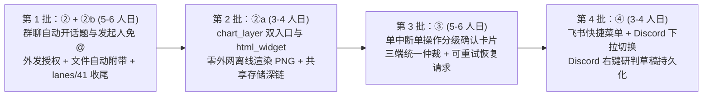

# 渠道第二阶段设计方案（飞书 / Discord / 个人微信，r2 修订版）

> **基线分支**：`docs/channel-phase2`（基于 `dalton/main` `305400a37`）  
> **前置分支**：`fix/channel-sandbox-links`（`lanes/41`，工作区沙箱路径改写登录深链）、`feat/external-member-perms-final`（外部成员服务端权限守卫）  
> **关联文档**：`docs/dalton/features/standalone-core.md`、`docs/dalton/features/external-member-permissions.md`（前置分支 `feat/external-member-perms-final` 新增）、`docs/dalton/features/weixin-multi-account.md`、`docs/dalton/features/cos-delivery-confirmation.md`  
> **文档状态**：r2 修订版（已按两份独立设计审查意见与三项定案全面修订，第七章方案待用户最终确认）

---

## 目录

- [一、背景、范围与架构准则](#一背景范围与架构准则)
  - [1.1 现状与演进顺序](#11-现状与演进顺序)
  - [1.2 范围边界](#12-范围边界)
  - [1.3 双形态部署、能力门控与上游钩子规范](#13-双形态部署能力门控与上游钩子规范)
  - [1.4 后续演进事项（本阶段范围之外）](#14-后续演进事项本阶段范围之外)
- [二、各项功能在三渠道的实现方案与接口契约](#二各项功能在三渠道的实现方案与接口契约)
  - [2.1 三渠道承载与降级总览](#21-三渠道承载与降级总览)
  - [2.2 功能 ②：群聊 `@机器人` 自动开话题与话题内免 `@` 继续对话](#22-功能-群聊-机器人-自动开话题与话题内免--继续对话)
  - [2.3 功能 ②a：交互图表与图表图层转图片并附网页交互版链接](#23-功能-a交互图表与图表图层转图片并附网页交互版链接)
  - [2.4 功能 ②b：回答生成文件自动附带与 `lanes/41` 链接收尾事项](#24-功能-b回答生成文件自动附带与-lanes41-链接收尾事项)
  - [2.5 功能 ③：可交互卡片与单中断单操作原生按钮总览](#25-功能-可交互卡片与单中断单操作原生按钮总览)
  - [2.6 功能 ④：机器人快捷菜单与 Discord 右键「转入 `<品牌名>` 研判」](#26-功能-机器人快捷菜单与-discord-右键转入-品牌名-研判)
- [三、确认卡片风险分级、身份核验与回调接入（功能 ③ 详设）](#三确认卡片风险分级身份核验与回调接入功能--详设)
  - [3.1 单中断单操作允许清单与风险四级分类表（L0–L3）](#31-单中断单操作允许清单与风险四级分类表l0l3)
  - [3.2 双地址卡片绑定、门禁只读校验与原子核销协议](#32-双地址卡片绑定门禁只读校验与原子核销协议)
  - [3.3 三端提交统一竞争、可重试恢复请求与网页端协同](#33-三端提交统一竞争可重试恢复请求与网页端协同)
  - [3.4 飞书 `card.action.trigger` 与 Discord 组件/弹窗回调接入](#34-飞书-cardactiontrigger-与-discord-组件弹窗回调接入)
- [四、安全、权限与文件过滤规则](#四安全权限与文件过滤规则)
  - [4.1 服务端资源来源与接收群外发授权](#41-服务端资源来源与接收群外发授权)
  - [4.2 外部成员发起交互时的权限范围](#42-外部成员发起交互时的权限范围)
  - [4.3 双路径白名单过滤与发送前实测复核](#43-双路径白名单过滤与发送前实测复核)
- [五、数据库变更设计（Dalton 迁移链）](#五数据库变更设计dalton-迁移链)
  - [5.1 群聊机器人话题登记表 `dalton_channel_bot_topics`（第 1 批新增）](#51-群聊机器人话题登记表-dalton_channel_bot_topics第-1-批新增)
  - [5.2 渠道交互令牌表与中断恢复竞争表（第 3 批新增）](#52-渠道交互令牌表与中断恢复竞争表第-3-批新增)
  - [5.3 Discord 右键研判一次性草稿表 `dalton_channel_context_menu_drafts`（第 4 批新增）](#53-discord-右键研判一次性草稿表-dalton_channel_context_menu_drafts第-4-批新增)
  - [5.4 存量表边界、迁移链顺接与滚动升级回退方案](#54-存量表边界迁移链顺接与滚动升级回退方案)
- [六、分批实施计划、测试与上线验收](#六分批实施计划测试与上线验收)
  - [6.1 批次划分总表](#61-批次划分总表)
  - [6.2 各批实施细节、测试用例与验收标准](#62-各批实施细节测试用例与验收标准)
- [七、已定方案（待用户最终确认）](#七已定方案待用户最终确认)

---

## 一、背景、范围与架构准则

### 1.1 现状与演进顺序

渠道网关（`integrations/dalton-channel-gateway/`，基于 TypeScript〔带静态类型的 JavaScript 超集语言〕独立进程运行，默认监听本机回环地址 `127.0.0.1:8962`，通过部署级单行租约 `dalton_channel_gateway_lease` 保持单活）负责衔接智能体对话后端与飞书、Discord、个人微信三个聊天端。目前已上线处理中表情与输入状态反馈（#499，`src/processing-feedback.ts`）以及个人微信多账号管理（#506/#507，`d049_weixin_multi_account.py`），前置分支 `fix/channel-sandbox-links`（`lanes/41`）完成了回复正文内工作区沙箱路径向网页登录深链的基础改写，前置分支 `feat/external-member-perms-final` 完成了外部成员在网页端的服务端访问守卫。

本设计覆盖渠道第二阶段的五项建设内容：

1. **② 群聊自动开话题与发起人免 `@` 追问**：在飞书群与 Discord 频道顶层 `@机器人` 提问时自动开启独立话题或 Thread（子区，Discord 频道内的独立讨论串），话题发起人在该话题内直接发送消息即可连续对话。
2. **②a 图表与图层转图片附网页交互链接**：将交互组件（`html_widget`）与专业看盘图表图层（`chart_layer`）在服务端离线隔离环境中渲染为高清 PNG（便携式网络图形无损图片格式）随回答发出，并附上打开网页交互视图的登录深链。
3. **②b 回答生成文件自动附带与链接收尾**：经服务端外发授权与双路径白名单校验后，按体积上限自动附带本轮可交付文件，同时完成 `lanes/41` 留待本批处理的引用式链接展开、自动化报告与数据任务通知携带会话编号生成深链、自动化完成摘要改写并保留工作区文件链接三项改造。
4. **③ 可交互卡片与单中断单操作原生按钮**：将澄清提问卡片升级为原生单选按钮、下拉框或弹窗输入；对命中「单中断、单操作」明确允许清单的低中风险确认操作提供渠道原生按钮，后端统一仲裁按钮点击、文字回复与网页提交并持久化可重试的恢复请求，其余操作统一提供网页端确认深链。
5. **④ 机器人快捷菜单与 Discord 消息右键研判**：提供飞书单聊输入框快捷菜单、Discord `/workspace` 下拉切换菜单与消息右键命令「转入 `<品牌名>` 研判」。

### 1.2 范围边界

为保持群聊阅读秩序、个人微信连接稳定性与团队数据隔离，第二阶段执行以下明确边界：

- **群聊采用整卡定稿投递**：群聊过程态统一展示轻量表情回应（飞书 `Typing`〔正在输入状态表情〕、Discord `⏳`），待本轮回答生成完毕后一次性发出排版完整的卡片。
- **个人微信采用单轮整条回复**：基于腾讯 iLink（腾讯面向个人智能体开放的微信连接协议）长轮询单聊通道，配合 `sendtyping`（正在输入状态信令）发送完整结论与精选附件。
- **后台任务统一在系统内管理**：研究进度、定时唤醒（`schedule_wakeup`）与自动化状态统一以 Dalton PostgreSQL（开源关系型数据库）记录为准。
- **按用户显式交互读取消息**：仅处理用户 `@机器人`、话题发起人在机器人所建话题内跟帖、显式合并转发或右键选中的单条消息；网关在入站解析阶段直接过滤其余普通群聊消息。

### 1.3 双形态部署、能力门控与上游钩子规范

全部实现严格遵循 `docs/dalton/features/standalone-core.md` 的双部署形态规范：

1. **统一形态解析与能力开关门控**：
   - 部署形态判断统一调用 `src.dalton.profile`（`resolve_profile()` 与 `DeploymentProfile.EVERFLOW` / `DeploymentProfile.CORE`）；能力启停判断统一调用 `src.dalton.capabilities`（`has_capability()`、`require_capability()`、`require_channel_platform_capability()`），前端统一调用 `web/src/hooks/useCapabilities.ts` 的 `useCapabilities()` 与 `web/src/config/brand.ts`。
   - 各子链路按最小所需能力精确门控：
     - 后端新增的 `channels_router.py` 内部端点全部登记入 `src/dalton/capabilities.py` 的 `DALTON_ROUTE_CAPABILITY_REGISTRY`：通用渠道端点绑定 `CapabilityId.CHANNEL_GATEWAY`，Discord 右键菜单草稿端点绑定 `(CapabilityId.CHANNEL_GATEWAY, CapabilityId.CHANNEL_DISCORD)`，并通过 `test_core_capabilities_gate.py` 门禁测试；
     - 运行期 `turn_deliverables` 产物汇总、图表快照渲染、`/messages/replay` 渠道元数据输出与网页确认同步占位仅在 `has_capability(CapabilityId.CHANNEL_GATEWAY)` 为真时执行；
     - 数据任务通知关联监控面板深链（读取 `src/dalton/monitors/data_job_registry.py`）仅在 `CapabilityId.CHANNEL_GATEWAY` 与 `CapabilityId.DATA_JOBS` 同时启用时加载并输出。
   - 在核心安装形态（`DALTON_PROFILE=core` / `APP_ENV=core`）下渠道能力默认关闭；当部署者显式开启对应渠道能力并填入机器人凭据时，本阶段全部能力直接运行，全程独立于宿主机桥接程序。
2. **网页地址与品牌名称全配置化**：
   - 后端统一通过 `src/dalton/settings.py` 的 `get_dalton_public_app_url()` 拼装深链；渠道网关在启动及健康对账中从后端内部状态接口同步公网地址，使网关 `src/config.ts` 的 `webBaseUrl` 与后端保持一致。
   - 当部署处于本机回环试用状态（公网地址为空，或主机名为 `localhost` / `127.0.0.1`）时，网关将链接展示为「请在网页端对应会话或工作区查看」文字指引。
   - 卡片标题、提示词与右键菜单文案统一通过 `src/dalton/settings.py` 的 `get_brand_name()`（读取环境变量 `BRAND_NAME`，`core` 形态默认 `Dalton`，`everflow` 形态默认 `Everflow`）动态生成。
3. **上游改动标记与路径登记**：
   - 触及上游共享源码文件（包括 `src/server/`、`src/ptc_agent/`、`src/tools/`、`libs/`、`web/` 下非 Dalton 专属文件）的每一处修改，均须附带 `# DALTON-HOOK(<topic>): <reason>` 或 `// DALTON-HOOK(<topic>): <reason>` 注释，并将新增钩子标识登记入 `scripts/dalton/check_hooks.sh`。
   - 新增 Dalton 专属文件若位于 `scripts/dalton/dalton_paths.txt` 既有前缀之外，须同步补登记路径，且**每一开发批次**均执行并通过 `bash scripts/dalton/check_hooks.sh --strict`。

### 1.4 后续演进事项（本阶段范围之外）

结合审查意见与范围收敛决议，以下扩展项归入后续迭代评估，本阶段四个批次保持聚焦交付：

1. **定时报告外发配置（`dalton_report_delivery`）的渠道按钮确认**：`src/dalton/tools/report_delivery_tools.py` 的 `action="set"` 当前通过模型参数流转，待 `docs/dalton/features/cos-delivery-confirmation.md` 将其改造为服务端 `hitl_confirm("dalton_report_delivery_set", ...)` 并落地多目标 `confirm_token` 后，再在后续迭代评估接入渠道 L2 确认卡片。
2. **CLI（Command-Line Interface，命令行工具）跨电脑审批的渠道按钮接入**：`src/server/dependencies/cli_approval.py` 与 `src/server/services/cli_approvals.py` 基于 Redis（内存键值数据库）待批记录与专用接口 `POST /api/v1/cli/approvals/{approval_id}/decision`（`src/server/app/cli_approvals.py:55`）独立运作，本阶段继续在网页端审批，后续按需评估独立渠道审批适配。
3. **单次暂停含多中断或多操作槽位的复合渠道卡片**：同一暂停内包含多个中断或单个中断内包含多个 `action_requests`（以及带 `order_decisions` 键值槽位的批量操作）时，本阶段统一引导至网页端 `answerBoard.ts` 完整面板处理；渠道端多槽位分布收集留待后续体验迭代。
4. **群话题全员免 `@` 开关与按核验结果细分的研报发布渠道审批**：本阶段固定执行「话题内仅发起人免 `@`」与「正式研报发布（`publish_approval`）固定网页端确认」；群级自定义免 `@` 策略与零疑问研报草稿移动端快捷审批留作后续治理演进方向。

---

## 二、各项功能在三渠道的实现方案与接口契约

### 2.1 三渠道承载与降级总览

| 功能项 | 飞书（Feishu）实现与降级 | Discord 实现与降级 | 个人微信（Weixin iLink）实现与降级 |
| --- | --- | --- | --- |
| **② 群聊开话题与发起人免 `@` 追问** | 前置开启 `im:message.group_msg` 权限；群顶层 `@` 回复传 `reply_in_thread: true` 自动创建话题（`omt_xxx`），话题发起人免 `@` 继续追问；原消息撤回（`230011`/`231003`/`230110`）时降级为普通群消息 | 频道顶层 `@` 区分会话键与父频道投递地址，首轮在父频道从原消息建公开子区，发起人在子区内免 `@` 追问；权限或活跃子区满额（`50013`/`160006`/`160007`）降级为父频道引用回复，原消息已删除（`10008`）发无引用简短提示 | 面向单聊（`weixin:@me`），群消息记为 `weixin_group_unsupported` 归档略过；单聊直接连续收发 |
| **②a 图表与图层转图片** | Schema 2.0（飞书第二代交互卡片规范）内嵌共享对象存储拉取的高清 PNG（`tag: "img"`）+ 底部 `open_url` 按钮 `[打开网页交互版]`；超 10 MB（兆字节）自动使用 1x 缩放或转 WebP（高压缩率网页图片格式） | `multipart/form-data`（多部分表单上传格式）附带高清 PNG + `ActionRow`（操作组件行容器）`Link Button`（外链按钮）`[打开网页交互版]`；对象存储或渲染器未就绪时发送文字结论 + 网页深链 | 正文后追加加密上传的 `IMAGE` 图片消息，公网地址可达时附纯文本交互深链；对象存储或渲染器未就绪时发送文字与深链 |
| **②b 文件自动附带与深链** | 经服务端外发授权后，≤10 MB 图片走 `im.image.create`，≤20 MB 文档走 `im.file.create`（`.html`〔HTML，HyperText Markup Language，超文本标记语言〕离线转 PDF〔Portable Document Format，便携式文档格式〕后复核体积）；超限或跨区文件输出网页登录深链 | 经服务端外发授权后，≤20 MB 可交付文件作为附件发送（`.html` 离线转 PDF 后复核体积）；超限、超 50 MB 总量或跨区文件输出网页登录深链 | ≤20 MB 自有工作区可交付文件经 AES-128-ECB（128 位高级加密标准电子密码本模式，`src/channels/weixin/cdn.ts`）加密上传 CDN（内容分发网络）作为 `IMAGE`/`FILE` 发送（单轮最多 3 个）；超限或跨区文件输出登录深链 |
| **③ 提问与单中断单操作按钮** | L0 提问渲染按钮组或 `form` 表单；允许清单内单中断单操作 L1 直接发 `[批准]` `[拒绝]` 按钮，L2 群聊自动发发起人飞书私聊二次确认卡（私聊送达失败时保留群内脱敏网页确认入口）；其余与 L3 出 `[前往网页端核对并确认]` 外链按钮 | L0 渲染 `Button` / `StringSelect` + `Modal`；允许清单内单中断单操作 L1 发按钮卡，L2 群频道发只读门禁卡 `[查看详情并确认]` 返回 `flags: 64` Ephemeral（仅点击者可见临时消息）确认卡；其余与 L3 出外链按钮 | L0 输出数字编号列表供直接回复；单中断 `credit_pause` 支持回复 `继续`；其余确认统一发送中文说明与网页端确认深链 |
| **④ 快捷菜单与右键研判** | 订阅 `application.bot.menu_v6` 响应单聊输入框上方 4 个固定菜单（返回研究总监、切换工作区卡片、新建对话、停止任务），保留 v7 `/` 命令 | 升级无参 `/workspace` 返回下拉切换菜单；注册消息右键命令（`type = 3`）「转入 `<品牌名>` 研判」，独立首次同步弹 `Modal` 并经 Postgres 一次性草稿落库流转 | 在 `/help` 与扫码成功欢迎语列出快捷指令，发送 `/workspace` 返回编号列表供回复切换 |

---

### 2.2 功能 ②：群聊 `@机器人` 自动开话题与话题内免 `@` 继续对话

#### （1）飞书实现、前置权限、入站前置过滤与降级

1. **平台权限前置条件（`im:message.group_msg`）**：
   - 飞书群内接收未显式 `@机器人` 的话题跟帖消息，依赖飞书开放平台应用开启群消息权限 **`im:message.group_msg`**（获取群组中所有消息）并发布应用版本审批生效，列为第 1 批上线前置条件。
   - 在权限尚未生效的过渡窗口内，群顶层 `@机器人` 自动创建话题以及在话题内继续通过 `@机器人` 追问均正常运作并归入同一话题会话。
2. **入站前置过滤（持久化和下载附件前直接丢弃无关群消息）**：
   - 开启 `im:message.group_msg` 后，飞书长连接（`src/channels/feishu/monitor.ts`）会收到机器人所在群的全部消息。为保持零冗余存储与零无效下载，在调用 `getMessageFeishu`、`downloadMessageResourceFeishu` 或后端 `I-1`（`register-and-resolve`）之前执行两步内存快速筛选：
     - 若群消息未 `@机器人` 且 `message.thread_id` 与 `message.root_id` 均为空，直接丢弃（普通群聊闲谈零落库、零后端请求）；
     - 若群消息未 `@机器人` 但携带 `thread_id` 或 `root_id`，先查网关内存 LRU（Least Recently Used，最近最少使用缓存，同时缓存已确认的机器人话题与短时效非机器人话题负缓存），缓存未命中时调用轻量只读接口 `/internal/topics/lookup`（**新增**）。仅当命中机器人参与的话题且 `senderOpenId === initiatorPlatformUserId`（话题发起人本人，见第七章定案 1）时，将 `event.threadScopeKey` 归一为已登记的 `canonical_scope_key` 并置 `event.isGroupTrigger = true` 继续进入后续流程；其余非机器人话题或非发起人普通跟帖在内存中直接略过。
3. **普通群顶层 `@` 自动创建话题与话题群兼容**：
   - 在普通群中，用户首次顶层 `@机器人` 发送消息 `om_root`（尚无 `thread_id`）时，飞书适配器 `src/channels/feishu/inbound-parse.ts` 与 `src/channels/feishu/targets.ts` 将初始 `threadScopeKey` 构造为 `chat:<chat_id>:topic:<om_root>`；在话题群中（消息自带 `message.thread_id = omt_xxx`），`threadScopeKey` 为 `chat:<chat_id>:thread:<omt_xxx>`。
   - 首条回复发出时，`src/orchestrator.ts` 对普通群顶层触发回合传入 `newThread: true, replyToMessageId: om_root`。`src/channels/feishu/send.ts` 调用 `im.message.reply` 并传入 `reply_in_thread: true`。
   - **话题回执持久化与同轮多片/重试复用**：飞书接口返回首条回复 `data.message_id` 及话题标识 `thread_id`（`omt_xxx`；若响应体未直接携带 `thread_id`，调用一次 `getMessageFeishu(first_reply_message_id)` 读取 `thread_id`）。网关通过 `I-7`（`deliveries/progress`）将 `bot_topic_registration` 随投递进度同事务写入新增表 **`dalton_channel_bot_topics`**（记录 `external_topic_id = omt_xxx`、`root_message_id = om_root`、`first_reply_message_id`、`canonical_scope_key` 与发起人身份），保持 `dalton_channel_deliveries.confirmed_thread_address` 专供 Discord 使用。同一轮后续文本分片、自动附带文件（②b）、图表卡片（②a）以及异常重试均通过 `dalton_channel_bot_topics`（按 `root_message_id` 或 `external_topic_id`）定位并以 `reply_in_thread: true` 投递至同一话题。
   - 话题发起人在该话题内直接发送 `/new`、`/stop`、`/workspace`、`/main` 斜杠指令同样免 `@` 生效。
4. **原消息撤回与建话题受限降级**：
   - 调整 `src/channels/feishu/send.ts` 的 `sendReplyOrFallbackDirect`（现行逻辑仅在 `replyInThread` 为假时回退）：当首轮建话题请求遇到原消息已撤回或已移除（飞书错误码 `230011`、`231003`、`230110`）或群设置限制创建话题时，自动回退调用 `im.message.create` 在群内直接发送回答，并保持 `dalton_channel_bot_topics` 无脏记录。

#### （2）Discord 实现、会话键与投递地址分离及降级

1. **会话键与已确认投递地址严格分离**：
   - 在已登记的服务器文字频道（`GuildText = 0`）或公告频道（`GuildAnnouncement = 5`）收到顶层 `<@botId>` 消息时，Discord 适配器 `src/channels/discord/inbound.ts` 将逻辑会话键 `threadScopeKey` 构造为 `chat:<guildId>/<channelId>:topic:<messageId>`（采用 `:topic:` 前缀标识顶层新开会话），同时保持出站 `targetAddress` 为父频道地址 `discord:<guildId>/<channelId>`，并标记 `inboundInExistingThread: false`。
   - 改造 `src/channels/discord/send.ts` 的 `sendMessageDiscord`：当 `params.newThread === true` 且 `confirmedThreadAddress` 为空时，直接对父频道 `parsed.channelId` 调用 `src/channels/discord/threading.ts` 的 `createThreadDiscord`（子区名称取清洗后的用户问题首行，按 UTF-16〔16 位统一码字符编码〕安全截断至 `100` 字符以内，自动归档时长 `60` 分钟），避免在子区尚未创建前对 `<messageId>` 执行频道读取。
   - `createThreadDiscord` 确认子区创建成功后，先通过 `onConfirmedThread` 走现有 `d036` 两阶段确认账本写入 `dalton_channel_deliveries.confirmed_thread_address = "discord:<guildId>/<parentChannelId>/thread/<threadId>"` 及 `discord_body_phase`，并同步通过 `I-7` 将 `(platform='discord', chat_address, external_topic_id=thread.id, root_message_id=messageId, canonical_scope_key)` 写入 `dalton_channel_bot_topics`；确认落库后再向新子区发送首条消息与后续附件。
   - 论坛频道（`GuildForum = 15`）与媒体频道（`GuildMedia = 16`）内的帖子本身已是子区（`type = 11`，`inboundInExistingThread: true`），直接在该子区内回复并登记 `dalton_channel_bot_topics`。
2. **子区内发起人免 `@` 继续对话**：
   - Discord 适配器 `src/channels/discord/index.ts` 收到子区消息（`type = 10 / 11 / 12`）且未包含 `<@botId>` 时，先查内存话题缓存或调用 `/internal/topics/lookup` 查询 `dalton_channel_bot_topics`；仅当确认为已登记机器人子区且发送者为子区发起人（`author.id === initiatorPlatformUserId`）时，将 `threadScopeKey` 归一为表内 `canonical_scope_key` 并置 `isGroupTrigger = true`；回复前若子区已自动归档，`ensureThreadUnarchived` 自动解封。无关子区的非 `@` 消息在入站前直接丢弃。
3. **建帖失败分类回退与未知结果复用**：
   - **确定性建帖拒绝回退**：复用 `src/channels/discord/threading.ts` 的 `isDefiniteThreadPostFailure`（HTTP〔超文本传输协议〕4xx 确定性错误）。细分两类回退处理：
     - 当因缺少 `CREATE_PUBLIC_THREADS` 权限（`403` / Discord 错误码 `50013`）或活跃子区数量达到上限（`400` / Discord 错误码 `160006` 或 `160007`）导致建帖被拒且原消息仍在时，自动回退在父频道携带 `message_reference: { message_id: replyToMessageId }` 引用回复；
     - 当因原触发消息已被删除（`404` / Discord 错误码 `10008`）导致建帖被拒时，省略 `message_reference`，在已授权父频道按权限发送一条不含原消息引用的简短完成提示（附网页会话登录深链），保持投递正常结案。
   - **超时与 5xx 结果未知保护**：当建帖请求遇到网络超时、连接中断或 HTTP 5xx 时，沿用 `threading.ts` 现有的 `adoptUnconfirmedThread(() => findThreadStartedFromMessage(...))` 查找复用与 `outcome: "unknown"` 持久化重试机制，确保同一回复只在一个目标位置发出。

#### （3）接口契约与群会话代数失效同步

- **扩展 `POST /api/v1/dalton/channels/internal/inbound/register-and-resolve`（`I-1`，已有端点新增可选字段）**：
  - 请求体新增可选字段：`external_topic_id?: string | null`、`root_message_id?: string | null`。
  - 当 `(platform, chat_address, external_topic_id)`（或 `root_message_id`）命中 `dalton_channel_bot_topics` 时，后端在事务内将 `scope_key` 归一为表内记录的 `canonical_scope_key`，刷新 `last_active_at`，并在响应中新增返回 `resolved_scope_key: string` 与 `topic_initiator_platform_user_id: string | null`。
- **扩展 `POST /api/v1/dalton/channels/internal/deliveries/progress`（`I-7`，已有端点新增可选字段）**：
  - 请求体新增可选对象 `bot_topic_registration?: { external_topic_id: string; root_message_id?: string | null; first_reply_message_id?: string | null; canonical_scope_key: string; initiator_platform_user_id: string }`，在首条回复确认话题后同事务 `INSERT ... ON CONFLICT DO UPDATE` 写入 `dalton_channel_bot_topics`。
- **新增 `POST /api/v1/dalton/channels/internal/topics/lookup`（新增端点，登记 `CapabilityId.CHANNEL_GATEWAY`）**：
  - 请求：`{ platform: "feishu" | "discord", chat_address: string, external_topic_id?: string | null, root_message_id?: string | null }`；
  - 响应：`{ found: boolean, canonical_scope_key: string | null, external_topic_id: string | null, first_reply_message_id: string | null, initiator_platform_user_id: string | null, initiator_dalton_user_id: string | null }`。
- **群会话代数失效覆盖 `:topic:` 作用域**：
  - 同步更新 `src/dalton/database/channel_gateway.py:4086-4122` 的 `_advance_group_chat_generations_in_tx` 及群解绑清理逻辑，将匹配条件扩展为 `scope_key = 'chat:' || %s OR scope_key LIKE 'chat:' || %s || ':thread:%%' OR scope_key LIKE 'chat:' || %s || ':topic:%%'`，使群绑定移除或重置时同步推进全部 `:thread:` 与 `:topic:` 话题会话代数并清理挂起中断。

---

### 2.3 功能 ②a：交互图表与图表图层转图片并附网页交互版链接

采用服务端无头 Chromium（开源无头浏览器渲染内核）**离线隔离渲染**高清 PNG 快照 + 共享对象存储持久化 + 网页交互版登录深链的统一架构，一次建设覆盖飞书、Discord、个人微信三端。

#### （1）后端离线隔离渲染、双入口持久化与共享对象存储

1. **看盘图表图层（`chart_layer`）同步与后台双入口快照生成**：
   - 复用 `libs/chartkit/chartkit/_renderer.py` 内置的工作线程渲染器 `RENDERER` 与离线打包页面 `chart-render.html`（运行在虚拟源 `https://chart-snapshot.invalid`，全程零外部网络请求，本地路由供给行情序列与图层数据并经 `_SETTLE_JS` 定帧）。
   - 同时接入两处图层落库出口（均标注 `DALTON-HOOK(channel-chart-snapshot)` 且仅在 `has_capability(CapabilityId.CHANNEL_GATEWAY)` 为真且当前会话关联渠道或渠道投递自动化时触发）：
     1) **同步工具出口**：`src/tools/chart_annotation/layers.py` 的 `_publish` 完成图层落库后；
     2) **后台命令结算出口**：`src/server/services/commands/settle.py`（`:230-241`）中脱离前台等待的后台命令通过 `cr_db.finalize` 持久化 `outbox_layers` 后。
   - 渲染出的 PNG（默认尺寸 `1200×720`）按内容寻址键 `channel-snapshots/{thread_id}/{sha256[:16]}/chart_{layer_id}.png` 通过 `src/utils/storage` 的 `upload_bytes` 写入**共享对象存储**（Everflow S3/R2 或核心安装内置 MinIO〔兼容 S3 协议的开源对象存储服务〕），并将快照元数据 `{ snapshot_key, sha256, size_bytes, width, height, artifact_type: "chart_layer", chart_id, layer_id, title }` 持久化写入当前运行记录元数据（供 SSE〔Server-Sent Events，服务端单向事件流〕实时 `event: artifact`、断线回放 `/messages/replay` 与后台命令汇报回合统一读取）。
2. **交互式 HTML 组件（`ShowWidget` / `html_widget`）零外网离线渲染**：
   - 在 `src/server/services/pdf_render.py`（标注 `DALTON-HOOK(channel-offline-render)`）现有的单例无头 Chromium、`_RENDER_SEMAPHORE` 信号量与 `_SETTLE_JS` 定帧脚本基础上，新增**离线隔离渲染函数** `render_widget_png(html, resolved_data, *, width=1200, max_height=2400, scale=2.0) -> bytes`（**新增**），供 `src/ptc_agent/agent/tools/show_widget.py`（标注 `DALTON-HOOK(channel-widget-snapshot)`）在渠道回合调用。
   - **严格零外部网络运行方式**：渲染上下文注入 `window.__WIDGET_DATA__`、标准亮色主题 CSS（层叠样式表）变量及强制离线 CSP（内容安全策略，`connect-src 'none'; img-src data: blob:; media-src data: blob:`）。Playwright `page.route("**/*", ...)` 拦截全部请求：对于组件常用的前端图表与排版库（`chart.js`、`echarts`、`lightweight-charts`、`d3`、`katex`）在 `cdnjs.cloudflare.com`、`cdn.jsdelivr.net`、`unpkg.com`、`esm.sh` 下的受控标准路径，直接由后端镜像内置的**本地可信静态副本**（经哈希校验打包在容器内）从磁盘返回；其余一切公网 HTTP/HTTPS 请求、携带查询串的数据请求、重定向响应、内网地址以及全部 `page.route_web_socket("**/*", ...)` 连接均在路由层直接阻断关闭，确保注入页面的工作区数据全程留在容器内存内。
   - 渲染生成的 PNG 同样存入共享对象存储 `channel-snapshots/{thread_id}/{sha256[:16]}/widget_{artifact_id}.png`，并将快照引用持久化写入组件产物记录与运行元数据。
3. **跨 worker 并发预算与优雅回退**：
   - 每个后端 worker 进程由 `_RENDER_SEMAPHORE` 限制本地并发，同时配合 Redis / PostgreSQL 轻量并发计数槽位将整套部署的自动渲染总并发控制在上限以内（默认全局上限 `2`，单张超时 `25` 秒，单回合最多自动渲染前 `4` 张图表）。
   - 当部署未启用共享对象存储（`is_storage_enabled()` 为假）、未安装 Chromium 或单次渲染超时失败时，记录结构化告警日志并省略 `snapshot_key`，网关照常发出完整文字分析与网页交互登录深链。
4. **内部快照读取接口与严格键格式校验**：
   - 在 `src/dalton/app/channels_router.py` 新增内部端点 `GET /api/v1/dalton/channels/internal/snapshots/{snapshot_key:path}`（**新增**，登记 `CapabilityId.CHANNEL_GATEWAY`）。
   - **严格键校验与外发鉴权**：首先解码并校验原始路径不含 `..`、反斜杠或二次编码，且严格匹配正则 `^channel-snapshots/([0-9a-f]{8}-[0-9a-f]{4}-[0-9a-f]{4}-[0-9a-f]{4}-[0-9a-f]{12})/([0-9a-f]{16})/[A-Za-z0-9_.-]+\.png$`；提取路径中的 `thread_id` 核验其归属 `X-User-Id`、核验该 `snapshot_key` 已登记在该会话的持久化快照清单中，并通过第四章 `channel_outbound_guard` 接收群外发授权后，调用 `src/utils/storage` 的 `get_bytes(snapshot_key)` 返回 `image/png` 字节流。
   - **网页交互深链定位**：
     - `html_widget`：`${WEB_BASE_URL}/chat/t/${threadId}?widget=${encodeURIComponent(artifactId)}`（若已发布为监控看板且对目标受众可见则使用 `/monitors/${slug}`）；
     - `chart_layer`：`${WEB_BASE_URL}/chat/t/${threadId}?chart=${encodeURIComponent(chartId)}&layer=${encodeURIComponent(layerId)}`；
     - 前端 `web/src/pages/ChatAgent/components/ChatView.tsx`（**新增参数解析**，标注 `// DALTON-HOOK(channel-deep-links)`）识别 `?widget=` 自动滚动高亮对应组件卡片，识别 `?chart=&layer=` 自动展开右侧看盘面板并定位到指定图层。

#### （2）网关收集与三渠道投递

- `src/orchestrator.ts` 在实时流（`consumeTurnSseStream`）、断线回放流（`deliverReplayFallback` / `consumeInFlightReplayRunStream`，读取 `/messages/replay` 返回的持久化快照清单）及后台唤醒/命令回报流（`consumeBackgroundRunStream`）中按 `artifact_id` 去重收集本轮快照。
- 在回合结算时（覆盖默认整轮回复与显式 `send_message` 后的图表补发）：
  - **飞书**：构造 Schema 2.0 卡片（`src/channels/feishu/format.ts`），调 `im.image.create` 上传 PNG（若超过飞书图片接口 `10 MB` 上限，自动压缩为 1x 尺寸或转 WebP 并复核体积），嵌入 `tag: "img"`（`preview: true`），底部放置 `open_url` 按钮 `[打开网页交互版]`。
  - **Discord**：将 PNG 作为消息附件上传，并附加含 `Link Button`（`style = 5`，标签 `打开网页交互版`）的 `ActionRow`。
  - **个人微信**：正文发出后，将 PNG 经 iLink CDN 加密上传并以 `IMAGE` 消息发出；公网 `webBaseUrl` 可达时在正文中附上 `网页交互版：<链接>`。

---

### 2.4 功能 ②b：回答生成文件自动附带与 `lanes/41` 链接收尾事项

#### （1）本轮可交付文件持久化记录、双源收集与离线转 PDF

1. **本轮新写/覆盖文件的准确持久化记录（`turn_deliverables`，新增）**：
   - 为准确识别 `Write`、`Edit`、`ExecuteCode`、`Bash` 在本轮实际产出的可交付文件（排除回合开始前已存在的历史旧文件，并准确捕获同名覆盖更新文件），在渠道回合（`has_capability(CapabilityId.CHANNEL_GATEWAY)` 为真）执行以下记录机制（标注 `DALTON-HOOK(channel-deliverables)`）：
     - 回合运行开始（及后台命令启动）时，对本回合工作区根目录下的可交付后缀文件记录轻量基线指纹映射 `path -> (mtime_ns, size_bytes)`；
     - 回合运行结算写入 `event: run_end`（`src/server/services/runs/stream_writer.py` 与 `src/server/services/runs/sse_producer.py`）前，合并本轮成功执行的 `Write`/`Edit` 目标路径、`image_capture` 捕获图片路径以及沙箱工作区内相较回合基线新增或 `(mtime_ns, size_bytes)` 发生变化的文件（对同名文件进一步比对内容 `sha256` 确认实际更新），经后端双路径白名单（§4.3）筛选后，按 `(thread_id, run_id)` 持久化写入运行记录元数据字段 `turn_deliverables: Array<{ workspace_id: string; path: string; size_bytes: number; sha256: string }>`；后台命令在 `commands/settle.py` 结算后将其新产出的可交付文件归入触发的汇报回合运行记录。
     - 实时流终点事件 `event: run_end` 与断线回放接口 `GET /api/v1/threads/{thread_id}/messages/replay`（`src/server/app/threads/messaging.py:1376`）**读取同一份持久化 `turn_deliverables` 清单**，保证实时投递与断流重试结果一致。
2. **双源合并与私聊/群聊范围区分**：
   - **来源一（回复正文引用）**：网关在代码块与行内代码之外通过 `sandbox-links.ts`（前置分支 `fix/channel-sandbox-links` 新增）识别出的工作区文件路径；
   - **来源二（本轮持久化产物）**：`run_end` 与 `/messages/replay` 返回的本回合自有工作区 `turn_deliverables`。
   - 剔除本轮已由 `send_message(files=[...])` 显式发出的文件及 ②a 已发出的图表快照后，统一交由后端外发授权接口（§4.1）裁决：**私聊**按「正文点名自有工作区文件优先 -> 本轮新写自有工作区可交付文件次之」附带；**群聊**仅从「最终回复正文中显式点名且位于本回合自有工作区的可交付文件」中附带；所有跨工作区引用（`__wsref__/<workspaceId>/<path>`）与受限来源文件统一输出需登录鉴权的网页深链。
3. **`.html` 报告零外网离线转 PDF 与配额复核降级**：
   - 命中自有工作区 `.html` / `.htm` 可交付报告文件时，后端调用 `src/server/services/pdf_render.py` 的 `render_workspace_pdf` 并启用 **§2.3（1）同款离线隔离模式**（仅放行本工作区同源静态文件请求且逐跳阻断一切重定向、公网/内网外部请求与 WebSocket，前端图表库由本地可信副本供应）生成 `.pdf` 字节流。
   - 对转换后的 `.pdf` 结果（及其他待发文件）实测复核文件魔数与实际字节大小：单文件 `≤ 20 MB`（飞书内联图片 `≤ 10 MB`，`10–20 MB` 图片自动走 `im.file.create` 文件消息）、单轮自动附带飞书/Discord 最多 `5` 个（个人微信最多 `3` 个）、整轮总附件 `≤ 50 MB`。超出配额或离线渲染超时的文件在回复末尾追加说明：`📎 <文件名> — 请前往网页查看：<登录深链>`。
4. **渠道提示词同步说明**：
   - 更新网关 `src/types.ts` 的 `buildSurfaceRules`：指引模型在正文中用本工作区相对路径书写生成的文件链接（网关自动转为登录深链并按规则附带可交付文件），需指定顺序时可调用 `send_message(files=[...])`。合入前执行提示词语言规范审查。

#### （2）纳入 `lanes/41` 推迟的三项链接收尾改造

1. **Markdown（轻量级纯文本标记语法）引用式链接展开与跨工作区目标保留**：
   - 在 `sandbox-links.ts`（跳过围栏代码块与行内代码）新增引用式链接解析器：提取正文中的链接定义行 `[ref]: destination "optional title"`（标签长度上限 `512` 字符）。
   - **完整复用 `lanes/41` 的路径分类、编码与降级规则**：当 `destination` 为跨工作区引用 `__wsref__/<targetWorkspaceId>/<path>` 时，保留目标工作区标识并改写为 `${WEB_BASE_URL}/chat/${targetWorkspaceId}?file=${encodedPath}`（仅改写深链，保持在群聊附件候选集之外）；当命中本回合工作区路径时改写为 `${WEB_BASE_URL}/chat/t/${threadId}?file=${encodedPath}`（无 `threadId` 但有 `workspaceId` 时生成 `/chat/${workspaceId}?file=${encodedPath}`）；将正文中引用的 `[文字][ref]`、`[ref][]` 原地展开为标准内联链接 `[文字](深链)`，兼容飞书富文本与微信文本过滤器。
2. **自动化报告与数据任务通知携带会话与工作区编号生成深链**：
   - **自动化通知与报告链路**：在 `src/dalton/database/automation_notifications.py` 的 `decide_automation_notification_plan`（`:406`）与 `src/dalton/database/automation_reports.py`（`:296-313`，报告投递行存储于 `dalton_notify_deliveries`）中，通过关联查询 `automation_executions.conversation_thread_id` 与 `automations.workspace_id`，在返回的通知计划顶层新增字段 `thread_id: string | null` 与 `workspace_id: string | null`。网关 `src/automation-notifications.ts` 与 `src/data-task-notifications.ts` 将 `threadId` 与 `workspaceId` 传入 `sandbox-links.ts`，按上述分类规则把正文与飞书 GFM（GitHub 扩展 Markdown）段落中的工作区路径（含 `__wsref__`）改写为对应登录深链。
   - **脚本数据任务链路**：在 `src/dalton/database/data_task_notifications.py` 中，当 `CapabilityId.CHANNEL_GATEWAY` 与 `CapabilityId.DATA_JOBS` 同时启用、任务已在 `src/dalton/monitors/data_job_registry.py` 绑定监控看板、公网地址已配置且通过 `src/dalton/monitors/permissions.py` 受众可见性校验时，在通知计划中附带 `monitor_url`（新增字段）供卡片底部生成「查看监控面板」链接；宿主机本地路径统一展示为纯文件名文本。
3. **自动化完成摘要保留并改写工作区文件链接**：
   - 在 `src/dalton/notify/dispatch.py`（现行 `_strip_non_http_markdown_links` 位于 `:705`）新增 `rewrite_workspace_links_for_external(text, *, public_base, thread_id=None, workspace_id=None)`（**新增函数**）：在构造自动化完成通知摘要卡片与纯文本时，复用同一路径分类器将合规工作区文件链接（含引用式链接与 `__wsref__`）改写为对应登录深链；当 `public_base` 未配置或命中排除目录时转为纯文本标签。
   - 同步调整 `dispatch.py` 的 `_truncate_section_body`（`:845`）与 `_truncate_line_at_punct`（`:792`）：按链接的可见显示文字长度计入摘要字数预算，并通过 `truncate_preserving_markdown_links`（`:672`）保持截断位置落在完整链接边界之外。

---

### 2.5 功能 ③：可交互卡片与单中断单操作原生按钮总览

- **提问卡片（`AskUserQuestion`，`src/ptc_agent/agent/middleware/ask_user.py`）**：
  - **飞书**：构造 Schema 2.0 卡片。单题单选且选项数 `≤ 5`、每项字数 `≤ 20` 时，渲染一组 `button`（点击回传对应选项）；多选（`allow_multiple: true`）或选项数 `> 5` 时，渲染 `form` 容器包裹 `select_static` / `multi_select_static` 下拉框 + 1 个可选补充说明 `input` + 提交按钮，旁配 `[跳过]` 按钮。
  - **Discord**：单题单选 `≤ 5` 项渲染 `ActionRow` `Button`；多选或 `6–25` 项渲染 `StringSelect`（设置 `min_values` / `max_values`）；附 `[填写其他回答]` 按钮（点击弹出 `Modal` 多行文本框）与 `[跳过]` 按钮。
  - **个人微信与全端文字兼容**：微信继续输出清晰的编号列表（`1. ... 2. ...`）；飞书与 Discord 在发出按钮卡片的同时，继续支持用户直接打字回复序号或自由文本作答，与按钮点击在后端竞争同一待确认状态（§3.3）。
- **确认卡片（收窄为「单中断、单操作」明确允许清单）**：
  - 仅当当前暂停仅含 **1 个待处理中断**、该中断仅含 **1 个操作项**（或为顶层 `credit_pause`）且类型命中 §3.1 明确允许清单时，按后端判定的 L1（当前会话按钮确认）或 L2（飞书私聊二次确认卡 / Discord 只读门禁 + 私密确认卡）渲染渠道原生按钮；其余所有单操作与多中断/多操作复合暂停统一渲染 `[前往网页端核对并确认]` 登录深链入口。

---

### 2.6 功能 ④：机器人快捷菜单与 Discord 右键「转入 `<品牌名>` 研判」

#### （1）机器人快捷菜单

1. **飞书机器人单聊自定义菜单**：
   - 在飞书开发者后台配置单聊输入框上方 4 个快捷菜单项（菜单键统一为 `dalton:menu:<action>`）：
     - `返回研究总监`（`dalton:menu:main`）：切回个人 `Home` 研究总监会话；
     - `切换工作区`（`dalton:menu:workspace`）：查询用户名下可访问工作区，返回带工作区下拉框与快捷按钮的 Schema 2.0 卡片，点击完成 `/workspace <id>` 切换；
     - `新建对话`（`dalton:menu:new`）：在当前工作区推进会话代数（`generation + 1`）开启新对话；
     - `停止当前任务`（`dalton:menu:stop`）：停止当前会话正在运行的回合。
   - 网关在 `src/channels/feishu/monitor.ts` 的 `eventDispatcher.register` 中订阅 `"application.bot.menu_v6"`（复用现有 `WSClient` 长连接），提取 `operator.operator_id.open_id` 与 `event_key`，通过 `I-3`（`internal/session/command`）执行并向单聊返回反馈。`src/native-commands/feishu-registrar.ts` 已有的 4 个飞书 v7 `/` 命令保持并存，并在同步命令输出中附带自定义菜单配置自检提示。
2. **Discord 斜杠菜单增强**：
   - 在现有 `/main`、`/workspace`（含实时自动补全）、`/new`、`/stop` 基础上，当用户无参数执行 `/workspace` 时，在 `flags: 64` Ephemeral 响应中附带 `StringSelect` 工作区下拉菜单（展示最近活跃的最多 25 个可写工作区），支持点选一键切换。
3. **个人微信快捷指引**：
   - 在扫码连接成功欢迎语与 `/help` 回复中列出 `/main`、`/workspace`、`/new`、`/stop`、`/unbind` 指令说明；发送无参 `/workspace` 时返回带序号的工作区列表，支持回复 `/workspace <序号或名称>` 切换。

#### （2）Discord 右键消息菜单「转入 `<品牌名>` 研判」

1. **命令声明与复合键幂等同步**：
   - 在 `src/native-commands/manifest.ts` 与 `src/native-commands/discord-registrar.ts` 新增一条消息上下文菜单命令（`ApplicationCommandType.Message = 3`，全局 `contexts: [0, 1]` 覆盖服务器频道与机器人私聊）。命令名称按 `get_brand_name()` 动态生成：默认 `转入 Dalton 研判`（Everflow 环境按配置生成 `转入 Everflow 研判` 或自定义 `转入 <BRAND_NAME> 研判`，按 UTF-16 安全截断至 32 字符以内）。
   - 扩展 `discord-registrar.ts` 的 `indexRemoteDiscordCommands` 按 `(name, commandType)` 复合键索引，通过定向 `POST` / `PATCH` 幂等同步。
2. **独立首次同步弹 `MODAL` 分支与 Postgres 一次性草稿持久化**：
   - Discord 消息右键命令首次回调（`INTERACTION_CREATE`，`type = 2, data.type = 3`）携带 `data.target_id` 与 `data.resolved.messages[target_id]`（含被选消息正文、作者、时间与附件元数据），后续弹窗提交回调（`MODAL_SUBMIT`，`type = 5`）仅携带 `custom_id` 与表单输入值，且 Discord 协议要求 `MODAL`（`type = 9`）作为首次交互响应直接同步返回（独立于常规命令的 `DEFERRED_CHANNEL_MESSAGE_WITH_SOURCE` `type = 5` 延迟应答分支）。为此建立完整的两步持久化协议：
   - **第 1 步（独立解析与同步弹框前预备）**：
     - 在 `src/channels/discord/interactions.ts` 新增解析分支 `kind: "message_context_command"`；在 `src/channels/discord/index.ts` 的 `dispatchInteraction`（`:675` 通用延迟应答之前）设置专门处理分支，在 `2.0` 秒预算内调用后端新增接口 **`POST /api/v1/dalton/channels/internal/context-menu/prepare`**（登记 `(CapabilityId.CHANNEL_GATEWAY, CapabilityId.CHANNEL_DISCORD)`）。
     - 后端核验点击者在 `dalton_channel_identities` 的绑定状态与成员等级（`src/dalton/access_tiers.py::get_user_tier`）：未绑定账号时网关同步返回 `flags: 64` 绑定引导提示；外部成员（`tier == "external"`）在服务器频道触发时同步返回 `flags: 64` 提示「外部成员请通过机器人私聊使用」；校验通过时，后端查询源频道是否属于 `dalton_channel_chat_bindings` 已授权群频道（决定 `allow_public_thread`），生成 128 位随机 `draft_nonce`，将点击者、源频道、被选消息快照与附件描述列表写入 **Postgres 一次性短期表 `dalton_channel_context_menu_drafts`**（**新增**，有效期 `15` 分钟，见 §5.3）。
     - 网关在 3 秒窗口内直接同步返回 `MODAL`（`type = 9`，`custom_id = "dlt:ctx:<draft_nonce>"`），包含可选多行输入框「补充研判问题（留空则核查事实并提炼要点）」；当 `allow_public_thread` 为真时额外展示投递位置选择项，**默认选中「发到我的机器人私聊」**，可选「在当前频道新建子区公开讨论」（未授权频道固定发往本人私聊，见第七章定案 2）。
   - **第 2 步（弹窗提交重验、目标工作区一致上传与结果回执）**：
     - 收到 `MODAL_SUBMIT`（`type = 5`）时，网关先同步返回 `DEFERRED_CHANNEL_MESSAGE_WITH_SOURCE`（`type = 5, flags = 64`）私密延迟占位响应，随即调用后端新增接口 **`POST /api/v1/dalton/channels/internal/context-menu/consume`**。
     - 后端在单事务内按 `draft_nonce_hash` 执行 `consumed_at IS NULL AND expires_at > NOW()` 原子核销，**重新校验点击者平台身份、当前 `dalton_channel_identities` 绑定、成员等级以及所选投递去向权限**（选「新建子区公开讨论」时重验源频道仍在 `dalton_channel_chat_bindings` 白名单且成员为 `admin` 或 `internal`），并解析该投递去向对应的**目标会话与目标工作区 ID**（发往本人私聊时取用户私聊当前活跃工作区或个人 `Home`；发往频道子区时取该群会话下发起人的对应工作区），确保跨网关重启与多后端 worker 一致。
     - 网关通过 `src/channels/discord/inbound.ts` 的 `downloadDiscordAttachment`（强制 HTTPS 与 Discord CDN 域名白名单校验；若用户在弹窗停留期间附件临时签名过期且机器人在源频道具备历史消息读取权限，按源频道与 `target_message_id` 刷新一次附件地址）下载合规附件并上传至**上述解析出的同一目标工作区**，将被选消息格式化为引用块拼合补充问题后通过 `I-1` 与 `POST /api/v1/threads/{thread_id}/messages` 启动回合。
     - **回合创建后补发深链与私信关闭兜底**：待后端创建/解析出 `thread_id` 并接纳回合后，网关调用 `PATCH /webhooks/{app_id}/{interaction_token}/messages/@original` 将点击者的私密响应更新为含精确登录深链 `${WEB_BASE_URL}/chat/t/${thread_id}` 的确认提示；当投递目标为本人私聊且遇到用户关闭服务器成员私信（Discord 错误码 `50007`）返回投递受限时，网关利用该次 `MODAL_SUBMIT` 有效期 15 分钟的 `interaction_token` 追加/更新仅点击者本人可见的 `flags: 64` 提示，告知私信受限并附上网页会话深链供直接查看研判结果。

---

## 三、确认卡片风险分级、身份核验与回调接入（功能 ③ 详设）

### 3.1 单中断单操作允许清单与风险四级分类表（L0–L3）

1. **后端权威分类与「单中断、单操作」准入规则**：
   - 改造网关 `src/orchestrator.ts` 的 `handleInterruptEvent`（`:7187-7261`，现行逻辑把所有带 `action_requests` 的中断统一归入 `web_only_approval`）：当飞书或 Discord 会话收到中断事件时，网关将原始中断载荷提交至后端 `POST /api/v1/dalton/channels/internal/action-tokens/mint`（**新增**），由后端统一完成准入判定与风险定级。
   - **单中断、单操作准入条件**：仅当目标 `(thread_id, run_id)` 当前挂起的中断总数为 **`1`**，且该中断满足「顶层 `credit_pause`」或「`len(action_requests) == 1`（槽位索引固定为 `0`）且 `action_requests[0].type` 命中下表 L0 / L1 / L2 允许清单」时，后端签发渠道交互令牌并返回对应级别；凡同一暂停内包含多个中断、单个中断包含多个 `action_requests`、或类型不在允许清单内的暂停，后端统一返回 `L3`（仅渲染网页端确认深链，交由前端 `web/src/pages/ChatAgent/session/interrupts/answerBoard.ts` 按完整多槽位协议处理）。

2. **真实中断类型与风险四级分类表**：

| 风险级别 | 精确中断类型标识与后端代码位置 | 分级判定条件（签发与核销双端校验） | 飞书承载方式 | Discord 承载方式 | 个人微信承载方式 | 快捷按钮有效期（TTL） |
| --- | --- | --- | --- | --- | --- | --- |
| **L0 澄清提问** | `ask_user_question`（`src/ptc_agent/agent/middleware/ask_user.py:60`，工具 `AskUserQuestion`） | 单题澄清提问（`action_requests[0].type == "ask_user_question"`） | Schema 2.0 按钮组或 `form` 下拉/输入框 + `[跳过]`（兼容打字回复） | `Button` / `StringSelect` + `[填写其他回答]` `Modal` + `[跳过]`（兼容打字回复） | 数字编号文本列表，回复序号或文字作答 | **6 小时**（随会话代数有效） |
| **L1 低风险确认** | 1. `ptc_agent`（`src/tools/secretary/dispatch.py:366`，对应 `chief_of_staff.py` 工具 `delegate_to_analyst`）<br>2. `create_workspace`（`src/tools/secretary/tools.py:388`，对应 `manage_workspaces(action="create")`）<br>3. `credit_pause`（`src/ptc_agent/agent/middleware/credit_gate.py:704`）<br>4. `dalton_notify_add_personal_target`（`src/dalton/tools/notify_tools.py:715`，工具 `dalton_notify_settings`）<br>5. `dalton_notify_test`（`src/dalton/tools/notify_tools.py:852`，工具 `dalton_notify_settings`） | 1. `ptc_agent`：目标 `workspace_id` 属于**调用者本人自有工作区**（`workspace.user_id == dalton_user_id`）；<br>2–3. 单操作直接归入 L1；<br>4. `dalton_notify_add_personal_target`：目标地址属于**调用者本人已绑定私信集合**；<br>5. `dalton_notify_test`：解析出的 `targets` 全部属于**调用者本人已绑定私信集合** | 当前会话直接发卡片：`[批准]`、`[拒绝]`、`[拒绝并附言]` 按钮 | 当前会话直接发组件卡：`[批准]`、`[拒绝]`、`[拒绝并附言]` 按钮 | `credit_pause` 支持回复 `继续`（可带补充说明）；其余发中文摘要 + 网页端确认深链 | **30 分钟** |
| **L2 中风险确认** | 1. `delete_thread`（`src/tools/secretary/tools.py:812`，对应 `manage_threads(action="delete")`）<br>2. `ptc_agent`（`delegate_to_analyst`）<br>3. `dalton_notify_set_route`（`src/dalton/tools/notify_tools.py:537`，工具 `dalton_notify_settings`）<br>4. `dalton_notify_add_personal_target` / `dalton_notify_test`（含群聊或他人目标时） | 1. `delete_thread`：单会话删除；<br>2. `ptc_agent`：目标工作区属于**同事共享可写工作区**（`cos_access == "rw"`）；<br>3. `dalton_notify_set_route`：设置任务推送路由；<br>4. `dalton_notify_add_personal_target` 或 `dalton_notify_test` 的目标包含**群聊/频道或非调用者本人私信** | **私聊**：发完整参数卡 + 带原生 `confirm` 二次确认弹窗的 `[批准]` 按钮；<br>**群聊/话题**：群内发脱敏提示（附网页链接兜底），完整确认卡自动发往发起人飞书私聊（`feishu:user:<open_id>`）；私聊不可达时保留群内脱敏网页确认入口 | **私聊**：发完整参数卡 + `[确认执行]` `[取消]` `[拒绝并附言]`；<br>**群频道/子区**：先发脱敏只读门禁卡 `[查看详情并确认]`，发起人点击后返回 `flags: 64` 私密详情确认卡 | 发送中文风险摘要 + 网页端确认深链 | **10 分钟** |
| **L3 固定网页端确认** | 1. `order_approval`（`src/ptc_agent/agent/middleware/order_governance.py:331` 全部下单/改单/撤单/期权行权）<br>2. `delete_workspace`（`src/tools/secretary/tools.py:641`）、电脑移除、删除定时任务<br>3. `publish_approval` / `publish_report`（`src/dalton/publish/service.py:2340`，见第七章定案 3）、公开分享与监控受众放开（`src/server/app/artifacts/records.py`、`src/dalton/monitors/`）<br>4. OAuth（开放授权协议）与外部连接器授权，以及全部多中断/多操作暂停 | 命中任一高风险类型、未在 L0–L2 允许清单内，或单次暂停含多中断/多 `action_requests` | 发送风险说明卡片 + 原生外链按钮 `[前往网页端核对并确认]` | 发送风险说明卡片 + `Link Button` `[前往网页端核对并确认]` | 发送中文说明 + 网页端确认深链 | 网页端登录会话内确认 |

- **独立于本表的两类确认说明**：
  - **`dalton_notify_settings` 三项动作全量托管 `confirm_token`**：`dalton_notify_set_route`（`notify_tools.py:559`）、`dalton_notify_add_personal_target`（`:731`）与 `dalton_notify_test`（`:876`）在工具恢复后均会重算并校验 `decisions[0].confirm_token`。后端在签发上述三项动作的 L1 / L2 令牌时，统一将中断载荷中的 `confirm_token` 存入表列 `server_confirm_token`，并在批准恢复时写入 `hitl_response[interrupt_id].decisions[0].confirm_token`（同时对齐 `web/src/pages/ChatAgent/session/interrupts/toolApprovalCard.ts:138` 填入 `order_decisions[action_type]`），完整通过工具侧二次重算校验。
  - **CLI 跨电脑审批与 `dalton_report_delivery`**：CLI 跨电脑审批继续通过网页端专用接口 `POST /api/v1/cli/approvals/{approval_id}/decision`（读取 Redis 待批记录）处理；定时报告外发配置 `dalton_report_delivery` 归入后续迭代（§1.4）。

---

### 3.2 双地址卡片绑定、门禁只读校验与原子核销协议

1. **客户端按钮零业务载荷编码**：
   - 按钮回调标识仅携带 128 位随机 `approval_nonce`（Base64URL 编码，22 字符）与动作枚举，总长度控制在 40 字符以内（满足 Discord `custom_id` 100 字符上限）：
     - 确认动作：`dlt:apv:<approval_nonce>:<approve|reject|gate|reason>`
     - 提问动作：`dlt:ask:<approval_nonce>:<opt_idx|submit|skip|custom>`
2. **原会话与承载卡片双地址分离记录**：
   - 为准确表达飞书群聊 L2（原会话在群话题 `feishu:oc_xxx`、确认卡发往私聊 `feishu:user:ou_xxx`）与普通卡片的差异，`dalton_channel_action_tokens` 分别存储：
     - **原会话来源字段**：`origin_chat_type`（`'dm' | 'group'`）、`origin_chat_address`、`origin_scope_key`、`session_generation`；
     - **实际承载卡片字段**：`card_chat_type`（`'dm' | 'group'`）、`card_chat_address`、`card_message_id`（卡片发出后由网关立即调用 `POST /api/v1/dalton/channels/internal/action-tokens/bind-card`〔**新增**〕写入绑定）。
   - 当飞书群聊触发 L2 且向发起人飞书私聊发送确认卡遇到权限或不可达失败时，网关保留原群内的脱敏提示卡并附上 `[前往网页端核对并确认]` 外链按钮，并将该渠道令牌置为 `superseded`，确保用户可直接转往网页端完成确认。
3. **Discord L2 门禁按钮（`:gate`）独立只读校验（保持待确认态）**：
   - 点击群频道内的 `[查看详情并确认]`（`dlt:apv:<nonce>:gate`）时，网关调用专用只读校验端点 **`POST /api/v1/dalton/channels/internal/action-tokens/inspect-gate`**（**新增**）：
     - 核验 `platform == 'discord'`、点击者 `clicker_platform_user_id == row.initiator_platform_user_id`、回调频道匹配 `row.card_chat_address` 且消息 ID 匹配 `row.card_message_id`、当前 `dalton_channel_identities` 仍绑定同一 `dalton_user_id`、成员等级属于 `admin` 或 `internal`、`expires_at > NOW()`、令牌未消费且底层检查点中断仍待确认；
     - 校验通过后返回 `prompt_summary`，网关以 `CHANNEL_MESSAGE_WITH_SOURCE`（`type = 4, flags = 64`）向发起人本人单独展示含完整参数与 `[确认执行]`、`[取消]`、`[拒绝并附言]` 按钮的私密详情卡，**保持 `consumed_at` 为空且保持会话处于待确认暂停态**；待发起人在该私密详情卡上点击具体决定按钮时，再进入下方核销与恢复流程。
4. **提交决定时的六步全量复核（`POST /api/v1/dalton/channels/internal/action-tokens/consume`，新增）**：
   - **第 1 步（提取平台可信身份与校验卡片归属）**：飞书取长连接回调 `operator.open_id`，Discord 取已验明 `application_id` 的 Gateway 事件 `member.user.id` / `user.id`；校验回调所在会话匹配 `row.card_chat_address`，且公开/私聊持久卡片的回调消息 ID 等于 `row.card_message_id`（Discord `flags: 64` 私密详情卡校验其 `origin_chat_address` 与已通过门禁记录）。
   - **第 2 步（重验发起人身份与当前账号绑定）**：核对 `clicker_platform_user_id == row.initiator_platform_user_id`，并在同事务内反查 `dalton_channel_identities` 确认该平台账号当前仍绑定于同一个 `row.dalton_user_id`。身份未匹配时返回 `403 clicker_mismatch`，向点击者单独返回私密轻提示「此项操作由发起人本人确认」，原卡片维持待确认状态。
   - **第 3 步（重验原群权限与成员等级）**：只要 `row.origin_chat_type == 'group'`（包括在飞书私聊点击源自群话题的 L2 卡片），同事务重查 `src/dalton/access_tiers.py::get_user_tier(dalton_user_id)` 确认仍为 `admin` 或 `internal`，并重查 `dalton_channel_chat_bindings` 确认 `row.origin_chat_address` 仍处于已绑定启用状态。
   - **第 4 步（校验过期时间与会话代数）**：以数据库时钟核对 `expires_at > NOW()`，并核对 `dalton_channel_session_generations` 中 `(platform, origin_scope_key, dalton_user_id)` 的当前 `generation == row.session_generation`。超期记录更新为 `consumed_via = 'expired'` 并返回 `410 token_expired`，网关将卡片更新为「快捷确认已过期，请前往网页端处理」并保留网页跳转按钮。
   - **第 5 步（校验实时检查点分支、待确认参数摘要与动态归属）**：读取 `thread_id` 当前分支最新检查点（对齐 `src/server/handlers/checkpoint_handler.py::settle_resume_request`），确认当前分支尖端仍挂起 `(row.run_id, row.interrupt_id)`，重算挂起中断的参数摘要校验 `live_args_sha256 == row.args_sha256`（L0 选项索引同时核对 `options_snapshot` 边界），并对 `ptc_agent` 重新核查目标工作区当前归属/共享写权限与 `row.risk_tier` 一致（例如签发后工作区被收回写权限或变更为他人工作区时拒绝直接放行）。
   - **第 6 步（竞争同一待确认状态并持久化可重试恢复请求）**：在同一数据库事务内写入 `dalton_channel_interrupt_resumes`（§3.3）抢占 `(thread_id, run_id, interrupt_id)` 唯一决定权，同时将该中断下当前令牌标为 `consumed_via = 'channel'`、同中断其他未消费令牌标为 `consumed_via = 'superseded'`，生成并返回带稳定 `request_key` 的恢复指令。

---

### 3.3 三端提交统一竞争、可重试恢复请求与网页端协同

为彻底消除「令牌已核销但网关退出未恢复」「后端繁忙暂拒导致确认丢失」以及「按钮点击、打字回复、网页端提交三方并发重复恢复」，后端建立以 **`(thread_id, run_id, interrupt_id)`** 为唯一主键的待确认仲裁与可重试恢复表 **`dalton_channel_interrupt_resumes`**（**新增**，见 §5.2）：

1. **三端提交竞争同一待确认主键**：
   - **渠道按钮提交**（`/internal/action-tokens/consume`）：完成 §3.2 六步校验后，在事务内执行 `INSERT INTO dalton_channel_interrupt_resumes (thread_id, run_id, interrupt_id, settled_via, ...) VALUES (..., 'channel_button', ...) ON CONFLICT (thread_id, run_id, interrupt_id) DO NOTHING RETURNING *`，写入确认决定、拼装好的 `hitl_response`（单中断单槽位结构对齐 `answerBoard.ts:47-65`）及确定性幂等键 `request_key = "hitl-resume:<thread_id>:<run_id>:<interrupt_id>"`，初始状态置为 `resume_status = 'pending_dispatch'`。
   - **渠道文字回复提交**（L0 回复数字/文本或微信 `credit_pause` 回复 `继续`）：网关在派发恢复前先调用 **`POST /api/v1/dalton/channels/internal/interrupt-resumes/claim-text`**（**新增**），在后端事务内校验当前分支与会话代数后抢占同一 `(thread_id, run_id, interrupt_id)` 行（`settled_via = 'channel_text'`，`resume_status = 'pending_dispatch'`），并同事务将该中断关联的未消费 `dalton_channel_action_tokens` 更新为 `consumed_via = 'text_reply'`，随后网关异步置灰已发按钮卡片。
   - **网页端提交**（`POST /api/v1/threads/{thread_id}/messages` 携带 `hitl_response`，在 `src/server/handlers/chat/` 入口标注 `DALTON-HOOK(channel-interrupt-settle)`，当 `CHANNEL_GATEWAY` 启用时生效）：在进入 `settle_resume_request` 与运行准入前，后端先对本次 `hitl_response` 覆盖的每个 `interrupt_id` 执行同表原子占位（`settled_via = 'web', resume_status = 'admitted'`），并同事务将关联 `dalton_channel_action_tokens` 标为 `consumed_via = 'web'`、清理 `dalton_channel_session_generations.pending_interrupt`。若某 `interrupt_id` 已被渠道抢先确认，网页请求收到 `409 already_settled_in_channel` 提示刷新会话；若网页抢先占位成功，后续渠道点击或打字收到 `already_consumed`（返回 `settled_via = 'web'`）并将渠道卡片刷新为「已在网页端处理」。
2. **接纳后再更新卡片终态与持久化恢复重试**：
   - 网关拿到 `pending_dispatch` 恢复指令后，使用固定的 `request_key = "hitl-resume:<thread_id>:<run_id>:<interrupt_id>"` 调用 `POST /api/v1/threads/{thread_id}/messages`（后端 `src/server/handlers/chat/ptc_run.py:349` 的 `run_named_by_key` 原生保证同一 `request_key` 重试幂等复用同一运行）。
   - **接纳后更新终态**：在后端正式接纳恢复运行（返回 SSE 流且首包无准入拒绝）后，网关调用 **`POST /api/v1/dalton/channels/internal/interrupt-resumes/ack`**（**新增**）将 `resume_status` 更新为 `'admitted'`，**此时再将飞书/Discord 卡片刷新为最终已处理状态（`已批准` / `已拒绝` / `已提交回答`）**；等待接纳期间卡片展示过渡态「已收到确认，正在恢复执行…」。
   - **进程退出与后端暂拒自愈**：若网关在核销事务提交后意外退出重启，或后端因并发容量（`writer_capacity` / `429` / `503` / `running`）暂时拒绝本次恢复请求，持久化在 `dalton_channel_interrupt_resumes` 中处于 `pending_dispatch` 状态的记录由网关启动恢复流程（`/internal/recover` `mode=startup` 扩展返回待恢复列表）及周期重试协程按指数退避重新以同一 `request_key` 发起恢复，直至成功接纳（更新为 `admitted` 并刷新卡片）或遇到检查点分支已演进的确定性终态冲突（更新为 `terminal_failed` 并在卡片附上网页会话链接）。
3. **网页端确认通道常驻可用**：
   - 渠道按钮的 10 分钟 / 30 分钟 TTL 仅作用于聊天窗口快捷令牌；令牌过期且尚未产生确认决定时，`dalton_channel_interrupt_resumes` 无占位行，用户随时可通过卡片上的网页深链在浏览器中核对并完成确认。

---

### 3.4 飞书 `card.action.trigger` 与 Discord 组件/弹窗回调接入

#### （1）飞书 `card.action.trigger` 长连接接入

- **平台配置**：在飞书开发者后台「事件与回调 -> 回调配置」开启**使用长连接接收回调**并添加 `card.action.trigger`，直接复用现有出站 `WSClient` 长连接（应用版本变更由租户管理员审批发布生效）。发出的交互卡片统一声明 `config.update_multi: true`，使全群或单聊视图同步展示最新状态。
- **3 秒回调时限与两阶段卡片刷新**：
  - 在 `src/channels/feishu/monitor.ts` 的 `eventDispatcher.register` 中注册 `"card.action.trigger"` 处理器。
  - 点击「拒绝并附言」按钮时，卡片内展开或切换带原因 `input` 的 `form` 表单提交；点击确认/单选/表单提交时，处理器在 `2.2` 秒窗口内调用 `/action-tokens/consume`：核销通过后先同步返回过渡态卡片 `{ toast: { type: "info", content: "已记录，正在恢复执行…" }, card: { type: "raw", data: resumingCard } }` 满足飞书 3 秒回调窗口；待后台 `dispatchHitlResumeTurn` 确认后端已接纳运行（`ack`）后，调用 `PATCH /open-apis/im/v1/messages/:open_message_id` 将卡片更新为终态。

#### （2）Discord `MESSAGE_COMPONENT` 与 `MODAL_SUBMIT` 接入

- **连接与鉴权**：复用现有 Gateway WebSocket 的 `INTERACTION_CREATE` 事件与 `verifiedApplicationId` 核验。
- **解析与三类响应分流**：
  - 在 `src/channels/discord/interactions.ts` 扩展 `parseDiscordInteractionCreate`，在 `type = 2`（应用命令，含新增 `data.type = 3` 消息右键命令）与 `type = 4`（自动补全）之外，新增解析 `type = 3`（`MESSAGE_COMPONENT`）与 `type = 5`（`MODAL_SUBMIT`）。
  - 在 `src/channels/discord/interaction-response.ts` 补齐对应响应路径：
    1) **点击确认 / 单选 / 下拉提交**：先在 1.5 秒内返回 `DEFERRED_UPDATE_MESSAGE`（`type = 6`）或过渡态 `UPDATE_MESSAGE`（`type = 7`），完成 `/action-tokens/consume` 与后端运行接纳（`ack`）后编辑原卡片消息将组件置为终态禁用态；
    2) **点击「拒绝并附言」或「填写其他回答」**：首次回调经只读校验未消费后，直接同步返回 `MODAL`（`type = 9`）弹出私密输入框；收到 `MODAL_SUBMIT` 后执行核销、等待运行接纳并刷新原卡片；
    3) **点击群频道 L2 门禁按钮（`:gate`）**：调用 `/action-tokens/inspect-gate` 校验发起人身份与来源通过后，返回 `CHANNEL_MESSAGE_WITH_SOURCE`（`type = 4, flags = 64`）向发起人本人展示含完整参数的私密确认卡。

---

## 四、安全、权限与文件过滤规则

### 4.1 服务端资源来源与接收群外发授权

发入飞书群/话题或 Discord 频道/子区的原生图片（②a）与原生文件附件（②b），对该群或频道内的全体成员（含未绑定 Dalton 账号的平台成员）直接可见。现有 `src/dalton/colleague_outbound_guard.py:388` 的 `is_run_outbound_blocked` 专门面向受限分析师（`analyst`）轮次，对研究总监（`chief_of_staff`）固定返回 `False`（`:400`），而工作区下载接口 `src/server/app/workspace_files/crud.py:1075` 按发起人的网页读取权限判定。为建立完整严密的群聊外发边界，在后端新增统一的**渠道资源外发授权模块 `src/dalton/channel_outbound_guard.py`**（**新增**）与内部授权端点 **`POST /api/v1/dalton/channels/internal/outbound/authorize-resources`**（**新增**，登记 `CapabilityId.CHANNEL_GATEWAY`），覆盖**实时回复、断线回放、后台唤醒/命令/分析师回报以及建帖失败降级投递**全部四条出站路径，并同时管控 **②a 图表快照、②b 文件附件与自动化通知卡片摘要**：

1. **全角色跨工作区来源追踪（覆盖 `chief_of_staff` 与 `analyst`）**：
   - 在保留现有 `is_run_outbound_blocked`（分析师轮次）的基础上，在研究总监跨区工具入口（`src/tools/secretary/chief_of_staff.py` 的 `list_files`、`read_file`、`copy_file` 以及 `agent_output` 读取非本人自有工作区线程，标注 `DALTON-HOOK(channel-outbound-guard)`）与 `colleague_workspace` 工具上，为当前运行持久化写入 `colleague_source_touched = True` 标记，并对 `copy_file` 落入 `Home` 或本人工作区的目标路径登记跨区来源记录。
2. **按资源来源与实际接收目标分级放行**：
   - **个人私聊目标（`chat_type == 'dm'`）**：接收人为已验证绑定的 `dalton_user_id` 本人。允许发送本回合自有工作区（`workspace_id == turn_workspace_id` 且属主为本人）产出的图表快照与合规文件附件；对于跨工作区引用（`__wsref__/<otherWorkspaceId>/<path>`）或带跨区复制标记的文件，统一输出需登录鉴权的网页深链（`/chat/<otherWorkspaceId>?file=...`），由浏览器打开时实时执行同事共享权限与只读二进制限制（`crud.py:1097`）检查。
   - **群聊/频道目标（`chat_type == 'group'`）**：同时满足以下四项条件时，才允许将文件或图表快照作为群原生附件/图片发出；其余情形统一转换为需登录鉴权的网页深链：
     1) **接收群实时有效**：`(platform, target_chat_address)` 在 `dalton_channel_chat_bindings` 中处于已绑定启用状态，且发起人当前等级为 `admin` 或 `internal`（公司级自动化按任务绑定的已授权群路由校验）；
     2) **严格本工作区自有来源**：文件必须位于本回合所属工作区（`workspace_id == turn_workspace_id`）且工作区属主为发起人本人（或公司级任务对应工作区），且正文中已显式引用点名该路径；**一切 `__wsref__/<otherWorkspaceId>/<path>` 跨工作区路径与兄弟工作区路径统一只改写为网页登录深链**；
     3) **整轮零同事受限数据源触碰**：本轮运行的 `is_run_outbound_blocked` 与 `colleague_source_touched` 均为 `False`，且目标文件无跨区复制标记（一旦本轮读取或复制过同事共享工作区资料，该轮在群聊中的 ②a 图表快照与 ②b 自动文件统一降级为网页登录深链）；
     4) **通过双路径白名单与转换后体积/类型复核**（见 §4.3）。
3. **网页深链与监控看板的登录鉴权边界**：
   - 渠道发出的会话深链（`/chat/t/<threadId>?...`）与工作区深链（`/chat/<workspaceId>?...`）均为纯前端路由地址，群成员点击后统一经过 Dalton 登录认证（核心安装 `local` 会话或 Everflow `supabase` 会话）并由后端逐请求核验会话或目标工作区读取权限。
   - 监控看板链接（`/monitors/<slug>`）严格对齐 `src/dalton/monitors/models.py:22` 的四档可见性枚举（**`own`、`members`、`company`、`public`**）及 `src/dalton/monitors/permissions.py` 的服务端权限校验。

### 4.2 外部成员发起交互时的权限范围

严格对齐前置分支 `feat/external-member-perms-final`（`docs/dalton/features/external-member-permissions.md`）与 `src/dalton/database/channel_gateway.py` 现有隔离模型：

1. **群聊交互面向内部成员与管理员开放**：飞书群/话题与 Discord 频道/子区内的机器人对话、免 `@` 话题跟帖、群斜杠命令、群卡片按钮与服务器频道消息右键研判统一面向管理员（`admin`）与内部成员（`internal`）开放；外部成员（`tier == "external"`）在群聊场景触发时，后端记录 `external_member_group_forbidden`，交互回调仅向其本人返回「外部成员请通过机器人私聊使用」提示。
2. **外部成员私聊交互边界**：
   - 外部成员可在已绑定的飞书私聊、Discord 私聊或开启 `allow_external` 的个人微信私聊中正常发起对话、接收本人自有工作区产出的图表快照 PNG 与 `≤ 20 MB` 可交付文件、使用 L0 提问按钮与本人自有工作区的 L1 确认按钮，以及使用私聊快捷菜单。
   - 外部成员访问网页深链与监控看板时，统一受 `feat/external-member-perms-final` 落地的服务端守卫约束（仅可访问本人自有工作区/会话及显式授权给其 `members` 名单或 `public` 的看板）。

### 4.3 双路径白名单过滤与发送前实测复核

后端在生成 `turn_deliverables` 与执行外发授权读取文件前，统一执行双路径（原始路径 + 解析符号链接后真实路径）过滤与发送前实测复核：

1. **原始路径与符号链接解析路径双重校验**：
   - 在读取工作区文件字节或启动 HTML 转 PDF 前，同时对**请求传入的工作区相对路径**与**沙箱/工作区根目录下解析全部符号链接后的真实路径（`realpath`）**执行边界与目录/后缀检查：要求真实路径严格落在当前工作区根目录之内，且原始路径与真实路径的任一层级均避开排除目录、双方扩展名均命中可交付白名单。
2. **可交付扩展名白名单（小写匹配，参考前端 `web/src/pages/ChatAgent/utils/filePaths.ts` 并做渠道安全收紧）**：
   - 文档：`.pdf`、`.docx`、`.doc`、`.md`、`.markdown`、`.txt`、`.rtf`、`.odt`
   - 表格：`.xlsx`、`.xlsm`、`.xls`、`.csv`、`.tsv`（收紧排除 `filePaths.ts` 中的二进制中间列存 `.parquet`）
   - 演示文稿：`.pptx`、`.ppt`（收紧排除 `filePaths.ts` 中的 `.key`，规避与私钥文件 `*.key` 同后缀风险）
   - 图片：`.png`、`.jpg`、`.jpeg`、`.gif`、`.webp`、`.bmp`（收紧排除可执行脚本矢量的原始 `.svg` 直接外发）
   - 网页报告：`.html`、`.htm`（经 §2.4 离线无外网 `render_workspace_pdf` 转为 `.pdf` 后发送，并在正文中附网页端预览深链）
3. **排除目录与排除后缀清单（原始路径或 `realpath` 任一命中即排除）**：
   - **排除目录前缀**：`.agents/`、`_internal/`、`uploads/`、`.git/`、`node_modules/`、`__pycache__/`、`.venv/`、`.pytest_cache/`、任何以 `.` 开头的隐藏文件或隐藏目录（如 `.env`、`.env.*`、`.DS_Store`），以及任何含 `..` 或控制字符的路径。
   - **排除后缀**：`.py`、`.sh`、`.bash`、`.zsh`、`.js`、`.mjs`、`.cjs`、`.ts`、`.tsx`、`.jsx`、`.sql`、`.ipynb`、`.r`、`.go`、`.rs`、`.json`、`.jsonl`、`.yaml`、`.yml`、`.toml`、`.ini`、`.cfg`、`.conf`、`.lock`、`.log`、`.pem`、`.key`、`.crt`、`.parquet`、`.feather`、`.arrow`、`.pkl`、`.pickle`、`.db`、`.sqlite`、`.sqlite3`、`.duckdb`、`.h5`、`.npz`、`.zip`、`.tar`、`.gz`、`.tgz`、`.7z`、`.svg`。
4. **基于实际发送产物复核类型与体积**：
   - 对直接发送的原始文件、`.html` 离线转换产出的 `.pdf` 字节流以及渲染压缩后的图表图片，在实际上传渠道前按最终字节流复核文件头魔数（如 PDF `%PDF-`、PNG/JPEG/WebP 魔数）与体积配额（单文件 `≤ 20 MB`，飞书内联图片 `≤ 10 MB`，整轮合计 `≤ 50 MB`，飞书/Discord 单轮自动附带最多 `5` 个、个人微信最多 `3` 个）。

---

## 五、数据库变更设计（Dalton 迁移链）

所有数据库变更均写入 Dalton Alembic（数据库表结构版本迁移工具）迁移链 `src/dalton/migrations/versions/`。当前 `dalton/main` 头节点为 `d052`（`d052_embedding_metadata_and_dimension.py`），并行批次集成后排在 `d050` / `d051` 之后，具体迁移版本号在各批开发合入时顺接当时的唯一 `head` 确定。全部迁移遵循纯增量建表（`SET LOCAL lock_timeout = '5s'`），共新增 **4 张自有表**（第 1 批 1 张、第 3 批 2 张、第 4 批 1 张）：

### 5.1 群聊机器人话题登记表 `dalton_channel_bot_topics`（第 1 批新增）

持久化飞书自动创建的话题（`omt_xxx`、根消息 `om_xxx` 与首条回复 `first_reply_message_id`）及 Discord 自动创建的子区，保证首轮根消息作用域、同轮后续分片/附件重试以及网关重启后的发起人免 `@` 跟帖全部归一到同一会话：

```sql
CREATE TABLE IF NOT EXISTS dalton_channel_bot_topics (
    platform VARCHAR(32) NOT NULL,                    -- 'feishu' | 'discord'
    chat_address VARCHAR(255) NOT NULL,               -- 如 'feishu:oc_xxx' | 'discord:<guild>/<parent>'
    external_topic_id VARCHAR(255) NOT NULL,          -- 飞书 omt_xxx 或 Discord thread_id
    root_message_id VARCHAR(255) NULL,                -- 触发开帖的原消息 ID (om_xxx / message_id)
    first_reply_message_id VARCHAR(255) NULL,         -- 首条成功落入话题的回复消息 ID，供后续分片/重试定位
    canonical_scope_key VARCHAR(255) NOT NULL,        -- 归一后的会话 scope_key
    initiator_dalton_user_id VARCHAR(255) NOT NULL,   -- 话题发起人 Dalton user_id
    initiator_platform_user_id VARCHAR(255) NOT NULL, -- 话题发起人平台 ID (open_id / user.id)
    created_at TIMESTAMPTZ NOT NULL DEFAULT NOW(),
    last_active_at TIMESTAMPTZ NOT NULL DEFAULT NOW(),
    PRIMARY KEY (platform, chat_address, external_topic_id)
);

CREATE INDEX IF NOT EXISTS idx_dalton_channel_bot_topics_root
    ON dalton_channel_bot_topics (platform, chat_address, root_message_id)
    WHERE root_message_id IS NOT NULL;
```

### 5.2 渠道交互令牌表与中断恢复竞争表（第 3 批新增）

1. **渠道交互一次性令牌表 `dalton_channel_action_tokens`（新增）**：分别记录原会话来源与实际承载卡片地址及 `card_message_id`，托管 `dalton_notify_settings` 三动作的 `server_confirm_token`：

```sql
CREATE TABLE IF NOT EXISTS dalton_channel_action_tokens (
    token_hash VARCHAR(64) PRIMARY KEY,               -- SHA-256(approval_nonce)
    platform VARCHAR(32) NOT NULL,                    -- 'feishu' | 'discord'
    dalton_user_id VARCHAR(255) NOT NULL,
    initiator_platform_user_id VARCHAR(255) NOT NULL,
    origin_chat_type VARCHAR(16) NOT NULL CHECK (origin_chat_type IN ('dm', 'group')),
    origin_chat_address VARCHAR(255) NOT NULL,        -- 触发中断的原会话地址
    origin_scope_key VARCHAR(255) NOT NULL,           -- 触发中断的原会话 scope_key
    session_generation INTEGER NOT NULL,
    card_chat_type VARCHAR(16) NOT NULL CHECK (card_chat_type IN ('dm', 'group')),
    card_chat_address VARCHAR(255) NOT NULL,          -- 实际承载确认卡片的会话地址（飞书群 L2 为发起人私聊地址）
    card_message_id VARCHAR(255) NULL,                -- 渠道已发卡片 message_id，发送后立即绑定并在回调时校验
    gate_verified_at TIMESTAMPTZ NULL,                -- Discord 群 L2 门禁通过时间戳（只读校验记录，保持未消费）
    thread_id UUID NOT NULL,
    run_id VARCHAR(255) NOT NULL,
    interrupt_id VARCHAR(255) NOT NULL,
    risk_tier VARCHAR(8) NOT NULL CHECK (risk_tier IN ('L0', 'L1', 'L2')),
    action_type VARCHAR(128) NOT NULL,
    args_sha256 VARCHAR(64) NOT NULL,
    server_confirm_token VARCHAR(128) NULL,           -- 托管 dalton_notify_set_route / add_personal_target / test 的 confirm_token
    options_snapshot JSONB NULL,                      -- L0 提问选项快照
    prompt_summary JSONB NOT NULL DEFAULT '{}'::jsonb,
    expires_at TIMESTAMPTZ NOT NULL,
    consumed_at TIMESTAMPTZ NULL,
    consumed_via VARCHAR(32) NULL CHECK (
        consumed_via IS NULL
        OR consumed_via IN ('channel', 'web', 'text_reply', 'superseded', 'expired')
    ),
    created_at TIMESTAMPTZ NOT NULL DEFAULT NOW()
);

CREATE INDEX IF NOT EXISTS idx_dalton_channel_action_tokens_interrupt
    ON dalton_channel_action_tokens (thread_id, run_id, interrupt_id);

CREATE INDEX IF NOT EXISTS idx_dalton_channel_action_tokens_expires
    ON dalton_channel_action_tokens (expires_at)
    WHERE consumed_at IS NULL;
```

2. **待确认中断统一竞争与可重试恢复表 `dalton_channel_interrupt_resumes`（新增）**：协调渠道按钮、渠道文字回复与网页端提交竞争同一 `(thread_id, run_id, interrupt_id)`，并持久化可重试的恢复请求：

```sql
CREATE TABLE IF NOT EXISTS dalton_channel_interrupt_resumes (
    thread_id UUID NOT NULL,
    run_id VARCHAR(255) NOT NULL,
    interrupt_id VARCHAR(255) NOT NULL,
    settled_via VARCHAR(32) NOT NULL CHECK (settled_via IN ('channel_button', 'channel_text', 'web')),
    settled_by_user_id VARCHAR(255) NOT NULL,
    platform VARCHAR(32) NULL,                        -- 'feishu' | 'discord' | 'weixin'（web 提交为 NULL）
    token_hash VARCHAR(64) NULL,
    request_key VARCHAR(255) NOT NULL,                -- 稳定幂等键 'hitl-resume:<thread_id>:<run_id>:<interrupt_id>'
    resume_payload JSONB NULL,                        -- 渠道恢复完整请求载荷（供网关重启或后端暂拒后重试）
    card_chat_address VARCHAR(255) NULL,
    card_message_id VARCHAR(255) NULL,
    resume_status VARCHAR(32) NOT NULL CHECK (
        resume_status IN ('pending_dispatch', 'admitted', 'terminal_failed')
    ),
    attempt_count INTEGER NOT NULL DEFAULT 0,
    next_retry_at TIMESTAMPTZ NULL,
    last_error TEXT NULL,
    created_at TIMESTAMPTZ NOT NULL DEFAULT NOW(),
    updated_at TIMESTAMPTZ NOT NULL DEFAULT NOW(),
    PRIMARY KEY (thread_id, run_id, interrupt_id)
);

CREATE INDEX IF NOT EXISTS idx_dalton_channel_interrupt_resumes_pending
    ON dalton_channel_interrupt_resumes (next_retry_at, created_at)
    WHERE resume_status = 'pending_dispatch';
```

### 5.3 Discord 右键研判一次性草稿表 `dalton_channel_context_menu_drafts`（第 4 批新增）

绑定 Discord 右键消息初次回调（`APPLICATION_COMMAND` `type = 3`）与弹窗提交回调（`MODAL_SUBMIT` `type = 5`），支持网关重启恢复与提交时权限复核：

```sql
CREATE TABLE IF NOT EXISTS dalton_channel_context_menu_drafts (
    draft_nonce_hash VARCHAR(64) PRIMARY KEY,         -- SHA-256(draft_nonce)
    platform VARCHAR(32) NOT NULL DEFAULT 'discord' CHECK (platform = 'discord'),
    dalton_user_id VARCHAR(255) NOT NULL,
    clicker_platform_user_id VARCHAR(255) NOT NULL,
    source_chat_type VARCHAR(16) NOT NULL CHECK (source_chat_type IN ('dm', 'group')),
    source_chat_address VARCHAR(255) NOT NULL,
    source_channel_id VARCHAR(255) NOT NULL,
    target_message_id VARCHAR(255) NOT NULL,
    allow_public_thread BOOLEAN NOT NULL DEFAULT FALSE,
    message_snapshot JSONB NOT NULL,                  -- 被选消息脱敏正文、作者显示名、时间戳与附件元数据列表
    expires_at TIMESTAMPTZ NOT NULL,                  -- 默认 NOW() + INTERVAL '15 minutes'
    consumed_at TIMESTAMPTZ NULL,
    created_at TIMESTAMPTZ NOT NULL DEFAULT NOW()
);

CREATE INDEX IF NOT EXISTS idx_dalton_channel_ctx_drafts_expires
    ON dalton_channel_context_menu_drafts (expires_at)
    WHERE consumed_at IS NULL;
```

### 5.4 存量表边界、迁移链顺接与滚动升级回退方案

1. **存量表职责边界（逐项对照代码核实）**：
   - `dalton_channel_deliveries.confirmed_thread_address` 与 `discord_body_phase`（`d036_discord_confirmed_thread.py`、`channel_gateway.py:7993`）：保持专用于 Discord 两阶段建帖确认；飞书话题回执独立存入 `dalton_channel_bot_topics`。
   - `dalton_channel_deliveries.files_status`（`d030_channel_gateway.py`）：继续记录出站附件投递状态。
   - `dalton_notify_deliveries`（`src/dalton/database/automation_reports.py:307`）、`automations`、`automation_executions`：直接关联查询 `automations.workspace_id` 与 `automation_executions.conversation_thread_id` 为自动化通知与报告批次构造深链。
   - `dalton_channel_inbound_events`、`dalton_channel_session_generations`、`dalton_channel_gateway_lease`（`d049_weixin_multi_account.py`）：本阶段新增网关内部写接口同样纳入部署级租约 `epoch` 校验体系。
2. **标准启用顺序与平滑回退流程**：
   - **每批上线顺序**：① 执行纯增量 Alembic 迁移建表 → ② 部署新版后端（新增请求与响应字段全部设为可选向后兼容，迁移后至网关重启前的窗口内旧网关正常收发与回执） → ③ 部署并重启新版渠道网关 → ④ 应用对应批次的平台后台配置或执行一次 `dalton-native-commands` 命令同步。
   - **逐批停用与回退方式**：数据库保留已创建的增量新表（零破坏存量读写）；第 1/2 批回退网关版本即可恢复普通群回复与纯链接交付；第 3 批可通过配置开关切回纯文本提问与网页确认深链，已发出的历史按钮卡片在旧后端或停用态下点击时引导前往网页端确认（网页确认入口全程可用）；第 4 批回退网关后执行一次 `dalton-native-commands` 即可撤销新增的右键消息菜单命令。

---

## 六、分批实施计划、测试与上线验收

### 6.1 批次划分总表

按「**第 1 批（② + ②b 含 `lanes/41` 收尾项）→ 第 2 批（②a）→ 第 3 批（③）→ 第 4 批（④）**」分 4 批顺序推进，每批均可独立合入主分支并独立上线：



| 批次 | 覆盖范围 | 数据库迁移（顺接合入时 `head`） | 平台后台配置变更 | 预估工作量 | 前置依赖 |
| --- | --- | --- | --- | --- | --- |
| **第 1 批** | **②** 群聊自动开话题与发起人免 `@` 追问 + **②b** 服务端外发授权、双路径过滤、离线 HTML 转 PDF 自动附带 + `lanes/41` 三项收尾 | 新增 `dalton_channel_bot_topics` 表 | 飞书后台申请开启 `im:message.group_msg` 权限并发布应用版本 | **5–6 人日** | `fix/channel-sandbox-links`（`lanes/41`）与 `feat/external-member-perms-final` 合入 |
| **第 2 批** | **②a** `chart_layer`（同步+后台命令双入口）与 `html_widget` 零外网离线转高清 PNG（共享对象存储）+ 网页交互深链 | 无 | 无（复用现有图片上传权限） | **3–4 人日** | 第 1 批 |
| **第 3 批** | **③** `AskUserQuestion` 原生按钮/表单 + 单中断单操作允许清单 L1/L2 原生按钮 + 三端竞争与可重试恢复 + L3 网页确认卡 | 新增 `dalton_channel_action_tokens` 与 `dalton_channel_interrupt_resumes` 表 | 飞书后台开启长连接回调 `card.action.trigger` 并发布应用版本；Discord 免新增权限 | **5–6 人日** | 第 2 批 |
| **第 4 批** | **④** 飞书单聊菜单 + Discord `/workspace` 下拉切换 + Discord 右键「转入 `<品牌名>` 研判」一次性草稿流转 | 新增 `dalton_channel_context_menu_drafts` 表 | 飞书配置机器人菜单并订阅 `application.bot.menu_v6` 发布版本；Discord 执行一次 `dalton-native-commands` 同步 | **3–4 人日** | 第 3 批 |

---

### 6.2 各批实施细节、测试用例与验收标准

#### 第 1 批：群聊自动开话题免 `@`（②）+ 服务端外发守卫、产物自动附带与链接收尾（②b）

- **主要改动文件**：
  - **后端 Dalton 文件**：迁移脚本 `src/dalton/migrations/versions/d05X_channel_bot_topics.py`（**新增**）、`src/dalton/channel_outbound_guard.py`（**新增**）、`src/dalton/app/channels_router.py`、`src/dalton/capabilities.py`（登记新增路由）、`src/dalton/database/channel_gateway.py`、`src/dalton/notify/dispatch.py`、`src/dalton/database/automation_notifications.py`、`src/dalton/database/automation_reports.py`、`src/dalton/database/data_task_notifications.py`。
  - **后端上游文件（均加 `DALTON-HOOK`）**：`src/server/services/pdf_render.py`（离线隔离渲染模式与本地前端库路由）、`src/server/services/runs/sse_producer.py` 与 `src/server/services/runs/stream_writer.py`（`run_end` 携带持久化 `turn_deliverables`）、`src/server/app/threads/messaging.py`（`/messages/replay` 返回 `turn_deliverables`）、`src/tools/secretary/chief_of_staff.py`（登记 `colleague_source_touched`）。
  - **网关文件**：`src/sandbox-links.ts`（前置分支新增，本批扩展引用式链接）、`src/types.ts`、`src/config.ts`、`src/backend-client.ts`、`src/orchestrator.ts`、`src/delivery-service.ts`、`src/data-task-notifications.ts`、`src/automation-notifications.ts`、飞书端 `inbound-parse.ts` / `targets.ts` / `send.ts` / `monitor.ts`、Discord 端 `inbound.ts` / `index.ts` / `send.ts` / `threading.ts`。
- **测试覆盖（Vitest〔TypeScript 单元测试框架〕+ `pytest`〔Python 单元测试框架〕）**：
  1. **飞书话题与前置过滤**：普通群顶层 `@` 发送 `reply_in_thread: true` 并写入 `dalton_channel_bot_topics`（保持 `confirmed_thread_address` 为空）、同轮多片与附件复用话题回执、发起人免 `@` 跟帖命中原 `canonical_scope_key`、非发起人无 `@` 跟帖与普通群闲谈在下载附件和 `I-1` 落库前直接丢弃、未开启 `im:message.group_msg` 时显式 `@` 正常续聊、原消息撤回（`230011`/`231003`）自动回退普通群消息、群会话失效覆盖 `:topic:` 作用域。
  2. **Discord 建帖与分类回退**：首轮顶层 `@` 严格分离 `:topic:` 会话键与父频道投递地址，先对父频道执行 `createThreadDiscord` 确认后再发正文；`403`/`50013` 缺权限与 `160006`/`160007` 活跃子区满额回退父频道引用回复；原消息已删除（`404`/`10008`）发送无引用简短提示；超时与 5xx 保持 `adoptUnconfirmedThread` 查找复用。
  3. **链接改写与通知深链**：引用式链接展开并保留 `__wsref__/<targetWorkspaceId>/...` 目标工作区深链；`automation_notifications` 与 `automation_reports`（基于 `dalton_notify_deliveries`）准确携带 `thread_id` 与 `workspace_id`（覆盖会话缺失回退）；监控看板链接按 `own` / `members` / `company` / `public` 与 `DATA_JOBS` 能力门控；`dispatch.py` 摘要按可见文字预算完整保留链接。
  4. **外发授权、双路径过滤与离线 HTML 转 PDF**：`turn_deliverables` 在 `run_end` 与 `/messages/replay` 一致返回（覆盖旧文件排除、同名覆盖更新、后台命令结算与断流重试）；研究总监读取或 `copy_file` 同事工作区后群聊自动退回登录深链；跨工作区 `__wsref__` 只发登录深链；指向 `.env` 或 `.agents/` 的符号链接被 `realpath` 拦截；离线 HTML 转 PDF 阻断公网请求、CDN 数据外带、302 重定向与 WebSocket，并对转换后 PDF 复核体积；旧网关配新后端兼容与微信 `context_token` 失效时的投递结算校验。
- **上线验收标准**：
  - 飞书群与 Discord 频道 `@机器人` 自动创建话题/子区，发起人直接追问延续同一会话，群友讨论互不干扰；
  - 回答生成的自有工作区可交付文件自动随消息附带，跨工作区引用安全输出需登录深链；
  - `DALTON_PROFILE=core` 下关闭渠道能力时零渠道逻辑执行、开启后按同一权限规则运行，`test_core_capabilities_gate.py` 与 `bash scripts/dalton/check_hooks.sh --strict` 全绿。

#### 第 2 批：交互图表与图表图层转图片附网页交互版链接（②a）

- **主要改动文件**：
  - **后端 Dalton 文件**：`src/dalton/app/channels_router.py`（新增 `/internal/snapshots/{snapshot_key:path}`）、`src/dalton/capabilities.py`（登记路由）、`src/dalton/channel_outbound_guard.py`（快照外发鉴权）。
  - **后端与前端上游文件（均加 `DALTON-HOOK`）**：`src/server/services/pdf_render.py`（新增 `render_widget_png`）、`src/ptc_agent/agent/tools/show_widget.py`、`src/tools/chart_annotation/layers.py`、`src/server/services/commands/settle.py`（后台命令图层快照）、`libs/chartkit/chartkit/_renderer.py`、`web/src/pages/ChatAgent/components/ChatView.tsx`（解析 `?widget=` 与 `?chart=&layer=`）。
  - **网关文件**：`src/orchestrator.ts`、`src/delivery-service.ts`、`src/backend-client.ts`、飞书端 `format.ts`、Discord 端 `send.ts`、微信端 `send.ts`。
- **测试覆盖**：
  1. **双入口图表图层快照**：覆盖 `layers.py::_publish` 同步发布与 `commands/settle.py` 后台命令结算发布的 `ChartLayer` 快照生成、共享对象存储写入与运行元数据持久化；
  2. **零外部网络组件渲染**：`render_widget_png` 使用本地可信库副本离线渲染 ECharts / Chart.js 组件；验证页面发起公网 HTTPS、白名单 CDN 查询串请求、HTTP 重定向、内网地址与 WebSocket 连接全部被阻断；对象存储或渲染器未就绪时平稳发送文字结论与网页登录深链；
  3. **严格键校验与多实例回放**：验证 `/internal/snapshots/{snapshot_key:path}` 拒绝 `..`、编码绕过、非法前缀与非本人 `thread_id`；在 Core 容器双 worker（`--workers 2`）、SSE 断流重连回放与容器重启场景下验证三渠道图片投递与外链定位。
- **上线验收标准**：
  - 飞书、Discord、个人微信询问个股技术形态或交互图表时直接收到高清图表图片，点击「打开网页交互版」登录后自动定位至对应组件或看盘图层；`bash scripts/dalton/check_hooks.sh --strict` 全绿。

#### 第 3 批：可交互卡片与单中断单操作原生按钮（③）

- **主要改动文件**：
  - **后端 Dalton 文件**：迁移脚本 `src/dalton/migrations/versions/d05Y_channel_action_tokens.py`（**新增**，建 `dalton_channel_action_tokens` 与 `dalton_channel_interrupt_resumes`）、`src/dalton/app/channels_router.py`（新增 `mint` / `bind-card` / `inspect-gate` / `consume` / `claim-text` / `ack` 端点）、`src/dalton/capabilities.py`（登记全部新增路由）、`src/dalton/database/channel_gateway.py`。
  - **后端上游文件（加 `DALTON-HOOK`）**：`src/server/handlers/chat/`（网页 `hitl_response` 提交抢占同一 `dalton_channel_interrupt_resumes` 行并防并发重复恢复）。
  - **网关文件**：`src/types.ts`、`src/channels/adapter.ts`、`src/backend-client.ts`、`src/orchestrator.ts`、飞书端 `monitor.ts` / `format.ts` / `send.ts`、Discord 端 `interactions.ts` / `interaction-response.ts` / `send.ts` / `index.ts`。
- **测试覆盖**：
  1. **真实中断类型与单中断单操作收窄**：核对 `ptc_agent`（本人自有工作区 L1 vs 同事 `rw` 工作区 L2，含签发后至点击前工作区权限变更复核）、`create_workspace`（L1）、`credit_pause`（L1）、`delete_thread`（L2）、`dalton_notify_settings` 三动作（按实际目标受众分 L1/L2 且三者均回传 `confirm_token` 通过工具重算校验）；多中断批次、多 `action_requests`、L3 操作与 CLI 跨电脑审批统一走网页端入口；
  2. **三端统一竞争与故障恢复**：测试跨后端 worker 下按钮连点、按钮与文字回复并发、按钮与网页端 `hitl_response` 并发仅唯一一方获准恢复；测试核销提交后网关立即退出重启、以及后端暂时返回 `writer_capacity` / `429` 拒绝恢复时，由持久化 `dalton_channel_interrupt_resumes` 以同一 `request_key` 自动重试恢复并在接纳后刷新卡片终态；
  3. **双地址绑定、只读门禁与降级**：Discord 频道点击 `:gate` 仅返回 `flags: 64` 详情卡且保持 `consumed_at IS NULL`，后续点击 `[确认执行]` 才核销恢复；飞书群触发 L2 自动发发起人私聊确认卡并在核销时复核原群权限与成员等级，飞书私聊送达失败时保留群内脱敏网页确认入口；网关重启与旧卡片超期延迟点击平稳提示前往网页端确认。
- **上线验收标准**：
  - 飞书与 Discord 内澄清提问与单中断单操作确认可在手机端一键完成，后端接纳恢复后卡片准确更新终态；网页与聊天端并发操作零重复执行；`bash scripts/dalton/check_hooks.sh --strict` 全绿。

#### 第 4 批：机器人快捷菜单与 Discord 右键「转入 `<品牌名>` 研判」（④）

- **主要改动文件**：
  - **后端 Dalton 文件**：迁移脚本 `src/dalton/migrations/versions/d05Z_channel_context_menu_drafts.py`（**新增**）、`src/dalton/app/channels_router.py`（新增 `context-menu/prepare` 与 `context-menu/consume`）、`src/dalton/capabilities.py`（登记路由）、`src/dalton/database/channel_gateway.py`。
  - **网关与命令同步器**：`src/native-commands/manifest.ts` / `types.ts` / `discord-registrar.ts` / `feishu-registrar.ts`、飞书端 `monitor.ts`、Discord 端 `interactions.ts` / `interaction-response.ts` / `index.ts`、`src/orchestrator.ts`、`src/commands.ts`。
- **测试覆盖**：
  1. `CHAT_INPUT`（`type = 1`）与 `MESSAGE`（`type = 3`）复合键幂等同步、`get_brand_name()` 动态品牌替换与 32 字符截断、停用时命令撤销；
  2. 飞书 `application.bot.menu_v6` 四个单聊菜单项执行 `I-3` 命令，点「切换工作区」返回可交互切换卡片；Discord 无参 `/workspace` 返回下拉切换菜单；
  3. Discord 右键消息走独立同步 `MODAL` 首次响应分支并写入 `dalton_channel_context_menu_drafts`；模拟弹窗填写期间网关重启后提交 `MODAL_SUBMIT`，验证重验点击者绑定与投递去向权限、附件上传至与运行一致的目标工作区、回合创建后更新 `@original` 附上网页会话深链、以及用户关闭私信（`50007`）时通过仅点击者可见响应告知结果深链。
- **上线验收标准**：
  - 飞书单聊菜单与 Discord `/workspace` 下拉菜单点选即生效；Discord 右键任意消息选择「转入 `<品牌名>` 研判」可跨重启稳定携带原消息与附件启动分析；`bash scripts/dalton/check_hooks.sh --strict` 全绿。

---

## 七、已定方案（待用户最终确认）

> **定案说明**：以下三项交互与治理方案已按第一轮设计默认方案定案，正文各章节已统一按此口径编写，**待用户最终确认**。

1. **群聊机器人话题内「免 `@` 继续对话」的触发人范围（功能 ②）**
   - **已定方案**：话题内**仅话题发起人本人**免 `@` 直接连续追问；群内其他已绑定的内部成员或管理员在该话题内需要向机器人提问时，通过显式 `@机器人` 触发其本人工作区会话（自动附带话题首楼与被回复消息作为上下文），保证群友在话题楼内的人际讨论自然顺畅。

2. **Discord 右键消息「转入 `<品牌名>` 研判」的默认回复去向（功能 ④）**
   - **已定方案**：点击右键菜单后同步弹出轻量输入框（可填写补充研判问题，由 Postgres 一次性记录关联原消息）；当源频道属于已授权 Dalton 频道时提供投递位置选择项且**默认选中「发到我的机器人私聊」**（可选「在当前频道新建子区公开讨论」），其余频道固定发往本人私聊；回合创建后向点击者返回私密网页深链，私信受限时通过仅点击者可见响应提示网页查看入口。

3. **正式研报发布审批（`publish_approval` / `publish_report`）的确认终端（功能 ③）**
   - **已定方案**：全部正式研报发布审批固定归入 **L3（网页端确认）**。渠道卡片展示核验统计摘要与 `[前往网页端核对并确认]` 跳转按钮，审批人在浏览器内完整审阅数字核验明细、审稿意见与排版后完成发布确认。
