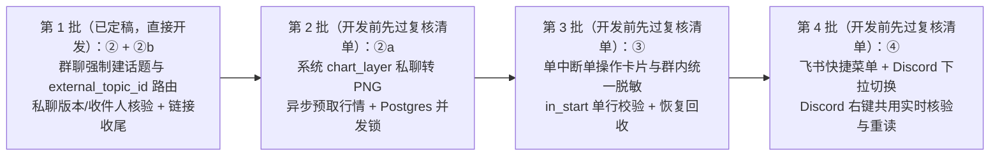

# 渠道第二阶段设计方案（飞书 / Discord / 个人微信，r6 第 1 批代码级收口版）

> **基线分支**：`docs/channel-phase2`（基于 `dalton/main` `305400a37`）  
> **前置分支**：`fix/channel-sandbox-links`（`lanes/41`，已合入 `src/shared/sandbox-links.ts` 工作区沙箱路径改写登录深链）、`feat/external-member-perms-final`（外部成员服务端权限守卫）  
> **关联文档**：`docs/dalton/features/standalone-core.md`、`docs/dalton/features/external-member-permissions.md`（前置分支 `feat/external-member-perms-final` 新增）、`docs/dalton/features/weixin-multi-account.md`、`docs/dalton/features/cos-delivery-confirmation.md`  
> **文档状态**：r6 版（**第 1 批已完成代码级收口并直接进入开发**；第 2–4 批保留设计并附「开发前设计复核清单」，轮到对应批次开发前对照当时代码复核收口；第七章方案待用户最终确认）

---

## 目录

- [一、背景、范围与架构准则](#一背景范围与架构准则)
  - [1.1 现状与演进顺序](#11-现状与演进顺序)
  - [1.2 范围边界](#12-范围边界)
  - [1.3 双形态部署、能力门控与上游钩子规范](#13-双形态部署能力门控与上游钩子规范)
  - [1.4 后续演进事项（本阶段范围之外）](#14-后续演进事项本阶段范围之外)
- [二、各项功能在三渠道的实现方案与接口契约](#二各项功能在三渠道的实现方案与接口契约)
  - [2.1 三渠道承载与降级总览](#21-三渠道承载与降级总览)
  - [2.2 功能 ②：群聊 `@机器人` 自动开话题与话题内免 `@` 继续对话](#22-功能-群聊-机器人-自动开话题与话题内免--继续对话)
  - [2.3 功能 ②a：系统看盘图表图层转图片并附网页交互版链接](#23-功能-a系统看盘图表图层转图片并附网页交互版链接)
  - [2.4 功能 ②b：私聊回答生成文件自动附带与 `lanes/41` 链接收尾事项](#24-功能-b私聊回答生成文件自动附带与-lanes41-链接收尾事项)
  - [2.5 功能 ③：可交互卡片与单中断单操作原生按钮总览](#25-功能-可交互卡片与单中断单操作原生按钮总览)
  - [2.6 功能 ④：机器人快捷菜单与 Discord 右键「转入 `<品牌名>` 研判」](#26-功能-机器人快捷菜单与-discord-右键转入-品牌名-研判)
- [三、确认卡片风险分级、身份核验与回调接入（功能 ③ 详设）](#三确认卡片风险分级身份核验与回调接入功能--详设)
  - [3.1 单中断单操作允许清单与风险四级分类表（L0–L3）](#31-单中断单操作允许清单与风险四级分类表l0l3)
  - [3.2 卡片身份核验、门禁登记与私密详情卡短期令牌协议](#32-卡片身份核验门禁登记与私密详情卡短期令牌协议)
  - [3.3 三端提交统一竞争、同事务准入确认与幂等恢复协议](#33-三端提交统一竞争同事务准入确认与幂等恢复协议)
  - [3.4 飞书 `card.action.trigger` 与 Discord 组件/弹窗回调接入](#34-飞书-cardactiontrigger-与-discord-组件弹窗回调接入)
- [四、安全、权限与文件过滤规则](#四安全权限与文件过滤规则)
  - [4.1 系统图表外发、私聊文件附带与群卡片可见字段规则](#41-系统图表外发私聊文件附带与群卡片可见字段规则)
  - [4.2 外部成员发起交互时的权限范围](#42-外部成员发起交互时的权限范围)
  - [4.3 私聊自动附带文件的双路径白名单与配额过滤规则](#43-私聊自动附带文件的双路径白名单与配额过滤规则)
- [五、数据库变更设计（Dalton 迁移链）](#五数据库变更设计dalton-迁移链)
  - [5.1 群聊机器人话题登记表 `dalton_channel_bot_topics`（第 1 批新增）](#51-群聊机器人话题登记表-dalton_channel_bot_topics第-1-批新增)
  - [5.2 渠道交互令牌表与中断恢复竞争表（第 3 批新增）](#52-渠道交互令牌表与中断恢复竞争表第-3-批新增)
  - [5.3 Discord 右键研判草稿与可重试派发表 `dalton_channel_context_menu_drafts`（第 4 批新增）](#53-discord-右键研判草稿与可重试派发表-dalton_channel_context_menu_drafts第-4-批新增)
  - [5.4 存量表边界、迁移链顺接与滚动升级回退方案](#54-存量表边界迁移链顺接与滚动升级回退方案)
- [六、分批实施计划、测试与上线验收](#六分批实施计划测试与上线验收)
  - [6.1 批次划分总表](#61-批次划分总表)
  - [6.2 各批实施细节、测试用例与验收标准](#62-各批实施细节测试用例与验收标准)
- [七、已定方案（待用户最终确认）](#七已定方案待用户最终确认)

---

## 一、背景、范围与架构准则

### 1.1 现状与演进顺序

渠道网关（`integrations/dalton-channel-gateway/`，基于 TypeScript〔带静态类型的 JavaScript 超集语言〕独立进程运行，默认监听本机回环地址 `127.0.0.1:8962`，通过部署级单行租约 `dalton_channel_gateway_lease` 保持单活）负责衔接智能体对话后端与飞书、Discord、个人微信三个聊天端。目前已上线处理中表情与输入状态反馈（#499，`src/processing-feedback.ts`）以及个人微信多账号管理（#506/#507，`d049_weixin_multi_account.py`），前置分支 `fix/channel-sandbox-links`（`lanes/41`）完成了回复正文内工作区沙箱路径向网页登录深链的基础改写，前置分支 `feat/external-member-perms-final` 完成了外部成员在网页端的服务端访问守卫。

本设计聚焦收窄后的渠道第二阶段五项交付内容（按 4 个批次推进，其中**第 1 批现已定稿并直接进入开发**，第 2–4 批在启动开发前先完成 §6.2 对应批次的设计复核清单）：

1. **② 群聊自动开话题与发起人免 `@` 追问（第 1 批，已定稿）**：在飞书群与 Discord 频道顶层 `@机器人` 提问时，首轮由网关直接创建独立话题或 Thread（子区，Discord 频道内的独立讨论串）并锁定 `canonical_scope_key`，话题发起人在该话题内直接发送消息即可连续对话，后续轮次统一按已登记平台话题号 `external_topic_id` 投递回同一话题。
2. **②a 系统看盘图表图层转图片附网页交互链接（第 2 批）**：将系统内置渲染页承载的看盘图表图层（`chart_layer`，页面仅消费后端行情数据与强校验图层结构化数据）渲染为高清 PNG（便携式网络图形无损图片格式），**仅在发起人本人私聊中**随回答发出并附上网页交互版登录深链；群聊与频道会话以及自定义交互组件（`ShowWidget` / `html_widget`）统一输出网页交互版登录深链。
3. **②b 私聊回答生成文件自动附带与链接收尾（第 1 批，已定稿）**：在发起人与机器人的私聊会话中，工具写入本人自有工作区成功时同步在 `turn_deliverables` 记录当次 `FileStamp`（`size`、`mtime`、`ctime`、`inode`）与内容 SHA-256 哈希；下载接口按已授权 `delivery_key` 在 PostgreSQL 核对运行归属、私聊类型、实际收件人与当前有效平台绑定（个人微信复用账号 ID、机器人代数及上传后复核），并通过 `read_contained_sandbox_file_versioned`（离线回退核对 `workspace_files.sandbox_modified_at` 与 `content_hash` / `blob_sha256`）确认当前文件版本与哈希一致后随私聊发出（版本缺失或存在差异时发网页登录深链）；私聊附件独立于正文发送状态结算并按已确认 `files_status` 去重；群聊与频道会话（含 `/agent/send` 显式传入的 `files`）及 `.html`（HTML，HyperText Markup Language，超文本标记语言）网页报告统一转为网页登录深链；同时扩展已合入的 `src/shared/sandbox-links.ts` 完成引用式链接分片前展开、`workspaceId` 回退，以及后端通知摘要剥离前深链改写与报告入库前改写。
4. **③ 可交互卡片与单中断单操作原生按钮（第 3 批）**：将澄清提问卡片升级为原生单选按钮、下拉框或弹窗输入；对命中「单中断、单操作」明确允许清单的 L1 / L2 确认操作提供渠道原生按钮（群内 L1 与 L2 卡片统一仅展示动作名称与网页 / 私聊或私密卡确认入口，完整参数放入飞书发起人私聊卡或 Discord 私密详情卡）；通过 `begin_run(in_start=...)` 同事务提交准入状态与恢复运行（强制核对恰好更新 1 行 `pending_dispatch`），保持行内 `request_key` 与 `begin_run` 使用的请求键严格一致，并由后端恢复任务统一回收超时未准入行及运行已取消/失败的网页未确认记录；其余操作及额度暂停（`credit_pause`）沿用网页端与现有文字入口。
5. **④ 机器人快捷菜单与 Discord 消息右键研判（第 4 批）**：提供飞书单聊输入框快捷菜单、Discord `/workspace` 下拉切换菜单与消息右键命令「转入 `<品牌名>` 研判」（首次派发与重启恢复共用实时权限检查与原消息实时重读）。

### 1.2 范围边界

为保持群聊阅读秩序、个人微信连接稳定性与团队数据隔离，第二阶段执行以下明确边界：

- **群聊采用整卡定稿投递与深链交付**：群聊过程态统一展示轻量表情回应（飞书 `Typing`〔正在输入状态表情〕、Discord `⏳`），待本轮回答生成完毕后一次性发出排版完整的卡片；系统看盘图表、自定义交互组件及工作区生成文档与表格在群聊中统一输出需登录鉴权的网页深链。
- **个人微信采用单轮整条回复**：基于腾讯 iLink（腾讯面向个人智能体开放的微信连接协议）长轮询单聊通道，配合 `sendtyping`（正在输入状态信令）向发起人本人私聊发送完整结论、系统图表图片与本轮写入的精选附件。
- **后台任务统一在系统内管理**：研究进度、定时唤醒（`schedule_wakeup`）与自动化状态统一以 Dalton PostgreSQL（开源关系型数据库）记录为准。
- **按用户显式交互读取消息**：仅处理用户 `@机器人`、话题发起人在机器人已登记话题（携带实际话题标识）内跟帖、显式合并转发或右键选中的单条消息；网关在入站解析阶段直接略过其余普通群聊消息。

### 1.3 双形态部署、能力门控与上游钩子规范

全部实现严格遵循 `docs/dalton/features/standalone-core.md` 的双部署形态规范：

1. **统一形态解析与能力开关门控**：
   - 部署形态判断统一调用 `src.dalton.profile`（`resolve_profile()` 与 `DeploymentProfile.EVERFLOW` / `DeploymentProfile.CORE`）；能力启停判断统一调用 `src.dalton.capabilities`（`has_capability()`、`require_capability()`、`require_channel_platform_capability()`），前端统一调用 `web/src/hooks/useCapabilities.ts` 的 `useCapabilities()` 与 `web/src/config/brand.ts`。
   - 各子链路按最小所需能力精确门控：
     - 后端新增的 `channels_router.py` 内部端点全部登记入 `src/dalton/capabilities.py` 的 `DALTON_ROUTE_CAPABILITY_REGISTRY`：通用渠道端点在路由层绑定 `CapabilityId.CHANNEL_GATEWAY`，并在请求处理函数及后台恢复任务从可信请求参数或数据库记录解析出具体 `platform`（`feishu`、`discord` 或 `weixin`）后，继续调用 `require_channel_platform_capability(platform)` 核验对应平台子能力（`CapabilityId.CHANNEL_FEISHU`、`CapabilityId.CHANNEL_DISCORD` 或 `CapabilityId.CHANNEL_WEIXIN`）；Discord 右键菜单草稿端点直接在路由层绑定 `(CapabilityId.CHANNEL_GATEWAY, CapabilityId.CHANNEL_DISCORD)`，全部通过 `test_core_capabilities_gate.py` 门禁测试；
     - 运行期私聊 `turn_deliverables` 工具写入记录汇总、`chart_layer` 系统图表私聊快照渲染、`/messages/replay` 渠道元数据输出与浏览器会话 `hitl_response` 协同占位仅在 `has_capability(CapabilityId.CHANNEL_GATEWAY)` 为真时执行；
     - 数据任务通知关联监控面板深链（读取 `src/dalton/monitors/data_job_registry.py`）仅在 `CapabilityId.CHANNEL_GATEWAY` 与 `CapabilityId.DATA_JOBS` 同时启用时加载并输出。
   - 在核心安装形态（`DALTON_PROFILE=core` / `APP_ENV=core`）下渠道能力默认保持关闭；当部署者显式开启 `CHANNEL_GATEWAY` 及对应平台子能力、另行部署渠道网关进程（`integrations/dalton-channel-gateway/`）并配置服务令牌、双向可达地址与机器人凭据后，系统图表私聊快照直接复用 Core 默认内置的 `DALTON_CHAT_UPLOAD_STORAGE_*` MinIO（兼容 S3 协议的开源对象存储服务）配置，本阶段全部能力可用。
2. **网页地址与品牌名称全配置化**：
   - 后端统一通过 `src/dalton/settings.py` 的 `get_dalton_public_app_url()` 拼装深链；渠道网关在启动及健康对账中从后端内部状态接口同步公网地址，使网关 `src/config.ts` 的 `webBaseUrl` 与后端保持一致。
   - 当部署处于本机回环试用状态（公网地址为空，或主机名为 `localhost` / `127.0.0.1`）时，网关将链接展示为「请在网页端对应会话或工作区查看」文字指引。
   - 卡片标题、提示词与右键菜单文案统一通过 `src/dalton/settings.py` 的 `get_brand_name()`（读取环境变量 `BRAND_NAME`，`core` 形态默认 `Dalton`，`everflow` 形态默认 `Everflow`）动态生成。
3. **上游改动标记与路径登记**：
   - 触及上游共享源码文件（包括 `src/server/`、`src/ptc_agent/`、`src/tools/`、`libs/`、`web/` 下非 Dalton 专属文件）的每一处修改，均须附带 `# DALTON-HOOK(<topic>): <reason>` 或 `// DALTON-HOOK(<topic>): <reason>` 注释，并将新增钩子标识登记入 `scripts/dalton/check_hooks.sh`。
   - 新增 Dalton 专属文件若位于 `scripts/dalton/dalton_paths.txt` 既有前缀之外，须同步补登记路径，且**每一开发批次**均执行并通过 `bash scripts/dalton/check_hooks.sh --strict`。

### 1.4 后续演进事项（本阶段范围之外）

为保持本阶段四个批次边界清晰、权限隔离闭环可靠，以下扩展项归入后续阶段独立规划：

1. **群聊与频道自动附带本轮生成文件及图表图片（含跨工作区持久来源表、研究总监跨区标记与发送前哈希复核）**：
   - **归入后续原因**：群聊与频道消息面向群内全体成员（含未绑定平台账号成员）直接可见。在多回合协作场景下，研究总监（`chief_of_staff`）读取同事资料生成自由文本或数值序列图层、跨回合文件拷贝、命令行脚本派生新文件以及同一工作区并发回合写入同名文件，需要数据库级跨区来源标记与沙箱写入层不可变字节版本共同形成群外发隔离闭环；本阶段群聊统一输出需登录鉴权的网页深链，系统图表图片与文件自动附带专门面向发起人本人的私聊开放。
   - **后续开启前提**：① 在 PostgreSQL 运行记录中持久化研究总监与分析师统一的跨工作区资料触碰标志；② 在沙箱文件写入层捕获当次写入的不可变字节摘要并与文件级来源元数据原子落盘，同时覆盖工具写入与命令行脚本派生文件；③ 建立绑定实际接收群地址与不可变内容版本的群外发授权复核链路。
2. **自定义交互组件（`ShowWidget` / `html_widget`）转图片与 `.html` 报告转 PDF（Portable Document Format，便携式文档格式）附件**：
   - **归入后续原因**：`ShowWidget` 组件与 `.html` 报告均包含模型或脚本生成的自定义 HTML 与 JavaScript 代码。在常规应用容器内，除 Chromium（开源浏览器内核）DNS（Domain Name System，域名系统）参数、Service Worker（浏览器后台服务工作线程）限制及 Playwright（浏览器自动化测试与渲染框架）上下文路由拦截外，WebRTC（网页实时通信协议）等独立通道与同工作区子资源读取需要操作系统级网络命名空间与文件系统双重隔离；本阶段二者统一输出网页交互或预览深链。
   - **后续开启前提**：① 部署具备操作系统级网络命名空间隔离（仅保留本机回环网卡）的独立无特权渲染沙箱服务；② 为 HTML 转 PDF 建立沙箱外置子资源供给机制，将本地可读子资源限定为样式表、字体与白名单静态位图，并在底层收敛弹窗创建与脚本跨文件读取。
3. **定时报告外发配置（`dalton_report_delivery`）的渠道按钮确认**：
   - **归入后续原因**：`src/dalton/tools/report_delivery_tools.py` 的 `action="set"` 当前通过模型参数流转，待接入服务端中断确认。
   - **后续开启前提**：完成 `docs/dalton/features/cos-delivery-confirmation.md` 的服务端 `hitl_confirm("dalton_report_delivery_set", ...)` 与多目标 `confirm_token` 改造。
4. **CLI（Command-Line Interface，命令行工具）跨电脑审批的渠道按钮接入**：
   - **归入后续原因**：`src/server/dependencies/cli_approval.py` 与 `src/server/services/cli_approvals.py` 基于 Redis（内存键值数据库）待批记录与专用接口 `POST /api/v1/cli/approvals/{approval_id}/decision`（`src/server/app/cli_approvals.py:55`）独立运作，与 LangGraph 检查点 `hitl_response` 分属两条审批链路；本阶段继续在网页端审批。
   - **后续开启前提**：为 CLI 待批记录补充持久化渠道令牌映射、卡片脱敏门禁与幂等审批回调适配层。
5. **单次暂停含多中断或多操作槽位的复合渠道卡片**：
   - **归入后续原因**：同一暂停内包含多个中断或单个中断内包含多个 `action_requests`（以及批量 `order_decisions`）时，桌面与移动浏览器面板能够更清晰地统筹分项确认；本阶段统一引导至网页端 `answerBoard.ts` 完整面板处理。
   - **后续开启前提**：设计渠道端多步骤表单状态机与分项草稿暂存机制。
6. **群话题全员免 `@` 开关与按核验结果细分的研报发布渠道审批**：
   - **归入后续原因**：保障群聊人际讨论秩序，并确保正式研报数字核验明细经浏览器完整审阅后再发布；本阶段固定执行「话题内仅发起人免 `@`」与「正式研报发布（`publish_approval`）固定网页端确认」。
   - **后续开启前提**：落地群级管理员可配置的免 `@` 触发策略开关，以及面向零疑问研报草稿的移动端精简核验摘要规范。
7. **网关重启后未结算建帖回复的平台历史回执核实与自动补发**：
   - **归入后续原因**：飞书话题内跟帖回复的 `root_id` 与 `parent_id` 均指向话题根消息，且话题历史接口涉及多页翻页与跨重启 `I-6` / `I-7` 状态衔接；第 1 批重启时所有未结算的在途投递统一保持 `status = 'unknown'` 且不续发（含 Discord `before_body`），用户可在网页端查看完整回答。
   - **后续开启前提**：结合网关租约 `epoch`、`delivery_attempt`、持久化的待发首片摘要及飞书/Discord 话题历史分页对账机制，支持重启后精确核实平台回执并从断点补发。
8. **非发起人在群话题内显式 `@机器人` 时自动附带话题首楼与被回复消息上下文**：
   - **归入后续原因**：跨成员在他人发起的话题内 `@机器人` 时，首楼与被回复消息可能包含长文本或附件，需单独约定拉取范围、截断预算与入站结构化字段；第 1 批中其他已绑定内部成员或管理员在话题内 `@机器人` 时，按现有群内 `@` 行为触发其本人会话并传入当前消息内容。
   - **后续开启前提**：明确话题首楼与被回复消息的拉取边界、长度截断规则、入站载荷字段及工作区上下文隔离策略。

---

## 二、各项功能在三渠道的实现方案与接口契约

### 2.1 三渠道承载与降级总览

| 功能项 | 飞书（Feishu）实现与降级 | Discord 实现与降级 | 个人微信（Weixin iLink）实现与降级 |
| --- | --- | --- | --- |
| **② 群聊开话题与发起人免 `@` 追问** | 前置开启 `im:message.group_msg` 与 `im:message:readonly` 权限；群顶层 `@` 首轮由网关强制以 `reply_in_thread: true` 创建话题（`omt_xxx`），`canonical_scope_key` 固定为 `chat:<chat_id>:topic:<om_root>`（已有话题内 `@` 沿用 `chat:<chat_id>:thread:<omt_xxx>`），登记 `dalton_channel_bot_topics` 并清除负缓存；后轮出站按表内 `external_topic_id` 带 `reply_in_thread: true` 投递；重启时未结算首条回复沿用现有行为标 `unknown`（网页查看完整回答）；原消息撤回（`230011`/`231003`/`230110`）回退普通群消息 | 频道顶层 `@` 首轮由网关强制在父频道从原消息建公开子区，`canonical_scope_key` 固定为 `chat:<guild>/<parent>:topic:<msg>`（已有子区内 `@` 沿用 `chat:<guild>/<parent>:thread:<thread>`），确认地址沿用 `discord:<guild>/<parent>:thread:<thread>` 并登记 `dalton_channel_bot_topics`；后轮出站按表内 `external_topic_id` 先 `ensureThreadUnarchived` 再发入该子区，按父频道核验权限；权限或活跃子区满额（`50013`/`160006`/`160007`）回退父频道引用回复，原消息已删除（`10008`）发无引用简短提示；重启未确认建帖沿用现有 `unknown` 保护 | 面向单聊（`weixin:@me`），群消息记为 `weixin_group_unsupported` 归档略过；单聊直接连续收发 |
| **②a 系统看盘图表转图片** | **发起人私聊**：针对系统 `chart_layer` 生成 Schema 2.0（飞书第二代交互卡片规范）卡片，内嵌从 Dalton 对象存储拉取的高清 PNG（`tag: "img"`）+ 底部 `open_url` 按钮 `[打开网页交互版]`（超 10 MB〔兆字节〕自动使用 1x 缩放或转 WebP〔高压缩率网页图片格式〕）；**群聊/话题**、`ShowWidget` 或存储/渲染器未就绪时统一发网页登录深链 | **发起人私聊**：针对系统 `chart_layer` 以 `multipart/form-data`（多部分表单上传格式）附带高清 PNG + `ActionRow`（操作组件行容器）`Link Button`（外链按钮）`[打开网页交互版]`；**群频道/子区**、`ShowWidget` 或存储/渲染器未就绪时统一发网页登录深链 | **发起人私聊**：针对系统 `chart_layer` 在正文后追加加密上传的 `IMAGE` 图片消息，公网地址可达时附纯文本交互深链；`ShowWidget` 或存储/渲染器未就绪时发文字与深链 |
| **②b 私聊本轮文件附带与深链** | **发起人私聊**：限本轮工具写入本人自有工作区的确认文件（`turn_deliverables` 记录写入时 `FileStamp` 与内容 SHA-256），按已授权 `delivery_key` 在 PostgreSQL 核对运行、私聊类型、收件人与当前有效绑定，并经双路径白名单及 `read_contained_sandbox_file_versioned`（离线核对 `workspace_files` 备份）确认版本/哈希一致后，≤10 MB 图片走 `im.image.create`、≤20 MB 文档/表格走 `im.file.create`；私聊附件独立结算并按 `files_status` 去重；**群聊（含显式 `send_message(files=...)`）**、`.html` 报告及版本差异/缺失文件统一发网页登录深链 | **发起人私聊**：限本轮工具写入本人自有工作区、通过 `delivery_key` 收件人与绑定核验且当前 `FileStamp`/哈希一致的 ≤20 MB 合规文件作为私聊附件发送（整轮 ≤50 MB，最多 5 个），独立于正文结算并按 `files_status` 去重；**群频道/子区（含显式 `send_message(files=...)`）**、`.html` 报告及版本差异/缺失文件统一发网页登录深链 | **发起人私聊**：限本轮工具写入本人自有工作区、通过 `delivery_key` 微信账号 ID/机器人代数核验（含上传后复核）且当前 `FileStamp`/哈希一致的合规文件（≤20 MB，单轮最多 3 个），经 AES-128-ECB（128 位高级加密标准电子密码本模式，`src/channels/weixin/cdn.ts`）加密上传 CDN（内容分发网络）作为 `IMAGE`/`FILE` 发送；其余发网页登录深链 |
| **③ 提问与单中断单操作按钮** | 所有交互卡常驻独立网页入口；L0 提问渲染按钮组或 `form` 表单；**私聊** L1/L2 发完整参数确认卡（L2 附二次确认框）；**群聊 L1 与 L2 一致**：群卡只显示动作名称与网页入口，完整参数与按钮发往发起人飞书私聊；`credit_pause` 保持文字/网页入口，L3 发网页入口 | 所有交互卡常驻独立网页入口；L0 渲染 `Button` / `StringSelect` + `Modal`；**私聊** L1/L2 发完整参数按钮卡；**群频道/子区 L1 与 L2 一致**：群卡只显示动作名称、网页入口与 `[查看详情并确认]` 门禁按钮，点击签发短期令牌返回 `flags: 64` Ephemeral（仅点击者可见临时消息）详情卡；凭证过期或 L3 给网页入口 | L0 输出数字编号列表供直接回复；`credit_pause` 沿用现有回复 `继续` / `/stop` 文字入口与网页入口；其余确认统一发送动作说明与网页端确认深链 |
| **④ 快捷菜单与右键研判** | 订阅 `application.bot.menu_v6` 响应单聊输入框上方 4 个固定菜单（返回研究总监、切换工作区卡片、新建对话、停止任务），保留 v7 `/` 命令 | 升级无参 `/workspace` 返回下拉切换菜单；注册消息右键命令（`type = 3`）「转入 `<品牌名>` 研判」，首次同步弹 `Modal`，首次派发与重启恢复共用实时权限检查与原消息实时重读，核验公开目的地可见范围与发帖权，未通过核验时终止并提示重新操作 | 在 `/help` 与扫码成功欢迎语列出快捷指令，发送 `/workspace` 返回编号列表供回复切换 |

---

### 2.2 功能 ②：群聊 `@机器人` 自动开话题与话题内免 `@` 继续对话

#### （1）飞书实现、前置权限、入站精确过滤与话题出站路由

1. **平台权限前置条件（`im:message.group_msg` 与 `im:message:readonly`）**：
   - 飞书群内接收未显式 `@机器人` 的话题跟帖消息，依赖飞书开放平台应用开启群消息权限 **`im:message.group_msg`**（获取群组中所有消息）；建话题首条回复后通过 `getMessageFeishu`（`src/channels/feishu/send.ts:731`，调用 `im.message.get`）读取回复消息所属 `thread_id`（`omt_xxx`）依赖 **`im:message:readonly`**（获取单聊、群组消息）权限，两项权限发布应用版本审批生效列为第 1 批上线前置条件。
   - 在权限生效前的过渡期内，群顶层 `@机器人` 自动创建话题以及在话题内继续通过 `@机器人` 追问均正常运作并归入对应会话。
2. **入站前置过滤、`canonical_scope_key` 保持与负缓存即时清除**：
   - 开启 `im:message.group_msg` 后，飞书长连接（`src/channels/feishu/monitor.ts`）在调用 `getMessageFeishu`、`downloadMessageResourceFeishu` 或后端 `I-1`（`register-and-resolve`）之前执行两步内存快速筛选：
     - **按实际话题标识 `thread_id` 精确匹配免 `@` 跟帖**：飞书普通群中主聊区普通引用回复（`reply_in_thread: false`）仅携带 `root_id` 而 `thread_id` 为空；凡群消息未 `@机器人` 且 `message.thread_id` 为空，直接在内存中作为主聊区普通发言略过（零落库、零下载、零后端请求）；
     - 当群消息未 `@机器人` 且携带非空 `message.thread_id`（`omt_xxx`）时，先查网关内存 LRU（Least Recently Used，最近最少使用缓存，分别维护已登记机器人话题正缓存与短时效非机器人话题负缓存），未命中时调用轻量只读接口 `/internal/topics/lookup`（**新增**，`match_mode: "inbound_followup"`，按 `(platform='feishu', chat_address, external_topic_id=message.thread_id)` 精确查询）。当命中已登记机器人话题且 `senderOpenId === initiatorPlatformUserId`（话题发起人本人，见第七章定案 1）时，**直接采用表内已锁定的 `canonical_scope_key` 作为 `event.threadScopeKey`（保持触发轮生成的 `chat:<chat_id>:topic:<om_root>` 或 `chat:<chat_id>:thread:<omt_xxx>` 原值，跳过 `buildDaltonFeishuThreadScopeKey` `src/channels/feishu/targets.ts:317` 向另一种 `:thread:` 键的重拼）**，在入站事件上记录 `externalTopicId = message.thread_id` 并置 `event.isGroupTrigger = true`；其余未 `@` 情形直接在内存中略过。
   - **话题内显式 `@机器人` 与指令路由**：话题发起人在已登记话题内显式 `@机器人` 或直接发送 `/new`、`/stop`、`/workspace`、`/main` 斜杠指令时，同样复用表内同一 `canonical_scope_key`（斜杠指令免 `@` 生效）；群内其他已绑定的内部成员或管理员在该话题内显式 `@机器人` 时，按现有群内 `@` 规则触发其本人会话（`threadScopeKey` 保持 `chat:<chat_id>:thread:<omt_xxx>`，仅传入当前 `@` 消息内容，见 §7 定案 1）。
   - **话题登记成功时清除负缓存**：当用户在普通话题内首次 `@机器人` 提问并写入 `dalton_channel_bot_topics` 时，网关收到 `I-1` 或 `I-7` 响应后同步清除该 `(chat_address, external_topic_id)` 的负缓存条目并写入正缓存，使发起人紧接着发出的免 `@` 追问立即生效。
3. **顶层 `@` 首轮网关强制建话题、后轮按 `external_topic_id` 出站投递与重启保护**：
   - **`canonical_scope_key` 确定规则**：普通群顶层 `@机器人` 发送消息 `om_root`（`message.thread_id` 为空）时，`src/channels/feishu/inbound-parse.ts` 与 `src/channels/feishu/targets.ts` 将初始 `threadScopeKey`（即登记时的 `canonical_scope_key`）构造为 `chat:<chat_id>:topic:<om_root>`；已在平台现有话题内首次 `@机器人`（自带 `message.thread_id = omt_xxx`）时，`canonical_scope_key` 沿用现有 `chat:<chat_id>:thread:<omt_xxx>`。
   - **顶层 `@` 首轮由网关强制建话题（独立于模型 `new_thread`）**：当触发入站为群顶层 `@`（`:topic:` 作用域且尚未登记话题）时，`I-6` 在授权认领同事务内先按「群地址 + 触发消息 ID」在 `dalton_channel_bot_topics` 写入 `status = 'pending'` 待确认预留行（锁定发起人与 `canonical_scope_key`），并从已核验的原入站记录返回 `root_message_id`。网关在 `src/orchestrator.ts` 与 `src/delivery-service.ts` 对该回合首条发往当前群会话的出站投递（涵盖实时回复、`/agent/send` 显式发送与断线回放）共用该 `root_message_id` 直接置位建话题标志，无需等待模型传入 `new_thread=true`。`FeishuChannelAdapter.sendTextChunk`（`src/channels/feishu/monitor.ts:878`）及 `sendMessageFeishu` / `sendStructuredCardFeishu`（`src/channels/feishu/send.ts:609`）向 `im.message.reply` 传入 `reply_in_thread: true`，从响应或 `getMessageFeishu(first_reply_message_id)` 取得 `omt_xxx` 后，通过 `I-7`（`deliveries/progress`）在同一数据库事务内更新 `platform_message_ids`、`sent_chunks` 并按预留行补全 `external_topic_id = omt_xxx` 与 `first_reply_message_id` 将话题转为 `status = 'confirmed'`，收到响应后立即清除该 `omt_xxx` 负缓存。
   - **同轮后续分片与后轮出站统一按 `dalton_channel_bot_topics.external_topic_id` 投递**：已登记话题的同轮后续分片，以及后续轮次的实时回复、断线回放（`deliverReplayFallback`）、后台唤醒/命令回报（`consumeBackgroundRunStream`）与当前会话 `send_message`，统一按表内 `external_topic_id` 投递进该飞书话题——携带当前轮触发消息 `replyToMessageId` 时对该入站消息调用 `im.message.reply(..., reply_in_thread: true)`；无当前触发消息的分片、回放或后台回报通过 `I-6` 返回的话题信息或 `/internal/topics/lookup`（`match_mode: "outbound_delivery"`，按 `canonical_scope_key` 查询）取得 `first_reply_message_id`（或 `root_message_id`）并以 `reply_in_thread: true` 回复，始终落在同一 `omt_xxx` 话题内。
   - **重启与未知回执统一保持 `unknown` 不续发**：单次请求超时或响应缺失 `message_id`（`send.ts:482`）时按现有流程记为 `status = "unknown"`；网关在结算前退出重启时，启动恢复将所有未结算的 `in_flight` 投递统一标为 `status = 'unknown', error_code = 'gateway_restarted'` 且不续发，用户可在网页端查看完整回答（重启后拉取平台历史核实回执并自动补发归入 §1.4 后续演进）。
4. **原消息撤回与建话题受限回退**：
   - 调整 `src/channels/feishu/send.ts:531, 587, 595` 的 `sendReplyOrFallbackDirect`：当首轮建话题请求收到确定性撤回或群设置限制错误（飞书错误码 `230011`、`231003`、`230110`）时，自动回退调用 `im.message.create` 在群内发送回答，保持 `dalton_channel_bot_topics` 仅记录已成功创建的话题。

#### （2）Discord 实现、子区出站路由与父频道权限核验

1. **`canonical_scope_key` 锁定、首轮网关强制建子区与后轮子区投递**：
   - **入站 `canonical_scope_key` 确定规则**：在已登记的服务器文字频道（`GuildText = 0`）或公告频道（`GuildAnnouncement = 5`）收到顶层 `<@botId>` 消息时，Discord 适配器 `src/channels/discord/inbound.ts` 将逻辑会话键 `threadScopeKey`（即登记时的 `canonical_scope_key`）构造为 `chat:<guildId>/<channelId>:topic:<messageId>`，保持初始出站 `targetAddress` 为父频道地址 `discord:<guildId>/<channelId>`；已在平台现有子区（`type = 10 / 11 / 12`，含论坛 `GuildForum = 15` 与媒体频道 `GuildMedia = 16` 下的帖子子区 `11`）内首次 `<@botId>` 时，`canonical_scope_key` 沿用现有 `chat:<guildId>/<parentChannelId>:thread:<threadId>`，并以父频道地址作为 `chat_address` 登记 `dalton_channel_bot_topics`。
   - **顶层 `@` 首轮由网关强制建子区（独立于模型 `new_thread`，必传触发消息 `messageId`）**：当触发入站为频道顶层 `@`（`:topic:` 作用域且尚未登记子区）时，`I-6` 在授权认领同事务内先按「父频道地址 + 触发消息 ID」在 `dalton_channel_bot_topics` 预留发起人与 `canonical_scope_key`（`status = 'pending'`），并从已核验的原入站记录返回 `root_message_id`。网关在 `src/orchestrator.ts` 与 `src/delivery-service.ts` 对该回合首条发往当前频道会话的出站投递（涵盖实时回复、`/agent/send` 显式发送与断线回放）共用该 `root_message_id` 直接打开建子区标志，无需等待模型传入 `new_thread=true`。在 `src/channels/discord/send.ts` 中，`threadIdFromScopeKey`（`:64-68`）仅用于解析 `:thread:` 作用域键；对于 `:topic:` 作用域键，首轮在 `confirmedThreadAddress` 与已登记 `external_topic_id` 均为空时对父频道 `parsed.channelId` 调用 `src/channels/discord/threading.ts` 的 `createThreadDiscord` 时**必须将触发消息 ID 作为 `messageId` 传入**（使 Discord 子区 ID 绑定该触发消息且支持 `10008` 回退；子区名称取清洗后的用户问题或回答首行，按 UTF-16〔16 位统一码字符编码〕安全截断至 `100` 字符以内，自动归档时长 `60` 分钟）。
   - **确认子区落库与后轮按 `external_topic_id` 投递**：
     - 首轮 `createThreadDiscord` 创建成功后，沿用现有 `src/dalton/database/channel_gateway.py:7993`（`_DISCORD_CONFIRMED_THREAD`）格式，通过 `onConfirmedThread` 在 `I-7` 同事务写入 `confirmed_thread_address = "discord:<guildId>/<parentChannelId>:thread:<threadId>"`、`discord_body_phase = 'before_body'`，并按预留行补全 `external_topic_id = thread.id` 将 `dalton_channel_bot_topics` 转为 `status = 'confirmed'`、清除该子区负缓存，随后向新子区发送首条消息与同轮后续分片；
     - **后轮出站路由**：同一话题后续轮次（含发起人免 `@` 跟帖、发起人在子区内显式 `@`、断线回放、后台唤醒/命令回报及当前会话 `send_message`）统一按 `dalton_channel_bot_topics.external_topic_id` 投递——网关通过入站关联、`I-6` 当前会话授权返回或 `/internal/topics/lookup`（按 `canonical_scope_key` 查询）取得 `external_topic_id`，在 `sendMessageDiscord` 中先调用 `getDiscordChannel(rest, external_topic_id)` 与 `ensureThreadUnarchived(rest, channel)`（`threading.ts:148`）确保已自动归档的子区解封，再将消息发入该 `external_topic_id` 子区。
   - **子区投递权限统一按父频道登记与用户渠道设置核验**：服务端在核验 Discord 子区投递或后续交互权限（含 `I-6` 及确认卡片门禁校验）时，凡遇到匹配 `_DISCORD_CONFIRMED_THREAD`（`discord:<guild>/<parent>:thread:<thread>`）或投递至已登记 `external_topic_id` 的子区目标，统一提取其父频道地址 `discord:<guild>/<parent>` 传入 `src/dalton/database/channel_gateway.py:529` 的 `_verify_group_target_deliverable`，核验 `dalton_channel_chat_bindings` 父频道登记与发起人 `dalton_channel_user_settings.apps.discord.chats` 配置；若首轮建帖失败回退至父频道，则直接按父频道 `discord:<guild>/<parent>` 核验。
2. **子区内发起人免 `@` 继续对话与非发起人 `@` 分流**：
   - Discord 适配器 `src/channels/discord/index.ts`（Gateway 连接已声明 `MessageContent = 32768` 意图，见 `src/channels/discord/gateway.ts:21`）收到子区消息（`type = 10 / 11 / 12`）且未包含 `<@botId>` 时，解析父频道地址 `discord:<guildId>/<parentChannelId>` 后先查内存话题缓存，未命中则调用 `/internal/topics/lookup`（`match_mode: "inbound_followup"`）按 `(platform='discord', chat_address='discord:<guildId>/<parentChannelId>', external_topic_id=channel.id)` 查询 `dalton_channel_bot_topics`；当确认为已登记机器人子区且发送者为子区发起人（`author.id === initiatorPlatformUserId`）时，**直接采用表内 `canonical_scope_key` 作为 `threadScopeKey`（跳过 `buildDiscordThreadScopeKey` `src/channels/discord/inbound.ts:134` 向 `:thread:` 的重拼）**，保留 `externalTopicId = channel.id` 并置 `isGroupTrigger = true`；其余未 `@` 子区消息在入站前直接略过。
   - 子区发起人在已登记子区内发送斜杠命令或显式 `<@botId>` 时同样复用表内 `canonical_scope_key`；其他已绑定的内部成员或管理员在该子区内显式 `<@botId>` 时，按现有群内 `@` 规则触发其本人会话（`chat:<guildId>/<parentChannelId>:thread:<channel.id>`，仅含当前消息）并在该子区内回复。
3. **建帖失败分类回退与重启保护**：
   - **确定性建帖拒绝回退**：复用 `src/channels/discord/threading.ts` 的确定性 HTTP 4xx 错误分类：
     - 当缺少 `CREATE_PUBLIC_THREADS` 权限（`403` / Discord 错误码 `50013`）或活跃子区数量达到上限（`400` / Discord 错误码 `160006` 或 `160007`）且原消息仍在时，自动回退在已授权父频道携带 `message_reference: { message_id: replyToMessageId }` 引用回复；
     - 当原触发消息已被删除（`404` / Discord 错误码 `10008`）时，省略 `message_reference`，在已授权父频道发送一条简短完成提示（附网页会话登录深链），正常结案。
   - **超时、5xx 与网关重启保护**：建帖请求在同次尝试中遇到网络超时、连接中断或 HTTP 5xx 时，沿用 `threading.ts` 现有的同次查找复用与 `outcome: "unknown"` 保护；网关重启时所有未结算的在途投递统一保持 `status = 'unknown'` 且不续发（含 `discord_body_phase = 'before_body'` 的投递），用户在网页端查看完整回答。

#### （3）接口契约与登记归属预留锁定

- **扩展 `POST /api/v1/dalton/channels/internal/inbound/register-and-resolve`（`I-1`，已有端点新增可选字段）**：
  - 请求体新增可选字段：`external_topic_id?: string | null`、`root_message_id?: string | null`。
  - 当 `external_topic_id` 非空且 `(platform, chat_address, external_topic_id)` 命中 `dalton_channel_bot_topics`（`status = 'confirmed'`）时：若 `platform_user_id == initiator_platform_user_id`（发起人本人），后端在事务内将会话键固定为表内 `canonical_scope_key` 并刷新 `last_active_at`；若为其他成员显式 `@机器人`，保持该成员自身的 `chat:<id>:thread:<external_topic_id>` 会话键并仅刷新 `last_active_at`（表内原 `initiator_*` 与 `canonical_scope_key` 保持不变）。
  - **开帖预留窗口归属锁定（`I-1` 先于 `I-7`）**：若按 `external_topic_id` 未命中已确认话题，后端先按 `(platform, chat_address, root_message_id)`（飞书取入站 `root_id`，Discord 取 `root_message_id` 或 `external_topic_id`）查询 `dalton_channel_bot_topics` 是否存在待确认预留行（`status = 'pending'`）。一旦命中预留行：不插入新发起人；若发送者即预留发起人本人，沿用预留 `canonical_scope_key`；若为其他成员显式 `@机器人`，保持该成员自身的 `chat:<id>:thread:<external_topic_id>` 会话键，并返回预留行 `topic_initiator_platform_user_id` 且 `topic_newly_registered = false`。
  - 仅当既未命中已确认话题、又未命中同一根消息的预留行时，用户在未登记的普通已有话题内首次显式 `@机器人` 触发，同事务以 `status = 'confirmed'`、`canonical_scope_key = chat:<id>:thread:<external_topic_id>` 登记 `dalton_channel_bot_topics` 并返回 `topic_newly_registered: true` 供网关即时清除负缓存；响应新增返回 `resolved_scope_key: string`、`external_topic_id: string | null` 与 `topic_initiator_platform_user_id: string | null`。
- **扩展 `I-6`（`authorize-and-claim`）与 `I-7`（`deliveries/progress`）（维持单次发送与重启 `unknown` 不续发）**：
  - `I-6` 在授权当前群会话投递时：① 从已核验的原入站记录（及 `dalton_channel_bot_topics`）返回 `root_message_id: string | null`、`external_topic_id: string | null` 与 `first_reply_message_id: string | null`，供实时回复、`/agent/send` 显式发送、断线回放与后台回报共用；② 当投递属于顶层 `:topic:<root_msg>` 且尚无已确认话题时，在同事务先向 `dalton_channel_bot_topics` 写入 `status = 'pending'` 预留行（固定 `canonical_scope_key`、`root_message_id` 与发起人）；③ 对重启后标为 `status = 'unknown'` 的记录（含 Discord `before_body`）统一返回 `in_flight_or_unknown` 不续发；④ 核验 Discord 子区目标时提取父频道地址调用 `_verify_group_target_deliverable`；⑤ 对私聊当前会话投递，在 `dalton_channel_deliveries.dm_recipient_platform_user_id` 固定原入站私聊实际平台收件人，并返回同 `run_id` 下已记录的 `prior_run_files` 供网关去重。
  - `I-7` 请求体新增可选字段 `bot_topic_registration?: { external_topic_id: string; root_message_id?: string | null; first_reply_message_id?: string | null; canonical_scope_key: string; initiator_platform_user_id: string }`：在投递处于 `in_flight` 确认飞书首片回执或确认 Discord 子区地址时，于同一数据库事务内按预留行（或新建）补全 `external_topic_id` / `first_reply_message_id` 并将 `status` 置为 `'confirmed'`（首次预留或写入的 `canonical_scope_key` 与 `initiator_*` 保持固定），网关收到成功响应后同步清除该话题负缓存。
- **新增 `POST /api/v1/dalton/channels/internal/topics/lookup`（新增端点，路由登记 `CapabilityId.CHANNEL_GATEWAY` 并调用 `require_channel_platform_capability(platform)`）**：
  - 请求：`{ platform: "feishu" | "discord", chat_address: string, match_mode: "inbound_followup" | "outbound_delivery", external_topic_id?: string | null, canonical_scope_key?: string | null, root_message_id?: string | null }`：
    - `inbound_followup`：供入站免 `@` 跟帖按非空 `(platform, chat_address, external_topic_id)` 精确查询 `status = 'confirmed'` 的已登记话题 `canonical_scope_key` 与发起人身份；
    - `outbound_delivery`：供后轮出站与分片发送优先按 `(platform, chat_address, canonical_scope_key)`（同时兼容按 `external_topic_id` 或 `root_message_id`）精确查询 `status = 'confirmed'` 的平台话题号 `external_topic_id` 与 `first_reply_message_id`；
  - 响应：`{ found: boolean, canonical_scope_key: string | null, external_topic_id: string | null, root_message_id: string | null, first_reply_message_id: string | null, initiator_platform_user_id: string | null, initiator_dalton_user_id: string | null }`。
- **群会话代数行为**：与现有 `:thread:` 作用域保持一致，群解绑不推进个人会话代数；话题内 `/new`、`/stop`、`/workspace`、`/main` 指令在 `execute_session_command` 中直接按归一后的 `canonical_scope_key` 生效。

---

### 2.3 功能 ②a：系统看盘图表图层转图片并附网页交互版链接

> **推进说明**：本节对应第 2 批，第 2 批开发前复核清单 2 条已由负责人拍板收口并直接落入本节与 §6.2。

本阶段聚焦渲染**系统内置看盘图表图层（`chart_layer`）**：渲染页 `libs/chartkit/chartkit/render/chart-render.html`（由 `cd web && pnpm build:chart-render` 构建产物提供，见 `libs/chartkit/chartkit/_renderer.py:32-33`）接收后端行情 K 线序列与经 `chartkit.schema.parse_layer` 强类型校验的绘图结构数据（页面内仅运行系统自有绘图代码）。由于研究总监在读取同事资料时生成的图层标注或序列可能带有跨工作区分析信息，生成的 PNG 快照存入 Dalton 对象存储后**仅在发起人本人私聊（`chat_type == 'dm'`）中发送图片**并附网页交互版登录深链；**群聊与频道会话（`chat_type == 'group'`）**以及自定义交互组件（`ShowWidget` / `html_widget`）统一输出需登录鉴权的网页交互版深链。

#### （1）系统看盘图表渲染、异步行情预取、跨进程状态持久化与私聊快照鉴权

1. **复用双形态对象存储配置（覆盖 Core 默认 MinIO 与 Everflow S3/R2）**：
   - 新增快照存储辅助模块 `src/dalton/channel_snapshot_storage.py`（**新增**），直接复用 `src/dalton/chat_upload_storage.py` 的双形态凭据解析与客户端池：优先读取 `DALTON_CHAT_UPLOAD_STORAGE_*`（`docker-compose.core.yml:213-216` 已为 `DALTON_PROFILE=core` 默认配置 `http://minio:9000` 与 `chat-uploads` 存储桶），未配置时自动回退读取 Everflow 生产已有的 `DALTON_ASR_STORAGE_*`（`src/dalton/transcription_storage.py`），并在服务启动时复用桶就绪探测。
   - 快照对象统一存放在键前缀 `channel-snapshots/{thread_id}/{sha256[:16]}/` 下，与 `chat-uploads/` 聊天附件前缀相互独立，支持多后端 worker 进程直接跨进程读写。
2. **主异步循环行情预取、双出口同事务写 `pending` 与后台渲染（已收口复核清单 #1）**：
   - 复用 `libs/chartkit/chartkit/_renderer.py` 的单工作线程渲染器 `RENDERER`（`_renderer.py:302-320`）与离线打包页面 `chart-render.html`（运行在虚拟源 `https://chart-snapshot.invalid`，`_renderer.py:224` 已内置 `service_workers="block"`；在 `_launch` `:364` 启动参数补加 `--host-resolver-rules=MAP * ~NOTFOUND`，并将 `:229` 的路由注册提升至 `context.route("**/*", handle)`，仅响应本地 `RENDER_DIR` 静态资源与内存 `api()` 路由）。
   - **主事件循环异步取数 + 纯内存同步闭包供给渲染线程**：现有 `ChartBars`（`libs/chartkit/chartkit/_bars_source.py:40-58`）在无事件循环的 `chartkit-bars` 守护线程中同步调用 `tool(start, end)`，且 `Renderer` 每进程仅维护一条渲染工作线程。因此，在提交 `SnapshotJob`（`_renderer.py:82`）之前，先在后端**主异步事件循环**上按回合发起人 `user_id`（对齐 `src/server/app/market_data.py:12` `DataReadUserId`）调用 `src/server/services/cache/daily_cache_service.py`（`DailyCacheService`）或 `src/server/services/cache/intraday_cache_service.py`（`IntradayCacheService`）取好图层所需窗口的 OHLCV（开盘价、最高价、最低价、收盘价与成交量）数据，封装为纯内存同步闭包 `backend_market_bars_tool`（直接返回 `fetch_bars` 契约所需的 `{data, timezone, source}` 字典）交给 `SnapshotJob`。渲染超时或异常全部在快照后台任务内部捕获并记录日志，将该项标记为 `failed`，确保 `layers.py::_publish` 与 `commands/settle.py` 主结算流程正常完成。
   - **PostgreSQL 跨进程状态机（同事务先写 `pending`，后台任务更新 `ready` / `failed`，10 分钟滞留清理）**：
     - 运行记录 `conversation_responses.metadata.chart_snapshots` 每项持久化 `status: "pending" | "ready" | "failed"`（连同 `artifact_type: "chart_layer"`、`workspace_id`、`chart_id`、`symbol`、`timeframe`、`layer_id`、`title`、`command_id`、`pending_since`、`updated_at`；就绪后写入 `snapshot_key`、`sha256`、`size_bytes`、`width`、`height`；失败写入 `error`）。
     - 同时接入两处图层落库出口（均标注 `DALTON-HOOK(channel-chart-snapshot)`，在 `has_capability(CapabilityId.CHANNEL_GATEWAY)` 为真、当前会话关联发起人本人私聊渠道或私聊投递自动化、且 `is_run_outbound_blocked == False` 时触发，单回合最多自动渲染前 `4` 张系统图表）：
       1) **同步工具出口**：`src/tools/chart_annotation/layers.py` 的 `_publish`（`:159`）在提交图层落库的**同一数据库事务内**先向 `conversation_responses.metadata.chart_snapshots` 写入 `status = "pending"`，随后投递后台异步渲染任务；
       2) **后台命令结算出口**：`src/server/database/runs/command_runs.py` 的 `finalize` 在提交 `outbox_layers` 与回报任务的**同一数据库事务内**先向关联运行记录 `chart_snapshots` 写入 `status = "pending"`（带 `command_id`，回报回合按 `report_source.command_id` 关联可见），随后 `src/server/services/commands/settle.py`（`:230-241`）在提交成功后投递后台异步渲染任务；
     - 渲染出的 PNG（默认尺寸 `1200×720`）写入 `channel-snapshots/{thread_id}/{sha256[:16]}/chart_{layer_id}.png` 后，原子将对应项更新为 `status = "ready"`（失败或跳过则更新为 `status = "failed"`）。
     - **滞留 `pending` 自动清理**：后端 `RecoveryScanner` 周期清理任务将 `pending_since` 超过 **10 分钟（600 秒）**仍处于 `status = "pending"` 的记录（例如图层提交后渲染进程异常退出导致长期 `pending`）原子标记为 `status = "failed"`。
3. **PostgreSQL 部署级并发锁、跨进程状态轮询、私聊快照读取鉴权与网页交互深链**：
   - **部署级并发采用 PostgreSQL 锁控制**：结合进程内 `_RENDER_SEMAPHORE` 与 **PostgreSQL 顾问锁槽位**协调多后端 worker 间的全局 Chromium 渲染并发（默认部署级总并发上限 `2`，单张超时 `25` 秒，单回合最多自动渲染前 `4` 张系统图表），避免多 worker 各自独立拉起超额浏览器实例；对象存储未配置、未安装 Chromium 或等待锁超时时，条目落为 `failed`，网关平稳发送文字结论与网页交互登录深链。
   - 在 `src/dalton/app/channels_router.py` 新增两处内部端点（均登记 `CapabilityId.CHANNEL_GATEWAY`，解析目标平台后调用 `require_channel_platform_capability(platform)`，且静态路径 `/internal/snapshots/status` 注册在通配下载路径之前）：
     1) **`GET /api/v1/dalton/channels/internal/snapshots/status`（新增）**：接收查询参数 `run_id`、`thread_id` 与可选 `platform`，直接以 PostgreSQL 为准返回该运行（含关联 `command_report` 后台命令）当前的 `chart_snapshots` 清单与 `has_pending` 标志，供跨进程网关轮询；
     2) **`GET /api/v1/dalton/channels/internal/snapshots/{snapshot_key:path}`（新增）**：接收查询参数 `run_id` 与 `target_address`：
        - 校验 `snapshot_key` 严格匹配正则 `^channel-snapshots/([0-9a-f]{8}-[0-9a-f]{4}-[0-9a-f]{4}-[0-9a-f]{4}-[0-9a-f]{12})/([0-9a-f]{16})/chart_[A-Za-z0-9_.-]+\.png$`（拦截路径穿越与编码绕过）；
        - 核验路径提取出的快照 `thread_id` 与本次 `run_id` 所属运行的 `conversation_thread_id` 完全一致，`snapshot_key` 位于该 `(thread_id, run_id)`（含关联 `command_report` 命令）持久化的 `chart_snapshots` 清单内且 `status == "ready"`，会话归属有效且该运行 `is_run_row_outbound_blocked`（`src/dalton/colleague_outbound_guard.py:418`）为 `False`；
        - **严格核对本人私聊目标**：核对 `target_address` 为私聊地址，且属于该 `thread_id` 发起人当前已有效绑定的本人私聊目标（飞书匹配 `dalton_channel_identities` 本人 `open_id` 单聊、Discord 匹配本人 `user_id` 私聊、微信匹配当前活跃绑定账号本人单聊）；凡群聊目标或目标地址与发起人本人私聊不一致的请求均拒绝返回图片字节，由网关改发网页交互版登录深链；核对通过并校验对象 `sha256` 一致后返回 PNG 字节流。
   - **网页交互深链定位**：
     - `chart_layer`：`${WEB_BASE_URL}/chat/t/${threadId}?chart=${encodeURIComponent(chartId)}&layer=${encodeURIComponent(layerId)}`（私聊连同高清 PNG 一并发出；群聊直接发送该交互深链）；
     - `html_widget`（`ShowWidget`）：本阶段统一输出网页深链 `${WEB_BASE_URL}/chat/t/${threadId}?widget=${encodeURIComponent(artifactId)}`（若已发布为对目标受众可见的监控看板则输出 `/monitors/${slug}`）；
     - 前端 `web/src/pages/ChatAgent/components/ChatView.tsx`（**新增参数解析**，标注 `// DALTON-HOOK(channel-deep-links)`）识别 `?chart=&layer=` 自动展开右侧看盘面板并定位到指定图层，识别 `?widget=` 自动滚动高亮对应组件卡片。

#### （2）网关收集、20 秒就绪等待与三渠道投递

- `src/orchestrator.ts` 在实时流（`consumeTurnSseStream`）、断线回放流（`deliverReplayFallback` / `consumeInFlightReplayRunStream`，读取 `/messages/replay` 返回的持久化 `chart_snapshots` 清单）及后台唤醒/命令回报流（`consumeBackgroundRunStream`）中按 `layer_id` 去重收集本轮系统图表元数据（以及 `html_widget` 的网页深链信息）。
- **跨进程 `pending` 最多等待 20 秒规则**：网关在私聊结算投递图表前，对已 `ready` 的快照直接拉取图片；对仍为 `pending` 的快照按 `run_id` / `thread_id` 轮询后端 `GET /internal/snapshots/status`（以数据库为准），**最多等待 20 秒**；期间转为 `ready` 则发送 PNG 图片，超时仍为 `pending`（含渲染进程异常退出场景）或状态为 `failed` 则平稳发送网页交互深链。
- 在回合结算时（群聊与频道会话对 `chart_layer` 与 `ShowWidget` 统一附网页交互登录深链；发起人本人私聊执行图片投递）：
  - **飞书私聊**：构造 Schema 2.0 卡片（`src/channels/feishu/format.ts`），调 `im.image.create` 上传 PNG（超过 `10 MB` 时自动使用 1x 尺寸或转 WebP 并复核体积），嵌入 `tag: "img"`（`preview: true`），底部放置 `open_url` 按钮 `[打开网页交互版]`；群聊或 `ShowWidget` 放置网页交互深链按钮。
  - **Discord 私聊**：将 PNG 作为私聊消息附件上传，并附加含 `Link Button`（`style = 5`，标签 `打开网页交互版`）的 `ActionRow`；群频道/子区或 `ShowWidget` 发送说明与 `[打开网页交互版]` / `[打开网页交互组件]` `Link Button`。
  - **个人微信单聊**：正文发出后，将 PNG 经 iLink CDN 加密上传并以 `IMAGE` 消息发出；公网 `webBaseUrl` 可达时在正文中附上 `网页交互版：<链接>`。

---

### 2.4 功能 ②b：私聊回答生成文件自动附带与 `lanes/41` 链接收尾事项

#### （1）发起人私聊产物版本与收件人核验、独立结算去重及群聊文件统一转深链

1. **私聊附件与群聊深链边界（含 `/agent/send` 显式发送统一拦截）**：
   - **发起人本人私聊（飞书私聊、Discord 私聊、个人微信私聊）**：接收人须经 PostgreSQL 核验为原私聊会话发起人当前有效绑定的本人账号；当本回合运行于发起人**本人自有工作区**（`workspace.user_id == dalton_user_id` 且非共享持有者，`is_run_outbound_blocked == False`）时，通过写入版本/哈希比对与文件校验的可交付文件随私聊发出。
   - **群聊与频道会话统一输出网页登录深链（覆盖显式 `send_message(files=[...])`）**：在 `src/delivery-service.ts` 的 `executeDelivery`（衔接 `src/agent-routes.ts:81` `POST /agent/send`）通过 `I-6` 取得实际授权投递目标 `targetAddress` 后统一判定——凡实际投递目标为群聊或频道/子区（非 `_is_dm_address` 私聊目标），`options.files` 中的全部文件直接在网关内转换为需登录鉴权的网页深链行并入待发文本（零文件下载、零平台上传），并在 `files_status` 中记录为 `{ path, status: "linked", reason: "group_target_deep_link" }`，由群成员点击后经服务端登录与工作区权限校验查看。
2. **`turn_deliverables` 在工具写入成功时记录 `FileStamp` 与内容 SHA-256（新增）**：
   - 自动附带候选严格限定为本轮运行通过文件写入工具写入本人自有工作区的确认文件（排除工作区历史旧文件与同一工作区其他回合或外部进程写入的文件）。
   - 在渠道私聊回合（`has_capability(CapabilityId.CHANNEL_GATEWAY)` 为真且工作区属主为发起人本人）执行以下记录流程（标注 `DALTON-HOOK(channel-deliverables)`）：
     - 在 `src/server/handlers/chat/ptc_run.py:1056` 构建图实例时，为本回合主工作区 `SandboxBackend` 注入按 `(thread_id, run_id, workspace_id)` 隔离的写入记录回调 `operation_callback`（衔接 `src/ptc_agent/core/sandbox/files.py:720` `aedit_file_text` 返回实际写入字节的 `written_sha256` / `written_size`、`src/ptc_agent/agent/tools/file_ops.py:447, 524` 的 `Write` / `Edit` 成功回调及 `src/ptc_agent/agent/backends/sandbox.py:331`）；
     - 每次本轮工具成功写入本工作区文件且通过 §4.3 双路径白名单（原始相对路径与沙箱解析符号链接后的 `realpath` 均落在当前工作区根目录之内，命中可交付扩展名且避开排除目录与排除后缀）时，**用实际写入的字节计算 SHA-256 哈希与字节长度**；随后通过 `read_contained_sandbox_file_versioned` 读取写入后的沙箱 `FileStamp`（`src/ptc_agent/core/sandbox/file_version.py:55`：`size`、`mtime`、`ctime`、`inode` 及按沙箱自身时钟判定的 `settled`）与当前文件字节，**仅当读取到的字节长度与 SHA-256 与实际写入字节完全一致且 `FileStamp` 有效时才登记为本轮文件**；若写入返回与回调读取之间被并发覆盖导致无法确认，则不登记（若同路径早先已登记亦同时清除），之后只发网页登录深链。同一回合内对同一路径多次调用工具写入时，按规范化相对路径保留本回合最后一次确认成功写入的版本记录；
     - 回合结算在 `finalize_run`（`src/server/database/runs/lifecycle.py:776`）提交运行终态并写入 `event: run_end`（`src/server/services/runs/stream_writer.py` 与 `src/server/services/runs/sse_producer.py`）前，当 `is_run_outbound_blocked == False` 时，将该清单固化至 `conversation_responses.metadata` 的 `turn_deliverables: Array<{ workspace_id: string; path: string; size: number; sha256: string; stamp: { size: number; mtime: string; ctime: string; inode: string } | null; stamp_settled: boolean }>`。
     - 实时流终点事件 `event: run_end` 与断线回放接口 `GET /api/v1/threads/{thread_id}/messages/replay`（`src/server/app/threads/messaging.py:1376`）**读取同一份持久化 `turn_deliverables` 清单**。
3. **私聊附件独立结算、`files_status` 去重、收件人核验与版本比对下载接口**：
   - **私聊附件结算独立于正文是否已发送，并按已确认 `files_status` 去重**：
     - 在网关 `src/orchestrator.ts`（覆盖实时流 `:5285`、断线回放 `:6866` 与后台运行结算 `:8350`）中，私聊 `turn_deliverables` 自动附带作为独立结算步骤执行，与 `settleTurnFallbackAndPartialNotice`（`:10004`）中 `sentToCurrentCount === 0` 的正文补发分支解耦：无论本轮正文已由 `/agent/send` 发出（`sent_to_current_count > 0`）还是由 `fallback:${runId}` 发出，只要当前私聊回合存在待处理的 `turn_deliverables`，均以确定性投递键 `deliverables:${runId}` 走 `I-6` 认领与 `I-7` 进度结算；
     - **发出文件前持久化待发送项并按 `(workspace_id, normalized_path)` 去重**：每次发出私聊文件前（涵盖显式 `send_message(files=...)` 与 `deliverables:${runId}`），先通过 `I-7` 将该文件的 `{ workspace_id, path, status: "pending" }` 写入 `files_status`，平台确认后再更新为 `"sent"` / `"linked"`。选取候选文件前，通过 `I-6` 返回的该 `run_id` 下 `is_current = TRUE` 全部投递 `files_status` 按 `(workspace_id, normalized_path)` 去重：已为 `"sent"` 或 `"linked"` 的文件直接跳过；处于 `"pending"` 或 `"unknown"`（含平台已接收但进度未落库前网关退出被标为 `unknown` 的投递）的文件不再重传二进制，仅提供网页登录深链；剩余候选按「最终回复正文（围栏代码块与行内代码之外）显式点名的文件优先 -> 其余本轮工具新写文件次之」排序发送。
   - **内部下载接口 `GET /api/v1/dalton/channels/internal/deliverables/download` 与发送前收件人复核**：
     - 在 `src/dalton/app/channels_router.py` 新增 `GET /api/v1/dalton/channels/internal/deliverables/download` 与 `POST /api/v1/dalton/channels/internal/deliveries/{delivery_key}/verify-dm-recipient`（均登记 `CapabilityId.CHANNEL_GATEWAY`，携带 `X-Service-Token` 与 `X-Gateway-Epoch` 请求头，接收 `delivery_key`、`delivery_attempt` 及下载所需的 `workspace_id`、`path`）：
       1) **在 Postgres 固定实际平台收件人、发送前复核与飞书上传后复核**：
          - `I-6` 认领私聊当前会话投递时，从已核验的原入站记录（`dalton_channel_inbound_events` 的私聊发送者，或微信后台回合的 `weixin_recipient_id`）将实际平台收件人持久化写入 `dalton_channel_deliveries.dm_recipient_platform_user_id`；若后台回合（如飞书/Discord 后台唤醒）缺少原私聊收件人记录，`dm_recipient_platform_user_id` 保持为空，下载与复核接口一律拒绝并返回 `403 deliverable_recipient_denied`，网关改为只发网页登录深链；
          - 下载接口从 PostgreSQL `dalton_channel_deliveries` 读取 `delivery_key` 对应投递行，先按行内 `platform` 调用 `require_channel_platform_capability(platform)` 并校验网关租约 `epoch`，核对 `status == 'in_flight'`、`delivery_attempt` 匹配当前尝试、`kind IN ('agent_send', 'fallback')`、`is_current == TRUE`、`_is_dm_address(platform, target_address)` 为真且 `dm_recipient_platform_user_id` 非空；关联核对原触发会话 `chat_type == 'dm'`、工作区为发起人本人自有工作区（`workspace.user_id == user_id` 且非共享持有者）且 `is_run_row_outbound_blocked == False`；
          - **发送前与上传后复核当前有效平台绑定**：飞书与 Discord 在下载后、发文件消息前调用 `verify-dm-recipient` 复核 `dalton_channel_identities` 中 `(user_id, platform)` 仍有效绑定且 `platform_user_id == dm_recipient_platform_user_id`、成员在册状态有效；**飞书在调用 `im.image.create` / `im.file.create` 上传完毕后、发出文件消息前再复核一次**；个人微信沿用 `src/dalton/database/weixin_multi_account.py:3973`（`preflight_weixin_send`）与 `src/channels/weixin/send.ts:381` 上传后 `refreshAfterUpload` 二次复核。任一环节核验未通过均终止文件发送。
       2) **比对当前文件 `FileStamp` / 内容哈希（与数据库时间戳解耦）**：
          - 确认规范化 `(workspace_id, path)` 位于本轮 `conversation_responses.metadata->'turn_deliverables'` 清单内且具备记录的 `sha256` 与 `size`；
          - **在线沙箱读取**：调用 `src/server/services/workspace_file_containment.py:585` 的 `read_contained_sandbox_file_versioned` 完成双路径包含校验并取得当前原始字节、`FileStamp` 及沙箱自身时钟判定的 `settled`；核对读取期间文件未被并发改写（`read.stamp` 非空）、原始字节长度与 `sha256` 严格等于 `turn_deliverables` 记录值，且当记录含 `stamp` 时当前 `read.stamp`（`size`、`mtime`、`ctime`、`inode`）一致；
          - **离线备份回退**：当沙箱已停止回退数据库备份时，查询 `src/server/database/workspace_file.py:354`（`workspace_files` 表）的 `sandbox_modified_at`、`file_size` 与 `content_hash` / `blob_sha256` 及备份原始字节（`http_file_bytes`），核对 `file_size`、`content_hash` / `blob_sha256`（及原始字节 SHA-256）与 `turn_deliverables.sha256` 一致，且 `sandbox_modified_at` 微秒时间戳与记录的 `stamp.mtime` 对齐；
          - **版本一致后脱敏返回，缺失或差异统一转登录深链**：原始字节通过上述版本与哈希核对后，对 UTF-8 文本执行一致的凭据脱敏（`redact_bytes`），并通过文件头魔数与体积配额检查（单文件 `≤ 20 MB`；飞书内联图片 `≤ 10 MB`，`10–20 MB` 图片走 `im.file.create` 文件消息；飞书/Discord 私聊单轮自动附带最多 `5` 个、个人微信单轮最多 `3` 个；整轮总附件 `≤ 50 MB`）后返回字节流；凡版本记录缺失、文件不存在、读取中途被改写、或当前 `FileStamp` / 内容哈希（含离线 `sandbox_modified_at` / `content_hash` / `blob_sha256`）与记录存在差异时，接口返回 `409 deliverable_version_mismatch`（或 `404`），网关将该文件改为在私聊回复中附上网页登录深链。
     - `.html` / `.htm` 网页报告、跨工作区引用（`__wsref__/<workspaceId>/<path>`）、同事共享工作区文件以及超出体积/数量配额或版本不一致的文件，统一在回复中展示需登录鉴权的网页预览深链：`📎 <文件名> — 请前往网页查看：<登录深链>`。
4. **渠道提示词同步说明**：
   - 更新网关 `src/types.ts` 的 `buildSurfaceRules`：说明在个人私聊中，通过 `Write` / `Edit` 在本工作区写入并在回复正文中用工作区相对路径引用的合规文档、表格或图片会自动附带文件并附网页登录深链（由代码脚本生成的合规文件如需在私聊作为附件发出，可调用 `send_message(files=[...])` 指定相对路径）；在群聊与频道中，引用工作区相对路径或通过 `send_message` 指定文件均统一输出网页登录深链供成员登录后查看。合入前执行提示词语言审查。

#### （2）纳入 `lanes/41` 推迟的三项链接收尾改造

1. **扩展已合入 `src/shared/sandbox-links.ts` 的 `rewriteSandboxLinks`（分片前展开引用式链接并增加 `workspaceId`）**：
   - 直接在已合入的 `integrations/dalton-channel-gateway/src/shared/sandbox-links.ts` 现有 `rewriteSandboxLinks`（基于 mdast 语法树，保留围栏代码块与行内代码跳过、以及有根路径 `deepLinkPath` 编码逻辑）上原地扩展，复用同一套解析与路径分类管线：
     - **增加可选 `workspaceId` 参数**：扩展签名为 `rewriteSandboxLinks(text, webBaseUrl, threadId?, workspaceId?)`；当命中本工作区路径时，有 `threadId` 生成 `${WEB_BASE_URL}/chat/t/${threadId}?file=${encodedPath}`，缺少 `threadId` 但有 `workspaceId` 时生成 `${WEB_BASE_URL}/chat/${workspaceId}?file=${encodedPath}`；当目标为跨工作区引用 `__wsref__/<targetWorkspaceId>/<path>` 时，保留目标工作区标识生成 `${WEB_BASE_URL}/chat/${targetWorkspaceId}?file=${encodedPath}`；
     - **分片前将引用式链接展开为内联深链**：对语法树识别出的工作区 `linkReference` 与 `imageReference`（完整覆盖简写 `[ref]`、折叠 `[ref][]` 与完整 `[文字][ref]` 三种 Markdown 引用式写法），在消息文本分片（`splitTextChunks`）之前直接原地展开为标准内联深链 `[显示文字](深链)`（公网地址未配置/回环或缺少会话与工作区标识时展开为纯文本显示名），并将对应的工作区 `[ref]: destination` 定义行同步改写为深链或直接删除，确保长消息分片后每片内联链接均完整可点且兼容飞书富文本与微信文本过滤。
2. **自动化报告与数据任务通知全链路透传会话/工作区编号及服务端卡片前置改写**：
   - **已保存报告卡片入库校验前改写**：在 `src/dalton/database/automation_reports.py` 的 `submit_automation_report`（`:795`）完成 `lock_report_execution`（`:1407`，已取出 `automation_executions.conversation_thread_id` 与 `automations.workspace_id`）之后、调用 `prepare_automation_report_content`（`:570`）及 `_validate_card` / `_scan_string`（`:1121-1167`）之前，先调用后端 `rewrite_workspace_links_for_external` 将卡片正文与受支持链接字段中的合规工作区路径（含 `__wsref__` 与 `[ref]` / `[ref][]` / `[文字][ref]` 引用式链接）改写为 `https://...` 登录深链；当公网地址为本机回环或未配置时，卡片 Markdown 正文中的工作区链接转为纯文件名文本，卡片结构化链接控件（含 `_URL_KEYS` 字段）若指向工作区相对路径则移除跳转动作或转为普通文本元素，随后执行 `_validate_card` 安全扫描（继续拦截原始 `file://`、`IMG:` 或宿主机敏感路径）。
   - **报告与通知授权响应全量透传已有 `thread_id` 与 `workspace_id`**：
     - 在 `src/dalton/database/automation_notifications.py` 的 `decide_automation_notification_plan`（`:406`）中关联查询 `automation_executions.conversation_thread_id` 与 `automations.workspace_id`，在返回计划顶层新增 `thread_id: string | null` 与 `workspace_id: string | null`；
     - 在 `src/dalton/database/automation_reports.py` 的 `authorize_saved_report_target`（`:2872`）及 `src/dalton/database/data_task_notifications.py` 的 `_authorized_target_from_report`（`:396`）与统一授权出口 `authorize_data_task_notification_plan`（`:1247`，`plan_payload` `:1335`）中同步透传 `thread_id: string | null` 与 `workspace_id: string | null`（自动化报告分支填入执行关联的 `conversation_thread_id` 与 `workspace_id`；独立宿主机脚本任务 `dalton_data_runs` 运行在会话与工作区之外，两字段返回 `null`）。网关 `src/automation-notifications.ts` 与 `src/data-task-notifications.ts` 将收到的 `threadId` 与 `workspaceId` 传入 `src/shared/sandbox-links.ts` 的 `rewriteSandboxLinks` 统一完成深链改写。
   - **脚本数据任务监控看板链接**：在 `src/dalton/database/data_task_notifications.py` 中，当 `CapabilityId.CHANNEL_GATEWAY` 与 `CapabilityId.DATA_JOBS` 同时启用、任务已在 `src/dalton/monitors/data_job_registry.py` 绑定监控看板、公网地址已配置且通过 `src/dalton/monitors/permissions.py` 受众可见性校验时，在 `plan_payload` 中附带 `monitor_url`（新增字段）供卡片底部生成「查看监控面板」链接；宿主机本地路径统一展示为纯文件名文本。
3. **Python 端按同一套分类实现外发链接改写，并在 `dispatch.py` 剥离链接前替换**：
   - 在 `src/dalton/notify/dispatch.py` 按与网关 `src/shared/sandbox-links.ts` **同一套路径分类、排除目录、`__wsref__` 解析、引用式链接（`[ref]`、`[ref][]`、`[文字][ref]`）展开及 `deepLinkPath` 编码规则**独立实现 `rewrite_workspace_links_for_external(text, *, public_base, thread_id=None, workspace_id=None)`（**新增函数**）：当 `public_base` 可达时将合规工作区链接改写为对应登录深链，当 `public_base` 未配置/回环或命中排除目录时转为纯文本标签。
   - **在剥离非 HTTP 链接前先行替换**：在 `dispatch.py` 的 `extract_summary_lines`（`:957`）与 `extract_card_sections`（`:1089`）（及调用二者的 `format_notify_message` 等通知构造入口透传 `thread_id`、`workspace_id`）中，**先调用 `rewrite_workspace_links_for_external` 将工作区链接替换为 `https://...` 深链，再执行现有的 `_strip_non_http_markdown_links`（`:705`）剥离其余本地引用**；同步调整 `extract_summary_lines` 选行预算、`_truncate_section_body`（`:845`）与 `_truncate_line_at_punct`（`:792`）按链接可见文字计入摘要字数预算，保留完整链接，并通过 `truncate_preserving_markdown_links`（`:672`）保持截断位置落在完整链接边界之外。

---

### 2.5 功能 ③：可交互卡片与单中断单操作原生按钮总览

> **推进说明**：本节与第三章对应第 3 批，进入编码开发前先完成 §6.2「第 3 批开发前设计复核清单」核实收口。

- **全卡片常驻独立网页入口**：飞书与 Discord 发出的每一张提问或确认卡片（L0–L3），在公网 `webBaseUrl` 已配置时均在初始发送时附带独立的网页会话跳转按钮（飞书 `open_url`、Discord `Link Button`），确保令牌过期、交互凭证超期或服务回退后用户始终可一键进入网页端处理。
- **提问卡片（`AskUserQuestion`，`src/ptc_agent/agent/middleware/ask_user.py`）**：
  - **飞书**：构造 Schema 2.0 卡片。单题单选且选项数 `≤ 5`、每项字数 `≤ 20` 时，渲染一组 `button`；多选（`allow_multiple: true`）或选项数 `> 5` 时，渲染 `form` 容器包裹 `select_static` / `multi_select_static` 下拉框 + 1 个可选补充说明 `input` + 提交按钮，旁配 `[跳过]` 与 `[前往网页端查看]`（受限分析师轮次 `is_run_outbound_blocked` 在群内仅发通用提示与网页查看入口）。
  - **Discord**：单题单选 `≤ 5` 项渲染 `ActionRow` `Button`；多选或 `6–25` 项渲染 `StringSelect`（设置 `min_values` / `max_values`）；附 `[填写其他回答]` 按钮（弹出 `Modal` 多行文本框）、`[跳过]` 与 `[前往网页端查看]`（受限分析师轮次在群内仅发通用提示与网页查看入口）。
  - **个人微信与全端文字兼容**：微信继续输出清晰的编号列表（`1. ... 2. ...`）；飞书与 Discord 在发出按钮卡片的同时，继续支持用户直接打字回复序号或自由文本作答，通过统一的 UUIDv5 `request_key` 与按钮点击在后端竞争同一待确认主键（§3.3）。
- **确认卡片（「单中断、单操作」允许清单，群内 L1 与 L2 统一只展示动作名称与确认入口）**：
  - 当当前暂停仅含 **1 个待处理中断**、该中断满足 `len(action_requests) == 1` 且 `action_requests[0].type` 命中 §3.1 明确允许清单时，按后端判定的 L1 或 L2 签发渠道原生按钮：
    - **私聊会话**：直接在当前私聊展示完整参数与确认按钮（飞书 L2 附加原生 `confirm` 二次确认框）；
    - **群聊与频道会话（L1、L2 规则一致）**：**群内卡片只显示本地化动作名称与网页 / 私聊确认入口**；目标地址、参数、任务名与工作区名统一只放进飞书发起人私聊确认卡或 Discord `flags: 64` 私密详情卡内。
  - 额度暂停（`credit_pause`）沿用现有的网页端恢复/停止入口及聊天文字回复 `继续` / `/stop` 入口；其余所有单操作与多中断/多操作复合暂停归入 L3，渲染动作名称与 `[前往网页端核对并确认]` 登录深链入口。

---

### 2.6 功能 ④：机器人快捷菜单与 Discord 右键「转入 `<品牌名>` 研判」

> **推进说明**：本节对应第 4 批，进入编码开发前先完成 §6.2「第 4 批开发前设计复核清单」核实收口。

#### （1）机器人快捷菜单

1. **飞书机器人单聊自定义菜单**：
   - 在飞书开发者后台配置单聊输入框上方 4 个快捷菜单项（菜单键统一为 `dalton:menu:<action>`）：
     - `返回研究总监`（`dalton:menu:main`）：切回个人 `Home` 研究总监会话；
     - `切换工作区`（`dalton:menu:workspace`）：查询用户名下可访问工作区，返回带工作区下拉框与快捷按钮的 Schema 2.0 卡片，点击完成 `/workspace <id>` 切换；
     - `新建对话`（`dalton:menu:new`）：在当前工作区推进会话代数（`generation + 1`）开启新对话；
     - `停止当前任务`（`dalton:menu:stop`）：停止当前会话正在运行的回合。
   - 网关在 `src/channels/feishu/monitor.ts` 的 `eventDispatcher.register` 中订阅 `"application.bot.menu_v6"`（复用现有 `WSClient` 长连接），提取 `operator.operator_id.open_id` 与 `event_key`，通过 `I-3`（`internal/session/command`）执行并向单聊返回反馈。`src/native-commands/feishu-registrar.ts` 已有的 4 个飞书 v7 `/` 命令保持并存，并在同步命令输出中附带自定义菜单配置自检提示。
2. **Discord 斜杠菜单增强**：
   - 在现有 `/main`、`/workspace`（含实时自动补全）、`/new`、`/stop` 基础上，当用户无参数执行 `/workspace` 时，在 `flags: 64` Ephemeral 响应中附带 `StringSelect` 工作区下拉菜单（展示最近活跃的最多 25 个可写工作区），支持点选一键切换。
3. **个人微信快捷指引**：
   - 在扫码连接成功欢迎语与 `/help` 回复中列出 `/main`、`/workspace`、`/new`、`/stop`、`/unbind` 指令说明；发送无参 `/workspace` 时返回带序号的工作区列表，支持回复 `/workspace <序号或名称>` 切换。

#### （2）Discord 右键消息菜单「转入 `<品牌名>` 研判」

1. **命令声明、复合键幂等同步与定向撤销命令**：
   - 在 `src/native-commands/manifest.ts` 与 `src/native-commands/discord-registrar.ts` 新增一条消息上下文菜单命令（`ApplicationCommandType.Message = 3`，全局 `contexts: [0, 1]` 覆盖服务器频道与机器人私聊）。命令名称按 `get_brand_name()` 动态生成：默认 `转入 Dalton 研判`（Everflow 环境按配置生成 `转入 Everflow 研判` 或自定义 `转入 <BRAND_NAME> 研判`，按 UTF-16 安全截断至 32 字符以内）。
   - 扩展 `discord-registrar.ts` 的 `indexRemoteDiscordCommands`（`:484`）按 `(name, commandType)` 复合键索引，常规同步走定向 `POST` / `PATCH`；同时为 `dalton-native-commands` 新增显式撤销参数 `--revoke-context-menu`（**新增**），定向针对已登记的 `type = 3` Dalton 右键命令发起 `DELETE /applications/{app_id}/commands/{cmd_id}`，在停用或回退时精确下线右键菜单并完整保留其余 `CHAT_INPUT` 斜杠命令。
2. **首次同步弹 `MODAL`、首次派发与重启恢复共用实时权限检查及原消息重读**：
   - 建立「轻量目标登记 -> 弹窗提交原子核销 -> 首次与重启恢复共用实时权限检查与原消息重读」协议：
   - **第 1 步（独立解析与同步弹框前登记目标标识，零正文快照存储）**：
     - 在 `src/channels/discord/interactions.ts` 新增解析分支 `kind: "message_context_command"`；在 `src/channels/discord/index.ts` 的 `dispatchInteraction`（`:675` 通用延迟应答之前）设置专门分支，在 `2.0` 秒预算内调用后端新增接口 **`POST /api/v1/dalton/channels/internal/context-menu/prepare`**（登记 `(CapabilityId.CHANNEL_GATEWAY, CapabilityId.CHANNEL_DISCORD)`）。
     - 后端校验 `DALTON_CHANNEL_CONTEXT_MENU_ENABLED` 开关为真，核验点击者在 `dalton_channel_identities` 的绑定状态与成员等级（`src/dalton/access_tiers.py::get_user_tier`）：未绑定账号时同步返回 `flags: 64` 绑定引导；外部成员（`tier == "external"`）在服务器频道触发时同步返回 `flags: 64` 提示「外部成员请通过机器人私聊使用」。
     - 校验通过时，解析源频道所属父频道：仅当源频道为已通过 `_verify_group_target_deliverable` 授权的公开文字/公告频道（`GuildText = 0`、`GuildAnnouncement = 5`），或其下属公开/公告子区（`AnnouncementThread = 10`、`PublicThread = 11`，其父频道为已授权的 `0` 或 `5`；显式排除私有子区 `PrivateThread = 12` 及论坛/媒体频道）时置 `allow_public_thread = True`。生成 128 位随机 `draft_nonce`，仅将点击者身份、源服务器 `source_guild_id`、源频道 `source_channel_id` 与类型、父频道 `source_parent_channel_id` 及 `target_message_id` 写入 **`dalton_channel_context_menu_drafts`**（**新增**，`dispatch_status = 'draft'`，有效期 `15` 分钟，**表内只记录标识，待派发核验通过并成功重读原消息后才读取正文与附件**，见 §5.3）。
     - 网关在 3 秒窗口内直接同步返回 `MODAL`（`type = 9`，`custom_id = "dlt:ctx:<draft_nonce>"`），含可选多行输入框「补充研判问题（留空则核查事实并提炼要点）」；`allow_public_thread` 为真时展示投递位置选择项，**默认选中「发到我的机器人私聊」**，可选「在所属公开频道新建子区讨论」（其余频道固定发往本人私聊，见第七章定案 2）。
   - **第 2 步（弹窗提交同事务核销，首次派发与重启恢复共用实时权限检查与原消息重读）**：
     - 收到 `MODAL_SUBMIT`（`type = 5`）时，网关先同步返回 `DEFERRED_CHANNEL_MESSAGE_WITH_SOURCE`（`type = 5, flags = 64`）私密延迟占位响应，随即调用后端 **`POST /api/v1/dalton/channels/internal/context-menu/consume`**（**新增**）：
       - 后端在同一数据库事务内校验 `DALTON_CHANNEL_CONTEXT_MENU_ENABLED` 开启、`consumed_at IS NULL AND expires_at > NOW()`，重验点击者平台身份、当前 `dalton_channel_identities` 绑定与成员等级；若所选投递模式为公开建帖，解析实际目的地父频道地址 `discord:<source_guild_id>/<dest_parent_channel_id>`（顶层频道取 `source_channel_id`，公开子区取 `source_parent_channel_id`）并通过 `_verify_group_target_deliverable` 核验父频道绑定与点击者渠道设置；生成稳定幂等键 `request_key = UUIDv5(DALTON_CTX_MENU_NAMESPACE, draft_nonce_hash)`，同事务写入 `consumed_at = NOW()`、`dispatch_status = 'pending_dispatch'`、`submitted_payload`、`resolved_scope_key`、`resolved_workspace_id` 与 `target_delivery_address`。
     - **共用实时权限检查与原消息重读函数（`verifyAndFetchContextMenuSource`）**：无论是首次 `MODAL_SUBMIT` 派发，还是网关在 `consume` 后退出重启、由 `/internal/recover`（`mode=startup`）拉取未超期 `pending_dispatch` 草稿执行恢复派发（当后端尚无该 `request_key` 对应的已创建运行记录时），网关均执行**完全相同的实时 Discord REST 权限检查与原消息重读**：
       1) **源频道当前权限与私有子区成员资格实时核验**：
          - 服务器来源（`source_chat_type == 'group'`）：按草稿保存的 `source_guild_id`、`clicker_platform_user_id`、`source_channel_id` 实时调用 Discord REST 接口获取频道及父频道详情（`GET /channels/{source_channel_id}`，子区同步获取 `GET /channels/{parent_id}` 并核对 `guild_id === source_guild_id`）、服务器角色（`GET /guilds/{source_guild_id}/roles`）以及点击者与机器人的当前成员角色（`GET /guilds/{source_guild_id}/members/{user_id}`），结合频道/父频道 `permission_overwrites` 实时计算当前有效权限位，确认**点击者与机器人双方当前均具备源频道的 `VIEW_CHANNEL`（`1 << 10`）与 `READ_MESSAGE_HISTORY`（`1 << 16`）**；当源频道为私有子区（`PrivateThread = 12`）时，额外调用 `GET /channels/{source_channel_id}/thread-members/{clicker_user_id}` 确认点击者当前仍在该私有子区成员列表内（或具备父频道 `MANAGE_THREADS` `1 << 34`）；
          - 私聊来源（`source_chat_type == 'dm'`）：调用 `GET /channels/{source_channel_id}` 确认 `type === 1`（单聊）且接收人为 `clicker_platform_user_id` 本人。
       2) **公开投递实际目的地可见范围与发帖权限核验**：当投递模式为公开建帖时，解析实际目的地父频道 `dest_channel_id`（源为 `GuildText = 0` / `GuildAnnouncement = 5` 时取 `source_channel_id`；源为已有公开/公告子区 `10` / `11` 时取其实时 `parent_id`，并确认其类型为 `0` 或 `5` 且非私有子区 `12`），核对 `discord:<source_guild_id>/<dest_channel_id> === draft.target_delivery_address`（确保目的地与源消息处于同一公开频道可见边界），并确认**点击者与机器人双方在 `dest_channel_id` 上实时具备 `VIEW_CHANNEL`、`SEND_MESSAGES`（`1 << 11`）、`CREATE_PUBLIC_THREADS`（`1 << 35`）与 `SEND_MESSAGES_IN_THREADS`（`1 << 38`）**（从顶层消息触发时从原消息或独立子区建帖；从已有公开子区触发时调用 `threading.ts` 的 `createThreadDiscord` 在父频道 `dest_channel_id` 新建带恢复标记的独立公开子区）。
       3) **成功重读原消息后读取正文与附件**：上述权限核验全部通过后，实时调用 `GET /channels/{source_channel_id}/messages/{target_message_id}`；**仅在该请求成功返回原消息对象后，才提取其当前最新正文与有效附件地址**下载上传至 `resolved_workspace_id`，并以 `request_key` 调用 `I-1` 与 `POST /api/v1/threads/{thread_id}/messages` 启动回合。
       4) **无法核验时终止派发并提示重新操作**：若任一权限检查未通过（含机器人缺少 `READ_MESSAGE_HISTORY`、点击者失去频道权限或私有子区成员资格、公开目的地权限不足）或原消息无法读取（含消息已删除 `404`/`10008`、REST 校验失败），网关立即调用 **`POST /api/v1/dalton/channels/internal/context-menu/ack`**（传入 `status = 'terminal_failed'`）终止派发，并告知用户「无法核验原消息访问权限或原消息已移除，请重新操作」（首次提交更新 `@original` 私密响应；重启恢复时若交互凭证已过期则通过机器人私聊发送简短告知）。
     - **已创建运行的幂等收敛与结果回执**：当 `POST /api/v1/threads/{thread_id}/messages` 接纳运行（或网关在运行创建后、`ack` 前重启，重放收到 `409 duplicate_request` 且运行进行中或已完成）时，调用 `/internal/context-menu/ack`（`status = 'admitted'`）结案，并将点击者私密响应更新为含登录深链 `${WEB_BASE_URL}/chat/t/${thread_id}` 的确认提示（若 `duplicate_request` 显示该运行已失败或已取消，则标为 `terminal_failed` 并附上网页深链）；发往本人私聊遇到用户关闭服务器成员私信（Discord 错误码 `50007`）时，更新 `flags: 64` 私密响应附上网页会话深链。

---

## 三、确认卡片风险分级、身份核验与回调接入（功能 ③ 详设）

### 3.1 单中断单操作允许清单与风险四级分类表（L0–L3）

1. **后端权威分类与「单中断、单操作」准入规则**：
   - 改造网关 `src/orchestrator.ts` 的 `handleInterruptEvent`（`:7187-7261`）：当飞书或 Discord 会话收到中断事件时，网关将原始中断载荷提交至后端 `POST /api/v1/dalton/channels/internal/action-tokens/mint`（**新增**），由后端统一完成准入判定与风险定级。
   - **单中断、单操作准入条件**：当 `DALTON_CHANNEL_INTERACTIVE_ACTIONS_ENABLED` 开启、目标 `(thread_id, run_id)` 当前挂起的中断总数为 **`1`**、且该中断满足 `len(action_requests) == 1`（槽位索引固定为 `0`）并命中下表 L0 / L1 / L2 允许清单时，后端签发渠道交互令牌并返回对应级别；`credit_pause` 沿用现有网页与文字 `继续` / `/stop` 入口，其余单操作及多中断/多操作暂停统一返回 `L3`，渲染网页端确认深链交由前端 `web/src/pages/ChatAgent/session/interrupts/answerBoard.ts` 处理。
2. **群聊卡片统一脱敏准则（L1、L2、L3 一致）**：
   - 在飞书群/话题与 Discord 频道/子区（`origin_chat_type == 'group'`）中，**所有确认卡片（L1、L2、L3 规则完全一致）在群内只展示固定本地化动作名称与网页 / 私聊（或 Discord 私密卡）确认入口**；工作区名称、派发问题、任务名称、个人私信地址（如 `feishu:user:ou_...`、`discord:user:...`）、群目标地址及工具参数全部放入飞书发起人私聊确认卡、Discord `flags: 64` 私密详情卡或登录后的网页端。

3. **真实中断类型与风险四级分类表**：

| 风险级别 | 精确中断类型标识与后端代码位置 | 分级判定条件（签发与核销双端校验） | 飞书承载方式（均附独立网页入口） | Discord 承载方式（均附独立网页入口） | 个人微信承载方式 | 快捷按钮有效期（TTL） |
| --- | --- | --- | --- | --- | --- | --- |
| **L0 澄清提问** | `ask_user_question`（`src/ptc_agent/agent/middleware/ask_user.py:60`，工具 `AskUserQuestion`） | 单题澄清提问（`action_requests[0].type == "ask_user_question"`） | Schema 2.0 按钮组或 `form` 下拉/输入框 + `[跳过]` + `[前往网页端查看]`（兼容打字回复；受限分析师轮次群内仅发通用提示 + 网页入口） | `Button` / `StringSelect` + `[填写其他回答]` `Modal` + `[跳过]` + `[前往网页端查看]`（兼容打字回复；受限分析师轮次群内仅发通用提示 + 网页入口） | 数字编号文本列表，回复序号或文字作答 | **6 小时**（随会话代数有效） |
| **L1 低风险确认** | 1. `ptc_agent`（`src/tools/secretary/dispatch.py:366`，对应 `chief_of_staff.py` 工具 `delegate_to_analyst`）<br>2. `create_workspace`（`src/tools/secretary/tools.py:388`，对应 `manage_workspaces(action="create")`）<br>3. `dalton_notify_add_personal_target`（`src/dalton/tools/notify_tools.py:715`，工具 `dalton_notify_settings`）<br>4. `dalton_notify_test`（`src/dalton/tools/notify_tools.py:852`，工具 `dalton_notify_settings`） | 1. `ptc_agent`：目标 `workspace_id` 属于**调用者本人自有工作区**（`workspace.user_id == dalton_user_id`）；<br>2. `create_workspace`：单工作区创建；<br>3. `dalton_notify_add_personal_target`：目标地址属于**调用者本人已绑定私信集合**；<br>4. `dalton_notify_test`：解析出的 `targets` 全部属于**调用者本人已绑定私信集合** | **私聊**：发完整参数卡 + `[批准]`、`[拒绝]`、`[拒绝并附言]` + `[前往网页端查看]`；<br>**群聊/话题**：**群内只显示动作名称与 `[前往网页端核对并确认]` 外链（提示已发私聊确认卡）**；工作区名、问题、任务名、目标地址与按钮只放进发往发起人飞书私聊（`feishu:user:<open_id>`）的确认卡 | **私聊**：发完整参数卡 + `[批准]`、`[拒绝]`、`[拒绝并附言]` + `[前往网页端查看]`；<br>**群频道/子区**：**群内只显示动作名称、`[查看详情并确认]` 门禁按钮与 `[前往网页端核对并确认]` 外链**；工作区名、问题、任务名、目标地址与操作按钮只放进点击门禁签发短期令牌返回的 `flags: 64` 私密详情卡 | 发送中文动作提示 + 网页端确认深链 | **30 分钟** |
| **L2 中风险确认** | 1. `delete_thread`（`src/tools/secretary/tools.py:812`，对应 `manage_threads(action="delete")`）<br>2. `ptc_agent`（`delegate_to_analyst`）<br>3. `dalton_notify_set_route`（`src/dalton/tools/notify_tools.py:537`，工具 `dalton_notify_settings`）<br>4. `dalton_notify_add_personal_target` / `dalton_notify_test`（含群聊或他人目标时） | 1. `delete_thread`：单会话删除；<br>2. `ptc_agent`：目标工作区属于**同事共享可写工作区**（`cos_access == "rw"`）；<br>3. `dalton_notify_set_route`：设置任务推送路由；<br>4. `dalton_notify_add_personal_target` 或 `dalton_notify_test` 的目标包含**群聊/频道或他人目标** | **私聊**：发完整参数卡 + 带原生 `confirm` 二次确认弹窗的 `[批准]`、`[拒绝]`、`[拒绝并附言]`；<br>**群聊/话题**：**群内只显示动作名称与 `[前往网页端核对并确认]` 外链**；完整参数与带 `confirm` 二次确认弹窗的按钮只放进发起人飞书私聊卡（私聊送达受限时保留群内网页入口） | **私聊**：发完整参数卡 + `[确认执行]`、`[取消]`、`[拒绝并附言]`；<br>**群频道/子区**：**群内只显示动作名称、`[查看详情并确认]` 门禁按钮与 `[前往网页端核对并确认]` 外链**；完整参数与操作按钮只放进点击门禁签发短期令牌返回的 `flags: 64` 私密详情卡 | 发送中文动作名称提示 + 网页端确认深链 | **10 分钟** |
| **L3 固定网页端确认** | 1. `order_approval`（`src/ptc_agent/agent/middleware/order_governance.py:331` 全部下单/改单/撤单/期权行权）<br>2. `delete_workspace`（`src/tools/secretary/tools.py:641`）、电脑移除、删除定时任务<br>3. `publish_approval` / `publish_report`（`src/dalton/publish/service.py:2340`，见第七章定案 3）、公开分享与监控受众放开（`src/server/app/artifacts/records.py`、`src/dalton/monitors/`）<br>4. OAuth（开放授权协议）与外部连接器授权，以及全部多中断/多操作暂停 | 命中任一高风险类型、位于允许清单之外，或单次暂停含多中断/多 `action_requests` | **私聊**：动作摘要 + `[前往网页端核对并确认]` 外链；<br>**群聊/话题**：**只显示固定动作名称** + `[前往网页端核对并确认]` 外链 | **私聊**：动作摘要 + `Link Button` `[前往网页端核对并确认]`；<br>**群频道/子区**：**只显示固定动作名称** + `Link Button` `[前往网页端核对并确认]` | 发送中文动作名称提示 + 网页端确认深链 | 网页端登录会话内确认 |

- **三类专门中断规则说明**：
  - **`credit_pause`（`src/ptc_agent/agent/middleware/credit_gate.py:633, 704`）保持网页与文字入口**：`CreditGateMiddleware` 恢复时通过运行准入重查账户额度并忽略 `interrupt()` 返回值。`credit_pause` 维持现有三渠道文字回复 `继续`（可附补充说明）与 `/stop` 停止命令，以及提示附带的网页端继续与停止入口。
  - **`dalton_notify_settings` 三项动作全量托管 `confirm_token`**：`dalton_notify_set_route`（`notify_tools.py:559`）、`dalton_notify_add_personal_target`（`:731`）与 `dalton_notify_test`（`:876`）在工具恢复后均会重算并校验 `decisions[0].confirm_token`。后端在签发上述三项动作的 L1 / L2 令牌时，统一将中断载荷中的 `confirm_token` 存入表列 `server_confirm_token`，并在批准恢复时写入 `hitl_response[interrupt_id].decisions[0].confirm_token`（同时对齐 `web/src/pages/ChatAgent/session/interrupts/toolApprovalCard.ts:138` 填入 `order_decisions[action_type]`），完整通过工具侧二次重算校验。
  - **CLI 跨电脑审批与 `dalton_report_delivery`**：CLI 跨电脑审批继续通过网页端专用接口 `POST /api/v1/cli/approvals/{approval_id}/decision` 处理；定时报告外发配置 `dalton_report_delivery` 归入后续迭代（§1.4）。

---

### 3.2 卡片身份核验、门禁登记与私密详情卡短期令牌协议

1. **客户端按钮零业务载荷编码**：
   - 按钮回调标识仅携带 128 位随机 `approval_nonce`（Base64URL 编码，22 字符）与动作枚举，总长度控制在 40 字符以内（满足 Discord `custom_id` 100 字符上限）：
     - 确认动作：`dlt:apv:<approval_nonce>:<approve|reject|gate|reason>`
     - 提问动作：`dlt:ask:<approval_nonce>:<opt_idx|submit|skip|custom>`
2. **飞书群聊卡与私聊卡核验规则（投递地址与回调核验解耦）**：
   - `dalton_channel_action_tokens` 分别记录原会话来源（`origin_chat_type`、`origin_chat_address`、`origin_scope_key`、`session_generation`）与卡片承载信息（`card_chat_type`、`card_delivery_address`、`card_message_id`）。卡片发出后网关立即调用 `POST /api/v1/dalton/channels/internal/action-tokens/bind-card`（**新增**）写入平台返回的真实 `card_message_id`。
   - **飞书私聊卡核验（含单聊直接触发与群聊 L1 / L2 转私聊卡）**：飞书单聊入站地址在网关内部统一记为 `feishu:@me`（`src/channels/feishu/targets.ts:296-309`），而 `card.action.trigger` 长连接回调提供的是操作者 `operator.open_id`、卡片消息 ID `context.open_message_id` 与实际单聊会话 ID `context.open_chat_id`。因此，表列 `card_delivery_address = "feishu:user:<open_id>"` **专用于网关出站投递**，回调核验时（`card_chat_type == 'dm'`）直接以回调中的操作者 **`operator.open_id` 对齐 `row.initiator_platform_user_id`**、以 **`context.open_message_id` 对齐 `row.card_message_id`**。
   - **飞书群内 L0 提问卡核验（`card_chat_type == 'group'`）**：同时对齐 `operator.open_id == row.initiator_platform_user_id`、`context.open_message_id == row.card_message_id` 以及 `f"feishu:{context.open_chat_id}" == row.card_delivery_address`。
   - **飞书群内 L1 / L2 最小化内容与私聊送达受限回退**：群内提示卡只展示固定本地化动作名称（如「派发工作区分析师任务」「新建工作区」「添加个人通知目标」「发送测试通知」「设置任务推送路由」「删除会话」）与 `[前往网页端核对并确认]` 外链按钮；任务名、目标地址、工作区名、问题与参数只放入发往 `feishu:user:<open_id>` 的发起人私聊确认卡。若向发起人私聊发送卡片返回权限或送达错误，网关将私聊令牌置为 `superseded`，群内卡片上的网页确认入口继续供发起人点击完成确认。
3. **Discord 群内 L1 / L2 门禁登记（写 `gate_verified_at`）与私密详情卡独立短期令牌**：
   - **群内门禁卡（`token_role = 'gate'`，覆盖群内 L1 与 L2）**：群频道/子区内发出的门禁卡统一只显示固定本地化动作名称、`[查看详情并确认]`（`dlt:apv:<gate_nonce>:gate`）与 `[前往网页端核对并确认]` 外链按钮。
   - **点击 `:gate` 校验并签发私密详情卡短期令牌（`POST /api/v1/dalton/channels/internal/action-tokens/inspect-gate`，新增）**：
     - 后端核验 `DALTON_CHANNEL_INTERACTIVE_ACTIONS_ENABLED` 为真、`platform == 'discord'`、`row.token_role == 'gate'`、点击者 `clicker_platform_user_id == row.initiator_platform_user_id`、回调频道与消息 ID 匹配 `row.card_delivery_address` 及 `row.card_message_id`、当前 `dalton_channel_identities` 仍绑定同一 `dalton_user_id`、成员等级为 `admin` 或 `internal`、`origin_chat_address`（子区提取父频道 `discord:<guild>/<parent>`）通过 `_verify_group_target_deliverable` 校验、`expires_at > NOW()`、`consumed_at IS NULL` 且底层检查点中断仍挂起；
     - 校验通过后，在事务内**将门禁令牌行的 `gate_verified_at` 更新为 `NOW()`**（保持 `consumed_at IS NULL` 且保持回合处于暂停待确认态），同时**新签发一枚绑定该点击者、原会话（`origin_chat_address`、`origin_scope_key`、`session_generation`）与父门禁令牌（`parent_token_hash = gate_row.token_hash`）的短期私密卡令牌**（`token_role = 'ephemeral_confirm'`，TTL 取 `min(门禁等级 TTL, 门禁令牌剩余有效期, 14 分钟)`，在 Discord 交互凭证 15 分钟有效期内），连同 `prompt_summary`（含任务名、目标地址、工作区名与完整参数）一并返回；
     - 网关向点击者返回 `flags: 64` 私密详情卡（含决定按钮与 `[前往网页端核对并确认]`，按钮携带新签发的 `ephemeral_nonce`），通过交互响应回执或 `GET /webhooks/{app_id}/{interaction_token}/messages/@original` 拿到该私密消息的实际 `message.id`，立即调用 `/action-tokens/bind-card` 将其绑定至该短期令牌的 `card_message_id`。发起人可多次点击门禁按钮重新唤出最新短期私密卡，提交时统一竞争同一暂停主键。
   - **私密卡刷新与交互凭证过期处理**：点击私密详情卡上的决定按钮时，网关使用该次按钮点击自带的有效 `interaction_token` 更新私密卡状态，并通过机器人 REST 接口更新群内原门禁卡（移除 `[查看详情并确认]` 按钮，保留网页查看入口）；若交互凭证已超过 15 分钟有效期或网关重启导致历史私密消息无法刷新，网关提供并保留网页端登录入口。
4. **提交决定时的六步全量复核（`POST /api/v1/dalton/channels/internal/action-tokens/consume`，新增）**：
   - **第 1 步（校验接纳开关、平台可信身份与令牌角色/卡片归属）**：核对 `DALTON_CHANNEL_INTERACTIVE_ACTIONS_ENABLED` 为真，且 `row.token_role IN ('direct', 'ephemeral_confirm')`；飞书对齐 `operator.open_id` 与 `context.open_message_id == row.card_message_id`（群 L0 卡同时核对 `open_chat_id`）；Discord 对齐已验明 `application_id` 的 Gateway 事件用户 ID、回调频道匹配 `row.origin_chat_address`（或已登记子区）且回调 `interaction.message.id == row.card_message_id`（当 `token_role == 'ephemeral_confirm'` 时同时核验关联 `parent_token_hash` 行的 `gate_verified_at IS NOT NULL`）。
   - **第 2 步（重验发起人身份与当前账号绑定）**：核对 `clicker_platform_user_id == row.initiator_platform_user_id`，并在同事务内反查 `dalton_channel_identities` 确认该平台账号当前仍绑定于同一个 `row.dalton_user_id`。身份不一致时返回 `403 clicker_mismatch`，仅向点击者返回私密轻提示「此项操作由发起人本人确认」，原卡片维持待确认状态。
   - **第 3 步（重验原群权限与成员等级）**：当 `row.origin_chat_type == 'group'`（包括在飞书私聊点击群 L1/L2 卡或在 Discord 点击 `ephemeral_confirm` 私密卡）时，同事务重查 `src/dalton/access_tiers.py::get_user_tier(dalton_user_id)` 确认仍为 `admin` 或 `internal`，并按父频道通过 `_verify_group_target_deliverable` 确认原群绑定与用户渠道设置有效。
   - **第 4 步（校验过期时间与会话代数）**：以数据库时钟核对 `expires_at > NOW()`，并核对 `dalton_channel_session_generations` 中 `(platform, origin_scope_key, dalton_user_id)` 的当前 `generation == row.session_generation`。超期记录更新为 `consumed_via = 'expired'` 并返回 `410 token_expired`，网关将可更新的卡片切换为网页端登录入口。
   - **第 5 步（校验实时检查点分支、待确认参数摘要与动态归属）**：读取 `thread_id` 当前分支最新检查点（对齐 `src/server/handlers/checkpoint_handler.py::settle_resume_request`），确认当前分支尖端仍挂起 `(row.run_id, row.interrupt_id)`，重算挂起中断参数摘要校验 `live_args_sha256 == row.args_sha256`（L0 选项索引同时核对 `options_snapshot` 边界），并对 `ptc_agent` 重新核查目标工作区当前归属与共享写权限仍符合 `row.risk_tier`。
   - **第 6 步（竞争同一暂停主键并写入带租约期限的 `pending_dispatch`）**：在同一数据库事务内写入 `dalton_channel_interrupt_resumes`（§3.3，附可回收期限 `lease_expires_at`）抢占 `(thread_id, run_id, interrupt_id)` 决定权，将该中断下当前令牌标为 `consumed_via = 'channel'`、同中断其他未消费令牌标为 `consumed_via = 'superseded'`，**返回确定性 UUIDv5 `request_key` 与完整 `resume_payload`**。

---

### 3.3 三端提交统一竞争、同事务准入确认与幂等恢复协议

> **推进说明**：本节对应第 3 批，进入编码开发前须同步结合 §6.2「第 3 批开发前设计复核清单」完成代码级复核。

为确保恢复请求满足 `POST /api/v1/threads/{thread_id}/messages` 的 UUID 校验（`src/server/models/chat.py:28` `RequestKey`），并闭合进程异常退出、请求键错位、客户端断开与运行失败后的终态收敛，后端以 **`(thread_id, run_id, interrupt_id)`** 为主键建立 **`dalton_channel_interrupt_resumes`**（**新增**，见 §5.2），执行以下统一协议：

1. **行内 `request_key` 严格对齐 `begin_run` 请求键**：
   - 定义固定常量命名空间 `DALTON_HITL_RESUME_NAMESPACE`，对渠道发起或未携带合法 UUID 的网页恢复请求，统一按输入字符串 `f"{thread_id}:{run_id}:{interrupt_id}"` 生成确定性 **UUIDv5** 作为 `request_key`（数据库列类型为 `UUID NOT NULL`）。
   - **渠道双入口返回同一确定性 `request_key`**：按钮核销接口 `/internal/action-tokens/consume` 与文字回复抢占接口 **`POST /api/v1/dalton/channels/internal/interrupt-resumes/claim-text`**（**新增**，覆盖 L0 打字作答与 `credit_pause` 打字回复 `继续`）**均在响应中返回这把表内 UUIDv5 `request_key` 与持久化 `resume_payload`**；网关 `src/orchestrator.ts`（改造原 `:2888`、`:2918`、`:2941` 与 `:4042`）在首次调用 `dispatchHitlResumeTurn` / `dispatchCreditPauseResumeWithSupplement` 以及启动或周期恢复重放时，**全程固定将该键作为 `ChatRequest.request_key` 提交**（恢复流遇到 `duplicate_request` 失败运行时直接按第 5 项转入 `terminal_failed`，保持单键到底）。
   - **网页占位键与 `ChatRequest.request_key` 严格一致**：浏览器会话提交 `hitl_response` 时，**写入 `dalton_channel_interrupt_resumes.request_key` 的值必须严格等于本次传入 `begin_run` 的 `ChatRequest.request_key`**。当浏览器请求自带合法 UUID `request_key` 时，占位行与 `POST /messages`（`begin_run`）共同使用该客户端 UUID；当浏览器请求未携带合法 UUID 时，后端派生上述确定性 UUIDv5，**同时写入占位行 `request_key` 并覆盖回填至 `request.request_key`** 后再调用 `begin_run`。后端恢复任务只按表内这把 `request_key` 调用 `run_named_by_key` 核查运行。
   - **`credit_pause` 补充说明随 `resume_payload` 持久化**：当用户在 `credit_pause` 回复 `继续` 并附带补充说明或附件时，`claim-text` 将 `{ hitl_response, credit_supplement: { text, content } }` 一并写入 `dalton_channel_interrupt_resumes.resume_payload`；首次派发与重启恢复均从 `resume_payload` 读取补充说明，在恢复运行启动后按原顺序发送补充 `steer` 并通过 `I-7 steer/reconcile` 对账。
2. **三端先行占位均携带可回收租约期限（`lease_expires_at`）**：
   - **渠道按钮提交**（`/internal/action-tokens/consume`）：以 `settled_via = 'channel_button'`、`resume_status = 'pending_dispatch'`、`lease_expires_at = NOW() + INTERVAL '5 minutes'` 抢占主键；
   - **渠道文字回复提交**（`/internal/interrupt-resumes/claim-text`）：校验接纳开关、当前检查点分支与会话代数后，以 `settled_via = 'channel_text'`、`resume_status = 'pending_dispatch'`、`lease_expires_at = NOW() + INTERVAL '5 minutes'` 抢占主键，同事务将关联未消费令牌标为 `consumed_via = 'text_reply'`；
   - **网页浏览器会话提交与网关重放直通**（在 `src/server/app/threads/messaging.py` 与 `src/server/handlers/chat/ptc_run.py` 标注 `DALTON-HOOK(channel-interrupt-settle)`，当 `has_capability(CapabilityId.CHANNEL_GATEWAY)` 为真且请求携带 `hitl_response` 时生效）：
     - **交互式浏览器会话占 `web` 行**：通过 `src/dalton/colleague_outbound_guard.py:76` 的 `is_interactive_owner_session` 识别浏览器会话，对每个 `interrupt_id` 以 **`settled_via = 'web'`、`resume_status = 'pending_dispatch'`、`lease_expires_at = NOW() + INTERVAL '90 seconds'`**（`request_key` 与 `request.request_key` 同步对齐）执行同表抢占，并暂标关联渠道令牌为 `consumed_via = 'web'`。若该中断已有过期未准入占位则先触发同事务回收判定，仍被有效占据时返回 `409 already_settled_in_channel` 提示刷新会话；
     - **网关派发与重放直通**：当请求来自渠道网关服务令牌（`messaging.py:394` `_is_service_request(raw_request)` 为真）且 `request.request_key` 匹配 `dalton_channel_interrupt_resumes` 中该中断已登记的 `request_key` 时，刷新 `lease_expires_at` 后直接进入 `_settle_against_branch` 与 `ptc_run.py` 运行准入。
3. **「标记已接纳」与「创建恢复运行」在 `begin_run(in_start=...)` 同事务提交且强制核对更新行数**：
   - 在 `src/server/handlers/chat/ptc_run.py`（`:735-778`）传入 `src/server/services/runs/admission.py:467` **`begin_run(..., in_start=_on_start)`** 的 `_on_start(conn)` 回调中（运行于 `START` 创建 `conversation_responses` 恢复运行记录的同一个 PostgreSQL 事务连接内）：
     - 执行 `UPDATE dalton_channel_interrupt_resumes SET resume_status = 'admitted', admitted_run_id = %s, lease_expires_at = NULL, updated_at = NOW() WHERE thread_id = %s AND run_id = %s AND interrupt_id = %s AND resume_status = 'pending_dispatch'`，**强制核对受影响行数恰好为 `1`（`rowcount == 1`）；若更新行数异于 `1`（如超时占位已被回收删除），立即抛出异常使整个 `START` 事务连同新创建的运行记录一并回滚**；`channel_ack_at` 在 `START` 阶段保持 `NULL`（网页提交待运行被执行器实际接手消费或正常结算后置 `channel_ack_at = NOW()`；渠道发起行待网关完成结果投递与卡片更新后调用 **`POST /api/v1/dalton/channels/internal/interrupt-resumes/ack`**〔**新增**〕写入 `channel_ack_at = NOW()`）；
     - 同事务清理 `dalton_channel_session_generations.pending_interrupt`。
   - **提交前确定性拒绝即时释放，客户端断开沿用 `admission.py` 现有语义**：
     - 当请求在 `START` 提交之前遇到确定性或配额拒绝（账户额度不足或速率限制返回 `429`、检查点分支变更返回 `409`、参数校验失败返回 `422`、权限变更返回 `403`）时，请求内清理逻辑立即**删除本次 `pending_dispatch` 占位行，并将本次暂标的未过期 `dalton_channel_action_tokens`（`expires_at > NOW()`）恢复为未消费状态（`consumed_at = NULL, consumed_via = NULL`）**，使用户补充额度后在网页或渠道均可立即重试；
     - 当请求已进入 `begin_run` 后发生客户端连接断开（`admission.py:634-644, 745-767` `_settle_after_start`）时，**沿用现有语义**：`START` 照常提交（`in_start` 同步将恢复行写为 `admitted`），随后 `_settle_after_start` 调用 `fail_open_run(..., status="cancelled", no_model_calls=True)` 将该尚未进入执行器的运行记为 `cancelled`，统一交由第 4 项后端恢复任务回收释放。
4. **后端恢复任务统一回收超时未准入行与已取消/失败网页恢复行，网关续接未 `ack` 渠道行**：
   - **后端恢复扫描（`src/server/services/runs/recovery.py`）覆盖两类记录**：
     1) **超时未准入占位行**（`resume_status = 'pending_dispatch' AND lease_expires_at < NOW()`，覆盖 `settled_via = 'web'`、`channel_button` 与 `channel_text`）：按 `(thread_id, str(row.request_key))` 调用 `admission.py` 的 `run_named_by_key` 核查运行账本——若已有活跃或已完成/再次中断运行（`in_progress`、`completed`、`success`、`interrupted`），补记为 `resume_status = 'admitted', admitted_run_id = existing_run_id, lease_expires_at = NULL`；若已有运行处于 `error`、`failed`、`cancelled` 且检查点中断已消费，记为 `terminal_failed`；若无运行记录（如 `START` 提交前进程退出或派发超期），同事务**删除该 `pending_dispatch` 占位行并恢复关联未过期的 `dalton_channel_action_tokens`（`consumed_at = NULL, consumed_via = NULL`）**；
     2) **网页提交已 `admitted` 但运行在消费中断前已取消/失败的记录**（**新增类别**：`resume_status = 'admitted' AND settled_via = 'web' AND channel_ack_at IS NULL`，且关联 `admitted_run_id` 在 `conversation_responses` 中已处于 `cancelled`、`error` 或 `failed` 终态，例如浏览器在 `START` 期间断开触发 `fail_open_run`）：核查底层 LangGraph 检查点确认执行器尚未应用本次恢复（原 `(run_id, interrupt_id)` 仍挂起）后，在同一事务内删除该恢复行（或标 `terminal_failed` 释放抢占，详见第 3 批复核清单）并将关联未过期 `dalton_channel_action_tokens` 恢复为未消费状态，使网页或渠道可再次提交。
   - **网关扫描未完成渠道处理的记录（覆盖 `pending_dispatch` 与已 `admitted` 未 `ack`）**：
     - 网关启动恢复（`/internal/recover` `mode=startup`）与周期重试协程扫描 `settled_via IN ('channel_button', 'channel_text') AND channel_ack_at IS NULL` 的记录：
       - 当 `resume_status == 'pending_dispatch'` 时：以该行固定的 `request_key` 与 `resume_payload` 发送 `POST /api/v1/threads/{thread_id}/messages`（遇到后端瞬时容量繁忙 `503` / `writer_capacity` 时续期 `lease_expires_at` 并按指数退避重试）；
       - 当 `resume_status == 'admitted'`（例如后端 `begin_run(in_start=...)` 已同事务提交运行与 `admitted`，而网关在调用 `ack` 前退出重启；或重放收到 `409 duplicate_request` 且运行进行中/已完成）时：网关直接按 `admitted_run_id` 接上现有运行实时流或 `/messages/replay` 完成结果投递（含按序补发 `resume_payload.credit_supplement`），刷新飞书/Discord 卡片为终态，并调用 `/internal/interrupt-resumes/ack` 写入 `channel_ack_at = NOW()`。
5. **`terminal_failed` 进入条件与终态收敛动作**：
   - **进入 `terminal_failed` 的条件**：
     1) 首次派发或重放收到 `409 duplicate_request`，且返回的已有运行 `run_status` 为失败或已取消（`error`、`failed`、`cancelled`、`stale_recovery`）；
     2) 后端恢复扫描或网关续接 `admitted_run_id` 时发现该恢复运行在完成投递前已以失败/已取消终态结束且无法交付；
     3) 重放时底层检查点分支已推进（目标中断已消费且无该 `request_key` 对应的运行记录），或重放重试次数达到上限（默认 `5` 次）。
   - **进入后的处理**：将 `resume_status` 更新为 `'terminal_failed'`，结束自动重试；渠道侧将关联的飞书/Discord 交互卡片移除操作按钮、改留 `[前往网页端查看]` 登录深链入口（文字恢复发送简短状态提示并附网页会话深链），随即写入 `channel_ack_at = NOW()` 结案。
6. **渠道停用期间网页恢复独立闭环**：
   - 当部署未启用 `CapabilityId.CHANNEL_GATEWAY` 时，网页恢复跳过渠道表逻辑；当 `CapabilityId.CHANNEL_GATEWAY` 开启而渠道网关停机维护时，网页提交通过 `begin_run(in_start=...)` 同事务完成 `admitted`（若进程异常退出或客户端断开亦由后端自身的恢复任务自动回收），全程在后端独立闭环。

---

### 3.4 飞书 `card.action.trigger` 与 Discord 组件/弹窗回调接入

#### （1）飞书 `card.action.trigger` 长连接接入

- **平台配置**：在飞书开发者后台「事件与回调 -> 回调配置」开启**使用长连接接收回调**并添加 `card.action.trigger`，直接复用现有出站 `WSClient` 长连接（应用版本变更由租户管理员审批发布生效）。发出的交互卡片统一声明 `config.update_multi: true`，使会话视图同步展示最新状态。
- **3 秒回调时限与两阶段卡片刷新**：
  - 在 `src/channels/feishu/monitor.ts` 的 `eventDispatcher.register` 中注册 `"card.action.trigger"` 处理器，提取 `event.operator.open_id` 与 `event.context.open_message_id`（群 L0 卡片附加提取 `event.context.open_chat_id`）。
  - 点击「拒绝并附言」按钮时，卡片内展开带原因 `input` 的 `form` 表单提交；点击确认/单选/表单提交时，处理器在 `2.2` 秒窗口内调用 `/action-tokens/consume`：核销写入 `pending_dispatch` 后先同步返回过渡态卡片 `{ toast: { type: "info", content: "已记录，正在恢复执行…" }, card: { type: "raw", data: resumingCard } }`（保留独立网页跳转按钮）；待后台 `dispatchHitlResumeTurn` 确认后端运行已准入完成结果衔接并调用 `/interrupt-resumes/ack` 后，调用 `PATCH /open-apis/im/v1/messages/:open_message_id` 将卡片更新为终态（若因 `429` 释放占位则恢复可点击按钮并弹出提示；若进入 `terminal_failed` 则改留网页查看入口）。

#### （2）Discord `MESSAGE_COMPONENT` 与 `MODAL_SUBMIT` 接入

- **连接与鉴权**：复用现有 Gateway WebSocket 的 `INTERACTION_CREATE` 事件与 `verifiedApplicationId` 核验。
- **解析与三类响应分流**：
  - 在 `src/channels/discord/interactions.ts` 扩展 `parseDiscordInteractionCreate`，在 `type = 2`（应用命令，含新增 `data.type = 3` 消息右键命令）与 `type = 4`（自动补全）之外，新增解析 `type = 3`（`MESSAGE_COMPONENT`）与 `type = 5`（`MODAL_SUBMIT`）。
  - 在 `src/channels/discord/interaction-response.ts` 补齐对应响应路径：
    1) **点击确认 / 单选 / 下拉提交**：先在 1.5 秒内返回 `DEFERRED_UPDATE_MESSAGE`（`type = 6`）或过渡态 `UPDATE_MESSAGE`（`type = 7`），完成 `/action-tokens/consume`、后端运行准入衔接与 `ack` 后编辑卡片为终态禁用态（私密详情卡使用当前有效 `interaction_token` 更新 `@original` 并通过机器人 REST 更新群内门禁卡；进入 `terminal_failed` 或交互凭证过期时只留网页端登录入口）；
    2) **点击「拒绝并附言」或「填写其他回答」**：首次回调经只读校验未消费后，直接同步返回 `MODAL`（`type = 9`）弹出私密输入框；收到 `MODAL_SUBMIT` 后执行核销、等待运行准入并刷新卡片；
    3) **点击群频道 L1 / L2 门禁按钮（`:gate`）**：调用 `/action-tokens/inspect-gate` 校验通过（写下 `gate_verified_at` 并取得新签发的短期 `ephemeral_confirm` 令牌）后，返回 `CHANNEL_MESSAGE_WITH_SOURCE`（`type = 4, flags = 64`）向发起人本人展示含完整参数与独立网页入口的私密详情卡，并立即将返回的私密消息 ID 通过 `bind-card` 绑定至该短期令牌。

---

## 四、安全、权限与文件过滤规则

### 4.1 系统图表外发、私聊文件附带与群卡片可见字段规则

针对聊天渠道与团队协作边界，按私聊与群聊明确划分数据外发范围：

1. **系统看盘图表快照（②a `chart_layer`）的本人私聊外发与群聊深链规则**：
   - `chart_layer` 快照 PNG **仅面向发起人本人私聊（`chat_type == 'dm'`）发送**；群聊与频道会话统一输出网页交互版登录深链（避免研究总监读取同事资料生成的自由文本或数值序列图层在群聊图片中面向全体群成员展示）。私聊快照读取由 `GET /api/v1/dalton/channels/internal/snapshots/{snapshot_key:path}` 统一强制校验：
     1) **路径、`thread_id` 与本运行持久化清单匹配**：`snapshot_key` 严格匹配路径正则，路径中的快照 `thread_id` 与本次运行所属 `conversation_thread_id` 一致，快照位于对应 `(thread_id, run_id)` 持久化的 `chart_snapshots` 清单内，且对象字节 `sha256` 与清单一致；
     2) **同事工作区受限轮次守卫**：检查该运行在 PostgreSQL 中的权威状态 `is_run_row_outbound_blocked`（`src/dalton/colleague_outbound_guard.py:418`）为 `False`；受限分析师轮次只输出网页登录深链；
     3) **发起人当前绑定本人私聊核验**：核对请求传入的 `target_address` 为私聊地址，且属于该 `thread_id` 发起人当前有效绑定的本人私聊目标（飞书本人 `open_id`、Discord 本人 `user_id`、个人微信当前活跃绑定账号本人单聊），并按该平台通过 `require_channel_platform_capability` 校验；核对未通过时改由网关发送网页交互登录深链。
2. **私聊本轮文件附带（②b）的收件人、版本核验与群聊统一深链边界**：
   - **附件外发严格限经 PostgreSQL 核验的发起人本人私聊（`chat_type == 'dm'`）**：`/internal/deliverables/download` 以已授权的 `delivery_key` 及 `delivery_attempt` 定位原入站记录，在数据库内核对运行归属、私聊类型、实际收件人与当前有效绑定（飞书/Discord 核对 `dalton_channel_identities` 当前绑定同一用户与同一收件 `platform_user_id`；个人微信复用 `weixin_account_id`、`bot_generation` 及上传 CDN 后 `refreshAfterUpload` 复核），同时确认工作区为本人自有工作区、`is_run_row_outbound_blocked == False`、路径位于本轮 `turn_deliverables` 内，且**当前通过 `read_contained_sandbox_file_versioned` 读取到的 `FileStamp` 与原始字节 SHA-256（离线备份核对 `workspace_files.sandbox_modified_at` 与 `content_hash` / `blob_sha256`）与写入时记录一致**；满足全部条件并通过 §4.3 双路径白名单、凭据脱敏、魔数与配额校验后作为私聊原生附件发出，版本缺失或差异时统一改发网页登录深链。
   - **群聊与频道会话（含 `/agent/send` 显式传入的 `files`）统一输出网页登录深链**：群聊与频道回复中的全部工作区文档、表格、报告、跨工作区引用（`__wsref__/<workspaceId>/<path>`）以及模型显式调用 `send_message(files=[...])` 发往群目标的文件，在网关取得实际授权目标后统一输出需登录鉴权的网页深链。
3. **群聊交互卡片可见字段白名单（覆盖 L0–L3）**：
   - **群内 L1、L2、L3 确认卡（统一最小可见字段）**：群聊与频道内发出的确认卡片只包含**固定本地化动作名称**与**确认跳转入口**（飞书群内为 `[前往网页端核对并确认]` 外链及已发私聊提示；Discord 群内为 `[查看详情并确认]` 门禁按钮与 `[前往网页端核对并确认]` 外链）；工作区名称、派发问题、任务名称、个人私信目标地址、群推送地址及工具参数全部仅在飞书发起人私聊卡、Discord `flags: 64` 私密详情卡或登录后的网页端展示。
   - **群内 L0 澄清提问卡**：当 `is_run_outbound_blocked == False` 时，展示提问文本、选项标签、交互控件与 `[前往网页端查看]` 按钮；当 `is_run_outbound_blocked == True` 时，群内仅展示「需要补充确认问题」通用提示与 `[前往网页端查看]` 外链入口。
4. **网页深链与监控看板的登录鉴权边界**：
   - 渠道发出的会话深链（`/chat/t/<threadId>?...`）与工作区深链（`/chat/<workspaceId>?...`）均为前端路由地址，用户点击后统一经过 Dalton 登录认证（核心安装 `local` 会话或 Everflow `supabase` 会话）并由后端逐请求核验会话或目标工作区读取权限。
   - 监控看板链接（`/monitors/<slug>`）严格对齐 `src/dalton/monitors/models.py:22` 的四档可见性枚举（**`own`、`members`、`company`、`public`**）及 `src/dalton/monitors/permissions.py` 的服务端权限校验。

### 4.2 外部成员发起交互时的权限范围

严格对齐前置分支 `feat/external-member-perms-final`（新增 `docs/dalton/features/external-member-permissions.md`）与 `src/dalton/database/channel_gateway.py` 现有隔离模型：

1. **群聊交互面向内部成员与管理员开放**：飞书群/话题与 Discord 频道/子区内的机器人对话、免 `@` 话题跟帖、群斜杠命令、群卡片按钮与服务器频道消息右键研判统一面向管理员（`admin`）与内部成员（`internal`）开放；外部成员（`tier == "external"`）在群聊场景触发时，后端记录 `external_member_group_forbidden`，交互回调仅向其本人返回「外部成员请通过机器人私聊使用」提示。
2. **外部成员私聊交互边界**：
   - 外部成员可在已绑定的飞书私聊、Discord 私聊或开启 `allow_external` 的个人微信私聊中正常发起对话、接收本人自有工作区生成的 `chart_layer` 图表快照 PNG 与本轮工具写入的 `≤ 20 MB` 合规可交付文件、使用 L0 提问按钮与本人自有工作区的 L1 确认按钮，以及使用私聊快捷菜单。
   - 外部成员访问网页深链与监控看板时，统一受 `feat/external-member-perms-final` 落地的服务端守卫约束（仅可访问本人自有工作区/会话及显式授权给其 `members` 名单或 `public` 的看板）。

### 4.3 私聊自动附带文件的双路径白名单与配额过滤规则

后端记录私聊 `turn_deliverables` 与网关下载发送私聊附件时，统一执行双路径（原始路径 + 解析符号链接后真实路径）准入规则与魔数/体积校验：

1. **原始路径与符号链接解析路径双重校验**：
   - 同时对**请求传入的工作区相对路径**与**沙箱/工作区根目录下解析全部符号链接后的真实路径（`realpath`）**执行边界与目录/后缀检查：要求 `realpath` 严格落在当前本人自有工作区根目录之内，原始路径与 `realpath` 的任一层级均避开隐藏项与排除目录，且双方扩展名均命中下方可交付白名单。
2. **私聊自动附带可交付文件扩展名白名单（小写匹配）**：
   - 参考 `web/src/pages/ChatAgent/utils/filePaths.ts` 并做渠道安全收紧：
     - 文档：`.pdf`、`.docx`、`.doc`、`.md`、`.markdown`、`.txt`、`.rtf`、`.odt`
     - 表格：`.xlsx`、`.xlsm`、`.xls`、`.csv`、`.tsv`（收紧排除二进制中间列存 `.parquet`）
     - 演示文稿：`.pptx`、`.ppt`（收紧排除与私钥同后缀的 `.key`）
     - 位图图片：`.png`、`.jpg`、`.jpeg`、`.gif`、`.webp`、`.bmp`（`.html`、`.htm` 网页报告与 `.svg` 矢量图统一输出网页登录深链）
3. **排除目录与排除后缀清单（原始路径或 `realpath` 任一命中即改发深链）**：
   - **排除目录与隐藏项**：`.agents/`、`_internal/`、`uploads/`、`.git/`、`node_modules/`、`__pycache__/`、`.venv/`、`.pytest_cache/`、以 `.` 开头的隐藏文件或隐藏目录（如 `.env`、`.env.*`、`.DS_Store`），以及含 `..` 或控制字符的路径。
   - **排除后缀**：`.html`、`.htm`、`.svg`、`.py`、`.sh`、`.bash`、`.zsh`、`.js`、`.mjs`、`.cjs`、`.ts`、`.tsx`、`.jsx`、`.sql`、`.ipynb`、`.r`、`.go`、`.rs`、`.json`、`.jsonl`、`.yaml`、`.yml`、`.toml`、`.ini`、`.cfg`、`.conf`、`.lock`、`.log`、`.pem`、`.key`、`.crt`、`.parquet`、`.feather`、`.arrow`、`.pkl`、`.pickle`、`.db`、`.sqlite`、`.sqlite3`、`.duckdb`、`.h5`、`.npz`、`.zip`、`.tar`、`.gz`、`.tgz`、`.7z`。
4. **发送前收件人核验、写入版本/哈希比对、文件魔数与体积配额校验**：
   - 发送前由 `/internal/deliverables/download` 按已授权 `delivery_key` 核验私聊收件人与当前有效绑定，并通过 `read_contained_sandbox_file_versioned`（离线回退读 `workspace_files.sandbox_modified_at` 与 `content_hash` / `blob_sha256`）核对当前文件 `FileStamp` 与原始字节 SHA-256 同本轮 `turn_deliverables` 记录一致；同时在上传渠道前核验二进制文件头魔数（如 PDF `%PDF-`、PNG/JPEG/GIF/WebP/BMP 魔数）与体积配额：单文件 `≤ 20 MB`（飞书内联图片 `≤ 10 MB`，`10–20 MB` 图片走 `im.file.create`），整轮合计 `≤ 50 MB`，飞书/Discord 私聊单轮自动附带最多 `5` 个、个人微信私聊单轮最多 `3` 个；版本缺失或不一致及超出配额的文件统一附上网页登录深链。

---

## 五、数据库变更设计（Dalton 迁移链）

所有数据库变更均写入 Dalton Alembic（数据库表结构版本迁移工具）迁移链 `src/dalton/migrations/versions/`。当前 `dalton/main` 头节点为 `d052`（`d052_embedding_metadata_and_dimension.py`），具体迁移版本号在各批开发合入时顺接当时的唯一 `head` 确定。全部迁移遵循纯增量建表与可空列扩展（`SET LOCAL lock_timeout = '5s'`），共新增 **4 张自有表**（第 1 批 1 张、第 2 批 0 张、第 3 批 2 张、第 4 批 1 张）：

### 5.1 群聊机器人话题登记表 `dalton_channel_bot_topics`（第 1 批新增）与投递收件人列

持久化飞书自动创建或首次在话题内触发的话题（`omt_xxx`、根消息 `om_xxx` 与首条回复 `first_reply_message_id`）及 Discord 公开子区（`chat_address` 固定存父频道地址 `discord:<guild>/<parent>`），支持开帖前按 `(platform, chat_address, root_message_id)` 写入 `status = 'pending'` 预留行锁定发起人与 `canonical_scope_key`，确认后补全 `external_topic_id` 并转为 `status = 'confirmed'`；同步为 `dalton_channel_deliveries` 增加可空列 `dm_recipient_platform_user_id` 固定每次私聊投递的实际平台收件人：

```sql
CREATE TABLE IF NOT EXISTS dalton_channel_bot_topics (
    platform VARCHAR(32) NOT NULL,                    -- 'feishu' | 'discord'
    chat_address VARCHAR(255) NOT NULL,               -- 如 'feishu:oc_xxx' | 'discord:<guild>/<parent>'
    canonical_scope_key VARCHAR(255) NOT NULL,        -- 固定为触发轮的 chat:<id>:topic:<根消息> 或已有话题 chat:<id>:thread:<平台话题号>
    external_topic_id VARCHAR(255) NULL,              -- 待确认预留行为 NULL；确认后写飞书 omt_xxx 或 Discord thread_id
    root_message_id VARCHAR(255) NULL,                -- 顶层触发开帖的原消息 ID
    first_reply_message_id VARCHAR(255) NULL,         -- 首条成功落入话题的回复消息 ID
    initiator_dalton_user_id VARCHAR(255) NOT NULL,   -- 话题发起人 Dalton user_id（预留/首次登记后保持固定）
    initiator_platform_user_id VARCHAR(255) NOT NULL, -- 话题发起人平台 ID (open_id / user.id，预留/首次登记后保持固定)
    status VARCHAR(32) NOT NULL DEFAULT 'confirmed' CHECK (status IN ('pending', 'confirmed')),
    created_at TIMESTAMPTZ NOT NULL DEFAULT NOW(),
    last_active_at TIMESTAMPTZ NOT NULL DEFAULT NOW(),
    PRIMARY KEY (platform, chat_address, canonical_scope_key)
);

CREATE UNIQUE INDEX IF NOT EXISTS idx_dalton_channel_bot_topics_external
    ON dalton_channel_bot_topics (platform, chat_address, external_topic_id)
    WHERE external_topic_id IS NOT NULL;

CREATE UNIQUE INDEX IF NOT EXISTS idx_dalton_channel_bot_topics_root
    ON dalton_channel_bot_topics (platform, chat_address, root_message_id)
    WHERE root_message_id IS NOT NULL;

ALTER TABLE dalton_channel_deliveries
    ADD COLUMN IF NOT EXISTS dm_recipient_platform_user_id VARCHAR(255) NULL;
```

### 5.2 渠道交互令牌表与中断恢复竞争表（第 3 批新增）

1. **渠道交互令牌表 `dalton_channel_action_tokens`（新增）**：覆盖私聊直接确认卡（`direct`）、Discord 群内 L1/L2 门禁卡（`gate`，记录 `gate_verified_at`）与 Discord 私密详情卡独立短期令牌（`ephemeral_confirm`，通过 `parent_token_hash` 关联门禁并绑定私密消息 ID）；飞书群内 L1/L2 确认卡统一投递至发起人私聊 `card_delivery_address = 'feishu:user:<open_id>'`：

```sql
CREATE TABLE IF NOT EXISTS dalton_channel_action_tokens (
    token_hash VARCHAR(64) PRIMARY KEY,               -- SHA-256(approval_nonce)
    token_role VARCHAR(32) NOT NULL DEFAULT 'direct' CHECK (
        token_role IN ('direct', 'gate', 'ephemeral_confirm')
    ),
    parent_token_hash VARCHAR(64) NULL,               -- ephemeral_confirm 关联的父 gate token_hash
    platform VARCHAR(32) NOT NULL,                    -- 'feishu' | 'discord'
    dalton_user_id VARCHAR(255) NOT NULL,
    initiator_platform_user_id VARCHAR(255) NOT NULL, -- 飞书回调对齐 operator.open_id，Discord 对齐 user.id
    origin_chat_type VARCHAR(16) NOT NULL CHECK (origin_chat_type IN ('dm', 'group')),
    origin_chat_address VARCHAR(255) NOT NULL,        -- 触发中断的原会话地址
    origin_scope_key VARCHAR(255) NOT NULL,           -- 触发中断的原会话 scope_key
    session_generation INTEGER NOT NULL,
    card_chat_type VARCHAR(16) NOT NULL CHECK (card_chat_type IN ('dm', 'group')),
    card_delivery_address VARCHAR(255) NOT NULL,      -- 出站投递地址（飞书私聊为 'feishu:user:<open_id>'，专用于投递）
    card_message_id VARCHAR(255) NULL,                -- 已发卡片或 Discord 私密消息 ID，回调对齐 open_message_id / message.id
    gate_verified_at TIMESTAMPTZ NULL,                -- Discord gate 令牌校验通过时间戳（保持待确认态）
    thread_id UUID NOT NULL,
    run_id VARCHAR(255) NOT NULL,
    interrupt_id VARCHAR(255) NOT NULL,
    risk_tier VARCHAR(8) NOT NULL CHECK (risk_tier IN ('L0', 'L1', 'L2')),
    action_type VARCHAR(128) NOT NULL,
    args_sha256 VARCHAR(64) NOT NULL,
    server_confirm_token VARCHAR(128) NULL,           -- 托管 dalton_notify_set_route / add_personal_target / test 的 confirm_token
    options_snapshot JSONB NULL,                      -- L0 提问选项快照
    prompt_summary JSONB NOT NULL DEFAULT '{}'::jsonb,
    expires_at TIMESTAMPTZ NOT NULL,
    consumed_at TIMESTAMPTZ NULL,
    consumed_via VARCHAR(32) NULL CHECK (
        consumed_via IS NULL
        OR consumed_via IN ('channel', 'web', 'text_reply', 'superseded', 'expired')
    ),
    created_at TIMESTAMPTZ NOT NULL DEFAULT NOW()
);

CREATE INDEX IF NOT EXISTS idx_dalton_channel_action_tokens_interrupt
    ON dalton_channel_action_tokens (thread_id, run_id, interrupt_id);

CREATE INDEX IF NOT EXISTS idx_dalton_channel_action_tokens_expires
    ON dalton_channel_action_tokens (expires_at)
    WHERE consumed_at IS NULL;
```

2. **待确认中断统一竞争与恢复表 `dalton_channel_interrupt_resumes`（新增）**：行内 `request_key`（`UUID NOT NULL`）严格等于本次传入 `begin_run` 的请求键，先行占位携带 `lease_expires_at` 供后端恢复任务回收超时未准入行，`begin_run(in_start=...)` 同事务核对恰好更新 1 行 `pending_dispatch` 后写入 `admitted` 与 `admitted_run_id`，后端恢复同步覆盖运行已取消/失败的未确认 `web` 行：

```sql
CREATE TABLE IF NOT EXISTS dalton_channel_interrupt_resumes (
    thread_id UUID NOT NULL,
    run_id VARCHAR(255) NOT NULL,
    interrupt_id VARCHAR(255) NOT NULL,
    settled_via VARCHAR(32) NOT NULL CHECK (settled_via IN ('channel_button', 'channel_text', 'web')),
    settled_by_user_id VARCHAR(255) NOT NULL,
    platform VARCHAR(32) NULL,                        -- 'feishu' | 'discord' | 'weixin'（浏览器会话 web 占位为 NULL）
    token_hash VARCHAR(64) NULL,
    request_key UUID NOT NULL,                        -- 严格等于传入 begin_run 的 ChatRequest.request_key（渠道及无键网页请求取确定性 UUIDv5）
    resume_payload JSONB NOT NULL,                    -- 完整 hitl_response 及可选 credit_supplement（三端抢占时统一写入）
    admitted_run_id VARCHAR(255) NULL,                -- begin_run(in_start=...) 同事务写入的恢复运行 ID
    card_delivery_address VARCHAR(255) NULL,
    card_message_id VARCHAR(255) NULL,
    resume_status VARCHAR(32) NOT NULL CHECK (
        resume_status IN ('pending_dispatch', 'admitted', 'terminal_failed')
    ),
    lease_expires_at TIMESTAMPTZ NULL,                -- pending_dispatch 可回收期限（后端扫描所有超时未准入行，含 web 行）
    channel_ack_at TIMESTAMPTZ NULL,                  -- 恢复确认收尾时间（渠道投递刷卡完成或 web 运行消费确认后写入）
    attempt_count INTEGER NOT NULL DEFAULT 0,
    next_retry_at TIMESTAMPTZ NULL,
    last_error TEXT NULL,
    created_at TIMESTAMPTZ NOT NULL DEFAULT NOW(),
    updated_at TIMESTAMPTZ NOT NULL DEFAULT NOW(),
    PRIMARY KEY (thread_id, run_id, interrupt_id)
);

-- 供后端恢复任务扫描全部超时未准入占位行（含 settled_via = 'web'）
CREATE INDEX IF NOT EXISTS idx_dalton_channel_interrupt_resumes_unadmitted
    ON dalton_channel_interrupt_resumes (lease_expires_at, created_at)
    WHERE resume_status = 'pending_dispatch';

-- 供后端恢复任务扫描已 admitted 但运行取消/失败的网页未确认恢复行
CREATE INDEX IF NOT EXISTS idx_dalton_channel_interrupt_resumes_web_unacked
    ON dalton_channel_interrupt_resumes (updated_at)
    WHERE resume_status = 'admitted' AND settled_via = 'web' AND channel_ack_at IS NULL;

-- 供渠道网关扫描尚未完成渠道结果衔接或卡片刷新的记录（第 3 批开发前复核清单同步核对网页刷卡索引范围）
CREATE INDEX IF NOT EXISTS idx_dalton_channel_interrupt_resumes_unacked
    ON dalton_channel_interrupt_resumes (next_retry_at, updated_at)
    WHERE settled_via <> 'web' AND channel_ack_at IS NULL;
```

### 5.3 Discord 右键研判草稿与可重试派发表 `dalton_channel_context_menu_drafts`（第 4 批新增）

仅保存成员、源频道/父频道与目标消息标识（零消息正文快照存储），确保首次派发与重启恢复均在实时权限核验并成功重读原消息后才使用正文和附件：

```sql
CREATE TABLE IF NOT EXISTS dalton_channel_context_menu_drafts (
    draft_nonce_hash VARCHAR(64) PRIMARY KEY,         -- SHA-256(draft_nonce)
    platform VARCHAR(32) NOT NULL DEFAULT 'discord' CHECK (platform = 'discord'),
    dalton_user_id VARCHAR(255) NOT NULL,
    clicker_platform_user_id VARCHAR(255) NOT NULL,
    source_chat_type VARCHAR(16) NOT NULL CHECK (source_chat_type IN ('dm', 'group')),
    source_chat_address VARCHAR(255) NOT NULL,
    source_guild_id VARCHAR(255) NULL,
    source_channel_id VARCHAR(255) NOT NULL,
    source_channel_type INTEGER NULL,                 -- Discord ChannelType
    source_parent_channel_id VARCHAR(255) NULL,       -- 源为子区时记录其父频道 ID
    target_message_id VARCHAR(255) NOT NULL,          -- 被选原消息 ID（派发时实时重读正文与附件）
    allow_public_thread BOOLEAN NOT NULL DEFAULT FALSE,
    dispatch_status VARCHAR(32) NOT NULL DEFAULT 'draft' CHECK (
        dispatch_status IN ('draft', 'pending_dispatch', 'admitted', 'terminal_failed')
    ),
    request_key UUID NULL,                            -- consume 同事务生成的稳定 UUIDv5 请求键
    submitted_payload JSONB NULL,                     -- 补充问题与所选投递模式
    resolved_scope_key VARCHAR(255) NULL,             -- consume 解析锁定的目标会话 scope_key
    resolved_workspace_id UUID NULL,                  -- consume 解析锁定的目标工作区 ID（附件上传与运行一致）
    target_delivery_address VARCHAR(255) NULL,        -- consume 解析锁定的实际投递目标地址
    expires_at TIMESTAMPTZ NOT NULL,                  -- 默认 NOW() + INTERVAL '15 minutes'
    consumed_at TIMESTAMPTZ NULL,
    created_at TIMESTAMPTZ NOT NULL DEFAULT NOW(),
    updated_at TIMESTAMPTZ NOT NULL DEFAULT NOW()
);

CREATE INDEX IF NOT EXISTS idx_dalton_channel_ctx_drafts_expires
    ON dalton_channel_context_menu_drafts (expires_at)
    WHERE consumed_at IS NULL;

CREATE INDEX IF NOT EXISTS idx_dalton_channel_ctx_drafts_pending
    ON dalton_channel_context_menu_drafts (updated_at)
    WHERE dispatch_status = 'pending_dispatch';
```

### 5.4 存量表边界、迁移链顺接与滚动升级回退方案

1. **存量表职责边界（逐项对照代码核实）**：
   - `dalton_channel_deliveries` 的 `confirmed_thread_address`、`discord_body_phase`、`delivery_attempt`（`d036_discord_confirmed_thread.py`、`channel_gateway.py:7993`）与微信绑定列 `weixin_account_id`、`weixin_bot_id`、`weixin_bot_generation`、`weixin_recipient_id`（`d049_weixin_multi_account.py`）：保持现有结构与重启恢复将未结算 `in_flight` 行置为 `status = 'unknown'` 的规则不变；飞书与 Discord 已登记话题统一存入 `dalton_channel_bot_topics`；私聊附件下载按 `delivery_key` 与 `delivery_attempt` 从本表关联原入站记录核验实际收件人与当前有效绑定。
   - `dalton_channel_deliveries.files_status`（`d030_channel_gateway.py`）：记录出站文件状态（含私聊已发送 `"sent"` 与群目标或超限转深链 `"linked"`），并供私聊自动附件独立结算时按已确认记录去重。
   - `workspace_files`（`src/server/database/workspace_file.py:354`）：沙箱离线回退时，私聊产物下载按表内 `sandbox_modified_at`、`file_size` 与 `content_hash` / `blob_sha256` 核对写入版本。
   - `dalton_notify_deliveries`（`src/dalton/database/automation_reports.py:307`）、`automations`、`automation_executions`：在报告保存前改写合规工作区链接，并在通知与报告授权接口中透传 `automations.workspace_id` 与 `automation_executions.conversation_thread_id`。
   - `dalton_channel_inbound_events`、`dalton_channel_session_generations`、`dalton_channel_gateway_lease`（`d049_weixin_multi_account.py`）：本阶段新增网关内部写接口与私聊附件下载核验同样纳入部署级租约 `epoch` 校验体系。
2. **标准启用顺序与分批有序排水回退流程**：
   - **每批上线顺序**：① 执行纯增量 Alembic 迁移 → ② 部署新版后端（新增请求与响应字段设为可选向后兼容，迁移后至网关重启前旧网关正常收发） → ③ 部署并重启新版渠道网关 → ④ 应用对应批次的平台后台配置或执行一次 `dalton-native-commands` 命令同步。
   - **分批有序停用与回退顺序**（数据库保留增量新表与可空列，先在后端停接新提交、处理完已接收记录至终态后再切回旧版本）：
     - **第 1 / 2 批回退**：直接切回上一版网关镜像（必要时回退后端），自动恢复普通群回复与纯网页链接交付。
     - **第 3 批有序排水回退**：① 先将后端配置 `DALTON_CHANNEL_INTERACTIVE_ACTIONS_ENABLED` 设为 `false`：后端停止签发新交互按钮令牌（新中断直接返回纯网页确认入口），同时在 `inspect-gate`、`consume`、`claim-text` 拒绝接纳历史已发出卡片的按钮新提交（引导点击卡片常驻的 `[前往网页端查看]` 外链按钮），**并继续处理已写入 `dalton_channel_interrupt_resumes` 的在途记录（含运行准入、未准入回收、结果衔接与 `ack`）** → ② 查询确认 `dalton_channel_interrupt_resumes` 中 `resume_status = 'pending_dispatch'` 及 `settled_via <> 'web' AND channel_ack_at IS NULL` 的记录数全部降为 `0`（所有已接收记录均已到达终态） → ③ 再回退网关与后端镜像。
     - **第 4 批有序排水回退**：① 先执行 `dalton-native-commands --revoke-context-menu` 定向撤销 Discord `type = 3` 右键命令、在飞书后台关闭单聊菜单，并将后端配置 `DALTON_CHANNEL_CONTEXT_MENU_ENABLED` 设为 `false`：后端拒绝新的 `context-menu/prepare` 以及已打开 `Modal` 弹窗后续提交的 `context-menu/consume`（返回友好私密提示并附网页入口），**同时继续处理已进入 `pending_dispatch` 的在途记录直至全部到达 `admitted` 或 `terminal_failed` 终态** → ② 查询确认 `dalton_channel_context_menu_drafts` 中 `dispatch_status = 'pending_dispatch'` 的记录数降为 `0` → ③ 再回退网关与后端至旧版本，旧版网关继续平稳处理原有的 4 个斜杠命令。

---

## 六、分批实施计划、测试与上线验收

### 6.1 批次划分总表

按收窄后的范围分「**第 1 批（已定稿，直接进入开发）→ 第 2 批（开发前先过复核清单）→ 第 3 批（开发前先过复核清单）→ 第 4 批（开发前先过复核清单）**」4 批顺序推进，每批均可独立合入主分支并独立上线：



| 批次 | 推进状态 | 覆盖范围 | 数据库迁移（顺接合入时 `head`） | 平台后台配置变更 | 预估工作量 | 前置依赖 |
| --- | --- | --- | --- | --- | --- | --- |
| **第 1 批** | **已定稿，直接进入开发** | **②** 群聊顶层 `@` 网关强制建话题、锁定 `canonical_scope_key`、后轮按 `dalton_channel_bot_topics.external_topic_id` 出站投递、Discord 父频道鉴权、发起人免 `@` 跟帖与负缓存清理（重启未结算首条回复沿用 `unknown`）+ **②b** 私聊 `turn_deliverables` 记录 `FileStamp` 与内容哈希、按 `delivery_key` 核验收件人与有效绑定（微信含上传后复核）、私聊附件独立结算与 `files_status` 去重、群目标 `files` 统一转登录深链 + 扩展 `src/shared/sandbox-links.ts` 与后端摘要前置改写 | 新增 `dalton_channel_bot_topics` 表 | 飞书后台开启 `im:message.group_msg` 与 `im:message:readonly` 权限并发布应用版本；Discord 确认开启 `MESSAGE_CONTENT` 意图 | **4–5 人日** | `fix/channel-sandbox-links`（`lanes/41`）与 `feat/external-member-perms-final` 合入 |
| **第 2 批** | **开发前先过复核清单（2 条）** | **②a** 系统 `chart_layer`（主循环异步预取行情 + 同步闭包供给 + Postgres 顾问锁控制全局并发）转高清 PNG，**仅在发起人本人私聊发送图片 + 网页交互深链**；群聊与 `ShowWidget` 统一发网页登录深链 | 无 | 无（复用现有私聊图片上传权限） | **2–3 人日** | 第 1 批 + 完成第 2 批复核清单 |
| **第 3 批** | **开发前先过复核清单（6 条）** | **③** `AskUserQuestion` 原生按钮/表单 + 单中断单操作 L1/L2 原生按钮（群内 L1/L2 统一只显示动作名称与确认入口）+ `begin_run(in_start=...)` 恰好更新 1 行校验、行内 `request_key` 对齐 `begin_run`、超时未准入及已取消/失败 `web` 行回收 | 新增 `dalton_channel_action_tokens` 与 `dalton_channel_interrupt_resumes` 表 | 飞书后台开启长连接回调 `card.action.trigger` 并发布应用版本；Discord 复用现有连接 | **4–5 人日** | 第 2 批 + 完成第 3 批复核清单 |
| **第 4 批** | **开发前先过复核清单（4 条）** | **④** 飞书单聊菜单 + Discord `/workspace` 下拉切换 + Discord 右键「转入 `<品牌名>` 研判」（首次与重启共用实时权限核验及原消息重读、公开目的地可见范围与发帖权核验、`--revoke-context-menu`） | 新增 `dalton_channel_context_menu_drafts` 表 | 飞书配置机器人菜单并订阅 `application.bot.menu_v6` 发布版本；Discord 执行 `dalton-native-commands` 同步 | **3–4 人日** | 第 3 批 + 完成第 4 批复核清单 |

---

### 6.2 各批实施细节、测试用例与验收标准

#### 第 1 批（已定稿，直接进入开发）：群聊自动开话题免 `@`（②）+ 私聊本轮产物自动附带与链接收尾（②b）

- **实施范围与关键契约（可直接按此编码）**：
  1. **数据库迁移**：在 `src/dalton/migrations/versions/` 顺接当时唯一 `head`（`d051`）新增纯增量迁移 `d053_channel_bot_topics.py`（`SET LOCAL lock_timeout = '5s'`），创建 `dalton_channel_bot_topics` 表（支持 `pending` 预留行与 `confirmed` 确认行）、`idx_dalton_channel_bot_topics_external` 与 `idx_dalton_channel_bot_topics_root` 唯一部分索引，并为 `dalton_channel_deliveries` 增加可空列 `dm_recipient_platform_user_id`（§5.1）。
  2. **能力门控与内部端点**：
     - 在 `src/dalton/capabilities.py` 的 `DALTON_ROUTE_CAPABILITY_REGISTRY` 为新增路由 `/api/v1/dalton/channels/internal/topics/lookup`、`/api/v1/dalton/channels/internal/deliverables/download` 与 `/api/v1/dalton/channels/internal/deliveries/{delivery_key}/verify-dm-recipient` 登记 `CapabilityId.CHANNEL_GATEWAY`；各端点处理函数在从请求参数或数据库记录取得 `platform` 后统一调用 `require_channel_platform_capability(platform)` 校验对应平台子能力；
     - 在 `src/dalton/app/channels_router.py` 与 `src/dalton/database/channel_gateway.py` 扩展 `I-1`（支持 `external_topic_id`、`root_message_id`，先查已确认话题与同根消息的 `pending` 预留行以锁定原发起人与 `canonical_scope_key`，不插入新发起人；返回 `resolved_scope_key`、`external_topic_id`、`topic_initiator_platform_user_id`、`topic_newly_registered`）、`I-6`（在开帖前写入 `pending` 预留行并从已核验原入站记录返回 `root_message_id`、`external_topic_id`、`first_reply_message_id`；重启后 `unknown` 记录统一不续发含 Discord `before_body`；Discord 子区目标提取父频道调用 `_verify_group_target_deliverable`；私聊投递固定 `dm_recipient_platform_user_id` 并返回同 `run_id` 已记录的 `prior_run_files`）与 `I-7`（在 `in_flight` 确认首片或确认 Discord 子区时同事务按预留行补全 `external_topic_id` 并置 `status = 'confirmed'`；支持文件发送前持久化 `pending` 状态）；实现 `/internal/topics/lookup` 与 `/internal/deliveries/{delivery_key}/verify-dm-recipient`；群解绑与现有 `:thread:` 一致，不推进个人会话代数；
     - 实现 `GET /api/v1/dalton/channels/internal/deliverables/download`：以已授权 `delivery_key` 与 `delivery_attempt` 在 PostgreSQL 定位投递记录与原入站记录，核对运行、私聊类型、工作区属主本人、`is_run_row_outbound_blocked == False`、固定 `dm_recipient_platform_user_id` 非空（后台回合缺失原收件人记录时拒绝）与当前有效平台绑定（微信复用 `preflight_weixin_send` 的 `weixin_account_id`、`bot_generation` 与 `context_token` 校验）；通过 `read_contained_sandbox_file_versioned` 读取在线文件当前 `FileStamp` 与原始字节 SHA-256（沙箱离线回退核对 `workspace_files.sandbox_modified_at`、`file_size` 与 `content_hash` / `blob_sha256`）并与本轮 `turn_deliverables` 记录比对，一致后执行 UTF-8 凭据脱敏、魔数与 `≤ 20 MB` 配额校验返回字节流；版本缺失或不一致返回 `409 deliverable_version_mismatch`（或 `404`）由网关改发网页登录深链，收件人或绑定核验拒绝返回 `403`。
  3. **上游运行钩子（统一标注 `DALTON-HOOK(channel-deliverables)` 并登记 `scripts/dalton/check_hooks.sh`）**：
     - `src/ptc_agent/core/sandbox/files.py`、`src/ptc_agent/agent/backends/results.py`、`src/server/handlers/chat/ptc_run.py`、`src/ptc_agent/agent/tools/file_ops.py`、`src/ptc_agent/agent/backends/sandbox.py`：在 `has_capability(CapabilityId.CHANNEL_GATEWAY)` 为真且为本人自有工作区回合时，`Write` / `Edit` 用实际写入的字节计算 SHA-256 与字节长度，写入后读取 `FileStamp` 与当前字节核对哈希一致才登记进本轮 `turn_deliverables`（无法确认则不登记，只发登录链接）；
     - `src/server/database/runs/lifecycle.py`、`src/server/services/runs/finalization.py`、`src/server/services/runs/executor.py`、`src/server/services/runs/stream_writer.py`：在 `is_run_outbound_blocked == False` 时将本轮最后确认写入版本的 `turn_deliverables` 固化进 `conversation_responses.metadata` 并随 `run_end` 输出；
     - `src/server/app/threads/messaging.py`：`/messages/replay` 在 `CHANNEL_GATEWAY` 开启时返回运行持久化的 `turn_deliverables`。
  4. **渠道网关与链接收尾**：
     - 飞书端（`inbound-parse.ts`、`targets.ts`、`send.ts`、`monitor.ts`、`media.ts`）：入站内存过滤放行显式 `@` 或携带非空 `message.thread_id` 且命中已登记话题发起人的消息，发起人消息直接复用表内 `canonical_scope_key`，登记话题时清除负缓存；顶层 `@` 首轮由网关使用 `I-6` 返回的 `root_message_id` 强制以 `reply_in_thread: true` 建话题并同事务确认 `dalton_channel_bot_topics`，后轮出站统一按表内 `external_topic_id` 带 `reply_in_thread: true` 投递；重启时未结算投递统一保持 `unknown` 不续发；撤回错误码（`230011`/`231003`/`230110`）回退普通群消息；飞书私聊发文件在上传后、发出文件消息前执行 `verify-dm-recipient` 二次复核；
     - Discord 端（`inbound.ts`、`index.ts`、`send.ts`、`threading.ts`）：顶层 `@` 固定 `:topic:` 会话键并由网关首轮强制在父频道建公开子区（**必传触发消息 `messageId` 给 `createThreadDiscord`**），确认地址保持 `discord:<guild>/<parent>:thread:<thread>` 并确认 `dalton_channel_bot_topics`；`threadIdFromScopeKey` 仅解析 `:thread:` 键，`:topic:` 后轮出站按表内 `external_topic_id` 先 `ensureThreadUnarchived` 再发入子区；子区内发起人免 `@` 追问复用同一 `canonical_scope_key`；权限/满额（`50013`/`160006`/`160007`）回退父频道引用回复，原消息删除（`10008`）发无引用简短提示；Discord 私聊发文件在下载后、发送前复核绑定；
     - 群目标文件转深链与私聊附件独立结算（`agent-routes.ts`、`delivery-service.ts`、`orchestrator.ts`、`backend-client.ts`、`channels/weixin/send.ts`、`types.ts`）：`DeliveryService` 在 `I-6` 取得实际目标后将群/频道目标的 `files` 统一转为网页登录深链（记 `files_status` 为 `"linked"`）；私聊发文件前持久化 `pending` 状态；私聊自动附件以 `deliverables:${runId}` 独立于正文是否已发送执行结算，按 `(workspace_id, normalized_path)` 与同 `run_id` 的 `files_status` 去重（`pending`/`unknown` 只发网页入口），调用 `/internal/deliverables/download` 拉取（微信沿用 `refreshAfterUpload` 上传后复核），收到 `409 deliverable_version_mismatch`、超配额或 `.html` 报告统一发送网页登录深链；更新 `buildSurfaceRules` 并过提示词语言审查；
     - 链接收尾（`src/shared/sandbox-links.ts`、`automation-notifications.ts`、`data-task-notifications.ts`、`src/dalton/notify/dispatch.py`、`automation_notifications.py`、`automation_reports.py`、`data_task_notifications.py`）：扩展现有 `rewriteSandboxLinks` 在分片前将 `[ref]`、`[ref][]`、`[文字][ref]` 展开为内联深链、定义行改为深链或删除、增加 `workspaceId` 参数支持 `/chat/${workspaceId}?file=` 并保留 `__wsref__`；Python 端按同一套分类实现 `rewrite_workspace_links_for_external`，在 `dispatch.py` 的 `extract_summary_lines`（按可见文字计算 320 字符预算）与 `extract_card_sections` 剥离链接之前先行替换，并在 `automation_reports.py` 的 `lock_report_execution` 之后、`_validate_card` 之前改写报告内容与卡片链接；报告与通知授权接口全链路透传 `thread_id` / `workspace_id`（脚本任务按 `CHANNEL_GATEWAY` + `DATA_JOBS` 及看板权限输出 `monitor_url`）。
- **主要改动文件清单**：
  - **后端 Dalton 文件**：`src/dalton/migrations/versions/d053_channel_bot_topics.py`（**新增**）、`src/dalton/app/channels_router.py`、`src/dalton/capabilities.py`、`src/dalton/database/channel_gateway.py`、`src/dalton/channel_deliverables.py`（**新增**）、`src/dalton/notify/dispatch.py`、`src/dalton/database/automation_notifications.py`、`src/dalton/database/automation_reports.py`、`src/dalton/database/data_task_notifications.py`、`scripts/dalton/check_hooks.sh`、`scripts/dalton/dalton_paths.txt`（如需补登记）。
  - **后端上游文件（均加 `DALTON-HOOK(channel-deliverables)`）**：`src/ptc_agent/core/sandbox/files.py`、`src/ptc_agent/agent/backends/results.py`、`src/server/handlers/chat/ptc_run.py`、`src/ptc_agent/agent/tools/file_ops.py`、`src/ptc_agent/agent/backends/sandbox.py`、`src/server/database/runs/lifecycle.py`、`src/server/services/runs/finalization.py`、`src/server/services/runs/executor.py`、`src/server/services/runs/stream_writer.py`、`src/server/app/threads/messaging.py`。
  - **网关文件**：`src/shared/sandbox-links.ts`、`src/agent-routes.ts`、`src/types.ts`、`src/backend-client.ts`、`src/orchestrator.ts`、`src/delivery-service.ts`、`src/data-task-notifications.ts`、`src/automation-notifications.ts`、飞书端 `inbound-parse.ts` / `targets.ts` / `send.ts` / `monitor.ts` / `media.ts`、Discord 端 `inbound.ts` / `index.ts` / `send.ts` / `threading.ts`、微信端 `send.ts`（复用上传后复核）。
- **测试覆盖（Vitest〔TypeScript 单元测试框架〕+ `pytest`〔Python 单元测试框架〕）**：
  1. **话题首轮强制建帖、`canonical_scope_key` 预留锁定、后轮按 `external_topic_id` 出站路由与重启统一 `unknown`**：
     - 验证飞书与 Discord 顶层 `@` 首轮由网关强制创建话题/公开子区（覆盖实时回复、`/agent/send` 显式发送与断线回放三种首轮来源，Discord 必传触发消息 `messageId`），`canonical_scope_key` 固定为触发轮的 `chat:<id>:topic:<根消息>`（已在现有话题/子区内 `@` 时沿用 `chat:<id>:thread:<平台话题号>`）；
     - 验证后续入站（发起人免 `@` 跟帖、发起人在话题内显式 `@`、话题内 `/stop` 等指令）保持同一 `canonical_scope_key`；后轮实时回复、断线回放、后台回报与当前会话 `send_message` 通过 `dalton_channel_bot_topics.external_topic_id` 及 `/internal/topics/lookup`（按 `canonical_scope_key` 查询）准确发入该话题/子区（飞书对当前入站消息带 `reply_in_thread: true`，Discord 先 `ensureThreadUnarchived` 再发进该子区，`threadIdFromScopeKey` 仅解析 `:thread:` 键）；
     - 验证**飞书与 Discord 各一条「他人 `I-1` 先于 `I-7`」**：开帖前已预留归属，他人抢先在话题内 `@机器人` 时原话题发起人与 `canonical_scope_key` 保持不变，随后 `I-7` 补全 `external_topic_id`；
     - 验证主聊区仅带 `root_id`（缺省 `thread_id`）的普通引用略过、普通话题命中负缓存后首次 `@` 即时清负缓存、飞书撤回（`230011`/`231003`/`230110`）与 Discord `50013`/`160006`/`160007`/`10008` 分类回退，以及网关重启时未结算投递（含 Discord `before_body`）统一保持 `status = 'unknown'` 且不续发。
  2. **私聊附件实际写入字节哈希与 `FileStamp` 版本比对（在线沙箱与离线备份）**：
     - 验证 `turn_deliverables` 在 `Write`/`Edit` 写入成功时用实际写入字节计算 SHA-256 并核对写入后取得的 `FileStamp`（`size`、`mtime`、`ctime`、`inode`）一致才登记；在线下载通过 `read_contained_sandbox_file_versioned`、离线回退通过 `workspace_files.sandbox_modified_at` 与 `content_hash` / `blob_sha256` 比对一致并脱敏后发出；
     - **专项覆盖四类改写与离线旧备份场景**：① **覆盖发生在写入返回之后、回调读取之前**（验证因读取字节与实际写入字节哈希不一致而不登记，后续只发登录链接）；② **保 `mtime` 覆写**（写入后用 `cp -p` 或 `touch -r` 覆写同路径保留原 `mtime`）；③ **结算前同路径再写**（回合 `finalize_run` 结算前被脚本覆盖或同一时钟步未 `settled` 改写，以及同回合工具连续两次写同路径保留最后一次工具版本）；④ **两轮交错写入同名文件**与**沙箱停止后 `workspace_files` 停留在旧版本备份**——验证版本缺失或不一致时均返回 `409 deliverable_version_mismatch` 并统一只发网页登录深链。
  3. **私聊附件收件人核验、群显式发送转深链与私聊附件独立结算去重**：
     - **收件人核验专项**：覆盖**目标误传**（以群投递或跨目标 `is_current=false` 的 `delivery_key` 请求下载）、**解绑发生在下载之后、发送之前**（含飞书上传后发消息前解绑与 Discord 下载后发消息前解绑）、**后台回合缺少原私聊收件人记录时只发登录链接**，以及**个人微信文件上传 CDN 期间切换或重登机器人账号**（验证 `preflight_weixin_send` 与 `refreshAfterUpload` 拦截且停止发送）；
     - **群显式发送与私聊独立结算专项**：覆盖**群内或向群目标调用 `send_message(files=[...])`** 在 `I-6` 取得实际目标后统一将 `files` 转为网页登录深链（零文件下载上传），**私聊先通过 `send_message` 发送正文、随后在回合结算时独立补发自动附件**，以及**平台已接收文件、进度尚未提交时网关退出**后按 `(workspace_id, normalized_path)` 识别未决状态只提供网页入口。
  4. **`src/shared/sandbox-links.ts` 扩展、Python 摘要可见字数预算与平台子能力门禁**：
     - 验证 `rewriteSandboxLinks` 在分片前将 `[ref]`、`[ref][]`、`[文字][ref]` 展开为内联深链、定义行改为深链或删除、无 `threadId` 时通过 `workspaceId` 生成 `/chat/${workspaceId}?file=` 并保留 `__wsref__` 目标工作区；
     - 验证 Python `rewrite_workspace_links_for_external` 在 `dispatch.py` 的 `extract_summary_lines`（含短标签配长链接在 320 字符预算内不丢失摘要）与 `extract_card_sections` 剥离链接前完成深链替换；验证 `automation_reports` 在有公网地址与回环地址两种配置下均通过 `_validate_card` 保存并投递；验证单独关闭渠道子能力（`CHANNEL_FEISHU` / `CHANNEL_DISCORD` / `CHANNEL_WEIXIN`）时 `/internal/topics/lookup`、`/internal/deliverables/download` 与 `/internal/deliveries/{delivery_key}/verify-dm-recipient` 返回 `404`。
- **上线验收标准**：
  - 飞书开放平台应用已开启 `im:message.group_msg` 与 `im:message:readonly` 权限并发布生效，Discord 机器人后台已开启 `MESSAGE_CONTENT` 意图；
  - 飞书群与 Discord 频道顶层 `@机器人` 首轮（含实时回复、`/agent/send`、断线回放）自动创建话题/子区，发起人免 `@` 多轮连续追问、回放与后台回报均稳定落在同一话题/子区内，重启时未结算投递（含 Discord `before_body`）统一保持 `unknown` 不续发，用户在网页端查看完整回答；
  - 发起人私聊准确收到通过收件人绑定复核及实际写入字节哈希/`FileStamp` 比对的本轮合规文件（含先发正文再结算附件场景），并发覆盖、解绑、后台缺失原收件人、群聊（含显式 `send_message(files=...)`）统一输出网页登录深链；
  - 默认 `DALTON_PROFILE=core` 关闭态门禁测试 `test_core_capabilities_gate.py` 与 `bash scripts/dalton/check_hooks.sh --strict` 全部通过；Core 启用态需另行部署渠道网关进程并配置服务令牌与双向可达地址后验收。

---

#### 第 2 批（已定稿，复核清单已收口）：系统看盘图表图层转图片附网页交互版链接（②a）

- **第 2 批开发前设计复核清单收口定案（2 条）**：
  1. **后台命令结算与图表快照生成的跨进程时序（已收口）**：快照生成状态持久化在 PostgreSQL（`conversation_responses.metadata.chart_snapshots` 每项携带 `status: "pending" | "ready" | "failed"`、`pending_since`、`updated_at`、`command_id` 等字段）；图层提交时在**同一数据库事务内**先写入 `pending`（覆盖同步 `_publish` 与后台命令 `command_runs.finalize`），渲染在后台异步任务中执行，完成后原子更新为 `ready`（附 `snapshot_key`、`sha256`、`size_bytes`、`width`、`height`）或 `failed`。网关投递回报时：`ready` 直接拉取发图；`pending` 轮询后端 `GET /internal/snapshots/status`（以 PostgreSQL 为准）**最多等待 20 秒**，超时或 `failed` 改发网页交互深链；渲染进程异常退出导致长期 `pending` 时，网关超时后平稳发链接，并由后端 `RecoveryScanner` 清理任务在 **10 分钟（600 秒）**后把滞留 `pending` 标记为 `failed`。
  2. **Core 形态默认关闭与显式启用后的私聊图片投递测试分层（已收口）**：拆分两层独立测试与验收：① 默认 `DALTON_PROFILE=core` 下渠道端点（含 `/internal/snapshots/status` 与 `/internal/snapshots/{snapshot_key:path}`）与快照渲染门禁全部保持关闭；② Core 环境下显式启用 `CHANNEL_GATEWAY` 及对应平台子能力并配置凭据后，直接复用内置 `DALTON_CHAT_UPLOAD_STORAGE_*`（MinIO）完成私聊系统图表 PNG 投递（单元测试中使用 `create_autospec` 替身对象存储保持接口签名）。
- **主要改动文件**：
  - **后端 Dalton 文件**：`src/dalton/channel_snapshot_storage.py`（**新增**，复用 `DALTON_CHAT_UPLOAD_STORAGE_*` / `DALTON_ASR_STORAGE_*` 及 PostgreSQL 并发顾问锁）、`src/dalton/channel_chart_snapshots.py`（**新增**，跨进程 `pending/ready/failed` 状态机、主循环行情预取与后台渲染、10 分钟滞留清理、私聊快照鉴权）、`src/dalton/app/channels_router.py`（新增 `/internal/snapshots/status` 与 `/internal/snapshots/{snapshot_key:path}`）、`src/dalton/capabilities.py`。
  - **后端与前端上游文件（均加 `DALTON-HOOK`）**：`src/ptc_agent/agent/tools/command_handoff.py`、`src/tools/chart_annotation/layers.py`（`_publish` 同事务写 `pending` 与后台渲染出口）、`src/server/database/runs/command_runs.py` 与 `src/server/services/commands/settle.py`（后台命令 `outbox_layers` 同事务写 `pending` 与后台渲染出口）、`src/server/services/runs/recovery.py`（10 分钟滞留 `pending` 清理）、`src/server/services/runs/finalization.py`、`src/server/services/runs/executor.py`、`src/server/services/runs/stream_writer.py`、`src/server/app/threads/messaging.py`（`run_end` 与 `/messages/replay` 暴露 `chart_snapshots`）、`libs/chartkit/chartkit/_renderer.py`（`--host-resolver-rules`、`context.route` 与超时参数）、`web/src/pages/ChatAgent/components/ChatView.tsx` 与 `MessageContentSegments.tsx`（解析 `?chart=&layer=` 与 `?widget=`）。
  - **网关文件**：`src/orchestrator.ts`、`src/delivery-service.ts`、`src/backend-client.ts`、`src/channels/adapter.ts`、飞书端 `format.ts` / `monitor.ts`、Discord 端 `send.ts` / `index.ts`、微信端 `send.ts`。
- **测试覆盖**：
  1. **跨进程时序、Core 双层测试、主循环异步取数与 Postgres 部署级并发锁**：验证双进程分别完成后台命令结算与回报投递（进程 A 同事务写 `pending` 后后台写 `ready`，进程 B 实时查库并下发）、图层提交后渲染进程异常退出（网关 20 秒超时转深链 + 后端 10 分钟清理标 `failed`）、主事件循环按发起人 `user_id` 从 `DailyCacheService` / `IntradayCacheService` 预取 OHLCV 并交给 `chartkit-bars` 线程同步读取生成 PNG、多 worker 下 PostgreSQL 顾问锁限制全局渲染并发；分别覆盖默认 `DALTON_PROFILE=core` 关闭态门禁与 Core 显式开启 `CHANNEL_GATEWAY` + 平台子能力后经 `DALTON_CHAT_UPLOAD_STORAGE_*` 替身对象存储完成私聊 PNG 投递；
  2. **仅本人私聊发图、本人私聊 `target_address` 鉴权及群聊/`ShowWidget` 深链边界**：验证发起人本人私聊正常获取并发送 `chart_layer` PNG 快照（飞书 Schema 2.0 卡片内嵌图片 + 按钮、Discord multipart PNG + Link Button、微信加密图片 + 深链），而群聊目标、`target_address` 非该会话发起人当前绑定本人私聊、快照 `thread_id` 与运行不一致、以及 `is_run_row_outbound_blocked == True` 的受限轮次均改发网页交互登录深链；验证 `ShowWidget`（`html_widget`）统一输出网页交互深链；
  3. **共享契约夹具、严格键校验与断流回放**：新增后端真实路由与网关 Vitest 共用契约夹具测试（覆盖 `/internal/snapshots/status`、`/internal/snapshots/{snapshot_key:path}` 鉴权与错误码、`replay_done` `chart_snapshots_by_run`）；验证拦截 `..`、编码绕过与非本运行 `snapshot_key`；验证 SSE 断流重连回放与前端 `?chart=&layer=`、`?widget=` 定位。
- **上线验收标准**：
  - 显式启用渠道的 Core 安装与 Everflow 环境下，发起人私聊直接收到高清系统看盘图表图片并附网页交互视图入口，后台命令跨进程结算与渲染异常均可平稳收敛，群聊统一发送网页交互登录深链；`bash scripts/dalton/check_hooks.sh --strict` 通过。

---

#### 第 3 批（开发前先过复核清单）：可交互卡片与单中断单操作原生按钮（③）

> [!IMPORTANT]
> **开发前前置要求**：轮到第 3 批启动编码开发前，须先对照当时最新代码逐条复核并闭合下方「第 3 批开发前设计复核清单」（共 6 条）。

- **第 3 批开发前设计复核清单（共 6 条）**：
  1. **每次占位的独立标识与事务行锁核验（Codex r4 高，§3.3 第 2–5 项、§5.2）**：旧请求仍在执行 `begin_run` 时若占位租约到期被回收并由另一方重新抢占同一暂停，仅检查 `resume_status = 'pending_dispatch'` 仍可能误更新新占位；开发前补充每次占位的独立标识（如 `claim_id`），在 `in_start`、超时回收与失败清理事务中锁定同一行并核对占位标识与状态，补测旧请求在回收后才抵达 `in_start`。
  2. **`terminal_failed` 后无有效恢复运行且原中断仍挂起时允许网页重新取得决定权（Codex r4 高，§3.3 第 2–5 项、§5.2）**：渠道自动重试耗尽且尚未创建有效恢复运行时，主键停留在 `terminal_failed` 且卡片引导前往网页端，需允许交互式网页提交在确认无恢复运行且原检查点中断仍挂起时重新取得该暂停决定权（避免返回 `409 already_settled_in_channel`），并补测重试耗尽后从网页恢复。
  3. **文字恢复记录关联原入站事件与微信多账号源信息（Codex r4 高，§3.3 第 1、3–4 项、§5.2）**：`claim-text` 占位事务需关联触发本次文字恢复的原入站事件（`inbound_event_id` / `message_id`），使网关重启恢复时可可靠定位回复消息、复用补充说明 `steer` 请求键，并在个人微信多账号场景从原入站记录获取 `weixin_account_id` 与机器人代数 `bot_generation`，补测文字提交后重启恢复。
  4. **网页提交记录的历史渠道卡片刷新扫描与索引覆盖（Codex r4 高，§3.3 第 3–4 项、§5.2）**：存在已发出飞书/Discord 确认卡的网页提交需要网关刷新历史卡片后再记完 `channel_ack_at`，而当前未 `ack` 索引与网关扫描排除了 `settled_via = 'web'`；开发前统一无卡 `web` 行与有卡 `web` 行的状态字段、局部索引及网关刷卡扫描范围，补测网页批准后历史渠道卡片自动更新为终态。
  5. **飞书同一 `approval_nonce` 重复回调的幂等响应（Grok r4 中，§3.2 第 6 步、§3.4（1））**：飞书长连接在 2.2 秒窗口内遇到超时重推或用户双击再次携带同一 `approval_nonce` 进入时，若该中断恢复行处于 `pending_dispatch` 或 `admitted`，返回与首次一致的「已记录，正在恢复执行…」过渡卡片（避免因令牌已核销向用户报错），仅在 `terminal_failed` 或令牌过期时改留网页入口。
  6. **回退关闭按钮开关时保留现有文字恢复及通用端点平台子能力核验（Codex r4 中，§1.3、§5.4 第 3 批）**：回退关闭 `DALTON_CHANNEL_INTERACTIVE_ACTIONS_ENABLED` 时，仅停用原生交互按钮的签发与点击核销（`mint` / `inspect-gate` / `consume`），保留 `claim-text` 承载的现有个人微信数字/文字答复与三渠道 `credit_pause` 回复「继续」入口；同时核对全部新增第 3 批内部端点及恢复任务从请求或数据库记录解析 `platform` 后调用 `require_channel_platform_capability(platform)`。
- **主要改动文件**：
  - **后端 Dalton 文件**：迁移脚本 `src/dalton/migrations/versions/d05Y_channel_action_tokens.py`（**新增**）、`src/dalton/app/channels_router.py`（新增 `mint` / `bind-card` / `inspect-gate` / `consume` / `claim-text` / `ack`）、`src/dalton/capabilities.py`、`src/dalton/settings.py`（`DALTON_CHANNEL_INTERACTIVE_ACTIONS_ENABLED`）、`src/dalton/database/channel_gateway.py`。
  - **后端上游文件（加 `DALTON-HOOK`）**：`src/server/app/threads/messaging.py`、`src/server/handlers/chat/ptc_run.py`（`begin_run(in_start=_on_start)` 核对恰好更新 1 行 `pending_dispatch` 同事务提交 `admitted` 与恢复运行、提交前拒绝释放占位、客户端断开沿用现有语义）与 `src/server/services/runs/recovery.py`（扫描回收超时未准入 `pending_dispatch` 行及运行已取消/失败的未确认 `web` 行）。
  - **网关文件**：`src/types.ts`、`src/channels/adapter.ts`、`src/backend-client.ts`、`src/orchestrator.ts`、飞书端 `monitor.ts` / `format.ts` / `send.ts`、Discord 端 `interactions.ts` / `interaction-response.ts` / `send.ts` / `index.ts`。
- **测试覆盖**：
  1. **同事务单行准入校验、请求键严格对齐与故障自愈（必测场景）**：
     - **`in_start` 单行校验与进程退出恢复**：模拟占位已被回收删除后慢请求才进入 `begin_run(in_start=...)`，验证更新 0 行时抛错回滚整个 `START` 事务；模拟网页与渠道占位落库后、`START` 提交前后端进程终止，验证租约到期后恢复任务删除占位并恢复未过期令牌；模拟网页提交在 `START` 期间客户端断开（运行被 `_settle_after_start` 标为 `cancelled`），验证后端恢复任务扫描 `admitted + web + channel_ack_at IS NULL` 且运行已取消的记录并释放暂停；
     - **行内 `request_key` 与 `begin_run` 对齐**：分别验证浏览器携带合法 UUID 与缺省 UUID 两种请求下，占位行 `request_key` 与 `begin_run` 实际使用的 `ChatRequest.request_key` 完全一致，运行启动后恢复扫描准确识别运行；
     - **已接纳未 `ack` 时退出、并发冲突与 `429` 重试**：验证网关重启后按 `admitted_run_id` 续接投递与补充 `steer`；验证按钮、文字与网页并发抢占唯一胜出，重放命中失败运行直接转 `terminal_failed`；验证提交前 `429` 立即释放占位恢复令牌；
  2. **群内 L1 / L2 / L3 统一脱敏与允许清单边界**：验证群内 L1 与 L2 卡片均仅显示固定动作名称与网页/私聊或私密卡入口，敏感参数只出现在飞书发起人私聊卡或 Discord 私密详情卡内；验证 `credit_pause` 文字与网页入口及 `dalton_notify_settings` 三动作托管 `confirm_token`；
  3. **复核清单场景与有序排水回退测试**：覆盖复核清单全部 6 项测试场景，以及关闭开关后的在途记录排水结案。
- **上线验收标准**：
  - 完成第 3 批复核清单收口后，飞书与 Discord 单中断单操作确认与提问顺畅可用，群聊卡片统一脱敏，进程异常退出、客户端断开与并发提交下保持一致收敛；`bash scripts/dalton/check_hooks.sh --strict` 通过。

---

#### 第 4 批（开发前先过复核清单）：机器人快捷菜单与 Discord 右键「转入 `<品牌名>` 研判」（④）

> [!IMPORTANT]
> **开发前前置要求**：轮到第 4 批启动编码开发前，须先对照当时最新代码逐条复核并闭合下方「第 4 批开发前设计复核清单」（共 4 条）。

- **第 4 批开发前设计复核清单（共 4 条）**：
  1. **右键研判稳定入站事件 ID 与附件上传、运行准入共用同一解析结果（Codex r4 高，§2.6（2）第 2 步、§5.3）**：每次右键草稿提交由草稿标识派生稳定唯一的入站事件 `message_id`（支持对同一条 Discord 原消息多次发起研判而互不冲突）；在下载源消息附件前先登记入站事件，锁定并核验 `consume` 解析出的工作区 `resolved_workspace_id`、会话代数与投递模式，使附件上传位置与 `I-1` 运行准入严格使用同一解析结果，重启恢复时同步重验当前工作区访问权限。
  2. **草稿弹窗提交期限与派发恢复期限分离及回退条件一致（Codex r4 中，§2.6（2）、§5.3、§5.4 第 4 批）**：分开管理弹窗提交有效期（限制 `draft -> pending_dispatch`）与提交后的派发恢复有效期；恢复任务扫描全部已提交的 `pending_dispatch` 记录（避免临近弹窗过期提交后网关重启导致记录漏扫滞留），先按 `request_key` 核对已有运行，再将超期未创建运行的记录收敛至 `terminal_failed`，确保与回退排水要求的 `pending_dispatch = 0` 条件严格一致，补测临近过期提交后重启与回退。
  3. **Discord 有效权限位完整计算算法（Grok r4 中，§2.6（2）第 2 步）**：明确 `verifyAndFetchContextMenuSource` 的 Discord 权限计算规则：① 拥有 `ADMINISTRATOR`（`1 << 3`）直接视为具备所检权限；② 按服务器 `@everyone` 角色 → 成员所拥有的服务器角色按位或 → 频道 `@everyone` 覆盖（先清 `deny` 再加 `allow`） → 频道角色覆盖汇总（先清 `deny` 再加 `allow`，确保频道覆盖拒绝优先于角色允许） → 频道成员个人覆盖的顺序计算；③ 私有子区除具备父频道 `MANAGE_THREADS` 外仍以线程成员接口为准；补测「角色拥有查看权而频道覆盖拒绝」场景。
  4. **从已有公告子区（`AnnouncementThread = 10`）发起公开研判的子区创建方式（Codex r4 中，§2.6（2）第 2 步、§6.2 第 4 批）**：现有 `createThreadDiscord` 无原消息分支固定提交 `type: 11`，而公告父频道（`GuildAnnouncement = 5`）建帖接口规则与普通文字频道存在差异；开发前单独规定公告频道的独立子区创建方式与降级策略，在真实 Discord 公告频道完成验证前，从已有公告子区发起右键研判时仅提供「发到我的机器人私聊」选项。
- **主要改动文件**：
  - **后端 Dalton 文件**：迁移脚本 `src/dalton/migrations/versions/d05Z_channel_context_menu_drafts.py`（**新增**）、`src/dalton/app/channels_router.py`（新增 `context-menu/prepare`、`context-menu/consume`、`context-menu/ack`）、`src/dalton/capabilities.py`、`src/dalton/settings.py`（`DALTON_CHANNEL_CONTEXT_MENU_ENABLED`）、`src/dalton/database/channel_gateway.py`。
  - **网关与命令同步器**：`src/native-commands/manifest.ts` / `types.ts` / `discord-registrar.ts`（新增 `--revoke-context-menu`） / `feishu-registrar.ts`、飞书端 `monitor.ts`、Discord 端 `interactions.ts` / `interaction-response.ts` / `index.ts`、`src/orchestrator.ts`、`src/commands.ts`。
- **测试覆盖**：
  1. `CHAT_INPUT`（`type = 1`）与 `MESSAGE`（`type = 3`）复合键幂等同步、`get_brand_name()` 动态品牌替换与 32 字符截断；验证执行 `dalton-native-commands --revoke-context-menu` 定向撤销右键命令后，旧版网关仍正常处理原有 4 个斜杠命令；
  2. 飞书 `application.bot.menu_v6` 四个单聊菜单项执行 `I-3` 命令，点「切换工作区」返回可交互切换卡片；Discord 无参 `/workspace` 返回下拉切换菜单；
  3. **Discord 右键首次派发与重启恢复共用实时核验及复核清单专项测试**：
     - 分别在首次 `MODAL_SUBMIT` 与 `consume` 后网关重启恢复两种路径下，模拟点击者失去源频道权限（含角色有查看权而频道覆盖拒绝）、被移出私有子区、机器人缺少 `READ_MESSAGE_HISTORY` 权限、以及原消息已被删除，验证两条路径调用同一实时检查函数，核验未通过或原消息已移除时立即标为 `terminal_failed` 并告知用户重新操作；
     - 覆盖稳定入站事件 ID 多次研判同一消息、附件上传与运行准入锁定同一工作区、临近过期提交后重启收敛、从已有公开子区发起公开投递及关闭私信（`50007`）私密深链回退；
     - 模拟回退排水期间关闭 `DALTON_CHANNEL_CONTEXT_MENU_ENABLED` 后提交已打开的右键 `Modal` 弹窗，验证新提交平稳引导至网页入口，已在途记录全部到达终态结案。
- **上线验收标准**：
  - 完成第 4 批复核清单收口后，飞书单聊菜单与 Discord `/workspace` 下拉菜单点选即生效；Discord 右键消息研判在首次提交与重启恢复下均通过实时权限核验与原消息重读后派发，支持有序排水回退；`bash scripts/dalton/check_hooks.sh --strict` 通过。

---

## 七、已定方案（待用户最终确认）

> **定案说明**：以下三项交互与治理方案已按第一轮设计默认方案定案，正文各章节已统一按此口径编写，**待用户最终确认**。

1. **群聊机器人话题内「免 `@` 继续对话」的触发人范围（功能 ②）**
   - **已定方案**：话题内**仅话题发起人本人**（且消息携带实际话题标识 `thread_id` / 子区频道 ID）免 `@` 直接连续追问，并全程沿用触发轮锁定的 `canonical_scope_key`；第 1 批中，群内其他已绑定的内部成员或管理员在该话题内向机器人提问时，通过显式 `@机器人` 触发其本人会话（与现有群内 `@` 行为一致，仅传入当前消息内容，保证群友在话题楼内的人际讨论自然顺畅；自动附带话题首楼与被回复消息上下文归入 §1.4 后续演进事项）。

2. **Discord 右键消息「转入 `<品牌名>` 研判」的默认回复去向（功能 ④）**
   - **已定方案**：点击右键菜单后同步弹出轻量输入框（可填写补充研判问题，由 PostgreSQL 草稿记录源频道与目标消息标识）；当源消息位于已授权公开 Dalton 频道（或其公开子区）时提供投递位置选择项且**默认选中「发到我的机器人私聊」**（可选「在所属公开频道新建子区讨论」），其余频道与私有子区固定发往本人私聊；首次提交与重启恢复共用实时源权限核验、公开目的地权限核验与原消息实时重读，无法核验时终止派发并提示重新操作；回合创建后向点击者返回私密网页深链，私信受限时通过仅点击者可见响应提示网页查看入口。

3. **正式研报发布审批（`publish_approval` / `publish_report`）的确认终端（功能 ③）**
   - **已定方案**：全部正式研报发布审批固定归入 **L3（网页端确认）**。渠道卡片在私聊展示核验摘要、在群聊仅展示固定动作名称，并统一提供 `[前往网页端核对并确认]` 跳转按钮，审批人在浏览器内完整审阅数字核验明细、审稿意见与排版后完成发布确认。
