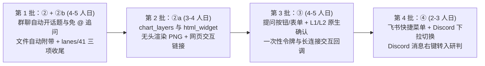

# 渠道第二阶段设计方案（飞书 / Discord / 微信）

> **基线分支**：`design/channel-phase2`（基于 `dalton/main` `305400a37`，衔接前置分支 `fix/channel-sandbox-links`）  
> **关联文档**：`standalone-core.md`、`external-member-permissions.md`、`weixin-multi-account.md`、`cos-delivery-confirmation.md`

---

## 目录

- [一、背景、范围与架构准则](#一背景范围与架构准则)
  - [1.1 现状与演进顺序](#11-现状与演进顺序)
  - [1.2 范围边界](#12-范围边界)
  - [1.3 独立核心安装（Standalone Core）对齐规则](#13-独立核心安装standalone-core对齐规则)
- [二、各项功能在三渠道的实现方案与接口契约](#二各项功能在三渠道的实现方案与接口契约)
  - [2.1 三渠道承载与降级总览](#21-三渠道承载与降级总览)
  - [2.2 功能 ②：群聊 `@机器人` 自动开话题与话题内免 `@` 继续对话](#22-功能-群聊-机器人-自动开话题与话题内免--继续对话)
  - [2.3 功能 ②a：交互图表与图表图层转图片并附网页交互版链接](#23-功能-a交互图表与图表图层转图片并附网页交互版链接)
  - [2.4 功能 ②b：回答生成文件自动附带与 `lanes/41` 链接收尾事项](#24-功能-b回答生成文件自动附带与-lanes41-链接收尾事项)
  - [2.5 功能 ③：可交互卡片与原生按钮总览](#25-功能-可交互卡片与原生按钮总览)
  - [2.6 功能 ④：机器人快捷菜单与 Discord 右键「转入 Dalton 研判」](#26-功能-机器人快捷菜单与-discord-右键转入-dalton-研判)
- [三、确认卡片风险分级、身份核验与回调接入（功能 ③ 详设）](#三确认卡片风险分级身份核验与回调接入功能--详设)
  - [3.1 操作风险四级分类表（L0–L3）](#31-操作风险四级分类表l0l3)
  - [3.2 点击者身份核验、一次性令牌与过期策略](#32-点击者身份核验一次性令牌与过期策略)
  - [3.3 与现有网页端确认的关系](#33-与现有网页端确认的关系)
  - [3.4 飞书 `card.action.trigger` 与 Discord 组件/弹窗回调接入](#34-飞书-cardactiontrigger-与-discord-组件弹窗回调接入)
- [四、安全、权限与文件过滤规则](#四安全权限与文件过滤规则)
  - [4.1 群聊中图片、附件与链接的可见性边界](#41-群聊中图片附件与链接的可见性边界)
  - [4.2 外部成员发起交互时的权限范围](#42-外部成员发起交互时的权限范围)
  - [4.3 自动附带文件的体积配额、类型白名单与排除规则](#43-自动附带文件的体积配额类型白名单与排除规则)
- [五、数据库变更设计（Dalton 迁移链）](#五数据库变更设计dalton-迁移链)
  - [5.1 群聊机器人话题登记表 `dalton_channel_bot_topics`](#51-群聊机器人话题登记表-dalton_channel_bot_topics)
  - [5.2 渠道交互一次性令牌表 `dalton_channel_action_tokens`](#52-渠道交互一次性令牌表-dalton_channel_action_tokens)
  - [5.3 现有表复用说明与滚动升级兼容](#53-现有表复用说明与滚动升级兼容)
- [六、分批实施计划、测试与上线验收](#六分批实施计划测试与上线验收)
  - [6.1 批次划分总表](#61-批次划分总表)
  - [6.2 各批实施细节、测试用例与验收标准](#62-各批实施细节测试用例与验收标准)
- [七、待用户决定的问题](#七待用户决定的问题)

---

## 一、背景、范围与架构准则

### 1.1 现状与演进顺序

渠道网关（`dalton-channel-gateway` 服务，基于 TypeScript〔带静态类型的 JavaScript 超集语言〕独立进程运行，监听本机回环地址 `127.0.0.1:8962`）负责衔接智能体对话后端与飞书、Discord、个人微信三个聊天端。目前已上线处理中表情与输入状态反馈（#499，`processing-feedback.ts`）以及个人微信多账号管理（#506/#507），前置分支 `fix/channel-sandbox-links`（`lanes/41`）完成了回复正文内工作区沙箱路径向网页登录深链的基础改写。

本设计覆盖渠道第二阶段的五项确定路线：

1. **② 群聊自动开话题与免 `@` 追问**：在飞书群与 Discord 频道 `@机器人` 提问时自动开启独立话题或 Thread（子区，Discord 频道内的独立讨论串），在话题内直接发送消息即可连续对话。
2. **②a 图表与图层转图片附网页交互链接**：将交互组件（`html_widget`）与专业看盘图表图层（`chart_layers`）渲染为高清 PNG（便携式网络图形无损图片格式）随回答发出，并附上打开网页交互视图的链接。
3. **②b 回答生成文件自动附带与链接收尾**：按可交付文件类型白名单与体积上限自动附带本轮产出的文件，同时完成 `lanes/41` 留待本批处理的引用式链接展开、自动化报告与数据任务通知携带会话编号生成深链、自动化完成摘要保留工作区文件链接三项改造。
4. **③ 可交互卡片与风险分级原生按钮**：将澄清提问卡片改为原生单选按钮、下拉框或弹窗输入；将确认操作按风险划分为四级（L0–L3，即 Level 0 至 Level 3 风险等级），低中风险在渠道内通过按钮核验发起人身份完成确认，高风险保持在网页端确认。
5. **④ 机器人快捷菜单与 Discord 消息右键研判**：提供飞书输入框快捷菜单、Discord 斜杠选择器与右键任意消息「转入 Dalton 研判」。

### 1.2 范围边界

为保证群聊阅读体验、个人微信协议稳定性与机构合规隔离，第二阶段明确维持以下简洁边界：

- **群聊保持整卡定稿投递**：群聊过程态统一使用轻量表情回应（飞书 `Typing`〔正在输入状态表情〕、Discord `⏳`），待本轮回答生成完毕后一次性发出排版完整的卡片，省去群聊高频流式改卡。
- **个人微信保持单轮整条回复**：基于腾讯 iLink（腾讯面向智能体开放的个人微信连接协议）长轮询单聊通道，配合 `sendtyping`（正在输入状态信令）发送完整结论与精选附件，保持单轮单条完整交付。
- **后台任务统一在系统内管理**：研究进度、定时唤醒（`schedule_wakeup`）与自动化继续以 Dalton 数据库为准，省去与飞书任务（Task v2，飞书第二版待办任务接口）做双向状态同步。
- **严格按用户显式触发读取消息**：仅处理用户 `@机器人`、在机器人所建话题内跟帖、合并转发或右键显式选中的单条消息，省去以应用全局身份跨群抓取历史消息。

### 1.3 独立核心安装（Standalone Core）对齐规则

全部开发严格遵循 `standalone-core.md` 的双部署形态规范：

1. **能力开关统一门控**：后端路由、工具、后台恢复协程与前端设置页继续通过 `capabilities.py` 中的 `CapabilityId.CHANNEL_GATEWAY` 及子开关 `CHANNEL_FEISHU`、`CHANNEL_DISCORD`、`CHANNEL_WEIXIN` 判断启停。在核心安装形态（Profile〔部署形态配置档〕为 `DALTON_PROFILE=core`）下渠道开关默认关闭；当客户显式开启对应渠道开关并填入机器人凭据时，本阶段五项能力直接可用，全程零依赖宿主机 `researchdata_bridge.py`。
2. **网页地址与品牌名全配置化**：
   - 后端统一调用 `settings.py` 的 `get_dalton_public_app_url()`（读取 `PUBLIC_APP_URL` / `DALTON_FRONTEND_URL`，核心安装由初始化脚本根据 `DOMAIN` 生成）拼装深链；渠道网关在启动及健康探针中支持从后端内部配置读取公网地址，保持网关 `config.ts` 的 `WEB_BASE_URL` 与后端配置自动一致。
   - 当部署处于本机回环试用状态（公网地址为空，或主机名为 `localhost` / `127.0.0.1`）时，网关自动将本机回环 URL（Uniform Resource Locator，统一资源定位符）替换为「请在网页端对应会话或工作区查看」文字说明。
   - 卡片标题、提示词与右键菜单文案统一读取部署品牌配置 `BRAND_NAME`（核心安装默认值为 `Dalton`，Everflow 生产环境按配置读取），品牌文案与群组路由全部由部署配置与数据库读取。

---

## 二、各项功能在三渠道的实现方案与接口契约

### 2.1 三渠道承载与降级总览

| 功能项 | 飞书（Feishu）实现与降级 | Discord 实现与降级 | 个人微信（Weixin iLink）实现与降级 |
| --- | --- | --- | --- |
| **② 群聊开话题与免 `@` 追问** | 群顶层 `@` 回复传 `reply_in_thread: true` 自动创建话题（`omt_xxx`），话题内免 `@` 继续对话；原消息撤回（`230011`/`231003`）时降级为普通群消息 | 频道顶层 `@` 从原消息创建公开子区（子区标识 Thread ID 等于原消息 ID），机器人所建子区内免 `@` 继续对话；缺建子区权限（`403`）或子区满额时降级为频道内引用回复 | 仅面向单聊（`weixin:@me`），群消息记为 `weixin_group_unsupported` 略过；单聊全程直接发消息 |
| **②a 图表与图层转图片** | Schema 2.0（飞书第二代交互卡片结构规范）卡片内嵌上传后的高清 PNG（`tag: "img"`，支持点击放大）+ 底部 `open_url` 按钮 `[打开网页交互版]`；超 10 MB（兆字节）自动压缩或转 WebP（高压缩率网页图片格式） | `multipart/form-data`（多部分表单上传格式）附带高清 PNG + `ActionRow`（Discord 操作组件行容器）外链按钮 `[打开网页交互版]`；渲染不可用时降级为纯文本结论 + 网页链接 | 正文后追加加密上传的 `IMAGE` 图片消息，并在公网地址可用时附纯文本交互链接；渲染不可用时仅发文本与链接 |
| **②b 文件自动附带与深链** | ≤10 MB 图片走 `im.image.create`，≤20 MB 文档走 `im.file.create`（`.html`〔HTML，HyperText Markup Language，超文本标记语言〕先转 PDF〔Portable Document Format，便携式文档格式〕）；>20 MB 降级为网页登录深链 | ≤20 MB 可交付文件走消息附件发送（`.html` 先转 PDF）；>20 MB 或超 50 MB 总量降级为网页登录深链 | ≤20 MB 可交付文件经 AES-128-ECB（128 位高级加密标准电子密码本加密模式）加密上传 CDN（Content Delivery Network，内容分发网络）作为 `IMAGE`/`FILE` 发送（单轮最多 3 个）；超限降级为登录深链 |
| **③ 提问与分级确认按钮** | L0 提问渲染按钮组或表单（`form` + 下拉/输入框）；L1 渲染 `[批准]` `[拒绝]` 按钮；L2 群聊自动私聊发送带二次确认弹窗的卡片；L3 仅出 `[前往网页端确认]` 外链按钮 | L0 渲染 `Button`（按钮组件）/ `StringSelect`（字符串下拉选择菜单）+ `Modal`（模态弹窗表单）；L1 渲染 `[批准]` `[拒绝]` 按钮；L2 群频道发门禁按钮，点击后返回 `flags: 64` Ephemeral（仅当前操作者本人可见的临时消息）确认卡；L3 仅出外链按钮 | L0 保持数字编号列表回复；`credit_pause` 支持回复 `继续`；其余 L1–L3 确认统一发送中文说明与网页端确认深链 |
| **④ 快捷菜单与右键研判** | 订阅 `application.bot.menu_v6` 响应输入框上方 4 个固定菜单（返回研究总监、切换工作区卡片、新建对话、停止任务），保留 v7 `/` 命令 | 升级 `/workspace` 返回下拉切换卡片；注册消息右键命令（`type = 3`）「转入 `<品牌名>` 研判」，提取该条消息正文与附件启动研判 | 优化 `/help` 与绑定欢迎语列出快捷指令，发送 `/workspace` 返回编号列表供直接回复切换 |

---

### 2.2 功能 ②：群聊 `@机器人` 自动开话题与话题内免 `@` 继续对话

#### （1）飞书实现与降级

1. **普通群顶层 `@` 自动创建话题**：
   - 在普通群（`chat_mode == "group"`）中，用户首次顶层 `@机器人` 发送消息 `om_root` 时，飞书尚未分配 `thread_id`。飞书适配器 `inbound-parse.ts` 与 `targets.ts` 将该消息的初始 `threadScopeKey` 构造为 `chat:<chat_id>:topic:<om_root>`。
   - 首条回复发出时，`orchestrator.ts` 对群聊顶层触发回合默认传入 `newThread: true` 与 `replyToMessageId: om_root`。飞书适配器 `monitor.ts` 的 `sendTextChunk`（及 `sendCard`、`sendFile`）将 `replyInThread: true` 透传给 `send.ts` 的 `sendReplyOrFallbackDirect`，调用 `POST /open-apis/im/v1/messages/:message_id/reply` 并携带 `reply_in_thread: true`。
   - 飞书服务端创建话题并在响应 `data` 中返回 `message_id`、`thread_id`（格式 `omt_xxx`）及 `root_id`（`om_root`）。`send.ts` 提取 `thread_id` 返回给 `DeliveryService`，通过内部接口 `I-7` 将 `(platform='feishu', chat_address, external_topic_id=omt_xxx, root_message_id=om_root, canonical_scope_key='chat:<chat_id>:topic:<om_root>')` 持久化至 `dalton_channel_bot_topics`，同时写入网关内存 LRU（Least Recently Used，最近最少使用淘汰缓存）映射表，后续分片与自动附件全部发入该话题。
2. **话题群（`chat_mode == "topic"`）原生兼容**：
   - 话题群的顶层帖子在创建时已携带 `message.thread_id = omt_xxx`，`threadScopeKey` 直接为 `chat:<chat_id>:thread:<omt_xxx>`，首条回复自动落入该话题并同样登记至 `dalton_channel_bot_topics`。
3. **话题内免 `@` 继续对话与斜杠命令**：
   - 当群消息携带非空 `message.thread_id`（或 `root_id`）但未显式 `@机器人` 时，飞书适配器 `monitor.ts` 先查内存活跃话题缓存，缓存未命中（如网关重启初期）时调用后端 `/internal/topics/lookup` 查询 `dalton_channel_bot_topics`。
   - 若确认为机器人参与的话题且发送者符合免 `@` 触发规则（默认发起人本人免 `@`，见第七章问题 1），网关将 `event.threadScopeKey` 归一为已登记的 `canonical_scope_key`，并将 `event.isGroupTrigger` 置为 `true`。话题内直接输入 `/new`、`/stop`、`/workspace`、`/main` 同样免 `@` 生效。
4. **异常降级**：
   - 若原消息在回复前已被发送者撤回（飞书错误码 `230011`、`231003`、`230110`）或当前群设置限制创建话题，飞书适配器 `send.ts` 自动回退调用 `im.message.create` 在群内直接发送回答，跳过写入 `dalton_channel_bot_topics`。

#### （2）Discord 实现与降级

1. **频道顶层 `@` 自动创建公开子区（Thread）**：
   - 在已登记的服务器文字频道（`GuildText = 0`）或公告频道（`GuildAnnouncement = 5`）收到顶层 `<@botId>` 消息时，Discord 适配器 `inbound.ts` 将初始 `threadScopeKey` 构造为 `chat:<guildId>/<channelId>:thread:<messageId>`（Discord 从消息创建子区时生成的子区 Snowflake〔Discord 雪花算法全局唯一数字标识〕固定等于原 `messageId`）。
   - 出站投递时，`orchestrator.ts` 传入 `newThread: true, replyToMessageId: event.messageId`。Discord 适配器 `send.ts` 复用 `threading.ts` 的 `createThreadDiscord`（子区名称取清洗后的用户问题首行，按 UTF-16〔16 位统一码字符编码〕安全截断至 100 字符以内，自动归档时长 60 分钟）与现有 `d036` 两阶段确认账本（`confirmed_thread_address` + `discord_body_phase`），将正文与后续附件全部投递至新子区，并通过 `I-7` 登记 `dalton_channel_bot_topics`。
   - 论坛频道（`GuildForum = 15`）与媒体频道（`GuildMedia = 16`）内的帖子本身已是子区（`type = 11`），直接在该子区内回复。
2. **子区内免 `@` 继续对话**：
   - Discord 适配器 `index.ts` 的 `dispatchMessage` 收到子区消息（`type = 10 / 11 / 12`）且未包含 `<@botId>` 时，检查子区频道缓存的 `owner_id === botUserId` 或查 `dalton_channel_bot_topics`（缓存缺失时调用一次 `getDiscordChannel` 回填）。确认属于机器人所建子区且满足触发人规则后，置 `isGroupTrigger = true`；回复前若子区已自动归档，`ensureThreadUnarchived` 自动解封。
3. **异常降级**：
   - 若机器人缺少 `CREATE_PUBLIC_THREADS` 权限（HTTP〔Hypertext Transfer Protocol，超文本传输协议〕`403` / Discord 错误码 `50013`）、原消息已被删除（`404` / `10008`）或服务器活跃子区数已达上限（`30000`），Discord 适配器 `send.ts` 捕获确定性建帖失败后自动回退为在父频道使用 `message_reference` 引用原消息回复，并通过 `I-1`/`I-7` 保持后续幂等。

#### （3）接口契约（网关 ↔ 后端）

- **扩展 `POST /api/v1/dalton/channels/internal/inbound/register-and-resolve`（`I-1`）**：
  - 请求体新增可选字段 `external_topic_id?: string | null`、`root_message_id?: string | null`。
  - 若 `(platform, chat_address, external_topic_id)` 命中 `dalton_channel_bot_topics`，后端在事务内将 `thread_scope_key` 归一为表内记录的 `canonical_scope_key`，刷新 `last_active_at`，并在响应中返回 `resolved_scope_key: string` 与 `topic_initiator_user_id: string | null`。
- **扩展 `POST /api/v1/dalton/channels/internal/deliveries/progress`（`I-7`）**：
  - 请求体新增可选对象 `bot_topic_registration?: { external_topic_id: string; root_message_id?: string | null; canonical_scope_key: string; initiator_platform_user_id: string }`，在首条消息成功开话题/建子区时同事务 `INSERT ... ON CONFLICT DO UPDATE` 写入 `dalton_channel_bot_topics`。
- **新增 `POST /api/v1/dalton/channels/internal/topics/lookup`**（`X-Service-Token` 鉴权）：
  - 请求：`{ platform: "feishu" | "discord", chat_address: string, external_topic_id?: string, root_message_id?: string }`；
  - 响应：`{ found: boolean, canonical_scope_key: string | null, initiator_platform_user_id: string | null, initiator_dalton_user_id: string | null }`。

---

### 2.3 功能 ②a：交互图表与图表图层转图片并附网页交互版链接

采用服务端无头 Chromium（开源无头浏览器渲染内核）统一渲染高清 PNG 快照 + 附网页交互版深链的方式，一次建设同时覆盖飞书、Discord、个人微信三端，并在核心安装环境下免外部配置直接生效。

#### （1）后端渲染与快照存储

1. **看盘图表图层（`chart_layers`）渲染**：
   - 复用 `chartkit` 模块 `_renderer.py` 已内置的独立工作线程渲染器 `RENDERER` 与打包好的 `chart-render.html`（加载前端同款 `MarketChart` K 线画布，完整还原 OHLCV〔开盘价、最高价、最低价、收盘价与成交量序列〕、副图指标、斐波那契、分叉线、筹码分布等 15 类专业画线）。
   - 在 `layers.py` 的 `_publish` 完成图层落库后，若当前运行来自渠道（`configurable.get("platform")` 非空或属于开启了渠道投递的自动化回合），调用快照生成辅助函数拉取对应品种与周期的行情序列渲染 PNG（默认尺寸 `1200×720`），按内容寻址键 `channel-snapshots/{thread_id}/{sha256[:16]}/chart_{layer_id}.png` 存入对象存储（未启用对象存储时写入后端受控本地缓存目录 `/tmp/dalton-channel-snapshots` 并保留 24 小时），将 `{ snapshot_key, sha256, size_bytes, width, height, chart_id, layer_id, title }` 附入 SSE（Server-Sent Events，服务端单向事件流）的 `event: artifact`（`artifact_type: "chart_layer"`）载荷及检查点回放记录。
2. **交互式 HTML 组件（`ShowWidget` / `html_widget`）渲染**：
   - 在 `pdf_render.py` 现有的单例无头 Chromium 池、`_RENDER_SEMAPHORE` 信号量、逐跳 SSRF（Server-Side Request Forgery，服务端请求伪造）拦截器（仅放行 `show_widget.py` 白名单内的四个公共前端 CDN：`cdnjs.cloudflare.com`、`cdn.jsdelivr.net`、`unpkg.com`、`esm.sh`，其余外部域名与页面内 WebSocket〔全双工长连接通信协议〕请求统一在路由层拦截关闭）及 `_SETTLE_JS` 定帧脚本基础上，新增 `render_widget_png(html, resolved_data, *, width=1200, max_height=2400, scale=2.0) -> bytes`。
   - 渲染前注入 `window.__WIDGET_DATA__` 与标准亮色主题 CSS（Cascading Style Sheets，层叠样式表）变量，待字体加载与 ECharts、Chart.js（两款前端图表绘制库）画布尺寸稳定后截取组件主体区域 PNG，同样存入 `channel-snapshots/`，由 `show_widget.py` 在渠道回合中将 `snapshot_key` 附入 `artifact_type: "html_widget"` 事件载荷。
3. **并发控制与失败回退**：
   - 渲染统一受后端信号量限制（默认并发上限 2，单张超时 25 秒，单回合最多自动渲染前 4 张图表）；当运行环境未安装 Chromium 或单次渲染超时时，记录告警日志并略过 `snapshot_key`，网关正常发出文字分析与网页交互链接。
4. **内部快照读取接口与网页深链定位**：
   - 在 `channels_router.py` 新增内部端点 `GET /api/v1/dalton/channels/internal/snapshots/{snapshot_key:path}`（校验 `X-Service-Token`、`X-User-Id` 与目标 `thread_id` 归属权限），返回 `image/png` 字节流，使网关无论后端使用对象存储还是本地磁盘均通过同一 HTTP 接口拉取。
   - 网页交互深链格式：
     - `html_widget`：`${WEB_BASE_URL}/chat/t/${threadId}?widget=${encodeURIComponent(artifactId)}`（若已发布为监控看板则优先取 `/monitors/${slug}`）；
     - `chart_layer`：`${WEB_BASE_URL}/chat/t/${threadId}?chart=${encodeURIComponent(chartId)}&layer=${encodeURIComponent(layerId)}`；
     - 前端 `ChatView` 识别 `?widget=` 自动滚动高亮对应组件卡片，识别 `?chart=&layer=` 自动展开右侧看盘面板并定位到指定图层。

#### （2）网关收集与三渠道投递

- `orchestrator.ts` 在实时流（`consumeTurnSseStream`）、断线回放流（`deliverReplayFallback` / `consumeInFlightReplayRunStream`）及后台唤醒流（`consumeBackgroundRunStream`）中监听 `event: "artifact"`，按 `artifact_id` 去重收集本轮 `html_widget` 与 `chart_layer` 快照。
- 在回合结算时（同时覆盖默认整轮回复路径与显式调用 `send_message` 发送文字后的图表补发路径）：
  - **飞书**：构造 Schema 2.0 卡片（飞书适配器 `format.ts`），调 `im.image.create` 上传 PNG（若高清图超过飞书图片接口 10 MB 上限，自动使用 1x 缩放或转 WebP），嵌入 `tag: "img"`（`preview: true`），卡片底部放置 `open_url` 按钮 `[打开网页交互版]`。
  - **Discord**：将 PNG 作为消息附件上传，并附加包含 `Link Button`（外链跳转按钮，`style = 5`，标签 `打开网页交互版`）的 `ActionRow`。
  - **个人微信**：正文发出后，将 PNG 经 iLink CDN 加密上传并以 `IMAGE` 消息发出；公网 `WEB_BASE_URL` 可达时在正文中附上 `网页交互版：<链接>`。

---

### 2.4 功能 ②b：回答生成文件自动附带与 `lanes/41` 链接收尾事项

#### （1）本轮可交付文件自动收集与附带

1. **双源收集与优先级排序**：
   - **来源一（回复正文引用）**：网关在代码块与行内代码之外（通过 `sandbox-links.ts`）识别出的工作区文件路径与跨工作区引用 `__wsref__/<workspaceId>/<path>`；
   - **来源二（本轮工具新写文件）**：后端在 `sse_producer.py` 的 `turn_end` 事件及 `/messages/replay` 回放元数据中新增字段 `turn_deliverables: Array<{ workspace_id: string; path: string; size_bytes: number }>`，汇总本轮主智能体通过 `Write`、`Edit`、`ExecuteCode`、`Bash` 新建或更新且通过后端白名单预筛的文件路径（含 `image_capture.py` 捕获的图片原路径）。
   - **去重与群/私聊范围区分**：剔除本轮已由 `send_message(files=[...])` 显式发出的文件及 ②a 已发出的图表快照。**私聊**按「正文点名文件优先 -> 本轮新写可交付文件次之」合并附带；**群聊**仅自动附带「最终回复正文中显式点名/链接的可交付文件」，演算过程中的中间底稿留在工作区内供网页端按需查阅。
2. **`.html` 网页报告转 PDF 与大文件降级**：
   - 命中 `.html` / `.htm` 的可交付报告文件时，网关调用后端文件渲染路由（等价 `render_workspace_pdf`）拉取转换后的 `.pdf` 字节流作为渠道附件发出，同时在正文中保留网页端在线预览深链。
   - 单个文件 ≤ 20 MB（飞书内联图片 ≤ 10 MB，10–20 MB 图片自动改走 `im.file.create` 文件消息；SVG〔Scalable Vector Graphics，可缩放矢量图形〕转 PNG 或按文件发送）、单轮自动附带飞书/Discord 最多 5 个（微信最多 3 个）、整轮总附件 ≤ 50 MB。超出体积或数量上限的文件自动在回复末尾追加文件卡片说明：`📎 <文件名> (<体积 MB>) — 文件较大，请前往网页查看：<登录深链>`。
3. **渠道提示词同步微调**：
   - 更新 `types.ts` 的 `buildSurfaceRules`：告知模型在正文中用工作区相对路径书写生成的文件链接（网关会自动转为网页深链并按体积上限附带可交付文件），跨会话指定目标或需确保特定顺序时仍可调用 `send_message(files=[...])`。该提示词改动在合入前执行提示词语言规范审查。

#### （2）纳入 `lanes/41` 推迟的三项链接收尾改造

1. **Markdown（轻量级纯文本标记语法）引用式链接展开与改写**：
   - 在 `sandbox-links.ts`（跳过围栏代码块与行内代码）增加引用式链接解析器：先提取正文中的链接定义行 `[ref]: destination "optional title"`（标签长度上限 512 字符，防回溯退化）；当 `destination` 命中沙箱路径（`/home/workspace/...`、`file:///...`、`__wsref__/...`、工作区相对路径）或本地预览地址（`http://localhost:<port>`）时，将其改写为登录深链 `${WEB_BASE_URL}/chat/t/${threadId}?file=...`，并将正文中引用的 `[文字][ref]`、`[ref][]` 原地展开为标准内联链接 `[文字](深链)`（兼容飞书富文本与微信文本过滤器），同时将原始路径送入 ②b 自动附件候选集。
2. **自动化报告与数据任务通知携带会话编号生成深链**：
   - **自动化通知链路**：在 `automation_notifications.py` 的 `decide_automation_notification_plan` 与 `automation_reports.py` 的报告投递计划中，从关联的 `automation_executions.conversation_thread_id` 与 `automations.workspace_id` 读取并在返回的通知计划顶层附带 `thread_id: string | null` 与 `workspace_id: string | null`。网关 `data-task-notifications.ts` 与 `automation-notifications.ts` 在发送前将 `threadId` 与 `workspaceId` 传入 `sandbox-links.ts`，使定时报告正文与飞书卡片 Markdown（GFM〔GitHub Flavored Markdown，GitHub 扩展标记语法〕段落）中的工作区路径统一生成 `/chat/t/<threadId>?file=<path>`（仅存在 `workspaceId` 时生成 `/chat/<workspaceId>?file=<path>`）。
   - **脚本数据任务链路**：在 `data_task_notifications.py` 中，若任务已在 `data_job_registry.py` 绑定监控看板且公网地址已配置，在通知计划中附带 `monitor_url` 供卡片底部生成「查看监控面板」链接；仅含宿主机本地路径的通知展示纯文件名文本。
3. **自动化完成摘要保留并改写工作区文件链接**：
   - 改造通知分发模块 `dispatch.py` 中的 `_strip_non_http_markdown_links`（现行逻辑仅保留 `http(s)://` 和 `/monitors/...` 链接）：新增 `rewrite_workspace_links_for_external(text, *, public_base, thread_id=None, workspace_id=None)`，在构造自动化完成通知摘要卡片与纯文本时，将合规工作区文件链接（含引用式链接）直接改写为 `${public_base}/chat/t/${thread_id}?file=${encoded_path}`（仅在未配置 `public_base` 或命中系统内部路径时回退为纯文本标签）。
   - 同步调整 `_truncate_section_body` 与 `_truncate_line_at_punct`：按链接的可见显示文字长度计入卡片摘要字数预算，并复用 `truncate_preserving_markdown_links` 确保截断位置落在完整链接边界之外。

---

### 2.5 功能 ③：可交互卡片与原生按钮总览

- **提问卡片（`AskUserQuestion`，智能体向用户发起澄清提问的工具）**：
  - **飞书**：构造 Schema 2.0 卡片。单题单选且选项数 ≤ 5、每项字数 ≤ 20 时，渲染一组 `button`（点击即回传对应选项）；多选（`allow_multiple: true`）、多题或选项数 > 5 时，渲染 `form` 容器包裹 `select_static` / `multi_select_static` 下拉框 + 1 个可选补充说明 `input` + 提交按钮，旁配 `[跳过]` 按钮。
  - **Discord**：单题单选 ≤ 5 项渲染 `ActionRow` `Button`（每行最多 5 个按钮）；多选或 6–25 项渲染 `StringSelect`（设置 `min_values` / `max_values`）；附 `[填写其他回答]` 按钮（点击弹出 `Modal` 多行文本框）与 `[跳过]` 按钮。
  - **个人微信与全端文字兼容**：微信继续输出清晰的编号列表（`1. ... 2. ...`）；飞书与 Discord 在发出按钮卡片的同时，继续支持用户直接打字回复序号或自由文本回答（任一方式先到达即核销该提问并置灰原卡片）。
- **确认卡片（HITL〔Human-in-the-Loop，人工介入确认〕与命令行审批）**：按 L1（渠道内直接按钮确认）、L2（群聊私密卡片 + 二次防误触确认）、L3（固定网页端确认）三级执行，完整分级表、身份校验与回调协议见第三章。

---

### 2.6 功能 ④：机器人快捷菜单与 Discord 右键「转入 Dalton 研判」

#### （1）机器人快捷菜单

1. **飞书机器人自定义菜单**：
   - 在飞书开发者后台配置输入框上方 4 个快捷菜单项（菜单键统一使用 `dalton:menu:<action>`）：
     - `返回研究总监`（`dalton:menu:main`）：切回个人 `Home` 研究总监会话；
     - `切换工作区`（`dalton:menu:workspace`）：查询用户名下可访问工作区，返回一张带工作区选择下拉框与快捷按钮的 Schema 2.0 卡片，点击即完成 `/workspace <id>` 切换；
     - `新建对话`（`dalton:menu:new`）：在当前工作区推进会话代数（`generation + 1`）开启新对话；
     - `停止当前任务`（`dalton:menu:stop`）：取消当前会话正在运行的回合。
   - 网关在飞书适配器 `monitor.ts` 的 `EventDispatcher.register` 中订阅 `application.bot.menu_v6`（复用现有 `WSClient`〔飞书长连接客户端〕），提取 `operator.operator_id.open_id` 与 `event_key`，复用 `orchestrator.ts` 的 `I-3` 会话命令通道执行并向用户单聊返回反馈。已有的 4 个飞书 v7 原生 `/` 斜杠命令同步器（`feishu-registrar.ts`）保持并存，并在同步工具输出中补充自定义菜单配置自检提示。
2. **Discord 斜杠菜单增强**：
   - 在现有 `/main`、`/workspace`（含实时自动补全）、`/new`、`/stop` 基础上，当用户无参数执行 `/workspace` 时，在 Ephemeral 响应中附带 `StringSelect` 工作区下拉菜单（最多展示最近活跃的 25 个可写工作区），支持点选一键切换。
3. **个人微信快捷指引**：
   - 在绑定成功欢迎语与 `/help` 回复中列出 `/main`、`/workspace`、`/new`、`/stop` 指令说明；当用户发送 `/workspace` 时返回带序号的工作区列表，支持回复 `/workspace <序号或名称>` 切换。

#### （2）Discord 右键消息菜单「转入 `<品牌名>` 研判」

1. **命令声明与幂等注册**：
   - 在原生命令模块 `manifest.ts` 与 `discord-registrar.ts` 新增一条消息上下文菜单命令（`ApplicationCommandType.Message = 3`，无 `description` 与 `options`，全局 `contexts: [0, 1]` 同时覆盖服务器频道与机器人私聊）。命令名称按配置品牌名生成：默认 `转入 Dalton 研判`（自定义品牌时为 `转入 <BRAND_NAME> 研判`，超 32 字符安全截断）。
   - 调整 `indexRemoteDiscordCommands` 按 `(name, commandType)` 复合键索引，使用定向 `POST` / `PATCH` 同步，保留应用下其他未托管命令原样运行。
2. **交互处理与安全流转**：
   - 用户右键任意消息点击该菜单项时，Discord Gateway（Discord 实时事件网关）推送 `INTERACTION_CREATE`（`type = 2`，`data.type = 3`，`data.target_id` 指向被选消息，`data.resolved.messages[target_id]` 直接携带被选消息的正文 `content`、作者名称、发送时间及附件元数据 `attachments`）。
   - **权限前置检查**：先核查点击者在 `dalton_channel_identities` 的绑定状态与成员等级。若点击者尚未绑定账号，返回 Ephemeral 提示引导绑定；服务器频道右键研判面向管理员与内部成员开放，外部成员（`tier == "external"`）在服务器频道触发时返回 Ephemeral 提示「外部成员请通过机器人私聊使用」。
   - **轻量弹窗收集研判要求**：校验通过后，网关在 3 秒首次回调中同步返回 `MODAL`（`type = 9`），包含 1 个可选多行输入框「补充研判问题（留空则核查事实并提炼要点）」；当当前频道为已授权的 Dalton 群频道时，额外提供投递位置下拉框（默认「发到我的机器人私聊」，可选「在当前频道新建子区讨论」；其余频道固定发往本人私聊，见第七章问题 2）。
   - **附件下载与回合发起**：收到 `MODAL_SUBMIT`（`type = 5`）后，网关先返回 Ephemeral 确认提示（附网页会话深链），通过现有 `downloadDiscordAttachment`（强制 HTTPS〔加密超文本传输协议〕与 Discord CDN 域名白名单 SSRF 校验）下载被选消息上的合规附件上传至目标工作区，将被选消息格式化为引用块拼合用户补充问题，作为标准入站回合提交后端执行。

---

## 三、确认卡片风险分级、身份核验与回调接入（功能 ③ 详设）

### 3.1 操作风险四级分类表（L0–L3）

根据操作可逆性、影响边界与所需审阅上下文，将后端全部交互中断与命令审批划分为四级：

| 风险级别 | 包含的具体操作（对应代码模块） | 飞书承载方式 | Discord 承载方式 | 个人微信承载方式 | 令牌有效期（TTL，Time To Live） |
| --- | --- | --- | --- | --- | --- |
| **L0 澄清提问** | `ask_user_question`（`ask_user.py`） | Schema 2.0 按钮组或 `form` 下拉/输入框 + `[跳过]`（兼容打字回复） | `Button` / `StringSelect` + `[填写其他回答]` `Modal` + `[跳过]`（兼容打字回复） | 数字编号文本列表，回复序号或文字继续 | **6 小时**（随会话活跃期） |
| **L1 低风险确认** | 1. `delegate_to_analyst` 派发至**本人自有工作区**（`chief_of_staff.py`）<br>2. `create_workspace` 新建工作区<br>3. `credit_pause` 单轮额度触顶继续运行（`credit_gate.py`）<br>4. `dalton_notify_test` 测试推送、`dalton_notify_add_personal_target` 添加本人接收目标（`notify_tools.py`） | 当前会话直接发卡片：`[批准]`、`[拒绝]`、`[拒绝并附言]` 按钮（核对点击者 = 发起人） | 当前会话直接发组件卡：`[批准]`、`[拒绝]`、`[拒绝并附言]` 按钮（核对点击者 = 发起人） | `credit_pause` 支持回复 `继续`（可带补充指令）；其余发中文摘要 + 网页端确认深链 | **30 分钟** |
| **L2 中风险确认** | 1. `delete_thread` 删除单条历史对话（`chief_of_staff.py`）<br>2. `delegate_to_analyst` 派发至**同事共享可写工作区**<br>3. `dalton_notify_set_route`、`dalton_report_delivery_set` 配置群发或他人私信推送路由（`notify_tools.py`、`report_delivery_tools.py`）<br>4. CLI（Command-Line Interface，命令行工具）跨电脑发起任务（开启 `computer_cli_tokens` 时，`cli_approval.py`） | **私聊**：发完整参数卡 + 带原生 `confirm` 二次确认弹窗的 `[批准]` 按钮；<br>**群聊/话题**：群内仅发脱敏提示，完整确认卡自动发往发起人飞书私聊（`feishu:@me`） | **私聊**：发完整参数卡 + `[确认执行]` `[取消]` 按钮；<br>**群频道/子区**：先发脱敏门禁卡 `[查看详情并确认]`，发起人点击后返回 `flags: 64` Ephemeral 私密详情确认卡 | 发送中文风险摘要 + 网页端确认深链 | **10 分钟** |
| **L3 高风险确认** | 1. `order_approval` 全部下单、改单、撤单、期权行权（`order_governance.py`）<br>2. `delete_workspace` 删除整个工作区、`computer_remove` 移除电脑、删除定时任务<br>3. `publish_approval` 正式研报入库发布（发布模块 `service.py`，见第七章问题 3）、公开分享与监控面板受众放开（`records.py`）<br>4. OAuth（Open Authorization，开放授权协议）/ 外部连接器授权 | **固定网页端确认**：发送风险说明卡片 + 原生外链按钮 `[前往网页端核对并确认]` | **固定网页端确认**：发送风险说明卡片 + `Link Button` `[前往网页端核对并确认]` | **固定网页端确认**：发送中文说明 + 网页端确认深链 | 仅在网页端登录会话内确认（跳过签发渠道令牌） |

---

### 3.2 点击者身份核验、一次性令牌与过期策略

1. **客户端按钮零业务载荷**：
   - Discord `custom_id` 长度为 100 字符上限，飞书卡片 JSON（JavaScript Object Notation，轻量级数据交换格式）对客户端可见。按钮回调值统一采用仅含随机标识的紧凑不透明格式：
     - 确认动作：`dlt:apv:<approval_nonce>:<approve|reject|gate|reason>`
     - 提问动作：`dlt:ask:<approval_nonce>:<opt_idx|submit|skip|custom>`
2. **服务端签发与哈希存储**：
   - 网关在 `handleInterruptEvent` 识别出 L0 / L1 / L2 中断后，调用后端内部接口 `POST /api/v1/dalton/channels/internal/action-tokens/mint` 申请 128 位随机令牌 `approval_nonce`（Base64URL〔URL 安全的 Base64 文本编码〕，22 字符）。
   - 后端仅在 `dalton_channel_action_tokens` 表中保存 `SHA-256`（256 位安全哈希算法）摘要 `token_hash`，并绑定 `dalton_user_id`、`platform`、`initiator_platform_user_id`、`thread_id`、`run_id`、`interrupt_id`、`risk_tier`、`action_type`、`args_sha256` 及 `expires_at`。
   - 对于 `dalton_notify_set_route` 与 `dalton_report_delivery_set`，中断载荷中携带的服务端 `confirm_token` 保存在表列 `server_confirm_token` 中，核销通过后由后端取出交还网关填入 `hitl_response`，仅在服务端内部流转。
3. **点击回调五步原子核验（`POST /api/v1/dalton/channels/internal/action-tokens/consume`）**：
   - **第 1 步（提取平台可信身份）**：飞书取长连接事件 `operator.open_id`；Discord 取 Gateway 事件 `member.user.id`（群频道）或 `user.id`（私聊），同时校验 `application_id` 与机器人已验证应用 ID 一致。
   - **第 2 步（核对发起人平台身份与当前账号绑定）**：查询 `token_hash` 对应记录，要求 `platform == row.platform` 且 `clicker_platform_user_id == row.initiator_platform_user_id`；同时在同事务内反查 `dalton_channel_identities`，确认该平台账号当前仍绑定于同一个 `row.dalton_user_id`，群聊场景同时要求成员等级 `get_user_tier(dalton_user_id)` 属于 `admin`（管理员）或 `internal`（内部成员）。核对未通过时返回 `403 clicker_mismatch`，飞书向点击者弹出个人 Toast（客户端顶部轻提示浮层）「此项操作由发起人本人确认」，Discord 返回 `flags: 64` Ephemeral 提示，原卡片保持待确认状态。
   - **第 3 步（严格核对风险分级）**：确认 `row.risk_tier` 属于允许渠道内确认的 `L0`、`L1` 或 `L2`；L3 高风险操作固定返回 `403 web_only_approval_required` 并引导前往网页端确认。
   - **第 4 步（检查过期与会话代数）**：使用数据库时钟 `NOW()` 核对 `expires_at > NOW()`，并校验对应 `dalton_channel_session_generations` 的会话仍有效。超期记录标为 `consumed_via = 'expired'` 并返回 `410 token_expired`，网关将卡片原地更新为「快捷确认已过期，请前往网页端处理」并保留网页跳转按钮。
   - **第 5 步（CAS〔Compare-And-Swap，比较并原子更新〕单次核销）**：执行 `UPDATE dalton_channel_action_tokens SET consumed_at = NOW(), consumed_via = 'channel' WHERE token_hash = $1 AND consumed_at IS NULL AND expires_at > NOW() RETURNING *`。应对网络重推或用户快速连点，仅首个请求获得执行权并推进 `dispatchHitlResumeTurn`；重复请求收到 `already_consumed` 后幂等返回终态卡片。

---

### 3.3 与现有网页端确认的关系

1. **共用同一套检查点恢复协议**：渠道核销成功后，网关拼装与网页端 `answerBoard.ts` 完全一致的 `hitl_response: { [interrupt_id]: { decisions: [{ type: "approve" | "reject", message, ...(confirm_token ? { confirm_token } : {}) }] } }`，调用 `POST /api/v1/threads/{thread_id}/messages`（`messages: []`）恢复 LangGraph（智能体有状态图执行框架）运行；工具内部的二次预检（如 `report_delivery.py` 重算校验 `confirm_token` 与 `config_version`）原样生效。
2. **网页端先处理后的渠道同步收敛**：
   - 当用户已在网页端完成确认或拒绝时，后端在清理会话中断状态时同步将 `(thread_id, run_id, interrupt_id)` 关联的未消费 `dalton_channel_action_tokens` 标记为 `consumed_via = 'web'`。
   - 网关持有 `card_message_id` 时异步发起非阻塞卡片刷新，将按钮置灰为「已在网页端处理」；后续若用户在手机端点击旧卡片，接口幂等返回「已在其他终端处理」提示并同步刷新卡片终态。
3. **网页端确认通道始终可用**：渠道的 10 分钟 / 30 分钟 TTL 仅作用于聊天窗口内的快捷按钮，底层会话检查点保持待确认状态，用户随时可通过卡片上的网页深链在浏览器中核对并完成确认。

---

### 3.4 飞书 `card.action.trigger` 与 Discord 组件/弹窗回调接入

#### （1）飞书 `card.action.trigger` 长连接接入

- **权限与后台配置**：在飞书开发者后台「事件与回调 -> 回调配置」开启**使用长连接接收回调**并添加 `card.action.trigger`（复用现有 `im:message` 与 `im:message:send_as_bot` 权限，直接走现有出站长连接，省去额外开放公网 Webhook〔网络回调接口〕端口；企业租户配置变更随应用版本发布由管理员审批生效）。
- **3 秒响应时限处理**：
  - 在飞书适配器 `monitor.ts` 的 `eventDispatcher.register` 中注册 `"card.action.trigger"` 回调；飞书 SDK（Software Development Kit，软件开发工具包）将该处理器返回的 JSON 对象直接作为同步回调响应下发客户端。
  - 处理器设置 **2.2 秒**内部核销时间窗：窗口内完成 `/action-tokens/consume` 时，同步返回 `{ toast: { type: "success", content: "已提交" }, card: { type: "raw", data: settledCard } }`，客户端瞬间置灰按钮并更新操作回执；随后在后台异步调用 `dispatchHitlResumeTurn` 消费智能体恢复流并发送后续回答。
  - 若内部核销耗时超过 2.2 秒，先同步返回 `{ toast: { type: "info", content: "正在处理确认…" } }` 满足飞书 3 秒时限，待核销落定后调用 `PATCH /open-apis/im/v1/messages/:open_message_id`（卡片开启 `config.update_multi: true`）刷新终态卡片。

#### （2）Discord `MESSAGE_COMPONENT` 与 `MODAL_SUBMIT` 接入

- **权限与连接**：复用现有 Gateway WebSocket 的 `INTERACTION_CREATE` 事件（沿用现有机器人〔Bot〕权限配置即可生效，服务器管理员免重新授权）。
- **解析与响应分流**：
  - 在 Discord 适配器 `interactions.ts` 扩展 `parseDiscordInteractionCreate`，在现有 `type = 2`（应用命令）与 `type = 4`（自动补全）之外，新增解析 `type = 3`（`MESSAGE_COMPONENT`，读取 `component_type`、`custom_id`、`values`、`message.id`）和 `type = 5`（`MODAL_SUBMIT`，读取 `custom_id` 与表单输入文本），沿用现有的 `verifiedApplicationId` 核验与两阶段频道上下文解析。
  - 在 `interaction-response.ts` 补齐三类响应辅助方法：
    1) **点击确认 / 单选 / 下拉提交**：核销通过后调 `UPDATE_MESSAGE`（`type = 7`）原地将原卡片按钮替换为已处理禁用态（若预计耗时 > 1.5 秒则先发 `DEFERRED_UPDATE_MESSAGE` `type = 6` 延迟响应，再编辑 `@original`），后台异步恢复回合；
    2) **点击「拒绝并附言」或「填写其他回答」**：首次回调直接同步返回 `MODAL`（`type = 9`）弹出私密输入框（省去前置延迟占位响应 `defer`）；收到 `MODAL_SUBMIT` 后完成核销并编辑原卡片消息；
    3) **点击群频道 L2 门禁按钮（`:gate`）**：核对点击者等于发起人后，返回 `CHANNEL_MESSAGE_WITH_SOURCE`（`type = 4, flags = 64`）向发起人单独展示含完整参数的私密确认卡。

---

## 四、安全、权限与文件过滤规则

### 4.1 群聊中图片、附件与链接的可见性边界

1. **原生图片与附件的可见范围及外发保护**：
   - 发入飞书群/话题或 Discord 频道/子区的图表图片（②a）与文档附件（②b），对该群或频道内的全体成员（含尚未绑定 Dalton 账号的群成员）直接可见。
   - 为保护跨工作区数据与群聊可见边界，执行两项安全规则：
     1) **同事数据外发守卫全链路覆盖**：将 `colleague_outbound_guard.py` 的 `is_run_outbound_blocked` 检查从显式 `send_message` 扩展覆盖至**默认整轮回复正文、②a 图表快照附带与 ②b 文件自动附带**；仅在本轮未读取受限同事工作区数据时才向群聊附带自动图片与文件，触发外发限制时仅保留需登录鉴权的网页深链。
     2) **群聊仅自动附带正文点名文件**：群聊回合仅将智能体在最终回复正文中显式引用点名的可交付文件纳入自动附带；智能体在沙箱演算过程中写入的其他文件保留在工作区内供网页端查阅。
2. **网页链接的鉴权边界**：
   - 渠道发出的会话深链（`/chat/t/<threadId>?...`）与工作区深链（`/chat/<workspaceId>?...`）均为**纯前端路由地址**（仅包含会话或工作区标识与文件相对路径，省去免登录文件授权令牌 `file_grants`）。
   - 群成员点击链接进入浏览器后，统一经过 Dalton 登录认证（核心安装 `local` 本地密码会话或 Everflow `supabase`〔开源身份认证与后端服务〕会话），并由后端校验其对该会话或目标工作区的读取权限；仅具备对应会话或工作区读取权限的登录成员可查看文件内容、组件数据与对话记录。
   - 监控面板链接（`/monitors/<slug>`）严格按面板自身的可见性配置（`own` / `internal` / `public`）执行访问控制。

### 4.2 外部成员发起交互时的权限范围

严格对齐 `external-member-permissions.md` 与 `channel_gateway.py` 现有隔离模型：

1. **外部成员固定通过私聊使用**：飞书群/话题与 Discord 频道/子区内的机器人对话、免 `@` 话题跟帖、群斜杠命令、群卡片按钮与群频道消息右键研判均限定向管理员（`admin`）与内部成员（`internal`）开放；外部成员（`tier == "external"`）在群聊场景触发时，后端登记 `external_member_group_forbidden`，交互回调仅向其本人返回「外部成员请通过机器人私聊使用」提示。
2. **私聊交互范围与外发边界**：
   - 外部成员可在已绑定的飞书私聊、Discord 私聊或经管理员开启 `allow_external` 的个人微信私聊中正常发起对话、接收本人工作区产出的图表截图 PNG 与 ≤20 MB 可交付文件、使用 L0 提问按钮与本人自有工作区的 L1 确认按钮，以及使用私聊快捷菜单。
   - 群推送路由配置工具（`dalton_notify_settings`、`dalton_report_delivery`）与公开分享链接（`/a/<code>`、`/s/<token>`）限定向内部成员与管理员开放；外部成员发起回合生成的网页链接统一为需本人账号登录访问的私密会话深链。

### 4.3 自动附带文件的体积配额、类型白名单与排除规则

后端汇总 `turn_deliverables` 与网关执行 `downloadWorkspaceFile` 前双重执行同一套过滤规则：

1. **数量与体积配额**：
   - 单文件上限：`20 MB`（飞书内联图片 `im.image.create` 上限 `10 MB`，`10 MB < 图片 ≤ 20 MB` 自动转为 `im.file.create` 文件发送）；
   - 单次投递总体积上限：`50 MB`；
   - 单轮自动附带数量上限：飞书与 Discord 最多 `5` 个文件，个人微信最多 `3` 个文件（与显式 `send_message` 合计上限 10 个）。
2. **可交付扩展名白名单（小写匹配，对齐前端 `filePaths.ts`）**：
   - 文档：`.pdf`、`.docx`、`.doc`、`.md`、`.markdown`、`.txt`、`.rtf`、`.odt`
   - 表格：`.xlsx`、`.xlsm`、`.xls`、`.csv`、`.tsv`
   - 演示文稿：`.pptx`、`.ppt`（注：**排除 `.key`**，规避与 TLS〔传输层安全协议〕或 SSH〔安全外壳远程登录协议〕私钥文件 `*.key` 后缀重名的外发风险）
   - 图片：`.png`、`.jpg`、`.jpeg`、`.gif`、`.webp`、`.bmp`
   - 网页报告：`.html`、`.htm`（统一经 `pdf_render.py` 渲染为 `.pdf` 文档附件发送，并在正文中附网页端在线预览深链）
3. **自动附带排除目录与后缀清单**：
   - **排除的内部目录前缀**（工作区相对路径任一层级命中即排除）：
     - `.agents/`（含技能、长期记忆、会话命令日志 `.agents/threads/`、共享工作区成员上下文 `.agents/members/`）
     - `_internal/`（沙箱内部运行环境与浏览器组件）
     - `uploads/`（入站用户上传的原始附件目录，避免重复回传用户刚上传的文件）
     - `.git/`、`node_modules/`、`__pycache__/`、`.venv/`、`.pytest_cache/`
     - 任何以 `.` 开头的隐藏文件或隐藏目录（如 `.env`、`.env.*`、`.DS_Store`）
     - 任何包含 `..` 路径段、控制字符或越出工作区根目录的符号链接路径
   - **排除的代码、脚本、配置与中间数据后缀**：
     - 脚本与源码：`.py`、`.sh`、`.bash`、`.zsh`、`.js`、`.mjs`、`.cjs`、`.ts`、`.tsx`、`.jsx`、`.sql`、`.ipynb`、`.r`、`.go`、`.rs`
     - 配置、日志与密钥：`.json`、`.jsonl`、`.yaml`、`.yml`、`.toml`、`.ini`、`.cfg`、`.conf`、`.lock`、`.log`、`.pem`、`.key`、`.crt`
     - 二进制中间数据与压缩包：`.parquet`、`.feather`、`.arrow`、`.pkl`、`.pickle`、`.db`、`.sqlite`、`.sqlite3`、`.duckdb`、`.h5`、`.npz`、`.zip`、`.tar`、`.gz`、`.tgz`、`.7z`

---

## 五、数据库变更设计（Dalton 迁移链）

所有数据库变更均写入 Dalton Alembic（数据库表结构版本迁移工具）迁移链（具体迁移脚本版本号在合入时顺接当前 `head`），独立于上游迁移目录演进，采用纯增量建表方式保障平滑滚动升级。本阶段共需新增 **2 张自有表**（分别随第 1 批与第 3 批落地）：

### 5.1 群聊机器人话题登记表 `dalton_channel_bot_topics`

随第 1 批迁移新增，用于持久化飞书自动创建的话题（`omt_xxx` 与根消息 `om_xxx`）及 Discord 自动创建的子区，保证首轮根消息作用域与后续话题内跟帖归一到同一会话，并在网关重启后立即恢复免 `@` 跟帖能力：

```sql
CREATE TABLE IF NOT EXISTS dalton_channel_bot_topics (
    platform VARCHAR(32) NOT NULL,                  -- 'feishu' | 'discord'
    chat_address VARCHAR(255) NOT NULL,             -- 如 'feishu:oc_xxx' | 'discord:<guild>/<parent>'
    external_topic_id VARCHAR(255) NOT NULL,        -- 飞书 omt_xxx 或 Discord thread_id
    root_message_id VARCHAR(255) NULL,              -- 触发开贴的原消息 ID (om_xxx / message_id)
    canonical_scope_key VARCHAR(255) NOT NULL,      -- 归一后的会话 scope_key
    initiator_dalton_user_id VARCHAR(255) NOT NULL, -- 话题发起人 Dalton user_id
    initiator_platform_user_id VARCHAR(255) NOT NULL, -- 话题发起人平台 ID (open_id / user.id)
    created_at TIMESTAMPTZ NOT NULL DEFAULT NOW(),
    last_active_at TIMESTAMPTZ NOT NULL DEFAULT NOW(),
    PRIMARY KEY (platform, chat_address, external_topic_id)
);

CREATE INDEX IF NOT EXISTS idx_dalton_channel_bot_topics_root
    ON dalton_channel_bot_topics (platform, chat_address, root_message_id)
    WHERE root_message_id IS NOT NULL;
```

### 5.2 渠道交互一次性令牌表 `dalton_channel_action_tokens`

随第 3 批迁移新增，用于服务端托管 L0 提问卡片与 L1/L2 确认按钮的一次性令牌哈希、发起人身份绑定、服务端确认凭证与原子核销状态：

```sql
CREATE TABLE IF NOT EXISTS dalton_channel_action_tokens (
    token_hash VARCHAR(64) PRIMARY KEY,             -- SHA-256(approval_nonce)，仅保存哈希摘要
    platform VARCHAR(32) NOT NULL,                  -- 'feishu' | 'discord'
    dalton_user_id VARCHAR(255) NOT NULL,
    initiator_platform_user_id VARCHAR(255) NOT NULL,
    chat_type VARCHAR(16) NOT NULL,                 -- 'dm' | 'group'
    chat_address VARCHAR(255) NOT NULL,
    scope_key VARCHAR(255) NOT NULL,
    session_generation INTEGER NOT NULL,
    thread_id UUID NOT NULL,                        -- 会话全局唯一标识符 (UUID)
    run_id VARCHAR(255) NOT NULL,
    interrupt_id VARCHAR(255) NOT NULL,
    risk_tier VARCHAR(8) NOT NULL CHECK (risk_tier IN ('L0', 'L1', 'L2')),
    action_type VARCHAR(128) NOT NULL,
    args_sha256 VARCHAR(64) NOT NULL,
    server_confirm_token VARCHAR(128) NULL,         -- 托管后端工具生成的 SHA-256 confirm_token
    options_snapshot JSONB NULL,                    -- L0 提问选项快照 (JSONB: PostgreSQL 二进制 JSON 存储类型)
    prompt_summary JSONB NOT NULL DEFAULT '{}'::jsonb,
    card_message_id VARCHAR(255) NULL,              -- 渠道已发卡片 message_id，供核销后置灰刷新
    expires_at TIMESTAMPTZ NOT NULL,
    consumed_at TIMESTAMPTZ NULL,
    consumed_via VARCHAR(32) NULL CHECK (
        consumed_via IS NULL
        OR consumed_via IN ('channel', 'web', 'text_reply', 'superseded', 'expired')
    ),
    created_at TIMESTAMPTZ NOT NULL DEFAULT NOW()
);

CREATE INDEX IF NOT EXISTS idx_dalton_channel_action_tokens_interrupt
    ON dalton_channel_action_tokens (thread_id, run_id, interrupt_id);

CREATE INDEX IF NOT EXISTS idx_dalton_channel_action_tokens_expires
    ON dalton_channel_action_tokens (expires_at)
    WHERE consumed_at IS NULL;
```

### 5.3 现有表复用说明与滚动升级兼容

- **飞书确认话题投递幂等**：直接复用 `d036` 在 `dalton_channel_deliveries` 上已建好的 `confirmed_thread_address VARCHAR(255) NULL` 列记录飞书首次回复确认后的话题目标地址，省去重复加列。
- **图表快照与自动附带文件**：图表 PNG 存入对象存储 `channel-snapshots/`（或本地临时缓存目录），出站文件状态继续写入 `dalton_channel_deliveries.files_status`；自动化通知深链所需的 `thread_id` 与 `workspace_id` 直接关联读取现有 `automation_executions`、`automations` 与 `dalton_automation_report_batches` 表。
- **快捷菜单与右键研判**：直接复用 `dalton_channel_inbound_events`（`event_kind` 区分 `'command'` 与 `'message'`）和 `dalton_channel_session_generations`。
- **滚动升级兼容**：两张新表均为纯新增独立表，保持全部存量表结构与约束原样兼容，迁移执行期间新旧版本后端与网关进程均可平滑并行运行。

---

## 六、分批实施计划、测试与上线验收

### 6.1 批次划分总表

按「**第 1 批（② + ②b 含 `lanes/41` 推迟项）→ 第 2 批（②a）→ 第 3 批（③）→ 第 4 批（④）**」分 4 批顺序推进，每批均可独立合入主分支并独立上线生产环境：



| 批次 | 覆盖范围 | 数据库迁移 | 平台后台配置变更 | 预估工作量 | 前置依赖 |
| --- | --- | --- | --- | --- | --- |
| **第 1 批** | **②** 群聊自动开话题与免 `@` 追问 + **②b** 回答文件按体积自动附带 + `lanes/41` 三项推迟事项 | 新增 `dalton_channel_bot_topics` 表 | 无（复用现有权限） | **4–5 人日** | `lanes/41` 合入 |
| **第 2 批** | **②a** `chart_layers` 与 `html_widget` 转高清 PNG 随回答发出 + 网页交互版深链 | 无 | 无（复用现有图片上传权限） | **3–4 人日** | 第 1 批 |
| **第 3 批** | **③** `AskUserQuestion` 原生按钮/下拉/表单 + L1/L2 风险分级按钮确认 + L3 网页确认卡 | 新增 `dalton_channel_action_tokens` 表 | 飞书后台开启长连接回调 `card.action.trigger` 并发布版本；Discord 免配置 | **4–5 人日** | 第 2 批 |
| **第 4 批** | **④** 飞书机器人菜单 + Discord `/workspace` 下拉切换 + Discord 右键「转入 `<品牌名>` 研判」 | 无 | 飞书配置机器人菜单并订阅 `application.bot.menu_v6` 发布版本；Discord 执行一次 `dalton-native-commands` 同步 | **2–3 人日** | 第 3 批 |

---

### 6.2 各批实施细节、测试用例与验收标准

#### 第 1 批：群聊自动开话题免 `@`（②）+ 产物自动附带与链接收尾（②b）

- **主要改动文件**：
  - 后端：`d05X_channel_bot_topics.py`、`channels_router.py`、`channel_gateway.py`、`sse_producer.py`、回放模块 `__init__.py`、通知分发 `dispatch.py`、`automation_notifications.py`、`automation_reports.py`、`data_task_notifications.py`、`pdf_render.py`。
  - 网关：`sandbox-links.ts`、`types.ts`、`config.ts`、`orchestrator.ts`、`delivery-service.ts`、`data-task-notifications.ts`、`automation-notifications.ts`、飞书端 `inbound-parse.ts` / `targets.ts` / `send.ts` / `monitor.ts`、Discord 端 `inbound.ts` / `index.ts` / `send.ts` / `threading.ts`。
- **测试覆盖（Vitest〔前端与 TypeScript 单元测试框架〕+ `pytest`〔Python 单元测试框架〕）**：
  1. 飞书普通群顶层 `@` 发送 `reply_in_thread: true` 并登记 `omt_xxx`、后续免 `@` 跟帖命中原 `canonical_scope_key`、原消息撤回（`230011`）自动回退普通群消息；话题群原生 `thread_id` 免 `@` 跟帖。
  2. Discord 频道顶层 `@` 自动从原消息建子区、子区内免 `@` 追问、网关重启后通过数据库查询恢复免 `@`、缺 `CREATE_PUBLIC_THREADS` 权限（`403`）自动回退父频道引用回复。
  3. `sandbox-links.ts` 引用式链接 `[label][ref]` 展开与改写、`localhost` 回环地址在无公网域名时的降级文案、代码块内链接保持原样。
  4. 自动化完成摘要保留并改写工作区文件链接（覆盖含中文括号与长路径截断边界）；自动化报告与数据任务通知携带 `thread_id` 生成登录深链。
  5. 自动文件附带：覆盖私聊双源收集、群聊仅附带正文点名文件、`.html` 自动转 `.pdf`、>20 MB 降级深链、`.agents/` / `_internal/` / `uploads/` / `.py` / `.key` 排除过滤、`colleague_outbound_guard` 触发时跳过群聊自动附件、外部成员群内跟帖限制。
- **上线验收标准**：
  - 在飞书群与 Discord 频道 `@机器人` 提问自动创建话题/子区，在话题内直接发送两轮追问均延续同一上下文；
  - 智能体生成 Excel（电子表格）或 PDF 报告时，聊天窗口自动收到文件附件，定时任务摘要卡片中的文件链接点击可在浏览器登录后打开对应文件面板；
  - 核心安装（`APP_ENV=core`）默认关闭渠道时全套单测与门禁（`check_hooks.sh --strict`）全绿。

#### 第 2 批：交互图表与图表图层转图片附网页交互版链接（②a）

- **主要改动文件**：
  - 后端：`pdf_render.py`、`show_widget.py`、`layers.py`、`_renderer.py`、`channels_router.py`；前端 `ChatView`（解析 `?widget=` 与 `?chart=&layer=` 定位锚点）。
  - 网关：`orchestrator.ts`、`delivery-service.ts`、飞书端 `format.ts`、Discord 端 `send.ts`、微信端 `send.ts`。
- **测试覆盖**：
  1. 后端 `chartkit` 渲染带 K 线、均线与支撑阻力位的 `ChartLayer` 输出有效 PNG 字节及尺寸校验；
  2. 后端 `render_widget_png` 渲染内联 SVG 与 ECharts 组件输出 PNG，组件内对内网地址与 WebSocket 连接的请求在路由拦截层阻断；Chromium 缺失或超时场景下记录告警并平稳回退为纯文本与网页链接；
  3. 网关在实时 SSE 流、断流重连回放流与后台唤醒流中均能采集图表快照，飞书生成带图与外链按钮的 Schema 2.0 卡片、Discord 生成带图与 `Link Button` 消息、微信发出加密 `IMAGE` 消息，并与 `send_message` 已发图片自动去重。
- **上线验收标准**：
  - 在飞书、Discord、微信向分析师询问个股技术形态或估值敏感性表，聊天窗口直接显示高清图表图片；点击「打开网页交互版」登录后直达该会话对应交互组件或看盘图层。

#### 第 3 批：可交互卡片与风险分级原生按钮（③）

- **主要改动文件**：
  - 后端：`d05Y_channel_action_tokens.py`、`channels_router.py`、`channel_gateway.py`。
  - 网关：`types.ts`、`adapter.ts`、`orchestrator.ts`、飞书端 `monitor.ts` / `format.ts` / `send.ts`、Discord 端 `interactions.ts` / `interaction-response.ts` / `send.ts` / `index.ts`。
- **测试覆盖**：
  1. L0 `AskUserQuestion`：单选按钮点击、多选下拉表单提交、自定义输入弹窗提交、文字回复数字序号与按钮并存竞争（先到者生效，后到者幂等忽略并刷新卡片）；
  2. L1 / L2 身份与安全：他人点击按钮返回私密提示且原卡状态保持待确认；同一按钮并发连点两次仅触发一次后端恢复；超过 10 分钟 / 30 分钟点击提示已过期并引导去网页确认；网页端先确认后渠道补点提示「已在其他终端处理」；
  3. L2 群聊隐私分流：Discord 频道点击门禁按钮仅向发起人返回 `flags: 64` Ephemeral 详情卡；飞书群话题触发 L2 时自动将完整确认卡发往发起人飞书私聊，点击后恢复原群话题运行；`dalton_report_delivery_set` 服务端托管 `confirm_token` 完整通过工具重算核验；
  4. L3 网页确认守卫：`order_approval`、`delete_workspace`、`publish_approval` 仅渲染网页跳转按钮，直接调用 `/action-tokens/consume` 返回 `403`。
- **上线验收标准**：
  - 飞书与 Discord 内智能体提问可直接点按钮作答；研究总监派发分析师、新建工作区、配置群通知路由可在手机端一键批准并原地更新卡片状态；群友代点被提示由发起人操作；高风险操作稳妥引导至网页端确认。

#### 第 4 批：机器人快捷菜单与 Discord 右键「转入 Dalton 研判」（④）

- **主要改动文件**：
  - 网关与命令同步器：原生命令模块 `manifest.ts` / `types.ts` / `discord-registrar.ts` / `feishu-registrar.ts`、飞书端 `monitor.ts`、Discord 端 `interactions.ts` / `index.ts`、`orchestrator.ts`、`commands.ts`。
- **测试覆盖**：
  1. `native-commands.test.ts`：`CHAT_INPUT`（`type = 1`）与 `MESSAGE`（`type = 3`）命令同应用幂等同步、自定义 `BRAND_NAME` 替换与 32 字符截断校验；
  2. 飞书 `application.bot.menu_v6` 四个菜单项触发对应 `I-3` 命令，点「切换工作区」返回可交互切换卡片；
  3. Discord `/workspace` 无参返回下拉切换菜单；Discord 消息右键「转入 Dalton 研判」弹出补充问题 `Modal`，提交后通过 SSRF 白名单下载被选消息附件并在目标私聊/子区启动研判回合；服务器频道仅允许内部成员与管理员使用右键研判。
- **上线验收标准**：
  - 飞书单聊输入框上方菜单点击即响应切换工作区或新建对话；Discord 右键任意群友消息选择「转入 Dalton 研判」即可带原消息正文与附件启动分析。

---

## 七、待用户决定的问题

除以下 3 项交互与治理取舍外，其余技术选型与安全参数均已按调研结论在正文中直接定案（若无特别调整，开发阶段可直接按各项的**默认方案**执行）：

1. **群聊机器人话题内「免 `@` 继续对话」的触发人范围（功能 ②）**
   - **背景**：后端群聊会话按 `(platform, scope_key, dalton_user_id)` 路由到每位成员各自的工作区（默认个人 `Home`）。若群友 B 在成员 A 发起的话题楼内与 A 互相讨论，全员免 `@` 会让机器人对楼内每句人际对话都插话并启动 B 的独立会话。
   - **选项 A（本文默认方案）**：话题内**仅话题发起人本人**免 `@` 直接连续追问；其他已绑定的内部成员/管理员在话题内需要询问机器人时显式 `@机器人`（触发其本人会话，并自动附带话题首楼与被回复消息作为上下文）。
   - **选项 B**：话题内所有已绑定的内部成员和管理员发言均免 `@` 触发各自会话。

2. **Discord 右键消息「转入 Dalton 研判」的默认回复去向（功能 ④）**
   - **背景**：在多人频道右键一条外部传闻或研报摘录发起研判时，发往个人私聊可避免打扰频道且在未登记为机器人发言白名单的频道也能随时使用；发往当前频道新建子区则方便团队共同讨论。
   - **选项 A（本文默认方案）**：点击右键菜单弹出轻量输入框（可填补充问题），在已授权频道提供去向下拉框且**默认选中「发到我的机器人私聊」**（可选「在当前频道新建子区公开讨论」）；在未授权频道固定发往本人私聊。
   - **选项 B**：省去弹窗，在已授权频道直接从该消息新建公开子区公开回复，在未授权频道直接转入本人私聊分析。

3. **无数字疑问的正式研报发布审批（`publish_approval`）是否开放渠道内确认（功能 ③）**
   - **背景**：正文默认将 `publish_approval` 归为 **L3（固定去网页端确认）**，便于审批人在浏览器完整核对数字核验明细与排版。若管理员日常高频在手机端审批草稿，也可按核验结果细分。
   - **选项 A（本文默认方案）**：全部正式研报发布保持 **L3 仅网页端确认**（渠道卡片展示核验统计摘要与 `[前往网页端审阅并发布]` 按钮）。
   - **选项 B**：当草稿数字核验 `contradicted == 0` 且 `uncertain == 0` 且独立审稿结论为 `pass` 时，归入 **L2（通过飞书私聊二次确认弹窗或 Discord 私密卡片一键批准）**；存在未核实或矛盾数字时仍要求去网页端确认。
