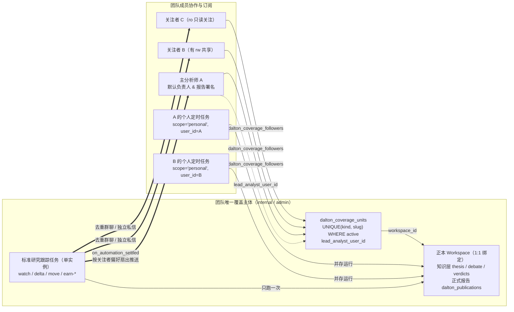
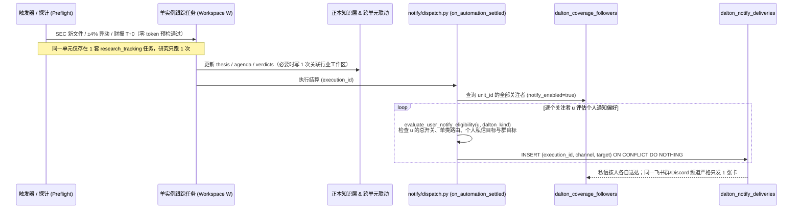

# 覆盖模型重构设计：一家公司一个工作区，人去关注它

> **状态**：设计提案（待评审）  
> **关联迁移基线**：`d015_user_coverage`、`d018_workspace_sharing`、`d023_coverage_units`～`d028_workspace_settings`、`d035_company_automations`（新迁移拟定 `d041`）  
> **核心目标**：将覆盖单元从「按人私有登记（`owner_user_id`）」改为「团队内同一主体唯一覆盖单元 + 唯一正本工作区 + 多人关注订阅 + 主分析师负责制 + 个人定时任务按创建者独立并存」。

---

## 0. 背景与核心设计原则

当前 Dalton 的覆盖体系是「跟着人走」的：

1. **主体注册表按人隔离**：`dalton_coverage_units`（`d023`）唯一键为 `(owner_user_id, kind, slug)`，绑定工作区时强制校验 `workspaces.user_id == owner_user_id`（`src/dalton/database/coverage_units.py:365-366` 抛出 `workspace_not_owned` 403）。
2. **早期覆盖表按人重复**：`d015_user_coverage.py` 建立的 `dalton_coverage` 主键为 `(user_id, ticker)`，每人各自维护一份股票池、各自在 Home 跑一份 `dalton-earnings-calendar`，并在各自工作区创建重复的 `watch` / `delta` / `move-up` / `move-down` / `earn-*` 任务。
3. **协作割裂与重复开销**：当两位研究员同时覆盖同一家公司（例如未上市的 **Anthropic** 或上市的 **NVDA**）时，只能各建一个工作区、各登记一个覆盖单元——研究草稿与对话分处两地、知识层（`thesis` / `verdicts`）与行业成员引用（`dalton_sector_members`）出现重复节点、同一财报与异动事件触发多份重复 LLM 执行。

本次重构确立以下 **5 条核心契约**：

1. **覆盖单元归属工作区（团队唯一），不归属个人**：团队内同一主体（同一 `(kind, slug)` 及上市公司同一规范化 `ticker_key`）最多只有一个 `active` 覆盖单元，至多绑定一个正本工作区。对该工作区拥有写权限的团队成员（工作区属主、获得写共享权限的同事、PM）均可登记与绑定。
2. **关注者（Followers）订阅机制**：每位成员独立关注自己关心的公司或行业覆盖单元；日常跟踪、财报日历提醒、异动与复盘推送按关注者及其个人通知偏好分发。
3. **个人定时任务各自归属创建者**：同一共享工作区内，不同有写权限的成员可各自创建、修改、启停自己的个人定时任务（`scope='personal'`），互不覆盖、互不篡改，且额度计入创建者本人。
4. **主分析师（Lead Analyst）责任制**：覆盖单元设 `lead_analyst_user_id` 字段，作为默认研究负责人与正式发布报告署名（`报告署名`），支持受控转交。
5. **存量平滑合并与可回滚迁移**：将现有「每人一份」的同名公司/行业单元与工作区按明确评分规则（支持人工指定覆写）合并至唯一正本工作区，其余原属主自动转为关注者，非正本工作区归档保留历史对话与文件、绝不破坏性删除。



---

## 1. 现状盘点（全量涉及模块、文件行号与改造对照）

通过 `git grep -l "dalton_coverage_units\|dalton_user_coverage\|coverage_unit\|user_coverage" -- src/dalton` 共命中 **34 个文件**，另有 **5 个紧耦合上下游文件**（标准任务编排、通知投递扇出、发布横幅渲染、上游工作区/自动化权限钩子）必须同步调整。

### 1.1 `d015_user_coverage` 与 `d023_coverage_units` 的关系及统一策略

> [!IMPORTANT]
> 代码库中并无名为 `dalton_user_coverage` 的物理表——`user_coverage` 是迁移 `d015_user_coverage.py` 与上游钩子 `# DALTON-HOOK(user-coverage)` 的特性代号，底层实际包含三张表：`dalton_coverage`、`dalton_coverage_groups`、`dalton_earnings_calendar_mirror`。

| 维度 | `d015_user_coverage.py`（`dalton_coverage` 等三表） | `d023_coverage_units.py`（`dalton_coverage_units`） | 重构后定位（一并治理、分层收敛） |
|---|---|---|---|
| **物理表与主键** | `dalton_coverage`：`PRIMARY KEY (user_id, ticker)`；<br>`dalton_coverage_groups`：按 `user_id` 存动态筛选规则；<br>`dalton_earnings_calendar_mirror`：`PRIMARY KEY (user_id)` | `dalton_coverage_units`：`unit_id UUID PK`，`UNIQUE (owner_user_id, kind, slug)`，部分唯一索引 `uq_dalton_coverage_units_active_workspace` | 1. **`dalton_coverage_units`**：升级为**团队级覆盖主体唯一真源**（去掉 `owner_user_id` 唯一键，新增 `lead_analyst_user_id`、`tier`、`ticker_key`）；<br>2. **新增 `dalton_coverage_followers`**：承载所有人对公司/行业单元的关注订阅与个人档位（`core`/`watch`）；<br>3. **`dalton_coverage`**：收敛为「个人轻量股票观察池 / 筛选规则组落盘表」（新增可空外键 `unit_id` 关联已登记公司单元），未建工作区的纯观察股无需污染团队正式工作区目录，一旦某股票存在团队覆盖单元则与 `dalton_coverage_followers` 自动双向同步；<br>4. **`dalton_earnings_calendar_mirror`**：新增团队级正本镜像（`user_id = 'system:dalton-company'`），读取时按用户关注的单元 + 观察池股票过滤。 |
| **可表达主体** | **仅限有 `ticker` 的上市公司**（无法表达 Anthropic、OpenAI 等未上市公司，也无法表达行业 `sector`） | 支持 `company`（`ticker` 可空，天然支持 **Anthropic** 等未上市公司）与 `sector`（禁止带 `ticker`） | 统一由 `dalton_coverage_units` 表达所有正式研究主体（上市公司、未上市公司、行业），并放宽 `d027` 对 `ticker IS NULL` 公司的约束（见 §2.2.4）。 |
| **工作区关系** | 无 `workspace_id` 列，靠名称/元数据启发式猜测（`service.py:1005`） | 显式 `workspace_id` 1:1 绑定，但要求 `ws.user_id == unit.owner_user_id` | 显式 `workspace_id` 1:1 绑定，写权限校验接入 `verify_workspace_access(..., need="write")`。 |
| **当前开关状态** | 已全量启用 | `src/dalton/dalton.yaml:37-38` 默认 `coverage_units.enabled: false`（环境变量覆盖） | 迁移完成后将 `coverage_units.enabled` 默认切为 `true`，消除双轨分裂。 |

---

### 1.2 全量模块盘点（34 个命中文件 + 5 个紧耦合上下游文件）

#### A. 覆盖领域层（`src/dalton/coverage/`，5 个文件）

| 文件路径与行号 | 当前如何使用 `owner` / `user_id` | 改为「工作区 + 关注者 + 主分析师」后的变更 |
|---|---|---|
| `src/dalton/coverage/__init__.py`<br>`L1-101` | 导出 `get_user_coverage`、`add_user_coverage_tickers` 等个人股票池接口，以及按 `owner_user_id` 签名的 `register_coverage_unit`、`bind_coverage_unit_workspace` 等函数（`L39-51`）。 | 导出新增的关注者与主分析师接口：`follow_coverage_unit`、`unfollow_coverage_unit`、`list_unit_followers`、`transfer_coverage_unit_lead`、`get_team_coverage_units`。 |
| `src/dalton/coverage/units.py`<br>`L37-148` | `register_coverage_unit`（`L37-78`）、`archive_coverage_unit`（`L81-91`）、`bind_coverage_unit_workspace`（`L94-112`）、`unbind_coverage_unit_workspace`（`L115-127`）、`get_registered_units`（`L130-148`）全部接收 `owner_user_id: str` 并透传给 DB 做属主强匹配。 | 参数改为 `actor_user_id: str`：<br>1. **登记（`register`）**：校验调用者属于 `internal`/`admin` 层级；若同时传入 `workspace_id`，校验调用者对该工作区有写权限；默认设 `lead_analyst_user_id = actor_user_id`，并在同一事务内将 `actor_user_id` 插入 `dalton_coverage_followers`。<br>2. **绑定/解绑（`bind`/`unbind`）**：校验调用者对目标/已绑工作区拥有写权限（`verify_workspace_access(..., need="write")`）或为 PM。<br>3. **归档（`archive`）**：仅限主分析师、绑定工作区属主或 PM。<br>4. 新增 `transfer_lead`、`follow`、`unfollow`。 |
| `src/dalton/coverage/unit_errors.py`<br>`L14-52` | `L26` 将唯一键冲突映射为 `"slug already registered for this owner"`（409）；`L30` 将 `"workspace belongs to another user"` 映射为 `("workspace_not_owned", 403)`；`L50` 映射 `"not found for this owner"`（404）。 | 调整错误码语义：<br>- `slug_conflict`（409）：团队内已存在同名 `active` 覆盖单元（返回已有 `unit_id`、`workspace_id` 与 `lead_analyst_user_id`，引导调用者直接 `follow`）；<br>- 新增 `ticker_conflict`（409）：同一规范化股票代码已存在团队覆盖单元；<br>- `workspace_not_owned` 改为 `workspace_write_forbidden`（403）；<br>- 新增 `external_tier_forbidden`（403）与 `lead_transfer_forbidden`（403）。 |
| `src/dalton/coverage/identity.py`<br>`L1-330` | `resolve_workspace_coverage_identity`（`L248-330`）按 `workspace_id` 查 `get_active_unit_by_workspace`，本身不校验 `owner_user_id`；但回退兼容路径（`L167-214`）依赖单用户 `automations` 推断股票代码；且 `L291-319` 对 `kind='company'` 且 `unit.ticker is None`（如 Anthropic）返回 `KIND_COMPANY, ticker=None`。 | 保持按 `workspace_id` 解析；回退兼容路径在过渡期按工作区查询 `research_tracking` 任务；确保下游模块正确识别 `identity.is_company and identity.ticker is None` 的未上市公司身份。 |
| `src/dalton/coverage/service.py`<br>`L156-2398` | - `get_user_coverage(user_id)`（`L156`）：读单人 `dalton_coverage`；<br>- `get_company_coverage()`（`L247`）：聚合全体 `admin`+`internal` 用户的 `dalton_coverage` 并集（Core 优先于 Watch）；<br>- `render_coverage_yaml` / `sync_user_coverage_to_home`（`L479-552`）：向个人 Home 渲染 `dalton/coverage.yaml`；<br>- `ensure_user_earnings_calendar_automation(user_id)`（`L555-635`）：**为每个用户各自创建一份 Home 级 `dalton-earnings-calendar` 周任务**；<br>- `_user_workspace_tickers(user_id)`（`L1005-1026`）：只查 `ws_db.list_workspaces(user_id=uid)` 判断 `has_workspace`；<br>- `add/remove/set_user_coverage_*`（`L1203-1410`）：仅改单人 `dalton_coverage`；<br>- `publish_user_earnings_calendar_mirror` / `query_user_earnings_calendar`（`L2144-2295`）：按 `user_id` 读写财报日历台账。 | 1. `_team_workspace_by_ticker()` 替代 `_user_workspace_tickers(user_id)`：直接从团队 `active` `dalton_coverage_units` 读取已绑工作区，任何关注者都能看到公司已有团队正本工作区；<br>2. `add_user_coverage_tickers` / `remove_user_coverage_tickers`：若目标 `ticker` 已有团队 `company` 覆盖单元，同步写入/移除 `dalton_coverage_followers`；<br>3. `ensure_user_earnings_calendar_automation` 改为**全队单实例** `ensure_team_earnings_calendar_automation()`（见 §3.2），停止为每位研究员创建重复的周六财报扫描任务；<br>4. `sync_user_coverage_to_home` 渲染的个人 `dalton/coverage.yaml` 合并该用户关注的全部 `dalton_coverage_units`（含未上市公司与行业区块）及轻量观察股。 |

#### B. 数据库访问层（`src/dalton/database/`，4 个命中文件）

| 文件路径与行号 | 当前如何使用 `owner` / `user_id` | 改为「工作区 + 关注者 + 主分析师」后的变更 |
|---|---|---|
| `src/dalton/database/coverage_units.py`<br>`L1-477` | - `L35`：唯一约束常量 `uq_dalton_coverage_units_owner_kind_slug`；<br>- `CoverageUnit` 数据类（`L59-88`）含 `owner_user_id`；<br>- `list_coverage_units(owner_user_id)`（`L134-160`）、`insert_coverage_unit`（`L163-222`）、`set_coverage_unit_status`（`L225-281`）均以 `owner_user_id = %s` 过滤；<br>- `bind_coverage_unit_workspace`（`L312-427`）：`L345` 锁 `owner_user_id = %s`，**`L365-366` 硬编码 `if str(ws_row.get("user_id") or "") != str(owner_user_id): raise ValueError("workspace belongs to another user")`**；<br>- `unbind_coverage_unit_workspace`（`L429-477`）：同样限定 `owner_user_id = %s`。 | 1. `CoverageUnit` 替换为 `lead_analyst_user_id`、`created_by_user_id`、`tier`、`ticker_key`；<br>2. 唯一冲突检测改为 `uq_dalton_coverage_units_active_kind_slug` 与 `uq_dalton_coverage_units_active_ticker_key`；<br>3. `bind_coverage_unit_workspace` 移除 `ws_row.user_id == owner_user_id` 硬判断，改为在事务内锁 `workspaces` 行并校验：(a) 非 Home、未删除；(b) 工作区属主属于 `internal`/`admin`；(c) 调用者具备该工作区写权限；(d) 若工作区当前 `dalton_workspace_sharing` 为 `hidden`，按默认策略保底提升至团队可见（见 §2.4）；<br>4. 新增 `dalton_coverage_followers` CRUD（`upsert_follower`、`delete_follower`、`list_followers_by_unit`、`list_followed_units_by_user`）与 `update_coverage_unit_lead`。 |
| `src/dalton/database/sector_members.py`<br>`L1-388` | `_active_sector_unit_on_cursor`（`L83-95`）按 `workspace_id` 查询 `unit_id, owner_user_id, slug`；`sync_sector_members_from_doc`（`L166-315`）将行业 `sector` 文档中的 `members[].unit_id` 投影至 `dalton_sector_members(sector_unit_id, member_id, company_unit_id)`。 | 移除 `owner_user_id` 列读取；校验 `members[].unit_id` 时直接查团队全局 `active` 且 `kind='company'` 的 `dalton_coverage_units`——由于每家公司在团队内只有唯一 `company_unit_id`，彻底消除此前「行业该引谁名下的同名公司单元」的歧义。 |
| `src/dalton/database/company_automations.py`<br>`L41-239` | - `fetch_scope_classification_context`（`L41-125`）：**`L82` 查询 `FROM dalton_coverage_units u WHERE u.workspace_id = %s::uuid AND u.owner_user_id = %s`**，导致非单元原登记人在该工作区操作任务时查不到覆盖单元；<br>- `list_automations_for_scope_db`（`L190-205`）：非 `company` 作用域一律按 `automations.user_id = caller_user_id` 过滤。 | 1. `L82` 去掉 `AND u.owner_user_id = %s`，改为按 `u.workspace_id = %s::uuid AND u.status = 'active'` 查询工作区绑定的唯一单元；<br>2. `scope='personal'` 保持按 `automations.user_id = caller_user_id` 隔离（同事之间互不可改个人定时任务）；`scope='research_tracking'` 支持按可读工作区 / 关注单元向团队成员展示运行态。 |
| `src/dalton/database/knowledge.py`<br>`L1-403` | `dalton_knowledge_versions` 与 `dalton_verdicts` 底层以 `workspace_id` 为核心键（`UNIQUE (workspace_id, doc_key, version_no)`），`user_id` 仅记录该版本提交人；但 `latest_by_user`（`L311-345`）硬过滤 `JOIN workspaces w ... WHERE w.user_id = %s`。 | 保留 `user_id` 作为版本作者审计字段；新增 `latest_by_workspaces(workspace_ids)`（取代仅查 `w.user_id = %s` 的 `latest_by_user`），供晨会看板与周报按「用户关注的覆盖单元工作区集合」批量拉取最新 `thesis` / `verdict`。 |

#### C. 自主运行与调度层（`src/dalton/autonomy/`，9 个命中文件 + `schedule.py`）

| 文件路径与行号 | 当前如何使用 `owner` / `user_id` | 改为「工作区 + 关注者 + 主分析师」后的变更 |
|---|---|---|
| `src/dalton/autonomy/classification.py`<br>`L141-289` | - `_matches_active_coverage_unit`（`L150`）要求 `unit.owner_user_id == automation.user_id`；<br>- `build_research_tracking_sql_predicate`（`L256-278`）要求 `u.owner_user_id = a.user_id` 且 `w.user_id = a.user_id`。 | 移除 `u.owner_user_id = a.user_id` 与 `w.user_id = a.user_id` 条件：只要任务的 `dalton_kind` 属于 `RESEARCH_TRACKING_KINDS`（或符合跟踪前缀且绑定在有效覆盖单元工作区上），即归类为 `research_tracking`；其余成员在共享工作区自建的任务一律归类为 `personal`。 |
| `src/dalton/autonomy/tracking.py`<br>`L43-1503` | - `resolve_default_tier`（`L43-65`）只查当前调用者个人的 `get_user_tier(user_id, ticker)`；<br>- `resolve_workspace_id_by_ticker`（`L76-124`）只查 `user_id` 名下工作区；<br>- `_load_company_automations`（`L423-440`）与 `_load_sector_automations`（`L696-715`）按调用者 `user_id` 调 `list_all_user_automations`，若两位同事分别开启跟踪会生成两套重复任务；<br>- `_resolve_workspace_sector`（`L491`）读取 `unit.owner_user_id` 传给时区回退。 | 1. **规范档位（Canonical Tier）**：由单元自身档位与全体关注者档位取最高优先级（任一关注者或单元设为 `core` 即按 `core` 每日巡检，否则按 `watch` 每周巡检）；<br>2. **单实例跟踪**：`_load_company_automations` / `_load_sector_automations` 改为按 `workspace_id` + `scope='research_tracking'` 查询并加工作区级 advisory lock，确保同一覆盖单元全局只有 **1 套** `watch`/`delta`/`move`/`earn-*` 任务；<br>3. 未上市公司（`ticker IS NULL`）启用跟踪时仅创建 `watch`（议程/催化剂巡检）与 `delta`（内部与网页资料增量复盘），跳过 `move-up/down` 股价触发器；<br>4. 行业时区回退改为读 `unit.lead_analyst_user_id`。 |
| `src/dalton/autonomy/board.py`<br>`L260-945` | `L370-378` 硬编码 `SELECT ... FROM workspaces WHERE status <> 'deleted' AND user_id = %s`！且 `L604` `if not identity.is_company or not identity.ticker: continue` 直接跳过无 `ticker` 公司。结果：同事关注了别人创建的工作区（哪怕被转交为主分析师），晨会看板 `dalton_coverage_board` 完全看不到该公司，也看不到 Anthropic 等未上市公司。 | 1. 工作区枚举改为查询「当前用户关注的 `active` 覆盖单元绑定工作区 $\cup$ 当前用户担任 `lead_analyst_user_id` 的工作区」（并经 `verify_workspace_access(..., need="read")` 过滤）；<br>2. 放宽 `L604`：支持 `identity.is_company` 且 `ticker is None` 的未上市公司（用 `unit.slug` / `display_name` 标识，跳过股价/财报探针分项，保留议程到期、辩题与新鲜度评分）。 |
| `src/dalton/autonomy/units_view.py`<br>`L102-802` | - `member_workspace_visible`（`L118`）与 `build_units_view`（`L183-303`）按 `owner_user_id == user_id` 区分本人与同事单元，`auto_tracked`（`L265`）只检查调用者本人的自动化；<br>- `build_unit_detail`（`L594-802`）中 **`L682` 仅当 `is_own`（`unit.owner_user_id == user_id`）时才返回 `evidence_gaps`（跨单元待补证缺口）**。 | 1. 列表输出改为 `lead_analyst_user_id`、`lead_analyst_name`、`workspace_owner_user_id`、`is_following`、`follower_count`、`can_write`；<br>2. `auto_tracked` 按工作区级 `research_tracking` 任务状态判定；<br>3. `build_unit_detail` 对所有具备该行业工作区读权限的内部成员展示 `evidence_gaps`，具备写权限的成员均可协同补证。 |
| `src/dalton/autonomy/sector.py`<br>`L78-182` | `check_sector_automation_binding`（`L78-135`）已按 `(unit_id, workspace_id)` 校验而不锁 `owner_user_id`；仅 `resolve_sector_due_timezone`（`L145-182`）回退链读取传入的单元属主时区。 | 回退链顺序改为：`sector.json.research_tz` → `unit.research_tz` → `lead_analyst_user_id` 用户时区 → 部署默认时区。 |
| `src/dalton/autonomy/preflight.py`<br>`L515-710` | `_sync_home_coverage_for_preflight`（`L614-642`）按自动化 `user_id` 渲染 Home `coverage.yaml`；公司/行业预检按 `workspace_id` 写 `dalton_watch_state` 与 `dalton_signals`。 | 1. 团队级 `dalton-earnings-calendar` 预检读取全队覆盖并集；<br>2. 公司 `watch` 预检当 `unit.ticker IS NULL`（如 Anthropic）时只跑 `agenda` 到期探针（对齐行业预检模式），不调 SEC / 港 A 公告 / 财报 API，写入 `dalton_watch_state(workspace_id, unit_id=unit.unit_id, ticker=None)`。 |
| `src/dalton/autonomy/probes/director.py`<br>`L191-390` | `dalton-director-daily` 零 token 预检在 `L191-208` 与 `L336-390` 只扫描 `workspaces WHERE user_id = %s` 的未决信号与陈旧度。 | 改为扫描该用户**关注或担任主分析师**的全部可读覆盖单元工作区，并增加「工作区已有运行中跟踪/派单任务则跳过重复唤醒」检查。 |
| `src/dalton/autonomy/probes/sec.py`<br>`L60-93` | `_lookup_local_cik`（`L60-92`）回退读取 `ws["user_id"]` 个人的 `get_user_coverage` 查 `extra.cik`。 | 优先查团队覆盖单元元数据 / `get_company_coverage()` 聚合字典中的 `cik`，消除对单一工作区创建者个人 `dalton_coverage` 行的依赖。 |
| `src/dalton/autonomy/system_jobs.py`<br>`L326-560` | `_discover_company_workspaces(user_id)`（`L326`）只查 `workspaces WHERE user_id = %s`；`_discover_sector_units(user_id)`（`L476`）调 `list_coverage_units(user_id)` 只查本人名下单元。 | 改为展示团队覆盖单元的唯一标准跟踪任务（支持「我关注的 / 全部团队覆盖」筛选），以及全队唯一的 `dalton-earnings-calendar` 状态。 |
| *紧耦合*：`src/dalton/autonomy/schedule.py`<br>`L135-755` | `schedule_dalton_automation_helper`（`L550`）拒绝 `COMPANY_SYSTEM_USER_ID`；`L684-708` 在分析师工作区内强制要求解析出非空 `ws_ticker` 且任务名以 `dalton-<ticker>-` 开头（导致未上市公司工作区与行业工作区无法由分析师创建个人定时任务）。 | 1. 标准 `research_tracking` 任务走专用幂等编排入口（使用 `COMPANY_SYSTEM_USER_ID` 公共额度池 + 工作区级锁）；<br>2. 分析师工作区内的个人定时任务校验放宽为支持 `dalton-<unit_slug>-<custom>`（兼容未上市公司与行业工作区），且调用 `verify_workspace_access(..., need="write")` 允许有 `rw` 权限的同事创建归属自己的个人任务。 |

#### D. 知识层与正式发布层（`src/dalton/knowledge/*` 5 个文件 + `publish/` 2 个文件）

| 文件路径与行号 | 当前如何使用 `owner` / `user_id` | 改为「工作区 + 关注者 + 主分析师」后的变更 |
|---|---|---|
| `src/dalton/knowledge/cross_unit.py`<br>`L312-890` | `actor_can_write_workspace`（`L312-329`）已通过 `verify_workspace_access(..., need="write", channel="cos")` 判断跨工作区写权限；但联动失败写入 `dalton_cross_unit_requests` 时（`L721`、`L801`）绑定 `owner_user_id = actor_user_id`，导致同事 B 触发的补证缺口无法被主分析师 A 的重试任务（`L851` `retry_linkage_rows(user_id)`）拾取。 | 1. 联动写入保持单工作区单次落盘；<br>2. `dalton_cross_unit_requests` 改为按 `source_unit_id` / `target_unit_id` 归集，`owner_user_id` 仅保留为 `requested_by_user_id` 审计列；对该工作区有写权限的任一成员（或主分析师）均可查询与重试。 |
| `src/dalton/knowledge/profiles.py`<br>`L1-95` | 按 `resolve_workspace_coverage_identity` 决定工作区使用 `company` 还是 `sector` 知识文档集合（`DOC_KEYS`），无个人属主耦合。 | 无需改语义；随着 `coverage_units` 成为唯一真源，工作区绑定的 `kind` 直接决定知识 profile。 |
| `src/dalton/knowledge/reconcile.py`<br>`L1-800` | 按 `workspace_id` 对账沙箱文件与 `dalton_knowledge_versions`，写入新版本时记录当前执行者 `user_id`。 | 保持按 `workspace_id` 单份知识真源对账；同事通过共享写权限更新 `thesis.md` 时，`dalton_knowledge_versions.user_id` 如实记录本次修改人。 |
| `src/dalton/knowledge/service.py`<br>`L1-500, L1180-1330` | 知识读写校验工作区写权限；当 `sector` 文档提交成功后触发 `sector_members` 投影与跨单元联动。 | 确保所有有工作区写权限的成员（含 `rw` 共享同事与新任主分析师）均可调 `knowledge_write_doc` / `knowledge_append_verdict`，且仅触发一次跨单元联动。 |
| `src/dalton/knowledge/schemas/sector.schema.json`<br>`L1-43` | `members[].unit_id` 指向成员公司的覆盖单元 UUID。 | Schema 结构不变，业务约束升级为指向团队唯一的 `company` 覆盖单元 `unit_id`。 |
| `src/dalton/publish/service.py`<br>`L1440-1550, L2286-2550` | **发现致命协作阻塞**：<br>1. **`L2289-2300`**：审批发布硬编码 `if user_id not in pm_users or user_id != ws_owner_id:`——若正本工作区由普通 `internal` 研究员创建（`ws_owner_id` 不是 PM），**没有任何人能批准发布该工作区的报告**！<br>2. `L1479` 与 `L2534` 将 `dalton_publish_requests.user_id` 和 `dalton_publications.user_id` 强行写成 `ws_owner_id`，无视实际撰稿人与主分析师；<br>3. `L1425` 若公司无 `ticker`（如 Anthropic）在旧分支会报错。 | 1. **修复 PM 审批门禁**：允许任何在 `DALTON_PM_USER_IDS` 中且对该工作区有读/写访问权的 PM 审批 `publish_report`（不再要求 `pm_user_id == ws_owner_id`）；<br>2. **落地主分析师署名**：`dalton_publish_requests` 与 `dalton_publications` 记录 `lead_analyst_user_id`（取自覆盖单元当前 `lead_analyst_user_id`，未绑单元时回退提交人）与 `author_user_id`（实际提交人）；<br>3. 支持已登记未上市公司（`subject_kind='company', ticker=None, unit_id=unit.unit_id`）正式发布深度报告。 |
| *紧耦合*：`src/dalton/publish/files.py`<br>`L31-58` | `prepend_publication_banner` 仅渲染 `批准人` 与 `独立审稿`，没有分析师署名行。 | 在发布归档横幅中正式渲染 `> - **主分析师**：<lead_analyst_name>`（若实际提交人不同于主分析师，并列渲染 `**执笔/协办**：<author_name>`）。 |

#### E. 工具层、路由层、配置与迁移（`tools/`、`workflows/`、`app/`、配置与紧耦合上游钩子）

| 文件路径与行号 | 当前如何使用 `owner` / `user_id` | 改为「工作区 + 关注者 + 主分析师」后的变更 |
|---|---|---|
| `src/dalton/tools/__init__.py`<br>`L1-353` | 按角色（Chief of Staff vs Analyst）装配 `dalton_coverage`、`dalton_coverage_unit`、`dalton_coverage_tracking` 等工具。 | 工具集保持角色边界；更新工具注入上下文以传入调用者层级与工作区权限。 |
| `src/dalton/tools/coverage_tools.py`<br>`L61-233` | `dalton_coverage` 工具读写调用者个人的 `dalton_coverage` 股票池与筛选组。 | 语义明确为「我的关注与观察池」：`add` 时若团队已有对应公司覆盖单元则自动关注该单元并返回正本 `workspace_id`；`list` 同时返回已关注的公司/行业单元与轻量观察股。 |
| `src/dalton/tools/director_tools.py`<br>`L180-205, L688-814, L1397-2024` | - `dalton_coverage_unit`（`L688-814`）：文档与实现均声明“操作调用者本人的覆盖单元，工作区必须归本人所有”；<br>- `_verify_tracking_workspace_owner`（`L184-205`）与 `dalton_coverage_tracking`（`L1397-1599`）：仅允许工作区属主启停跟踪。 | 1. `dalton_coverage_unit` 扩展动作：`register`（支持一步传入 `workspace_id`）、`bind`、`unbind`、`archive`、`transfer_lead`（转交主分析师）、`follow`、`unfollow`、`list`（支持 `scope='followed'|'all'`）；<br>2. `dalton_coverage_tracking` 允许主分析师、工作区写权限成员或 PM 启停单元标准跟踪。 |
| `src/dalton/workflows/company_routing.py`<br>`L217-285, L351-438` | `find_company_workspaces(user_id, ticker)` 在 `L245` 只查 `workspaces WHERE user_id = %s`（注释写明“别人的工作区一律不查”）。 | **优先查询团队 `active` `dalton_coverage_units`**（校验调用者可读权限）：当同事在行业工作区或其他工作区试图写某公司深度文件时，准确路由并引导至团队唯一的正本工作区，杜绝再次建出重复工作区。 |
| `src/dalton/app/router.py`<br>`L1252-1662` | - `/coverage/units` 系列接口（`L1389-1457`）全部把 `current_user_id` 当 `owner_user_id`；<br>- `PUT /api/v1/dalton/automations/{name}`（`L1286`）调 `_verify_workspace_access`（仅允许 `ws.user_id == current_user_id`）；<br>- `/tracking/{workspace_id}`（`L1471-1594`）仅允许工作区属主或 PM 写入。 | 1. `/coverage/units` 改为团队共享目录接口，新增 `POST /coverage/units/{id}/follow`、`DELETE /coverage/units/{id}/follow`、`POST /coverage/units/{id}/lead-analyst`；<br>2. `PUT /dalton/automations/{name}` 改为校验 `verify_workspace_access(..., need="write", channel="web")`；<br>3. `/tracking/{workspace_id}` 允许工作区写权限成员与主分析师操作。 |
| `src/dalton/dalton.yaml`（`L37-38`）& `src/dalton/settings.py`（`L269-279, L546-552`） | 定义 `coverage_units.enabled: false` 与 `DALTON_COVERAGE_UNITS_ENABLED` 开关。 | 保持配置项兼容；在 Phase 4 验收通过后将 `dalton.yaml` 默认值翻转为 `true`。 |
| `d023_coverage_units.py` / `d025_sector_members.py` / `d035_company_automations.py` | 历史已执行迁移文件（定义原 `owner_user_id` 唯一键、外键与 `automations_company_owner_check`）。 | **不修改已发布历史迁移**；全部表结构演进通过新迁移 `d041_coverage_follows_company.py` 完成。 |
| *紧耦合*：`src/dalton/notify/dispatch.py`<br>`L205-445, L4646-4835` | `on_automation_settled`（`L4646`）仅读取 `automation["user_id"]` 单一用户的通知偏好生成投递目标。 | 对覆盖单元关联的 `research_tracking` 执行，改为查询 `dalton_coverage_followers` 全量关注者，逐人校验偏好并写入 `dalton_notify_deliveries`（利用既有 `UNIQUE (execution_id, channel, target)` 自动完成群聊去重与私信扇出，详述见 §3.3）。 |
| *紧耦合上游钩子*：<br>1. `src/server/services/automations/lifecycle.py`（`L89-117, L148-158`）<br>2. `src/server/services/automation_executor.py`（`L387-397, L439-481`）<br>3. `src/tools/secretary/approvals.py`（`L57-78`） | **发现个人定时任务共享并存的 3 处上游拦截点**：<br>1. `lifecycle.py` 调 `require_workspace_owner` 拒绝同事在共享工作区创建自动化（403）；<br>2. `automation_executor.py` 的 `# DALTON-HOOK(dalton-auth)` 在 `ws_owner != auto_owner` 时直接抛异常中止执行；<br>3. `approvals.py` 的 `# DALTON-HOOK(workspace-duplicate-guard)` 只防同一用户名下重名工作区，不防跨同事重复建同名公司工作区。 | 1. `lifecycle.py` 增加 `# DALTON-HOOK(dalton-sharing)`：允许对工作区拥有写权限（`verify_workspace_access(..., need="write")`）的成员创建归属本人的 `personal` 自动化；<br>2. `automation_executor.py` 在执行前校验 `auto_owner` 仍保有该工作区写权限（或为 `COMPANY_SYSTEM_USER_ID` 标准跟踪任务），并在 `_precreate_titled_thread` 时写入 `conversation_threads.user_id = auto_owner`；若写权限已被撤回则 fail-closed 跳过执行；<br>3. `approvals.py` 扩展重复守卫：若团队已有同名/同 ticker 的 `active` 覆盖单元，拦截新建工作区并提示直接复用正本工作区。 |

---

## 2. 新数据模型、团队边界与权限设计

### 2.1 「团队」边界定义（Team Scope）

审计 `src/dalton/access_tiers.py`、`src/dalton/auth.py` 与 `d016_members_and_invites.py` 可知：**Dalton 当前没有多租户 `org_id` / `team_id` 表，一个 Dalton 部署实例即代表一个投研团队**，用户按以下四类身份分层：

- `admin`（`DALTON_PM_USER_IDS`，即 PM / 管理员）与 `internal`（匹配 `DALTON_ALLOWED_EMAILS` 白名单域名/邮箱的内部投研成员）：共同构成**同一投研团队**，共享团队工作区可见性、团队记忆与公司级报告。
- `external`（仅凭邀请码注册的外部隔离访客）：按 `src/dalton/sharing.py:6-10, 866-901` 铁律严格与内部隔离，看不到任何内部工作区，其工作区也绝不向他人暴露。
- `company`（`system:dalton-company`）：非人类系统执行身份，禁止外部 HTTP/WS 登录（`company_identity.py:55-66`）。

因此，**覆盖单元的「团队唯一」边界定义如下**：

1. **数据库唯一性范围**：部署实例内全局 `active` 唯一——即 `UNIQUE (kind, slug) WHERE status = 'active'` 与上市公司 `UNIQUE (ticker_key) WHERE status = 'active' AND kind = 'company' AND ticker_key IS NOT NULL`。
2. **准入边界**：**仅 `internal` 与 `admin` 成员可登记、绑定、关注、查看团队覆盖单元**；`external` 用户调用覆盖单元接口或工具一律返回 `403 external_tier_forbidden`（防止外部访客抢占内部 slug 或窥探内部覆盖名单；`external` 用户仅可使用其个人隔离工作区）。

---

### 2.2 数据库表结构设计（迁移 `d041_coverage_follows_company.py`）

#### 2.2.1 改造 `dalton_coverage_units`（去个人属主、加主分析师与团队唯一索引）

为避免 `0700.HK` 与 `700.HK`、`BRK-B` 与 `BRK.B` 因书写差异绕过 `slug` 唯一键建出两个覆盖单元，引入规范化 `ticker_key`（由 `src/dalton/coverage/identity.py` 同源规则归一化：港股去前导零如 `0700.HK` → `700.HK`，去空白转大写）。

```sql
-- 1. 新增团队协作与主分析师字段
ALTER TABLE dalton_coverage_units
    ADD COLUMN IF NOT EXISTS lead_analyst_user_id TEXT,
    ADD COLUMN IF NOT EXISTS created_by_user_id   TEXT,
    ADD COLUMN IF NOT EXISTS ticker_key           TEXT,
    ADD COLUMN IF NOT EXISTS tier                 TEXT NOT NULL DEFAULT 'core'
        CONSTRAINT ck_dalton_coverage_units_tier
        CHECK (tier IN ('core', 'watch'));

-- 2. 回填存量行（合并去重脚本先行处理同 slug/ticker_key 冲突，详见 §4）
UPDATE dalton_coverage_units
SET lead_analyst_user_id = COALESCE(lead_analyst_user_id, owner_user_id),
    created_by_user_id   = COALESCE(created_by_user_id, owner_user_id)
WHERE lead_analyst_user_id IS NULL OR created_by_user_id IS NULL;

ALTER TABLE dalton_coverage_units
    ALTER COLUMN lead_analyst_user_id SET NOT NULL,
    ALTER COLUMN created_by_user_id   SET NOT NULL;

-- 3. 移除「按人隔离」的旧唯一约束与旧索引，旧 owner_user_id 改为可空兼容列（Phase 4 清理）
ALTER TABLE dalton_coverage_units
    DROP CONSTRAINT IF EXISTS uq_dalton_coverage_units_owner_kind_slug,
    ALTER COLUMN owner_user_id DROP NOT NULL;

DROP INDEX IF EXISTS idx_dalton_coverage_units_owner_kind;
DROP INDEX IF EXISTS idx_dalton_coverage_units_owner_ticker;

-- 4. 建立团队级唯一约束（仅约束 status = 'active'，已归档历史行不占坑）
CREATE UNIQUE INDEX IF NOT EXISTS uq_dalton_coverage_units_active_kind_slug
    ON dalton_coverage_units (kind, slug)
    WHERE status = 'active';

CREATE UNIQUE INDEX IF NOT EXISTS uq_dalton_coverage_units_active_ticker_key
    ON dalton_coverage_units (ticker_key)
    WHERE status = 'active' AND kind = 'company' AND ticker_key IS NOT NULL;

-- 保留 d023 原有的工作区 1:1 排他索引：
-- uq_dalton_coverage_units_active_workspace ON (workspace_id) WHERE status = 'active'

CREATE INDEX IF NOT EXISTS idx_dalton_coverage_units_lead_analyst
    ON dalton_coverage_units (lead_analyst_user_id, status);

CREATE INDEX IF NOT EXISTS idx_dalton_coverage_units_kind_status
    ON dalton_coverage_units (kind, status, updated_at DESC);
```

#### 2.2.2 新建关注关系表 `dalton_coverage_followers`

```sql
CREATE TABLE IF NOT EXISTS dalton_coverage_followers (
    unit_id        UUID NOT NULL
        REFERENCES dalton_coverage_units(unit_id) ON DELETE CASCADE,
    user_id        TEXT NOT NULL,
    tier           TEXT NOT NULL DEFAULT 'core'
        CONSTRAINT ck_dalton_coverage_followers_tier
        CHECK (tier IN ('core', 'watch')),
    notify_enabled BOOLEAN NOT NULL DEFAULT TRUE,
    source         TEXT NOT NULL DEFAULT 'ui'
        CONSTRAINT ck_dalton_coverage_followers_source
        CHECK (source IN ('seed', 'chat', 'ui', 'group', 'register', 'migration')),
    group_id       UUID NULL
        REFERENCES dalton_coverage_groups(group_id) ON DELETE SET NULL,
    followed_at    TIMESTAMPTZ NOT NULL DEFAULT NOW(),
    updated_at     TIMESTAMPTZ NOT NULL DEFAULT NOW(),
    PRIMARY KEY (unit_id, user_id)
);

-- 支撑「我关注的覆盖单元」列表、晨会看板与动态筛选组刷新
CREATE INDEX IF NOT EXISTS idx_dalton_coverage_followers_user
    ON dalton_coverage_followers (user_id, tier, followed_at DESC);

CREATE INDEX IF NOT EXISTS idx_dalton_coverage_followers_group
    ON dalton_coverage_followers (user_id, group_id)
    WHERE group_id IS NOT NULL;
```

- **`dalton_coverage`（`d015`）衔接列**：为 `dalton_coverage` 增加可空列 `unit_id UUID REFERENCES dalton_coverage_units(unit_id) ON DELETE SET NULL`（加索引 `idx_dalton_coverage_unit_id`）。当某只观察股已登记为团队覆盖单元时，`dalton_coverage` 行自动关联 `unit_id` 并与 `dalton_coverage_followers` 保持幂等同步；尚未建工作区、也未登记正式覆盖单元的纯筛选股继续留在 `dalton_coverage` 供个人观察。

#### 2.2.3 扩展跨单元补证表 `dalton_cross_unit_requests`（去个人属主锁死）

```sql
ALTER TABLE dalton_cross_unit_requests
    ADD COLUMN IF NOT EXISTS requested_by_user_id TEXT;

UPDATE dalton_cross_unit_requests
SET requested_by_user_id = COALESCE(requested_by_user_id, owner_user_id)
WHERE requested_by_user_id IS NULL;

CREATE INDEX IF NOT EXISTS idx_dalton_cross_unit_req_target_open
    ON dalton_cross_unit_requests (target_unit_id, status, updated_at DESC);
```

#### 2.2.4 放宽 `d027` 主体身份约束并增加正式发布主分析师署名列

> [!WARNING]
> 1. `d027_subject_identity.py` 在 `dalton_watch_state` 与 `dalton_publications` 上定义了 `CHECK ((subject_kind = 'company' AND ticker IS NOT NULL) OR (subject_kind = 'sector' AND ticker IS NULL AND unit_id IS NOT NULL))`。这会导致 **Anthropic** 等未上市公司（`subject_kind = 'company'`、`ticker IS NULL`、`unit_id IS NOT NULL`）无法写议程巡检状态、也无法正式发布报告！  
> 2. `dalton_publications` 带有 `BEFORE UPDATE OR DELETE` 不可变触发器 `trg_dalton_pub_immutable`（`d005_publications.py:92-96`）。因此新增署名列**必须仅使用元数据级 `ADD COLUMN`（不触发行重写、不执行 `UPDATE`）**。

```sql
-- 1. 允许未上市公司（ticker IS NULL 但 unit_id IS NOT NULL）写入 watch_state 与 publications
ALTER TABLE dalton_watch_state DROP CONSTRAINT IF EXISTS ck_dalton_watch_state_subject;
ALTER TABLE dalton_watch_state ADD CONSTRAINT ck_dalton_watch_state_subject CHECK (
    (subject_kind = 'company' AND (ticker IS NOT NULL OR unit_id IS NOT NULL))
    OR (subject_kind = 'sector' AND ticker IS NULL AND unit_id IS NOT NULL)
);

ALTER TABLE dalton_publications DROP CONSTRAINT IF EXISTS ck_dalton_publications_subject;
ALTER TABLE dalton_publications ADD CONSTRAINT ck_dalton_publications_subject CHECK (
    (subject_kind = 'company' AND (ticker IS NOT NULL OR unit_id IS NOT NULL))
    OR (subject_kind = 'sector' AND ticker IS NULL AND unit_id IS NOT NULL)
);

-- 2. 发布申请与不可变归档表增加主分析师与执笔人列（纯目录级 DDL，零行重写）
ALTER TABLE dalton_publish_requests
    ADD COLUMN IF NOT EXISTS unit_id              UUID,
    ADD COLUMN IF NOT EXISTS lead_analyst_user_id VARCHAR(255),
    ADD COLUMN IF NOT EXISTS author_user_id       VARCHAR(255);

ALTER TABLE dalton_publications
    ADD COLUMN IF NOT EXISTS lead_analyst_user_id VARCHAR(255),
    ADD COLUMN IF NOT EXISTS author_user_id       VARCHAR(255);
```

#### 2.2.5 标准研究跟踪任务的数据库级单实例约束

在 `automations` 表上：

1. 增加部分唯一索引，从数据库层彻底杜绝同一工作区出现两套同名标准跟踪任务：
   ```sql
   CREATE UNIQUE INDEX IF NOT EXISTS uq_automations_workspace_tracking_name
       ON automations (workspace_id, name)
       WHERE scope = 'research_tracking'
         AND deleted_at IS NULL
         AND workspace_id IS NOT NULL;
   ```
2. 放宽 `d035` 的 `automations_company_owner_check`（`d035_company_automations.py:203-209`），允许 `scope = 'research_tracking'` 使用 `system:dalton-company` 公共预算身份执行（同时兼容迁移过渡期由人类用户持有的旧行）：
   ```sql
   ALTER TABLE automations DROP CONSTRAINT IF EXISTS automations_company_owner_check;
   ALTER TABLE automations ADD CONSTRAINT automations_company_owner_check CHECK (
       (scope = 'company' AND user_id = 'system:dalton-company')
       OR (scope = 'research_tracking')
       OR (scope = 'personal' AND user_id <> 'system:dalton-company')
   );
   ```

---

### 2.3 权限矩阵

所有写权限检查统一复用 `src/dalton/auth.py` 与 `src/dalton/sharing.py` 的工作区权限语义（**工作区有写权限的人** = 工作区属主 `workspaces.user_id` $\cup$ 该工作区开启 `web_access='rw'` 或 `cos_access='rw'` 时的其他 `internal`/`admin` 成员 $\cup$ PM `admin`）：

| 操作 | 允许执行的角色 / 条件 | 拒绝时的错误码与行为 |
|---|---|---|
| **查看覆盖单元目录 / 关注 / 取消关注** | 任意 `internal` 或 `admin` 成员（对所绑工作区若为 `hidden` 则仅属主与 PM 可见详情） | `external` 用户返回 `403 external_tier_forbidden` |
| **登记新覆盖单元（不绑工作区）** | 任意 `internal` 或 `admin` 成员；默认 `lead_analyst_user_id = 登记人` 并自动关注 | 若同 `(kind, slug)` 或同 `ticker_key` 已存在 `active` 单元，返回 `409 slug_conflict` / `ticker_conflict`（附已有单元信息） |
| **登记并绑定 / 绑定已有工作区（`bind`）** | 对目标工作区拥有**写权限**的 `internal` / `admin` 成员（目标工作区属主必须为 `internal`/`admin`，禁止绑定 Home 或 `external` 工作区） | 无写权限返回 `403 workspace_write_forbidden`；该工作区已绑其他活动单元返回 `409 workspace_already_bound` |
| **解绑工作区（`unbind`）** | 当前主分析师、绑定工作区属主或 PM（`admin`） | 解绑时自动暂停该工作区上的标准 `research_tracking` 任务，不删除知识层与文件 |
| **转交主分析师（`transfer_lead`）** | 当前主分析师、绑定工作区属主或 PM（`admin`）；新主分析师必须为 `internal` 或 `admin` | 转交成功自动将新主分析师加入 `dalton_coverage_followers`（`tier='core'`）；若工作区尚未开启 `rw` 共享，提示或自动确保新主分析师可写（见 §6 问题 5） |
| **启停/刷新标准跟踪任务（`tracking`）** | 当前主分析师、绑定工作区有写权限的成员或 PM（`admin`） | 只读关注者不可直接停掉全队跟踪任务（只读关注者只需取消关注或关闭个人通知即可停止接收推送） |
| **创建/修改/删除个人定时任务（`personal`）** | 创建时需对目标工作区拥有写权限；创建后 `automations.user_id = 创建者`，**仅创建者本人（或管理员运维）可改删** | 同事 A 无法修改或删除同事 B 在同一工作区内的个人定时任务；若 B 日后被收回工作区写权限，下次触发在 `automation_executor` 处 fail-closed 停止 |
| **提交报告发布（`publish_report`）** | 对正本工作区有写权限的任意 `internal` / `admin` 成员（报告署名取单元 `lead_analyst_user_id`，执笔人取提交者） | 未通过审计/审稿门禁按既有状态机流转 |
| **批准正式发布（PM 审批）** | 任意位于 `DALTON_PM_USER_IDS`（`admin`）且可访问该工作区的 PM | 修复原 `service.py:2289` 要求 `pm == ws_owner_id` 的缺陷 |
| **归档覆盖单元 / 删除工作区** | 归档单元：主分析师、工作区属主或 PM（且若仍有其他关注者需带 `confirm=true`）；删除工作区：仅工作区属主或 PM，**若工作区仍绑定 `active` 覆盖单元或含已发布报告（`dalton_publications`），拒绝直接删除工作区**（须先解绑/迁移正本） | 防止工作区原创建人误删全队共用的正本工作区 |

---

### 2.4 与现有工作区共享及设置体系的衔接（`d018` / `d020` / `d028`）

代码库中存在两套互补的工作区设置表，职责需要严格区分：

1. **`d018_workspace_sharing`（`dalton_workspace_sharing`）+ `d020_colleague_dispatch_threads`（`dalton_user_sharing`、`conversation_threads.user_id`）——控制读写访问与跨同事线程隔离**：
   - `dalton_workspace_sharing` 默认值为 `cos_access='ro', web_access='hidden'`（`d018_workspace_sharing.py:23-26`）。
   - **关键衔接规则**：如果一个工作区被绑定为团队唯一的覆盖单元正本，而 `web_access` 仍保持默认的 `'hidden'`，其他关注者在 Web 端将无法打开该工作区阅读报告与知识层，甚至在 `units_view` 中被隐藏（`units_view.py:216`）。因此，**当工作区绑定到 `dalton_coverage_units` 时，若其 `web_access == 'hidden'`，系统自动将其保底提升为 `web_access = 'ro'`、`cos_access = LEAST_RESTRICTIVE(cos_access, 'ro')`**（工作区属主或 PM 若需多人共同撰稿，可在共享设置中切为 `'rw'`，同事即可在同一工作区写代码、改知识文档、建个人定时任务）。
   - **同一工作区内的对话与定时任务隔离**：`d020` 已为 `conversation_threads` 增加 `user_id` 列。同事 B 在共享工作区中发起的对话或 B 的个人定时任务触发的新线程（`automation_executor._precreate_titled_thread`），其 `conversation_threads.user_id` 均为 B；LiveFS 虚拟挂载 `.agents/user/automations/<file_name>` 按当前轮次 `CallContext.user_id` 解析（`src/server/services/automations/file.py:243-250`），唯一索引为 `(user_id, file_name) WHERE deleted_at IS NULL`（`d035`），因此 **A 与 B 的个人自动化在文件系统与数据库层天然隔离、互不覆盖**。
2. **`d028_workspace_settings`（`dalton_workspace_settings.team_memory_enabled`）——控制历史对话归档检索**：
   - `d028` 控制该工作区的**日常对话记录（Conversation Archive）**是否纳入全团队语义检索（默认 `FALSE`）。
   - **衔接规则**：绑定覆盖单元**不强制篡改** `team_memory_enabled`（结构化知识层 `thesis`/`debate`/`verdicts` 与正式报告 `publications` 走 `d018` 读权限即可对团队关注者开放；草稿对话是否进团队记忆仍尊重工作区属主/主分析师在 `d028` 中的显式开关）。但正本工作区的共享与 `team_memory_enabled` 设置页除工作区属主外，**同步开放给当前主分析师与 PM 配置**。

---

## 3. 按关注者分发与「单次执行」机制

核心原则：**采集与研究计算跟着「覆盖单元 + 正本工作区」走（同一事件全局只跑一次），提醒、视图与消息投递跟着「关注者」走（按个人订阅与通知偏好扇出）**。



### 3.1 每日跟踪（Watch / Delta / 股价异动）

1. **单套任务编排**：
   - 上市公司覆盖单元（`kind='company'`, `ticker IS NOT NULL`）在正本工作区维护唯一一套 4 个标准任务：`dalton-<t>-watch`、`dalton-<t>-delta`、`dalton-<t>-move-up`、`dalton-<t>-move-down`。
   - 未上市公司覆盖单元（如 **Anthropic**，`kind='company'`, `ticker IS NULL`）在正本工作区维护唯一一套 2 个标准任务：`dalton-unit-<slug>-watch`（仅跑 `agenda` 验证项/催化剂到期探针）与 `dalton-unit-<slug>-delta`（网页/X/内部资料增量复盘），不创建证券行情触发器。
   - 行业覆盖单元（`kind='sector'`）保持唯一一套 2 个标准任务：`dalton-sector-<slug>-agenda` 与 `dalton-sector-<slug>-delta`。
2. **动态档位联动（Core / Watch 升降级）**：
   - 定义单元有效跟踪档位：`effective_tier = 'core' IF (unit.tier == 'core' OR EXISTS(follower WHERE tier == 'core')) ELSE 'watch'`。
   - 当首位关注者将某公司设为 `core` 时，自动将正本工作区的 `watch`（每 30 分钟盘中巡检）与 `delta`（周二至周六每日盘后复盘）调为 Core 频率；当所有关注者均降为 `watch`（或无人关注）时，自动降频至 Watch 节奏或暂停（无人关注时自动暂停 `research_tracking` 节省预算，有人重新关注时自动恢复）。
3. **晨会总监（`dalton-director-daily`）去重协同**：
   - 每个用户的个人晨会调用 `dalton_coverage_board(user_id)` 时，仅聚合**该用户关注的覆盖单元 + 担任主分析师的单元**，生成千人千面的晨会简报。
   - 若晨会总监需要对某正本工作区 `delegate_to_analyst` 派发深挖任务，先检查该工作区当日是否已有活跃运行或刚完成的同类自动复盘轮次，避免两位同事的晨会同时对同一工作区重复派单。

### 3.2 财报日历与财报窗口（T-3 / T+0 / T+1）

1. **周度日历扫描只跑一次**：
   - 将原每用户一份的 `dalton-earnings-calendar` 合并为**全队唯一系统级任务**（每周六 09:00 运行一次），扫描「全部 `active` 上市公司覆盖单元 $\cup$ 全体内部成员 `dalton_coverage` 观察股」未来 21 天的财报披露日。
   - 扫描结果写入团队正本镜像 `dalton_earnings_calendar_mirror(user_id = 'system:dalton-company')`。
2. **财报窗口单次排期**：
   - 对未来披露期内有效档位为 `core` 且已绑定正本工作区的公司单元，在正本工作区幂等排期唯一一套一次性任务：`dalton-<t>-earn-<period>-tm3`、`t0`、`tp1`。
3. **按关注者过滤视图与周历提醒**：
   - Web 端 `GET /api/v1/dalton/earnings/calendar`：读取团队正本台账；「我的关注」视图按调用者的 `dalton_coverage_followers` $\cup$ 个人 `dalton_coverage` 过滤并标注每家公司的主分析师与个人关注档位；「全团队覆盖」视图展示完整日历。
   - 周六日历刷新完成后的周度财报预告推送：按每位用户在未来 14 天内**实际命中关注标的**的子集生成个性化提醒（若某研究员关注的标的下周均无财报，则静默不打扰）。

### 3.3 推送通知扇出与天然幂等去重（`notify/dispatch.py`）

`d014_notify_deliveries` 表已有唯一约束 `UNIQUE (execution_id, channel, target)`，这为「单次执行、多人分发、群聊不重发」提供了极佳的底层保证：

1. **路由判定分支**（在 `src/dalton/notify/dispatch.py:on_automation_settled` 中）：
   - **`scope == 'personal'`（个人自建定时任务）**：保持现状，仅读取 `automation.user_id` 创建者一人的通知偏好与路由目标。
   - **`scope == 'company'`（公司级固定简报，`REPORT_PROFILES`）**：保持现状，走任务行级 `notify_routes`。
   - **`scope == 'research_tracking'`（覆盖单元标准跟踪 / 异动 / 财报窗口）**：
     1. 由 `automation.workspace_id` 反查 `active` `dalton_coverage_units` 得到 `unit_id`；
     2. 查询 `dalton_coverage_followers WHERE unit_id = %s AND notify_enabled = TRUE` 得到关注者列表 $\{u_1, u_2, \dots, u_k\}$；
     3. 对每位关注者 $u_i$：
        - **档位过滤**：若 $u_i$ 对该单元的关注档位为 `watch`，默认仅投递高优事件（`earnings_t0` 财报快评、`price_move` 异动归因、重大评级变更），跳过高频的 `earnings_tm3` 前瞻与日常 `weekly_delta`（除非用户在 `dalton_notify_routes` 显式开启）；`core` 关注者接收完整生命周期推送。
        - **个人偏好校验**：调用 `evaluate_user_notify_eligibility(u_i, automation_classification)`，核对 $u_i$ 本人的 `dalton_notify_enabled` 总开关、`dalton_notify_overrides`、`dalton_notify_targets` 与分类路由（如飞书私信 `feishu:user:ou_xxx`、Discord 私信或内部群）。
     4. 将所有通过校验的 `(execution_id, channel, target)` 批量 `INSERT ... ON CONFLICT (execution_id, channel, target) DO NOTHING` 写入 `dalton_notify_deliveries`：
        - 研究员 A 与 B 各自的私信目标不同 → 各自收到一份私信卡片；
        - A 与 B 都把路由配到了同一个内部投研飞书群 `feishu:chat:oc_semi` → 唯一约束自动去重，**群里严格只发 1 张卡片**！

### 3.4 知识层更新与行业成员关系

1. **知识层单点沉淀**：
   - 无论是日常 `watch`/`delta` 自动更新，还是主分析师 A、共享写权限同事 B 手动修订，全部写入正本工作区的同一组 `dalton_knowledge_versions`（`thesis`、`debate`、`agenda`、`drivers`、`sector`）与 `dalton_verdicts` 时间线。
   - 所有关注者在 Web 工作区详情、Chief of Staff 跨工作区问答以及晨会看板中读到的都是**同一份最新结论**，彻底消灭多处同步。
2. **行业成员关系与跨单元联动**：
   - 行业正本工作区的 `sector` 文档维护 `members: [{unit_id, role, note}]`，其中 `unit_id` 指向团队唯一的公司 `unit_id`。
   - 当成员公司正本工作区的 `thesis` 或 `verdict` 更新时，`knowledge/cross_unit.py` 沿 `dalton_sector_members` 反向查出所有包含该公司的行业正本工作区，每个关联行业工作区**只写入一条跨单元候选证据**（不因关注人数倍增）。

---

## 4. 存量数据规模推断与平滑迁移方案

### 4.1 生产环境存量数据规模推断（基于代码与迁移静态分析）

在不连接数据库的前提下，从迁移历史与配置文件可准确推断当前生产数据量级：

1. **成员规模**：由 `DALTON_ALLOWED_EMAILS` 与 `DALTON_PM_USER_IDS`（`src/dalton/access_tiers.py`、`d016_members_and_invites.py`）管理的内部投研团队，规模属于精干买方/研究团队量级（约 **5～20 名 `internal`/`admin` 成员**，少量隔离 `external` 访客）。
2. **覆盖标的基数**：`config/dalton/coverage.yaml` 预置种子共 **105 只股票**（**27 只 Core** 含美股科技/中概港股，**78 只 Watch**）；`seed_user_coverage_from_yaml`（`coverage/service.py:2300`）按用户播入 `dalton_coverage`，因此 `dalton_coverage` 总行数约为 **$O(10^2 \sim 2 \times 10^3)$ 行**。
3. **覆盖单元与工作区基数**：
   - `d023_coverage_units` 于近期（2026-11）引入，且 `src/dalton/dalton.yaml:37-38` 当前默认 `coverage_units.enabled: false`：即使部分环境已通过 `DALTON_COVERAGE_UNITS_ENABLED=true` 灰度开启，`dalton_coverage_units` 行数也在 **$O(0 \sim 2 \times 10^2)$ 行**量级。
   - 全部用户创建的非 Home 公司/行业工作区总数约为 **$O(50 \sim 500)$ 个**；同一热点公司（如 NVDA、MSFT、700.HK、Anthropic）在团队内存在 2～4 个重复个人工作区/重复跟踪任务。
4. **迁移性能结论**：全量数据均在千行以内，单事务/批处理脚本可在 **数秒内** 完成扫描、备份与合并，不存在大表锁表瓶颈（所有 DDL 仍遵循 `SET LOCAL lock_timeout = '5s'`）。

---

### 4.2 冲突合并：同一公司多个工作区时「正本工作区」选择规则

当迁移脚本发现同一主体（上市公司按规范化 `ticker_key` 归组，无 ticker 公司与行业按 `(kind, normalized_slug)` 归组）在团队 `internal`/`admin` 成员名下存在 **$\ge 2$ 个候选工作区或覆盖单元**时，采用 **「人工覆写优先 + 确定性五级评分自动兜底」** 选出唯一正本工作区（Canonical Workspace）：

| 优先级 | 判定维度 | 规则与工程理由 |
|---|---|---|
| **P0（最高）** | **人工指定清单（`--manifest`）** | 迁移前先跑 `--dry-run` 输出冲突报告 JSON（列出每组冲突公司的所有候选工作区、属主、报告数、知识版本数、最近活跃时间），允许 Lead/PM 在 `canonical_overrides.yaml` 中直接指定某公司的正本 `workspace_id` 与 `lead_analyst_user_id`。 |
| **P1** | **正式发布报告数（`dalton_publications`）** | 优先选拥有已发布正式报告数量最多的工作区。**硬性理由**：`dalton_publications` 受不可变触发器与工作区删除守卫保护，正式归档报告是团队最高等级的合规研究资产，必须留在正本工作区。 |
| **P2** | **知识层完整度（`dalton_knowledge_versions` + `dalton_verdicts`）** | 若均无正式发布报告，比较有效知识文档数（尤其是否具备有效 `thesis`）及 `version_no + verdicts` 总沉淀深度，深者胜出。 |
| **P3** | **近 30 天人类研究活跃度** | 比较近 30 天工作区内人工对话轮次与非空文件更新数（区分真正有人深耕的工作区 vs 仅由初始化脚本建出的空壳工作区）。 |
| **P4（兜底）** | **已显式登记 `d023` 单元 > PM（`admin`）属主 > 最早 `created_at`** | 完全平分时，优先保留已绑定 `dalton_coverage_units` 的工作区，其次选 PM 持有的工作区，最后按 `workspaces.created_at ASC, workspace_id ASC` 确定性决出唯一胜者。 |

> [!CAUTION]
> **若同一公司的两个工作区都存在不可变正式发布报告（`dalton_publications > 0`）**：`--dry-run` 会将其标记为 `HIGH_PRIORITY_CONFLICT` 并在未显式传入 `--confirm-multi-pub` 或人工 manifest 时中止自动合并，确保 PM 知情确认（两个工作区均不会丢失报告，但需人工确认以哪个作为后续持续迭代的正本）。

---

### 4.3 迁移脚本执行步骤（`scripts/dalton/migrate_coverage_follows_company.py`）

迁移拆分为 **Alembic 结构迁移（`d041`）** 与 **幂等数据归并脚本** 两部分，分 6 步执行：

1. **Step 1 — 预检与冲突干跑（`--dry-run`）**：
   - 扫描全部 `internal`/`admin` 用户的：(a) `dalton_coverage_units`（`status='active'`）；(b) 未绑单元但由 `resolve_workspace_coverage_identity` 识别为公司的工作区；(c) `dalton_coverage` 个人股票池。
   - 输出冲突归并预览表（候选工作区得分、拟选正本、拟任主分析师、拟转关注者名单、拟暂停的重复跟踪任务列表）。
2. **Step 2 — 写入完整回滚快照表（`dalton_coverage_merge_backups`）**：
   - 在事务内创建批次记录 `batch_id`，将本次涉及的所有旧 `dalton_coverage_units` 行、`dalton_sector_members.company_unit_id` 原值、`dalton_workspace_sharing` 原值、拟暂停/改作用域的 `automations` 原状态完整写入备份表 `dalton_coverage_merge_backups`。
3. **Step 3 — 确立唯一覆盖单元与正本工作区共享保底**：
   - 对每个主体保留或新建唯一的 `active` `dalton_coverage_units` 行，绑定胜出的正本 `workspace_id`，设置 `lead_analyst_user_id`（人工指定优先，否则取正本工作区属主）与规范化 `ticker_key`。
   - 检查正本工作区的 `dalton_workspace_sharing`：若 `web_access == 'hidden'`，保底更新为 `web_access = 'ro', cos_access = 'ro'`，确保被合并过来的关注者立即可读正本工作区。
4. **Step 4 — 原属主与股票池订阅者全量转为关注者**：
   - 将正本主分析师、所有非正本重复单元/重复工作区的原属主，以及 `dalton_coverage` 中持有该 `ticker` 的所有 `internal`/`admin` 用户幂等插入 `dalton_coverage_followers`（保留其原有的 `core`/`watch` 档位与 `group_id`，若同一人在多处有记录则取最高档位 `core > watch`），并回填 `dalton_coverage.unit_id`。
   - 同步重写 `dalton_sector_members.company_unit_id` 与 `dalton_cross_unit_requests` 中指向被归并旧 `unit_id` 的引用为胜出的正本 `unit_id`，随后将旧重复 `dalton_coverage_units` 行置为 `status = 'archived', workspace_id = NULL`。
5. **Step 5 — 去重标准跟踪任务并安全归档非正本工作区（零文件删除）**：
   - **正本工作区**：收敛保留唯一一套 `scope='research_tracking'` 标准跟踪任务（按全体关注者最高档位对齐 Core/Watch 频率）。
   - **非正本重复工作区**：
     - 将其上的标准跟踪任务（`dalton-<t>-watch/delta/move-*/earn-*`）全部暂停并软归档（记录在备份表中，杜绝双跑）；
     - 将其上的个人自定义任务（`scope='personal'`）保持原属主不变（或提示属主按需迁入正本工作区）；
     - **绝不删除非正本工作区的文件、历史对话或发布记录**——仅将其工作区名称追加后缀 `（历史个人副本）`，使其不再参与覆盖路由与晨会看板扫描，原属主可随时打开查阅或手动搬运有价值的草稿到正本工作区。
   - **Home 级 `dalton-earnings-calendar`**：暂停各用户 Home 下重复的个人 `dalton-earnings-calendar`，启用全队单实例任务。
6. **Step 6 — 施加数据库唯一索引锁口**：
   - 验证 `active` 行无 `(kind, slug)` 与 `(ticker_key)` 重复后，建立 `uq_dalton_coverage_units_active_kind_slug`、`uq_dalton_coverage_units_active_ticker_key` 与 `uq_automations_workspace_tracking_name`。

### 4.4 可回滚性保障

- **数据层一键回滚（`--rollback --batch-id <id>`）**：依据 `dalton_coverage_merge_backups` 快照，在单个事务内：
  1. 恢复被归档的旧 `dalton_coverage_units` 行状态与原 `workspace_id` 绑定；
  2. 恢复 `dalton_sector_members` 外键引用与 `dalton_workspace_sharing` 原共享级别；
  3. 去掉非正本工作区的 `（历史个人副本）` 后缀，恢复其原 `pre_merge_status = 'active'` 的跟踪自动化，并停用新建的团队单实例任务。
- **Schema 层可降级（`alembic downgrade`）**：`d041` 保留可空的旧 `owner_user_id` 列（写入时镜像 `lead_analyst_user_id` 直至 Phase 4 稳定期结束）；若尚未产生跨人同 slug 冲突或回滚脚本已先行还原数据，`downgrade()` 可无损恢复旧索引结构。

---

## 5. 分阶段实施计划

遵循 `AGENTS.md`「先用真实端到端调用验证，稳定后再用单测锁死契约」与多 worker 并发安全（状态真源在 Postgres + 行锁/advisory lock，零进程内可变状态）原则，分 4 个阶段推进：

| 阶段 | 范围 | 核心验证与测试要点 | 主要风险与缓解措施 |
|---|---|---|---|
| **Phase 1：数据模型、权限底座与迁移脚本** | 1. 编写迁移 `d041`（`dalton_coverage_units` 改造、`dalton_coverage_followers` 新表、`d027` 未上市公司约束放宽、发布表署名列、跟踪任务唯一索引）；<br>2. 重构 `database/coverage_units.py`、`coverage/units.py`、`unit_errors.py`、`app/router.py` 与 `dalton_coverage_unit` 工具（支持关注/取关、主分析师转交、写权限绑定）；<br>3. 实现 `migrate_coverage_follows_company.py`（支持 `--dry-run` / `--apply` / `--rollback`）。 | - 在本地/预发栈跑通 `alembic upgrade` → `dry-run` → `apply` → `rollback` → `re-apply` 闭环；<br>- 真实 API 验证：内部同事 A 建 Anthropic（无 ticker）工作区并登记覆盖单元，同事 B 重复登记收到 409 并一键关注，外部用户 `external` 访问被 403 拦截；<br>- 跑通 `scripts/dalton/check_hooks.sh --strict --audit`。 | **风险**：存量同名港股（`0700.HK` vs `700.HK`）漏合并。<br>**缓解**：在迁移与写入入口统一走 `ticker_key` 规范化函数并由唯一索引兜底。 |
| **Phase 2：单次执行跟踪、财报日历与关注者推送扇出** | 1. 改造 `autonomy/tracking.py`、`schedule.py`、`classification.py`、`preflight.py`、`probes/*` 实现工作区级单套跟踪任务与关注者最高档位（Core/Watch）动态联动，补齐未上市公司议程巡检；<br>2. 改造 `coverage/service.py` 将 `dalton-earnings-calendar` 收敛为团队单实例，日历查询接口按关注过滤；<br>3. 改造 `notify/dispatch.py:on_automation_settled` 按 `dalton_coverage_followers` 扇出推送；<br>4. 改造 `autonomy/board.py`、`units_view.py`、`system_jobs.py`、`workflows/company_routing.py`。 | - 端到端触发一次公司 `watch`/`move-up` 与财报 `earn-t0` 结算，验证：LLM 仅跑 1 次，关注者 A、B 各自收到飞书/Discord 私信，共同配置的飞书群严格只收到 1 张卡片，未关注的 C 与关闭通知开关的 D 不收到推送；<br>- 运行 `scripts/multiworker_gate/` 验证多 worker 并发启停跟踪与投递去重无竞态；<br>- 稳定后补齐分类器、档位聚合与扇出去重的契约单测。 | **风险**：取消关注导致最后一位 Core 用户离开时误停仍在运行中的轮次。<br>**缓解**：档位重算仅更新 `automations` 下次 cron/status，绝不中断正在执行的 `automation_executions`。 |
| **Phase 3：共享工作区个人定时任务并存 & 报告署名/审批修复** | 1. 接入 3 处上游钩子（`lifecycle.py`、`automation_executor.py`、`approvals.py`），放行有 `rw` 写共享权限的同事在同一正本工作区创建、运行归属本人的 `personal` 定时任务，并在权限撤回时 fail-closed；<br>2. 改造 `publish/service.py` 与 `publish/files.py`：修复非 PM 工作区无法被 PM 审批发布的阻塞，落地报告横幅与归档表中的「主分析师」署名。 | - 真实调用验证：工作区属主 A 开启 `rw` 共享后，同事 B 在该工作区通过 Web / Agent 创建个人定时任务并成功触发（线程归属 B、扣费归 B、A 无法改删 B 的个人任务；A 将共享降回 `ro` 后 B 的任务下次触发自动阻断）；<br>- 研究员提交 Anthropic 与 NVDA 报告，PM 跨人审批通过，核验归档 Markdown 横幅正确渲染 `主分析师`。 | **风险**：放开共享工作区自动化后越权操作他人任务。<br>**缓解**：`automations` 写删仍强校验 `automation.user_id == caller_user_id`，仅工作区准入校验改为 `need="write"`。 |
| **Phase 4：前端交互升级与默认开关切换** | 1. Web 前端覆盖面板、侧栏工作区树与设置页适配「我关注的 / 全部团队覆盖」双视图、关注按钮、主分析师标签与转交弹窗；<br>2. 将 `src/dalton/dalton.yaml` 中 `coverage_units.enabled` 默认切为 `true`，清理旧启发式兼容分支与废弃的 `owner_user_id` 镜像写入。 | - `cd web && pnpm typecheck && pnpm test` 及 Playwright 关键路径验证；<br>- `make lint` 全栈静态检查通过。 | **风险**：前后端发布窗口期的短暂字段兼容。<br>**缓解**：后端 API 在过渡期同时保留 `lead_analyst_user_id` 与兼容别名字段 `owner_user_id`（值等于 `lead_analyst_user_id`）。 |

---

## 6. 待用户决定的问题（共 5 项）

以下 5 个问题涉及团队协作策略与产品体验取舍，代码层面均已设计好支持路径，请确认最终产品口径：

### 问题 1：正本工作区在绑定覆盖单元后的「默认共享权限」
当某成员将一个私有工作区（`dalton_workspace_sharing` 默认 `web_access='hidden', cos_access='ro'`）绑定为团队唯一的公司/行业覆盖单元时，其他关注者需要阅读其中的知识层与报告。默认共享级别应如何设置？
- **选项 A（推荐）**：**自动保底升级为团队全员只读（`web_access='ro', cos_access='ro'`）**；若需要多位同事共同在工作区内改模型、写草稿或建个人定时任务，再由工作区属主/主分析师/PM 将共享切为可写（`rw`）。*理由：既保证任何关注者订阅后都能立即查看正本工作区成果，又防止其他成员误改核心估值模型与未定稿草稿。*
- **选项 B**：绑定为团队覆盖单元后，默认对全体内部成员开放可写（`web_access='rw', cos_access='rw'`）。

### 问题 2：存量合并时「非正本」重复工作区的历史资料处置
对于团队内目前已存在 2 个以上个人工作区的同一家公司（如两位同事各有一个 Anthropic 工作区），选出唯一正本工作区后，其余非正本工作区应如何处理？
- **选项 A（推荐）**：**自动评分选正本（支持迁移前人工清单覆写）+ 非正本工作区原位归档保留**（自动停掉其重复跟踪任务、重命名为 `<原名>（个人历史副本）`、原属主自动转为正本关注者，由本人按需将有价值的草稿手动搬入正本工作区，**不自动拷贝合并文件与知识文档**）。*理由：两份独立撰写的 `thesis.md` 或同名估值脚本若机械合并极易产生语义冲突或互相覆盖，原位只读保留最安全、100% 可回滚。*
- **选项 B**：在选项 A 基础上，迁移脚本自动把非正本工作区的文件复制到正本工作区的 `legacy_imports/<username>/` 子目录下，并将非正本工作区隐藏。

### 问题 3：标准跟踪任务（Watch / Delta / 异动 / 财报窗口）的预算归属
重构后同一覆盖单元的标准跟踪任务全队只跑一份、结果推给所有关注者，其 LLM Token 消耗应计入哪个预算池？
- **选项 A（推荐）**：**计入公司公共预算池（`system:dalton-company`）**，而个人自建定时任务（`scope='personal'`）与个人对话仍计入创建者本人日额度。*理由：标准跟踪属于全队共享基础设施；若扣主分析师个人额度，一旦主分析师当天跑深度研究耗尽个人日限额，会导致全队订阅的晚间财报快评或异动归因被预算门禁熔断，且转交主分析师时无需迁移底层任务属主。*
- **选项 B**：计入当前主分析师（`lead_analyst_user_id`）的个人日额度，转交主分析师时同步迁移底层跟踪任务的计费属主。

### 问题 4：尚未建工作区的「轻量观察股 / 动态筛选组」与覆盖单元的边界
目前 `d015` 的 `dalton_coverage` 包含动态筛选规则组（`dalton_coverage_groups`）与大量仅看财报日历、尚未建立独立研究工作区的 Watch 股票（如种子表中的 78 只 Watch 股）。它们是否也要全部建为 `dalton_coverage_units`？
- **选项 A（推荐）**：**双层协同——正式覆盖进 `dalton_coverage_units`，纯观察股保留 `dalton_coverage`**。凡是团队立项研究的主体（无论上市公司、Anthropic 等未上市公司还是行业，支持先登记关注、后绑定工作区）统一进入 `dalton_coverage_units` + `dalton_coverage_followers`；动态筛选组筛出的纯观察股继续留在个人 `dalton_coverage` 中，一旦某只股票被登记为团队覆盖单元，两者通过 `unit_id` 自动双向同步关注状态。*理由：避免筛选器一次扫出的上百只边缘观察股淹没团队正式覆盖目录。*
- **选项 B**：彻底废弃 `dalton_coverage` 表，所有观察股与筛选组命中标的均自动创建未绑定工作区的 `dalton_coverage_units` 行。

### 问题 5：主分析师（Lead Analyst）转交权限与写权限联动
谁有权发起主分析师转交，以及当新任主分析师此前对该正本工作区没有写权限时应如何处理？
- **选项 A（推荐）**：**当前主分析师、正本工作区属主或 PM（`admin`）均可直接将主分析师转交给任意内部成员（`internal`/`admin`）**；转交生效时自动将新主分析师加入 `core` 关注者，且**主分析师身份自带对该正本工作区的写权限**（无需再把工作区对全员开成 `rw`）。*理由：既避免为了给新主分析师写权限而被迫向全员开放 `rw`，又确保主分析师交接后能立即更新知识层与提交署名报告。*
- **选项 B**：必须由新主分析师先点击确认「接受转交」后才生效，且工作区写权限仍只能通过工作区全局 `rw` 共享开关授予。
