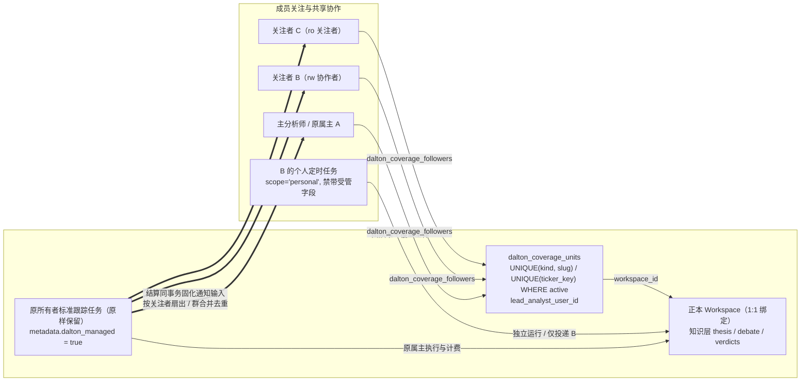
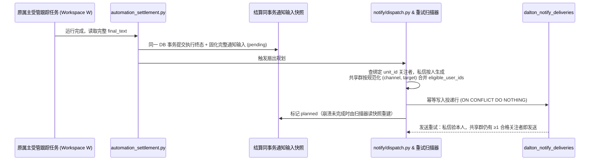

# 覆盖模型重构设计：一家公司一个工作区，人去关注它

> **状态**：设计提案（第 3 版，按 2026-11-19 生产实测数据收敛为纯加法迁移）  
> **关联迁移基线**：`d014_notify_deliveries`、`d015_user_coverage`、`d018_workspace_sharing`、`d023_coverage_units`～`d028_workspace_settings`、`d035_company_automations`（新迁移拟定 `d041`）  
> **核心目标**：将覆盖单元从「按人私有登记（`owner_user_id`）」升级为「团队内同一主体唯一覆盖单元 + 唯一正本工作区 + 多人关注订阅与通知扇出 + 主分析师负责制 + 共享工作区内个人定时任务独立并存」；**首期迁移只做加法，现有标准跟踪与财报日历任务原样保留（仍由原所有者执行与计费）**。

---

## 0. 背景、生产事实与核心契约

### 0.1 现状痛点与生产实测事实

当前覆盖体系按个人隔离：`dalton_coverage_units`（`d023`）唯一键为 `(owner_user_id, kind, slug)` 且绑定工作区硬校验 `workspaces.user_id == owner_user_id`（`src/dalton/database/coverage_units.py:365-366`）；通知投递亦只向任务属主单人发送。多人关注同一家公司时，无法共享同一正本工作区与事件推送。

**2026-11-19 生产只读核查结果**：
- `dalton_coverage_units` 活动行共 **114 条**（`company` 104 条、`sector` 10 条），分属 3 位内部用户（98 / 15 / 1）。
- **按 `(kind, slug)` 跨用户重复：0 条；按公司 `ticker` 重复：0 条。** 现有已登记覆盖单元中不存在「两人登记同一家公司」。
- 实际出现的重复案例（如 **Anthropic**）：两人各建了一个工作区，但并未都登记为覆盖单元（未上市、无 `ticker`）。

基于上述生产事实，首期无需设计复杂的存量自动合并、任务停写软归档与两段式回滚机制，确立以下 **5 条核心契约**：

1. **覆盖单元团队唯一，按工作区写权限操作**：团队内同一 `(kind, slug)` 及上市公司同一规范化 `ticker_key` 最多只有一个 `active` 覆盖单元，至多绑定一个正本工作区。对该工作区拥有写权限的内部成员或 PM 可登记与绑定；并发重复登记返回 `409` 并附胜出单元信息引导关注。
2. **跟踪任务不切换，投递处按关注者扇出**：现有标准跟踪（`watch` / `delta` / `move-up` / `move-down` / `earn-*` / `sector-*`）与个人 `dalton-earnings-calendar` 任务**原样保留，仍由原所有者执行与计费**；首期仅在结算投递层对正本工作区的可推送跟踪结果按 `dalton_coverage_followers` 扇出（共享群合并去重，个人周历只发私信）。
3. **受管跟踪与个人定时任务严格分界**：个人创建/修改入口严禁携带受管元数据字段；分类、预检与通知扇出统一只认受管元数据（`dalton_managed = true`）。共享工作区内协作者自建的个人定时任务（`scope='personal'`）归创建者本人、计创建者额度、只向创建者本人投递，绝不扇出。
4. **主分析师（Lead Analyst）责任制**：覆盖单元设 `lead_analyst_user_id`（存量回填原 `owner_user_id`），首期支持直接转交给已具备该正本工作区写权限的内部成员；正式报告跨人审批与横幅署名放入后续阶段。
5. **单次纯加法迁移 + 未登记重复工作区人工归整**：`d041` 在同一次迁移内完成冲突预检（存在重复即中止并打印清单）、加列建表、存量回填与全局唯一索引替换；Anthropic 等未登记重复工作区由用户选定正本后按简短人工步骤一次性处理。



---

## 1. 模块盘点与改造范围

### 1.1 `d015` 与 `d023` 的分层关系

`user_coverage`（`d015_user_coverage.py`）底层包含 `dalton_coverage`、`dalton_coverage_groups`、`dalton_earnings_calendar_mirror` 三张表，与 `dalton_coverage_units`（`d023`）按双层模型收敛：

- **`dalton_coverage_units` + 新表 `dalton_coverage_followers`**：团队正式研究主体（上市公司、未上市公司、行业）的唯一注册真源与成员关注订阅表；切换验收后将 `src/dalton/dalton.yaml:37-38` 的 `coverage_units.enabled` 默认切为 `true`。
- **`dalton_coverage` + `dalton_coverage_groups`**：保留为个人轻量观察股与动态筛选组表（`dalton_coverage` 新增可空 `unit_id`）；`d041` 一次性将命中活动公司单元的观察股持有者导入 `dalton_coverage_followers`，日常仅保留「向观察池新加入已登记代码 ⇒ 自动关注对应单元」单向联动（取消关注不反删观察池，筛选组刷新不重加已取关单元）。
- **`dalton_earnings_calendar_mirror`**：首期保持按用户维护（`PRIMARY KEY (user_id)`），渲染个人 `coverage.yaml` 时合并「已关注公司单元 $\cup$ 本人工作区绑定的活动公司单元 $\cup$ 个人观察池」。

### 1.2 涉及代码模块清单

| 层级 | 文件路径 | 首期改造要点 |
|---|---|---|
| **覆盖领域与数据库** | `src/dalton/coverage/units.py`、`unit_errors.py`、`__init__.py`<br>`src/dalton/database/coverage_units.py` | 接口改为 `actor_user_id`；`register` 同事务 `SAVEPOINT` 完成插入 + 可选绑定 + 初始关注，唯一冲突回退保存点后查胜出单元返回 `409`（`slug_conflict` / `ticker_conflict`）；绑定校验工作区写权限（或显式 PM 旁路）；新增 `follow` / `unfollow` / `transfer_lead`。 |
| **代码归一与路由发现** | `src/dalton/coverage/identity.py`<br>`src/dalton/workflows/company_routing.py`<br>`src/dalton/coverage/service.py` | 抽出共享 `normalize_ticker_key`；公司路由优先查团队 `active` `dalton_coverage_units` 并过滤 `config.dalton_historical_duplicate_of` 历史副本；`add_user_coverage_tickers` 命中已有单元时单向自动关注；`render_coverage_yaml` 合并已关注公司单元与个人观察池。 |
| **工作区软删与关联表** | `src/server/database/workspace.py`（`L1815-1834`）<br>`src/dalton/database/sector_members.py`、`knowledge.py`、`company_automations.py`<br>`src/dalton/knowledge/cross_unit.py` | `workspace.py` 在 `FOR UPDATE` 行锁内拒绝软删除仍绑定 `active` 单元的工作区；`sector_members.py` 与 `company_automations.py` 去掉 `owner_user_id` 硬过滤；`knowledge.py` 新增 `latest_by_workspaces`；`cross_unit.py` 增加 `target_unit_id` / `requested_by_user_id`，允许目标或源工作区写权限成员重试未决 `gap`。 |
| **受管分类、排期与预检** | `src/server/models/automation.py`（`L556`）<br>`src/dalton/autonomy/schedule.py`（`L545-875`）<br>`src/dalton/autonomy/classification.py`、`preflight.py`<br>`src/dalton/autonomy/tracking.py` | 个人任务创建/修改入口剥离或拒绝受管元数据字段；`schedule.py` 取消默认写入 `dalton_managed=True`，仅受管入口显式写入且禁带 `report_profile`；分类与预检统一只认受管元数据；`tracking.py` 始终在正本工作区属主名下维护单套标准任务，支持无 `ticker` 公司建 `watch`（仅 `agenda` 探针）与 `delta`。 |
| **看板、视图与权限钩子** | `src/dalton/autonomy/board.py`、`units_view.py`、`sector.py`、`probes/director.py`、`probes/sec.py`、`system_jobs.py`<br>`automations/lifecycle.py`、`automation_executor.py`、`secretary/approvals.py` | 看板与总监巡检枚举「已关注 `active` 单元工作区 $\cup$ 担任主分析师的工作区」（含无 `ticker` 公司，过滤历史副本）；`units_view` 输出 `lead_analyst_user_id`、`is_following`、`follower_count`；`lifecycle.py` 与 `automation_executor.py` 支持写权限协作者创建和运行 `personal` 任务（强制固定线程归属创建者本人）；`approvals.py` 在新建同名工作区命中已有单元时提示复用正本。 |
| **结算固化与通知扇出** | `src/server/services/automation_settlement.py`（`L482-536, L975-991`）<br>`src/dalton/notify/dispatch.py`（`L142-258, L3353, L4680-4800`） | 结算同一数据库事务固定保存完整通知输入（含 `final_text`）；可推送受管跟踪结果按关注者偏好扇出，共享群按规范化 `(channel, target)` 合并并支持多订阅者重试重检；`earnings_calendar` 首期限定只发私信。 |
| **工具与 REST 路由** | `src/dalton/tools/coverage_tools.py`、`director_tools.py`<br>`src/dalton/app/router.py` | 暴露单元关注/取关/主分析师转交接口；跟踪管理与任务更新端点接入 `verify_workspace_access(..., need="write")`（管理动作保留显式 PM 旁路）。 |

---

## 2. 数据模型、单次迁移 `d041` 与人工处理流程

### 2.1 团队边界与股票代码规范化

- **团队范围**：部署内 `internal`（`DALTON_ALLOWED_EMAILS`）与 `admin`（`DALTON_PM_USER_IDS`）同属一个投研团队，可查看、关注与协作覆盖单元；`external` 访客严格隔离，一律返回 `403 external_tier_forbidden`。
- **股票代码规范化（`ticker_key`）**：复用 `company_routing.py:72-85` 港 A 规则并统一多股本连接符：
  - **A 股**：统一为 `DDDDDD.{SS|SZ|BJ}`（`.SH` 折算为 `.SS`）；
  - **港股**：统一为 5 位零填充纯数字（`700`、`0700.HK` → `00700`）；
  - **美股及其他市场类别股**：去空白转大写，单字符类别后缀前的 `-` 统一折算为 `.`（如 `BRK-B` 与 `BRK.B` 均归一为 `BRK.B`，展示列 `ticker` 保留标准行情写法）。
- **并发登记 `409` 契约**：`register_coverage_unit` 在同一事务内设 `SAVEPOINT`，依次插入 `dalton_coverage_units`、锁定并绑定 `workspace_id`（若提供）、写入登记人 `dalton_coverage_followers`。若触发唯一索引冲突，`ROLLBACK TO SAVEPOINT` 后在同连接查询胜出的 `active` 单元，返回 `409 slug_conflict` 或 `409 ticker_conflict`（附 `unit_id`、`workspace_id`、`lead_analyst_user_id`）。

### 2.2 单次迁移 `d041`（冲突预检 + 加列建表 + 回填 + 唯一索引切换）

由于生产环境存量跨用户重复为 0，旧约束移除与新全局唯一索引建立放在**同一次 Alembic 迁移 `d041`** 中原子完成，消除兼容过渡期的约束真空：

1. **迁移开头冲突检查（存在重复即中止）**：迁移最开头先对 `status = 'active'` 行检查是否存在跨用户（或同用户异写）的 `(kind, slug)` 重复与规范化 `ticker_key` 重复；若存在任一冲突，直接 `RAISE EXCEPTION` 打印冲突清单（`unit_id`、`owner_user_id`、`kind`、`slug`、`ticker`、`workspace_id`）使迁移失败回滚，由人工处理后重跑，**不写自动合并逻辑**。
2. **加列与新建表**：为 `dalton_coverage_units` 增加 `lead_analyst_user_id`、`created_by_user_id`、`ticker_key`、`tier`；新建关注表 `dalton_coverage_followers` 与结算通知输入快照表 `dalton_notify_outbox`；为 `dalton_coverage` 增加可空 `unit_id`；为 `dalton_cross_unit_requests` 增加 `target_unit_id`、`requested_by_user_id`；放宽 `d027` 对 `dalton_watch_state` 无 `ticker` 公司的 CHECK 约束。
3. **存量回填**：现有 `owner_user_id` 回填为 `lead_analyst_user_id`、`created_by_user_id`（新写入继续同步维护 `owner_user_id = lead_analyst_user_id` 以便平滑回退），并作为首个关注者写入 `dalton_coverage_followers`；将匹配活动公司单元 `ticker_key` 的存量 `dalton_coverage` 行关联 `unit_id` 并幂等导入 `dalton_coverage_followers`；为全部存量标准跟踪与日历任务幂等补齐 `dalton_managed = true`、`dalton_kind`（已绑活动单元的工作区一并写入 `unit_id`）。
4. **同事务替换唯一约束**：移除 `uq_dalton_coverage_units_owner_kind_slug`，立即创建全局部分唯一索引 `uq_dalton_coverage_units_active_kind_slug` 与 `uq_dalton_coverage_units_active_ticker_key`。

```sql
-- 1. 迁移开头：在 Python 预计算规范化 ticker_key 后，校验 active 行是否存在 (kind, slug) 或 ticker_key 重复；
--    一旦命中冲突，格式化打印 (unit_id, owner_user_id, kind, slug, ticker, workspace_id) 清单并 RAISE EXCEPTION 中止迁移。

-- 2. 加列与新建表
ALTER TABLE dalton_coverage_units
    ADD COLUMN IF NOT EXISTS lead_analyst_user_id TEXT,
    ADD COLUMN IF NOT EXISTS created_by_user_id   TEXT,
    ADD COLUMN IF NOT EXISTS ticker_key           TEXT,
    ADD COLUMN IF NOT EXISTS tier                 TEXT NOT NULL DEFAULT 'core'
        CONSTRAINT ck_dalton_coverage_units_tier CHECK (tier IN ('core', 'watch'));

CREATE TABLE IF NOT EXISTS dalton_coverage_followers (
    unit_id        UUID NOT NULL REFERENCES dalton_coverage_units(unit_id) ON DELETE CASCADE,
    user_id        TEXT NOT NULL,
    tier           TEXT NOT NULL DEFAULT 'core'
        CONSTRAINT ck_dalton_coverage_followers_tier CHECK (tier IN ('core', 'watch')),
    notify_enabled BOOLEAN NOT NULL DEFAULT TRUE,
    source         TEXT NOT NULL DEFAULT 'ui'
        CONSTRAINT ck_dalton_coverage_followers_source
        CHECK (source IN ('seed', 'chat', 'ui', 'register', 'migration')),
    followed_at    TIMESTAMPTZ NOT NULL DEFAULT NOW(),
    updated_at     TIMESTAMPTZ NOT NULL DEFAULT NOW(),
    PRIMARY KEY (unit_id, user_id)
);
CREATE INDEX IF NOT EXISTS idx_dalton_coverage_followers_user
    ON dalton_coverage_followers (user_id, tier, followed_at DESC);

CREATE TABLE IF NOT EXISTS dalton_notify_outbox (
    execution_id TEXT PRIMARY KEY,
    automation_id TEXT NOT NULL,
    workspace_id UUID,
    thread_id    TEXT,
    run_id       TEXT,
    final_text   TEXT,
    plan_status  TEXT NOT NULL DEFAULT 'pending'
        CONSTRAINT ck_dalton_notify_outbox_status CHECK (plan_status IN ('pending', 'planned')),
    created_at   TIMESTAMPTZ NOT NULL DEFAULT NOW(),
    planned_at   TIMESTAMPTZ
);
CREATE INDEX IF NOT EXISTS idx_dalton_notify_outbox_pending
    ON dalton_notify_outbox (created_at) WHERE plan_status = 'pending';

ALTER TABLE dalton_coverage
    ADD COLUMN IF NOT EXISTS unit_id UUID REFERENCES dalton_coverage_units(unit_id) ON DELETE SET NULL;

ALTER TABLE dalton_cross_unit_requests
    ADD COLUMN IF NOT EXISTS target_unit_id       UUID,
    ADD COLUMN IF NOT EXISTS requested_by_user_id TEXT;

-- 放宽 d027：允许 Anthropic 等无 ticker 公司按 unit_id 写入议程巡检状态
ALTER TABLE dalton_watch_state DROP CONSTRAINT IF EXISTS ck_dalton_watch_state_subject;
ALTER TABLE dalton_watch_state ADD CONSTRAINT ck_dalton_watch_state_subject CHECK (
    (subject_kind = 'company' AND (ticker IS NOT NULL OR unit_id IS NOT NULL))
    OR (subject_kind = 'sector' AND ticker IS NULL AND unit_id IS NOT NULL)
);

-- 3. 回填主分析师、创建人、规范化 ticker_key 与首个关注者，并在同一次迁移中替换唯一约束
UPDATE dalton_coverage_units
SET lead_analyst_user_id = COALESCE(lead_analyst_user_id, owner_user_id),
    created_by_user_id   = COALESCE(created_by_user_id, owner_user_id)
WHERE lead_analyst_user_id IS NULL OR created_by_user_id IS NULL;

ALTER TABLE dalton_coverage_units
    ALTER COLUMN lead_analyst_user_id SET NOT NULL,
    ALTER COLUMN created_by_user_id   SET NOT NULL,
    DROP CONSTRAINT IF EXISTS uq_dalton_coverage_units_owner_kind_slug;

CREATE UNIQUE INDEX IF NOT EXISTS uq_dalton_coverage_units_active_kind_slug
    ON dalton_coverage_units (kind, slug)
    WHERE status = 'active';

CREATE UNIQUE INDEX IF NOT EXISTS uq_dalton_coverage_units_active_ticker_key
    ON dalton_coverage_units (ticker_key)
    WHERE status = 'active' AND kind = 'company' AND ticker_key IS NOT NULL;

INSERT INTO dalton_coverage_followers (unit_id, user_id, tier, notify_enabled, source)
SELECT unit_id, owner_user_id, tier, TRUE, 'migration'
FROM dalton_coverage_units
WHERE status = 'active'
ON CONFLICT (unit_id, user_id) DO NOTHING;
```

### 2.3 未登记重复工作区的一次性人工处理步骤

针对两位成员各有一个未登记工作区的场景（如 **Anthropic**），不写自动归组或评分脚本，上线后按以下 4 步一次性人工归整：

1. **选定正本**：由两位工作区属主（或 PM）协商确定继续维护的正本工作区 `W_canonical`。
2. **登记覆盖单元并开放共享**：正本属主将主体（如 `kind='company'`, `slug='anthropic'`, `ticker=NULL`）登记为团队覆盖单元并绑定 `W_canonical`，按协作需要为同事开启工作区 `ro` 或 `rw` 共享。
3. **另一方关注正本**：另一位成员对该覆盖单元执行 `follow`，接入看板视图与后续推送。
4. **标记历史副本**：另一工作区 `W_dup` **原名称、原文件与原对话完整保留不删**，仅在 `workspaces.config` 写入 `"dalton_historical_duplicate_of": "<W_canonical>"`（若有自建重复跟踪任务则手动暂停）；路由、看板与自动发现统一跳过带该标记的工作区。

### 2.4 权限矩阵与工作区共享衔接

> [!NOTE]
> `verify_workspace_access(..., need="write", channel="web"|"cos")`（`src/dalton/auth.py:439`、`sharing.py:866-932`）的写权限集合为「工作区属主 `workspaces.user_id` $\cup$ 满足对应渠道 `rw` 共享条件的内部成员」（`external` 工作区始终隔离）。下表中的「或 PM（`admin`）」均为管理端点的调用点级显式旁路。

| 操作 | 允许执行条件 | 边界与约束 |
|---|---|---|
| **查看目录 / 关注 / 取消关注** | 任意 `internal` 或 `admin` 成员 | `external` 返回 `403`；绑定工作区若为 `hidden`，仅属主与 PM 可读工作区内部详情 |
| **登记新单元 / 绑定工作区** | `internal` 或 `admin`；传 `workspace_id` 需具备该工作区写权限或 PM | 禁绑 Home、历史副本或 `external` 工作区；唯一冲突返回 `409` |
| **解绑 / 归档单元 / 软删工作区** | 解绑/归档：主分析师、工作区属主或 PM | 软删工作区在 `workspace.py` 行锁内校验无 `active` 单元绑定且无已发布报告 |
| **转交主分析师（`transfer_lead`）** | 发起：当前主分析师、工作区属主或 PM；**接收人须已具备正本工作区写权限** | 直接生效，不篡改工作区全局共享级别，个人关注档位由接收人自定 |
| **启停/改档标准跟踪（`tracking`）** | 主分析师、绑定工作区写权限成员或 PM | 始终操作正本工作区属主名下的单套受管任务，不按调用者另建重复任务 |
| **创建/改删个人任务（`personal`）** | 创建校验渠道写权限；改删要求 `automation.user_id == caller_user_id` | 固定线程强制归属创建者本人；写权限撤回后下次预检/执行自动跳过 |
| **正式报告发布与审批** | **首期维持工作区属主单通道现状** | 跨人审批、无 `ticker` 归档与署名横幅延至后续阶段 |

- **共享与记忆设置衔接（`d018` / `d020` / `d028`）**：LiveFS `.agents/user/automations/<file_name>` 按当前轮次 `user_id` 隔离，共享工作区内多人个人任务与对话线程天然互不覆盖；绑定覆盖单元不改动 `team_memory_enabled`（`d028`）与已有 `cos_access`。

---

## 3. 受管分类边界与可恢复通知扇出

### 3.1 个人任务禁带受管字段与全链路分类一致性

为防止共享工作区内的个人定时任务被误判为团队跟踪并扇出给全体关注者，建立从写入入口到预检、结算的全链路闭合规则：

1. **个人入口剥离/拒绝受管保留字段**：
   - 定义受管保留元数据键：`MANAGED_METADATA_KEYS = {"dalton_managed", "dalton_kind", "unit_id"}`。
   - `AutomationCreate` 与 `AutomationUpdate`（`src/server/models/automation.py:556`）、REST `/automations` 写接口、LiveFS 用户自动化文件同步，以及非受管排期调用，**一律拒绝或剥离受管保留字段**；同时禁止通过个人更新接口篡改已有受管任务的上述字段或任务名称。
2. **排期入口取消默认受管标记**：
   - 移除 `src/dalton/autonomy/schedule.py:842` 无条件写入 `meta.setdefault("dalton_managed", True)` 的现状。
   - 仅以下受管路径显式写入 `metadata.dalton_managed = True`、标准 `dalton_kind` 及绑定 `unit_id`：① `tracking.py` 标准跟踪编排（始终挂在正本工作区属主 `workspaces.user_id` 名下）；② `ensure_user_earnings_calendar_automation`；③ `dalton_schedule_automation` 中经校验目标工作区归属调用者本人且匹配标准财报窗口命名（`dalton-<t>-earn-<period>-<tm3|t0|tp1|recheck>`）的财报排期。其余一切通过 `dalton_schedule_automation` 创建的任务均归为 `personal`。
   - **硬禁 Report Profile**：受管 `research_tracking` 任务严禁写入或挂载 `report_profile`，避免触发 `dispatch.py:4693` 的单属主报告早退分支。
3. **分类器、预检与通知共用唯一受管判定**：
   - `classification.py`、`preflight.py`（`_determine_kind` / `is_dalton_automation`）与 `notify/dispatch.py` 统一移除按 `dalton-<slug>-*` 名称前缀/后缀推断标准跟踪的兜底，**仅当 `metadata.dalton_managed is True` 且 `metadata.dalton_kind ∈ RESEARCH_TRACKING_KINDS` 时判定为受管 `research_tracking`**。
   - 任何不带受管标记的任务恒为 `personal`：预检按个人任务校验创建者写权限，结算通知归为 `category='custom'` **仅投递创建者本人，绝不进入关注者扇出**。

### 3.2 结算事务固定保存通知输入与可恢复扇出



1. **通知输入在结算事务内固定保存**：
   - `automation_executions.result_excerpt` 仅保存截断摘要（`automation_settlement.py:975`），而通知卡片与正文依赖完整 `final_text = answer.sent or answer.text`。
   - 在 `exec_db.settle_execution(..., in_transaction=...)`（`automation_settlement.py:496-513`）提交执行终态的**同一数据库事务**内，将不可变的完整通知输入快照（`execution_id`、`automation_id`、`workspace_id`、`thread_id`、`run_id`、完整 `final_text`、`plan_status = 'pending'`）持久化落盘（如 `dalton_notify_outbox` 表）。
   - `on_automation_settled` 完成投递行规划后置 `plan_status = 'planned'`。若进程在事务提交后崩溃，后台重试扫描器直接读取该固定快照（配合按 `(automation_execution_id, run_id)` 精确绑定的 `dalton_verdicts` 行）幂等重建 `dalton_notify_deliveries`，**绝不回退读取截断的 `result_excerpt` 或可能被下一批次覆盖的工作区/镜像文件**。
2. **按关注者扇出与共享群规范化合并**：
   - **可推送范围不变**：日常 `watch` / `delta` 仅更新知识层与看板信号，不发通知；`earnings_tm3`、`earnings_t0`、`earnings_tp1` 与通过裁决门禁的 `price_move`，若所属工作区绑定了 `active` 覆盖单元，则按 `dalton_coverage_followers`（`notify_enabled = TRUE`）扇出（`core` 关注者默认收全类，`watch` 关注者默认收 `earnings_t0` 与 `price_move`，均受个人通知总开关与渠道覆盖控制）；尚未绑定覆盖单元的个人工作区维持原任务属主单人投递不变。
   - **群目标去重与重试重检**：私信目标按关注者独立写入 `dalton_notify_deliveries`；共享群目标（飞书群、Discord 频道等）先经规范化 `(channel, normalized_target)` 合并为全群唯一一条投递行（契合 `d014` `UNIQUE (execution_id, channel, target)`），并在 `payload_json.eligible_user_ids` 记录命中的关注者列表。重试发送时（`dispatch.py:3353`）重检该列表，**只要仍有至少 1 位关注者保持合格订阅即正常发送**。
3. **财报日历维持原所有者运行 + 首期周历只发私信**：
   - 各成员 Home 的 `dalton-earnings-calendar` 原样保留在本人名下运行与计费：扫描本人 `coverage.yaml`（含已关注公司单元、本人工作区绑定的公司单元与个人观察股），更新本人 `dalton_earnings_calendar_mirror`，但**仅对归属本人名下的正本工作区排期 `earn-*` 任务**（同事关注的正本工作区由该正本属主的日历负责排期，产出结果后经扇出送达全体关注者）。
   - **共享群周历规则（首期只发私信）**：由于个人周历（`category = 'earnings_calendar'`）内容按每位成员自己的关注集与观察池裁剪，若投递至共享群会导致群内只收到单人子集或多成员内容冲突。因此**首期 `earnings_calendar` 通知严格限定只投递个人私信目标，自动跳过用户路由中配置的全部共享群目标**。

---

## 4. 实施计划与后续阶段

遵循 `AGENTS.md`「先用真实端到端调用验证，稳定后再用单测锁死契约」与多 worker 并发安全原则分两步交付：

| 阶段 | 交付范围 | 验证要点 |
|---|---|---|
| **Stage 1：纯加法迁移 `d041`、领域接口与可恢复扇出** | 1. 编写 `d041`（冲突预检、加列建 `dalton_coverage_followers`、回填主分析师与首个关注者、替换唯一索引、放宽 `d027` `watch_state` 约束、补齐存量标准跟踪受管元数据）；<br>2. 实现覆盖单元写权限登记/绑定（`SAVEPOINT` + `409`）、关注/取关、主分析师转交、工作区软删行锁守卫；<br>3. 实现个人任务受管字段剥离、显式受管排期、结算同事务通知输入快照、关注者扇出、群合并重试与周历仅私信规则。 | - 预发库执行 `alembic upgrade` 与 `downgrade` 演练，验证冲突预检拦截与零存量重复直通；<br>- 端到端真实触发正本工作区 `earn-t0` / `move-up` 扇出（私信独立、共享群合并、单人关通知群仍送达）、验证 `earnings_calendar` 跳过共享群仅发私信；<br>- 验证共享工作区内协作者创建 `dalton-<slug>-custom` 个人任务：禁带受管字段、不扇出、撤回 `rw` 自动跳过；<br>- 通过 `scripts/dalton/check_hooks.sh --strict --audit` 与 `scripts/multiworker_gate/`。 |
| **Stage 2：前端适配、人工归整重复工作区与默认开启** | 1. Web 前端与看板适配「我关注的 / 全部团队覆盖」、关注按钮与主分析师转交；<br>2. 按 §2.3 四步法人工归整 Anthropic 等未登记重复工作区；<br>3. `dalton.yaml` 将 `coverage_units.enabled` 默认切为 `true`，补齐核心契约单测。 | - `cd web && pnpm typecheck && pnpm test` 与 `make lint` 全量通过；<br>- 核验 Anthropic 登记正本并标记副本后，看板、路由与无 `ticker` 日常巡检正常工作。 |

### 后续阶段（首期不含）

1. **公司公共预算池与团队级财报日历**：后续若需将团队标准跟踪与财报日历的 Token 成本从原工作区属主剥离至公共账户，再引入 `system:dalton-company` 公共预算池承接标准跟踪与全队单实例日历，并配套定义面向共享群的团队全量周历模板。
2. **正式报告跨人审批与横幅署名**：独立打通 `publish/service.py` 跨人恢复、PM 跨人审批、无 `ticker` 公司正式归档写入，以及申请创建时的 `lead_analyst_user_id` 署名快照渲染。

---

## 5. 待用户决定的问题（共 3 项）

### 问题 1：正本工作区绑定覆盖单元时的默认共享可见性（`web_access`）
当私有工作区（默认 `web_access='hidden', cos_access='ro'`）绑定为团队覆盖单元正本时，如何处理可见性？
- **选项 A（推荐）**：**新建登记或主动绑定正本工作区时，若 `web_access == 'hidden'` 默认提升为团队 Web 只读（`web_access='ro'`），原样保留 `cos_access`；存量已绑的 114 个单元工作区在 `d041` 迁移中不静默改写共享权限**（避免未确认即暴露历史草稿，由属主或 PM 按需开放 `'ro'`/`'rw'`）。
- **选项 B**：新建绑定与存量 114 个已绑工作区统一将 `web_access='hidden'` 提升为 `'ro'`（或直接开放 `'rw'`）。

### 问题 2：个人轻量观察股 / 动态筛选组（`dalton_coverage`）与覆盖单元的边界
`d015` 个人观察池中的纯观察股与动态筛选组标的，如何与团队覆盖单元衔接？
- **选项 A（推荐）**：**保持双层模型 + 单向自动关注**。正式覆盖主体入驻 `dalton_coverage_units` + `dalton_coverage_followers`；纯观察股与动态筛选组保留在个人 `dalton_coverage`。仅在往观察池新加入已登记覆盖单元的代码时自动关注该单元，手动取关后不被筛选组刷新重加。
- **选项 B**：所有进入个人观察池或筛选组的股票均自动创建未绑工作区的团队覆盖单元。

### 问题 3：主分析师（Lead Analyst）转交的前置条件与方式
主分析师转交是否需要接收确认流或自动修改工作区权限？
- **选项 A（推荐）**：**首期采用直接转交（无确认流），但接收人须已具备该正本工作区的写权限（`internal`/`admin`）**，转交不自动改动工作区全局共享开关，后续如需让主分析师身份自动继承写权限，统一在 `require_workspace_access` 单一权限入口扩展。
- **选项 B**：引入「待接收人确认」状态机，并在转交时自动为接收人或全团队开启工作区 `rw` 权限。
