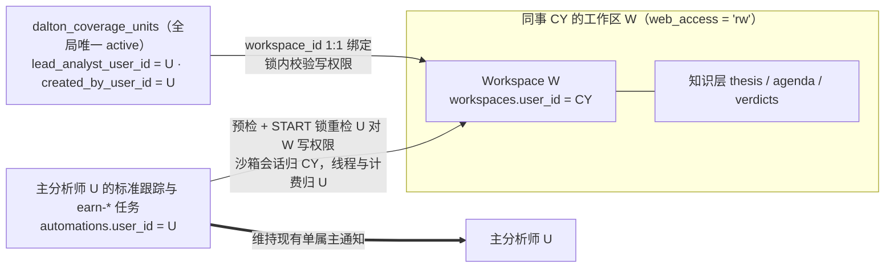

# 覆盖模型重构设计：一家公司一个工作区（首期主分析师负责，二期关注者扇出）

> **状态**：设计提案（第 4 版，首期收窄为写权限登记绑定与主分析师单属主运行，关注者扇出移至第二期）  
> **关联基线**：`d018_workspace_sharing`、`d020_colleague_dispatch_threads`、`d023_coverage_units`～`d028_workspace_settings`、`d035_company_automations`（新迁移拟定 `d041` 扩张 + `d042` 收紧）  
> **首期目标**：解决「同事已授予工作区写权限，但覆盖单元只能挂在自己名下工作区、导致多人重复建工作区」的核心痛点——允许对工作区有写权限的成员登记并绑定覆盖单元，全团队同一公司/行业仅保留一个活动覆盖单元，标准跟踪与财报日历维持主分析师单人执行与单人通知。

---

## 0. 背景、生产事实与首期范围

### 0.1 痛点与 2026-11-19 生产只读实测

当前 `dalton_coverage_units`（`d023`）唯一键为 `(owner_user_id, kind, slug)`，且绑定硬校验 `workspaces.user_id == owner_user_id`（`src/dalton/database/coverage_units.py:365-366`）。例如同事 CY 拥有 ANT 工作区并向用户开放了读写权限，用户仍无法将覆盖单元绑在 CY 的工作区上，只能另开一个工作区。

生产库实测：`dalton_coverage_units` 活动行共 **114 条**（`company` 104、`sector` 10），**跨用户 `(kind, slug)` 重复 0 条，`ticker` 重复 0 条**；Anthropic 等重复工作区均尚未同时登记为覆盖单元。

### 0.2 首期（Phase 1）核心契约

1. **一家公司/行业一个活动单元，按工作区写权限登记绑定**：部署内同一 `(kind, slug)` 与上市公司同一规范化 `ticker_key` 至多一个 `active` 单元；调用者对目标工作区具备工作区级写权限即可绑定，不再要求是工作区所有者。**绑定与转交绝不自动扩大工作区共享设置。**
2. **主分析师（`lead_analyst_user_id`）与创建人记录**：单元新增 `lead_analyst_user_id`（初始为登记人，可转交）与 `created_by_user_id`（不可变），所有登记入口写齐这两列与 `ticker_key`；采用「先可空扩张、发版补写后再锁表收紧」的无中断滚动发布顺序。
3. **跟踪与通知维持现状，仅通知主分析师**：首期**不建**关注者表与通知快照表，**不做**扇出；已绑活动单元的工作区，标准跟踪与 `earn-*` 任务创建在 `lead_analyst_user_id` 名下，按现有逻辑计费并只向主分析师本人发送通知，仅将执行器、预检与排期的「工作区属主」检查精确放宽为「对该工作区有写权限」。
4. **改绑、转交与软删强一致并发控制**：改绑须同时具备**当前绑定工作区与目标工作区**写权限；转交须**发起人与接收人此刻都具备该工作区写权限**；`bind` 与工作区软删共用 `workspaces FOR UPDATE` 行锁并在取锁后重查状态。
5. **读权限严格只认工作区实际权限**：看板与单元详情仅按目标工作区的实际读权限返回内容，绝不把单元的 `owner_user_id` / `lead_analyst_user_id` 当作可读依据。



---

## 1. 数据模型、滚动发布顺序与人工归整

### 1.1 字段约束、规范化 `ticker_key` 与登记入口对齐

- **团队边界**：仅 `internal`（`DALTON_ALLOWED_EMAILS`）与 `admin`（`DALTON_PM_USER_IDS`）可访问覆盖单元；`external` 一律返回 `403`。
- **共享 `normalize_ticker_key(ticker)`**（抽入 `src/dalton/coverage/identity.py`，供迁移预检、回填与运行时写入共用同一实现）：
  - **A 股**：复用 `company_routing.py:72-85` 归一为 `DDDDDD.{SS|SZ|BJ}`（`.SH` → `.SS`）；
  - **港股**：归一为 5 位零填充纯数字（`700`、`0700.HK` → `00700`）；
  - **美股及其他市场**：去空白转大写，单字符类别股连接符 `-` 折算为 `.`（`BRK-B` → `BRK.B`；展示列 `ticker` 保留标准行情写法）。
- **全部写入入口写齐新列**：REST `POST /coverage/units`（`src/dalton/app/router.py:1389-1408`）与工具 `dalton_coverage_unit(action="register")`（`src/dalton/tools/director_tools.py:756-774`）统一经 `units.register_coverage_unit`（`src/dalton/coverage/units.py:37`）→ `cu_db.insert_coverage_unit`（`src/dalton/database/coverage_units.py:163`）同时写入 `owner_user_id = actor_user_id`、`lead_analyst_user_id = actor_user_id`、`created_by_user_id = actor_user_id`、`ticker` 及 `ticker_key = normalize_ticker_key(ticker)`。转交主分析师时同步更新 `lead_analyst_user_id` 与 `owner_user_id`，保持回退兼容。
- **并发重复登记 `409`**：登记事务内设 `SAVEPOINT`，命中唯一索引冲突后 `ROLLBACK TO SAVEPOINT` 并在同连接查询胜出单元，返回 `409 slug_conflict` 或 `409 ticker_conflict`（仅附 `unit_id`、`lead_analyst_user_id`，若调用者对胜出单元绑定工作区可读才附 `workspace_id`）。

### 1.2 新旧应用发布顺序与两步迁移（`d041` 扩张 → 发版 → `d042` 收紧）

首期选定**「迁移列先可空，新版应用全量上线补写后再锁表收紧」**方案，消除滚动发布期间旧版 worker `INSERT` 缺列报错或漏写 `ticker_key` 绕过唯一索引的窗口：

1. **Step 1 — 执行扩张迁移 `d041`（旧版应用在线）**：`SET LOCAL lock_timeout = '5s'`，仅新增可空列 `lead_analyst_user_id TEXT`、`created_by_user_id TEXT`、`ticker_key TEXT`，不删旧唯一约束、不加 `NOT NULL`。旧版 `INSERT` 省略新列仍正常写入。
2. **Step 2 — 滚动发布新版应用**：新版所有写入入口写齐三列；读路径使用 `COALESCE(lead_analyst_user_id, owner_user_id)`；切换验收后开启 `coverage_units.enabled`。
3. **Step 3 — 执行收紧迁移 `d042`（旧版 worker 全部退出后）**：在**同一事务**内完成：
   - `SET LOCAL lock_timeout = '5s'` 后立即 `LOCK TABLE dalton_coverage_units IN ACCESS EXCLUSIVE MODE`，阻断并发登记写入；
   - 在 Python 中读取全表，调用 `normalize_ticker_key` 为存量行及滚动窗口写入行统一回填 `lead_analyst_user_id`、`created_by_user_id` 与 `ticker_key`；
   - 检查 `status = 'active'` 行是否存在跨用户 `(kind, slug)` 重复或 `ticker_key` 重复；若存在任一冲突，打印完整冲突清单（`unit_id, owner_user_id, kind, slug, ticker, ticker_key, workspace_id`）并 `RAISE EXCEPTION` 回滚中止；
   - 收紧 `NOT NULL` 与 `CHECK` 约束（强制有 `ticker` 的公司行必有非空 `ticker_key`），移除旧唯一约束并建立全局部分唯一索引：

```sql
-- d042 核心收紧 DDL（在 LOCK TABLE ... IN ACCESS EXCLUSIVE MODE、Python 回填与冲突检查通过后同事务执行）
ALTER TABLE dalton_coverage_units
    ALTER COLUMN lead_analyst_user_id SET NOT NULL,
    ALTER COLUMN created_by_user_id   SET NOT NULL,
    ADD CONSTRAINT ck_dalton_coverage_units_ticker_key_sync CHECK (
        (ticker IS NULL AND ticker_key IS NULL)
        OR (ticker IS NOT NULL AND kind = 'company' AND ticker_key IS NOT NULL AND BTRIM(ticker_key) <> '')
    ),
    DROP CONSTRAINT IF EXISTS uq_dalton_coverage_units_owner_kind_slug;

CREATE UNIQUE INDEX IF NOT EXISTS uq_dalton_coverage_units_active_kind_slug
    ON dalton_coverage_units (kind, slug) WHERE status = 'active';

CREATE UNIQUE INDEX IF NOT EXISTS uq_dalton_coverage_units_active_ticker_key
    ON dalton_coverage_units (ticker_key)
    WHERE status = 'active' AND kind = 'company' AND ticker_key IS NOT NULL;

CREATE INDEX IF NOT EXISTS idx_dalton_coverage_units_lead_kind
    ON dalton_coverage_units (lead_analyst_user_id, kind, created_at);
```

4. **回退与 `downgrade` 冲突预检**：若 `d042` 后需回退旧版应用镜像，须先执行 `alembic downgrade d041` 放开 `NOT NULL`/`CHECK` 并恢复旧唯一约束，再切回旧镜像。由于删除旧约束后保留 `archived` 行可能使同一 `owner_user_id` 下出现多条同 `(kind, slug)` 记录，`d042.downgrade()` 开头先锁表检查 `GROUP BY owner_user_id, kind, slug HAVING COUNT(*) > 1`（含 `archived` 行），命中即打印清单并 `RAISE EXCEPTION` 拒绝降级。

### 1.3 Anthropic 未登记重复工作区的一次性人工处理步骤

1. **选定正本并确认写权限**：两位成员（或 PM）选定继续维护的正本工作区 `W_canonical`，由正本属主确认工作区共享设置已按协作需要开启 `web_access='rw'`（或对只读成员开启 `'ro'`）。
2. **主分析师登记并绑定正本**：主分析师将 Anthropic（`kind='company'`, `slug='anthropic'`, `ticker=NULL`）登记为覆盖单元并绑定 `W_canonical`。
3. **标记历史副本**：另一工作区 `W_dup` **原名称、文件与对话完整保留不删**，仅在 `workspaces.config` 写入 `"dalton_historical_duplicate_of": "<W_canonical>"`（若有自建重复定时任务则手动暂停）；看板、路由与未分类工作区列表统一跳过带该标记的工作区。

---

## 2. 权限、并发锁序与读隔离

### 2.1 工作区写权限口径与不自动扩权原则

- **统一写权限谓词**：首期所有跨人绑定、转交、跟踪排期与自动化运行，统一以**工作区共享设置写权限** `require_workspace_access(ws, user_id, channel="web", need="write", conn=conn)`（`src/dalton/sharing.py:783-930`）为准——即「工作区属主 `workspaces.user_id` $\cup$ 被授予 `dalton_workspace_sharing.web_access = 'rw'` 的内部/PM 成员」（Home、历史副本、`deleted`/`unbound` 及 `external` 工作区一律拒绝）。不采用 `channel="cos"`，避免默认开启的用户级 `cos_rw_enabled` 绕过单工作区的 `hidden`/`ro` 设置。
- **不自动扩大共享**：登记、绑定、改绑与转交**不改写** `dalton_workspace_sharing`（修改共享设置仍仅限工作区属主或 PM，`src/dalton/sharing.py:113-136`）及 `team_memory_enabled`。

### 2.2 改绑、转交、解绑/归档与工作区软删的并发与锁序

- **全局无死锁加锁顺序**：
  - 覆盖单元写事务（`bind` / `unbind` / `archive` / `transfer_lead`）：① `SELECT ... FROM dalton_coverage_units WHERE unit_id = %s FOR UPDATE` → ② 对涉及的工作区集合（`{old_ws_id, target_ws_id}` 去空排序）执行 `SELECT ... FROM workspaces WHERE workspace_id = ANY(%s::uuid[]) ORDER BY workspace_id FOR UPDATE` → ③ 若为 `sector` 单元，按同样字典序取 `pg_advisory_xact_lock(hashtext('dalton:kv:' || ws_id || ':sector'))`。
  - 工作区软删事务（`src/server/database/workspace.py:1813-1834`）：保持 `lock_user_egress_state` → `SELECT ... FROM workspaces WHERE workspace_id = %s FOR UPDATE`，在行锁内新增普通查询 `SELECT 1 FROM dalton_coverage_units WHERE workspace_id = %s::uuid AND status = 'active' LIMIT 1`（不加单元行锁），命中即拒绝软删。两边以同一把 `workspaces FOR UPDATE` 行锁串行化，取锁后重查状态，既无死锁循环，也杜绝绑入刚软删工作区的竞态。
- **同一事务锁内重查规则**：
  - **首次绑定（`old_ws_id IS NULL`）**：调用者须为单元当前 `lead_analyst_user_id`（或显式 PM），且锁后重查 `target_ws` 未删除并对 `target_ws` 有写权限（防止他人用自己的工作区抢绑别人的未绑单元）。
  - **改绑（`old_ws_id IS NOT NULL`）**：锁后重查调用者此刻对**当前绑定工作区 `old_ws_id` 与目标工作区 `target_ws_id` 都有写权限**（或显式 PM），且 `target_ws` 未删除；改绑后同事务清理 `old_ws_id` 行业成员投影并暂停原主分析师在 `old_ws_id` 上的标准跟踪任务。
  - **解绑（`unbind`）与归档（`archive`）**：已绑定工作区时，锁后重查调用者对该绑定工作区有写权限（工作区属主恒有写权限，故在主分析师权限撤回后属主仍可自行解绑释放工作区）或为 PM；未绑定时要求调用者为 `lead_analyst_user_id` 或 PM。
  - **转交主分析师（`transfer_lead`）**：已绑定工作区时，锁后重查**发起人**（当前 `lead_analyst_user_id` 或工作区属主，且此刻对该工作区**有写权限**；或 PM）与**接收人**（`internal`/`admin` 且**此刻对该工作区有写权限**）双方权限——已失去写权限的原主分析师不得发起转交。
  - **跨工作区 `gap` 重试保持不变**：首期不新增 `dalton_cross_unit_requests` 字段，不改动 `src/dalton/knowledge/cross_unit.py:843` 现有重试权限。

### 2.3 看板与详情读权限隔离

- **`src/dalton/autonomy/units_view.py`**：移除 `member_workspace_visible`（`L117-118`）、`build_units_view`（`L204-214, L258-263`）与 `build_unit_detail`（`L613-625, L656-661, L768-777`）中「`unit.owner_user_id == uid` 即判工作区可读」的分支。单元绑定工作区的 `readable` 仅当 `workspaces.user_id == uid` 或在 `colleague_access[ws_id]` 中 `web_readable == True` 时为真；工作区不可读时 `build_unit_detail` 直接抛 `UnitNotFound`（`404`），不执行 `_latest_valid_docs` 读取 `thesis`/`agenda`/`drivers`。`sector_members.py`（`L254-276`）投影已按绑定工作区同步，读取时按目标工作区可见性脱敏 `workspace_id`。
- **`src/dalton/autonomy/board.py`**：枚举候选工作区（`L369-390`）纳入调用者担任 `lead_analyst_user_id` 的绑定工作区时，必须过滤掉调用者无实际 Web 读权限（`hidden`）及带 `dalton_historical_duplicate_of` 标记的工作区；一旦工作区属主撤回权限，看板立即停止返回该工作区的 `thesis` 摘要、信号与裁决理由（`L822-902`）。

---

## 3. 同事工作区内标准跟踪与财报日历的执行与检查点改造

### 3.1 运行与通知机制（维持单属主，不做扇出）

- **归属与通知**：已绑定活动覆盖单元的工作区，其标准跟踪（`watch` / `delta` / `move-up` / `move-down` / `sector-*`）与财报窗口（`earn-*`）统一挂在单元 `lead_analyst_user_id` 名下（`automations.user_id = lead_analyst_user_id`；未绑单元工作区仍挂 `workspaces.user_id`）。主分析师 Home 的 `dalton-earnings-calendar` 照常扫描本人覆盖名单并在该共享工作区内排期 `earn-*`。结算后沿用 `src/dalton/notify/dispatch.py:4710` 与 `src/dalton/database/automation_notifications.py:342-353` 现有逻辑，按 `automation.user_id` **仅向主分析师本人发送通知**，不改结算事务与通知网关。
- **放宽边界**：仅将「任务属主必须是工作区所有者（`workspaces.user_id == automation.user_id`）」放宽为「任务属主此刻对该工作区拥有写权限（`channel="web", need="write"`）」；固定线程仍强制归属 `automation.user_id` 本人。一旦工作区属主撤回主分析师写权限，下次预检或运行时入场即拒绝执行。

### 3.2 需修改的属主/共享检查点清单（文件与行号）

| 环节 | 文件与行号 | 现状检查 | 首期放宽与适配规则 |
|---|---|---|---|
| **执行器工作区校验** | `src/server/services/automation_executor.py:387-397`（`_stored_workspace`）、`L466-481`（`_resolve_thread`） | 硬校验 `ws_owner == auto_owner`，否则抛 `ValueError` | 当 `ws_owner != auto_owner` 时改为调用 `require_workspace_access(workspace, auto_owner, channel="web", need="write")` |
| **执行器预建固定线程** | `src/server/services/automation_executor.py:444-457`（`_precreate_titled_thread`） | `create_thread(...)` 未传 `user_id`，导致 `threads_read.py:850` 回退取 `w.user_id`（同事），下次运行在 `L354-365` 误弃固定线程 | 显式传入 `user_id=automation["user_id"]`，确保同事工作区内的自动化线程归属任务创建者本人 |
| **执行器入场与沙箱绑定** | `src/server/services/automation_executor.py:856-891`（`_run_turn`）→ `src/server/database/workspace.py:1682-1757`（`lock_run_workspace`） | 未传 `workspace_owner_id`，`ptc_run.py:257-261` 默认把 `user_id` 当工作区属主取沙箱会话 | 当 `ws_owner != user_id` 时在 `extra_configurable` 与 `run_metadata` 传入 `workspace_owner_id=ws_owner`、`origin_channel="web"`，复用 `colleague-dispatch` 沙箱会话与知识层归属，并由 `lock_run_workspace` 在 START 事务 `FOR SHARE OF w` 锁内原子重检写权限 |
| **运行前预检（Preflight）** | `src/dalton/autonomy/preflight.py:496-512`（核心在 `L511` `_verify_automation_workspace_ownership`） | 调无参 `verify_workspace_access(workspace_id, user_id)`（`src/dalton/auth.py:447, 486-503` 严格属主校验） | 改为 `verify_workspace_access(workspace_id, user_id, need="write", channel="web")`；写权限被撤回时预检直接失败闭合，不唤醒沙箱 |
| **Dalton 排期助手** | `src/dalton/autonomy/schedule.py:618-636`（核心在 `L620`、`L631` `schedule_dalton_automation_helper`） | 非 Home 分支调无参 `verify_workspace_access(ws_id_str, user_id)` 仅放行工作区属主 | `action == "list"` 改为 `need="read", channel="web"`；`upsert` / `pause` / `resume` 改为 `need="write", channel="web"`（打通 Home 财报日历跨同事共享工作区排期 `earn-*`） |
| **通用自动化生命周期与文件同步** | `src/server/services/automations/lifecycle.py:89-117, 148-157`（`L107-109`）及 `src/server/app/automations.py:380-390`（`L388`） | `require_target_ownership` 与 `_delivery_workspace` 调 `require_workspace_owner` 拒绝非属主工作区 | 非 Home 工作区放宽为 `require_workspace_access(..., channel="web", need="write")`（支持在共享工作区内直接写自动化文件补建任务）；`lifecycle.py:114` `require_thread_owner` 保持不变 |
| **跟踪与系统任务管理入口** | `src/dalton/app/router.py:1471-1589, 1634-1662`（核心在 `L1510-1515`）；`src/dalton/tools/director_tools.py:189-199, 201-261, 1567-1598, 1717-1751, 1820-1850, 1892-1938`；`src/dalton/autonomy/tracking.py:76-125, 491-496`；`src/dalton/autonomy/system_jobs.py:1595-1665, 1689-1715, 2254-2289` | 启停仅允许工作区属主（或 PM），状态查询按 `workspaces.user_id` 读取任务行 | 已绑活动单元工作区的标准任务归属统一取 `COALESCE(unit.lead_analyst_user_id, ws.user_id)`；写操作校验调用者对该工作区有 `web` 写权限且（已绑单元时）为主分析师或 PM；按 `ticker` 解析优先命中调用者任主分析师的活动单元 |
| **任务分类（`scope`）** | `src/dalton/database/company_automations.py:73-86`；`src/dalton/autonomy/classification.py:141-155, 233, 252-259` | 单元匹配分支校验 `u.owner_user_id = user_id` | 改为 `COALESCE(u.lead_analyst_user_id, u.owner_user_id) = user_id`，确保主分析师在同事工作区内的标准跟踪任务仍归为 `research_tracking` |

---

## 4. 第二期展望（Phase 2 概要，首期不实现）

第二期在「一家公司一个正本工作区」稳定运行后，再引入**多人关注订阅（`dalton_coverage_followers`）与按关注者扇出通知、受管任务来源治理、结算通知快照、共享群目标授权及 `system:dalton-company` 公共预算池**。立项设计时须逐条解决第 3 版复审识别的以下阻断问题：

1. **受管任务可信来源与存量核对（Codex #2）**：普通排期工具与旧默认 `dalton_managed=True` / `dalton-*` 名称前缀规则会把个人任务误判为受管跟踪并纳入扇出或启停；须收敛为仅可信受管入口授予标记、对存量使用可核对清单，且启停逻辑同步校验受管身份。
2. **财报窗口触发与通知类别解耦（Codex #3）**：直接向 `earn-*` 补写 `dalton_kind` 会改变 `preflight.py` `_determine_kind` 分支，导致无新信号时误跳过财报任务；须将预检唤醒分支与通知路由类别解耦，并将技能内直接写自动化文件的补建入口统一收敛至可信排期。
3. **结算通知快照固定输入与原子恢复（Codex #4）**：同事务快照须固定记录当次执行的受管分类、路由任务标识、绑定 `unit_id` 与精确关联的裁决依据，补齐正文读取失败时按原 `run_id` 的恢复路径，并原子提交整组投递行与 `planned` 状态，防止改名或改绑后漏发/错发。
4. **网关首次发送与重试的多关注者资格一致性（Codex #5）**：共享群按 `(execution_id, channel, target)` 去重后，网关首次发送与重试须共用同一套 `eligible_user_ids` 资格判断（避免因投递行记录的单个 `user_id` 关闭通知而整群跳过），私信须重检接收者本人关注状态，并兼容旧投递记录的类别还原。
5. **关注关系与共享群的读权限边界（Codex #6 扇出部分）**：关注动作不得绕过工作区读权限暴露隐藏工作区摘要或推送正文；投递至共享群须具备该正本工作区对目标群的明确授权。

---

## 5. 首期待用户决定的问题（2 项）

### 问题 1：主分析师转交（`transfer_lead`）时原标准跟踪任务的交接方式
当覆盖单元主分析师从 A 转交给同样具备该工作区写权限的 B 时，原挂在 A 名下的标准跟踪任务如何处理？
- **选项 A（推荐）**：直接转交（无确认流）；转交完成后自动**暂停** A 在该工作区名下的标准跟踪与未执行 `earn-*` 任务（立即停止向 A 计费与推送），且若此前标准跟踪处于开启状态，自动在 **B 名下幂等创建/启用**同档位标准跟踪。
- **选项 B**：转交时仅自动暂停 A 在该工作区的任务，不自动在 B 名下启用，由 B 按需手动开启。

### 问题 2：主分析师负责的上市公司单元与个人 `dalton_coverage` 名单联动
主分析师在同事工作区上登记/绑定或接管带 `ticker` 的上市公司单元后，如何与本人 `Home/dalton/coverage.yaml`（供 `dalton-earnings-calendar` 扫描排期）衔接？
- **选项 A（推荐）**：登记、绑定或转交接收带 `ticker` 的活动公司单元时，幂等确保该代码写入当前 `lead_analyst_user_id` 的 `dalton_coverage`（已有行保留原 `tier`，不存在则默认 `'core'`），并在渲染主分析师 `coverage.yaml` 时附带该正本 `workspace_id`，使现有财报日历无需改流程即可扫描并排期。
- **选项 B**：`dalton_coverage_units` 与个人 `dalton_coverage` 保持独立，不自动写入，由主分析师手动维护个人覆盖名单。
