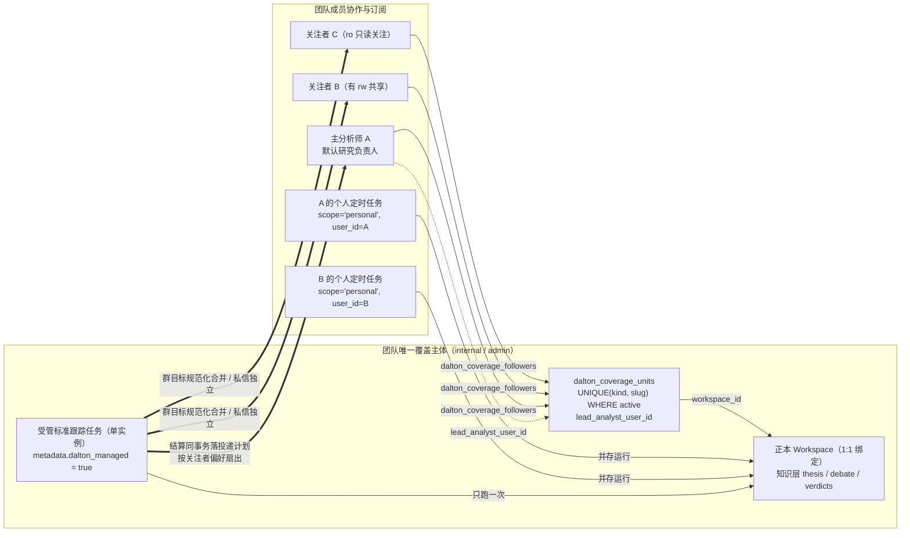
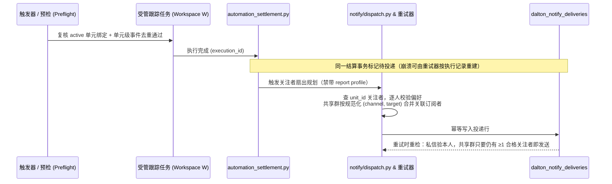

# 覆盖模型重构设计：一家公司一个工作区，人去关注它

> **状态**：设计提案（第 2 版，已按评审收敛）  
> **关联迁移基线**：`d005_publications`、`d014_notify_deliveries`、`d015_user_coverage`、`d018_workspace_sharing`、`d023_coverage_units`～`d028_workspace_settings`、`d035_company_automations`（新迁移拟定 `d041`）  
> **核心目标**：将覆盖单元从「按人私有登记（`owner_user_id`）」改为「团队内同一主体唯一覆盖单元 + 唯一正本工作区 + 多人关注订阅 + 主分析师负责制 + 共享工作区内个人定时任务按创建者独立并存」。

---

## 0. 背景与核心设计原则

当前 Dalton 的覆盖体系是「跟着人走」的：

1. **主体注册表按人隔离**：`dalton_coverage_units`（`d023`）唯一键为 `(owner_user_id, kind, slug)`，绑定工作区时强制校验 `workspaces.user_id == owner_user_id`（`src/dalton/database/coverage_units.py:365-366` 抛出 `workspace_not_owned` 403）。
2. **早期覆盖表按人重复**：`d015_user_coverage.py` 建立的 `dalton_coverage` 主键为 `(user_id, ticker)`，每人各自维护股票池、各自在 Home 跑一份 `dalton-earnings-calendar`，并在各自工作区创建重复的 `watch` / `delta` / `move-up` / `move-down` / `earn-*` 任务。
3. **协作割裂与重复开销**：当两位研究员同时覆盖同一家公司（如未上市的 **Anthropic** 或上市的 **NVDA**）时，只能各建一个工作区、各登记一个覆盖单元——研究草稿与对话分处两地、知识层（`thesis` / `verdicts`）与行业成员引用出现重复节点、同一财报与异动事件触发多份重复 LLM 执行。

本次重构确立以下 **5 条核心契约**：

1. **覆盖单元归属工作区（团队唯一），不归属个人**：团队内同一主体（同一 `(kind, slug)` 及上市公司同一规范化 `ticker_key`）最多只有一个 `active` 覆盖单元，至多绑定一个正本工作区。对该工作区拥有写权限的内部成员或 PM 可登记与绑定。
2. **关注者（Followers）订阅机制**：每位成员独立关注关心的公司或行业覆盖单元；标准跟踪与财报窗口全局只跑一次，可推送事件按关注者通知偏好扇出，共享群目标合并去重。
3. **受管跟踪与个人定时任务严格分界**：团队标准跟踪任务仅由内部受管编排入口创建并携带受管元数据；共享工作区内成员自建的个人定时任务（`scope='personal'`）一律归属创建者本人，互不篡改、不进团队扇出，额度计入创建者。
4. **主分析师（Lead Analyst）责任制**：覆盖单元设 `lead_analyst_user_id` 作为默认研究负责人，首期支持向已具备该工作区写权限的内部成员直接转交（正式报告跨人审批与横幅署名放入后续独立阶段，不在首期扩大改动面）。
5. **不中断切换与两段式可回滚迁移**：严格遵循 **「加兼容字段 → 停旧写入 → 回填与合并 → 建唯一索引 → 启用新写入」** 顺序；旧任务保留原行直至替代任务可运行后再原子切换，非正本工作区保留原名并加显式历史副本标记，绝不删除历史文件与执行记录。



---

## 1. 现状盘点（全量涉及模块、文件行号与改造对照）

通过 `git grep -l "dalton_coverage_units\|dalton_user_coverage\|coverage_unit\|user_coverage" -- src/dalton` 共命中 **34 个文件**，另有紧耦合的任务调度、通知投递、技能提示面与上游权限钩子需同步调整。

### 1.1 `d015_user_coverage` 与 `d023_coverage_units` 的关系及分层收敛策略

> [!IMPORTANT]
> 代码库中无名为 `dalton_user_coverage` 的物理表——`user_coverage` 是迁移 `d015_user_coverage.py` 与 `# DALTON-HOOK(user-coverage)` 的特性代号，底层包含三张表：`dalton_coverage`、`dalton_coverage_groups`、`dalton_earnings_calendar_mirror`。

| 维度 | `d015_user_coverage.py`（`dalton_coverage` 等三表） | `d023_coverage_units.py`（`dalton_coverage_units`） | 重构后定位（分层收敛） |
|---|---|---|---|
| **物理表与主键** | `dalton_coverage`：`PRIMARY KEY (user_id, ticker)`；<br>`dalton_coverage_groups`：按 `user_id` 存动态筛选规则（支持一票多组与独立过期状态）；<br>`dalton_earnings_calendar_mirror`：`PRIMARY KEY (user_id)` | `dalton_coverage_units`：`unit_id UUID PK`，`UNIQUE (owner_user_id, kind, slug)`，部分唯一索引 `uq_dalton_coverage_units_active_workspace` | 1. **`dalton_coverage_units`**：升级为**团队级覆盖主体唯一真源**（`d041` 加 `lead_analyst_user_id`、`created_by_user_id`、`tier`、`ticker_key`，合并收尾建团队唯一索引）；<br>2. **新增 `dalton_coverage_followers`**：承载成员对公司/行业单元的关注订阅与个人通知档位；<br>3. **`dalton_coverage`**：保留为个人轻量股票观察池与动态筛选组落盘表（新增可空 `unit_id`），迁移时一次性导入关注表，日常仅保留「新加入已覆盖代码 ⇒ 自动关注单元」单向联动；<br>4. **`dalton_earnings_calendar_mirror`**：建立团队级正本镜像（`user_id = 'system:dalton-company'`），读取与周推送按个人关注单元 $\cup$ 观察池过滤。 |
| **可表达主体** | **仅限有 `ticker` 的上市公司**（无法表达 Anthropic 等未上市公司或行业 `sector`） | 支持 `company`（`ticker` 可空，支持未上市公司）与 `sector`（无 `ticker`） | 统一由 `dalton_coverage_units` 表达正式研究主体（上市公司、未上市公司、行业），放宽 `d027` 对 `dalton_watch_state` 无 `ticker` 公司的约束（见 §2.2.4）。 |
| **工作区关系** | 无 `workspace_id` 列，靠名称/元数据启发式猜测（`service.py:1005`） | 显式 `workspace_id` 1:1 绑定，硬校验 `ws.user_id == unit.owner_user_id` | 显式 `workspace_id` 1:1 绑定，写权限接入 `verify_workspace_access(..., need="write")` 并在必要管理入口保留显式 PM 旁路。 |
| **当前开关状态** | 已全量启用 | `src/dalton/dalton.yaml:37-38` 默认 `coverage_units.enabled: false` | 切换验收通过后将 `coverage_units.enabled` 默认切为 `true`。 |

---

### 1.2 全量模块盘点

#### A. 覆盖领域层（`src/dalton/coverage/`，5 个文件）

| 文件路径与行号 | 现状行为与 `owner` / `user_id` 耦合点 | 重构后变更 |
|---|---|---|
| `src/dalton/coverage/__init__.py`<br>`L1-101` | 导出个人股票池接口与按 `owner_user_id` 签名的覆盖单元接口（`L39-51`）。 | 导出 `follow_coverage_unit`、`unfollow_coverage_unit`、`list_unit_followers`、`transfer_coverage_unit_lead`、`get_team_coverage_units`。 |
| `src/dalton/coverage/units.py`<br>`L37-148` | `register`、`archive`、`bind`、`unbind`、`get_registered_units` 全部接收 `owner_user_id` 做属主强匹配。 | 参数改为 `actor_user_id`：<br>1. **登记（`register`）**：校验 `internal`/`admin` 层级；将单元插入、可选工作区绑定与初始关注放入**同一事务**，唯一冲突回退保存点后查胜出记录并返回 409；<br>2. **绑定/解绑（`bind`/`unbind`）**：绑定需目标工作区写权限（或显式 PM 旁路）；解绑限主分析师、工作区属主或 PM；<br>3. **转交主分析师（`transfer_lead`）**：首期仅允许转交给已对该正本工作区具备写权限的内部成员；<br>4. 新增 `follow`、`unfollow`。 |
| `src/dalton/coverage/unit_errors.py`<br>`L14-52` | `L26` 映射 `"slug already registered for this owner"`（409）；`L30` 映射 `("workspace_not_owned", 403)`；`L50` 映射 `"not found for this owner"`（404）。 | 调整错误码：<br>- `slug_conflict` / `ticker_conflict`（409）：附胜出 `unit_id`、`workspace_id`、`lead_analyst_user_id` 引导关注；<br>- `workspace_write_forbidden`（403）、`external_tier_forbidden`（403）、`lead_transfer_forbidden`（403）。 |
| `src/dalton/coverage/identity.py`<br>`L57-75, L167-330` | `L57` 仅校验 ticker 格式并转大写，不含港 A 归一；`L167-232` 回退兼容路径要求非空 ticker 且可能把普通短工作区名误判为 ticker；`L248-330` 按 `workspace_id` 解析绑定单元。 | 1. 抽出共享 `normalize_ticker_key`（复用 `company_routing.py:72` 港 A 规则并统一多股本连接符）；<br>2. 过滤带历史副本标记的工作区；兼容回退在迁移中仅产候选名单，正式路由以 `dalton_coverage_units` 为准。 |
| `src/dalton/coverage/service.py`<br>`L156-2398` | `ensure_user_earnings_calendar_automation`（`L555`）按人建周日历任务；`_user_workspace_tickers`（`L1005`）只查本人工作区；`add/remove_user_coverage_*`（`L1203`）只改个人表；`L2144` 按人读写日历台账。 | 1. `_team_workspace_by_ticker()` 从团队 `active` 单元读正本工作区；<br>2. `add_user_coverage_tickers` 命中已登记公司单元时单向幂等写入 `dalton_coverage_followers`（删除观察股不自动取关）；<br>3. 改为全队单实例 `ensure_team_earnings_calendar_automation()`；<br>4. `sync_user_coverage_to_home` 合并该用户关注的覆盖单元（含未上市公司与行业）及个人观察股。 |

#### B. 数据库访问层（`src/dalton/database/` 4 个命中文件 + `workspace.py` 软删守卫）

| 文件路径与行号 | 现状行为与耦合点 | 重构后变更 |
|---|---|---|
| `src/dalton/database/coverage_units.py`<br>`L1-477` | `L35` `uq_dalton_coverage_units_owner_kind_slug`；`bind_coverage_unit_workspace`（`L365-366`）硬校验 `ws_row.user_id == owner_user_id`。 | 1. 数据类升级为 `lead_analyst_user_id`、`created_by_user_id`、`tier`、`ticker_key`；<br>2. `bind_coverage_unit_workspace` 锁 `workspaces` 行校验非 Home、未删除、非历史副本、属主为 `internal`/`admin`、调用者有写权限（或 PM），若 `web_access == 'hidden'` 保底升为 `'ro'`（保留原 `cos_access`）；<br>3. 新增 `dalton_coverage_followers` CRUD 与 `update_coverage_unit_lead`。 |
| `src/dalton/database/sector_members.py`<br>`L50-95, L166-388` | `_active_sector_unit_on_cursor` 读 `owner_user_id`；`sync_sector_members_from_doc` 每次从 `sector` 知识文档全量重建 `dalton_sector_members`。 | 移除 `owner_user_id` 读取；校验 `members[].unit_id` 查全局 `active` 公司单元，并在投影与读取层支持将已归档历史 `unit_id` 解析映射到 `merged_into_unit_id`。 |
| `src/dalton/database/company_automations.py`<br>`L41-239` | `fetch_scope_classification_context`（`L82`）带 `AND u.owner_user_id = %s`；`L190` 非 `company` 任务按 `user_id = caller_user_id` 过滤。 | 1. `L82` 去掉 `AND u.owner_user_id = %s`；<br>2. `scope='personal'` 保持按 `automations.user_id = caller_user_id` 隔离；`scope='research_tracking'` 按可读工作区向团队展示运行态。 |
| `src/dalton/database/knowledge.py`<br>`L311-345` | `latest_by_user` 硬过滤 `JOIN workspaces w ... WHERE w.user_id = %s`。 | 新增 `latest_by_workspaces(workspace_ids)`，供看板与周报按关注工作区集合批量拉取最新 `thesis` / `verdict`。 |
| *紧耦合*：`src/server/database/workspace.py`<br>`L1815-1834` | 软删除在 `SELECT ... FROM workspaces FOR UPDATE` 行锁内通过 `# DALTON-HOOK(workspace-delete-guard)` 检查 `has_published_reports`，但未检查覆盖单元绑定（且 `workspace_id` 无物理外键）。 | 在同一工作区 `FOR UPDATE` 行锁内增加检查：若存在 `status = 'active'` 的 `dalton_coverage_units` 绑定该工作区，拒绝软删除（须先解绑或迁移正本）。 |

#### C. 自主运行与调度层（`src/dalton/autonomy/` 9 个文件 + `schedule.py`、`price_trigger.py`、`services/company_automations.py`）

| 文件路径与行号 | 现状行为与耦合点 | 重构后变更 |
|---|---|---|
| `src/dalton/autonomy/classification.py`<br>`L165-289` & `services/company_automations.py:831` | 1. `L167`、`L286` 与 `services/company_automations.py:831` 将 `COMPANY_SYSTEM_USER_ID` 一律判为 `'company'`；<br>2. `L177-215`、`L247-276` 用 `DALTON_TRACKING_NAME_RE` 前缀兜底匹配 `research_tracking`。 | 1. **去掉名称前缀兜底**：`research_tracking` 仅认受管元数据（`metadata.dalton_managed = true` 且 `dalton_kind ∈ RESEARCH_TRACKING_KINDS`）及 `dalton-earnings-calendar`；共享工作区内的 `dalton-<slug>-<custom>` 个人任务严格归为 `personal`；<br>2. 分类器与历史接口先判受管 `research_tracking`，再判系统 `company` 任务。 |
| `src/dalton/autonomy/tracking.py`<br>`L43-1503` | 按调用者 `user_id` 查任务导致多人开启生成多套；`L1108` 检查 `paused_by_user`；`L1137-1148` 检查 `_replaced_by_tracker`。 | 1. 单元跟踪档位直接取 `unit.tier`（由主分析师或写权限成员显式设置）；<br>2. 按 `workspace_id` + 受管标记加 advisory lock 维护单套标准任务，完整保留 `paused_by_user` 与 `replaced_by_tracker` 语义；<br>3. 未上市公司仅建 `watch`（议程探针）与 `delta`，跳过股价触发器；时区回退读 `lead_analyst_user_id`。 |
| `src/dalton/autonomy/board.py`<br>`L370-378, L604` | `L374` 只查 `workspaces WHERE user_id = %s`，`L604` 跳过无 `ticker` 公司。 | 枚举「当前用户关注的 `active` 单元工作区 $\cup$ 担任 `lead_analyst_user_id` 的工作区」（过滤历史副本与无读权限工作区）；支持无 `ticker` 公司进入看板。 |
| `src/dalton/autonomy/units_view.py`<br>`L183-303, L594-802` | `L183-237` 已通过 `load_colleague_workspace_access` 按共享可见性合并同事单元，但按 `owner_user_id` 区分归属、`auto_tracked`（`L265`）只查本人任务，`L682` 仅对 `is_own` 返回 `evidence_gaps`。 | 输出 `lead_analyst_user_id`、`is_following`、`follower_count`、`can_write`；`auto_tracked` 查工作区级受管跟踪任务；`evidence_gaps` 对所有有工作区读权限的内部成员开放。 |
| `src/dalton/autonomy/sector.py`<br>`L145-182` | `resolve_sector_due_timezone` 回退读单元 `owner_user_id` 时区。 | 回退链改为：`sector.json.research_tz` → `unit.research_tz` → `lead_analyst_user_id` 用户时区 → 部署默认时区。 |
| `src/dalton/autonomy/preflight.py`<br>`L496-512, L614-645` | 1. `_verify_automation_workspace_ownership`（`L496`）调无参 `verify_workspace_access` 强制 `ws.user_id == auto.user_id`；<br>2. `L640` 在 `company_execution` 下跳过个人 `dalton_coverage_groups` 刷新。 | 1. 受管 `research_tracking`（含系统身份）改为校验 `workspace_id` 与 `metadata.unit_id` 活动绑定一致；`personal` 任务改为 `verify_workspace_access(ws_id, auto_owner, need="write")`；<br>2. 团队日历预检前先批量刷新内部成员到期的 `dalton_coverage_groups`；<br>3. 无 `ticker` 公司 `watch` 预检只跑 `agenda` 探针。 |
| `src/dalton/autonomy/probes/director.py`<br>`L191-390` | 只扫描 `workspaces WHERE user_id = %s`。 | 改为扫描该用户关注或担任主分析师的可读正本工作区（过滤历史副本）。 |
| `src/dalton/autonomy/probes/sec.py`（`L60-93`）& `system_jobs.py`（`L326-560`） | `sec.py` 只从工作区属主个人覆盖表查 `cik`；`system_jobs.py` 只扫本人工作区与本人单元。 | `sec.py` 优先读团队单元元数据 / `get_company_coverage()`；`system_jobs.py` 展示团队正本标准跟踪任务（过滤历史副本）与全队唯一财报日历。 |
| *紧耦合*：`src/dalton/autonomy/price_trigger.py`<br>`L614-650` | `dalton_price_move_firings` 按 `(user_id, symbol, direction, trading_date)` 去重，切换任务执行身份后同日异动会重复触发。 | 去重唯一键改为按覆盖单元维度 `(unit_id, symbol, direction, trading_date)`（未绑单元旧行回退原键），切换当天回填当日已触发记录的 `unit_id`。 |
| *紧耦合*：`src/dalton/autonomy/schedule.py`<br>`L545-555, L684-708` | `L550` 拒绝 `COMPANY_SYSTEM_USER_ID` 调用个人排期入口；`L686-708` 要求分析师工作区必有非空 `ws_ticker`。 | 1. 新增内部受管编排入口供 `tracking` 与团队 `dalton-earnings-calendar` 幂等排期标准任务（自动写入受管元数据）；<br>2. 分析师工作区个人任务校验放宽支持无 `ticker` 公司与行业工作区，使用 `verify_workspace_access(..., need="write")`。 |

#### D. 知识层与正式发布层（`src/dalton/knowledge/*` 5 个文件 + `publish/` 2 个文件）

| 文件路径与行号 | 现状行为与耦合点 | 重构后变更 |
|---|---|---|
| `src/dalton/knowledge/cross_unit.py`<br>`L312-329, L800-890` | `L721` 调 `actor_can_write_workspace`；但联动失败落盘 `insert_request`（`L800-801`）写 `owner_user_id = actor_user_id`，导致同事触发的 `gap` 无法被他人的 `retry_linkage_rows(user_id)`（`L851`）拾取。 | `dalton_cross_unit_requests` 增加 `target_unit_id` 与 `requested_by_user_id`；重试查询改为按目标/源工作区写权限放行，任一有写权限成员或主分析师均可重试未决 `gap`。 |
| `src/dalton/knowledge/service.py`（`L830`）、`profiles.py`、`reconcile.py`、`sector.schema.json` | `service.py:830` 写知识文档调普通共享权限检查（系统身份 `system:dalton-company` 不在共享表内会被拒）。 | 在知识写权限检查处为「当前工作区有效绑定单元的受管系统执行上下文」放行写权限；人类协作者沿用 `verify_workspace_access(..., need="write")`。 |
| `src/dalton/publish/service.py`（`L1294, L1549, L2109, L2289`）、`database/publications.py`（`L235`）、`publish/files.py`（`L31`） | 跨人发布存在 **4 处耦合限制**：<br>1. `L2289` 要求 `user_id in pm_users and user_id == ws_owner_id`；<br>2. `L1294` 按 `request_id` 恢复仅限属主或发起人；<br>3. `L2109` 非属主到达待审批时重新交回属主；<br>4. 无 `ticker` 公司在 `L1549` 用 `slug.split("-")[0]` 伪造伪 ticker，且 `publications.py:235` 拒绝空 ticker。 | **首期不含正式发布流程改造**（维持工作区属主单通道现状，不在首期触碰审批流）。<br>放入**后续独立阶段（发布协同专项）**：届时一并打通恢复入口、审批交接、PM 跨人审批、无 ticker 正式归档写入，并在申请创建时快照记录 `lead_analyst_user_id` 与 `author_user_id` 渲染横幅署名。 |

#### E. 工具、路由、通知、技能提示面与上游钩子

| 文件路径与行号 | 现状行为与耦合点 | 重构后变更 |
|---|---|---|
| `src/dalton/tools/__init__.py`、`coverage_tools.py`（`L61-233`） | `dalton_coverage` 仅读写个人 `dalton_coverage` 表。 | `add` 已存在团队覆盖单元的股票时自动关注该单元并返回正本 `workspace_id`；`list` 同时返回已关注覆盖单元与个人轻量观察股。 |
| `src/dalton/tools/director_tools.py`<br>`L184, L472-491, L688-814, L1397-1599` | 1. `dalton_cross_unit_request`（`L472-491`）`_verify_sector_unit` 区分 `owner_user_id != user_id` 且台账按 `owner_user_id` 隔离；<br>2. `dalton_coverage_unit`（`L688`）与 `dalton_coverage_tracking`（`L184, L1397`）仅限属主。 | 1. `dalton_cross_unit_request` 改为按覆盖单元绑定工作区的读写权限校验与共享台账访问；<br>2. `dalton_coverage_unit` 支持 `register`/`bind`/`unbind`/`archive`/`transfer_lead`/`follow`/`unfollow`/`list`；<br>3. `dalton_coverage_tracking` 允许主分析师、工作区写权限成员或 PM 操作。 |
| `src/dalton/workflows/company_routing.py`<br>`L72-85, L217-285` | `_ticker_key`（`L72`）已有港 A 归一但未归一 `BRK-B`/`BRK.B`；`find_company_workspaces`（`L245`）只查本人工作区且不过滤历史副本。 | 扩展 `_ticker_key` 统一多股本连接符；路由优先查团队 `active` `dalton_coverage_units`，并在回退扫描中过滤带历史副本标记的工作区。 |
| `src/dalton/app/router.py`<br>`L1286, L1328-1457, L1471-1594` | 只读接口 `GET /coverage/units`（`L1328-1363`）已通过 `units_view` 返回同事可见单元；但写接口（`L1389+`）把 `current_user_id` 当 `owner_user_id`，`L1286` 锁死工作区属主。 | 写接口切换为团队单元语义并新增 `follow`/`unfollow`/`lead-analyst` 端点；`PUT /automations/{name}` 与 `/tracking/{workspace_id}` 改为 `verify_workspace_access(..., need="write", channel="web")`（管理端点保留显式 PM 旁路）。 |
| *紧耦合*：`src/server/services/automation_settlement.py`（`L520`）& `src/dalton/notify/dispatch.py`（`L58, L3353, L4693-4725`） | 1. `settlement.py:520` 状态提交后才调 `on_automation_settled`，进程退出会丢投递；<br>2. `dispatch.py:4693-4706` 对带 report profile 的任务直接早退；<br>3. `L3353` 重试共享群时只重检单个 `user_id` 开关。 | 1. 投递计划在结算同一事务落盘（或支持从结算记录幂等重建）；<br>2. 钉死 `research_tracking` 任务**不得携带 report profile**；<br>3. 群目标按规范化 `(channel, target)` 合并，重试时只要仍有至少 1 位合格关注者即发送。 |
| *技能提示面*：`plugins/dalton/skills/*` | `dalton-earnings-calendar/SKILL.md`（`L15, L19, L146-150`）按个人 `coverage.yaml` 扫描并调个人排期入口；其余多处技能文案写明“按用户各自维护”。 | 同步更新以下提示面文件：<br>1. `plugins/dalton/skills/dalton-earnings-calendar/SKILL.md`（及 `contract.json`）：改为全队覆盖并集扫描、调用受管排期入口、保留有工作区 Watch 股 `T0`；<br>2. `dalton-research-director/SKILL.md`、`dalton-weekly-review/SKILL.md`、`dalton-conventions/SKILL.md`、`dalton-earnings-flash/SKILL.md`、`dalton-earnings-preview/SKILL.md`：对齐团队正本工作区与个人关注名单口径。 |
| *上游权限钩子*：<br>1. `automations/lifecycle.py`（`L89-117`）<br>2. `automation_executor.py`（`L368, L444`）<br>3. `secretary/approvals.py`（`L57-78`） | 1. `lifecycle.py` 调 `require_workspace_owner` 拦截同事建任务；<br>2. `automation_executor.py` 有两处属主校验（`L368`、`L444`）；<br>3. `approvals.py` 只防同用户重名工作区。 | 1. `lifecycle.py` 按入口渠道调用 `verify_workspace_access(..., need="write")`；<br>2. `automation_executor.py` 两处校验统一支持受管系统任务与有写权限的 `personal` 创建者，固定线程强制保持 `conversation_threads.user_id == auto_owner`；<br>3. `approvals.py` 当新建工作区命中已有团队覆盖单元时提示复用正本工作区。 |

---

## 2. 新数据模型、团队边界与权限设计

### 2.1 「团队」边界定义（Team Scope）

Dalton 一个部署实例对应一个投研团队（`src/dalton/access_tiers.py`、`src/dalton/sharing.py:866-901`）：

- `admin`（`DALTON_PM_USER_IDS`）与 `internal`（匹配 `DALTON_ALLOWED_EMAILS` 的内部成员）：属于**同一投研团队**，可登记、绑定、关注、查看团队覆盖单元。
- `external`（外部隔离访客）：与内部团队严格隔离，调用覆盖单元接口或工具一律返回 `403 external_tier_forbidden`。
- `company`（`system:dalton-company`）：非人类系统执行身份，仅用于团队公共任务与受管标准跟踪执行，禁止外部登录。

---

### 2.2 数据库演进与五步切换顺序

> [!IMPORTANT]
> **全链路统一切换顺序（严禁在合并去重前建全局唯一索引）**：  
> **① 加兼容字段、建关注表、放宽约束（`d041`） → ② 停旧写入 → ③ 回填与存量合并 → ④ 建唯一索引（合并脚本收尾） → ⑤ 启用新写入**。  
> `d041` 只执行向后兼容的加列、建新表与放宽 CHECK，线上旧代码与现有任务在切换窗口前零中断运行；三个业务唯一索引（`uq_dalton_coverage_units_active_kind_slug`、`uq_dalton_coverage_units_active_ticker_key`、`uq_automations_workspace_tracking_name`）全部在步骤 ④ 存量冲突清零后创建。

#### 2.2.1 `dalton_coverage_units` 演进、股票代码规范化与并发登记

1. **股票代码规范化（`ticker_key`）**：复用 `src/dalton/workflows/company_routing.py:72-85` 的 `_ticker_key` 港股、A 股规则并补齐多股本代码归一：
   - **A 股**：统一为 `DDDDDD.{SS|SZ|BJ}`（裸 6 位码按号段推断交易所，`.SH` 折算为 `.SS`）；
   - **港股**：统一为 5 位零填充纯数字（如 `700`、`0700.HK`、`00700` 均归一为 `00700`）；
   - **美股及其他市场类别股**：去空白转大写后，将类别股单字符后缀前的连字符 `-` 统一折算为 `.`（如 **`BRK-B` 与 `BRK.B` 统一归一为 `BRK.B`**，`BF-B` 与 `BF.B` 归一为 `BF.B`；展示字段 `ticker` 保留标准行情写法）。
2. **并发登记事务语义**：`register_coverage_unit` 在**同一数据库事务**内开启 `SAVEPOINT`，依次执行：① 插入 `dalton_coverage_units`；② 若传入 `workspace_id` 则锁工作区行完成绑定；③ 将登记人插入 `dalton_coverage_followers`。若命中唯一索引触发 `UniqueViolation`，立即 `ROLLBACK TO SAVEPOINT`，在同一连接上读取胜出的 `active` 单元记录，返回 `409 slug_conflict` 或 `409 ticker_conflict`（携带胜出 `unit_id`、`workspace_id`、`lead_analyst_user_id`），引导调用者直接 `follow`。

```sql
-- 【步骤 ①：d041 兼容结构迁移（不建全局唯一索引）】
ALTER TABLE dalton_coverage_units
    ADD COLUMN IF NOT EXISTS lead_analyst_user_id TEXT,
    ADD COLUMN IF NOT EXISTS created_by_user_id   TEXT,
    ADD COLUMN IF NOT EXISTS merged_into_unit_id  UUID,
    ADD COLUMN IF NOT EXISTS ticker_key           TEXT,
    ADD COLUMN IF NOT EXISTS tier                 TEXT NOT NULL DEFAULT 'core'
        CONSTRAINT ck_dalton_coverage_units_tier
        CHECK (tier IN ('core', 'watch'));

UPDATE dalton_coverage_units
SET lead_analyst_user_id = COALESCE(lead_analyst_user_id, owner_user_id),
    created_by_user_id   = COALESCE(created_by_user_id, owner_user_id)
WHERE lead_analyst_user_id IS NULL OR created_by_user_id IS NULL;

ALTER TABLE dalton_coverage_units
    DROP CONSTRAINT IF EXISTS uq_dalton_coverage_units_owner_kind_slug,
    ALTER COLUMN owner_user_id DROP NOT NULL;

CREATE INDEX IF NOT EXISTS idx_dalton_coverage_units_lead_analyst
    ON dalton_coverage_units (lead_analyst_user_id, status);
CREATE INDEX IF NOT EXISTS idx_dalton_coverage_units_kind_status
    ON dalton_coverage_units (kind, status, updated_at DESC);

-- 【步骤 ④：合并脚本完成去重后施加的唯一索引】
ALTER TABLE dalton_coverage_units
    ALTER COLUMN lead_analyst_user_id SET NOT NULL,
    ALTER COLUMN created_by_user_id   SET NOT NULL;

CREATE UNIQUE INDEX IF NOT EXISTS uq_dalton_coverage_units_active_kind_slug
    ON dalton_coverage_units (kind, slug)
    WHERE status = 'active';

CREATE UNIQUE INDEX IF NOT EXISTS uq_dalton_coverage_units_active_ticker_key
    ON dalton_coverage_units (ticker_key)
    WHERE status = 'active' AND kind = 'company' AND ticker_key IS NOT NULL;
```

#### 2.2.2 新建关注表 `dalton_coverage_followers` 与观察池单向衔接

```sql
CREATE TABLE IF NOT EXISTS dalton_coverage_followers (
    unit_id        UUID NOT NULL
        REFERENCES dalton_coverage_units(unit_id) ON DELETE CASCADE,
    user_id        TEXT NOT NULL,
    tier           TEXT NOT NULL DEFAULT 'core'
        CONSTRAINT ck_dalton_coverage_followers_tier
        CHECK (tier IN ('core', 'watch')),
    notify_enabled BOOLEAN NOT NULL DEFAULT TRUE,
    source         TEXT NOT NULL DEFAULT 'ui'
        CONSTRAINT ck_dalton_coverage_followers_source
        CHECK (source IN ('seed', 'chat', 'ui', 'register', 'migration')),
    followed_at    TIMESTAMPTZ NOT NULL DEFAULT NOW(),
    updated_at     TIMESTAMPTZ NOT NULL DEFAULT NOW(),
    PRIMARY KEY (unit_id, user_id)
);

CREATE INDEX IF NOT EXISTS idx_dalton_coverage_followers_user
    ON dalton_coverage_followers (user_id, tier, followed_at DESC);

ALTER TABLE dalton_coverage
    ADD COLUMN IF NOT EXISTS unit_id UUID
        REFERENCES dalton_coverage_units(unit_id) ON DELETE SET NULL;

CREATE INDEX IF NOT EXISTS idx_dalton_coverage_unit_id
    ON dalton_coverage (unit_id) WHERE unit_id IS NOT NULL;
```

- **单向衔接规则**：`dalton_coverage` 与 `dalton_coverage_groups` 继续承载个人观察股与多筛选组状态；迁移时一次性将存量记录导入 `dalton_coverage_followers`，首期日常仅在用户向 `dalton_coverage` **新加入已存在团队覆盖单元的代码时自动关注该单元**，手动取消关注不反删观察池，筛选组刷新也不重加已取消关注的单元。

#### 2.2.3 扩展跨单元请求表 `dalton_cross_unit_requests`（对齐 `d026` 实际表结构）

`d026_cross_unit_requests.py:38-56` 现有列为 `owner_user_id`、`sector_unit_id`、`sector_workspace_id`、`target_workspace_id`（原表无 `target_unit_id` 列）。`d041` 显式补齐兼容列与索引：

```sql
ALTER TABLE dalton_cross_unit_requests
    ADD COLUMN IF NOT EXISTS target_unit_id       UUID,
    ADD COLUMN IF NOT EXISTS requested_by_user_id TEXT;

UPDATE dalton_cross_unit_requests
SET requested_by_user_id = COALESCE(requested_by_user_id, owner_user_id)
WHERE requested_by_user_id IS NULL;

CREATE INDEX IF NOT EXISTS idx_dalton_cur_target_unit_status
    ON dalton_cross_unit_requests (target_unit_id, status, updated_at DESC)
    WHERE target_unit_id IS NOT NULL;
```

#### 2.2.4 放宽 `d027` 主体身份约束

`d027_subject_identity.py:34` 要求 `subject_kind = 'company'` 时 `ticker IS NOT NULL`，会阻断 **Anthropic** 等未上市公司写入 `dalton_watch_state` 议程巡检状态（以及后续阶段的正式报告归档；注意 `dalton_publications` 带 `trg_dalton_pub_immutable` 不可变触发器，仅做目录级约束调整与可空列预留，零行重写）：

```sql
ALTER TABLE dalton_watch_state DROP CONSTRAINT IF EXISTS ck_dalton_watch_state_subject;
ALTER TABLE dalton_watch_state ADD CONSTRAINT ck_dalton_watch_state_subject CHECK (
    (subject_kind = 'company' AND (ticker IS NOT NULL OR unit_id IS NOT NULL))
    OR (subject_kind = 'sector' AND ticker IS NULL AND unit_id IS NOT NULL)
);

ALTER TABLE dalton_publications DROP CONSTRAINT IF EXISTS ck_dalton_publications_subject;
ALTER TABLE dalton_publications ADD CONSTRAINT ck_dalton_publications_subject CHECK (
    (subject_kind = 'company' AND (ticker IS NOT NULL OR unit_id IS NOT NULL))
    OR (subject_kind = 'sector' AND ticker IS NULL AND unit_id IS NOT NULL)
);
```

#### 2.2.5 标准跟踪任务约束与价格异动单元级去重

```sql
-- 1. d041：放宽 d035 系统身份约束，允许受管 research_tracking 使用 system:dalton-company
ALTER TABLE automations DROP CONSTRAINT IF EXISTS automations_company_owner_check;
ALTER TABLE automations ADD CONSTRAINT automations_company_owner_check CHECK (
    (scope = 'company' AND user_id = 'system:dalton-company')
    OR (scope = 'research_tracking')
    OR (scope = 'personal' AND user_id <> 'system:dalton-company')
);

-- 2. d041：价格异动去重表增加 unit_id，从「用户+代码」升级为「覆盖单元+代码」去重
ALTER TABLE dalton_price_move_firings
    ADD COLUMN IF NOT EXISTS unit_id UUID;

CREATE UNIQUE INDEX IF NOT EXISTS uq_dalton_price_move_firings_unit_day
    ON dalton_price_move_firings (unit_id, symbol, direction, trading_date)
    WHERE unit_id IS NOT NULL;

-- 3. 【步骤 ④：合并脚本软归档重复跟踪任务后建立】
CREATE UNIQUE INDEX IF NOT EXISTS uq_automations_workspace_tracking_name
    ON automations (workspace_id, name)
    WHERE scope = 'research_tracking'
      AND deleted_at IS NULL
      AND workspace_id IS NOT NULL;
```

---

### 2.3 权限矩阵与任务全链路一致性规则

> [!NOTE]
> **写权限判定边界说明**：`require_workspace_access` / `verify_workspace_access(..., need="write", channel="web"|"cos")`（`src/dalton/auth.py:439`、`sharing.py:866-932`）本身的写权限集合仅包含 **「工作区属主 `workspaces.user_id` $\cup$ 满足对应渠道 `rw` 共享条件的内部成员」**（开启同事派发时 CoS 实际读取属主级 `dalton_user_sharing` 与工作区级 `dalton_workspace_sharing`；`external` 属主工作区对包括 `admin` 在内的所有人只读/隔离）。下表中注明「或 PM（`admin`）」的管理动作均保留**调用点级显式旁路**（仅限属主为 `internal`/`admin` 的团队工作区），不当作 `verify_workspace_access` 的隐式属性。

| 操作 | 允许执行的角色 / 条件 | 拒绝或边界行为 |
|---|---|---|
| **查看覆盖单元目录 / 关注 / 取消关注** | 任意 `internal` 或 `admin` 成员（所绑工作区若为 `hidden` 则仅属主与 PM 可见详情） | `external` 用户返回 `403 external_tier_forbidden` |
| **登记新覆盖单元（可同时绑工作区）** | `internal` 或 `admin` 成员；若同时传 `workspace_id`，需对该工作区有写权限（或 PM） | 同 `(kind, slug)` 或同 `ticker_key` 已存在 `active` 单元时，保存点回退并返回 `409` 附胜出单元信息 |
| **绑定 / 解绑工作区（`bind` / `unbind`）** | `bind`：目标工作区写权限成员或 PM（禁绑 Home、历史副本或 `external` 工作区）；`unbind`：主分析师、工作区属主或 PM | 解绑时暂停该工作区上的受管 `research_tracking` 任务，保留知识层与文件 |
| **转交主分析师（`transfer_lead`）** | 发起人：当前主分析师、工作区属主或 PM；**首期接收人必须是已对该正本工作区具备写权限的 `internal`/`admin` 成员** | 直接生效（无确认流），不自动改动工作区全局共享开关，关注档位由接收人自行决定 |
| **启停/设置单元标准跟踪（`tracking`）** | 当前主分析师、绑定工作区写权限成员或 PM | 只读关注者不可修改全队跟踪频率或停掉任务（可自行取关或关个人通知） |
| **创建/修改/删除个人定时任务（`personal`）** | 创建按渠道校验 `verify_workspace_access(..., need="write", channel=...)`；改删强制 `automation.user_id == caller_user_id` | 同事间互不可改删对方的个人任务；写权限被撤回后下次触发在预检与执行器处 fail-closed 跳过 |
| **正式报告发布与审批** | **首期保持现状**（仅工作区属主单通道发起与同属主 PM 审批） | 跨人 PM 审批、无 `ticker` 正式发布与横幅署名纳入后续独立阶段 |
| **归档覆盖单元 / 软删除工作区** | 归档单元：主分析师、工作区属主或 PM；软删工作区：在 `workspace.py:1827` 的 `FOR UPDATE` 工作区行锁内校验无 `active` 单元绑定且无已发布报告 | 仍绑定 `active` 单元时拒绝删除工作区，防止误删团队正本 |

**任务分类与执行全链路一致性契约**：
1. **分类无歧义**：仅由内部受管编排入口写入 `metadata.dalton_managed = true` 且 `dalton_kind ∈ RESEARCH_TRACKING_KINDS` 的任务（及系统级 `dalton-earnings-calendar`）归类为 `research_tracking`；移除名称前缀兜底，确保共享工作区内成员创建的任何自定义任务（含 `dalton-<slug>-*`）恒为 `personal`。
2. **预检、执行器与工具写权限贯通**：
   - 对受管 `research_tracking` 任务（`user_id = 'system:dalton-company'`）：`preflight.py:496`、`automation_executor.py:368/444` 与 `knowledge/service.py:830` 统一复核 `automation.workspace_id` 当前仍有效绑定在 `metadata.unit_id` 对应的 `active` 覆盖单元上，核验通过即放行执行与知识层落盘；绑定失效则只记日志跳过本次。
   - 对 `personal` 任务：创建、修改、预检、执行器统一按创建者 `auto_owner` 校验当前工作区写权限；固定线程（`pinned` / `conversation_thread_id`）与新开线程强制校验 `conversation_threads.user_id == auto_owner`，严禁跨成员复用线程。

---

### 2.4 与现有工作区共享及设置体系的衔接（`d018` / `d020` / `d028`）

1. **`dalton_workspace_sharing`（`d018`）**：新建绑定或主动将工作区登记为覆盖单元正本时，若 `web_access == 'hidden'`，保底提升为 **`web_access = 'ro'`，同时原样保留该工作区已有的 `cos_access` 与属主级 `dalton_user_sharing` 设置**。工作区只读会同时开放工作区内的研究草稿与文件，因此存量迁移时将所有会从 `hidden` 扩大可见范围的私有工作区单列进预检清单供确认。
2. **共享工作区内线程与自动化文件隔离（`d020` / `d035`）**：LiveFS `.agents/user/automations/<file_name>` 按当前轮次 `CallContext.user_id` 解析，唯一索引为 `(user_id, file_name) WHERE deleted_at IS NULL`，同事 A 与 B 在同一工作区内的对话线程与个人定时任务天然隔离。
3. **`dalton_workspace_settings.team_memory_enabled`（`d028`）**：绑定覆盖单元不篡改 `team_memory_enabled` 默认值，日常对话是否进全队语义检索仍由工作区属主/主分析师/PM 显式控制。

---

## 3. 单次执行、财报日历与可恢复通知扇出

核心原则：**采集与研究计算跟着「覆盖单元 + 正本工作区」走（同一事件全局只跑一次），视图与消息投递跟着「关注者」走**。



### 3.1 每日跟踪与事件「已执行」判定规则

1. **单套受管任务编排**（档位直接读取 `unit.tier`，由主分析师或写权限成员设置）：
   - **上市公司**（`ticker IS NOT NULL`）：维护单套 4 项受管任务 `dalton-<t>-watch`、`dalton-<t>-delta`、`dalton-<t>-move-up`、`dalton-<t>-move-down`。
   - **未上市公司**（如 **Anthropic**，`ticker IS NULL`）：维护单套 2 项受管任务 `dalton-unit-<slug>-watch`（仅跑 `agenda` 探针）与 `dalton-unit-<slug>-delta`。
   - **行业单元**（`kind='sector'`）：维护单套 2 项受管任务 `dalton-sector-<slug>-agenda` 与 `dalton-sector-<slug>-delta`。
2. **切换与稳态下每类标准事件的「已执行」去重真源**：
   - **价格异动（`move-up` / `move-down`）**：以 `dalton_price_move_firings(unit_id, symbol, direction, trading_date)` 唯一索引为准；切换当天将正本与副本工作区当日已触发的异动记录统一回填 `unit_id`，确保切换执行身份后同日异动绝不重跑。
   - **日常巡检（`watch` / `sector_agenda`）**：以正本工作区 `dalton_watch_state` 与 `dalton_signals` 已消费信号指纹为准，直接继承水位。
   - **财报窗口（`earn-<period>-tm3/t0/tp1`）**：以 `(unit_id, quarter, stage)` 对照台账 `reported` 及正本/副本已成功结算的 `automation_executions` 历史判定；已执行阶段绝不补跑，仅对未到期的待执行阶段在正本工作区保留或改期单实例 `once` 任务。

### 3.2 财报日历与财报窗口（保留筛选组刷新与 Watch 股 `T0`）

1. **周度日历全队单次扫描 + 保留个人筛选组刷新**：
   - 停用各成员重复的个人日历任务前，在全队唯一 `dalton-earnings-calendar`（`user_id = 'system:dalton-company'`）的预检阶段先行刷新内部成员到期的 `dalton_coverage_groups`，随后汇总「全部 `active` 上市公司覆盖单元 $\cup$ 全体内部成员 `dalton_coverage` 观察股」渲染 `coverage.yaml`，扫描结果发布至团队镜像 `dalton_earnings_calendar_mirror(user_id = 'system:dalton-company')`。
2. **专用受管排期入口与 Core / Watch 建链契约**：
   - 新增内部受管排期入口供日历任务写入各公司正本工作区的财报 `once` 任务（绕开 `schedule.py:550` 对个人调度器的系统身份拦截，但强校验目标工作区绑定 `active` 公司单元且尊重 `paused_by_user`）。
   - **保持现有分级建链能力（`SKILL.md:146-148`）**：已绑定 `active` 正本工作区的公司，`unit.tier == 'core'` 排 `["tm3", "t0", "tp1"]` 三条；**`unit.tier == 'watch'` 保留排 `["t0"]` 快讯一条**；未建工作区的观察股仅更新日历台账，不建任务链。
3. **日历视图与周历推送按个人筛选**：
   - `GET /api/v1/dalton/earnings/calendar` 支持「我的关注」（按 `dalton_coverage_followers` $\cup$ 个人 `dalton_coverage` 过滤）与「全团队覆盖」视图。
   - 团队 Home 不绑定单一 `unit_id`，周六日历结算后的周度财报预告推送按每位内部成员的 **「已关注覆盖单元 $\cup$ 个人观察池股票」** 与未来披露窗口求交集独立筛选投递（交集为空则静默）。
4. **同步修改的技能提示面清单**：
   - `plugins/dalton/skills/dalton-earnings-calendar/SKILL.md` 及 `contract.json`（全队名单口径、受管排期调用、台账镜像说明）；
   - `plugins/dalton/skills/dalton-research-director/SKILL.md`、`dalton-weekly-review/SKILL.md`、`dalton-conventions/SKILL.md`、`dalton-earnings-flash/SKILL.md`、`dalton-earnings-preview/SKILL.md`（更新 `coverage.yaml` 与财报任务引用说明）。

### 3.3 可恢复的通知扇出与共享群合并（`notify/dispatch.py`）

1. **可推送事件边界与 Report Profile 禁令**：
   - 保持 `dispatch.py:58` 既有入口边界：日常 `watch` / `delta`（含未上市公司与行业的日常巡检/增量复盘）仅沉淀知识层与看板信号，**不直接发通知卡片**；仅 `earnings_tm3`、`earnings_t0`、`earnings_tp1`、`price_move` 等可推送分类进入关注者扇出。
   - **硬约束**：`on_automation_settled` 在 `dispatch.py:4693-4706` 对携带 validated report profile 的任务会直接早退走单属主报告投递——因此钉死 **`research_tracking` 受管任务一律不得携带 report profile**。
2. **结算与投递计划崩溃可恢复**：
   - 在 `automation_settlement.py:520` 提交执行终态的**同一数据库事务**内写入 `notify_plan_status = 'pending'`（或通知 outbox 行）；`on_automation_settled` 完成后置为 `'planned'`。若进程在落盘 `dalton_notify_deliveries` 前退出，后台重试扫描器自动扫描 `notify_plan_status = 'pending'` 的已结算执行，从执行记录与 `dalton_coverage_followers` 幂等重建投递计划。
3. **群目标规范化合并与重试资格重检**：
   - 对单元关注者逐人评估通知资格（`watch` 关注者默认接收 `earnings_t0` 与 `price_move`，`core` 关注者接收全部可推送分类，均受个人总开关与路由覆盖控制）。
   - 私信目标按人独立生成投递行；**共享群目标（飞书群、Discord 频道等）先经规范化 `(channel, normalized_target)` 合并**，全群只写一条投递记录并关联命中的关注者列表 `eligible_user_ids`；重试发送时（`dispatch.py:3353`）重检该列表，**只要仍有至少 1 位关注者保持合格订阅即正常发送**，避免单人关通知导致整群漏发。

### 3.4 知识层单点沉淀与行业成员关系

- 正本工作区承载唯一的 `dalton_knowledge_versions` 与 `dalton_verdicts`。
- 行业工作区 `sector` 文档中的 `members[].unit_id` 指向团队唯一的公司正本 `unit_id`；成员公司知识更新触发 `cross_unit.py` 时，每个关联行业正本工作区仅写入一条跨单元候选证据。

---

## 4. 存量平滑迁移、正本选择与两段式回滚

### 4.1 存量规模与切换耗时由预检实测输出

不在文档中静态推断生产成员数、工作区数或锁等待耗时——全部存量指标（活跃内部成员数、现有覆盖单元数、候选重复工作区组数、将扩大可见范围的私有工作区列表、在途执行数、待切换跟踪任务数及实测干跑耗时）统一由迁移脚本 `scripts/dalton/migrate_coverage_follows_company.py --dry-run` 连接目标环境实测输出，作为开启切换窗口的准入依据。

---

### 4.2 正本工作区选择规则与未上市公司归组

当同一主体在内部成员名下存在 $\ge 2$ 个候选工作区或覆盖单元时，采用 **「人工清单优先 + 精简二级规则」** 选出唯一正本工作区：

| 优先级 | 判定维度 | 规则说明 |
|---|---|---|
| **P0（最高）** | **人工指定清单（`--manifest`）** | 支持在 `canonical_overrides.yaml` 中显式指定任意主体的正本 `workspace_id`、`lead_analyst_user_id` 及是否跳过合并。 |
| **P1** | **已有正式发布报告或有效研究资料优先** | 拥有不可变正式发布报告（`dalton_publications`）的工作区优先；若均无正式报告，拥有有效知识层文档（`dalton_knowledge_versions` / `dalton_verdicts`）沉淀的工作区优先于空壳工作区。 |
| **P2（稳定兜底）** | **已绑 `d023` 单元 > 创建时间稳定排序** | 同等条件下优先保留已显式绑定 `dalton_coverage_units` 的工作区，再按 `workspaces.created_at ASC, workspace_id ASC` 确定性选出唯一正本。 |

**两项安全硬守卫**：
1. **多份正式报告冲突强制人工指定**：若同一主体的 **2 个及以上候选工作区均存在 `dalton_publications > 0`**，脚本拒绝自动择一，必须在人工 `--manifest` 中明确指定正本后方可执行切换。
2. **未上市公司（如 Anthropic）与启发式识别仅作候选、人工确认**：`identity.py` 兼容回退规则只能产出有 `ticker` 的候选（且可能误判短字母名称工作区），无法识别未登记 `d023` 单元的未上市公司。因此 `--dry-run` 新增 **「跨内部成员规范化工作区名称相同的工作区」归组**（识别如两位成员各有一个 `Anthropic` 工作区）；所有未经 `d023` 显式登记、由兼容解析器或跨人同名规则扫出的归组**一律仅作为候选名单输出，须经人工 `--manifest` 确认后才执行合并**。

---

### 4.3 五步切换执行流程（不提前中断现有任务）

切换拆分为 **前置兼容迁移（Phase 1）** 与 **替代链路就绪后的原子切换窗口（Phase 3）**：

1. **步骤 ① — 执行 `d041` 兼容 DDL + 运行 `--dry-run` 预检**：
   - 执行 `alembic upgrade` 加兼容列、建关注表、放宽约束；**此时线上一切现有跟踪与个人财报日历任务照常运行，不做任何暂停**。
   - 运行 `--dry-run` 输出四份核对清单：① 候选合并组与拟选正本；② 未上市/启发式同名候选组（待人工确认）；③ 多份正式报告冲突组（如有）；④ **当前 `web_access='hidden'`、绑定后将扩大为团队只读的工作区清单**。人工确认生成 `canonical_overrides.yaml`。
2. **步骤 ② — 进入切换窗口，停旧写入并衔接在途执行**：
   - 待 Phase 2 新执行/扇出代码上线验证就绪后，开启短暂维护门禁暂停覆盖单元与标准跟踪任务的变更写入；检查涉及切换的任务是否存在 `pending`/`waiting`/`running` 在途执行（等待排空或保留旧任务行可读直至在途执行自然结算，绝不强杀在途轮次）。
3. **步骤 ③ — 写入完整备份快照并执行回填与归并**：
   - **完整备份**：在事务内向 `dalton_coverage_merge_backups` 记录 `batch_id`，保存涉及的 `dalton_coverage_units`、`dalton_coverage_followers` 变更前状态、`dalton_coverage.unit_id` 原值、`sector` 文档原版本号与 `dalton_sector_members`、`dalton_cross_unit_requests` 原行（含 JSONB）、`dalton_workspace_sharing`、`workspaces.config` 及所有被改动 `automations` 行的完整快照。
   - **单元与关注者归并**：确立唯一 `active` 覆盖单元与规范化 `ticker_key`；若正本工作区 `web_access == 'hidden'` 则升为 `'ro'`（保留原 `cos_access`）；将主分析师、重复单元/副本原属主及 `dalton_coverage` 持有者一次性幂等导入 `dalton_coverage_followers` 并回填 `dalton_coverage.unit_id`；被归并旧单元置 `status = 'archived', workspace_id = NULL, merged_into_unit_id = <canonical_unit_id>`。
   - **有效引用重写**：
     - **行业成员关系**：更新所有活动行业工作区当前有效 `sector` 知识文档中的 `members[].unit_id`（将旧 `unit_id` 替换为正本 `unit_id` 生成新版本）并重算 `dalton_sector_members` 投影，防止下次文档同步回退旧 ID；
     - **跨单元请求**：一并重写 `dalton_cross_unit_requests` 的表列（`sector_unit_id`、`sector_workspace_id`、`target_workspace_id`、`target_unit_id`）及 `payload`（`source_ref`、`target_ref`）、`evidence_needed`、`result` JSONB 中的旧单元与副本工作区引用。
   - **历史副本显式标记（保留原工作区名）**：非正本工作区**保留原名称、原文件与原对话不删改**，在 `workspaces.config` 写入 `"dalton_historical_duplicate_of": "<canonical_workspace_id>"`，路由、看板与跟踪发现统一过滤该标记。
   - **任务无损切换与防物理清理软归档**：
     - 正本工作区收敛为唯一一套受管 `research_tracking` 任务，**继承原任务的 `paused_by_user`、`replaced_by_tracker` 标记及已完成/待执行的财报 `once` 窗口状态**，并回填当日 `dalton_price_move_firings.unit_id`；共享工作区内的 `personal` 任务保持原创建者不动；
     - 被淘汰的重复标准跟踪任务与旧个人 `dalton-earnings-calendar` 任务统一执行软归档：**置 `deleted_at = NOW()`、`status = 'paused'`、将原状态存入 `pre_delete_desired_status`，并写入 `metadata.archived_by_migration = true`**；同步修改 `src/dalton/database/automation_recycle.py:31` 的 `PURGE_AUTOMATIONS_SQL`，排除 `metadata->>'archived_by_migration' = 'true'` 的行，防止 30 天回收站物理删除级联清空历史 `automation_executions`（`001_initial_schema.py:458`）。
4. **步骤 ④ — 建立唯一索引锁口**：
   - 校验零冲突后，创建 `uq_dalton_coverage_units_active_kind_slug`、`uq_dalton_coverage_units_active_ticker_key` 与 `uq_automations_workspace_tracking_name`，并将 `lead_analyst_user_id`、`created_by_user_id` 设为 `NOT NULL`。
5. **步骤 ⑤ — 启用新写入与团队日历调度**：
   - 放开写门禁，启用全队单实例 `dalton-earnings-calendar` 与正本受管跟踪调度。

---

### 4.4 两段式回滚方案

1. **阶段一：切换前或切换窗口内（尚未产生新不可变归档）的完整回滚**：
   - 执行 `migrate_coverage_follows_company.py --rollback --batch-id <id>`，依据 `dalton_coverage_merge_backups` 在单事务内完整还原：
     1. 删除本次迁移写入的 `dalton_coverage_followers` 行，恢复 `dalton_coverage.unit_id` 原值；
     2. 恢复旧 `dalton_coverage_units` 行的 `status`、`workspace_id` 并清空 `merged_into_unit_id`；
     3. 恢复行业 `sector` 文档版本、`dalton_sector_members` 投影以及 `dalton_cross_unit_requests` 表列与 JSONB 引用；
     4. 恢复 `dalton_workspace_sharing` 原权限，清除副本工作区 `config.dalton_historical_duplicate_of` 标记；
     5. 停用新建替代任务，将原任务的 `deleted_at` 置回 `NULL`、按 `pre_delete_desired_status` 恢复原状态并清除 `archived_by_migration`。
   - 数据还原并移除步骤 ④ 的新唯一索引后，可无损执行 `alembic downgrade` 退回旧 schema。
2. **阶段二：切换后已运行并产生新业务数据（或后续产生无 `ticker` 不可变发布归档）后的应用回退**：
   - 由于 `dalton_publications` 受 `trg_dalton_pub_immutable` 保护不可删改，一旦未来写入无 `ticker` 归档行便不能恢复旧 `d027` 严格约束；此阶段回退采用 **「应用层回退 + 保留兼容 schema」**——不执行 `alembic downgrade`，保留 `d041` 兼容列（过渡期双写镜像 `owner_user_id = lead_analyst_user_id`）与放宽后的约束，仅通过回滚脚本切换任务启停状态与功能开关。

---

## 5. 分阶段实施计划

遵循 `AGENTS.md`「先用真实端到端调用验证，稳定后再用单测锁死契约」与多 worker 并发安全原则推进：

| 阶段 | 范围 | 核心验证要点 | 主要风险与缓解措施 |
|---|---|---|---|
| **Phase 1：兼容 Schema、领域底座与预检干跑** | 1. 编写兼容迁移 `d041`（加兼容列、建 `dalton_coverage_followers`、放宽 `d027`/`d035` 约束、加异动 `unit_id` 去重索引，**不建覆盖单元与跟踪任务唯一索引，不暂停现有任务**）；<br>2. 实现 `coverage/units.py`（同事务保存点 + 409 引导、`ticker_key` 规范化、写权限转交）、`workspace.py` 行锁软删守卫、`automation_recycle.py` 迁移归档保护；<br>3. 实现 `migrate_coverage_follows_company.py --dry-run`。 | - 预发环境执行 `alembic upgrade` 与 `--dry-run`，输出实测规模、可见性扩大工作区清单与同名候选组；<br>- 真实调用验证并发登记保存点回退与 409 返回、工作区软删行锁拦截；<br>- 跑通 `scripts/dalton/check_hooks.sh --strict --audit`。 | **风险**：`BRK-B`/`BRK.B` 或港 A 代码异写漏归一。<br>**缓解**：读写入口与预检脚本共用单一 `normalize_ticker_key`。 |
| **Phase 2：受管单次执行、财报日历、可恢复扇出与共享个人任务** | 1. 改造 `classification.py`（仅认受管元数据，去前缀兜底）、`tracking.py`、`schedule.py`（受管排期入口）、`preflight.py`（系统绑定校验 + 保留筛选组刷新 + 无 ticker 议程探针）、`price_trigger.py`；<br>2. 改造 `settlement.py` 与 `notify/dispatch.py`（同事务投递计划标记、禁带 report profile、群目标规范化合并与多订阅者重检、周历按人筛选）；<br>3. 接入 `lifecycle.py`、`automation_executor.py`、`knowledge/service.py` 共享写权限与固定线程归属校验；<br>4. 更新 `dalton-earnings-calendar` 等 6 个技能提示面文件及 `board.py`、`units_view.py`、`company_routing.py`。 | - 在测试正本工作区端到端跑通 `watch`/`move-up`/`earn-t0` 与团队 `dalton-earnings-calendar`（核验筛选组刷新、Watch 股 `T0` 排期、群合并发送及单人关通知后群仍正常送达）；<br>- 验证共享工作区内同事 B 创建 `dalton-<slug>-custom` 个人任务：归属 `personal`、不扇出给关注者、固定线程归 B、撤回 `rw` 后自动阻断；<br>- 运行 `scripts/multiworker_gate/`。 | **风险**：结算后进程崩溃丢通知或误走 report profile 早退。<br>**缓解**：结算同事务写待规划状态由重试器兜底；受管编排入口硬禁写入 report profile。 |
| **Phase 3：生产切换窗口、建唯一索引与前端默认开启** | 1. 按 §4.3 执行切换窗口：停旧写入 → 备份与归并（单元、关注者、有效 `sector` 文档、`cross_unit_requests`、任务状态继承与软归档、历史副本标记）→ 建三个唯一索引 → 启用新写入；<br>2. Web 前端适配「我关注的 / 全部团队覆盖」视图、关注开关与主分析师转交；<br>3. `dalton.yaml` 将 `coverage_units.enabled` 默认切为 `true`。 | - 预发完整演练 `apply` → 阶段一回滚 → `re-apply` 闭环，核验 `paused_by_user`、`replaced_by_tracker` 与已完成财报窗口无误重跑；<br>- `cd web && pnpm typecheck && pnpm test` 与 `make lint` 全量通过，稳定后补齐核心契约单测。 | **风险**：切换窗口存在在途执行或未上市公司漏归组。<br>**缓解**：等待在途执行自然结算；未上市及启发式候选强制经 `--manifest` 人工确认。 |
| **后续阶段（首期不含）：正式发布跨人审批与报告署名** | 打通 `publish/service.py` 跨人恢复（`L1294`）、非属主待审批交接（`L2109`）、PM 跨人审批（`L2289`）、无 `ticker` 公司归档写入（消除 `L1549` 伪 ticker 并放开 `publications.py:235`），在申请创建时快照记录 `lead_analyst_user_id` 并在 `publish/files.py` 渲染署名横幅。 | - 非 PM 研究员在正本工作区提交上市/未上市公司报告，PM 跨人审批归档，核验中途转交主分析师不篡改在途申请署名快照。 | 与首期覆盖重构解耦，控制首期变更面。 |

---

## 6. 待用户决定的问题（共 5 项）

### 问题 1：正本工作区在绑定覆盖单元后的「默认共享权限」
当私有工作区（默认 `web_access='hidden', cos_access='ro'`）被绑定为团队覆盖单元正本时，默认共享级别如何设置？
- **选项 A（有条件推荐）**：**新建或主动登记为团队正本工作区时，若 `web_access == 'hidden'` 默认提升为 Web 只读（`web_access='ro'`），并保留已有的 CoS 共享权限不变**；但由于工作区只读会同时暴露其中的草稿与沙箱文件（范围大于仅订阅通知结论），**存量迁移时在 `--dry-run` 预检名单中明确列出所有将扩大可见范围的私有工作区，经确认后再执行**。多人共同改模型或建个人定时任务时再按需开启 `'rw'`。
- **选项 B**：绑定后默认对全体内部成员开放可写（`web_access='rw', cos_access='rw'`）。

### 问题 2：存量合并的正本选择与「非正本」重复工作区处置
对于团队内已存在多个个人工作区的同一家公司（如两位同事各有一个 Anthropic 工作区），如何选正本及处置副本？
- **选项 A（推荐）**：**精简规则选正本（人工清单 > 已有正式报告或研究资料 > 已绑单元与创建时间稳定排序；多份候选均有正式发布报告时强制人工指定；未上市及同名归组仅作候选经人工清单确认）+ 非正本工作区保留原名与原文件，写入显式历史副本标记（`config.dalton_historical_duplicate_of`）供路由、看板与跟踪发现过滤**，重复标准跟踪任务软归档（免除 30 天物理清理），原属主自动转为正本关注者。
- **选项 B**：在选项 A 基础上，由脚本自动把非正本工作区文件复制到正本工作区的 `legacy_imports/<username>/` 子目录下。

### 问题 3：标准跟踪任务（Watch / Delta / 异动 / 财报窗口）的预算归属
重构后全队只跑一份的标准跟踪任务，其 LLM Token 消耗计入哪个预算池？
- **选项 A（推荐）**：**计入公司公共预算池（`system:dalton-company`）**，个人定时任务（`scope='personal'`）与个人对话计入创建者本人额度。*前置条件：同步打通系统身份在预检、执行器、知识写工具与分类器中的受管白名单；若希望分步降低首次上线耦合，也可先保留既有执行身份跑通单实例与关注者扇出，随后平滑切换至 `system:dalton-company`。*
- **选项 B**：长期计入当前主分析师个人日额度，转交主分析师时同步迁移底层任务属主。

### 问题 4：尚未建工作区的「轻量观察股 / 动态筛选组」与覆盖单元的边界
`d015` 的 `dalton_coverage` 含有多筛选组命中股与大量尚未建工作区的纯观察股，是否全部迁入 `dalton_coverage_units`？
- **选项 A（推荐）**：**采用双层模型，仅保留单向自动关注**。正式研究主体进入 `dalton_coverage_units` + `dalton_coverage_followers`；动态筛选组与纯观察股保留在个人 `dalton_coverage`（完整保留一票多筛选组及独立过期标记）。存量迁移时一次性导入已有关注关系；首期日常仅保留「往观察池新加入已覆盖代码 ⇒ 自动关注单元」单向联动，避免手动取关后被筛选组刷新重新加回。
- **选项 B**：废弃 `dalton_coverage` 表，所有筛选组命中标的均自动创建未绑工作区的团队覆盖单元。

### 问题 5：主分析师（Lead Analyst）转交范围与写权限机制
主分析师转交是否需要自动改写工作区权限或增加接受确认流？
- **选项 A（推荐）**：**首期采用直接转交（无确认流），但仅允许转交给已对该正本工作区具备写权限的内部成员（`internal`/`admin`），关注档位由接收人自行决定**。*演进约束：若后续阶段希望「主分析师身份自带正本工作区写权限（无需先给其开 `rw`）」，必须在 `require_workspace_access`（`src/dalton/sharing.py` / `auth.py`）这一唯一权限咽喉点增加一条 `OR` 分支统一继承，切勿散落在各调用点修补，也不要在转交时把工作区全局共享强行改成全员 `rw`。*
- **选项 B**：引入待接收人点击「接受转交」确认状态机，并在转交时自动将工作区全局共享切为全员 `rw`。
