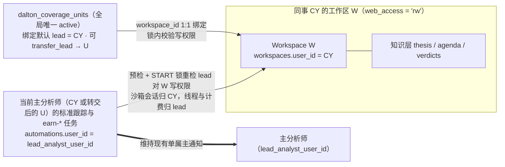

# 覆盖模型重构设计：一家公司一个工作区（首期主分析师负责，二期关注者扇出）

> **状态**：设计定稿（第 6 版，首期收窄为写权限登记绑定与主分析师单属主运行，关注者扇出移至第二期）  
> **关联基线**：`d018_workspace_sharing`、`d020_colleague_dispatch_threads`、`d023_coverage_units`～`d028_workspace_settings`、`d035_company_automations`、`d040_report_delivery_admin_notices`（新迁移拟定 `d041`）  
> **首期目标**：解决「同事已授予工作区写权限，但覆盖单元只能挂在自己名下工作区、导致多人重复建工作区」的核心痛点——允许对工作区有写权限的成员登记并绑定覆盖单元，全团队同一公司/行业仅保留一个活动覆盖单元，标准跟踪与财报日历维持主分析师单人执行与单人通知。

---

## 0. 背景、生产事实与首期范围

### 0.1 痛点与 2026-11-19 生产只读实测

当前 `dalton_coverage_units`（`d023`）唯一键为 `(owner_user_id, kind, slug)`，且绑定硬校验 `workspaces.user_id == owner_user_id`（`src/dalton/database/coverage_units.py:365-366`）。例如同事 CY 拥有 ANT 工作区并向用户开放了读写权限，用户仍无法将覆盖单元绑在 CY 的工作区上，只能另开一个工作区。

生产库实测：`dalton_coverage_units` 活动行共 **114 条**（`company` 104、`sector` 10），**跨用户 `(kind, slug)` 重复 0 条，`ticker` 重复 0 条**；Anthropic 等重复工作区均尚未同时登记为覆盖单元。

### 0.2 首期（Phase 1）核心契约

1. **一家公司/行业一个活动单元，按工作区写权限登记绑定**：部署内同一 `(kind, slug)` 与上市公司同一规范化 `ticker_key` 至多一个 `active` 单元；调用者对目标工作区具备工作区级写权限（或显式 PM）即可绑定，不再要求是工作区所有者。**绑定与转交绝不自动扩大工作区共享设置。**
2. **主分析师（`lead_analyst_user_id`）指派与转交**：单元仅新增 `lead_analyst_user_id` 与 `ticker_key`。**绑定到工作区时默认主分析师 = 目标工作区属主（`workspaces.user_id`）；未绑定的单元默认主分析师 = 登记人（`actor_user_id`）；PM 代登记/代绑定同此规则**（不落到代操作 PM 名下）。后续支持通过 `transfer_lead` 转交给同样具备该工作区写权限的内部成员。
3. **跟踪与通知维持现状，仅通知主分析师**：首期**不建**关注者表与通知快照表，**不做**扇出；已绑活动单元的工作区，标准跟踪与 `earn-*` 任务挂在 `lead_analyst_user_id` 名下，按现有逻辑计费并只向主分析师本人发送通知，仅将执行器、预检与排期的「工作区属主」检查精确放宽为「对该工作区有写权限」。
4. **改绑、转交与软删强一致并发控制**：改绑须同时具备**当前绑定工作区与目标工作区**写权限；转交须**发起人与接收人此刻都具备该工作区写权限**；`bind` 与工作区软删共用 `workspaces FOR UPDATE` 行锁并在取锁后重查状态。
5. **读权限严格只认工作区实际权限**：看板与单元详情仅按目标工作区的实际读权限返回内容，绝不把单元的 `owner_user_id` / `lead_analyst_user_id` 当作可读依据。



---

## 1. 数据模型、单次迁移 `d041`、部署回退与人工归整

### 1.1 字段约束、规范化 `ticker_key` 与登记/绑定指派规则

- **团队边界**：仅 `internal`（`DALTON_ALLOWED_EMAILS`）与 `admin`（`DALTON_PM_USER_IDS`）可访问覆盖单元；`external` 一律返回 `403`。
- **共享 `normalize_ticker_key(ticker)`**（抽入 `src/dalton/coverage/identity.py`，**供 `d041` 存量迁移回填与运行时新登记写入共用同一函数**）：
  - **A 股**：复用 `company_routing.py:72-85` 归一为 `DDDDDD.{SS|SZ|BJ}`（`.SH` → `.SS`）；
  - **港股**：归一为 5 位零填充纯数字（`700`、`0700.HK` → `00700`）；
  - **美股及其他市场**：去空白转大写，单字符类别股连接符 `-` 折算为 `.`（`BRK-B` → `BRK.B`；展示列 `ticker` 保留标准行情写法）。
- **登记与绑定的主分析师指派规则（含 PM 代操作）**：
  - 所有登记入口——REST `POST /coverage/units`（`src/dalton/app/router.py:1389-1408`）与 `dalton_coverage_unit(action="register")`（`src/dalton/tools/director_tools.py:756-774`）——统一经 `units.register_coverage_unit` → `cu_db.insert_coverage_unit` 写齐 `lead_analyst_user_id`、`owner_user_id`、`ticker` 与 `ticker_key = normalize_ticker_key(ticker)`（`ticker IS NULL` 时为 `NULL`）。
  - **未绑定的单元**（`workspace_id IS NULL`）：默认 `lead_analyst_user_id = actor_user_id`（登记人）。
  - **绑定到工作区时**（登记传入可选 `workspace_id`，或调用 `bind` 首次绑定 / 改绑）：默认 `lead_analyst_user_id = target_ws.user_id`（目标工作区属主）。
  - **PM 代登记 / 代绑定同此规则**：PM 为他人工作区登记或绑定时，默认主分析师指派为目标工作区属主 `target_ws.user_id`；未绑定时为登记人 `actor_user_id`。若需改由具备该工作区写权限的协作者担任主分析师，通过 `transfer_lead` 转交。
  - **回退兼容同步**：插入、绑定/改绑更新默认主分析师及 `transfer_lead` 时，始终同步写入 `owner_user_id = lead_analyst_user_id`。
- **并发重复登记 `409`**：登记事务内设 `SAVEPOINT`，命中唯一索引冲突后 `ROLLBACK TO SAVEPOINT` 并在同连接查询胜出单元，返回 `409 slug_conflict` 或 `409 ticker_conflict`（仅附 `unit_id`、`lead_analyst_user_id`，若调用者对胜出单元绑定工作区可读才附 `workspace_id`）。

### 1.2 单次原子迁移 `d041`（含存量 `ticker_key` 回填）与部署回退

- **正常发布无新旧共存窗口**：生产为单容器部署（`dalton-langalpha-backend-1`），`scripts/dalton/ops/prod/deploy_main.sh:431, 582` 等待无在途回合后于 `L584-585`（`apply_backend`，`L326-335`）重启单容器，`scripts/dalton/docker_entrypoint_dalton.sh:20-24` 先执行 `uv run alembic -c src/dalton/alembic.ini upgrade head` 再 `exec` 启动新后端，因此无需拆两步迁移，由单次迁移 `d041`（`down_revision = "d040"`）在同一事务内原子完成：

```python
# d041.upgrade() 核心流程（Alembic 同一数据库事务）
conn = op.get_bind()
conn.execute(sa.text("SET LOCAL lock_timeout = '5s'"))
conn.execute(sa.text("LOCK TABLE dalton_coverage_units IN ACCESS EXCLUSIVE MODE"))

# 1. 新增列（先可空以便回填存量行）
conn.execute(sa.text("""
    ALTER TABLE dalton_coverage_units
        ADD COLUMN IF NOT EXISTS lead_analyst_user_id TEXT,
        ADD COLUMN IF NOT EXISTS ticker_key           TEXT
"""))

# 2. 回填存量 lead_analyst_user_id（已绑工作区取工作区属主，未绑取原 owner_user_id）与规范化 ticker_key
conn.execute(sa.text("""
    UPDATE dalton_coverage_units u
    SET lead_analyst_user_id = COALESCE(
        u.lead_analyst_user_id,
        (SELECT w.user_id FROM workspaces w WHERE w.workspace_id = u.workspace_id AND w.status <> 'deleted'),
        u.owner_user_id
    )
    WHERE u.lead_analyst_user_id IS NULL
"""))
conn.execute(sa.text("UPDATE dalton_coverage_units SET ticker_key = NULL WHERE ticker IS NULL AND ticker_key IS NOT NULL"))
rows = conn.execute(sa.text("""
    SELECT unit_id, ticker FROM dalton_coverage_units WHERE kind = 'company' AND ticker IS NOT NULL
""")).fetchall()
for row in rows:  # 复用 src/dalton/coverage/identity.py 的同一 normalize_ticker_key()，否则新唯一索引对存量无效
    conn.execute(
        sa.text("UPDATE dalton_coverage_units SET ticker_key = :ticker_key WHERE unit_id = :unit_id"),
        {"ticker_key": normalize_ticker_key(row.ticker), "unit_id": row.unit_id},
    )

# 3. 冲突预检：回填后检查 status = 'active' 是否存在跨用户 (kind, slug) 或 ticker_key 重复；
#    若存在任一冲突，打印完整清单 (unit_id, owner_user_id, kind, slug, ticker, ticker_key, workspace_id) 并抛错回滚。

# 4. 收紧 NOT NULL / CHECK 约束，移除旧唯一约束并建立全局部分唯一索引
conn.execute(sa.text("""
    ALTER TABLE dalton_coverage_units
        ALTER COLUMN lead_analyst_user_id SET NOT NULL,
        DROP CONSTRAINT IF EXISTS ck_dalton_coverage_units_ticker_key_sync,
        ADD CONSTRAINT ck_dalton_coverage_units_ticker_key_sync CHECK (
            (ticker IS NULL AND ticker_key IS NULL)
            OR (ticker IS NOT NULL AND kind = 'company' AND ticker_key IS NOT NULL AND BTRIM(ticker_key) <> '')
        ),
        DROP CONSTRAINT IF EXISTS uq_dalton_coverage_units_owner_kind_slug;

    CREATE UNIQUE INDEX IF NOT EXISTS uq_dalton_coverage_units_active_kind_slug
        ON dalton_coverage_units (kind, slug) WHERE status = 'active';

    CREATE UNIQUE INDEX IF NOT EXISTS uq_dalton_coverage_units_active_ticker_key
        ON dalton_coverage_units (ticker_key)
        WHERE status = 'active' AND kind = 'company' AND ticker_key IS NOT NULL;

    CREATE INDEX IF NOT EXISTS idx_dalton_coverage_units_lead_kind
        ON dalton_coverage_units (lead_analyst_user_id, kind, created_at);
"""))
```

- **部署回退行为与 `revert_deploy()` 数据库降级**：
  - **回退窗口 fail-closed（不会写坏数据）**：当前 `scripts/dalton/ops/prod/deploy_main.sh:446-557` 的 `revert_deploy()` 只回退代码（`git reset -q --keep "$PRE_FF"`）不回退数据库。若出现「代码已回旧版、数据库仍在 `d041`」的回退窗口，旧版 `insert_coverage_unit`（`src/dalton/database/coverage_units.py:163-222`，`INSERT` 在 `L198-211`）因漏写 `lead_analyst_user_id`（`NOT NULL` 无默认值）与 `ticker_key`（`CHECK`）直接报错失败，**属 fail-closed，不会写入半截脏数据或绕过唯一索引的重复记录**。
  - **为何回退流程必须补 `downgrade d040`**：`./src:/app/src` 为宿主机 bind mount（`docker-compose.yml:94`）；一旦 `BACKEND_TOUCHED=1` 已执行 `d041`，`revert_deploy()` 先 `git reset --keep "$PRE_FF"` 会删掉 `d041` 迁移文件，随后重启容器时 `docker_entrypoint_dalton.sh:20` 的 `alembic upgrade head` 会因找不到版本 `d041` 直接失败退出（且即使仅回退业务代码也会导致旧版登记持续报错）。因此回退流程须在停写后、`git reset` 之前执行 `alembic -c src/dalton/alembic.ini downgrade d040`。
  - **`d041.downgrade()` 冲突预检**：开头先锁表检查 `GROUP BY owner_user_id, kind, slug HAVING COUNT(*) > 1`（含 `archived` 行）以及是否存在 `d040` 后端无法管理的跨属主活动绑定或同事名下活动受管任务，命中即打印清单并抛错拒绝降级（`revert_deploy()` 据此中止 `git reset`，保持 `d041` 代码与库一致以维持服务可用）；通过后再恢复 `uq_dalton_coverage_units_owner_kind_slug` 并移除新索引、新约束与新增两列。

### 1.3 Anthropic 未登记重复工作区的一次性人工处理步骤

1. **选定正本并确认写权限**：两位成员（或 PM）选定继续维护的正本工作区 `W_canonical`，由正本属主确认工作区共享设置已按协作需要开启 `web_access='rw'`（或对只读成员开启 `'ro'`）。
2. **登记并绑定正本**：登记 Anthropic（`kind='company'`, `slug='anthropic'`, `ticker=NULL`）并绑定 `W_canonical`（默认 `lead_analyst_user_id = W_canonical.user_id`，若由协作者主责则再执行 `transfer_lead`）。
3. **标记历史副本**：另一工作区 `W_dup` **原名称、文件与对话完整保留不删**，仅在 `workspaces.config` 写入 `"dalton_historical_duplicate_of": "<W_canonical>"`（若有自建重复定时任务则手动暂停）；看板、路由与未分类工作区列表统一跳过带该标记的工作区。

---

## 2. 权限、并发锁序与读隔离

### 2.1 工作区写权限口径与不自动扩权原则

- **统一写权限谓词**：首期所有跨人绑定、转交、跟踪排期与自动化运行，统一以**工作区共享设置写权限** `require_workspace_access(ws, user_id, channel="web", need="write", conn=conn)`（`src/dalton/sharing.py:783-929`）为准——即「工作区属主 `workspaces.user_id` $\cup$ 被授予 `dalton_workspace_sharing.web_access = 'rw'` 的内部/PM 成员」（`Home`、`deleted`/`unbound` 及 `external` 工作区一律拒绝；带 `dalton_historical_duplicate_of` 标记的历史副本在登记/绑定锁内显式拒绑）。不采用 `channel="cos"`，避免默认开启的用户级 `cos_rw_enabled` 绕过单工作区的 `hidden`/`ro` 设置。
- **不自动扩大共享**：登记、绑定、改绑与转交**不改写** `dalton_workspace_sharing`（修改共享设置仍仅限工作区属主或 PM，`src/dalton/sharing.py:113-135`）及 `team_memory_enabled`。

### 2.2 改绑、转交、解绑/归档与工作区软删的并发与锁序

- **全局无死锁加锁顺序**：
  - 覆盖单元写事务（带 `workspace_id` 的 `register` / `bind` / `unbind` / `archive` / `transfer_lead`）：① `SELECT ... FROM dalton_coverage_units WHERE unit_id = %s FOR UPDATE`（登记时在同一事务内先取目标工作区行锁再插入）→ ② 对涉及的工作区集合（`{old_ws_id, target_ws_id}` 去空排序）执行 `SELECT ... FROM workspaces WHERE workspace_id = ANY(%s::uuid[]) ORDER BY workspace_id FOR UPDATE` → ③ 若为 `sector` 单元，按同样字典序取 `pg_advisory_xact_lock(hashtext('dalton:kv:' || ws_id || ':sector'))`。
  - 工作区软删（`src/server/services/workspace_manager.py:464-506` + `src/server/database/workspace.py:1813-1834`）：在终止后台命令前先预检活动覆盖单元绑定，并在软删事务 `lock_user_egress_state` → `SELECT ... FROM workspaces WHERE workspace_id = %s FOR UPDATE` 行锁内新增普通查询 `SELECT 1 FROM dalton_coverage_units WHERE workspace_id = %s::uuid AND status = 'active' LIMIT 1`（不加单元行锁），命中即拒绝软删。两边以同一把 `workspaces FOR UPDATE` 行锁串行化，取锁后重查状态，既无死锁循环，也杜绝绑入刚软删工作区的竞态。
- **同一事务锁内重查规则**：
  - **首次绑定（`old_ws_id IS NULL`）**：调用者须为单元当前 `lead_analyst_user_id`（或显式 PM），且锁后重查 `target_ws` 未删除、非 `Home`、无 `dalton_historical_duplicate_of` 标记并对 `target_ws` 有写权限（或显式 PM）；绑定成功后默认更新 `lead_analyst_user_id = target_ws.user_id`（同步 `owner_user_id`），带 `ticker` 公司单元按 §6 决定 2 幂等同步主分析师 `dalton_coverage`。
  - **改绑（`old_ws_id IS NOT NULL`）**：锁后重查调用者此刻对**当前绑定工作区 `old_ws_id` 与目标工作区 `target_ws_id` 都有写权限**（或显式 PM），且 `target_ws` 未删除、非 `Home`、无 `dalton_historical_duplicate_of` 标记；改绑后默认更新 `lead_analyst_user_id = target_ws.user_id`（同步 `owner_user_id`），同事务清理 `old_ws_id` 行业成员投影，暂停原主分析师在 `old_ws_id` 上的标准跟踪与待跑 `earn-*` 任务，并按 §6 决定 2 同步新主分析师 `dalton_coverage`。
  - **解绑（`unbind`）与归档（`archive`）**：已绑定工作区时，锁后重查调用者对该绑定工作区有写权限（工作区属主恒有写权限，故在主分析师权限撤回后属主仍可自行解绑释放工作区）或为 PM，解绑/归档后自动暂停该工作区上的标准跟踪与待跑 `earn-*` 任务；未绑定时要求调用者为 `lead_analyst_user_id` 或 PM。
  - **转交主分析师（`transfer_lead`）**：已绑定工作区时，锁后重查**发起人**（当前 `lead_analyst_user_id` 或工作区属主，且此刻对该工作区**有写权限**；或 PM）与**接收人**（`internal`/`admin` 且**此刻对该工作区有写权限**）双方权限——已失去写权限的原主分析师不得发起转交；转交后按 §6 决定 1 与决定 2 完成任务交接与 `dalton_coverage` 同步。
  - **跨工作区 `gap` 重试保持不变**：首期不新增 `dalton_cross_unit_requests` 字段，不改动 `src/dalton/knowledge/cross_unit.py:843` 现有重试权限。

### 2.3 看板与详情读权限隔离

- **`src/dalton/autonomy/units_view.py`**：移除 `member_workspace_visible`（`L117-118`）、`build_units_view`（`L204-214, L258-263`）与 `build_unit_detail`（`L613-625, L656-661, L768-777`）中「`unit.owner_user_id == uid` 即判工作区可读」的分支。单元绑定工作区的 `readable` 仅当 `workspaces.user_id == uid` 或在 `colleague_access[ws_id]` 中 `web_readable == True` 时为真；工作区不可读时 `build_unit_detail` 直接抛 `UnitNotFound`（`404`），不执行 `_latest_valid_docs` 读取 `thesis`/`agenda`/`drivers`。`sector_members.py`（`L254-276`）投影已按绑定工作区同步，读取时按目标工作区可见性脱敏 `workspace_id`。
- **`src/dalton/autonomy/board.py`**：枚举候选工作区（`L369-390`）纳入调用者担任 `lead_analyst_user_id` 的绑定工作区时，必须过滤掉调用者无实际 Web 读权限（`hidden`）及带 `dalton_historical_duplicate_of` 标记的工作区；一旦工作区属主撤回权限，看板立即停止返回该工作区的 `thesis` 摘要、信号与裁决理由（`L822-902`）。

---

## 3. 同事工作区内标准跟踪与财报日历的执行与检查点改造

### 3.1 运行与通知机制（维持单属主，不做扇出）

- **归属与通知**：已绑定活动覆盖单元的工作区，其标准跟踪（`watch` / `delta` / `move-up` / `move-down` / `sector-*`）与财报窗口（`earn-*`）统一挂在单元 `lead_analyst_user_id` 名下（`automations.user_id = lead_analyst_user_id`；默认即工作区属主，`transfer_lead` 转交协作者后归接收人；未绑单元工作区仍挂 `workspaces.user_id`）。主分析师 Home 的 `dalton-earnings-calendar` 照常扫描本人覆盖名单并在该工作区内排期 `earn-*`。结算后沿用 `src/dalton/notify/dispatch.py:4710` 与 `src/dalton/database/automation_notifications.py:342-353` 现有逻辑，按 `automation.user_id` **仅向主分析师本人发送通知**，不改结算事务与通知网关。
- **放宽边界**：仅将「任务属主必须是工作区所有者（`workspaces.user_id == automation.user_id`）」放宽为「任务属主此刻对该工作区拥有写权限（`channel="web", need="write"`）」；固定线程仍强制归属 `automation.user_id` 本人。一旦工作区属主撤回主分析师写权限，下次预检或运行时入场即拒绝执行。

### 3.2 需修改的属主/共享检查点清单（文件与行号）

| 环节 | 文件与行号 | 现状检查 | 首期放宽与适配规则 |
|---|---|---|---|
| **执行器工作区校验** | `src/server/services/automation_executor.py:387-396`（`_stored_workspace`）、`L461-496`（`_resolve_thread`，校验在 `L466-480`） | 硬校验 `ws_owner == auto_owner`，否则抛 `ValueError` | 当 `ws_owner != auto_owner` 时改为调用 `require_workspace_access(workspace, auto_owner, channel="web", need="write")`，并将 `HTTPException` 映射为 `ValueError` |
| **执行器预建固定线程** | `src/server/services/automation_executor.py:422-459`（`_precreate_titled_thread`，调用在 `L444-457`） | `create_thread(...)` 未传 `user_id`，导致 `src/server/database/conversation/threads_read.py:850` 回退取 `w.user_id`（同事），下次运行在 `L354-364` 误弃固定线程 | 显式传入 `user_id=automation["user_id"]`，确保同事工作区内的自动化线程归属任务创建者本人 |
| **执行器入场与沙箱绑定** | `src/server/services/automation_executor.py:796-923`（`_run_turn`，请求与流调用在 `L856-891`）→ `src/server/database/workspace.py:1636-1775`（`lock_run_workspace`，同事重检段 `L1679-1775`） | 未传 `workspace_owner_id`，`src/server/handlers/chat/ptc_run.py:256-261` 默认把 `user_id` 当工作区属主取沙箱会话 | 当 `ws_owner != user_id` 时在 `extra_configurable` 与 `run_metadata` 传入 `workspace_owner_id=ws_owner`、`origin_channel="web"`，复用 `colleague-dispatch` 沙箱会话与知识层归属，并由 `lock_run_workspace` 在 START 事务 `FOR SHARE OF w` 锁内原子重检写权限 |
| **运行前预检（Preflight）** | `src/dalton/autonomy/preflight.py:496-512`（核心在 `L511` `_verify_automation_workspace_ownership`） | 调无参 `verify_workspace_access(workspace_id, user_id)`（`src/dalton/auth.py:447, 486-503` 严格属主校验） | 改为 `verify_workspace_access(workspace_id, user_id, need="write", channel="web")`；写权限被撤回时预检直接失败闭合，不唤醒沙箱 |
| **Dalton 排期助手** | `src/dalton/autonomy/schedule.py:618-636`（核心在 `L620`、`L631` `schedule_dalton_automation_helper`） | 非 Home 分支调无参 `verify_workspace_access(ws_id_str, user_id)` 仅放行工作区属主 | `action == "list"` 改为 `need="read", channel="web"`；`upsert` / `pause` / `resume` 改为 `need="write", channel="web"`（打通 Home 财报日历跨同事共享工作区排期 `earn-*`） |
| **通用自动化生命周期与文件同步** | `src/server/services/automations/lifecycle.py:89-116, 148-157`（`L107-109`、`L156`）及 `src/server/app/automations.py:380-390`（`L388`） | `require_target_ownership` 与 `_delivery_workspace` 调 `require_workspace_owner` 拒绝非属主工作区 | 非 Home 工作区放宽为 `require_workspace_access(..., channel="web", need="write")`；`lifecycle.py:114` `require_thread_owner` 保持不变 |
| **跟踪与系统任务管理入口** | `src/dalton/app/router.py:1471-1589, 1634-1662`（核心在 `L1510-1515`）；`src/dalton/tools/director_tools.py:189-199, 201-261, 1567-1598, 1717-1751, 1820-1850, 1892-1938`；`src/dalton/autonomy/tracking.py:76-125, 491-496`；`src/dalton/autonomy/system_jobs.py:1595-1665, 1689-1715, 2254-2289` | 启停仅允许工作区属主（或 PM），状态查询按 `workspaces.user_id` 读取任务行 | 已绑活动单元工作区的标准任务归属统一取 `COALESCE(unit.lead_analyst_user_id, ws.user_id)`；写操作校验调用者对该工作区有 `web` 写权限且（已绑单元时）为主分析师或 PM；按 `ticker` 解析优先命中调用者任主分析师的活动单元 |
| **任务分类（`scope`）** | `src/dalton/database/company_automations.py:73-86`；`src/dalton/autonomy/classification.py:141-155, 233, 252-259` | 单元匹配分支校验 `u.owner_user_id = user_id` | 改为 `COALESCE(u.lead_analyst_user_id, u.owner_user_id) = user_id`，确保主分析师在同事工作区内的标准跟踪任务仍归为 `research_tracking` |

---

## 4. 首期实施模块概览

- [ ] **共享 `normalize_ticker_key` 与迁移 `d041`**（`src/dalton/coverage/identity.py`、`src/dalton/migrations/versions/d041_team_coverage_units.py`）：抽出统一代码规范化函数；`d041` 锁表加列（`lead_analyst_user_id`、`ticker_key`），用同一 `normalize_ticker_key` 回填存量公司行 `ticker_key` 与 `lead_analyst_user_id` 后执行冲突预检、收紧 `NOT NULL`/`CHECK` 并切换全局部分唯一索引，配套 `downgrade` 冲突预检。
- [ ] **覆盖单元登记、绑定、转交、前端选择器与软删互斥**（`src/dalton/coverage/units.py`、`unit_errors.py`、`src/dalton/database/coverage_units.py`、`src/server/services/workspace_manager.py`、`src/server/database/workspace.py`、`src/dalton/app/router.py`、`src/dalton/tools/director_tools.py`、`web/src/pages/Settings/panels/dalton/DaltonCoverageCard.tsx`）：实现全入口 `internal`/`admin` 门控、`SAVEPOINT` + `409` 冲突响应、按工作区 `web` 写权限（或显式 PM）绑定/改绑/解绑、`transfer_lead`、设置页可写工作区绑定选择器及软删互斥。
- [ ] **看板、详情、工具列表与路由读隔离**（`src/dalton/autonomy/units_view.py`、`board.py`、`src/dalton/database/sector_members.py`、`src/dalton/workflows/company_routing.py`）：严格按工作区实际读权限返回内容并脱敏不可读 `workspace_id`，过滤 `dalton_historical_duplicate_of` 历史副本。
- [ ] **共享工作区标准跟踪、财报日历与单人通知收口**（按 §3.2 与 §7 检查清单逐项修改执行器、预检、排期、议程写入与通知路由）。
- [ ] **部署回退流程补数据库降级**（`scripts/dalton/ops/prod/deploy_main.sh:446-557`）：在 `revert_deploy()` 中，当 `BACKEND_TOUCHED=1` 且 `alembic_version_dalton` 已升过回退目标（`d040`）时，停写并在 `git reset -q --keep "$PRE_FF"` 删除新迁移脚本**之前**先执行 `uv run alembic -c src/dalton/alembic.ini downgrade d040`（降级预检失败则中止代码回退保持服务可用）。
- [ ] **上线归整**：生产 `docker-compose.dalton.yml:49` 已默认开启 `DALTON_COVERAGE_UNITS_ENABLED=1`（`d041` 上线即全量生效），同步对齐 `src/dalton/dalton.yaml:37-38` 默认值，并按 §1.3 完成 Anthropic 重复工作区一次性正本绑定与历史副本标记。

---

## 5. 第二期问题清单（Phase 2 概要，首期不实现）

第二期在「一家公司一个正本工作区」稳定运行后，再引入**多人关注订阅（`dalton_coverage_followers`）与按关注者扇出通知、受管任务来源治理、结算通知快照、共享群目标授权及 `system:dalton-company` 公共预算池**。立项设计时须逐条解决第 3 版复审（Codex + GLM）识别的以下阻断问题：

1. **受管任务可信来源与存量核对（Codex #2）**：普通排期工具与旧默认 `dalton_managed=True` / `dalton-*` 名称前缀规则会把个人任务误判为受管跟踪并纳入扇出或启停；须收敛为仅可信受管入口授予标记、对存量使用可核对清单，且启停逻辑同步校验受管身份。
2. **财报窗口触发与通知类别解耦（Codex #3）**：直接向 `earn-*` 补写 `dalton_kind` 会改变 `preflight.py` `_determine_kind` 分支，导致无新信号时误跳过财报任务；须将预检唤醒分支与通知路由类别解耦，并将技能内直接写自动化文件的补建入口统一收敛至可信排期。
3. **结算通知快照固定输入与原子恢复（Codex #4）**：同事务快照须固定记录当次执行的受管分类、路由任务标识、绑定 `unit_id` 与精确关联的裁决依据，补齐正文读取失败时按原 `run_id` 的恢复路径，并原子提交整组投递行与 `planned` 状态，防止改名或改绑后漏发/错发。
4. **网关首次发送与重试的多关注者资格一致性（Codex #5）**：共享群按 `(execution_id, channel, target)` 去重后，网关首次发送与重试须共用同一套 `eligible_user_ids` 资格判断（避免因投递行记录的单个 `user_id` 关闭通知而整群跳过），私信须重检接收者本人关注状态，并兼容旧投递记录的类别还原。
5. **共享群投递授权与关注视图隔离（Codex #6）**：关注动作不自动扩大工作区读权限、不暴露隐藏工作区摘要；投递至共享群须具备该正本工作区对目标群的明确授权。
6. **扇出前校验关注者对正本工作区的读权限（GLM #2）**：私信扇出与重试不能仅凭 `dalton_coverage_followers.notify_enabled = TRUE` 投递，须同时校验关注者此刻对正本工作区具备实际读权限（`require_workspace_access(..., channel="web", need="read")`），防止 `hidden` 正本工作区的研究全文（`final_text`）经观察池导入或目录关注越权外泄。
7. **取消关注 = 停用（保留行，自动关注路径不重开）（GLM #3）**：取消关注须更新为停用状态（置 `notify_enabled = FALSE`、记录 `unfollowed_at`）并**保留 `(unit_id, user_id)` 行**而非物理删行；观察池导入、新增代码与筛选组刷新等自动关注路径统一按 `ON CONFLICT (unit_id, user_id) DO NOTHING` 写入，绝不重开已取关记录，仅用户本人显式重新关注才恢复投递。

---

## 6. 已定决定

1. **主分析师转交（`transfer_lead`）与解绑/改绑的任务交接（采用原推荐选项 A）**：直接转交（无确认流）；转交完成后自动**暂停**原主分析师在该工作区的标准跟踪与待跑 `earn-*` 任务，且若此前标准跟踪处于开启状态，自动在新主分析师名下**幂等创建/启用**同档位标准跟踪（改绑、解绑与归档自动暂停原工作区上的标准跟踪与待跑 `earn-*`）。
2. **上市公司单元与个人 `dalton_coverage` 联动（采用原推荐选项 A）**：登记并绑定、首次绑定/改绑或转交接收带 `ticker` 的活动公司单元时，幂等写入当前 `lead_analyst_user_id` 的个人 `dalton_coverage`（已有行保留原 `tier`，新行默认 `'core'`），渲染主分析师 `Home/dalton/coverage.yaml` 时附带该正本 `workspace_id`（非当前主分析师即使保留个人观察行也不再附该正本 `workspace_id`）。

---

## 7. 首期实施检查清单

### 7.1 Codex 复审遗漏项（8 项）

- [ ] **C1 · 回退停写、降级预检扩展与降级失败保活**
  - **位置**：`scripts/dalton/ops/prod/deploy_main.sh:431, 446-557, 582-589`（重启在 `L584-585` → `apply_backend` `L326-335`）、`src/dalton/migrations/versions/d041_team_coverage_units.py`、`src/dalton/database/coverage_units.py:163-222, 354-366`
  - **要求**：`revert_deploy()` 在 `BACKEND_TOUCHED=1` 时先停写/等待空闲并在 `git reset` 前执行 `downgrade d040`；`d041.downgrade()` 除检查同属主含归档重复外，一并预检跨属主活动绑定及同事名下活动受管任务，任一命中即打印清单抛错，且 `revert_deploy()` 在降级失败时中止代码回退、保持 `d041` 服务在线供人工解绑/暂停后重降。
  - **测试**：`tests/unit/dalton/test_coverage_units.py`（验证同名归档行、跨人绑定或同事受管任务存在时 `downgrade` 拒绝且回退脚本不删 `d041` 迁移文件）。
- [ ] **C2 · 覆盖变更与受管任务排期、入场、信号占用及立即运行协同**
  - **位置**：`src/dalton/coverage/units.py:37-134`、`src/dalton/autonomy/schedule.py:618-636, 726-745`、`src/server/database/automation_executions.py:266-293`、`src/dalton/autonomy/preflight.py:496-512, 1285-1293`、`src/dalton/autonomy/system_jobs.py:2486-2545`
  - **要求**：转交、改绑、解绑与归档按 §6 决定 1 暂停旧主分析师标准跟踪与待跑 `earn-*`（转交同步在新主分析师名下幂等启用）；排期助手、立即运行、执行入场（`begin_execution_if_not_deleted`）与预检占用信号前（早于 `claim_signals_woken`）统一校验绑定单元工作区的受管任务归属/操作者须为当前 `lead_analyst_user_id`（管理入口允许 PM），拦截已入队旧执行开跑、抢占信号及其他有写权限成员建立第二套同名任务（已在途运行按当前回合自然结算）。
  - **测试**：`tests/unit/dalton/test_company_coverage.py`、`tests/unit/dalton/test_autonomy_preflight.py`（转交/解绑后已排队旧任务拒跑且不占信号，非主分析师写权限协作者排期同名受管任务被拒）。
- [ ] **C3 · 恢复执行/重新等待后的线程工作区核验与自动化文件保存身份**
  - **位置**：`src/server/services/automation_executor.py:88-115, 912-923, 1087-1096`、`src/server/database/workspace.py:1636-1675`、`src/ptc_agent/agent/filesystem_routes.py:215-216, 302-311`
  - **要求**：`execute()` 走 `handed_thread` 恢复路径（`L1092-1096`）及 `_run_turn` 等待线程后重读 `fresh`（`L912-923`）后，重新核验实际 `thread_id` 的 `workspace_id`、`user_id` 与最新 `firing.automation` 一致并同步刷新 `firing.route`；工作区自动化文件路由（`AutomationsBackend`）改用当前回合主分析师身份保存，或跨人共享工作区禁走文件直写补建、统一经排期工具创建。
  - **测试**：`tests/unit/server/services/test_restart_automation.py`、`tests/unit/server/services/test_automation_executor_route.py`（`handed_thread` 及等待期间迁工作区/撤权拒跑；协作者补建任务的 `automations.user_id` 归属主分析师）。
- [ ] **C4 · 财报日历名单退出规则与 `dalton_watch_event` 同口径工作区授权**
  - **位置**：`src/dalton/coverage/service.py:156-187`、`plugins/dalton/skills/dalton-earnings-calendar/SKILL.md:147-169`、`src/dalton/tools/director_tools.py:927-934, 1063-1073`、`src/dalton/knowledge/service.py:829-830`
  - **要求**：`get_user_coverage` 生成 `coverage.yaml` 时，对有活动覆盖单元的 `ticker` 仅向当前 `lead_analyst_user_id` 输出正本 `workspace_id` 与 `active` 状态（原主分析师保留个人行时置未绑定以退出原工作区排期）；`dalton_watch_event` 至 `knowledge_service.apply_update` 支持同一 `channel="web", need="write"` 工作区授权，避免仅获 Web 写权限的主分析师同步财报议程被 `cos` 检查拦截。
  - **测试**：`tests/unit/dalton/test_user_coverage.py`、`tests/unit/dalton/test_team_sharing.py`（转交后原主分析师 `coverage.yaml` 不带原正本 `workspace_id`；仅 `web_access='rw'` 调 `dalton_watch_event` 成功写入议程）。
- [ ] **C5 · 首期通知（首次发送与重试）仅发当前主分析师私信并跳过转交前遗留记录**
  - **位置**：`src/dalton/notify/dispatch.py:1078-1117, 1190-1225, 4705-4720`、`src/dalton/database/automation_notifications.py:330-354`、`src/server/services/automation_settlement.py:616-652`
  - **要求**：已绑活动单元工作区的受管任务在首次发送与重试资格复核中强制 `include_chat_targets=False`（屏蔽飞书群/Discord 频道路由），结算通用投递入口亦不外发共享群；重试发送前核验 `unit.lead_analyst_user_id == row.user_id` 且工作区可读，对转交、改绑、解绑或归档前已生成但未发出的记录直接标记跳过。
  - **测试**：`tests/unit/dalton/test_notify_chat_routes.py`、`tests/unit/dalton/test_automation_notify_gateway.py`（internal/admin 配置群路由时受管任务仅发本人私信，转交前待发记录重试自动跳过）。
- [ ] **C6 · 软删许可检查前置至终止后台命令之前，带 `workspace_id` 登记接入同一行锁互斥**
  - **位置**：`src/server/services/workspace_manager.py:464-506`（`end_workspace_commands` 在 `L487`）、`src/server/database/workspace.py:1813-1834`、`src/dalton/database/coverage_units.py:163-222`
  - **要求**：`WorkspaceManager.delete_workspace` 在调 `end_workspace_commands` 前先检查活动覆盖单元绑定并提前拒绝（保留 `workspace.py` `FOR UPDATE` 锁内重查兜底）；登记直传 `workspace_id` 写入时须在同事务内先对目标 `workspaces` 行执行 `FOR UPDATE` 加锁校验后再 `INSERT`。
  - **测试**：`tests/unit/server/services/test_workspace_manager.py`、`tests/unit/dalton/test_coverage_units.py`（删已绑工作区被拒时 `end_workspace_commands` 未触发；带 `workspace_id` 登记与并发软删互斥）。
- [ ] **C7 · 设置页绑定选择器列出可写同事工作区并按操作权限展示入口**
  - **位置**：`src/dalton/autonomy/units_view.py:204-303, 306-345`、`web/src/pages/Settings/panels/dalton/DaltonCoverageCard.tsx:133-162, 707-718, 735-739, 786-801`
  - **要求**：后端下发调用者有 Web 写权限（属主 $\cup$ `web_access='rw'`，排除 `Home`、已删、已绑活动单元与历史副本）的可绑定工作区列表（附属主信息）及每单元操作权限标志；前端移除 `unit.owner_user_id === user.user_id` 门控，改为按权限标志渲染绑定下拉与管理动作（含 `transfer_lead`）。
  - **测试**：`tests/unit/dalton/test_coverage_units_write_api.py`、`web/src/pages/Settings/panels/dalton/__tests__/DaltonCoverageCard.test.tsx`（同事 `rw` 工作区出现在绑定下拉框，工作区属主与主分析师按各自权限看到操作按钮）。
- [ ] **C8 · 登记、读取、变更全入口统一校验 `internal`/`admin`，工具单元列表按工作区读权限筛选**
  - **位置**：`src/dalton/app/router.py:1328-1457`、`src/dalton/access_tiers.py:47-95`（不用放行受邀外部成员的 `src/dalton/invites.py:114-141` `is_team_member`）、`src/dalton/tools/director_tools.py:735-814`、`src/dalton/database/coverage_units.py:134-161`
  - **要求**：覆盖单元全部 REST 入口（含未绑定 `register`、`list`、`detail`、`bind`、`unbind`、`archive`、`transfer_lead`）与 `dalton_coverage_unit` 工具统一前置 `is_internal_or_admin(user_id)`；`dalton_coverage_unit(action="list")` 对已绑定单元按目标工作区实际 Web 读权限筛选或脱敏不可读 `workspace_id`。
  - **测试**：`tests/unit/dalton/test_coverage_units_write_api.py`、`tests/unit/dalton/test_team_sharing.py`（受邀 `external` 调未绑定登记与工具均 `403`；撤回读权限后原主分析师调工具 `list` 不暴露绑定 `workspace_id`）。

### 7.2 GLM 复审勘误与实施注意（6 项）

- [ ] **G1 · `bind` 与带 `workspace_id` 登记锁内显式拒绑历史副本工作区**
  - **位置**：`src/dalton/database/coverage_units.py:163-222, 340-380`、`src/dalton/sharing.py:783-929`
  - **要求**：因 `require_workspace_access` 不检查 `dalton_historical_duplicate_of`，在 `bind` 与带 `workspace_id` 登记的 `workspaces FOR UPDATE` 锁内读取 `w.config` 并显式拒绑带该标记的工作区。
  - **测试**：`tests/unit/dalton/test_coverage_units.py`（向带 `dalton_historical_duplicate_of` 的工作区发起 `register` / `bind` 均被拒绝）。
- [ ] **G2 · 按勘误后精确行号核验固定线程落列与 START 锁内 `origin_channel="web"` 接线**
  - **位置**：`src/server/services/automation_executor.py:422-459, 796-923`、`src/server/database/conversation/threads_read.py:850`、`src/server/handlers/chat/ptc_run.py:256-261`、`src/server/database/workspace.py:1636-1775`
  - **要求**：确保 `_precreate_titled_thread` 显式落列 `user_id`（阻断 `threads_read.py:850` 回退至同事 ID）、`ptc_run.py:256-261` 接收 `workspace_owner_id` 路由沙箱，且 `lock_run_workspace`（`L1679-1775`）按 `origin_channel="web"` 完成 `FOR SHARE OF w` 锁内写权限重检。
  - **测试**：`tests/unit/server/services/test_automation_executor_route.py`、`tests/unit/server/handlers/test_ptc_run_workspace_status.py`（二次运行复用固定线程不误弃，START 锁内走 `web` 通道重检通过/撤权即拒）。
- [ ] **G3 · 在开启 Supabase 认证的运行栈上执行端到端验证**
  - **位置**：`src/dalton/auth.py:490-498`、`src/server/services/automation_executor.py:390, 469`、`src/server/database/workspace.py:1682`
  - **要求**：所有跨人写权限放宽分支均门控于 `is_dalton_supabase_auth_enabled()`；端到端实调验收须在开启 Dalton Supabase 认证的栈上完成，避免关认证环境下静默退化为仅属主模式产生假绿灯。
  - **测试**：`tests/unit/dalton/test_workspace_sharing.py`（开启 `dalton_supabase_auth` 夹具跑通同事 `rw` 链路，关认证时断言非属主 fail-closed）及开启 Supabase 认证栈的端到端实调。
- [ ] **G4 · `require_workspace_access` 抛出的 `HTTPException` 在执行器与预检映射为干净运行拒绝**
  - **位置**：`src/server/services/automation_executor.py:387-396, 461-496, 1017-1047, 1140-1186`、`src/dalton/autonomy/preflight.py:496-512, 2079-2099, 2345-2363`、`src/dalton/sharing.py:783-929`
  - **要求**：在执行器 `_stored_workspace`、`_resolve_thread` 与预检 `_verify_automation_workspace_ownership` 中捕获 `HTTPException(403/404)`（及 `ColleagueAccessRevokedError`），映射为既有运行拒绝语义（执行器转 `ValueError` 干净结算，预检返回 `workspace_access_denied` 跳过），不让未处理 `403` 冒出调度路径。
  - **测试**：`tests/unit/server/services/test_automation_executor_lifecycle.py`、`tests/unit/dalton/test_autonomy_preflight.py`（撤回 `web_access='rw'` 后触发预检与执行器，断言干净拒绝结算且无未捕获异常）。
- [ ] **G5 · 生产 `DALTON_COVERAGE_UNITS_ENABLED=1` 已默认生效的无灰度上线核验**
  - **位置**：`docker-compose.dalton.yml:49`、`src/dalton/dalton.yaml:37-38`
  - **要求**：生产 Compose 已默认注入 `DALTON_COVERAGE_UNITS_ENABLED=1`，`d041` 上线即全量生效无灰度窗口；须在上线前完成全量回归并同步对齐 `dalton.yaml` 默认值，容器重启后立即完成 §1.3 Anthropic 归整。
  - **测试**：`tests/unit/dalton/test_coverage_units.py`（验证配置默认值与环境变量覆盖一致）及部署后生产只读核验。
- [ ] **G6 · 登记、绑定与转交接收带 `ticker` 单元时幂等同步新主分析师个人 `dalton_coverage`**
  - **位置**：`src/dalton/coverage/units.py:37-134`、`src/dalton/coverage/service.py:156-187`
  - **要求**：按 §6 决定 2，在带 `ticker` 活动公司单元登记绑定、绑定/改绑或 `transfer_lead` 时，幂等写入当前 `lead_analyst_user_id` 的个人 `dalton_coverage`（已有行保留原 `tier`，缺行补 `'core'`），消除同事工作区因漏改个人 `coverage.yaml` 导致财报窗口静默不排期的风险。
  - **测试**：`tests/unit/dalton/test_user_coverage.py`、`tests/unit/dalton/test_coverage_units.py`（无个人行时自动写入 `'core'` 并附正本 `workspace_id`，已有 `'watch'` 行时保留原 `tier`）。
