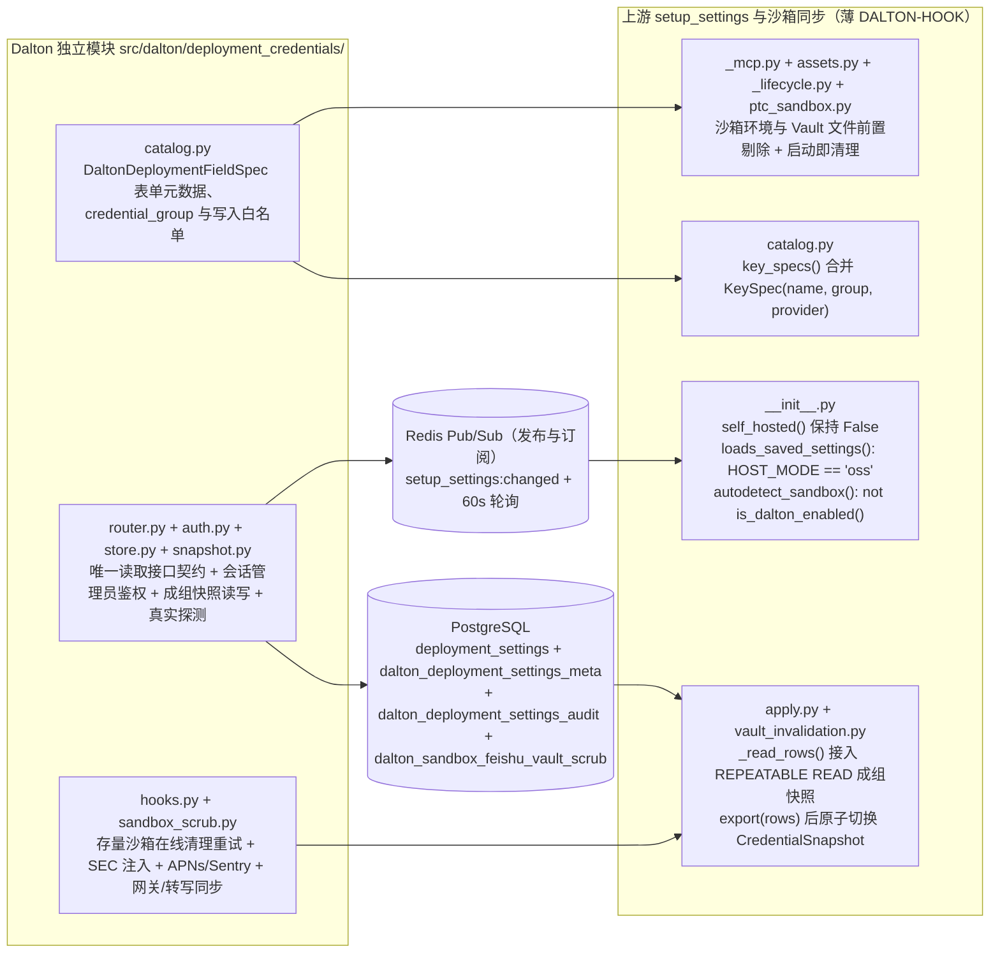
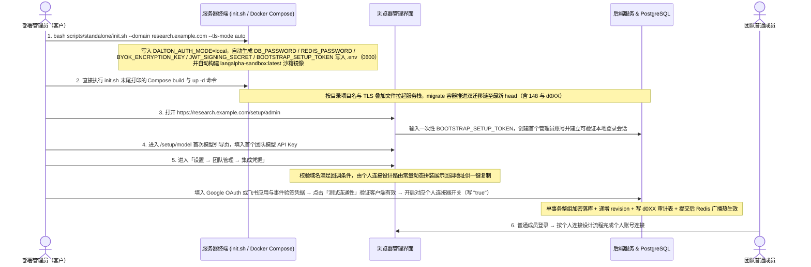

# 设计：部署级凭据与配置网页化（含全量环境变量清单审计）

> **设计定位**：面向独立核心版（Standalone Core，客户自托管交付形态）与 Everflow（内部生产形态）统一实施的部署级集成凭据管理方案  
> **关联特性**：个人连接器设计（`docs/dalton/features/google-workspace-official.md`，负责成员授权流程、回调路由、`state`〔一次性防跨站状态参数〕核销、会话校验、回调日志脱敏、个人令牌及能力开关与交付批次）、独立核心版能力门控体系（`src.dalton.capabilities`）、上游部署设置服务（`src/server/services/setup_settings`）  
> **状态**：**定稿（r7）** — **第 1 批部署级凭据底座正式定稿交付开发（Google OAuth〔开放授权协议〕客户端凭据、飞书应用凭据、飞书事件订阅加密密钥 Encrypt Key 与验证令牌 Verification Token）**；本文唯一定义部署级凭据的环境变量键名清单、加密存储、来源优先级、对外读取接口契约、存量与新建沙箱隔离清理、网页展示、管理员鉴权与审计，所有消费方统一调用本文接口读取；成员 OAuth 授权全链路与能力开关定义统一归口个人连接设计；第 2–4 批待深化项收入 §7「第 2–4 批开工前复核清单」，于各批开工前逐项复核设计。

---

## 一页摘要（结论先行）

1. **核心结论**：将全仓已归档的 **462 个**配置类环境变量划分为四类治理边界——**A 类（219 项）**基础设施、密码学根密钥、独立进程启动及内部服务连接参数与可选外部对象存储底座保留在环境配置文件（`.env`）及容器编排层，核心必需项由安装脚本 `scripts/standalone/init.sh` 自动生成；**B 类（118 项，含现有代码/生产已用键 116 项 + 第 1 批新增飞书事件验签凭据 2 项；个人连接器能力开关名统一引用个人连接设计）**第三方集成凭据、通用业务配置与可选能力开关收敛至管理员网页填写；**C 类（98 项）**Everflow 宿主机私有桥接、Supabase（托管身份认证后端服务）准入白名单与托管平台专属配置留在生产环境 `.env` 及宿主机配置文件；**D 类（27 项）**前端 Vite（前端构建工具）构建期变量中 **12 项**保留构建期确定、**12 项**改为运行期从后端读取、**3 项**按历史遗留与上游平台边界归档。
2. **存储、唯一读取契约、网关实时换钥兼容与热同步底座**：直接沿用上游迁移 `148_deployment_settings.py` 的 PostgreSQL（关系型数据库）逐键加密配置表 `deployment_settings`（每行一个 `name` 主键与 `BYTEA`〔二进制字节数组〕密文，经 `pgcrypto`〔PostgreSQL 内置密码学扩展〕对称加密并绑定 `BYOK_ENCRYPTION_KEY`）。新增 Dalton 迁移 `d0XX_deployment_settings_audit.py` 建立单行修订元数据表 `dalton_deployment_settings_meta`、挂载语句级防删改清空触发器的仅追加写入（Append-Only）审计表 `dalton_deployment_settings_audit` 及存量沙箱飞书密钥清理状态表 `dalton_sandbox_feishu_vault_scrub`；写入按凭据组（`credential_group`）整组校验，与乐观锁版本核对、审计追加在同一数据库连接同一事务内串行提交，提交成功后即使本进程热更新回调出现异常也照常发出 Redis（内存键值与发布订阅中间件）`setup_settings:changed` 通知并返回已提交 `revision` 与待应用标记。读取在单个 `REPEATABLE READ`（可重复读事务隔离级别）快照内同时读取修订号 `revision` 与全表密文行（逐行配合 `SAVEPOINT`〔事务保存点〕隔离坏密文容错），并在各工作进程内原子切换不可变凭据快照引用；本文 §2.3 唯一定义对外读取接口 `get_credential_group(group_name)` 与异步 `resolve_credential_group(group_name)`（返回 `CredentialGroupResult`，覆盖 `"google_oauth"`、`"feishu_app"`、`"feishu_event"` 三组及唯一环境变量键名清单），按 **「启动环境值（`env`）> 数据库已保存值（`saved`）> 第 1 批飞书主管理员 Vault〔用户加密凭据保险箱〕只读回退成对值（`vault_readonly`）」** 为每组选定唯一来源，个人连接、内部兼容端点与渠道网关等全部消费者统一通过这组接口读取。当 `"feishu_app"` 生效来源为 Vault 时，`resolve_credential_group("feishu_app")` 与内部兼容端点 `POST .../feishu-credentials` 实时读取主管理员 Vault 并同步刷新本进程槽位，且 Vault 更新专用飞书凭据提交后同步触发设置快照失效广播，确保按现网规程「Vault 换钥后立即重启网关」时新网关进程拿到最新密钥（原样保持 `200 + {credentials: ...}` 响应包络与鉴权契约）。飞书事件验签双键归属独立凭据组 `"feishu_event"`，按 `env > saved > unset` 从同一修订号快照选定唯一来源，与 `"feishu_app"` 的 `vault_readonly` 写锁相互独立。布尔开关统一采用三态存储（网页开启写 `"true"`、网页关闭写显式 `"false"`、点击「恢复默认」执行 `DELETE`〔数据库删行语句〕删行）。在上游 `src/server/services/setup_settings/` 放置 3 处薄钩子并在沙箱/Vault 同步点配齐 `DALTON-HOOK(deployment-credentials)`：启用 `loads_saved_settings()`、维持 Dalton 沙箱 `autodetect=False`（固定沙箱策略）、按 `KeySpec(name, group, provider)` 合并字段目录、接入一致性快照与热更新回调；表单元数据与写入白名单全部自持于 `src/dalton/deployment_credentials/`。
3. **管理员界面展示、五态来源徽标与跨设计引用边界**：核心安装与 Everflow 共用同一管理面板 **「设置 → 团队管理 → 集成凭据」**（路由参数 `?tab=deploymentCredentials`，采用 `React.lazy`〔React 组件异步懒加载机制〕按需加载）。已由真实进程环境或 `.env` 提供的变量通过启动快照识别为整组只读锁定；页面展示的 Google 与飞书 Redirect URI（授权回调地址）由后端读取个人连接设计（`docs/dalton/features/google-workspace-official.md`）导出的回调路由代码常量与 `PUBLIC_APP_URL` 动态拼接生成；个人连接器的能力开关名称、各形态默认值、成员「设置 → 外部集成」入口与交付批次统一引用个人连接设计。Google 个人授权要求回调地址具备公网可达的公共顶级域名后缀（Public Suffix）`https://` 地址或采用 Google 允许的本机回环地址（`http://localhost` / `http://127.0.0.1`），前置条件未满足时页面展示原因说明并置灰 Google 开关。第 1 批对主管理员 Vault 保持只读：回退命中 Vault 成对飞书应用凭据时标为 `vault_readonly` 只读回显 `App ID`（标明 **「第 3 批迁移后可在此修改」**），Vault 查询或解密失败时标为独立 `vault_error` 只读告警状态，飞书事件验签双键在此期间仍可在网页保存更新。
4. **可验证登录会话鉴权、全响应脱敏、沙箱三层隔离与存量在线清理、真实凭据探测**：保持上游免用户登录向导 `/api/v1/setup/*` 关闭，新增专用网页会话管理员依赖守卫 `/api/v1/dalton/deployment-settings`，仅在「可验证的网页登录会话（`local` 或 `supabase`）+ 管理员角色」下开放读写与探测；对服务令牌（`X-Service-Token`）及核心版免密回退身份（`DALTON_AUTH_MODE=oss`）统一返回 `403 Forbidden`（禁止访问），免密模式下前端放行展示纯静态「请先启用管理员登录模式」提示页（与架构决策 AD5 一致）。携带 `INTERNAL_SERVICE_TOKEN` 的内部网关地址 `CHANNEL_GATEWAY_URL` 归入 A 类基础设施环境。所有接口响应（含正常返回、请求体校验错误、`/test` 探测响应）与服务端日志统一执行密钥脱敏；连通性测试严格区分「网络可达」与「客户端凭据有效」（Google 直接请求官方令牌端点核验客户端密钥）。服务端专属密钥与专用飞书应用凭据通过三层机制加一次性在线清理与工作区沙箱隔离：环境变量按目标键名与源变量名双检拒载、按高熵值子串擦除、在沙箱 Vault 文件同步链路（`src/server/services/computer_manager/_mcp.py` 与 `src/ptc_agent/core/sandbox/assets.py`）前置剔除专用飞书凭据键，并在第 1 批上线时由后台清理器 `SandboxFeishuVaultScrubber` 与沙箱启动钩子对已运行及下次启动的存量沙箱执行已落盘 Vault 文件在线清理（失败自动重试并在 `dalton_sandbox_feishu_vault_scrub` 记录完成状态；后端与网关受控读取保持原状）。成员 OAuth 回调核销、原会话检查、回调查询串脱敏与个人令牌管理统一参见 `docs/dalton/features/google-workspace-official.md`。
5. **分批定稿与复核节奏**：**第 1 批部署级凭据底座正式定稿交付开发**——打通逐键存储与对外唯一读取接口契约、版本与审计表、网关 Vault 换钥实时读取、沙箱 Vault 飞书密钥同步过滤与存量沙箱一次性在线清理、「集成凭据」面板（含免密静态引导页与 Google 回调地址校验提示）、标准登录与回环试用双路径安装引导及 `/help` 指南，上线 Google OAuth 客户端凭据、飞书应用凭据与飞书事件验签密钥/验证令牌（个人连接器能力与批次按个人连接设计协同交付）；**第 2–4 批**（第 2 批 SEC〔美国证券交易委员会〕/ FMP〔Financial Modeling Prep，公开金融市场数据服务〕/ 搜索抓取 / Sentry〔异常监控服务〕及通用项、第 3 批渠道网关运行期凭据与飞书 Vault 迁移、第 4 批兜底 LLM〔大语言模型〕/ Embedding〔向量嵌入模型〕/ Whisper〔语音识别模型接口〕与前端公开配置）保留路线图规划，跨批次待深化项原样记入 **§7「第 2–4 批开工前复核清单」**，在各批启动前逐批完成复核设计。

---

## 1. 全量环境变量清单审计

**本节结论**：全仓共审计 `.env.core.example`（89 项）、`.env.example`（112 项）、`web/.env.dalton`（2 项）、`src/`（含 `src/config`、`src/server`、`src/ptc_agent`、`src/tools`、`src/llms`、`src/observability`、`src/utils`、`src/dalton`）、`plugins/`、`scripts/`、渠道网关 `integrations/dalton-channel-gateway`、`docs-site/` 及前端 `web/` 实际读取的全部 **462 个**配置环境变量，四个主分类严格互斥；另将内部状态标记、子进程上下文注入与测试专用覆盖项单列于 §1.6 备案。

### 1.1 分类统计总表

| 分类 | 定位与治理方式 | 子分组构成 | 变量数量 | 核心安装是否需要 |
|---|---|---|---:|---|
| **A 类：基础设施、进程启动配置与可选外部存储底座** | 保留在 `.env` 与容器编排层；核心必需项由 `scripts/standalone/init.sh` 自动生成，网关/转写连接与启动参数及可选外部云存储底座按需配置 | A1 网络域名与证书（17）+ A2 认证与密码学根密钥（15）+ A3 PostgreSQL 数据库（16）+ A4 Redis 缓存（8）+ A5 对象存储底座（66）+ A6 沙箱、中继、网关连接与容器编排（97） | **219** | 核心必需子集由 `init.sh` 自动生成；外部云存储/SSH 网关/渠道网关/转写底座按需配置 |
| **B 类：第三方集成凭据与业务开关** | 收敛至管理员网页「设置 → 团队管理 → 集成凭据」逐键加密存储，成组原子读取，布尔开关显式存 `true`/`false`，支持 `.env` 显式赋值时优先锁定只读 | B1 Google OAuth 与飞书应用及事件验签凭据（6，含新增飞书事件验签凭据 2；个人连接器能力开关引用个人连接设计）+ B2 公开金融与 SEC（6）+ B3 搜索与抓取（8）+ B4 通用显示、监控与外部扩展（35）+ B5 多渠道机器人凭据与运行期开关（19）+ B6 兜底 LLM / Embedding / 转写（44） | **118** | 全部按需在网页选填；标准登录模式新装零手改 `.env` 即可通过网页管理 |
| **C 类：Everflow 生产与托管平台专属** | 留在 Everflow 生产 `.env` / `~/.config/dalton/*.env` 或上游云平台配置，核心安装默认关闭并隐去 | C1 宿主机研究桥与专有能力开关（40）+ C2 Supabase 团队认证准入与私有连接器（28）+ C3 Mac 宿主机守护与灾备（16）+ C4 上游 Ginlix 托管平台专属（14） | **98** | 否（核心安装默认关闭并隐去） |
| **D 类：前端构建期变量（`VITE_*` 及构建插件变量）** | 区分构建期静态打包与符号表上传项、以及可收敛至后端运行期读取项 | D1 保留在构建期确定（12）+ D2 改为运行期从后端读取（12）+ D3 历史遗留与上游平台专属（3） | **27** | 核心前端构建由 `Dockerfile.edge` 自动注入默认值 |
| **合计** | **全仓已归档配置环境变量（四类互斥；脚本覆盖项与动态编号变量族纳入 §5 对账测试及 §7 复核）** | **19 个业务子表** | **462** | — |

---

### 1.2 A 类：基础设施、进程启动配置与可选外部存储底座（保留在 `.env`，共 219 项）

> **治理准则**：A 类变量包含三部分：① 数据库连接、加密根密钥（用于解密数据库中的 B 类凭据）、容器网络与反向代理端口，必须在后端连接数据库前就绪，由 `scripts/standalone/init.sh` 自动生成；② 渠道网关与语音转写等独立服务连接后端或后端附带内部服务令牌回拨网关所需的拓扑与启动参数（监听地址、内部服务连接地址、环境文件路径）；③ 可选外部对象存储底座（核心版默认使用内置 MinIO；替换外部 S3 兼容存储或 Cloudflare R2 时配置 `STORAGE_*`〔回退 `AWS_*` / `S3_*`〕，替换阿里云对象存储时配置 `OSS_*`，均在存储客户端启动初始化时读取一次）。  
> **运维生效约定**：修改 `.env` 中的容器环境变量后须执行 `docker compose up -d <service>` **重建容器**以注入新环境（单纯 `docker compose restart` 会沿用旧容器创建时的环境快照）；修改镜像构建参数须执行 `docker compose build <service> && docker compose up -d <service>` **重新构建镜像并重建容器**；宿主机原生守护进程修改配置后执行 `launchctl kickstart -k` **重启守护进程**。

#### A1. 部署形态、监听网络、域名与 TLS（传输层安全协议）证书（17 项）

| 变量名 | 来源 | 用途 | 谁读取 | 读取时机 | 改动后生效方式 | 核心安装是否需要 |
|---|---|---|---|---|---|---|
| `APP_ENV` | `.env.core.example`, `.env.example`, `src/dalton/profile.py` | 指定运行环境档位（`core` / `dalton` / `production`） | `src/dalton/profile.py`, `src/dalton/settings.py`, `docs-site` | 每次使用（`profile.py` 动态解析，配置缓存按需重建） | 重建 `backend` 容器并重新构建 `edge` 镜像与容器 | 是（`init.sh` 写入 `core`） |
| `DALTON_PROFILE` | `.env.core.example`, `src/dalton/profile.py` | 显式指定安装形态（`core` 或 `everflow`） | `src/dalton/profile.py`, `deploy/standalone/Dockerfile.edge` | 每次使用 / 边缘镜像构建期 | 重建 `backend` 容器并重新构建 `edge` 镜像与容器 | 是（`init.sh` 写入 `core`） |
| `DALTON_ENABLED` | `src/dalton/settings.py` | 控制是否启用 Dalton 扩展能力总开关 | `src/dalton/settings.py:is_dalton_enabled` | 每次使用 | 重建 `backend` 容器（涉及路由挂载） | 选填（默认开启） |
| `HOST_MODE` | `.env.core.example`, `.env.example`, `src/config/env.py` | 指定宿主运行模式（`oss`〔开源自托管模式〕或 `platform`〔多租户云平台模式〕） | `src/config/env.py`（模块常量） | 启动一次 | 重建 `backend` 容器 | 是（固定 `oss`） |
| `DALTON_HOST_PLATFORM` | `.env.core.example`, `src/dalton/settings.py` | 标识宿主机操作系统类型（`linux` 或 `macos`）以控制默认桥接行为 | `src/dalton/settings.py`, `scripts/dalton/ops/` | 每次使用 | 重建 `backend` 容器 | 是（`init.sh` 按宿主机写入） |
| `DOMAIN` | `.env.core.example`, `scripts/standalone/init.sh` | 部署实例主域名，用于合成访问地址与自动申请证书 | `scripts/standalone/init.sh`, `deploy/standalone/Caddyfile` | 安装生成期 / Caddy（边缘反向代理与自动证书服务器）启动一次 | 重跑 `init.sh --domain` 同步 `PUBLIC_APP_URL` 并重建 `edge` 与 `backend` 容器 | 是（`init.sh --domain` 写入） |
| `PUBLIC_APP_URL` | `.env.core.example`, `.env.example`, `src/config/env.py` | 浏览器访问前端应用的公开根地址（用于构造分享链接与 OAuth 回调地址） | `src/config/env.py`, `docker-compose.core.yml`, `docs-site` | 启动一次 | 重建 `backend` 与 `edge` 容器 | 是（`init.sh` 自动合成） |
| `PUBLIC_API_BASE_URL` | `src/config/env.py` | 外部客户端访问后端接口的公开根地址（前后端分离域名时使用） | `src/config/env.py`, `src/server/app/oauth_provider.py` | 启动一次 | 重建 `backend` 容器 | 否（同源反代留空） |
| `SERVER_BASE_URL` | `.env.core.example`, `.env.example`, `src/config/env.py` | 服务端对外基准地址（用于拼接回调与内部元数据链接） | `src/config/env.py`, `src/dalton/settings.py` | 启动一次 | 重建 `backend` 容器 | 是（`init.sh` 自动合成） |
| `HOST_IP` | `src/config/env.py` | 本机开发模式下宿主机局域网地址覆盖 | `src/config/env.py` | 启动一次 | 重启本机开发后端进程 | 否 |
| `DALTON_TLS_MODE` | `.env.core.example`, `docker-compose.core.yml` | 边缘网关证书模式（`loopback` / `auto`〔ACME 自动证书管理环境〕/ `internal` / `custom`） | `scripts/standalone/init.sh`, `deploy/standalone/Caddyfile` | `edge` 容器启动一次 | 重建 `edge` 容器 | 是（`init.sh` 按参数生成） |
| `DALTON_EDGE_PORT` | `.env.core.example`, `docker-compose.core.yml` | HTTP 明文回环模式或外层反代回源监听端口 | `docker-compose.core.yml`, `docker-compose.dalton.yml` | 容器编排启动一次 | 执行 `docker compose up -d edge` 重建容器端口映射 | 是（默认 `8088`） |
| `DALTON_EDGE_TLS_BIND` | `.env.core.example`, `src/dalton/settings.py` | TLS 模式下边缘网关宿主机绑定地址（如 `0.0.0.0` 或 `127.0.0.1`） | `docker-compose.core.yml`, `src/dalton/settings.py` | 容器编排启动一次 | 执行 `docker compose up -d edge` 重建容器 | 是（`init.sh` 自动生成） |
| `DALTON_EDGE_HTTP_PORT` | `.env.core.example`, `docker-compose.core.yml` | TLS 模式下 80 端口挑战与重定向映射端口 | `docker-compose.core.yml`, `scripts/standalone/init.sh` | 容器编排启动一次 | 执行 `docker compose up -d edge` 重建容器 | 是（默认 `80`） |
| `DALTON_EDGE_HTTPS_PORT` | `.env.core.example`, `docker-compose.core.yml` | HTTPS（安全超文本传输协议）对外服务监听端口 | `docker-compose.core.yml`, `scripts/standalone/init.sh` | 容器编排启动一次 | 执行 `docker compose up -d edge` 重建容器 | 是（默认 `443`） |
| `DALTON_TLS_CERT_DIR` | `.env.core.example`, `docker-compose.core.yml` | 自定义证书模式（`DALTON_TLS_MODE=custom`）宿主机证书挂载目录 | `docker-compose.core.yml` | 容器编排启动一次 | 执行 `docker compose up -d edge` 重建容器 | 选填（仅自定义证书需要） |
| `DALTON_CADDY_HOST` | `docker-compose.core.yml`, `deploy/standalone/Caddyfile` | 传递给 Caddy 的站点匹配主机头表达式 | `docker-compose.core.yml`, `deploy/standalone/Caddyfile` | `edge` 容器启动一次 | 重建 `edge` 容器 | 选填（由编排默认推导） |

#### A2. 认证模式、密码学主密钥与内部服务令牌（15 项）

| 变量名 | 来源 | 用途 | 谁读取 | 读取时机 | 改动后生效方式 | 核心安装是否需要 |
|---|---|---|---|---|---|---|
| `DALTON_AUTH_MODE` | `.env.core.example`, `.env.example`, `src/dalton/settings.py` | 选择身份认证后端（`local` 本地账号 / `supabase` / `oss` 开发回环） | `src/dalton/settings.py`, `src/server/utils/api.py` | 启动校验一次 + 每次请求分派 | 重建 `backend` 容器（第 4 批前同步重新构建 `edge` 镜像与容器） | 是（公网域名 `init.sh` 写入 `local`，回环试用写入 `oss`） |
| `DALTON_ALLOW_DEV_OSS_AUTH` | `.env.core.example`, `src/dalton/settings.py` | 显式允许本机回环开发免密 `oss` 模式通过启动安全门禁 | `src/dalton/settings.py`, `scripts/standalone/init.sh` | 启动一次 | 重建 `backend` 容器 | 是（生产为 `false`，回环试用写入 `1`） |
| `AUTH_USER_ID` | `.env.core.example`, `.env.example`, `src/config/env.py` | 免密 `oss` 开发模式下映射的默认单用户标识 | `src/config/env.py`, `plugins/dalton/` | 启动一次 | 重建 `backend` 容器 | 选填（仅试用模式使用） |
| `DALTON_AUTH_COOKIE_SECURE` | `.env.example`, `src/dalton/settings.py` | 控制本地登录刷新会话 Cookie（浏览器小型状态凭证）是否附加 `Secure` 属性 | `src/dalton/settings.py`, `src/dalton/auth/` | 每次签发会话时读取 | 重建 `backend` 容器后对新登录生效 | 选填（按协议自动推导） |
| `DALTON_WS_ALLOW_QUERY_TOKEN` | `.env.example`, `src/dalton/settings.py` | 控制 WebSocket（全双工长连接协议）握手是否接受查询参数令牌兜底 | `src/dalton/settings.py`, `src/server/auth/ws_auth.py` | 每次握手读取 | 重建 `backend` 容器 | 否（默认关闭） |
| `BYOK_ENCRYPTION_KEY` | `.env.core.example`, `.env.example`, `src/server/database/encryption.py` | 数据库静态加密主密钥（同时加密 `deployment_settings`、`user_api_keys`、`user_vault_secrets` 等全部密文列） | `src/server/database/encryption.py` | 每次读写密文列时传入 `pgp_sym_encrypt` | **保持固定**；轮换时须执行专用重加密迁移脚本并重建 `backend` 容器 | 是（`init.sh` 生成高熵随机值） |
| `JWT_SIGNING_SECRET` | `.env.core.example`, `.env.example`, `src/dalton/settings.py` | `DALTON_AUTH_MODE=local` 下签发与核验短期访问 JWT（JSON 网络签名令牌）的对称密钥 | `src/dalton/auth/tokens.py`, `src/dalton/settings.py` | 启动校验长度 + 每次签发/验签 | 重建 `backend` 容器（旧登录态同步失效需重登） | 是（`init.sh` 生成 64 字符十六进制） |
| `BOOTSTRAP_SETUP_TOKEN` | `.env.core.example`, `.env.example`, `src/dalton/auth/` | `DALTON_AUTH_MODE=local` 新装空库首次访问 `/setup/admin` 创建初始管理员时核验的一次性引导口令 | `src/dalton/auth/`, `scripts/standalone/init.sh` | 首次管理员自举时读取（自举完成后永久锁死） | 自举前重建 `backend` 容器生效；自举完成后锁定归档 | 是（`init.sh` 自动生成） |
| `INTERNAL_SERVICE_TOKEN` | `.env.core.example`, `.env.example`, `src/config/settings.py` | 后端与渠道网关、内部管理端点通信的共享鉴权令牌（`X-Service-Token` 请求头） | `src/config/settings.py`, `src/dalton/settings.py`, `channel-gateway` | 每次内部调用核验（网关侧启动加载一次） | 重建 `backend` 与 `channel-gateway` 容器（或重启宿主机网关进程） | 是（`init.sh` 自动生成） |
| `EGRESS_RELAY_SECRET` | `.env.core.example`, `.env.example`, `src/config/env.py` | 沙箱与后端出站代理中继服务之间的签名认证密钥 | `src/config/env.py`, `docker-compose.core.yml` | 启动一次 | 重建 `backend`、`egress-relay` 及工作区沙箱容器 | 是（`init.sh` 自动生成） |
| `DALTON_CHAT_UPLOAD_SIGNING_SECRET` | `.env.core.example`, `src/dalton/services/chat_uploads.py` | 聊天大文件分片上传令牌的签名密钥 | `src/dalton/services/chat_uploads.py` | 每次签发/核验上传票据时读取 | 重建 `backend` 容器（在途上传重传） | 是（`init.sh` 自动生成） |
| `DALTON_TRANSCRIPTION_TOKEN` | `.env.core.example`, `src/dalton/settings.py` | 后端与独立语音转写容器双向调用（提交转写与启动拉取凭据）的专用内部鉴权令牌 | `src/dalton/settings.py`, `src/dalton/transcription_service/` | 每次内部转写与凭据同步请求读取 | 重建 `backend` 与 `transcription` 容器 | 选填（部署 `--profile transcription` 转写底座前由运维在 `.env` 配置高熵随机值） |
| `DALTON_TRANSCRIPTION_TICKET_SECRET` | `.env.core.example`, `src/dalton/settings.py` | 语音转写浏览器直传音频对象存储票据的签名密钥 | `src/dalton/settings.py`, `src/dalton/services/transcriptions.py` | 每次签发票据读取 | 重建 `backend` 容器 | 选填（部署转写底座前由运维在 `.env` 配置高熵随机值） |
| `DALTON_LOCAL_SESSION_TTL_DAYS` | `src/dalton/auth/tokens.py` | 本地账号刷新会话有效期天数 | `src/dalton/auth/tokens.py` | 每次创建会话读取 | 重建 `backend` 容器后对新会话生效 | 选填（内置默认值） |
| `DALTON_REFRESH_GRACE_SECONDS` | `src/dalton/auth/sessions.py` | 本地账号刷新令牌并发轮换宽限期秒数 | `src/dalton/auth/sessions.py` | 每次刷新令牌读取 | 重建 `backend` 容器 | 选填（内置默认值） |

#### A3. PostgreSQL 数据库、记忆库与连接池（16 项）

| 变量名 | 来源 | 用途 | 谁读取 | 读取时机 | 改动后生效方式 | 核心安装是否需要 |
|---|---|---|---|---|---|---|
| `DB_TYPE` | `.env.core.example`, `.env.example` | 主数据库类型标识（固定 `postgresql`） | `src/config/settings.py`, `src/server/database/pool.py` | 启动一次 | 重建 `backend` 容器 | 是（固定 `postgresql`） |
| `DB_HOST` | `.env.core.example`, `.env.example` | PostgreSQL 主机名或容器服务名 | `src/config/settings.py`, `scripts/standalone/` | 启动一次 | 重建 `backend` 容器 | 是（默认 `postgres`） |
| `DB_PORT` | `.env.core.example`, `.env.example` | PostgreSQL 监听端口 | `src/config/settings.py`, `scripts/standalone/` | 启动一次 | 重建 `backend` 容器 | 是（默认 `5432`） |
| `DB_USER` | `.env.core.example`, `.env.example` | PostgreSQL 连接用户名 | `src/config/settings.py`, `docker-compose.core.yml` | 启动一次 | 重建 `postgres` 与 `backend` 容器 | 是（默认 `postgres`） |
| `DB_PASSWORD` | `.env.core.example`, `.env.example` | PostgreSQL 数据库密码 | `src/config/settings.py`, `docker-compose.core.yml` | 启动一次 | 同步修改数据库角色密码并重建 `backend` 容器 | 是（`init.sh` 自动生成） |
| `DB_NAME` | `.env.core.example`, `.env.example` | PostgreSQL 数据库名 | `src/config/settings.py`, `docker-compose.core.yml` | 启动一次 | 重建 `backend` 容器 | 是（默认 `langalpha`） |
| `DB_SSLMODE` | `.env.core.example`, `.env.example`, `src/config/env.py` | PostgreSQL 连接加密校验级别（内网默认 `disable`，云托管设为 `require`） | `src/config/env.py`, `src/config/settings.py` | 启动一次 | 重建 `backend` 容器 | 是（默认 `disable`） |
| `POSTGRES_CONVERSATION_POOL_MAX` | `.env.example`, `src/config/settings.py` | 业务数据连接池单进程最大连接数 | `src/config/settings.py` | 启动一次 | 重建 `backend` 容器 | 选填（有默认上限） |
| `POSTGRES_CHECKPOINTER_POOL_MAX` | `.env.example`, `src/config/settings.py` | LangGraph 状态检查点连接池单进程最大连接数 | `src/config/settings.py` | 启动一次 | 重建 `backend` 容器 | 选填（有默认上限） |
| `POSTGRES_WRITER_POOL_MAX` | `src/config/settings.py` | 异步流式写库专用连接池最大连接数 | `src/config/settings.py` | 启动一次 | 重建 `backend` 容器 | 选填（有默认上限） |
| `MEMORY_DB_TYPE` | `src/server/app/setup.py` | 独立长期记忆存储数据库类型（未设时复用主库） | `src/server/app/setup.py` | 启动一次 | 重建 `backend` 容器 | 否（默认复用主库） |
| `MEMORY_DB_HOST` | `.env.example`, `src/config/settings.py` | 独立长期记忆数据库主机地址 | `src/config/settings.py` | 启动一次 | 重建 `backend` 容器 | 否 |
| `MEMORY_DB_PORT` | `.env.example`, `src/config/settings.py` | 独立长期记忆数据库端口 | `src/config/settings.py` | 启动一次 | 重建 `backend` 容器 | 否 |
| `MEMORY_DB_NAME` | `.env.example`, `src/config/settings.py` | 独立长期记忆数据库名称 | `src/config/settings.py` | 启动一次 | 重建 `backend` 容器 | 否 |
| `MEMORY_DB_USER` | `.env.example`, `src/config/settings.py` | 独立长期记忆数据库用户名 | `src/config/settings.py` | 启动一次 | 重建 `backend` 容器 | 否 |
| `MEMORY_DB_PASSWORD` | `.env.example`, `src/config/settings.py` | 独立长期记忆数据库密码 | `src/config/settings.py` | 启动一次 | 重建 `backend` 容器 | 否 |

#### A4. Redis / Valkey（兼容 Redis 协议的开源内存数据库）缓存与消息总线（8 项）

| 变量名 | 来源 | 用途 | 谁读取 | 读取时机 | 改动后生效方式 | 核心安装是否需要 |
|---|---|---|---|---|---|---|
| `REDIS_PASSWORD` | `.env.core.example`, `.env.example` | Redis / Valkey 访问密码 | `docker-compose.core.yml`, `scripts/standalone/` | 容器与后端启动一次 | 重建 `redis` 与 `backend` 容器 | 是（`init.sh` 自动生成） |
| `REDIS_URL` | `.env.example`, `docker-compose.core.yml` | 完整 Redis 连接串（含密码与库编号） | `src/config/settings.py`, `src/utils/cache/redis_cache.py` | 启动一次 | 重建 `backend` 容器 | 是（Compose 由 `REDIS_PASSWORD` 拼装） |
| `REDIS_CACHE_ENABLED` | `src/utils/cache/redis_cache.py` | 是否启用业务查询缓存客户端 | `src/utils/cache/redis_cache.py` | 启动一次 | 重建 `backend` 容器 | 选填（默认开启） |
| `REDIS_MAX_CONNECTIONS` | `.env.example`, `src/config/settings.py` | 主 Redis 连接池最大连接数 | `src/config/settings.py` | 启动一次 | 重建 `backend` 容器 | 选填 |
| `REDIS_POOL_TIMEOUT` | `src/config/settings.py` | 获取 Redis 连接超时秒数 | `src/config/settings.py` | 启动一次 | 重建 `backend` 容器 | 选填 |
| `REDIS_PUBSUB_MAX_CONNECTIONS` | `src/config/settings.py` | 发布订阅专用 Redis 连接池上限 | `src/config/settings.py` | 启动一次 | 重建 `backend` 容器 | 选填 |
| `REDIS_STREAM_MAX_CONNECTIONS` | `src/config/settings.py` | SSE 事件流缓冲专用 Redis 连接池上限 | `src/config/settings.py` | 启动一次 | 重建 `backend` 容器 | 选填 |
| `DALTON_VALKEY_IMAGE` | `.env.core.example`, `docker-compose.core.yml` | 核心安装缓存容器镜像地址覆盖（默认 `valkey/valkey:8.1-alpine`） | `docker-compose.core.yml` | 容器编排启动一次 | 执行 `docker compose up -d redis` 重建容器 | 选填 |

#### A5. 对象存储底座（内置 MinIO〔自托管对象存储服务〕、聊天附件、转写存储与可选外部 S3〔通用对象存储协议〕/ R2〔Cloudflare 对象存储服务〕/ 阿里云 OSS，66 项）

> **说明**：独立核心版默认启用编排内置的 MinIO（根凭据由 `init.sh` 自动生成）。后端 `src/utils/storage/s3_client.py:StorageConfig` 通过统一的 **`STORAGE_*`（回退 `AWS_*` / `S3_*`）** 在模块导入期初始化 S3 兼容存储客户端——接入 Cloudflare R2 时配置 `STORAGE_ENDPOINT_URL=https://<account_id>.r2.cloudflarestorage.com`、`STORAGE_REGION=auto`、`STORAGE_ACCESS_KEY_ID`、`STORAGE_SECRET_ACCESS_KEY` 与 `STORAGE_BUCKET_NAME`（表中 `R2_*` 仅为 `.env.example` 样例遗留与桌面发布流水线变量，后端进程通过 `STORAGE_*` 访问 R2）；阿里云对象存储通过 `OSS_*` 初始化。

| 变量名 | 来源 | 用途 | 谁读取 | 读取时机 | 改动后生效方式 | 核心安装是否需要 |
|---|---|---|---|---|---|---|
| `MINIO_ROOT_USER` | `.env.core.example`, `docker-compose.core.yml` | 内置 MinIO 容器管理员账号 | `docker-compose.core.yml`, `scripts/standalone/` | 容器启动一次 | 重建 `minio`、`minio-init` 与 `backend` 容器 | 是（`init.sh` 自动生成） |
| `MINIO_ROOT_PASSWORD` | `.env.core.example`, `docker-compose.core.yml` | 内置 MinIO 容器管理员密码 | `docker-compose.core.yml`, `scripts/standalone/` | 容器启动一次 | 同步更新 MinIO 凭据并重建 `minio` 与 `backend` 容器 | 是（`init.sh` 自动生成） |
| `DALTON_MINIO_IMAGE` | `.env.core.example`, `docker-compose.core.yml` | 内置 MinIO 容器镜像版本覆盖 | `docker-compose.core.yml` | 容器编排启动一次 | 执行 `docker compose up -d minio` 重建容器 | 选填 |
| `DALTON_MINIO_MEM_LIMIT` | `docker-compose.core.yml` | MinIO 容器内存上限 | `docker-compose.core.yml` | 容器编排启动一次 | 执行 `docker compose up -d minio` 重建容器 | 选填 |
| `DALTON_MINIO_PORT` | `docker-compose.dalton.yml` | 开发/Everflow 编排下 MinIO API 宿主机映射端口 | `docker-compose.dalton.yml` | 容器编排启动一次 | 执行 `docker compose up -d minio` 重建容器 | 否（核心版走容器内网） |
| `DALTON_MINIO_CONSOLE_PORT` | `docker-compose.dalton.yml` | MinIO 控制台宿主机映射端口 | `docker-compose.dalton.yml` | 容器编排启动一次 | 执行 `docker compose up -d minio` 重建容器 | 否 |
| `MINIO_API_CORS_ALLOW_ORIGIN` | `docker-compose.dalton.yml` | MinIO 跨域资源共享允许的来源列表 | `docker-compose.dalton.yml` | 容器启动一次 | 重建 `minio` 容器 | 否 |
| `MINIO_API_STALE_UPLOADS_EXPIRY` | `docker-compose.core.yml` | 未完成分片上传自动清理过期时长 | `docker-compose.core.yml` | 容器启动一次 | 重建 `minio` 容器 | 选填（编排内置默认） |
| `MINIO_API_STALE_UPLOADS_CLEANUP_INTERVAL` | `docker-compose.core.yml` | 未完成分片上传巡检清理周期 | `docker-compose.core.yml` | 容器启动一次 | 重建 `minio` 容器 | 选填（编排内置默认） |
| `DALTON_CHAT_UPLOAD_STORAGE_ENDPOINT_URL` | `.env.core.example`, `src/dalton/chat_upload_storage.py` | 聊天大文件上传对象存储服务端点地址 | `src/dalton/chat_upload_storage.py`, `scripts/standalone/` | 每次构造存储客户端（按配置缓存） | 重建 `backend` 容器 | 是（默认指向内置 `http://minio:9000`） |
| `DALTON_CHAT_UPLOAD_STORAGE_SIGNING_ENDPOINT_URL` | `src/dalton/chat_upload_storage.py` | 预签名浏览器直传地址使用的外部端点覆盖 | `src/dalton/chat_upload_storage.py` | 每次签发上传链接时读取 | 重建 `backend` 容器 | 选填 |
| `DALTON_CHAT_UPLOAD_STORAGE_BUCKET_NAME` | `.env.core.example`, `src/dalton/chat_upload_storage.py` | 聊天附件存储桶名称 | `src/dalton/chat_upload_storage.py`, `docker-compose.core.yml` | 启动初始化桶 + 运行期读取 | 重建 `minio-init` 与 `backend` 容器 | 是（默认 `chat-uploads`） |
| `DALTON_CHAT_UPLOAD_STORAGE_ACCESS_KEY_ID` | `.env.core.example`, `src/dalton/chat_upload_storage.py` | 聊天附件存储访问密钥标识 | `src/dalton/chat_upload_storage.py` | 启动 / 客户端构造时 | 重建 `backend` 容器 | 是（`init.sh` 对齐 MinIO 账号） |
| `DALTON_CHAT_UPLOAD_STORAGE_SECRET_ACCESS_KEY` | `.env.core.example`, `src/dalton/chat_upload_storage.py` | 聊天附件存储访问私钥 | `src/dalton/chat_upload_storage.py` | 启动 / 客户端构造时 | 重建 `backend` 容器 | 是（`init.sh` 对齐 MinIO 密码） |
| `DALTON_CHAT_UPLOAD_STORAGE_REGION` | `.env.core.example`, `src/dalton/chat_upload_storage.py` | 聊天附件对象存储区域名 | `src/dalton/chat_upload_storage.py` | 启动 / 客户端构造时 | 重建 `backend` 容器 | 是（默认 `us-east-1`） |
| `DALTON_CHAT_UPLOAD_STORAGE_ADDRESSING_STYLE` | `.env.core.example`, `src/dalton/chat_upload_storage.py` | S3 寻址风格（MinIO 使用 `path`，云厂商常用 `virtual`） | `src/dalton/chat_upload_storage.py` | 启动 / 客户端构造时 | 重建 `backend` 容器 | 是（默认 `path`） |
| `DALTON_CHAT_UPLOAD_STORAGE_KEY_PREFIX` | `.env.core.example`, `src/dalton/chat_upload_storage.py` | 聊天上传对象键名前缀 | `src/dalton/chat_upload_storage.py` | 每次生成对象键时读取 | 重建 `backend` 容器 | 是（默认 `chat-uploads`） |
| `DALTON_CHAT_UPLOAD_CLEANUP_ENABLED` | `src/dalton/settings.py` | 是否启用后台过期聊天上传对象回收任务 | `src/dalton/settings.py`, `src/dalton/services/chat_uploads.py` | 启动一次 | 重建 `backend` 容器 | 选填（默认开启） |
| `DALTON_CHAT_UPLOAD_PART_IDLE_TIMEOUT_S` | `src/dalton/settings.py` | 单分片流式转发空闲超时秒数 | `src/dalton/settings.py` | 每次上传分片读取 | 重建 `backend` 容器 | 选填 |
| `DALTON_CHAT_UPLOAD_PART_TOTAL_TIMEOUT_S` | `src/dalton/settings.py` | 单分片上传总耗时上限秒数 | `src/dalton/settings.py` | 每次上传分片读取 | 重建 `backend` 容器 | 选填 |
| `AWS_ACCESS_KEY_ID` | `.env.example`, `src/utils/storage/s3_client.py` | 通用 AWS S3 对象存储访问密钥 ID（`STORAGE_ACCESS_KEY_ID` 的兼容回退） | `src/utils/storage/s3_client.py` | 启动导入一次 | 重建 `backend` 容器 | 选填（核心版默认用内置 MinIO） |
| `AWS_SECRET_ACCESS_KEY` | `.env.example`, `src/utils/storage/s3_client.py` | 通用 AWS S3 对象存储访问私钥（`STORAGE_SECRET_ACCESS_KEY` 的兼容回退） | `src/utils/storage/s3_client.py` | 启动导入一次 | 重建 `backend` 容器 | 选填 |
| `S3_BUCKET_NAME` | `.env.example`, `src/utils/storage/s3_client.py` | 通用 S3 存储桶名称（`STORAGE_BUCKET_NAME` 的兼容回退） | `src/utils/storage/s3_client.py`, `transcription_service` | 启动导入一次 | 重建 `backend` 容器 | 选填 |
| `S3_REGION` | `.env.example`, `src/utils/storage/s3_client.py` | 通用 S3 区域标识（`STORAGE_REGION` 的兼容回退） | `src/utils/storage/s3_client.py` | 启动导入一次 | 重建 `backend` 容器 | 选填 |
| `S3_ENDPOINT_URL` | `src/utils/storage/s3_client.py`, `worker_base.py` | S3 兼容服务端点覆盖（`STORAGE_ENDPOINT_URL` 的兼容回退） | `src/utils/storage/s3_client.py`, `worker_base.py` | 启动导入一次 | 重建对应服务容器 | 选填 |
| `S3_PUBLIC_URL_BASE` | `.env.example`, `src/utils/storage/s3_client.py` | 通用 S3 公开读取基础地址（`STORAGE_PUBLIC_URL_BASE` 的兼容回退） | `src/utils/storage/s3_client.py` | 启动导入一次 | 重建 `backend` 容器 | 选填 |
| `STORAGE_ENDPOINT_URL` | `.env.example`, `src/utils/storage/s3_client.py` | 统一 S3 兼容对象存储端点（核心版指向内置 MinIO；Cloudflare R2 填 `https://<account_id>.r2.cloudflarestorage.com`） | `src/utils/storage/s3_client.py`, `scripts/standalone/` | 启动导入一次 | 重建 `backend` 容器 | 选填（Compose 自动注入或替换云存储时填） |
| `STORAGE_BROWSER_ENDPOINT_URL` | `.env.example`, `src/utils/storage/s3_client.py` | 浏览器预签名直传使用的外部对象存储端点 | `src/utils/storage/s3_client.py` | 启动导入一次 | 重建 `backend` 容器 | 选填 |
| `STORAGE_ADDRESSING_STYLE` | `.env.example`, `src/utils/storage/s3_client.py` | 统一对象存储寻址模式（MinIO 填 `path`，S3 / R2 用默认 `virtual`） | `src/utils/storage/s3_client.py` | 启动导入一次 | 重建 `backend` 容器 | 选填 |
| `STORAGE_KEY_PREFIX` | `.env.example`, `src/utils/storage/s3_client.py` | 统一对象存储键前缀 | `src/utils/storage/s3_client.py` | 启动导入一次 | 重建 `backend` 容器 | 选填 |
| `STORAGE_BLOB_TRANSFER` | `.env.example`, `src/config/settings.py` | 沙箱大文件同步是否经对象存储中转 | `src/config/settings.py` | 启动一次 | 重建 `backend` 容器 | 选填 |
| `STORAGE_BROWSER_UPLOADS` | `.env.example`, `src/config/settings.py` | 是否开启浏览器直传对象存储模式 | `src/config/settings.py` | 启动一次 | 重建 `backend` 容器 | 选填 |
| `STORAGE_BUCKET_NAME` | `src/utils/storage/s3_client.py`, `worker_base.py` | 统一 S3 / R2 / MinIO 对象存储桶名称主变量 | `src/utils/storage/s3_client.py`, `worker_base.py` | 启动导入一次 | 重建 `backend` 容器 | 选填 |
| `STORAGE_ACCESS_KEY_ID` | `src/utils/storage/s3_client.py`, `worker_base.py` | 统一 S3 / R2 / MinIO 对象存储访问密钥 ID 主变量 | `src/utils/storage/s3_client.py`, `worker_base.py` | 启动导入一次 | 重建 `backend` 容器 | 选填 |
| `STORAGE_SECRET_ACCESS_KEY` | `src/utils/storage/s3_client.py`, `worker_base.py` | 统一 S3 / R2 / MinIO 对象存储访问私钥主变量 | `src/utils/storage/s3_client.py`, `worker_base.py` | 启动导入一次 | 重建 `backend` 容器 | 选填 |
| `STORAGE_REGION` | `src/utils/storage/s3_client.py`, `worker_base.py` | 统一对象存储区域名（Cloudflare R2 填 `auto`） | `src/utils/storage/s3_client.py`, `worker_base.py` | 启动导入一次 | 重建 `backend` 容器 | 选填 |
| `STORAGE_PUBLIC_URL_BASE` | `src/utils/storage/s3_client.py` | 统一对象存储公开读取根地址 | `src/utils/storage/s3_client.py` | 启动导入一次 | 重建 `backend` 容器 | 选填 |
| `R2_ACCOUNT_ID` | `.env.example`, `scripts/configure.sh` | `.env.example` 历史样例遗留的 Cloudflare R2 账户标识（后端运行期通过 `STORAGE_ENDPOINT_URL` 连接 R2） | `scripts/configure.sh`（向导提示） | 仅配置向导引用 | 接入 R2 时改填 `STORAGE_*` 并重建 `backend` 容器 | 否（样例遗留） |
| `R2_ACCESS_KEY_ID` | `.env.example`, `.github/workflows/desktop-release.yml` | `.env.example` 样例遗留与桌面端发布流水线上传安装包使用的 R2 密钥 ID（后端运行期改用 `STORAGE_ACCESS_KEY_ID`） | `.github/workflows/desktop-release.yml` | 发布流水线执行期 | 下次运行发布流水线生效（后端存储用 `STORAGE_*`） | 否（样例遗留 / 发布流水线） |
| `R2_SECRET_ACCESS_KEY` | `.env.example`, `.github/workflows/desktop-release.yml` | `.env.example` 样例遗留与桌面端发布流水线上传安装包使用的 R2 私钥（后端运行期改用 `STORAGE_SECRET_ACCESS_KEY`） | `.github/workflows/desktop-release.yml` | 发布流水线执行期 | 下次运行发布流水线生效（后端存储用 `STORAGE_*`） | 否（样例遗留 / 发布流水线） |
| `R2_BUCKET_NAME` | `.env.example`, `scripts/standalone/backup.sh` | `.env.example` 样例遗留与备份配置清单扫描名录项（后端运行期改用 `STORAGE_BUCKET_NAME`） | `scripts/standalone/backup.sh`（元数据扫描） | 备份脚本执行期 | 后端存储用 `STORAGE_BUCKET_NAME` | 否（样例遗留） |
| `R2_PUBLIC_URL_BASE` | `.env.example` | `.env.example` 样例遗留的 R2 公开访问域名（后端运行期改用 `STORAGE_PUBLIC_URL_BASE`） | 仅 `.env.example` 样例注释 | 运行期无直接读取 | 后端存储用 `STORAGE_PUBLIC_URL_BASE` | 否（样例遗留） |
| `OSS_ACCESS_KEY_ID` | `.env.example`, `src/utils/storage/oss_uploader.py` | 阿里云对象存储访问密钥 ID | `src/utils/storage/oss_uploader.py` | 启动导入一次 | 重建 `backend` 容器 | 否 |
| `OSS_ACCESS_KEY_SECRET` | `.env.example`, `src/utils/storage/oss_uploader.py` | 阿里云对象存储访问私钥 | `src/utils/storage/oss_uploader.py` | 启动导入一次 | 重建 `backend` 容器 | 否 |
| `OSS_BUCKET_NAME` | `.env.example`, `src/utils/storage/oss_uploader.py` | 阿里云对象存储桶名称 | `src/utils/storage/oss_uploader.py` | 启动导入一次 | 重建 `backend` 容器 | 否 |
| `OSS_REGION` | `.env.example`, `src/utils/storage/oss_uploader.py` | 阿里云对象存储地域标识 | `src/utils/storage/oss_uploader.py` | 启动导入一次 | 重建 `backend` 容器 | 否 |
| `OSS_ENDPOINT` | `.env.example`, `src/utils/storage/oss_uploader.py` | 阿里云对象存储服务端点 | `src/utils/storage/oss_uploader.py` | 启动导入一次 | 重建 `backend` 容器 | 否 |
| `DALTON_ASR_STORAGE_ENDPOINT_URL` | `.env.core.example`, `src/dalton/transcription_storage.py` | 语音转写音频对象存储端点（核心版默认复用内置 MinIO） | `src/dalton/transcription_storage.py`, `transcription_service` | 每次检查能力或发起转写时读取 | 重建 `backend` 与 `transcription` 容器 | 选填（部署转写底座时配置） |
| `DALTON_ASR_STORAGE_BUCKET_NAME` | `.env.core.example`, `src/dalton/transcription_storage.py` | 语音转写音频存储桶名称 | `src/dalton/transcription_storage.py`, `transcription_service` | 每次检查能力或发起转写时读取 | 重建 `backend` 与 `transcription` 容器 | 选填 |
| `DALTON_ASR_STORAGE_ACCESS_KEY_ID` | `.env.core.example`, `src/dalton/transcription_storage.py` | 语音转写音频存储访问密钥 ID | `src/dalton/transcription_storage.py`, `transcription_service` | 每次检查能力或发起转写时读取 | 重建 `backend` 与 `transcription` 容器 | 选填 |
| `DALTON_ASR_STORAGE_SECRET_ACCESS_KEY` | `.env.core.example`, `src/dalton/transcription_storage.py` | 语音转写音频存储访问私钥 | `src/dalton/transcription_storage.py`, `transcription_service` | 每次检查能力或发起转写时读取 | 重建 `backend` 与 `transcription` 容器 | 选填 |
| `DALTON_ASR_STORAGE_REGION` | `.env.core.example`, `src/dalton/transcription_storage.py` | 语音转写音频存储区域名 | `src/dalton/transcription_storage.py`, `transcription_service` | 启动 / 客户端构造时 | 重建 `backend` 与 `transcription` 容器 | 选填 |
| `DALTON_ASR_STORAGE_ADDRESSING_STYLE` | `.env.core.example`, `src/dalton/transcription_storage.py` | 语音转写存储寻址模式（`path` / `virtual`） | `src/dalton/transcription_storage.py`, `transcription_service` | 启动 / 客户端构造时 | 重建 `backend` 与 `transcription` 容器 | 选填 |
| `DALTON_ASR_STORAGE_KEY_PREFIX` | `src/dalton/transcription_service/worker_base.py` | 语音转写对象键前缀 | `src/dalton/transcription_service/worker_base.py` | 启动一次 | 重建 `transcription` 容器 | 选填 |
| `DALTON_TRANSCRIPTION_S3_PUBLIC_ENDPOINT` | `.env.core.example`, `src/dalton/transcription_storage.py` | 语音转写音频供沙箱直传或外部 ASR（自动语音识别）服务访问的签名端点覆盖 | `src/dalton/transcription_storage.py`, `src/dalton/services/transcriptions.py` | 每次签发上传或拉取链接时读取 | 重建 `backend` 容器 | 选填 |
| `DALTON_ASR_STORAGE_SIGNING_ENDPOINT_URL` | `.env.core.example`, `src/dalton/transcription_storage.py` | `DALTON_TRANSCRIPTION_S3_PUBLIC_ENDPOINT` 的历史兼容别名 | `src/dalton/transcription_storage.py` | 每次签发链接时读取 | 重建 `backend` 容器 | 否（保留 `.env` 兼容） |
| `STORAGE_MAX_UPLOAD_SIZE` | `src/utils/storage/s3_client.py` | 通用 S3 客户端单次默认最大上传字节数（默认 10 MiB） | `src/utils/storage/s3_client.py` | 启动导入一次 | 重建 `backend` 容器 | 选填 |
| `STORAGE_CONNECT_TIMEOUT_S` | `src/utils/storage/s3_client.py` | 通用 S3 客户端连接超时秒数（默认 `5`） | `src/utils/storage/s3_client.py` | 启动导入一次 | 重建 `backend` 容器 | 选填 |
| `STORAGE_READ_TIMEOUT_S` | `src/utils/storage/s3_client.py` | 通用 S3 客户端完整读取超时秒数（默认 `30`） | `src/utils/storage/s3_client.py` | 启动导入一次 | 重建 `backend` 容器 | 选填 |
| `STORAGE_RANGE_READ_TIMEOUT_S` | `src/utils/storage/s3_client.py` | 通用 S3 客户端小分片范围读取超时秒数（默认 `5`） | `src/utils/storage/s3_client.py` | 启动导入一次 | 重建 `backend` 容器 | 选填 |
| `STORAGE_MAX_POOL_CONNECTIONS` | `src/utils/storage/s3_client.py` | 通用 S3 客户端底层连接池上限（默认 `32`） | `src/utils/storage/s3_client.py` | 启动导入一次 | 重建 `backend` 容器 | 选填 |
| `STORAGE_DEFAULT_IMAGE_PREFIX` | `src/utils/storage/s3_client.py` | 通用 S3 导出图片默认对象键前缀（默认 `images/`） | `src/utils/storage/s3_client.py` | 启动导入一次 | 重建 `backend` 容器 | 选填 |
| `STORAGE_DEFAULT_CHART_PREFIX` | `src/utils/storage/s3_client.py` | 通用 S3 图表快照默认对象键前缀（默认 `charts/`） | `src/utils/storage/s3_client.py` | 启动导入一次 | 重建 `backend` 容器 | 选填 |
| `OSS_MAX_UPLOAD_SIZE` | `src/utils/storage/oss_uploader.py` | 阿里云 OSS 客户端单次默认最大上传字节数 | `src/utils/storage/oss_uploader.py` | 启动导入一次 | 重建 `backend` 容器 | 否 |
| `OSS_DEFAULT_IMAGE_PREFIX` | `src/utils/storage/oss_uploader.py` | 阿里云 OSS 导出图片默认对象键前缀 | `src/utils/storage/oss_uploader.py` | 启动导入一次 | 重建 `backend` 容器 | 否 |
| `OSS_DEFAULT_CHART_PREFIX` | `src/utils/storage/oss_uploader.py` | 阿里云 OSS 图表快照默认对象键前缀 | `src/utils/storage/oss_uploader.py` | 启动导入一次 | 重建 `backend` 容器 | 否 |

#### A6. 沙箱运行时、出站中继、SSH（安全外壳远程登录协议）网关、独立服务连接与容器编排（97 项）

| 变量名 | 来源 | 用途 | 谁读取 | 读取时机 | 改动后生效方式 | 核心安装是否需要 |
|---|---|---|---|---|---|---|
| `COMPOSE_FILE` | `.env.core.example` | 指定 Docker（容器运行时引擎）Compose 默认读取的编排文件名 | `docker compose` CLI、运维脚本 | 每次执行 `docker compose` 命令时读取 | 下次执行编排命令生效 | 是（`init.sh` 写入 `docker-compose.core.yml`） |
| `COMPOSE_PROFILES` | `.env.example` | 指定默认激活的可选容器组（如 `transcription`、`ssh-gateway`） | `docker compose` CLI | 每次执行编排命令时读取 | 执行 `docker compose up -d` | 选填 |
| `COMPOSE_PROJECT_NAME` | `.env.core.example` | Docker Compose 项目命名空间前缀 | `docker compose` CLI、`scripts/standalone/` | 每次执行编排命令时读取 | 重建整套容器栈生效 | 是（`init.sh` 默认按目录名推导） |
| `DALTON_CORE_INTERNAL_SUBNET` | `.env.core.example`, `docker-compose.core.yml` | 核心安装内部隔离桥接网络网段（防止与宿主机内网冲突） | `docker-compose.core.yml` | 首次创建 Docker 网络时读取 | 重建 Docker 网络与容器栈 | 是（默认 `172.31.250.0/24`） |
| `DALTON_TRUSTED_PROXY_HOPS` | `.env.core.example`, `.env.example`, `src/dalton/settings.py` | 后端解析真实客户端 IP 时信任的反向代理跳数 | `src/dalton/settings.py`, `src/server/utils/` | 每次请求解析客户端地址时读取 | 重建 `backend` 容器 | 是（核心版经 `edge` 默认 `1`） |
| `DALTON_TRUSTED_PROXIES` | `.env.example`, `src/dalton/settings.py` | 受信任反向代理网段白名单列表 | `src/dalton/settings.py` | 每次请求解析客户端地址时读取 | 重建 `backend` 容器 | 选填（核心版由网段自动推导） |
| `BACKEND_WORKERS` | `.env.core.example`, `docker-compose.core.yml` | 后端 Uvicorn（Python 异步网页服务器）工作进程并发数 | `docker-compose.core.yml` | 容器启动一次 | 重建 `backend` 容器 | 是（默认 `2`） |
| `LANGALPHA_WORKERS` | `src/server/app/setup.py` | 应用内部感知当前多进程工作器数量的环境变量 | `src/server/app/setup.py` | 启动一次 | 重建 `backend` 容器 | 选填（与 `BACKEND_WORKERS` 联动） |
| `BACKEND_PORT` | `docker-compose.dalton.yml`, `docker-compose.yml` | 开发或双容器编排下后端映射宿主机端口 | `docker-compose.yml`, `docker-compose.dalton.yml` | 容器编排启动一次 | 执行 `docker compose up -d backend` 重建容器 | 否（核心版仅暴露 `edge`） |
| `FRONTEND_PORT` | `docker-compose.dalton.yml`, `docker-compose.yml` | 开发或双容器编排下前端映射宿主机端口 | `docker-compose.yml`, `docker-compose.dalton.yml` | 容器编排启动一次 | 执行 `docker compose up -d frontend` 重建容器 | 否 |
| `PG_HOST_PORT` | `docker-compose.yml` | 开发编排下 PostgreSQL 宿主机映射端口 | `docker-compose.yml` | 容器编排启动一次 | 执行 `docker compose up -d postgres` 重建容器 | 否 |
| `REDIS_HOST_PORT` | `docker-compose.yml` | 开发编排下 Redis 宿主机映射端口 | `docker-compose.yml` | 容器编排启动一次 | 执行 `docker compose up -d redis` 重建容器 | 否 |
| `DOCKER_HOST_SOCKET` | `.env.core.example`, `.env.example` | 宿主机 Docker 守护进程套接字路径（供沙箱管理使用） | `docker-compose.core.yml`, `docker-compose.yml` | 容器编排启动一次 | 执行 `docker compose up -d backend` 重建容器 | 是（默认 `/var/run/docker.sock`） |
| `SANDBOX_DOCKER_NETWORK` | `.env.core.example`, `docker-compose.core.yml` | 新建本地 Docker 工作区沙箱所挂载的专用隔离网络名 | `docker-compose.core.yml`, `src/ptc_agent/config/` | 启动一次 / 创建沙箱时 | 重建 `backend` 与工作区沙箱容器 | 是（`init.sh` 按项目名写入 `<project>_sandbox`） |
| `DOCKER_SANDBOX_IMAGE` | `src/ptc_agent/config/utils.py` | 本地 Docker 沙箱容器使用的镜像名覆盖 | `src/ptc_agent/config/utils.py` | 启动加载配置时 | 重建 `backend` 与工作区沙箱容器 | 选填（默认 `langalpha-sandbox:latest`） |
| `DOCKER_SANDBOX_DEV_MODE` | `src/ptc_agent/config/utils.py` | 沙箱开发挂载模式（将宿主机源码挂入沙箱免重建） | `src/ptc_agent/config/utils.py` | 启动加载配置时 | 重建 `backend` 容器 | 否（仅本地开发用） |
| `DOCKER_SANDBOX_HOST_DIR` | `src/ptc_agent/config/utils.py` | 沙箱开发模式下宿主机仓库根目录路径 | `src/ptc_agent/config/utils.py` | 启动加载配置时 | 重建 `backend` 容器 | 否 |
| `DOCKER_SANDBOX_VOLUMES` | `src/ptc_agent/config/utils.py` | 附加挂载进本地 Docker 沙箱的额外卷声明 | `src/ptc_agent/config/utils.py` | 启动加载配置时 | 重建 `backend` 与工作区沙箱容器 | 否 |
| `LANGALPHA_DOCKER_COMPUTERS` | `src/ptc_agent/config/core.py` | 强制开启或关闭本地 Docker 计算机提供商 | `src/ptc_agent/config/core.py` | 启动加载配置时 | 重建 `backend` 容器 | 选填 |
| `EGRESS_RELAY_BASE_URL` | `.env.core.example`, `.env.example`, `src/config/env.py` | 受控出站中继服务内部地址（阻断沙箱与自定义接口探测内网） | `src/config/env.py`, `docker-compose.core.yml` | 启动一次 | 重建 `backend` 容器 | 是（核心编排默认 `http://backend:8000`） |
| `EGRESS_RELAY_LOOPBACK_URL` | `src/config/env.py` | 单容器或本机回环出站中继地址覆盖 | `src/config/env.py` | 启动一次 | 重建 `backend` 容器 | 选填 |
| `PREVIEW_PROXY_BASE_URL` | `.env.example`, `src/config/env.py` | 沙箱内网页服务与远程浏览器预览反向代理根地址 | `src/config/env.py`, `src/server/services/browser_view.py` | 启动一次 | 重建 `backend` 容器 | 选填（核心版由边缘同源承载） |
| `PREVIEW_PROXY_FRAME_ANCESTORS` | `.env.example`, `src/config/env.py` | 预览内嵌框架允许的父页面 CSP（内容安全策略）来源列表 | `src/config/env.py` | 启动一次 | 重建 `backend` 容器 | 选填 |
| `PDF_RENDER_INTERNAL_BASE` | `src/config/env.py` | 服务端导出打印级文档内部渲染基础地址 | `src/config/env.py` | 启动一次 | 重建 `backend` 容器 | 选填 |
| `CRAWL_SERVICE_PORT` | `src/dalton/crawl_service/__main__.py` | 独立网页渲染抓取微服务监听端口 | `src/dalton/crawl_service/__main__.py` | 容器启动一次 | 重建 `crawler` 容器 | 选填（默认端口内置） |
| `SSH_GATEWAY_ADDRESS` | `.env.example`, `src/server/ssh_gateway/` | 后端连接 SSH 反向隧道网关的内部地址（启用自带机器反向连接） | `src/config/settings.py`, `src/server/ssh_gateway/` | 启动一次 | 重建 `backend` 与 `ssh-gateway` 容器 | 选填（启用自带机器隧道时配置） |
| `SSH_GATEWAY_PUBLIC_ADDRESS` | `.env.example`, `src/server/ssh_gateway/` | 用户桌面端 `langalpha-helper` 外呼连接的公网网关地址 | `src/server/ssh_gateway/` | 启动一次 | 重建 `backend` 与 `ssh-gateway` 容器 | 选填 |
| `SSH_GATEWAY_LISTEN` | `.env.example`, `src/server/ssh_gateway/` | SSH 隧道网关外部客户端监听地址与端口 | `src/server/ssh_gateway/` | 容器启动一次 | 重建 `ssh-gateway` 容器 | 选填 |
| `SSH_GATEWAY_DIAL_LISTEN` | `.env.example`, `src/server/ssh_gateway/` | SSH 隧道网关供后端回拨的内部监听地址 | `src/server/ssh_gateway/` | 容器启动一次 | 重建 `ssh-gateway` 容器 | 选填 |
| `SSH_GATEWAY_PORT` | `.env.example`, `docker-compose.yml` | SSH 隧道网关宿主机暴露端口 | `docker-compose.yml` | 容器编排启动一次 | 执行 `docker compose up -d ssh-gateway` 重建容器 | 选填 |
| `SSH_GATEWAY_DB_POOL_MAX` | `.env.example`, `docker-compose.core.yml` | SSH 隧道网关专用数据库连接池上限 | `src/server/ssh_gateway/` | 容器启动一次 | 重建 `ssh-gateway` 容器 | 选填 |
| `SSH_GATEWAY_MEM_LIMIT` | `.env.example`, `docker-compose.yml` | SSH 隧道网关容器内存上限 | `docker-compose.yml` | 容器编排启动一次 | 执行 `docker compose up -d ssh-gateway` 重建容器 | 选填 |
| `DALTON_TRANSCRIPTION_SERVICE_URL` | `.env.core.example`, `src/dalton/settings.py` | 独立语音转写容器内部服务地址 | `src/dalton/settings.py`, `src/dalton/services/transcriptions.py` | 每次发起转写时读取 | 重建 `backend` 容器 | 选填（核心编排默认 `http://transcription:8965`） |
| `DALTON_TRANSCRIPTION_HOST` | `src/dalton/transcription_service/app.py` | 语音转写服务监听网卡地址 | `src/dalton/transcription_service/app.py` | 容器启动一次 | 重建 `transcription` 容器 | 选填 |
| `DALTON_TRANSCRIPTION_PORT` | `src/dalton/settings.py`, `transcription_service/app.py` | 语音转写服务监听端口 | `src/dalton/settings.py`, `transcription_service/app.py` | 容器启动一次 | 重建 `transcription` 容器 | 选填（核心编排为 `8965`） |
| `DALTON_TRANSCRIPTION_RECONCILE_ENABLED` | `src/dalton/services/transcriptions.py` | 是否启用转写任务后台状态对账协程 | `src/dalton/services/transcriptions.py` | 启动一次 | 重建 `backend` 容器 | 选填 |
| `DALTON_TRANSCRIPTION_SHUTDOWN_GRACE_S` | `src/dalton/transcription_service/app.py` | 转写容器优雅停机等待秒数 | `src/dalton/transcription_service/app.py` | 容器启动一次 | 重建 `transcription` 容器 | 选填 |
| `DALTON_ASR_WORKER_MODE` | `src/dalton/transcription_service/app.py` | 转写工作器驱动选择（核心版为 `whisper`，Everflow 可选 `seed`） | `src/dalton/transcription_service/app.py` | 容器启动一次 | 重建 `transcription` 容器 | 选填（核心版默认 `whisper`） |
| `BUILD_GIT_SHA` | `.env.core.example`, `docker-compose.core.yml` | 构建镜像时注入的代码提交哈希标识 | `docker-compose.core.yml`, `scripts/standalone/` | 镜像构建期 / 容器启动 | 重新构建镜像并重建容器 | 是（`init.sh` / 打包脚本自动写入） |
| `BUILD_GIT_DIRTY` | `.env.core.example`, `docker-compose.core.yml` | 构建镜像时工作树是否含未提交改动标记 | `docker-compose.core.yml`, `scripts/standalone/` | 镜像构建期 | 重新构建镜像并重建容器 | 是（自动写入） |
| `LANGALPHA_BUILD_SHA` | `src/observability/langsmith_run.py`, `deploy/` | 运行期可观测性追踪标记的服务构建版本号 | `src/observability/langsmith_run.py` | 启动一次 | 重新构建镜像并重建 `backend` 容器 | 选填（构建期自动注入） |
| `INSTALL_BROWSER_CRAWLER` | `.env.core.example`, `docker-compose.core.yml` | 构建后端镜像时是否安装无头浏览器抓取依赖 | `docker-compose.core.yml`, `Dockerfile` | 镜像构建期 | 重新构建 `backend` 镜像并重建容器 | 是（默认 `false` 精简体积） |
| `INSTALL_AGENT_BROWSER` | `Dockerfile.sandbox` | 构建沙箱镜像时是否内置 `agent-browser` 与浏览器引擎 | `Dockerfile.sandbox` | 沙箱镜像构建期 | 重新构建沙箱镜像并重建沙箱 | 选填（核心安装默认 `0`） |
| `INSTALL_OBSERVABILITY` | `docker-compose.core.yml`, `docker-compose.yml` | 构建后端镜像时是否安装 OpenTelemetry（开源可观测性遥测框架）依赖包 | `docker-compose.core.yml`, `Dockerfile` | 镜像构建期 | 重新构建 `backend` 镜像并重建容器 | 选填 |
| `INSTALL_CLAUDE_CODE` | `docker-compose.yml` | 构建镜像时是否预装 Claude Code 命令行运行时 | `docker-compose.yml`, `Dockerfile` | 镜像构建期 | 重新构建镜像并重建容器 | 选填 |
| `DALTON_BACKEND_IMAGE` | `docker-compose.core.yml`, `scripts/standalone/upgrade.sh` | 核心安装预构建后端镜像名称与标签覆盖 | `docker-compose.core.yml`, `upgrade.sh` | 编排启动 / 升级时 | 执行 `upgrade.sh` 或 `docker compose up -d` 重建容器 | 选填 |
| `DALTON_EDGE_IMAGE` | `docker-compose.core.yml`, `scripts/standalone/upgrade.sh` | 核心安装预构建边缘前端网关镜像名称与标签覆盖 | `docker-compose.core.yml`, `upgrade.sh` | 编排启动 / 升级时 | 执行 `upgrade.sh` 或 `docker compose up -d` 重建容器 | 选填 |
| `DALTON_CRAWLER_IMAGE` | `scripts/standalone/upgrade.sh` | 核心安装可选抓取服务镜像名称覆盖 | `scripts/standalone/upgrade.sh` | 升级脚本执行时 | 执行 `upgrade.sh` | 选填 |
| `DOCS_SITE_ORIGIN` | `deploy/standalone/Dockerfile.edge`, `docs-site/astro.config.mjs` | 构建 `/help` 帮助站静态站点时的站点根域名 | `Dockerfile.edge`, `docs-site/astro.config.mjs` | `edge` 镜像构建期 | 重新构建 `edge` 镜像并重建容器 | 选填（默认由 `PUBLIC_APP_URL` 推导） |
| `DOCS_PROFILE` | `docs-site/src/integrations/profile-filter.mjs` | 构建 `/help` 帮助站时显式指定过滤档位（`core` / `everflow`） | `docs-site/src/integrations/profile-filter.mjs` | `edge` 镜像构建期 | 重新构建 `edge` 镜像并重建容器 | 选填（与 `DALTON_PROFILE` 对齐） |
| `DALTON_FRONTEND_URL` | `docs-site/astro.config.mjs` | 帮助站顶部「返回应用」按钮跳转地址覆盖 | `docs-site/astro.config.mjs` | 帮助站构建期 | 重新构建 `edge` 镜像并重建容器 | 选填 |
| `FRONTEND_URL` | `docs-site/astro.config.mjs` | `DALTON_FRONTEND_URL` 的兼容回退变量 | `docs-site/astro.config.mjs` | 帮助站构建期 | 重新构建 `edge` 镜像并重建容器 | 选填 |
| `DALTON_BACKUP_PASSPHRASE_FILE` | `scripts/standalone/backup.sh`, `restore.sh` | 独立核心备份归档对称加密口令文件路径 | `scripts/standalone/backup.sh`, `restore.sh` | 每次执行备份或恢复脚本时 | 下次执行脚本生效 | 选填（生产备份强烈推荐配置） |
| `DALTON_HEALTH_TOKEN` | `scripts/standalone/upgrade.sh` | 升级脚本轮询详细健康检查端点的可选鉴权令牌 | `scripts/standalone/upgrade.sh` | 执行升级脚本时 | 下次执行脚本生效 | 选填 |
| `EVENT_LOG_DIR` | `.env.example` | 结构化事件文件落盘目录路径 | `src/observability/` | 启动一次 | 重建 `backend` 容器 | 选填 |
| `EVENT_LOG_KEEP_DAYS` | `.env.example` | 本地事件日志文件保留天数 | `src/observability/` | 启动一次 | 重建 `backend` 容器 | 选填 |
| `RECOVERY_SCAN_INTERVAL` | `src/config/settings.py` | 后台中断回合恢复扫描间隔秒数 | `src/config/settings.py` | 启动一次 | 重建 `backend` 容器 | 选填 |
| `DALTON_SCRYPT_MAX_WORKERS` | `src/dalton/auth/passwords.py` | 本地密码哈希计算专用线程池并发上限（防登录风暴占满事件循环） | `src/dalton/auth/passwords.py` | 启动一次 | 重建 `backend` 容器 | 选填 |
| `DALTON_SCRYPT_MAX_QUEUE` | `src/dalton/auth/passwords.py` | 本地密码哈希排队等待上限 | `src/dalton/auth/passwords.py` | 启动一次 | 重建 `backend` 容器 | 选填 |
| `DALTON_INVITE_RATE_LIMIT_PER_MINUTE` | `src/dalton/invites.py` | 邀请链接兑换接口每分钟限流阈值 | `src/dalton/invites.py` | 每次请求核验 | 重建 `backend` 容器 | 选填 |
| `DALTON_SSE_SESSION_RECHECK_SECONDS` | `src/dalton/auth/dispatch.py` | 长时 SSE 流式响应期间重验会话未吊销的周期秒数 | `src/dalton/auth/dispatch.py` | 启动一次 | 重建 `backend` 容器 | 选填 |
| `DALTON_WS_SESSION_RECHECK_SECONDS` | `src/dalton/auth/dispatch.py` | WebSocket 连接期间重验会话有效性的周期秒数 | `src/dalton/auth/dispatch.py` | 启动一次 | 重建 `backend` 容器 | 选填 |
| `DALTON_HEAVY_SUBPROCESS_LIMIT` | `src/dalton/heavy_compute.py` | 后端重型文档解析子进程并发信号量上限 | `src/dalton/heavy_compute.py` | 启动一次 | 重建 `backend` 容器 | 选填 |
| `OTEL_EXPORTER_OTLP_ENDPOINT` | `src/observability/otel.py` | OpenTelemetry 链路追踪上报接收地址 | `src/observability/otel.py` | 启动一次 | 重建 `backend` 容器 | 选填 |
| `OTEL_EXPORTER_OTLP_PROTOCOL` | `src/observability/otel.py` | OpenTelemetry 导出传输协议（`grpc` 或 `http/protobuf`） | `src/observability/otel.py` | 启动一次 | 重建 `backend` 容器 | 选填 |
| `OTEL_SERVICE_NAME` | `src/observability/otel.py` | OpenTelemetry 上报服务标识名 | `src/observability/otel.py` | 启动一次 | 重建 `backend` 容器 | 选填 |
| `OBSERVABILITY_HASH_IDS` | `src/observability/tracing.py` | 是否在遥测标签中对用户 ID 执行单向哈希脱敏 | `src/observability/tracing.py` | 启动一次 | 重建 `backend` 容器 | 选填 |
| `SSL_CERT_FILE` | `src/server/app/setup.py` | 企业私有根证书路径（供 Python 出站客户端信任自签网关） | `src/server/app/setup.py`, `httpx` | 启动一次 | 重建 `backend` 容器 | 选填 |
| `REQUESTS_CA_BUNDLE` | `src/server/app/setup.py` | 同步 HTTP（超文本传输协议）库根证书束路径 | `src/server/app/setup.py`, `requests` | 启动一次 | 重建 `backend` 容器 | 选填 |
| `CHANNEL_GATEWAY_URL` | `.env.example`, `src/config/env.py`, `src/dalton/settings.py` | 后端向 `dalton-channel-gateway` 投递消息与通知的受信内部服务地址（请求携带 `X-Service-Token: INTERNAL_SERVICE_TOKEN`，固定由运维在环境层管理以隔离令牌去向） | `src/config/env.py`, `src/dalton/settings.py`, `src/tools/messaging/tools.py` | 启动一次 / 通知投递时读取 | 重建 `backend` 容器 | 按需（部署渠道网关服务时在 `.env` 或编排配置） |
| `GATEWAY_HOST` | `channel-gateway/src/config.ts` | 渠道网关本地 HTTP 管理与回调监听地址（固定校验为 `127.0.0.1`） | `integrations/dalton-channel-gateway` | 网关进程启动一次 | 重建 `channel-gateway` 容器或重启宿主机网关守护进程 | 否（内置默认 `127.0.0.1`） |
| `GATEWAY_PORT` | `channel-gateway/src/config.ts`, `src/dalton/settings.py` | 渠道网关监听端口（默认 `8962`） | `channel-gateway`, `src/dalton/settings.py` | 网关启动一次；后端合成回退地址读取 | 重建 `channel-gateway` 容器或重启宿主机网关守护进程 | 否（默认 `8962`） |
| `GATEWAY_MODE` | `channel-gateway/src/config.ts` | `DALTON_GATEWAY_MODE` 的兼容启动模式别名（`incoming` 或 `outgoing`） | `integrations/dalton-channel-gateway` | 网关进程启动一次 | 重建 `channel-gateway` 容器或重启宿主机网关守护进程 | 否 |
| `DALTON_GATEWAY_MODE` | `channel-gateway/src/config.ts`, `launchd` | 渠道网关进程启动拓扑模式（`incoming` 入站双向带租约 / `outgoing` 仅出站通知） | `integrations/dalton-channel-gateway` | 网关进程启动一次 | 重建 `channel-gateway` 容器或重启宿主机网关守护进程 | 选填（默认 `incoming`） |
| `BACKEND_URL` | `channel-gateway/src/config.ts` | `DALTON_BACKEND_URL` 的兼容回连地址别名 | `integrations/dalton-channel-gateway` | 网关进程启动一次 | 重建 `channel-gateway` 容器或重启宿主机网关守护进程 | 否 |
| `DALTON_BACKEND_URL` | `channel-gateway/src/config.ts` | 渠道网关连接后端内部 API（应用编程接口）的基准地址（必须在拉取网页凭据前就绪） | `integrations/dalton-channel-gateway` | 网关进程启动一次 | 重建 `channel-gateway` 容器或重启宿主机网关守护进程 | 按需（部署渠道网关时由编排或环境注入） |
| `DALTON_CHANNEL_GATEWAY_ENV_FILE` | `channel-gateway/src/config.ts` | 宿主机模式下渠道网关启动加载的本地环境文件路径 | `integrations/dalton-channel-gateway` | 网关进程启动一次 | 重启宿主机网关守护进程 | 否（仅宿主机守护进程模式使用） |
| `DALTON_FEISHU_CREDENTIAL_SOURCE` | `channel-gateway/src/config.ts`, `vault-credentials.ts` | 渠道网关启动获取飞书凭据的来源模式（现支持 `vault` / `env`，第 3 批在 `config.ts` 同步扩展 `deployment`） | `integrations/dalton-channel-gateway` | 网关进程启动一次 | 重建 `channel-gateway` 容器或重启宿主机网关守护进程 | 选填（第 3 批起默认 `deployment` 走后端拉取） |
| `LOCAL_INSTALL_GROUPS` | `setup_settings/catalog.py`, `local_runtime.py` | 上游本机沙箱（`local`）可选工具组逗号列表（由 `environment._plain_names()` 原生管理，Dalton 面板隐藏） | `src/server/services/setup_settings/`, `local_runtime.py` | 启动加载与 `setup_settings` 同步 | 上游逻辑原样保留 | 否（Dalton 默认使用 `docker` 沙箱） |
| `DALTON_ASR_JOBS_DIR` | `src/dalton/transcription_service/app.py`, `preflight.py` | 语音转写服务本地任务状态与 `.owner.lock` 锁文件目录 | `src/dalton/transcription_service/` | 转写进程启动一次 | 重建 `transcription` 容器 | 选填（编排内置默认路径） |
| `DALTON_ASR_USAGE_FILE` | `src/dalton/transcription_service/app.py`, `jobs.py` | 语音转写服务本地用量流水 JSONL（行分隔 JSON）文件路径覆盖 | `src/dalton/transcription_service/` | 转写进程启动 / 记录用量时 | 重建 `transcription` 容器 | 选填 |
| `DALTON_ASR_LOCK_TIMEOUT_S` | `src/dalton/transcription_service/app.py`, `owner_lock.py` | 语音转写服务启动获取单实例 `.owner.lock` 的超时秒数 | `src/dalton/transcription_service/` | 转写进程启动一次 | 重建 `transcription` 容器 | 选填 |
| `DALTON_ASR_WORKER_FACTORY` | `src/dalton/transcription_service/worker_registry.py` | `DALTON_ASR_WORKER_MODE=custom` 时动态加载的工作器工厂函数路径（`module:callable`） | `src/dalton/transcription_service/worker_registry.py` | 转写进程启动一次 | 重建 `transcription` 容器 | 否 |
| `DALTON_TRANSCRIPTION_DISABLED` | `src/dalton/transcription_service/app.py` | 显式以禁用空转模式启动语音转写进程（跳过锁获取与任务恢复） | `src/dalton/transcription_service/app.py` | 转写进程启动一次 | 重建 `transcription` 容器 | 否 |
| `DALTON_CHANNEL_SNAPSHOT_MAX_CONCURRENCY` | `src/dalton/channel_snapshot_storage.py` | 消息渠道图表层快照上传并发信号量上限 | `src/dalton/channel_snapshot_storage.py` | 首次初始化并发器时读取 | 重建 `backend` 容器 | 选填 |
| `DALTON_HEALTH_ON_STARTUP` | `src/server/app/setup.py` | 后端工作进程启动时是否异步执行数据源健康巡检预热（默认开启） | `src/server/app/setup.py` | 启动一次 | 重建 `backend` 容器 | 选填 |
| `DALTON_WORKSPACE_FILE_GC_DISABLED` | `src/server/services/workspace_file_gc.py` | 工作区文件垃圾回收后台任务紧急熔断开关（设为 `1` 时暂停启动） | `src/server/services/workspace_file_gc.py` | 启动一次 | 重建 `backend` 容器 | 选填（仅升级回滚维护使用） |
| `BURST_MAX_CONCURRENT` | `src/server/dependencies/usage_limits.py` | 单用户突发并发请求上限（默认 `10`） | `src/server/dependencies/usage_limits.py` | 启动导入一次 | 重建 `backend` 容器 | 选填 |
| `USER_SKILLS_CACHE_DIR` | `src/server/services/user_skills/materialize.py` | 用户自定义技能本地物化缓存目录覆盖 | `src/server/services/user_skills/materialize.py` | 物化技能时读取 | 重建 `backend` 容器 | 选填 |
| `SEC_FILINGS_CACHE_DIR` | `src/tools/sec/edgar.py` | 未启用对象存储时 `edgar_engine` 本地文件缓存目录覆盖 | `src/tools/sec/edgar.py` | 启动初始化存储时 | 重建 `backend` 容器 | 选填 |
| `DALTON_SEC_CACHE_DIR` | `plugins/dalton_sec/dalton_sec_mcp_server.py` | `dalton_sec` 内置 MCP（模型上下文协议）服务本地文件缓存目录覆盖 | `plugins/dalton_sec/dalton_sec_mcp_server.py` | MCP 子进程启动时 | 重建 `backend` 与工作区沙箱容器 | 选填 |
| `EDGAR_VERIFY_SSL` | `src/tools/market_data/sec_filings.py` | 直接请求 SEC 接口时是否校验证书（企业自签代理排障用，默认 `true`） | `src/tools/market_data/sec_filings.py` | 每次请求读取 | 重建 `backend` 容器 | 否 |
| `TICKERTICK_BASE_URL` | `src/data_client/tickertick/client.py` | TickerTick 公开金融新闻源接口根地址覆盖 | `src/data_client/tickertick/client.py` | 启动导入一次 | 重建 `backend` 容器 | 选填 |
| `RESULT_LOG_ENABLED` | `src/llms/result_logger.py` | 是否将模型调用结果摘要写入本地调试日志（默认 `true`） | `src/llms/result_logger.py` | 构造日志器时读取 | 重建 `backend` 容器 | 选填 |
| `RESULT_LOG_DIR` | `src/llms/result_logger.py` | 模型调用结果本地调试日志目录路径 | `src/llms/result_logger.py` | 构造日志器时读取 | 重建 `backend` 容器 | 选填 |
| `LANGALPHA_WEB_DIST` | `src/server/app/web_dist.py` | 单体/桌面模式下由 FastAPI（Python 异步网页框架）直接托管的前端构建产物目录 | `src/server/app/web_dist.py` | 启动挂载路由时读取 | 重启本机或桌面后端进程 | 否（核心版由 Caddy 托管前端） |
| `GINLIXFLOW_BASE_URL` | `src/tools/secretary/dispatch.py`, `notify_turn.py` | 幕僚长（Chief of Staff）跨线程派活与通知回合自回调的本机基准地址 | `src/tools/secretary/dispatch.py`, `src/server/services/report_back/notify_turn.py` | 每次内部派发时读取 | 重建 `backend` 容器 | 选填（默认 `http://localhost:8000`） |

---

### 1.3 B 类：第三方集成凭据与业务开关（收敛至管理员网页填写，共 118 项）

> **治理准则**：B 类变量为外部平台颁发的应用凭据（Client ID〔客户端标识〕、Client Secret〔客户端密钥〕、API Key〔接口访问密钥〕、Bot Token〔机器人令牌〕）、合规请求头或可选功能开关。管理员在可验证登录会话下通过 **「设置 → 团队管理 → 集成凭据」** 填写后按行加密存入 `deployment_settings` 表，同一组凭据按修订号成组原子读写，布尔开关显式保存 `"true"` / `"false"`（点击「恢复默认」删行），通过 Redis 广播与 60 秒轮询同步到各后端工作进程；若运维人员已在真实环境变量或 `.env` 中显式赋非空值，则以启动环境快照为准并在网页上只读锁定展示。

#### B1. Google OAuth 客户端与飞书开放平台应用及事件验签凭据（第 1 批上线，6 项）

> **能力开关与交付批次引用说明**：个人连接器的能力开关变量名（`DALTON_CAP_*`）、各部署形态默认值及具体连接器交付批次统一由个人连接设计（`docs/dalton/features/google-workspace-official.md`）定义；需在「集成凭据」页面展示的个人连接器能力开关直接导入个人连接设计导出的能力常量注册进表单白名单，并复用本文的三态布尔存储机制（开启写 `"true"`、关闭写 `"false"`、恢复默认执行 `DELETE` 删行）。

| 变量名 | 来源 | 用途 | 谁读取 | 读取时机 | 改动后生效方式 | 核心安装是否需要 |
|---|---|---|---|---|---|---|
| `DALTON_GOOGLE_OAUTH_CLIENT_ID` | 生产 `.env`、`src/dalton/deployment_credentials/catalog.py` | Google Cloud OAuth 2.0 Web 应用客户端标识，作为个人 Google 连接器的部署级客户端凭据 | 部署凭据就绪判定 `google_oauth_ready()` 及个人连接设计（`docs/dalton/features/google-workspace-official.md`）定义的 Google 授权服务 | 每次调用 `get_credential_group("google_oauth")` 按唯一来源（启动环境 `_at_start` > 数据库同一 `revision` 快照）成组读取 | 网页成对保存后经 Redis 广播**立即热生效** | 按需（满足 Google 回调域名条件且启用 Google 个人连接器时填写） |
| `DALTON_GOOGLE_OAUTH_CLIENT_SECRET` | 生产 `.env`、`src/dalton/deployment_credentials/catalog.py` | Google Cloud OAuth 2.0 Web 应用客户端密钥（密文存储，零字符回显） | 同上，供 `google_oauth_ready()`、客户端连通性探测与个人连接模块读取 | 同上，经同一 `get_credential_group("google_oauth")` 整组取值 | 网页成对保存后经 Redis 广播**立即热生效** | 按需（满足 Google 回调域名条件且启用 Google 个人连接器时填写） |
| `DALTON_FEISHU_APP_ID` | `channel-gateway`, `src/dalton/` | 飞书开放平台企业自建应用 App ID（同时支撑个人飞书连接器与飞书机器人渠道） | 部署凭据就绪判定 `feishu_app_ready()`、个人连接模块、内部飞书凭据兼容端点、`dalton-channel-gateway` | 经 `get_credential_group("feishu_app")` 与异步 `resolve_credential_group("feishu_app")`（及兼容包装 `resolve_feishu_app_credentials()`）按唯一来源（启动环境 `_at_start` > 数据库同一 `revision` 快照 > 主管理员 Vault 只读回退成对值）取值；生效来源为 Vault 时异步解析每次请求实时读取 Vault 并刷新槽位，Vault 更新提交同步广播失效快照；第 1 批处于 `vault_readonly` 或 `vault_error` 时锁定网页飞书应用双键写入 | 核心版在网页保存后经 Redis 广播（漏通知 60 秒轮询收敛）对后端与兼容端点**立即热生效**；Everflow 现网按规程在 Vault 换钥后立即重启网关即可实时拿到新密钥（第 1 批网页展示 `vault_readonly`，第 3 批迁移后开放网页修改与网关热重连） | 按需（启用飞书个人连接器时网页填写） |
| `DALTON_FEISHU_APP_SECRET` | `channel-gateway`, `src/dalton/` | 飞书开放平台企业自建应用 App Secret（密文存储，零字符回显；从沙箱环境与沙箱 Vault 文件双路径剔除并在线清理存量沙箱） | 同上 | 同上 | 同上 | 按需（启用飞书个人连接器时网页填写） |
| `DALTON_FEISHU_ENCRYPT_KEY` | `[新增·第1批]` `src/dalton/deployment_credentials/catalog.py` | 飞书开放平台事件订阅加密与验签密钥（Encrypt Key，归属 `"feishu_event"` 组，密文存储、零字符回显，从沙箱双路径剔除并在线清理） | 个人连接设计定义的飞书事件回调验签与解密模块（统一经 `get_credential_group("feishu_event")` 读取） | 每次处理飞书事件回调时经 `get_credential_group("feishu_event")` 按唯一来源（启动环境 `_at_start` > 数据库同一 `revision` 快照 > 未配置空映射）整组择源读取，与 `"feishu_app"` 的 `vault_readonly` 写锁相互独立 | 网页保存后经 Redis 广播（漏通知 60 秒轮询收敛）**立即热生效**（Everflow 第 1 批 `"feishu_app"` 处于 `vault_readonly` 时仍可在网页独立填写与轮换） | 按需（启用飞书事件订阅加密验签时网页填写） |
| `DALTON_FEISHU_VERIFICATION_TOKEN` | `[新增·第1批]` `src/dalton/deployment_credentials/catalog.py` | 飞书开放平台事件订阅验证令牌（Verification Token，归属 `"feishu_event"` 组，密文存储、零字符回显，从沙箱双路径剔除并在线清理） | 个人连接设计定义的飞书事件回调令牌核验模块（统一经 `get_credential_group("feishu_event")` 读取） | 同上，经 `get_credential_group("feishu_event")` 按 `env > saved > unset` 从同一 `revision` 快照整组择源读取，与 `"feishu_app"` 的 `vault_readonly` 写锁相互独立 | 网页保存后经 Redis 广播**立即热生效**（Everflow 第 1 批同样支持在网页独立填写与轮换） | 按需（启用飞书事件订阅回调核验时网页填写） |

#### B2. 公开金融市场数据源与 SEC 合规身份（第 2 批上线，6 项）

| 变量名 | 来源 | 用途 | 谁读取 | 读取时机 | 改动后生效方式 | 核心安装是否需要 |
|---|---|---|---|---|---|---|
| `SEC_USER_AGENT` | `.env.core.example`, `src/dalton/sec_identity.py`, `plugins/dalton_sec/mcp.json` | 访问美国证监会 EDGAR（电子数据收集分析与检索系统）必填的 `User-Agent`（客户端身份标识请求头，格式 `机构名 联系邮箱`） | `src/dalton/sec_identity.py`, `src/tools/sec/edgar.py`, `src/dalton/autonomy/probes/sec.py`, `plugins/dalton_sec/mcp.json` | 现行：`edgar.py:46` 导入固化一次 + MCP 子进程启动读取 | **§2.4 改造后后端与新建沙箱立即热生效**：后端解析三别名有效身份后刷新 `edgar_engine`、以 `SEC_USER_AGENT` 注入并重启后端 `dalton_sec` 子进程；已运行工作区沙箱在下次重启工作区计算机时加载新身份 | 强烈推荐（启用美股财报检索时网页填写） |
| `EDGAR_IDENTITY` | `.env.example`, `src/dalton/sec_identity.py`, `src/tools/sec/edgar.py` | 上游 `edgar_engine` 读取的 SEC 身份低优先级兼容别名 | `src/dalton/sec_identity.py`, `src/tools/sec/edgar.py` | 现行：模块导入一次 | **§2.4 改造后保留外部只读 `.env` 原值，后端解析后统一以 `SEC_USER_AGENT` 注入沙箱 MCP** | 否（网页统一填 `SEC_USER_AGENT`） |
| `DALTON_SEC_USER_AGENT` | `src/dalton/autonomy/probes/sec.py`, `src/dalton/sec_identity.py` | Dalton 侧 SEC 身份最高优先级环境覆盖别名（§2.4 收口进 `resolve_sec_user_agent()` 并注入沙箱 `SEC_USER_AGENT`） | `src/dalton/sec_identity.py`, `probes/sec.py` | 每次调用 `resolve_sec_user_agent()` | 保留 `.env` 高优先级只读兼容，若已设置则在网页展示环境覆盖提示 | 否 |
| `FMP_API_KEY` | `.env.core.example`, `.env.example`, `setup_settings/catalog.py` | Financial Modeling Prep 公开股票行情、财务报表与估值接口密钥 | `src/data_client/fmp/`, `plugins/langalpha_market_data/mcp.json` | 每次构建行情客户端 + 沙箱启动时注入 | 后端客户端由 `apply.py:_reset_market_data()` **立即热重置**；已运行的沙箱在下次重启工作区计算机时加载新密钥（网页提示） | 推荐（获取实时与历史财务数据时网页填写） |
| `ALPHA_VANTAGE_API_KEY` | `.env.example` | Alpha Vantage 备用金融市场行情接口密钥 | 行情扩展脚本与沙箱环境 | 每次请求或沙箱启动时 | 后端立即生效；运行中沙箱重启后注入 | 否（可选数据源） |
| `X_BEARER_TOKEN` | `.env.example`, `plugins/` | X（原 Twitter）官方接口只读访问令牌（用于社媒舆情抓取技能） | 社媒抓取插件与沙箱技能脚本 | 每次执行抓取脚本时 | 后端立即生效；运行中沙箱重启后注入 | 否（可选数据源） |

#### B3. 网页搜索与网页抓取服务商密钥及端点（第 2 批上线，8 项）

| 变量名 | 来源 | 用途 | 谁读取 | 读取时机 | 改动后生效方式 | 核心安装是否需要 |
|---|---|---|---|---|---|---|
| `TAVILY_API_KEY` | `.env.core.example`, `.env.example`, `web_providers.json`, `catalog.py` | Tavily 面向智能体优化的网页搜索接口密钥 | `src/tools/web/providers/tavily.py`, `src/dalton/web_search_spec.py` | 每次执行搜索与每轮对话组装工具时动态读取 | 网页保存后**下一轮新对话立即挂载 `WebSearch` 工具**（进行中的当前回合保持原工具快照） | 推荐（至少填 1 个搜索密钥以启用联网搜索） |
| `SERPER_API_KEY` | `.env.core.example`, `.env.example`, `web_providers.json`, `catalog.py` | Serper（Google 搜索结果接口）服务密钥 | `src/tools/web/providers/serper.py` | 每次执行搜索与每轮组装工具时动态读取 | 网页保存后**下一轮新对话立即生效** | 选填（与 Tavily 等多选一或并存） |
| `EXA_API_KEY` | `.env.core.example`, `.env.example`, `web_providers.json` | Exa 语义网页搜索引擎接口密钥 | `src/tools/web/providers/exa.py` | 每次执行搜索与每轮组装工具时动态读取 | 网页保存后**下一轮新对话立即生效** | 选填 |
| `BOCHA_API_KEY` | `src/tools/manifest/web_providers.json`, `bocha.py` | 博查（Bocha）中文互联网搜索接口密钥 | `src/tools/web/providers/bocha.py` | 每次执行搜索与每轮组装工具时动态读取 | 网页保存后**下一轮新对话立即生效** | 选填（中文投研场景推荐） |
| `FIRECRAWL_API_KEY` | `.env.core.example`, `.env.example`, `web_providers.json`, `plugins/firecrawl/mcp.json` | Firecrawl 动态网页正文抓取与结构化提取密钥 | `src/tools/web/`, `plugins/firecrawl/mcp.json` | 每次网页抓取 + MCP 配置刷新时 | 网页保存后经 `apply.py` **立即热生效** | 选填 |
| `FIRECRAWL_BASE_URL` | `src/tools/web/providers/firecrawl.py`, `setup_settings/key_test.py` | 自托管或私有代理 Firecrawl 服务端点根地址（默认 `https://api.firecrawl.dev`） | `src/tools/web/providers/firecrawl.py`, `key_test.py` | 每次构造 `FirecrawlAPI` 客户端与执行密钥探测时动态读取 | 网页保存后**立即热生效** | 选填（自建 Firecrawl 时填写） |
| `PARALLEL_API_KEY` | `.env.core.example`, `.env.example`, `web_providers.json` | Parallel 网页深度检索与抓取服务密钥 | `src/tools/web/` | 每次调用与每轮组装工具时动态读取 | 网页保存后**下一轮新对话立即生效** | 选填 |
| `SEARCH_PROVIDER_MIN_TIER` | `src/config/env.py` | 搜索服务商最低速率档位策略控制 | `src/config/env.py` | 现行启动一次（§2.4 改为动态读取） | 改造后**立即热生效** | 选填 |

#### B4. 部署级通用显示、团队策略、异常监控与可选外部扩展（第 2 批上线，35 项）

| 变量名 | 来源 | 用途 | 谁读取 | 读取时机 | 改动后生效方式 | 核心安装是否需要 |
|---|---|---|---|---|---|---|
| `BRAND_NAME` | `.env.core.example`, `src/dalton/settings.py` | 自定义系统显示品牌名称（代码默认 `Dalton`；第 2 批将 `.env.core.example` 留空以解除环境锁定） | `src/dalton/settings.py:get_brand_name`, `/api/v1/dalton/capabilities` | 每次请求动态读取（帮助站构建期亦读取） | 应用界面与提示词**立即热生效**；`/help` 静态页标题在下次构建镜像时更新 | 选填（默认 `Dalton`） |
| `DALTON_TIMEZONE` | `.env.core.example`, `src/dalton/settings.py` | 部署默认业务时区（代码默认核心版 `UTC`、Everflow `Asia/Shanghai`；第 2 批模板留空解锁网页编辑） | `src/dalton/settings.py:get_dalton_timezone` | 每次读取配置时 | 网页保存后**立即热生效** | 选填 |
| `DALTON_INVITE_EMAIL_DOMAIN` | `.env.core.example`, `src/dalton/settings.py` | 本地账号模式下无 `@` 简写登录名自动补全的内部邮箱域名后缀（代码默认 `team.dalton.local`；第 2 批模板留空解锁网页编辑） | `src/dalton/settings.py`, `src/dalton/invites.py` | 每次登录规范化与生成邀请时读取 | 后端立即生效；前端配合 D2 公开配置接口同步生效 | 选填（默认 `team.dalton.local`） |
| `DALTON_OPERATOR_LLM_ENDPOINTS` | `.env.core.example`, `src/dalton/settings.py` | 管理员授信的内网自建推理服务端点白名单（如本机 Ollama / vLLM 地址，豁免私网出站拦截） | `src/dalton/settings.py`, `src/dalton/network.py` | 每次校验自定义模型出站地址时动态读取 | 网页保存后**立即热生效** | 选填（接入内网私有部署模型时填写） |
| `DALTON_DISABLED_PROVIDERS` | `src/dalton/settings.py` | 部署级全局禁用的模型供应商列表 | `src/dalton/settings.py` | 每次组装可用模型列表时读取 | 网页保存后**立即热生效** | 选填 |
| `DALTON_ASSIST_FALLBACK_MODEL` | `src/dalton/settings.py` | 标题生成、摘要等轻量辅助任务的全局兜底模型标识 | `src/dalton/settings.py` | 每次辅助模型路由时读取 | 网页保存后**立即热生效** | 选填 |
| `DALTON_BUDGET_GATE` | `src/dalton/settings.py`, `src/dalton/budget/gate.py` | 团队每日美元费用上限硬门禁布尔开关（代码 `is_dalton_budget_gate_enabled()` 仅当值为 `"1"` 时启用拦截；网页以 `boolean_one` 控件开启写 `"1"`、关闭或恢复默认执行删行） | `src/dalton/settings.py`, `src/dalton/budget/gate.py` | 每次回合准入检查时动态读取 | 网页切换后**新回合立即热生效** | 选填（开启每日费用强控时打开） |
| `DALTON_COMPUTER_CLI_TOKENS_ENABLED` | `src/dalton/settings.py` | 是否允许沙箱内 `la` 命令行工具使用计算机令牌跨工作区读取与申请审批（三态布尔开关：开 `"true"` / 关 `"false"` / 恢复默认删行） | `src/dalton/settings.py` | 每次签发/核验 CLI 令牌时读取 | 网页切换后**立即热生效** | 选填 |
| `DALTON_ARTIFACT_PUBLISHING_ENABLED` | `src/dalton/settings.py` | 是否开放研报产物正式审校与团队分享发布能力（核心版 YAML 默认开启；网页关闭写入显式 `"false"` 覆盖默认，恢复默认删行） | `src/dalton/settings.py` | 每次检查发布权限时读取 | 网页切换后**立即热生效** | 选填（默认开启） |
| `DALTON_CAP_COLLEAGUE_SHARING` | `src/dalton/capabilities.py` | 同事间工作区协作共享能力开关（Everflow 默认开启；网页关闭写显式 `"false"`，恢复默认删行） | `src/dalton/capabilities.py` | 每次能力求值时动态读取 | 网页切换后**立即热生效** | 选填 |
| `DALTON_COLLEAGUE_DISPATCH_ENABLED` | `src/dalton/settings.py`, `channel-gateway` | 是否允许跨成员委派分析任务（三态布尔开关：开 `"true"` / 关 `"false"` / 恢复默认删行，与 `DALTON_CAP_COLLEAGUE_SHARING` 兼容联动） | `src/dalton/settings.py`, `channel-gateway` | 后端每次读取；渠道网关随第 3 批运行期配置同步 | 后端**立即热生效** | 选填 |
| `SANDBOX_PROVIDER` | `.env.core.example`, `.env.example`, `catalog.py` | 选择代码执行沙箱后端（`docker` 本机容器 / `daytona` / `e2b`；第 2 批移除 `docker-compose.core.yml` 与 `init.sh` 的硬编码注入，默认回退 `agent_config.core.yaml` 的 `docker` 以允许网页切换） | `src/ptc_agent/config/utils.py`, `apply.py` | 启动加载 + `apply.py:_rebuild_config()` 刷新 | 网页保存后对**新建或新打开的工作区计算机立即生效** | 选填（默认 `docker`） |
| `DAYTONA_API_KEY` | `.env.example`, `setup_settings/catalog.py` | Daytona 云端沙箱平台 API 密钥（选用 `SANDBOX_PROVIDER=daytona` 时必填） | `src/ptc_agent/core/sandbox/providers/daytona.py` | 每次创建/连接 Daytona 沙箱时读取 | 网页保存后**立即热生效** | 否（仅用 Daytona 云沙箱时填） |
| `DAYTONA_SECRET_NAMESPACE` | `.env.example`, `core.py` | Daytona 沙箱受管平台密钥隔离命名空间标识 | `src/ptc_agent/core/sandbox/providers/daytona.py` | 创建沙箱时读取 | 网页保存后**立即热生效** | 否 |
| `E2B_API_KEY` | `.env.example`, `setup_settings/catalog.py` | E2B 云端安全沙箱平台 API 密钥（选用 `SANDBOX_PROVIDER=e2b` 时必填） | `src/ptc_agent/core/sandbox/providers/e2b.py` | 每次创建/连接 E2B 沙箱时读取 | 网页保存后**立即热生效** | 否（仅用 E2B 云沙箱时填） |
| `E2B_SECRET_NAMESPACE` | `.env.example`, `core.py` | E2B 沙箱受管平台密钥命名空间 | `src/ptc_agent/core/sandbox/providers/e2b.py` | 创建沙箱时读取 | 网页保存后**立即热生效** | 否 |
| `E2B_DOMAIN` | `.env.example`, `core.py` | 私有化部署 E2B 集群根域名 | `src/ptc_agent/core/sandbox/providers/e2b.py` | 创建沙箱时读取 | 网页保存后**立即热生效** | 否 |
| `E2B_API_URL` | `.env.example`, `core.py` | 私有化部署 E2B 控制面接口地址 | `src/ptc_agent/core/sandbox/providers/e2b.py` | 创建沙箱时读取 | 网页保存后**立即热生效** | 否 |
| `E2B_SANDBOX_URL` | `.env.example`, `core.py` | 私有化部署 E2B 沙箱数据面地址 | `src/ptc_agent/core/sandbox/providers/e2b.py` | 创建沙箱时读取 | 网页保存后**立即热生效** | 否 |
| `PLUGIN_MARKETPLACE_URL` | `.env.example`, `src/config/env.py` | 外部插件市场目录索引仓库地址 | `src/config/env.py`, `src/server/services/plugins/marketplace.py` | 现行启动一次（§2.4 改为从凭据快照成组读取） | 改造后网页保存**立即热生效** | 选填 |
| `PLUGIN_MARKETPLACE_TOKEN` | `.env.example`, `src/config/env.py` | 访问私有插件市场仓库的只读鉴权令牌 | `src/config/env.py`, `src/server/services/plugins/fetch.py` | 现行启动一次（§2.4 改为从凭据快照成组读取） | 改造后网页保存**立即热生效** | 选填 |
| `AUTOMATION_WEBHOOK_URL` | `.env.example`, `src/config/env.py` | 定时自动化任务执行完成后的外部 Webhook（网络事件回调钩子）接收地址 | `src/config/env.py`, `src/server/services/webhook_client.py` | 现行启动一次（§2.4 改为从凭据快照成组读取） | 改造后网页保存**立即热生效** | 选填 |
| `AUTOMATION_WEBHOOK_SECRET` | `.env.example`, `src/config/env.py` | 自动化外部 Webhook 请求体签名密钥 | `src/config/env.py`, `src/server/services/webhook_client.py` | 现行启动一次（§2.4 改为从凭据快照成组读取） | 改造后网页保存**立即热生效** | 选填 |
| `APNS_KEY_ID` | `.env.example`, `src/config/env.py` | APNs（苹果推送通知服务）密钥标识（供移动端通知使用） | `src/config/env.py`, `src/server/services/push/config.py`, `hook_jobs.py` | 现行导入期固化 `APNS_ENABLED`（§2.4 改为按凭据组实时重算启用态与凭据） | 改造后网页成组保存**立即热生效** | 否 |
| `APNS_TEAM_ID` | `.env.example`, `src/config/env.py` | Apple 开发者团队 Team ID | `src/config/env.py`, `src/server/services/push/config.py` | 同上 | 改造后**立即热生效** | 否 |
| `APNS_PRIVATE_KEY` | `.env.example`, `src/config/env.py` | APNs `.p8` 签名私钥 PEM（隐私增强邮件密钥编码格式）正文（支持网页多行密文录入） | `src/config/env.py`, `src/server/services/push/config.py` | 同上 | 改造后**立即热生效** | 否 |
| `APNS_PRIVATE_KEY_PATH` | `.env.example`, `src/config/env.py` | APNs 私钥本地文件路径（仅限服务器 `.env` 只读兼容，网页仅开放 `APNS_PRIVATE_KEY` 内容录入以隔离宿主机文件系统） | `src/config/env.py`, `src/server/services/push/config.py` | 同上 | 仅接受 `.env` 提供并重建 `backend` 容器 | 否 |
| `APNS_BUNDLE_IDS` | `.env.example`, `src/config/env.py` | 允许接收苹果推送的客户端包名逗号列表 | `src/config/env.py`, `src/server/services/push/config.py` | 同上 | 改造后**立即热生效** | 否 |
| `SENTRY_DSN` | `src/observability/sentry.py` | 后端异常监控可选接入 DSN（数据源连接地址） | `src/observability/sentry.py` | 启动初始化 + §2.4 刷新回调调用 `reconfigure_sentry()` | 改造后网页保存或清除**立即在各工作进程启停上报** | 选填（可选第三方监控） |
| `SENTRY_ENVIRONMENT` | `src/observability/sentry.py` | 后端上报 Sentry 的环境名称标签 | `src/observability/sentry.py` | 同上 | 随 `reconfigure_sentry()` **立即生效** | 选填 |
| `SENTRY_ORG` | `src/observability/sentry.py` | Sentry 组织短名（后端运行期 `sentry_issues_url` 拼接问题跳转链接；前端构建期符号表上传仍由构建机环境提供） | `src/observability/sentry.py` | 后端每次生成链接动态读取 `os.getenv` | 后端链接**立即热生效**（前端构建符号表见 D1） | 选填 |
| `LANGSMITH_TRACING` | `.env.example` | 是否开启 LangSmith 模型调用全链路追踪开关（三态布尔开关：开 `"true"` / 关 `"false"` / 恢复默认删行） | LangChain 运行时、`src/observability/` | 每次发起追踪运行读取 `os.environ` | 网页保存后**立即热生效** | 选填 |
| `LANGSMITH_API_KEY` | `.env.example` | LangSmith 平台追踪上报 API 密钥 | LangChain 运行时、`src/observability/` | 每次上报读取 `os.environ` | 网页保存后**立即热生效** | 选填 |
| `LANGSMITH_PROJECT` | `.env.example` | LangSmith 归属项目名称 | LangChain 运行时、`src/observability/` | 每次上报读取 `os.environ` | 网页保存后**立即热生效** | 选填 |
| `LANGSMITH_ENDPOINT` | `.env.example` | 自托管或专属区域 LangSmith 接口地址 | LangChain 运行时 | 每次上报读取 `os.environ` | 网页保存后**立即热生效** | 选填 |

#### B5. 消息渠道机器人集成凭据与运行期开关（第 3 批上线，19 项）

> **与网关拓扑及启动参数边界**：后端向网关发信且携带 `INTERNAL_SERVICE_TOKEN` 的连接地址 `CHANNEL_GATEWAY_URL`，以及网关监听端口、进程启动模式（`incoming` / `outgoing`）、后端回连地址与宿主机环境文件路径共 9 项已统一归入 A6 留在服务器环境；网页 B5 仅收纳机器人应用凭据、渠道能力开关与运行期投递参数。所有布尔开关均按「开 `"true"` / 关 `"false"` / 恢复默认删行」编码，确保显式 `"false"` 高于 Everflow 默认值与 `CHANNEL_GATEWAY_URL` 兼容推导。

| 变量名 | 来源 | 用途 | 谁读取 | 读取时机 | 改动后生效方式 | 核心安装是否需要 |
|---|---|---|---|---|---|---|
| `DALTON_CAP_CHANNEL_GATEWAY` | `src/dalton/capabilities.py` | 消息渠道网关父能力总开关（关闭写 `"false"`，优先覆盖 `CHANNEL_GATEWAY_URL` 兼容开启与 Everflow 默认值） | `src/dalton/capabilities.py` | 每次请求动态求值 | 网页切换后后端**立即热生效** | 按需（接入任一 IM〔即时通讯〕渠道时开启） |
| `DALTON_CAP_CHANNEL_FEISHU` | `src/dalton/capabilities.py` | 飞书机器人与卡片通知子能力开关（关闭写 `"false"`；第 3 批完成 Vault 迁移后联动校验飞书凭据完备性） | `src/dalton/capabilities.py` | 每次请求动态求值 | 网页切换后**立即热生效** | 按需 |
| `DALTON_CAP_CHANNEL_DISCORD` | `src/dalton/capabilities.py` | Discord 机器人频道与私信子能力开关（关闭写 `"false"`；第 3 批起联动校验 `DALTON_DISCORD_BOT_TOKEN` 已配置） | `src/dalton/capabilities.py` | 每次请求动态求值 | 网页切换后**立即热生效** | 按需 |
| `DALTON_CAP_CHANNEL_WEIXIN` | `src/dalton/capabilities.py` | 微信机器人子能力开关（关闭写 `"false"`） | `src/dalton/capabilities.py` | 每次请求动态求值 | 网页切换后**立即热生效** | 按需 |
| `DALTON_NOTIFY_VIA_GATEWAY` | `src/dalton/settings.py` | 控制通知分发是否统一经由渠道网关投递 | `src/dalton/settings.py` | 每次通知投递读取 | 网页保存后**立即热生效** | 选填 |
| `WEB_BASE_URL` | `channel-gateway/src/config.ts` | 渠道网关消息卡片中拼接网页跳转链接的前端根地址（未设时由后端运行期同步下发 `PUBLIC_APP_URL` 兜底） | `integrations/dalton-channel-gateway` | 网关启动及运行期凭据同步时 | 第 3 批随网关运行期配置同步自动更新 | 选填（默认复用 `PUBLIC_APP_URL`） |
| `DALTON_STATUS_FEEDBACK_ENABLED` | `channel-gateway/src/config.ts` | 渠道对话过程中是否推送思考/工具执行进度卡片总开关 | `integrations/dalton-channel-gateway` | 网关运行期读取 | 第 3 批随网关运行期配置同步生效 | 选填 |
| `DALTON_FEISHU_ENABLED` | `channel-gateway/src/config.ts` | 渠道网关侧启用飞书适配器开关 | `integrations/dalton-channel-gateway` | 网关启动及版本号变更时 | 第 3 批随 `credentials_revision` 热启停 | 按需 |
| `DALTON_FEISHU_STATUS_FEEDBACK_ENABLED` | `channel-gateway/src/config.ts` | 飞书渠道进度状态反馈子开关 | `integrations/dalton-channel-gateway` | 网关运行期读取 | 随网关配置同步生效 | 选填 |
| `FEISHU_SEND_CARD_TIMEOUT_S` | `src/dalton/settings.py` | 后端请求发送飞书消息卡片超时秒数 | `src/dalton/settings.py` | 每次发送卡片时读取 | 网页保存后**立即热生效** | 选填 |
| `DALTON_DISCORD_ENABLED` | `channel-gateway/src/config.ts` | 渠道网关侧启用 Discord 机器人连接开关 | `integrations/dalton-channel-gateway` | 网关启动及版本号变更时 | 第 3 批随 `credentials_revision` 热启停 | 按需 |
| `DALTON_DISCORD_BOT_TOKEN` | `channel-gateway/src/config.ts`, `src/dalton/app/router.py:3201` | Discord 开发者平台机器人令牌（后端频道管理与网关收发消息共用，与 `APPLICATION_ID` 同组同步） | `src/dalton/app/router.py`（每次调用）、`channel-gateway` | 后端从凭据快照成组读取；网关第 3 批经内部接口拉取并按版本号热重连 | 后端**立即热生效**；网关（含 `incoming` 心跳与 `outgoing` 轮询）自动重连 | 按需（启用 Discord 渠道时网页填写） |
| `DALTON_DISCORD_APPLICATION_ID` | `channel-gateway/src/native-commands/config.ts` | Discord 应用 Application ID（用于注册斜杠命令与右键菜单指令） | `integrations/dalton-channel-gateway` | 网关启动及凭据刷新时注册指令 | 第 3 批随网关凭据同步自动重注册指令 | 按需（启用 Discord 渠道时网页填写） |
| `DALTON_DISCORD_STATUS_FEEDBACK_ENABLED` | `channel-gateway/src/config.ts` | Discord 渠道进度反馈消息开关 | `integrations/dalton-channel-gateway` | 网关运行期读取 | 随网关配置同步生效 | 选填 |
| `DALTON_WEIXIN_ENABLED` | `channel-gateway/src/config.ts` | 渠道网关侧启用微信 iLink 协议连接开关（仅 `incoming` 模式有效） | `integrations/dalton-channel-gateway` | 网关启动及版本号变更时 | 第 3 批随 `credentials_revision` 热启停 | 按需 |
| `DALTON_WEIXIN_API_BASE_URL` | `channel-gateway/src/config.ts` | 微信网关上游协议接口根地址 | `integrations/dalton-channel-gateway` | 网关连接初始化时 | 第 3 批随网关配置同步重连 | 选填（内置官方默认地址） |
| `DALTON_WEIXIN_CDN_BASE_URL` | `channel-gateway/src/config.ts` | 微信媒体文件 CDN（内容分发网络）上传下载基础地址 | `integrations/dalton-channel-gateway` | 网关收发媒体文件时 | 随网关配置同步生效 | 选填 |
| `DALTON_WEIXIN_STATUS_FEEDBACK_ENABLED` | `channel-gateway/src/config.ts` | 微信渠道处理进度提示开关 | `integrations/dalton-channel-gateway` | 网关运行期读取 | 随网关配置同步生效 | 选填 |
| `DALTON_WEIXIN_MAX_CONCURRENT_ACCOUNTS` | `src/dalton/settings.py` | 单实例允许同时在线绑定的微信账号数量上限 | `src/dalton/settings.py` | 每次扫码绑定校验时读取 | 网页保存后**立即热生效** | 选填 |

#### B6. 部署级兜底 LLM、Embedding 与语音转写（Whisper）密钥及端点（第 4 批上线，44 项）

> **与 BYOK（Bring Your Own Key，自带模型密钥）分工说明**：日常团队对话模型推荐管理员在 **「设置 → 团队管理 → 模型与供应商」** 配置团队共享密钥（支持自定义端点策略与目录变体绑定），或由成员在个人设置配置个人 BYOK。下表中的部署级厂商环境变量密钥与基础端点覆盖作为**无用户上下文后台系统任务、向量嵌入及语音转写的全局兜底配置**，支持在网页集中管理。

| 变量名 | 来源 | 用途 | 谁读取 | 读取时机 | 改动后生效方式 | 核心安装是否需要 |
|---|---|---|---|---|---|---|
| `ANTHROPIC_API_KEY` | `.env.core.example`, `.env.example`, `providers.json` | Anthropic（Claude 系列模型）官方 API 密钥 | `src/llms/llm.py:_resolve_api_key` | 每次构造模型客户端时动态读取 `os.getenv` | 网页保存后**立即热生效** | 选填（可在模型页或此处填至少 1 家模型密钥） |
| `ANTHROPIC_BASE_URL` | `src/llms/endpoints.py` | Anthropic SDK（软件开发工具包）全局基础端点覆盖（须通过 `src/dalton/network.py` 出站地址校验） | `src/llms/endpoints.py`, `langchain-anthropic` | 每次构造客户端时动态读取 | 网页保存后**立即热生效** | 选填 |
| `ANTHROPIC_API_URL` | `src/llms/endpoints.py` | `langchain-anthropic` 高优先级端点覆盖兼容别名 | `src/llms/endpoints.py`, `langchain-anthropic` | 每次构造客户端时动态读取 | 网页统一写 `ANTHROPIC_BASE_URL`，本项保留 `.env` 只读兼容 | 否 |
| `OPENAI_API_KEY` | `.env.core.example`, `.env.example`, `providers.json` | OpenAI（GPT / o 系列模型、默认向量嵌入与 Whisper 回退）官方 API 密钥 | `src/llms/llm.py`, `src/dalton/embeddings/config.py`, `whisper_worker.py` | 每次构造客户端时动态读取 | 网页保存后**立即热生效** | 选填 |
| `OPENAI_BASE_URL` | `src/llms/endpoints.py`, `operator_channel.py`, `embeddings/config.py` | OpenAI 官方 SDK 与默认向量嵌入全局基础端点覆盖（须通过出站地址校验） | `src/llms/endpoints.py`, `operator_channel.py`, `embeddings/config.py` | 每次构造客户端时动态读取 | 网页保存后**立即热生效** | 选填 |
| `OPENAI_API_BASE` | `src/llms/endpoints.py`, `operator_channel.py` | `langchain-openai` 高优先级端点覆盖兼容别名 | `src/llms/endpoints.py`, `operator_channel.py` | 每次构造客户端时动态读取 | 网页统一写 `OPENAI_BASE_URL`，本项保留 `.env` 只读兼容 | 否 |
| `GEMINI_API_KEY` | `.env.core.example`, `.env.example`, `providers.json`, `web_providers.json` | Google Gemini 模型、向量嵌入及 Gemini 联网搜索复用密钥 | `src/llms/llm.py`, `embeddings/config.py`, `tools/web/` | 每次调用时动态读取（在 `catalog.py` 按 `name` 去重合并，见 §2.1） | 网页保存后**立即热生效** | 选填 |
| `DEEPSEEK_API_KEY` | `.env.core.example`, `.env.example`, `providers.json`, `web_providers.json` | DeepSeek 官方模型推理密钥 | `src/llms/llm.py` | 每次构造客户端时动态读取 | 网页保存后**立即热生效** | 选填 |
| `XAI_API_KEY` | `.env.core.example`, `providers.json` | xAI（Grok 系列模型）官方 API 密钥 | `src/llms/llm.py` | 每次构造客户端时动态读取 | 网页保存后**立即热生效** | 选填 |
| `ZAI_API_KEY` | `.env.core.example`, `.env.example`, `providers.json` | 智谱 Z.ai（GLM 系列模型）海外标准接口密钥 | `src/llms/llm.py` | 每次构造客户端时动态读取 | 网页保存后**立即热生效** | 选填 |
| `ZAI_CODING_API_KEY` | `src/llms/manifest/providers.json` | 智谱海外 Coding 套餐专用密钥 | `src/llms/llm.py` | 每次构造客户端时动态读取 | 网页保存后**立即热生效** | 选填 |
| `ZAI_CN_API_KEY` | `src/llms/manifest/providers.json` | 智谱国内版（bigmodel.cn）标准接口密钥 | `src/llms/llm.py` | 每次构造客户端时动态读取 | 网页保存后**立即热生效** | 选填 |
| `ZAI_CN_CODING_API_KEY` | `src/llms/manifest/providers.json` | 智谱国内版 Coding 套餐专用密钥 | `src/llms/llm.py` | 每次构造客户端时动态读取 | 网页保存后**立即热生效** | 选填 |
| `MINIMAX_API_KEY` | `.env.core.example`, `.env.example`, `providers.json` | MiniMax 标准推理接口密钥 | `src/llms/llm.py` | 每次构造客户端时动态读取 | 网页保存后**立即热生效** | 选填 |
| `MINIMAX_CODING_API_KEY` | `src/llms/manifest/providers.json` | MiniMax 海外 Coding 套餐专用密钥 | `src/llms/llm.py` | 每次构造客户端时动态读取 | 网页保存后**立即热生效** | 选填 |
| `MINIMAX_CN_CODING_API_KEY` | `src/llms/manifest/providers.json` | MiniMax 国内 Coding 套餐专用密钥 | `src/llms/llm.py` | 每次构造客户端时动态读取 | 网页保存后**立即热生效** | 选填 |
| `MOONSHOT_API_KEY` | `src/llms/manifest/providers.json` | 月之暗面（Kimi 系列模型）标准接口密钥 | `src/llms/llm.py` | 每次构造客户端时动态读取 | 网页保存后**立即热生效** | 选填 |
| `MOONSHOT_CODING_API_KEY` | `src/llms/manifest/providers.json` | Kimi 海外 Coding 套餐密钥 | `src/llms/llm.py` | 每次构造客户端时动态读取 | 网页保存后**立即热生效** | 选填 |
| `MOONSHOT_CN_CODING_API_KEY` | `src/llms/manifest/providers.json` | Kimi 国内 Coding 套餐密钥 | `src/llms/llm.py` | 每次构造客户端时动态读取 | 网页保存后**立即热生效** | 选填 |
| `DASHSCOPE_API_KEY` | `src/llms/manifest/providers.json` | 阿里云百炼（通义千问 Qwen 国内站）接口密钥 | `src/llms/llm.py` | 每次构造客户端时动态读取 | 网页保存后**立即热生效** | 选填 |
| `DASHSCOPE_API_KEY_INT` | `src/llms/manifest/providers.json` | 阿里云百炼国际站接口密钥 | `src/llms/llm.py` | 每次构造客户端时动态读取 | 网页保存后**立即热生效** | 选填 |
| `VOLCENGINE_API_KEY` | `src/dalton/llm/native_overlay.json` | 火山方舟（豆包大模型）接口密钥 | `src/llms/llm.py` | 每次构造客户端时动态读取 | 网页保存后**立即热生效** | 选填 |
| `OPENROUTER_API_KEY` | `src/llms/manifest/providers.json` | OpenRouter 聚合模型路由平台密钥 | `src/llms/llm.py` | 每次构造客户端时动态读取 | 网页保存后**立即热生效** | 选填 |
| `OPENCODE_API_KEY` | `src/llms/manifest/providers.json` | OpenCode 推理服务密钥 | `src/llms/llm.py` | 每次构造客户端时动态读取 | 网页保存后**立即热生效** | 选填 |
| `GROQ_API_KEY` | `src/llms/manifest/providers.json` | Groq 高速推理云接口密钥 | `src/llms/llm.py` | 每次构造客户端时动态读取 | 网页保存后**立即热生效** | 选填 |
| `CEREBRAS_API_KEY` | `src/llms/manifest/providers.json` | Cerebras 高速推理云接口密钥 | `src/llms/llm.py` | 每次构造客户端时动态读取 | 网页保存后**立即热生效** | 选填 |
| `DALTON_CAP_CONVERSATION_ARCHIVE` | `src/dalton/capabilities.py` | 历史对话语义归档与检索能力开关（Everflow YAML 默认开启，核心版默认关闭；开启写 `"true"`、关闭写 `"false"`、恢复默认删行） | `src/dalton/capabilities.py` | 每次请求动态求值 | 网页切换后**立即热生效** | 选填（核心版默认关闭） |
| `DALTON_EMBEDDING_PROVIDER` | `src/dalton/embeddings/config.py` | 向量嵌入服务提供商（如 `openai`、`gemini` 或兼容端点） | `src/dalton/embeddings/config.py` | 每次生成嵌入请求时读取 | 网页保存后**立即热生效** | 选填 |
| `DALTON_EMBEDDING_MODEL` | `src/dalton/embeddings/config.py` | 向量嵌入模型名称 | `src/dalton/embeddings/config.py` | 每次生成嵌入请求时读取 | 网页保存后**立即热生效**（改维度需重建索引） | 选填 |
| `DALTON_EMBEDDING_API_MODEL` | `src/dalton/embeddings/config.py` | 发送给上游向量接口的实际型号覆盖名 | `src/dalton/embeddings/config.py` | 每次生成嵌入请求时读取 | 网页保存后**立即热生效** | 选填 |
| `DALTON_EMBEDDING_DIMENSIONS` | `src/dalton/embeddings/config.py` | 向量维度大小（须与数据库向量列维度匹配） | `src/dalton/embeddings/config.py` | 每次生成嵌入请求时读取 | 网页保存后生效 | 选填 |
| `DALTON_EMBEDDING_BASE_URL` | `src/dalton/embeddings/config.py` | 自定义 OpenAI 兼容向量嵌入接口根地址 | `src/dalton/embeddings/config.py` | 每次生成嵌入请求时读取 | 网页保存后**立即热生效** | 选填 |
| `DALTON_EMBEDDING_API_KEY` | `src/dalton/embeddings/config.py` | 向量嵌入服务专用 API 密钥（未设时回退对应厂商密钥） | `src/dalton/embeddings/config.py` | 每次生成嵌入请求时读取 | 网页保存后**立即热生效** | 选填 |
| `DALTON_EMBEDDING_TASK_TYPE_DOC` | `src/dalton/embeddings/config.py`, `conversations/embedder.py` | 文档入库阶段传给向量嵌入接口的 `task_type` 参数覆盖 | `src/dalton/embeddings/config.py`, `embedder.py` | 每次生成嵌入请求时读取 | 网页保存后**立即热生效** | 选填 |
| `DALTON_EMBEDDING_TASK_TYPE_QUERY` | `src/dalton/embeddings/config.py`, `conversations/embedder.py` | 检索查询阶段传给向量嵌入接口的 `task_type` 参数覆盖 | `src/dalton/embeddings/config.py`, `embedder.py` | 每次生成嵌入请求时读取 | 网页保存后**立即热生效** | 选填 |
| `DALTON_EMBED_MAX_CONCURRENCY` | `src/dalton/embeddings/client.py` | 向量嵌入客户端单进程最大并发请求数 | `src/dalton/embeddings/client.py` | 每次调用时解析 | 网页保存后**立即热生效** | 选填 |
| `GOOGLE_API_KEY` | `src/dalton/embeddings/config.py` | `GEMINI_API_KEY` 在 Google SDK 侧的兼容回退密钥名 | `src/dalton/embeddings/config.py` | 每次调用时读取 | 网页统一写 `GEMINI_API_KEY`，本项保留 `.env` 只读兼容 | 否 |
| `DALTON_CAP_TRANSCRIPTION` | `src/dalton/capabilities.py` | 音视频会议录音转写能力开关（前置要求：运维已配置 `DALTON_ASR_STORAGE_*` 与 `DALTON_TRANSCRIPTION_TOKEN` 并以 `--profile transcription` 启动 `transcription` 容器；开关三态存 `"true"` / `"false"` / 删行） | `src/dalton/capabilities.py` | 每次请求动态求值 | 底座就绪时网页切换**立即热生效** | 选填 |
| `DALTON_TRANSCRIPTION_ENABLED` | `.env.core.example`, `src/dalton/settings.py` | 转写功能旧版布尔开关（与 `DALTON_CAP_TRANSCRIPTION` 三态同步写入） | `src/dalton/settings.py`, `capabilities.py` | 每次读取配置时 | 网页切换时与 `DALTON_CAP_TRANSCRIPTION` 同步写入 | 选填 |
| `DALTON_WHISPER_API_BASE_URL` | `.env.core.example`, `whisper_worker.py` | 核心版 Whisper 兼容语音识别接口根地址（如 OpenAI、Groq 或自建 Faster-Whisper） | `src/dalton/transcription_service/whisper_worker.py` | `transcription` 容器启动校验前拉取 + 运行期按 `revision` 同步重建适配器（见 §2.4） | 第 4 批在转写容器已启动前提下支持**未就绪自愈与已就绪在线轮换**（在途任务跑完旧快照，新任务用新配置） | 按需（开启转写时填写） |
| `DALTON_WHISPER_API_KEY` | `.env.core.example`, `whisper_worker.py` | Whisper 兼容语音识别服务 API 密钥 | `src/dalton/transcription_service/whisper_worker.py` | 同上 | 同上（清除密钥后拒绝新任务并等待在途任务排空） | 按需（开启转写时填写） |
| `DALTON_WHISPER_MODEL` | `.env.core.example`, `whisper_worker.py` | Whisper 转写使用的具体模型名（如 `whisper-1` 或 `whisper-large-v3-turbo`） | `src/dalton/transcription_service/whisper_worker.py` | 同上 | 同上 | 选填（默认 `whisper-1`） |
| `DALTON_WHISPER_RESPONSE_FORMAT` | `src/dalton/transcription_service/whisper_worker.py` | Whisper 接口返回格式（默认 `verbose_json` 以提取时间戳） | `src/dalton/transcription_service/whisper_worker.py` | 同上 | 同上 | 选填 |
| `DALTON_WHISPER_ALLOW_NO_AUTH` | `src/dalton/transcription_service/whisper_worker.py` | 允许调用授信内网免鉴权自建 Whisper 推理端点开关（三态布尔开关：开 `"true"` / 关 `"false"` / 恢复默认删行） | `src/dalton/transcription_service/whisper_worker.py` | 同上 | 同上 | 选填 |

---

### 1.4 C 类：Everflow 生产与托管平台专属（留在生产 `.env` / 宿主机配置，共 98 项）

> **治理准则**：C 类变量绑定在 Everflow 单机宿主机 `researchdata_bridge.py`、私有商业数据授权、Supabase 托管认证准入、宿主机 `launchd`（macOS 系统守护进程管理器）运维脚本或上游 Ginlix 多租户云平台上。核心安装（`DALTON_PROFILE=core`）通过 `src.dalton.profile` 与 `src.dalton.capabilities` 默认关闭并隐去，这些变量继续留在 Everflow 生产 `.env` 与 `~/.config/dalton/*.env`。

#### C1. Everflow 宿主机研究桥（`researchdata_bridge`）与专有数据源能力开关（40 项）

| 变量名 | 来源 | 用途 | 谁读取 | 读取时机 | 改动后生效方式 | 核心安装是否需要 |
|---|---|---|---|---|---|---|
| `DALTON_CAP_RESEARCHDATA_BRIDGE` | `src/dalton/capabilities.py` | Everflow 宿主机私有研究桥父能力开关 | `src/dalton/capabilities.py` | 每次请求动态求值 | 修改 `.env` 后重建 `backend` 容器 | 否（核心默认关闭） |
| `DALTON_CAP_ALPHAENGINE` | `src/dalton/capabilities.py` | AlphaEngine 专有研报检索能力开关 | `src/dalton/capabilities.py` | 每次请求动态求值 | 修改 `.env` 后重建 `backend` 容器 | 否 |
| `DALTON_CAP_GUIDEPOINT` | `src/dalton/capabilities.py` | Guidepoint 专家访谈库检索能力开关 | `src/dalton/capabilities.py` | 每次请求动态求值 | 修改 `.env` 后重建 `backend` 容器 | 否 |
| `DALTON_CAP_COMPANY_WIKI` | `src/dalton/capabilities.py` | 内部公司知识库（Company Wiki）入库与检索开关 | `src/dalton/capabilities.py` | 每次请求动态求值 | 修改 `.env` 后重建 `backend` 容器 | 否 |
| `DALTON_CAP_SALES_NOTES` | `src/dalton/capabilities.py` | 卖方销售纪要入库与检索能力开关 | `src/dalton/capabilities.py` | 每次请求动态求值 | 修改 `.env` 后重建 `backend` 容器 | 否 |
| `DALTON_CAP_TMTB` | `src/dalton/capabilities.py` | TMT 行业通讯专有源能力开关 | `src/dalton/capabilities.py` | 每次请求动态求值 | 修改 `.env` 后重建 `backend` 容器 | 否 |
| `DALTON_CAP_FUNDA_AI` | `src/dalton/capabilities.py` | Funda AI 基本面数据库能力开关 | `src/dalton/capabilities.py` | 每次请求动态求值 | 修改 `.env` 后重建 `backend` 容器 | 否 |
| `DALTON_CAP_FEISHU_DOCS` | `src/dalton/capabilities.py` | 经研究桥读写内部飞书云文档与知识库能力开关 | `src/dalton/capabilities.py` | 每次请求动态求值 | 修改 `.env` 后重建 `backend` 容器 | 否 |
| `DALTON_CAP_DATA_JOBS` | `src/dalton/capabilities.py` | Everflow 内部 42 项定时数据采集巡检任务开关 | `src/dalton/capabilities.py` | 每次请求与调度器启动读取 | 修改 `.env` 后重建 `backend` 容器 | 否 |
| `DALTON_CAP_FUND_AUTOMATIONS` | `src/dalton/capabilities.py` | 基金内部早报与持仓跟踪专属工作流开关 | `src/dalton/capabilities.py` | 每次请求动态求值 | 修改 `.env` 后重建 `backend` 容器 | 否 |
| `DALTON_CAP_PROBLEM_REPORTS` | `src/dalton/capabilities.py` | 内部智能体问题工单上报工具 `report_issue` 开关 | `src/dalton/capabilities.py` | 每次请求动态求值 | 修改 `.env` 后重建 `backend` 容器 | 否 |
| `DALTON_CAP_NATIVE_OAUTH_SYNC` | `src/dalton/capabilities.py` | 内部订阅制模型（`*-oauth`）账号池同步能力开关 | `src/dalton/capabilities.py` | 每次请求与加载模型覆盖层时 | 修改 `.env` 后重建 `backend` 容器 | 否 |
| `DALTON_RESEARCHDATA_URL` | `src/dalton/settings.py`, `plugins/dalton_data/mcp.json` | 宿主机 `researchdata_bridge` MCP 服务端点地址 | `src/dalton/settings.py`, `plugins/dalton_data/mcp.json` | 每次解析地址与加载插件时 | 修改 `.env` 后重建 `backend` 容器 | 否 |
| `DALTON_BRIDGE_URL` | `src/dalton/settings.py`, `capabilities.py` | 宿主机研究桥 HTTP 根地址 | `src/dalton/settings.py` | 每次调用桥接接口时 | 修改 `.env` 后重建 `backend` 容器 | 否 |
| `DALTON_BRIDGE_MCP_URL` | `src/dalton/autonomy/probes/cnhk.py` | 研究桥 MCP 探测地址覆盖 | `src/dalton/autonomy/probes/cnhk.py` | 每次健康巡检时 | 修改 `.env` 后重建 `backend` 容器 | 否 |
| `DALTON_BRIDGE_PORT` | `src/dalton/settings.py`, `researchdata_bridge.py` | 宿主机研究桥监听端口（默认 `8960`） | `src/dalton/settings.py`, `researchdata_bridge.py` | 桥接进程启动一次 | 重启宿主机桥接守护进程并重建 `backend` 容器 | 否 |
| `DALTON_BRIDGE_TOKEN` | `src/dalton/settings.py`, `plugins/dalton_data/mcp.json` | 后端与沙箱访问宿主机研究桥的 Bearer 鉴权令牌 | `src/dalton/settings.py`, `researchdata_bridge.py` | 桥接启动加载 + 后端每次读取 | 重启宿主机桥接守护进程并重建 `backend` 容器 | 否 |
| `DALTON_BRIDGE_ADMIN_TOKEN` | `src/dalton/settings.py`, `researchdata_bridge.py` | 研究桥高权限管理与运维接口专用令牌 | `src/dalton/settings.py`, `researchdata_bridge.py` | 同上 | 重启宿主机桥接守护进程并重建 `backend` 容器 | 否 |
| `DALTON_BRIDGE_EMBED_URL` | `src/dalton/settings.py` | 经宿主机研究桥本机模型生成向量嵌入的接口地址 | `src/dalton/settings.py`, `embeddings/config.py` | 每次向量化调用时 | 修改 `.env` 后重建 `backend` 容器 | 否 |
| `DALTON_DATA_JOBS_ENABLED` | `src/dalton/settings.py` | 内部数据采集调度器旧版兼容开关 | `src/dalton/settings.py`, `data_jobs/scheduler.py` | 启动一次 | 修改 `.env` 后重建 `backend` 容器 | 否 |
| `DALTON_DATA_TASK_MIN_FREE_MEM_MB` | `src/dalton/settings.py` | 触发宿主机数据任务前的最小可用内存保护阈值 | `src/dalton/settings.py` | 每次调度前检查 | 修改 `.env` 后重建 `backend` 容器 | 否 |
| `DALTON_COVERAGE_UNITS_ENABLED` | `src/dalton/settings.py`, `docker-compose.dalton.yml` | 内部研究员行业覆盖组管理开关 | `src/dalton/settings.py` | 每次请求读取 | 修改 `.env` 后重建 `backend` 容器 | 否 |
| `DALTON_PROBLEM_REPORTS_ENABLED` | `src/dalton/settings.py` | `DALTON_CAP_PROBLEM_REPORTS` 的兼容开关别名 | `src/dalton/settings.py` | 每次请求读取 | 修改 `.env` 后重建 `backend` 容器 | 否 |
| `DALTON_HOME_WORKSPACE_ALIASES` | `src/dalton/settings.py` | Everflow 历史主工作区名称兼容映射表 | `src/dalton/settings.py` | 每次解析工作区时 | 修改 `.env` 后重建 `backend` 容器 | 否 |
| `DALTON_AUDIT_CACHE_KEY` | `src/dalton/settings.py` | 内部审计缓存键版本盐值 | `src/dalton/settings.py` | 每次读写缓存时 | 修改 `.env` 后重建 `backend` 容器 | 否 |
| `DALTON_BRIDGE_HOST` | `scripts/dalton/researchdata_bridge.py` | 宿主机研究桥守护进程绑定地址（默认 `127.0.0.1`） | `scripts/dalton/researchdata_bridge.py` | 桥接进程启动一次 | 重启宿主机桥接进程 | 否 |
| `DALTON_BRIDGE_MAX_INFLIGHT` | `scripts/dalton/researchdata_bridge.py:1367` | 宿主机研究桥全局最大在途请求并发上限 | `scripts/dalton/researchdata_bridge.py` | 桥接进程启动一次 | 重启宿主机桥接进程 | 否 |
| `DALTON_BRIDGE_MAX_INFLIGHT_PER_CALLER` | `scripts/dalton/researchdata_bridge.py` | 宿主机研究桥单个调用方最大并发请求数 | `scripts/dalton/researchdata_bridge.py` | 桥接进程启动一次 | 重启宿主机桥接进程 | 否 |
| `DALTON_BRIDGE_MAX_INFLIGHT_UNSIGNED` | `scripts/dalton/researchdata_bridge.py` | 宿主机研究桥未携带调用者身份签名的请求并发上限 | `scripts/dalton/researchdata_bridge.py` | 桥接进程启动一次 | 重启宿主机桥接进程 | 否 |
| `DALTON_BRIDGE_AUTOMATION_RESERVED` | `scripts/dalton/researchdata_bridge.py` | 宿主机研究桥为定时自动化预留的并发槽位数 | `scripts/dalton/researchdata_bridge.py` | 桥接进程启动一次 | 重启宿主机桥接进程 | 否 |
| `DALTON_BRIDGE_CALLER_BUDGET_S` | `scripts/dalton/researchdata_bridge.py` | 宿主机研究桥单调用方执行时间预算秒数 | `scripts/dalton/researchdata_bridge.py` | 桥接进程启动一次 | 重启宿主机桥接进程 | 否 |
| `DALTON_BRIDGE_FANOUT_GRACE_S` | `scripts/dalton/researchdata_bridge.py` | 宿主机研究桥并发扇出宽限秒数 | `scripts/dalton/researchdata_bridge.py` | 桥接进程启动一次 | 重启宿主机桥接进程 | 否 |
| `DALTON_BRIDGE_EMBED_MAX_INFLIGHT` | `scripts/dalton/researchdata_bridge.py` | 宿主机研究桥本机向量嵌入并发槽位上限 | `scripts/dalton/researchdata_bridge.py` | 桥接进程启动一次 | 重启宿主机桥接进程 | 否 |
| `DALTON_BRIDGE_EMBED_MAX_BYTES` | `scripts/dalton/researchdata_bridge.py` | 宿主机研究桥单次向量嵌入请求体最大字节数 | `scripts/dalton/researchdata_bridge.py` | 桥接进程启动一次 | 重启宿主机桥接进程 | 否 |
| `DALTON_BRIDGE_CACHE_DIR` | `scripts/dalton/researchdata_bridge.py` | 宿主机研究桥本地检索缓存目录路径 | `scripts/dalton/researchdata_bridge.py` | 桥接进程启动一次 | 重启宿主机桥接进程 | 否 |
| `DALTON_BRIDGE_USAGE_FILE` | `scripts/dalton/researchdata_bridge.py` | 宿主机研究桥调用计量日志文件路径 | `scripts/dalton/researchdata_bridge.py` | 桥接进程启动一次 | 重启宿主机桥接进程 | 否 |
| `DALTON_BRIDGE_ASR_DISABLED` | `scripts/dalton/researchdata_bridge.py` | 禁用宿主机研究桥内嵌旧版语音识别路由开关 | `scripts/dalton/researchdata_bridge.py` | 桥接进程启动一次 | 重启宿主机桥接进程 | 否 |
| `DALTON_BRIDGE_SUBPROCESS_PROXY` | `scripts/dalton/researchdata_bridge.py` | 宿主机研究桥拉起数据采集子进程时注入的代理地址 | `scripts/dalton/researchdata_bridge.py` | 桥接拉起子进程时读取 | 重启宿主机桥接进程 | 否 |

#### C2. Everflow Supabase 认证准入、内部负责人标识与专有连接器（28 项）

| 变量名 | 来源 | 用途 | 谁读取 | 读取时机 | 改动后生效方式 | 核心安装是否需要 |
|---|---|---|---|---|---|---|
| `SUPABASE_URL` | `src/config/env.py`, `src/dalton/settings.py` | Everflow 团队登录使用的 Supabase 项目根地址 | `src/config/env.py`, `src/dalton/auth/` | 启动一次 | 重建 `backend` 容器 | 否（核心版默认使用 `local` 本地认证） |
| `SUPABASE_PUBLISHABLE_KEY` | `src/dalton/settings.py` | Supabase 客户端公开匿名密钥 | `src/dalton/settings.py`, `src/dalton/invites.py` | 启动 / 请求读取 | 重建 `backend` 容器 | 否 |
| `SUPABASE_SECRET_KEY` | `src/dalton/settings.py` | Supabase 服务端管理私钥（创建受邀账号等使用） | `src/dalton/settings.py`, `src/dalton/invites.py` | 每次调用管理接口时读取 | 重建 `backend` 容器 | 否 |
| `DALTON_ALLOWED_EMAILS` | `src/dalton/settings.py`, `src/dalton/auth/__init__.py:611` | `supabase` 认证模式启动安全门禁与初始登录邮箱白名单（为空时拒绝所有请求，须在首次管理员登录前置于 `.env`；核心版 `local` 模式改用 `BOOTSTRAP_SETUP_TOKEN` 与数据库邀请表） | `src/dalton/auth/`, `src/dalton/access_tiers.py`, `src/dalton/invites.py` | 启动门禁校验 + 每次认证读取 | 修改 `.env` 后重建 `backend` 容器 | 否（核心版由数据库角色与邀请表管理） |
| `DALTON_PM_USER_IDS` | `src/dalton/settings.py`, `src/dalton/auth/` | `supabase` 认证模式下的管理员与默认团队凭据持有人用户 ID 列表 | `src/dalton/auth/`, `src/dalton/credentials.py` | 每次校验管理员权限时读取 | 重建 `backend` 容器 | 否（核心版使用 `dalton_user_roles` 与 `dalton_credential_holder` 表） |
| `DALTON_MARKET_DIGEST_OWNER_ID` | `src/dalton/settings.py` | 内部每日市场晨报任务归属用户 ID | `src/dalton/settings.py` | 任务执行时读取 | 重建 `backend` 容器 | 否 |
| `DALTON_AI_FINANCE_OWNER_USER_ID` | `src/dalton/settings.py` | 内部 AI 金融专题跟踪任务归属用户 ID | `src/dalton/settings.py` | 任务执行时读取 | 重建 `backend` 容器 | 否 |
| `DALTON_EVE_TRACKING_CHAT_ID` | `src/dalton/settings.py` | 内部运营追踪卡片默认投递飞书群 ID | `src/dalton/settings.py` | 任务投递时读取 | 重建 `backend` 容器 | 否 |
| `DALTON_XAI_OAUTH_CLIENT_ID` | `src/dalton/llm/providers/xai_grok/oauth.py` | 内部原生订阅模型 xAI OAuth 客户端 ID | `src/dalton/llm/providers/xai_grok/oauth.py` | 发起内部订阅授权时 | 重建 `backend` 容器 | 否 |
| `DALTON_CODEX_CLIENT_VERSION` | `src/dalton/settings.py` | 内部 Codex 订阅通道协议客户端版本号 | `src/dalton/settings.py` | 构造请求头时读取 | 重建 `backend` 容器 | 否 |
| `DALTON_XAI_GROK_CLIENT_VERSION` | `src/dalton/settings.py` | 内部 Grok 订阅通道协议客户端版本号 | `src/dalton/settings.py` | 构造请求头时读取 | 重建 `backend` 容器 | 否 |
| `ALPHAENGINE_MCP_URL` | `scripts/dalton/launchd/` | 宿主机 AlphaEngine 桌面自动化桥接地址 | `scripts/dalton/research_runtime/`, `researchdata_bridge.py` | 宿主机守护进程启动读取 | `launchctl kickstart -k` 重启守护进程 | 否 |
| `ALPHAENGINE_MCP_HOST` | `scripts/dalton/launchd/` | 宿主机 AlphaEngine MCP 监听地址 | `scripts/dalton/research_runtime/alphaengine-mcp/` | 守护进程启动一次 | 重启宿主机守护进程 | 否 |
| `ALPHAENGINE_MCP_PORT` | `scripts/dalton/launchd/`, `researchdata_bridge.py` | 宿主机 AlphaEngine MCP 监听端口 | `alphaengine-mcp`, `researchdata_bridge.py` | 守护进程启动一次 | 重启宿主机守护进程 | 否 |
| `GUIDEPOINT_CLIENT_ID` | `scripts/dalton/research_runtime/` | Guidepoint 机构接口 OAuth 客户端 ID | `guidepoint_mcp_oauth.py` | 宿主机代理启动/刷新令牌时 | 重启宿主机 Guidepoint 代理 | 否 |
| `GUIDEPOINT_CLIENT_SECRET` | `scripts/dalton/research_runtime/` | Guidepoint 机构接口 OAuth 客户端密钥 | `guidepoint_mcp_oauth.py` | 同上 | 重启宿主机 Guidepoint 代理 | 否 |
| `GUIDEPOINT_PROXY_PORT` | `scripts/dalton/launchd/` | 宿主机 Guidepoint 代理服务监听端口 | `guidepoint_mcp_proxy.py` | 守护进程启动一次 | 重启宿主机 Guidepoint 代理 | 否 |
| `GUIDEPOINT_ENV_FILE` | `scripts/dalton/launchd/` | 宿主机 Guidepoint 凭据环境文件路径 | `guidepoint_mcp_oauth.py` | 守护进程启动一次 | 重启宿主机 Guidepoint 代理 | 否 |
| `GUIDEPOINT_TOKENS_FILE` | `scripts/dalton/launchd/` | 宿主机 Guidepoint 刷新令牌持久化文件路径 | `guidepoint_mcp_oauth.py` | 每次读写令牌时 | 重启宿主机 Guidepoint 代理 | 否 |
| `SEED_ASR_APP_ID` | `scripts/dalton/seed_asr_client.py` | Everflow 火山引擎豆包语音识别 Seed-ASR 应用 ID | `scripts/dalton/seed_asr_client.py`, `transcription_service` | 转写工作器调用时 | 重启宿主机桥接/转写守护进程或重建 `transcription` 容器 | 否（核心版使用通用 Whisper 接口） |
| `SEED_ASR_ACCESS_KEY` | `scripts/dalton/seed_asr_client.py` | 火山引擎 Seed-ASR 访问令牌 | `scripts/dalton/seed_asr_client.py`, `transcription_service` | 同上 | 同上 | 否 |
| `VOLC_TOS_AK` | `scripts/dalton/seed_asr_client.py` | 火山引擎对象存储 TOS（支撑 Seed-ASR 音频中转）Access Key | `scripts/dalton/seed_asr_client.py` | 同上 | 同上 | 否 |
| `VOLC_TOS_SK` | `scripts/dalton/seed_asr_client.py` | 火山引擎对象存储 TOS Secret Key | `scripts/dalton/seed_asr_client.py` | 同上 | 同上 | 否 |
| `VOLC_TOS_BUCKET` | `scripts/dalton/seed_asr_client.py` | 火山引擎对象存储桶名称 | `scripts/dalton/seed_asr_client.py` | 同上 | 同上 | 否 |
| `VOLC_TOS_ENDPOINT` | `src/dalton/transcription_service/worker_registry.py` | 火山引擎对象存储服务端点 | `worker_registry.py`, `seed_asr_client.py` | 同上 | 同上 | 否 |
| `VOLC_TOS_REGION` | `scripts/dalton/data_assets/` | 火山引擎对象存储地域标识 | `scripts/dalton/data_assets/` | 脚本运行时 | 下次运行生效 | 否 |
| `DALTON_GCAL_CALENDAR_ID` | `scripts/dalton/researchdata_bridge.py:12033` | Everflow 旧版宿主机 `gws` 命令行读取的固定日历 ID（将被个人日历 OAuth 连接器替代） | `scripts/dalton/researchdata_bridge.py` | 桥接脚本调用时 | 重启宿主机桥接进程 | 否 |
| `DALTON_GWS_BIN` | `scripts/dalton/researchdata_bridge.py:1238` | Everflow 宿主机 `gws`（Google Workspace CLI）可执行文件路径 | `scripts/dalton/researchdata_bridge.py` | 桥接进程启动一次 | 重启宿主机桥接进程 | 否 |

#### C3. Everflow Mac 宿主机 `launchd` 守护进程、健康巡检与异地灾备脚本（16 项）

| 变量名 | 来源 | 用途 | 谁读取 | 读取时机 | 改动后生效方式 | 核心安装是否需要 |
|---|---|---|---|---|---|---|
| `DALTON_HOST_VAR_DIR` | `src/dalton/settings.py`, `docker-compose.dalton.yml` | Everflow 宿主机运行时状态目录（挂载进容器供读取巡检状态） | `src/dalton/settings.py`, `docker-compose.dalton.yml` | 容器启动挂载 + 运行期读取 | 重建 `backend` 容器 | 否 |
| `DALTON_BACKEND_VAR_DIR` | `src/dalton/settings.py`, `system_jobs.py` | 容器内映射的宿主机 `var/dalton` 目录路径 | `src/dalton/autonomy/system_jobs.py` | 每次读取运维状态时 | 重建 `backend` 容器 | 否 |
| `DALTON_HOST_SRC_DIR` | `src/dalton/data_jobs/container_runner.py` | 容器化数据任务挂载的宿主机源码目录 | `container_runner.py` | 触发数据任务时 | 重建 `backend` 容器 | 否 |
| `DALTON_HOST_SCRIPTS_DIR` | `src/dalton/data_jobs/container_runner.py` | 容器化数据任务挂载的宿主机脚本目录 | `container_runner.py` | 触发数据任务时 | 重建 `backend` 容器 | 否 |
| `DALTON_OPS_JOBS_VIA_BRIDGE` | `src/dalton/autonomy/system_jobs.py` | 是否通过宿主机研究桥查询 `launchd` 运维任务健康状态 | `src/dalton/autonomy/system_jobs.py` | 每次请求系统任务页时 | 重建 `backend` 容器 | 否 |
| `DALTON_OPS_STATUS_FILE` | `src/dalton/autonomy/system_jobs.py` | 宿主机 `export_ops_status.py` 导出的状态快照 JSON 路径 | `src/dalton/autonomy/system_jobs.py` | 每次请求系统任务页时 | 重建 `backend` 容器 | 否 |
| `DALTON_OPS_STATUS_MAX_AGE_SECONDS` | `src/dalton/autonomy/system_jobs.py` | 宿主机运维状态快照判定陈旧的最大秒数 | `src/dalton/autonomy/system_jobs.py` | 每次检查时 | 重建 `backend` 容器 | 否 |
| `DALTON_OPS_ALERTS_FILE` | `channel-gateway`, `scripts/dalton/ops/_common.sh` | 宿主机看门狗与备份告警队列文件路径 | `channel-gateway`, `scripts/dalton/ops/` | 守护进程轮询时 | 重启宿主机渠道网关进程或脚本下次运行 | 否 |
| `DALTON_OPS_ALERTS_URL` | `scripts/dalton/ops/prod/watchdog.sh` | 宿主机看门狗推送告警至渠道网关的本地回调地址 | `scripts/dalton/ops/prod/watchdog.sh` | 看门狗每次巡检时 | 下次巡检生效 | 否 |
| `DALTON_BRIDGE_ENV_FILE` | `src/dalton/transcription_service/preflight.py` | 宿主机研究桥专用环境文件路径（默认 `~/.config/dalton/bridge.env`） | `install_bridge.sh`, `preflight.py` | 桥接安装与启动时 | 重启宿主机桥接进程 | 否 |
| `DALTON_TRANSCRIPTION_ENV_FILE` | `src/dalton/transcription_service/__main__.py` | 宿主机独立转写守护进程环境文件路径 | `transcription_service/__main__.py` | 进程启动一次 | 重启宿主机转写守护进程 | 否 |
| `DALTON_PROD_ENV_FILE` | `scripts/dalton/ops/dalton_data_backup.sh` | Everflow 生产备份脚本读取的仓库 `.env` 路径 | `scripts/dalton/ops/dalton_data_backup.sh` | 备份脚本每次执行时 | 下次备份生效 | 否（核心版用 `scripts/standalone/backup.sh`） |
| `DALTON_OFFSITE_BACKUP_ENV_FILE` | `scripts/dalton/ops/_common.sh` | Everflow 异地备份凭据环境文件路径 | `scripts/dalton/ops/` | 备份脚本每次执行时 | 下次备份生效 | 否 |
| `DALTON_BACKUP_KEY_FILE` | `scripts/dalton/ops/_common.sh` | Everflow 生产备份加密密钥文件路径 | `scripts/dalton/ops/` | 备份脚本每次执行时 | 下次备份生效 | 否 |
| `DALTON_RCLONE_REMOTE` | `scripts/dalton/ops/dalton_data_backup.sh` | Everflow 异地网盘同步 `rclone` 远端名称 | `dalton_data_backup.sh`, `dalton_db_offsite.sh` | 备份脚本每次执行时 | 下次备份生效 | 否 |
| `DALTON_RCLONE_DRIVE_DIR` | `scripts/dalton/ops/dalton_data_backup.sh` | Everflow 异地网盘备份目标目录路径 | `dalton_data_backup.sh`, `dalton_db_offsite.sh` | 备份脚本每次执行时 | 下次备份生效 | 否 |

#### C4. 上游 Ginlix 多租户云平台专属变量（`HOST_MODE=platform`，14 项）

| 变量名 | 来源 | 用途 | 谁读取 | 读取时机 | 改动后生效方式 | 核心安装是否需要 |
|---|---|---|---|---|---|---|
| `AUTH_SERVICE_URL` | `src/config/env.py` | 上游云平台独立账号计费微服务地址 | `src/config/env.py` | 启动一次 | 重建 `backend` 容器 | 否（Dalton 固定 `HOST_MODE=oss`） |
| `GINLIX_DATA_URL` | `src/config/env.py`, `plugins/langalpha_market_data/mcp.json` | 上游托管行情聚合网关 HTTP 地址 | `src/config/env.py`, `langalpha_market_data` | 启动一次 | 重建 `backend` 容器 | 否 |
| `GINLIX_DATA_WS_URL` | `src/config/env.py` | 上游托管行情实时推送 WebSocket 地址 | `src/config/env.py` | 启动一次 | 重建 `backend` 容器 | 否 |
| `GINLIX_DATA_SEC_ENABLED` | `src/config/env.py` | 是否经上游托管行情网关转发 SEC 披露查询 | `src/config/env.py` | 启动一次 | 重建 `backend` 容器 | 否（Dalton 使用开源 `dalton_sec`） |
| `FIRECRAWL_PARTNER_BASE_URL` | `.env.example`, `src/config/env.py` | 上游云平台自动为租户开通子账号的 Firecrawl 合作伙伴接口地址 | `src/config/env.py` | 启动一次 | 重建 `backend` 容器 | 否 |
| `FIRECRAWL_PLATFORM_KEY` | `.env.example`, `src/config/env.py` | 上游云平台 Firecrawl 合作伙伴主密钥 | `src/config/env.py` | 启动一次 | 重建 `backend` 容器 | 否 |
| `FIRECRAWL_ACCOUNT_EMAIL_DOMAIN` | `.env.example`, `src/config/env.py` | 上游云平台自动派生抓取子账号的邮箱域名 | `src/config/env.py` | 启动一次 | 重建 `backend` 容器 | 否 |
| `OAUTH_RESOURCE_ISSUER` | `.env.example`, `src/config/env.py` | 外部 OAuth 资源服务器令牌签发方标识 | `src/config/env.py`, `src/server/auth/oauth_resource.py` | 启动一次 | 重建 `backend` 容器 | 否 |
| `OAUTH_RESOURCE_JWKS_URL` | `.env.example`, `src/config/env.py` | 外部 OAuth 资源服务器 JWKS（JSON 网络公钥集合）验签地址 | `src/config/env.py`, `src/server/auth/oauth_resource.py` | 启动一次 | 重建 `backend` 容器 | 否 |
| `OAUTH_RESOURCE_AUDIENCE` | `.env.example`, `src/config/env.py` | 外部 OAuth 资源服务器受众声明（Audience） | `src/config/env.py`, `src/server/auth/oauth_resource.py` | 启动一次 | 重建 `backend` 容器 | 否 |
| `OAUTH_CLI_CLIENT_ID` | `.env.example`, `src/config/env.py` | `la login` 命令行授权流使用的公开客户端 ID | `src/config/env.py` | 启动一次 | 重建 `backend` 容器 | 否 |
| `MCP_CLIENT_METADATA_URL` | `src/config/env.py` | 远程 MCP OAuth 动态客户端元数据文档 URL | `src/config/env.py` | 启动一次 | 重建 `backend` 容器 | 否 |
| `ORG_CONNECTOR_CREDENTIAL_TOKEN` | `.env.example` | 上游云平台组织级连接器跨服务凭据交换令牌 | `src/server/` | 启动一次 | 重建 `backend` 容器 | 否 |
| `USD_TO_CREDITS_RATE` | `src/config/env.py` | 上游云平台美元兑积分点数换算汇率 | `src/config/env.py` | 启动一次 | 重建 `backend` 容器 | 否 |

---

### 1.5 D 类：前端构建期变量（`VITE_*` 及构建插件变量，共 27 项）

> **治理准则**：Vite 在执行 `pnpm build` 时会将 `import.meta.env.VITE_*` 静态内联进浏览器产物并运行构建插件。按下表拆分为：**D1 保留在构建期确定（12 项，含 Vite 构建插件读取的符号表上传与编译器开关）**、**D2 改为运行期从后端读取（12 项，第 4 批落地，登录前公开参数走 `GET /api/v1/dalton/public-config`，登录后形态与能力统一走 `useCapabilities()`，`import.meta.env.VITE_*` 保留为离线兜底）**、**D3 历史遗留与上游平台专属（3 项）**。

#### D1. 保留在构建期确定的变量（12 项）

| 变量名 | 来源 | 用途 | 谁读取 | 读取时机 | 改动后生效方式 | 核心安装是否需要 |
|---|---|---|---|---|---|---|
| `VITE_HOST_MODE` | `web/src/config/hostMode.ts`, `Dockerfile.web`, `Dockerfile.edge` | 区分开源自托管构建（`oss`）与上游多租户云平台构建（`platform`），参与路由根路径与静态代码裁剪 | `web/src/config/hostMode.ts`, `web/vite.config.js` | 前端构建期（静态常量） | 重新构建前端产物 / `edge` 镜像（Dalton 全形态固定 `oss`） | 是（`Dockerfile.edge` 固定写入 `oss`） |
| `VITE_API_BASE_URL` | `web/src/api/client.ts`, `AuthContext.tsx`, `vite.config.js` | 前端请求后端的基准根地址（首屏首个请求前确定，并参与生成内嵌框架安全头） | `web/src/api/client.ts`, `localAuth.ts`, `web/vite.config.js:framePolicy` | 前端构建期 | 重新构建前端镜像（核心安装经 Caddy 同源反代固定为空串 `""`，适配任意域名） | 是（`Dockerfile.edge` 固定为空 `""`） |
| `VITE_DALTON_UI` | `.env.core.example`, `web/src/config/brand.ts`, `Dockerfile.edge` | 开启 Dalton 界面特性与定制设置面板的静态构建开关 | `web/src/config/brand.ts:IS_DALTON_UI` | 前端构建期 | 重新构建前端镜像（Dalton 发行镜像固定为 `true`） | 是（固定 `true`） |
| `VITE_CDN_BASE` | `web/vite.config.js:63`, `staleBuild.tsx` | Vite 打包静态资源公共基础路径（`base` 配置，重写所有资源分块引用路径） | `web/vite.config.js`, `web/src/lib/staleBuild.tsx` | 前端构建期 | 重新构建前端镜像 | 否（同源部署固定 `/`） |
| `VITE_SENTRY_DSN` | `web/src/lib/sentry.ts`, `sentrySourcemaps.ts` | 前端异常采集地址，并在构建期触发插件向产物写入调试标识 | `web/src/lib/sentry.ts`, `web/scripts/vite-plugins/sentrySourcemaps.ts` | 前端构建期 + 浏览器首屏后加载 | 重新构建前端镜像 | 否 |
| `VITE_SENTRY_ENVIRONMENT` | `web/src/lib/sentry.ts` | 与构建期符号表配套的前端 Sentry 环境标识 | `web/src/lib/sentry.ts` | 前端构建期 | 重新构建前端镜像 | 否 |
| `SENTRY_AUTH_TOKEN` | `web/scripts/vite-plugins/sentrySourcemaps.ts:24` | 前端构建期将隐藏生成的 Source Maps（源码映射符号表）上传至 Sentry 后立即删除的构建机令牌（仅构建插件读取，保持在浏览器产物之外） | `web/scripts/vite-plugins/sentrySourcemaps.ts` | 前端 `pnpm build` 构建期 | 重新执行前端构建（须同时提供 `SENTRY_ORG` 与 `SENTRY_PROJECT`） | 否（仅开启前端符号表上传时配置） |
| `SENTRY_PROJECT` | `web/scripts/vite-plugins/sentrySourcemaps.ts:26` | 前端 Source Maps 上传目标 Sentry 项目短名（配合 B4 的 `SENTRY_ORG` 使用） | `web/scripts/vite-plugins/sentrySourcemaps.ts` | 前端 `pnpm build` 构建期 | 重新执行前端构建 | 否 |
| `REACT_COMPILER` | `web/scripts/react-plugins.ts:10` | 控制 Vite 构建是否启用 React Compiler（React 自动记忆化编译插件，默认开启，传 `off` 切回标准编译） | `web/scripts/react-plugins.ts` | 前端构建期 / 开发服务器启动期 | 重新构建前端或重启 `pnpm dev` | 否（使用默认开启） |
| `VITE_PROXY_BACKEND` | `web/vite.config.js:49` | 本地执行 `pnpm dev` 时 Vite 开发服务器转发 `/api` 的后端地址 | `web/vite.config.js` | 仅本地开发服务器启动期 | 重启本地 `pnpm dev` | 否（仅开发期） |
| `VITE_HMR_CLIENT_PORT` | `web/vite.config.js:52` | 本地经反向代理开发时浏览器连接 HMR（热模块替换）的端口 | `web/vite.config.js` | 仅本地开发服务器启动期 | 重启本地 `pnpm dev` | 否（仅开发期） |
| `VITE_DEV_ALLOWED_HOSTS` | `web/vite.config.js:57` | 本地开发服务器允许访问的自定义主机名列表 | `web/vite.config.js` | 仅本地开发服务器启动期 | 重启本地 `pnpm dev` | 否（仅开发期） |

#### D2. 改为运行期从后端读取的变量（12 项）

| 变量名 | 来源 | 用途 | 谁读取 | 读取时机 | 改动后生效方式（现行 → 改造后） | 核心安装是否需要 |
|---|---|---|---|---|---|---|
| `VITE_DALTON_AUTH` | `.env.core.example`, `web/src/config/daltonAuth.ts`, `Dockerfile.edge` | 前端登录流分支选择（`local` / `supabase` / 空值免密） | `web/src/config/daltonAuth.ts` | 现行构建期 → **第 4 批改为应用挂载前从 `public-config` 读取 `auth_mode`** | 现行需重建镜像 → **改造后单份预构建 `edge` 镜像通用于 `local`、`supabase` 与 `oss` 试用模式** | 是（改造后免重建切换） |
| `VITE_DALTON_PROFILE` | `web/src/config/brand.ts`, `daltonSetup.ts`, `Dockerfile.edge` | 前端安装形态首屏兜底标识（`core` / `everflow`） | `web/src/config/brand.ts`, `daltonSetup.ts`, `useCapabilities.ts` | 现行构建期首屏兜底 + 登录后读取 `/api/v1/dalton/capabilities` | **登录后统一以 `useCapabilities().profile` 作为唯一运行期形态来源（`public-config` 仅承载登录前字段以保持单一数据源）** | 是（由后端 `src.dalton.profile` 权威下发） |
| `VITE_BRAND_NAME` | `.env.core.example`, `web/.env.dalton`, `web/src/config/brand.ts` | 网页标题栏、登录页与侧栏显示的品牌名称 | `web/src/config/brand.ts`, `web/vite.config.js` | 现行构建期 + `useCapabilities()` 部分覆盖 | **登录前由 `public-config` 下发、登录后与 `useCapabilities().brandName` 对齐覆盖 `document.title`**，管理员改 `BRAND_NAME` 刷新浏览器即生效 | 选填（默认 `Dalton`） |
| `VITE_BRAND_MARK` | `.env.core.example`, `web/.env.dalton`, `web/index.html`, `BrandMark.tsx` | 品牌图标样式选择（`langalpha` 中性图标或 `everflow` 专属图标） | `web/src/config/brand.ts`, `web/index.html`, `BrandMark.tsx` | 现行构建期 | **改为随运行期下发的 `brand_mark` 动态切换图标与 `link[rel=icon]`** | 选填（核心版默认中性图标） |
| `VITE_DALTON_INVITE_EMAIL_DOMAIN` | `web/src/config/daltonAuth.ts`, `Dockerfile.edge` | 登录框输入纯用户名时自动拼接的内部邮箱后缀（与后端 `DALTON_INVITE_EMAIL_DOMAIN` 保持一致） | `web/src/config/daltonAuth.ts` | 现行构建期固化 | **改为从 `public-config` 动态读取后端 `invite_email_domain`**，管理员在网页修改后前后端同步生效 | 选填（默认 `team.dalton.local`） |
| `VITE_SUPABASE_URL` | `web/src/lib/supabase.ts`, `Dockerfile.web`, `vite.config.js` | `supabase` 认证模式下浏览器初始化认证 SDK 的项目地址 | `web/src/lib/supabase.ts`, `localUser.ts` | 现行构建期 | **当 `auth_mode === 'supabase'` 时由 `public-config` 下发后再惰性初始化 Supabase 客户端** | 否 |
| `VITE_SUPABASE_PUBLISHABLE_KEY` | `web/src/lib/supabase.ts`, `Dockerfile.web` | `supabase` 认证模式下浏览器使用的公开匿名密钥 | `web/src/lib/supabase.ts`, `localUser.ts` | 现行构建期 | **同上，随 `public-config` 下发** | 否 |
| `VITE_AUTH_USER_ID` | `web/src/config/localUser.ts` | `oss` 免密试用模式下前端展示的默认用户 ID | `web/src/config/localUser.ts` | 现行构建期 | **当 `auth_mode === 'oss'` 时由 `public-config` 返回** | 否 |
| `VITE_COOKIE_DOMAIN` | `web/src/lib/locale.ts`, `web/src/lib/supabase.ts` | 跨子域部署时语言偏好与会话 Cookie 的父域名属性 | `web/src/lib/locale.ts`, `supabase.ts` | 现行构建期 | **改为 `public-config` 可选下发，默认保持当前主机作用域** | 否 |
| `VITE_CONTACT_EMAILS` | `web/src/config/supportLinks.ts` | 帮助菜单展示的技术支持联系邮箱列表 | `web/src/config/supportLinks.ts` | 现行构建期 | **改为管理员可在网页填写并经 `public-config` 下发** | 选填 |
| `VITE_PRIVACY_URL` | `web/src/config/supportLinks.ts` | 登录页与帮助菜单展示的隐私政策外部链接 | `web/src/config/supportLinks.ts` | 现行构建期 | **同上，改为运行期下发** | 选填 |
| `VITE_SUPPORT_CONTACT_ENABLED` | `web/src/config/supportLinks.ts` | 是否在帮助菜单显示在线支持入口 | `web/src/config/supportLinks.ts` | 现行构建期 | **同上，改为运行期下发** | 否 |

#### D3. 历史遗留与上游平台专属构建期变量（3 项）

| 变量名 | 来源 | 用途 | 谁读取 | 读取时机 | 改动后生效方式与收敛建议 | 核心安装是否需要 |
|---|---|---|---|---|---|---|
| `VITE_DALTON_MODE` | `web/src/components/Main/Main.tsx`, `useNavItems.ts`, `creditPauseCard.ts` | 早期遗留的 Dalton 导航重定向判断变量（现已由 `IS_DALTON_UI` 涵盖） | `Main.tsx`, `useNavItems.ts`, `creditPauseCard.ts` | 前端构建期 | 第 4 批将这 3 处引用统一替换为 `IS_DALTON_UI`（`web/src/config/brand.ts`）后退役该变量 | 否（代码内部清理） |
| `VITE_APP_ENTRY_PATH` | `web/src/config/hostMode.ts` | 上游 `VITE_HOST_MODE=platform` 模式下 SPA（单页网页应用）挂载子路径（默认 `/app`） | `web/src/config/hostMode.ts` | 前端构建期 | 仅上游多租户平台使用，保持构建期不变 | 否 |
| `VITE_PLATFORM_URL` | `web/src/config/supportLinks.ts`, `Dockerfile.web` | 上游 `platform` 模式下跳转账户与账单门户根路径（默认 `/account`） | `supportLinks.ts`, `Automations/utils/status.ts`, `ChatAgent/` | 前端构建期 | 仅上游多租户平台使用，保持构建期不变 | 否 |

---

### 1.6 附录：内部状态标记、子进程上下文注入与测试专用变量说明（免运维配置）

代码扫描中还存在以下由程序自身维护或专供自动化测试使用的变量，它们属于内部运行时契约，单列备案备查：

1. **数据库内部状态标记**：`SETUP_COMPLETED`（`src/server/services/setup_settings/catalog.py:16`，仅作为 `deployment_settings` 表内的向导完成标记行，保持在 `os.environ` 导出范围之外）。
2. **沙箱、MCP 与宿主机桥接内部子进程传递字段**：`PTC_WORKSPACE_CONFIG`、`PTC_ALLOWED_SERVERS`、`PTC_CONFIG_FILE`、`MCP_SUPERVISOR`、`MCP_SUPERVISOR_ROOT`、`MCP_SUPERVISOR_IDLE_S`、`MCP_TRACE_FILE`、`GINLIX_TOKEN_FILE`、`FUSE_LIBRARY_NAME`、`FUSE_LIBRARY_PATH`、`MFUSEPY_CHECK_OVERRIDES`、`AGENT_BROWSER_USER_AGENT`、`CHARTKIT_RENDER_DIR`、`LANGALPHA_LOCAL_COMPUTER`、`LANGALPHA_OWNER_SECRET`、`LANGALPHA_DESKTOP_APP`、`LANGALPHA_RELOAD`、`LANGALPHA_STDIO_OWN_PYTHON`、`GOOGLE_GENAI_HTTP_CLIENT`；以及宿主机 `researchdata_bridge` 与定时数据脚本在拉起子任务时内部注入的路径/上下文变量（`DALTON_RUN_ID`、`DALTON_RUN_DIR`、`DALTON_OUTBOX_FILE`、`DALTON_SECRETS_DIR`、`DALTON_OCW_*`、`DALTON_RESEARCH_*`、`DALTON_WIKI_*`、`DALTON_MARKET_DIGEST_*`、桥接脚本内兼容别名 `FEISHU_APP_ID` / `FEISHU_APP_SECRET`）。
3. **沙箱镜像配方构建常量与本机多工作树调试路径**：`Dockerfile.sandbox` 内部构建版本锁（`NODE_VERSION`、`PLAYWRIGHT_VERSION`、`AGENT_BROWSER_VERSION`、`AGENT_BROWSER_SHA256_*`、`SANDBOX_CPUS`）及本机并行调试 `.env` 路径钩子（`DALTON_DOTENV_PATH`、`DALTON_REPO_ENV_FILE`）。
4. **测试与 CI（持续集成）专用超时及故障注入钩子**：`PYTEST_CURRENT_TEST`、`CODE_RUN_SLOT_TTL`、`CODE_RUN_QUEUE_TIMEOUT`、`BURST_COUNTER_TTL`、`WSFILES_TEST_PAUSE_*`、`DALTON_ASR_FAKE_*`、`DALTON_BRIDGE_TEST_*`、`FAKE_LLM_*`、`E2E_*`、`PERF_*`、`KTP_*`——仅在 `pytest` 或 Playwright 测试夹具中注入。

---

## 2. 网页化接入方案

**本节结论**：完整沿用上游迁移 148 的逐键加密表 `deployment_settings`、启动快照机制与 Redis 跨进程同步底座，在上游目录仅增加 **3 处薄钩子**，在 Dalton 迁移中独立维护修订号元数据表与仅追加审计表，在 `src/dalton/deployment_credentials/` 自持表单元数据与管理员路由，并与 `src.dalton.capabilities` 形成「显式开关 + 成对凭据就绪」双门控闭环。

### 2.1 接入上游 `setup_settings` 机制与薄 `DALTON-HOOK` 设计

#### 现状根因定位
上游 `src/server/services/setup_settings/__init__.py:23-33` 当前通过 `DALTON-HOOK(dalton-auth)` 定义了：

```python
def self_hosted() -> bool:
    return (
        HOST_MODE == "oss"
        and not is_dalton_enabled()
        and get_dalton_auth_mode() == "oss"
    )
```

`setup.py` 在挂载免用户登录路由 `/api/v1/setup/*` 时调用 `self_hosted()`，同时在启动钩子 `boot()` 与后台同步协程 `start()` 中复用了同一个 `self_hosted()`，使得 Dalton 部署跳过了 `deployment_settings` 的启动加载与 Redis 监听；同时 `boot()` 在 `self_hosted() == False` 时返回 `ConfigReading(autodetect=False)`，维持 Dalton 的固定沙箱选择策略。

#### 最小侵入改造（上游 `setup_settings` 3 处薄钩子 + 沙箱/Vault 隔离钩子，严格匹配真实函数签名）

在 `scripts/dalton/check_hooks.sh` 的 `ALLOWED_HOOKS` 注册钩子名 `deployment-credentials`，对上游 `src/server/services/setup_settings/` 做以下三处薄委托（并在沙箱环境过滤、沙箱 Vault 文件同步剔除与 Vault 变更失效点挂载同一钩子标识，见 §2.3 与 §3.2）：



1. **钩子 1 — `src/server/services/setup_settings/__init__.py`**：
   - `self_hosted()` 保持返回 `False`（确保上游免用户角色鉴权的 `/api/v1/setup/*` 在 Dalton 下关闭）；
   - 新增 `loads_saved_settings() -> bool: return HOST_MODE == "oss"` 供 `boot()` 与 `start()` 调用，开启启动期解密与运行期 `follow.py`（Redis `setup_settings:changed` 订阅 + 60 秒定时轮询）；
   - 新增 `autodetect_sandbox() -> bool: return not is_dalton_enabled()`，供 `apply.py` 的 `load_at_boot()`（含正常返回与异常捕获兜底）和 `_rebuild_config()` 传入 `ConfigReading(autodetect=autodetect_sandbox(), ...)` 与 `create_sandbox_config(..., autodetect=autodetect_sandbox())`，维持 Dalton 原有 `autodetect=False` 沙箱选择语义；当管理员在网页显式保存 `SANDBOX_PROVIDER` 时，由 `resolve_sandbox_provider()` 优先读取 `os.environ["SANDBOX_PROVIDER"]` 并通过 `in_reach_of(rows)` 更新可用沙箱列表。
2. **钩子 2 — `src/server/services/setup_settings/catalog.py`**：
   - 上游 `KeySpec` 真实结构为 `@dataclass(frozen=True) class KeySpec: name: str; group: str; provider: str`。在 `key_specs()` 末尾调用 `merge_dalton_key_specs(base_specs)`，**仅合并 `KeySpec(name, group, provider)` 并按 `spec.name` 保序去重**（处理 `GEMINI_API_KEY`、`DEEPSEEK_API_KEY`、`FMP_API_KEY` 等重名项；`SANDBOX_PROVIDER` 已由 `environment.py` 原生管理，且合并在首次 `take_snapshot()` 之前完成）。
   - `environment._plain_names()` 自动遍历 `key_names()`，启动执行 `load_at_boot()` 调用 `take_snapshot()` 时，将进程初始环境中的非空值冻结至快照字典 `_at_start`，由 `set_outside_app(name)` 与 `export(rows)` 自动保证「外部 `.env` 优先锁定、删除数据库行自动卸载或回退初始环境」。
3. **钩子 3 — `src/server/services/setup_settings/apply.py`（配合 `src/server/services/vault_invalidation.py`）**：
   - **一致性快照读取、严格主管理员 Vault 预载与不可变引用切换**：在 `_read_rows()` 中，当 `is_dalton_enabled()` 为真时调用 `store.read_settings_snapshot()` 在单个 `REPEATABLE READ` 只读事务快照内同时读取 `(revision, rows)`，随后仅在启动环境 `_at_start` 与本次数据库 `rows` **均无** `feishu_app` 任何键时，调用设置层封装函数 `preload_feishu_vault_pair(rows)` 只读查询主管理员 Vault（内部使用严格主管理员查询 `get_primary_admin_user_id_strict()` 区分「数据库查无主管理员记录」与「数据库查询异常」，再调用 `load_dedicated_feishu_vault_credentials()`，`user_vault_secrets` 零回写）：仅当数据库查询正常且确实未配置主管理员（`owner_unconfigured`）或 Vault 无成对飞书应用凭据（`vault_credentials_missing`）时收成 `feishu_vault_pair=None, feishu_vault_error=False`（按「未配置」处理）；主管理员角色表查询异常、Vault 读取失败或密文格式非法（`vault_unavailable`、`vault_credentials_invalid` 等）统一在设置层捕获并记录脱敏日志，收成 `feishu_vault_pair=None, feishu_vault_error=True`（映射为独立 `source="vault_error"`，保持 `feishu_app` 写保护）。上述 Vault 异常全部在设置层内部消化终止，确保 `_read_rows()`、`load_at_boot()` 与 `refresh()` 照常执行 `export(rows)` 并以单次引用赋值原子替换本进程不可变快照 `_active_snapshot`，使 Google OAuth、飞书事件验签凭据及能力开关立即生效；同时在 `vault_invalidation.py` 的 `after_secret_change()` / `after_secrets_changed()` 中，当变更键命中专用飞书 Vault 凭据时同步触发 `setup_settings.apply.refresh()` 与 `publish_changed()` 广播，使各工作进程快照立即对齐（见 §2.3）；
   - **运行期刷新与失败自动重试**：在 `refresh()` 中，于 `changed = export(rows) | _unapplied`、`_reset_market_data()` 和 `_rebuild_config()` 执行完毕之后、**`_unapplied = set()` 清空之前**调用 `await on_deployment_settings_refreshed(changed, rows, revision)`。若回调中任一步骤抛出异常，`_unapplied` 保留已变更键名，下一轮 60 秒轮询或 Redis 通知会再次把这些键带入 `changed` 重试直至成功；
   - **启动期同步**：在 `load_at_boot()` 完成 `exported = export(rows)` 后（以及 `setup.py` 完成初始配置加载后）调用 `on_deployment_settings_boot_loaded(exported, rows, revision)`，使启动时加载的凭据快照与组件内存态立即对齐。

#### Dalton 侧字段注册表结构（`src/dalton/deployment_credentials/catalog.py`）

显示标签、是否密钥、凭据组归属、表单控件类型及写入白名单全部维护在 Dalton 自持的 `DaltonDeploymentFieldSpec` 注册表中（向下投影出 `KeySpec(name, group, provider)` 供上游 `catalog.py` 合并；个人连接器需要在本页展示的 `DALTON_CAP_*` 能力开关直接导入 `docs/dalton/features/google-workspace-official.md` 导出的能力键常量与元数据注册）：

| 字段属性 | 类型 | 说明 |
|---|---|---|
| `name` | `str` | 对应的环境变量名（如 `DALTON_GOOGLE_OAUTH_CLIENT_ID`、`DALTON_FEISHU_ENCRYPT_KEY`） |
| `group` / `provider` | `str` | 投影给上游 `KeySpec(name, group, provider)` 的分组名与提供商标识 |
| `section` | `str` | 页面卡片分组标识：`calendar_mail`（个人连接器客户端凭据）、`feishu_app`（飞书开放平台应用与事件验签）、`market_sec`（金融数据与 SEC 合规）、`web_search`（网页搜索与抓取）、`channels`（消息渠道机器人）、`general`（部署显示、监控与外部扩展）、`llm_embedding_asr`（兜底模型、向量与语音转写） |
| `label_zh` / `label_en` | `str` | 中英文界面显示标签（放在 Dalton 侧表，保持上游 `KeySpec` 签名不变） |
| `secret` | `bool` | 是否为敏感密钥（放在 Dalton 侧表）：为 `True` 时使用密码框录入且接口零字符回显（含 Google Client Secret、飞书 App Secret、飞书 Encrypt Key 与 Verification Token）；为 `False` 时作为受控配置项回显当前生效文本或布尔状态 |
| `credential_group` | `str \| None` | 成组凭据标识（第 1 批开放 `google_oauth`、`feishu_app`、`feishu_event`，后续批次开放 `discord_bot`、`plugin_marketplace`、`automation_webhook`、`apns`），同一组按唯一来源与同一 `revision` 原子读取；其中 `google_oauth` 与 `feishu_app` 设为双键成对必填（`pair_required=True`），飞书事件验签双键归属独立组 `feishu_event`（`pair_required=False`，支持单填 `DALTON_FEISHU_VERIFICATION_TOKEN` 或双键同填，与 `feishu_app` 的 `vault_readonly` 写锁解耦） |
| `pair_with` | `str \| None` | 双键成对凭据伙伴键名（如 `DALTON_GOOGLE_OAUTH_CLIENT_ID` ↔ `DALTON_GOOGLE_OAUTH_CLIENT_SECRET`、`DALTON_FEISHU_APP_ID` ↔ `DALTON_FEISHU_APP_SECRET`），供前端双输入框联动展示 |
| `input_kind` | `Literal["secret", "text", "url", "boolean", "boolean_one", "select", "textarea"]` | 前端控件类型：通用开关（引用个人连接设计的连接器开关及 `DALTON_ARTIFACT_PUBLISHING_ENABLED` 等）使用 `boolean` 三态编码（开启存 `"true"`、关闭存显式 `"false"`、点击「恢复默认」执行 `DELETE` 删行）；`DALTON_BUDGET_GATE` 使用 `boolean_one`（开启存 `"1"`、关闭或恢复默认执行删行）；`APNS_PRIVATE_KEY` 使用多行密文框 |
| `profiles` | `frozenset[DeploymentProfile]` | 允许展示与写入该项的部署形态集合（由 `src.dalton.profile.resolve_profile()` 权威判定，默认 `{CORE, EVERFLOW}` 共用） |
| `requires_restart` | `Literal["none", "next_turn", "sandbox_hint", "gateway_hint", "transcription_hint"]` | 保存成功后的生效提示类型 |
| `test_kind` | `str \| None` | 连通性与凭据校验器标识（如 `google_oauth`、`feishu_app`、`fmp`、`tavily`、`firecrawl`、`discord_bot`、`sec_user_agent`） |
| `batch` | `Literal[1, 2, 3, 4]` | 部署级凭据上线批次号（个人连接器能力与批次以个人连接设计为准） |

---

### 2.2 管理员网页交互设计（「设置 → 团队管理 → 集成凭据」）

1. **统一导航位置与免密模式可见引导页**：
   - 在 `web/src/pages/Settings/sections.ts` 的 `team`（团队管理）分组下新增页签 `deploymentCredentials`（中文标题：**「集成凭据」**，英文标题：**`Integration Credentials`**，路由 `?tab=deploymentCredentials`，`minTier: 'admin'`），并在 `SettingsRail.tsx:useDaltonSettingsVisibility()` 中向可见性上下文 `DaltonSettingVisibilityContext` 透传 `isSingleUserOss`（对应 `DALTON_AUTH_MODE=oss` 免密回退模式，此时 `callerTier` 为 `null`）。
   - **多用户模式管理员门禁与免密模式静态提示页分流（对齐 AD5）**：
     - 当实例处于多用户登录模式（`DALTON_AUTH_MODE=local` 或 `supabase`，即 `isDaltonAuth === true`）时，`sections.ts:sectionShown()` 与 `Settings.tsx` 严格执行 `minTier: 'admin'` 核验——仅管理员可见并进入编辑面板，普通成员隐藏侧栏与搜索项，直接访问 `?tab=deploymentCredentials` 时跳回 `?tab=account`；
     - 当实例处于核心版单机免密模式（`DALTON_AUTH_MODE=oss`，即 `isSingleUserOss === true`）时，`sectionShown('deploymentCredentials', ctx)` 与 `Settings.tsx` 路由守卫对 `deploymentCredentials` 放行渲染**纯静态引导视图**——用户从侧栏点击「集成凭据」或访问直达链接 `?tab=deploymentCredentials` 时，直接显示 **「请先启用管理员登录模式（`DALTON_AUTH_MODE=local`）后再配置部署级集成凭据」** 说明页及 `init.sh` 切换命令（跳过挂载凭据录入表单与凭据查询请求）；同时组件兜底分支与后端 `/api/v1/dalton/deployment-settings*` 接口继续强制校验真实管理员登录会话，对 `oss` 身份一律返回 `403 Forbidden`（错误码 `login_mode_required`）。
2. **满足前端首屏体积预算与核心版检索词门禁**：
   - 前端首屏关键包体积硬上限为 `490 KiB`（`web/AGENTS.md`）。新建面板 `web/src/pages/Settings/panels/dalton/DaltonDeploymentCredentialsPanel.tsx` 在 `Settings.tsx` 中通过 `React.lazy()` 按需异步加载，首屏零体积增量。
   - 严守 `web/src/pages/Settings/__tests__/sections.capabilities.test.ts` 的能力检索门禁：`dalton-deployment-credentials` 的静态基础检索词仅包含中性词（`集成凭据 部署凭据 OAuth Google 日历 邮箱 搜索 数据源 SEC FMP integration credentials calendar email`）；渠道与平台专有词仅在 `settingSearchText(entry, t, ctx)` 中**严格依据已生效能力动态追加**——当 `channel_feishu` 已生效，或个人连接设计定义的飞书连接器能力已生效时追加 `飞书 feishu`；当 `channel_discord` 已生效时追加 `Discord discord`；当 `channel_weixin` 已生效时追加 `微信 weixin wechat`。核心版默认状态下设置搜索索引保持零专有词命中，管理员打开「集成凭据」面板正文可直接配置 Google 与飞书部署级凭据。
3. **同一页面、按分组清晰排布（附动态回调地址展示、Google 回调条件校验、飞书五态展示与验签双键独立录入）**：
   - 页面顶部展示当前部署形态（读取 `useCapabilities().profile`）、加密底座状态与当前配置修订号 `revision`。
   - **第 1 批连接器与飞书开放平台凭据卡片**：
     - 包含 **Google OAuth 2.0 客户端凭据区**（`DALTON_GOOGLE_OAUTH_CLIENT_ID`、`DALTON_GOOGLE_OAUTH_CLIENT_SECRET`）与 **飞书开放平台应用及事件验签凭据区**（应用双键 `DALTON_FEISHU_APP_ID`、`DALTON_FEISHU_APP_SECRET`，以及事件订阅验签双键 `DALTON_FEISHU_ENCRYPT_KEY`、`DALTON_FEISHU_VERIFICATION_TOKEN`）；
     - **授权回调地址动态读取与一键复制**：后端在 `GET /api/v1/dalton/deployment-settings` 中读取公开访问根地址 `PUBLIC_APP_URL`，**直接拼接个人连接设计（`docs/dalton/features/google-workspace-official.md`）定义的回调路由代码常量**动态生成 Google 与飞书标准回调地址返回前端只读展示，附「一键复制」按钮（确保管理页复制的地址与个人连接模块实际挂载的回调路由恒定一致）；
     - **内网部署的 Google 授权前置条件核验与页面说明**：Google OAuth 2.0 Web 客户端要求上述动态拼接的 Google 回调地址满足以下条件之一：① 公网可达（授权成员浏览器可访问回调地址，且后端服务可访问 `oauth2.googleapis.com`）并具备公共顶级域名后缀（如 `.com`、`.cn`、`.org`，含企业公网主域名下的子域如 `https://dalton.corp.example.com`）的 `https://` 地址；② Google 允许的本机回环地址（`http://localhost[:port]` 或 `http://127.0.0.1[:port]`）。后端在 `GET /api/v1/dalton/deployment-settings` 中返回 `google_redirect_uri_eligible` 与原因码（`raw_ip_not_allowed` / `private_tld_not_allowed` / `https_required`）；当 `PUBLIC_APP_URL` 为裸内网 IP（如 `https://192.168.1.10`）或私有后缀主机名（如 `https://dalton.internal`）时，Google 凭据区展示前置条件说明横幅，指引管理员改用合规域名重跑 `init.sh` 更新 `PUBLIC_APP_URL`，并置灰对应的 Google 连接器开关（飞书自建应用凭据照常配置启用）；
     - **飞书应用凭据只读保护、`vault_error` 独立提示与事件验签双键可写**：当 `feishu_app` 按「环境 > 数据库已保存值 > Vault 只读回退」解析命中环境锁定（`source: "env"`）或主管理员 Vault 只读回退（`source: "vault_readonly"`）时，应用双键区只读回显当前生效 `App ID` 与密钥已配置占位符，`vault_readonly` 展示琥珀色徽标 **「现网飞书机器人使用中（只读 · 第 3 批迁移后可在此修改）」**；当主管理员查询或 Vault 解密发生异常（`source: "vault_error"`）时，应用双键区禁用输入并展示独立告警徽标 **「主管理员 Vault 读取异常（只读锁定 · 请检查数据库或加密密钥）」**（跳过空 `App ID` 回显，维持写保护）；在 `vault_readonly` 或 `vault_error` 状态下，下方的飞书事件验签双键 `DALTON_FEISHU_ENCRYPT_KEY` 与 `DALTON_FEISHU_VERIFICATION_TOKEN` 只要未在 `.env` 锁定，仍保持可编辑以供管理员填写或轮换；独立核心版可直接录入保存 `DALTON_FEISHU_APP_ID / SECRET`（`source: "saved"`）；
     - **个人连接器能力开关引用与缓存刷新**：面板下方按个人连接设计导出的能力键常量与默认规则渲染三态 `boolean` 开关（开启写 `"true"`、关闭写显式 `"false"`，`source === "saved"` 时附「恢复默认」按钮提交 `null` 删行；前置凭据或回调条件未就绪时置灰说明）。管理员保存或恢复默认成功后，当前浏览器立即调用 React Query（前端异步状态与缓存管理库）的 `queryClient.invalidateQueries({ queryKey: queryKeys.dalton.capabilities() })`；`web/src/hooks/useCapabilities.ts` 配置 `refetchOnWindowFocus: true`（浏览器窗口聚焦自动重取）与 60 秒 `staleTime`（缓存保鲜时长），供团队成员同步最新能力状态（成员「设置 → 外部集成」导航与连接器卡片规则由 `docs/dalton/features/google-workspace-official.md` 负责）。

---

### 2.3 逐键加密存储、对外读取唯一契约与整组提交机制

1. **数据库一致性快照与对外读取唯一契约（由本文唯一定义）**：
   - **数据库单快照读取（消除跨查询半新半旧竞态）**：Dalton 在 `src/dalton/deployment_credentials/store.py` 实现 `read_settings_snapshot() -> tuple[int, dict[str, str]]`：在同一个 `get_db_connection()` 连接上开启显式只读可重复读事务（`conn.transaction()` 首句执行 `SET TRANSACTION ISOLATION LEVEL REPEATABLE READ READ ONLY`），利用 PostgreSQL 的 MVCC（多版本并发控制）一致性视图一次性查询 `dalton_deployment_settings_meta.revision` 与 `deployment_settings` 全表 `(name, value)` 密文行；随后在同一事务内为每行建立嵌套 `SAVEPOINT` 执行 `pgp_sym_decrypt(value, enc_key)`——单行密文损坏仅回滚当前 `SAVEPOINT` 并记录告警，若某一 `pair_required=True` 的 `credential_group` 内出现部分键解密失败则将该凭据组从返回字典中整体剔除并告警，保证数据库层每组键值严格来自同一个 `revision`。
   - **工作进程内不可变快照原子切换与严格 Vault 错误归类**：在 `src/dalton/deployment_credentials/snapshot.py` 维护进程级不可变对象 `CredentialSnapshot(revision: int, values: MappingProxyType[str, str], feishu_vault_pair: Mapping[str, str] | None, feishu_vault_error: bool = False)`。启动 `boot()` 与后台 `refresh()` **仅当启动环境 `_at_start` 与本次读取的数据库 `rows` 均无 `feishu_app` 任何键时**，调用 `preload_feishu_vault_pair(rows)` 只读查询主管理员 `user_vault_secrets`（第 1 批对 Vault 表纯只读）：内部通过严格查询函数 `get_primary_admin_user_id_strict()` 查询主管理员（本地认证模式下若 `dalton_credential_holder` / `dalton_user_roles` 查询发生数据库异常直接向上抛出，区分「查无记录」与「查询异常」）：查询成功且无主管理员（`owner_unconfigured`）或 Vault 无成对飞书应用凭据（`vault_credentials_missing`）时收成 `feishu_vault_pair=None, feishu_vault_error=False`；数据库异常、Vault 不可用或密文格式非法（`vault_unavailable`、`vault_credentials_invalid`）统一收成 `feishu_vault_pair=None, feishu_vault_error=True`（映射为 `source="vault_error"`，保持飞书应用双键写保护，其他凭据组与 `feishu_event` 组照常生效）。每次 `apply.py` 在 `_lock` 下完成 `export(rows)` 时，以单条引用赋值原子替换 `_active_snapshot`。
   - **对外唯一读取接口、返回值字段与环境变量键名权威清单**：在 `src/dalton/deployment_credentials/` 统一导出以下只读接口与不可变返回结构 `CredentialGroupResult`：
     - **返回值结构 `CredentialGroupResult`（`@dataclass(frozen=True)`）**：
       - `group: str`：凭据组标识（第 1 批为 `"google_oauth"`、`"feishu_app"`、`"feishu_event"`）；
       - `source: Literal["env", "saved", "vault_readonly", "vault_error", "unset"]`：本组按优先级选定的唯一来源；
       - `revision: int`：对应的配置快照修订号（`vault_readonly` 实时读取时携带当前进程快照 `revision`）；
       - `ready: bool`：本组凭据是否完整有效可用（`pair_required=True` 的 `"google_oauth"` 与 `"feishu_app"` 在双键齐全合法时为 `True`；`pair_required=False` 的 `"feishu_event"` 在所选来源包含至少一项合法键时为 `True`；半套缺失、`unset` 或 `vault_error` 时为 `False`）；
       - `values: Mapping[str, str]`：按本文唯一环境变量键名索引的只读键值映射（`ready=True` 时承载所选唯一来源下的有效键值；`ready=False` 时为空映射 `{}`）。
     - **对外导出读取函数集**：
       - `get_credential_group("google_oauth") -> CredentialGroupResult`、`get_credential_group("feishu_app") -> CredentialGroupResult`、`get_credential_group("feishu_event") -> CredentialGroupResult`：同步读取当前工作进程快照；
       - `await resolve_credential_group(group_name: str) -> CredentialGroupResult`（并提供 `await resolve_feishu_app_credentials()` 与 `get_feishu_event_credentials()` 薄包装委托同一实现）：异步读取接口；其中 `resolve_credential_group("feishu_app")` 在生效来源落入主管理员 Vault 时**每次调用实时查询 `user_vault_secrets` 并原子更新本进程 `_active_snapshot` 的 Vault 槽位**后返回 `CredentialGroupResult`；
       - `google_oauth_ready() -> bool`、`feishu_app_ready() -> bool`：基于 `get_credential_group()` 的就绪判定接口。
     - **第 1 批凭据组与环境变量键名唯一清单**：

| 凭据组标识（`group`） | 唯一权威环境变量键名 | 成组校验规则 | 唯一来源优先级 | 第 1 批写保护范围 |
|---|---|---|---|---|
| `"google_oauth"` | `DALTON_GOOGLE_OAUTH_CLIENT_ID`<br>`DALTON_GOOGLE_OAUTH_CLIENT_SECRET` | 双键成对必填（`pair_required=True`） | `env > saved > unset` | 命中 `env` 时整组只读 |
| `"feishu_app"` | `DALTON_FEISHU_APP_ID`<br>`DALTON_FEISHU_APP_SECRET` | 双键成对必填（`pair_required=True`） | `env > saved > vault_readonly`（Vault 异常为 `vault_error`，均无为 `unset`） | 命中 `env`、`vault_readonly` 或 `vault_error` 时锁定本组双键网页写入 |
| `"feishu_event"`（验签双键所在组） | `DALTON_FEISHU_ENCRYPT_KEY`<br>`DALTON_FEISHU_VERIFICATION_TOKEN` | 独立归属 `"feishu_event"` 组（`pair_required=False`，支持单配 `DALTON_FEISHU_VERIFICATION_TOKEN` 或双键同配） | `env > saved > unset`（组内任一键在 `_at_start` 非空时整组锁定 `env`） | 与 `"feishu_app"` 的 Vault 写锁相互独立，未命中 `env` 时网页始终可写 |

     - **全消费者收口约束与跨设计对齐**：**个人连接模块（Google 与飞书 OAuth 授权发起、回调换票、令牌刷新、飞书事件回调验签解密）、内部飞书凭据兼容端点（`POST .../feishu-credentials`）、渠道网关凭据同步接口及后续批次消费者统一通过上述 `get_credential_group()` / `resolve_credential_group()` 读取部署级凭据**，由 `src/dalton/deployment_credentials/` 集中收口进程环境变量、`deployment_settings` 与 `user_vault_secrets` 访问。个人连接设计（`docs/dalton/features/google-workspace-official.md`）中的环境变量键名与读取优先级统一改为直接引用本文 §2.3 契约。
   - **整组唯一来源选择顺序（`env > saved > vault_readonly`）**：
     1. **启动环境值优先（`source="env"`）**：若该组内**任一键**满足 `set_outside_app(key)`（启动快照 `_at_start[key]` 非空），整组唯一来源固定为启动环境 `_at_start`，组内全部键仅从 `_at_start` 取值；满足本组成组规则时返回 `ready=True` 及对应 `values`，`pair_required=True` 仅配单边键时返回 `ready=False, values={}`；
     2. **数据库同一修订号已保存值次之（`source="saved"`）**：当组内全部键均未出现在 `_at_start` 时，若当前 `_active_snapshot.values` 中存在该组**任一键**，整组唯一来源固定为同一 `revision` 的数据库快照行，组内全部键仅从 `_active_snapshot.values` 取值；满足成组规则时返回 `ready=True` 及该 `revision` 的 `values`，`pair_required=True` 缺省伙伴键时返回 `ready=False, values={}`；
     3. **主管理员 Vault 只读回退与实时读取（`source="vault_readonly"` / `"vault_error"`，仅第 1 批 `"feishu_app"`）**：当 `_at_start` 与 `_active_snapshot.values` 均无 `"feishu_app"` 任何键时，生效来源归属主管理员 Vault——同步 `get_credential_group("feishu_app")` 读取 `_active_snapshot.feishu_vault_pair`；**异步 `resolve_credential_group("feishu_app")`（及兼容包装 `resolve_feishu_app_credentials()`，供内部兼容端点 `POST .../feishu-credentials` 与异步飞书连接器调用）每次调用均实时查询主管理员 `user_vault_secrets`**（调用严格主管理员查询版 `load_dedicated_feishu_vault_credentials()`），读取成功或发生异常后同步原子刷新本工作进程 `_active_snapshot` 的 Vault 槽位，配合 `vault_invalidation.py` 在专用飞书 Vault 凭据增改删提交后主动触发 `setup_settings.apply.refresh()` 与 `publish_changed()`，确保按现网规程「Vault 换钥后立即重启网关」时网关拿到最新提交密钥且后端各读取面同步对齐；
     4. **未配置（`source="unset"`）**：上述来源均无该组键（含确认无主管理员或 Vault 无成对飞书凭据）时返回 `ready=False, values={}`。
2. **逐键密文行存储与整组单事务提交流程（`src/dalton/deployment_credentials/store.py`）**：
   - **沿用迁移 148 的逐键表与三态布尔落库**：`deployment_settings(name TEXT PRIMARY KEY, value BYTEA NOT NULL, updated_at TIMESTAMPTZ NOT NULL DEFAULT NOW())` 保持一行一个 `name`；`boolean` 开关开启存 `"true"`、关闭存显式 `"false"`，点击「恢复默认」或清除普通凭据传入 `null`（空白字符串仅对非布尔凭据规范化为 `None`）时执行 `DELETE FROM deployment_settings WHERE name = %s` 删行。
   - **单连接单事务整组提交流程**：管理员 `PUT /api/v1/dalton/deployment-settings` 在**同一个 `get_db_connection()` 连接与同一个 `conn.transaction()` 事务**内依次执行：
     1. 获取事务级咨询锁 `SELECT pg_advisory_xact_lock(hashtext('dalton_deployment_settings'))`；
     2. 锁定并读取 Dalton 元数据表 `SELECT revision FROM dalton_deployment_settings_meta WHERE singleton = TRUE FOR UPDATE`；核对请求携带的 `expected_revision`，版本不一致时立即返回 `409 Conflict`（错误码 `revision_conflict`）；
     3. 在同一事务游标读取现有 `deployment_settings`，结合启动快照 `_at_start` 与飞书应用凭据当前来源校验：单键或所属组任一键被 `set_outside_app(name)` 锁定时返回 `409 env_locked`；仅当本次请求涉及修改或清除 `feishu_app`（`DALTON_FEISHU_APP_ID / SECRET`）且环境与 `deployment_settings` 均无该组行时实时核查主管理员 Vault——若主管理员 Vault 存有现网飞书凭据（`vault_readonly`）或主管理员/Vault 查询发生异常（`vault_error`），返回 `409 feishu_bot_readonly_in_batch1` 保持飞书应用双键只读保护（确认无主管理员或 Vault 无成对飞书应用凭据时按 `unset` 放行写入，且修改 `google_oauth`、`feishu_event` 验签双键 `DALTON_FEISHU_ENCRYPT_KEY / VERIFICATION_TOKEN` 及能力开关时完全独立放行）；对涉及的每个 `pair_required=True` 的 `credential_group` 执行整组完整性校验，合并结果须整组完整有效或整组清空（半套配置返回 `422 incomplete_credential_group`），`pair_required=False` 的 `feishu_event` 组支持单键或双键写入与清除；
     4. 对发生实质变更的行逐行执行 `INSERT INTO deployment_settings (name, value, updated_at) VALUES (%s, pgp_sym_encrypt(%s, %s), NOW()) ON CONFLICT (name) DO UPDATE SET value = EXCLUDED.value, updated_at = NOW()` 或 `DELETE FROM deployment_settings WHERE name = %s`；
     5. 当存在至少一项实质变更时，更新 `dalton_deployment_settings_meta` 的 `revision = revision + 1, updated_at = NOW(), updated_by = actor_user_id`，并在同一事务内向 `dalton_deployment_settings_audit` 批量追加审计记录；
     6. **事务提交（Commit）完成后的刷新与成功响应语义**：数据库事务提交后，在 `try ... except ... finally` 结构中调用 `await setup_settings.apply.refresh()` 刷新本工作进程；`finally` 块始终执行 `await publish_changed()` 通知其余工作进程同步最新修订号。若本进程 `refresh()` 回调抛出异常，异常键保留在 `_unapplied` 供后续轮询重试，接口记录告警日志并照常返回 `200 OK`（响应携带已提交的 `revision`、`pending_apply: true` 与 `warnings: ["local_refresh_deferred"]`），准确反映数据库已持久化提交的真实状态。
3. **统一五态来源优先级（环境 > 数据库已保存值 > 第 1 批 Vault 只读回退 / Vault 异常锁定 > 未配置）**：
   每个字段在接口响应中标识 `source`（取值 `"env"` | `"saved"` | `"vault_readonly"` | `"vault_error"` | `"unset"`），§2.3、§2.4 兼容端点与 §2.5 就绪判定严格共用同一优先级顺序：

| 优先级与状态 | 判定条件 | 运行期生效值（整组唯一来源） | 网页界面展示行为 | 写入接口保护行为 |
|---|---|---|---|---|
| **1. 环境变量锁定（`source: "env"`）** | 单键或所属 `credential_group` 任一键满足 `set_outside_app(key)`（启动快照 `_at_start` 非空） | 整组仅采用 `_at_start` 启动环境值 | 展示蓝色徽标 **「由服务器环境变量提供（只读）」**；密钥项显示固定占位符 `••••••••`，输入框与恢复默认按钮置为禁用 | 请求尝试写入或清除该键及同组任一键时直接返回 `409 Conflict`（错误码 `env_locked`） |
| **2. 网页数据库已保存值（`source: "saved"`）** | 未命中环境锁定，且 `deployment_settings` 表中存在该键（或同组任一键，含布尔显式 `"true"` / `"false"`） | 整组仅采用同一 `revision` 的 `_active_snapshot.values` 解密值，并导出至 `os.environ` | 展示绿色徽标 **「已在网页配置」** 及更新时间；密钥项展示「已加密保存，输入新值可覆盖」，布尔项展示当前显式开/关态并附「恢复默认」按钮 | 传入新值或切换布尔 `"true"`/`"false"` 时更新密文行并递增 `revision`；点击「清除 / 恢复默认」传 `null` 执行 `DELETE` 删行 |
| **3a. 主管理员 Vault 只读回退（`source: "vault_readonly"`，仅第 1 批 `feishu_app`）** | 环境与 `deployment_settings` 均无 `DALTON_FEISHU_APP_ID / SECRET`，且主管理员 `user_vault_secrets` 存在有效成对飞书应用凭据 | 兼容端点与异步解析实时读取主管理员 Vault 最新成对凭据并同步刷新本进程快照（第 1 批对 Vault 表纯只读） | 展示琥珀色徽标 **「现网飞书机器人使用中（只读 · 第 3 批迁移后可在此修改）」**，回显当前 `App ID`，应用双键输入框置为禁用（事件验签双键仍可编辑） | 第 1 批对 Vault 表零改写，修改或清除 `feishu_app` 时返回 `409 Conflict`（错误码 `feishu_bot_readonly_in_batch1`），维持现网机器人绑定 |
| **3b. 主管理员 Vault 读取异常锁定（`source: "vault_error"`，仅第 1 批 `feishu_app`）** | 环境与 `deployment_settings` 均无 `DALTON_FEISHU_APP_ID / SECRET`，且严格查询主管理员或解密 Vault 发生数据库/格式异常 | 运行期返回 `None`（兼容端点返回 `503` 及对应 `vault_unavailable` / `vault_credentials_invalid` 错误码） | 展示红色告警徽标 **「主管理员 Vault 读取异常（只读锁定 · 请检查数据库或加密密钥）」**，隐藏空 `App ID` 回显，应用双键输入框置为禁用 | 修改或清除 `feishu_app` 时同样返回 `409 feishu_bot_readonly_in_batch1` 锁定写保护，避免异常期间误覆盖现网绑定 |
| **4. 未配置 / 默认（`source: "unset"`）** | 以上来源均无该键（含确认无主管理员或 Vault 无成对飞书应用凭据） | 读取代码、YAML 或部署形态默认值 | 展示灰色徽标 **「默认 / 未配置」**，布尔开关显示个人连接设计或部署形态定义的默认开闭状态 | 提交值后插入密文行（关闭布尔开关写入 `"false"`）并转为 `"saved"` |

---

### 2.4 运行期热生效链路与跨进程同步方案

严格对照各模块的真实读取路径，逐项规定修改 `.env`（需重建容器）与网页保存（经一致性快照、`export(rows)` 与刷新回调在线生效，Redis 漏通知时由 60 秒轮询兜底收敛）的工程落点（其中 ①–③ 属第 2 批数据源与通用扩展改造记录，第 1 批实际交付范围严格以 §5 第 1 批清单为准）：

| 问题类别与涉及变量 | 现状代码瓶颈位置 | 具体工程改造方案 | 实际生效时机 |
|---|---|---|---|
| **① SEC 身份服务端解析与沙箱 MCP 注入**<br>`SEC_USER_AGENT` / `EDGAR_IDENTITY` / `DALTON_SEC_USER_AGENT` | `src/tools/sec/edgar.py:46` 导入期向 `os.environ["EDGAR_IDENTITY"]` 写入默认占位符（污染 `_at_start` 快照）；`src/dalton/autonomy/probes/sec.py:134` 单独读取 `DALTON_SEC_USER_AGENT`；工作区沙箱仅打包 `plugins/dalton_sec/dalton_sec_mcp_server.py`，无后端 `src.dalton.sec_identity` 模块且 `mcp.json` 仅展开 `${SEC_USER_AGENT}`。 | 1. 在后端 `src/dalton/sec_identity.py:resolve_sec_user_agent()` 统一优先级为 **`DALTON_SEC_USER_AGENT` > `SEC_USER_AGENT` > `EDGAR_IDENTITY` > 默认占位符**，供后端 `probes/sec.py` 与 `edgar.py` 调用；沙箱内 `dalton_sec_mcp_server.py` **保持零后端依赖自包含实现**（仅读取自身进程 `os.environ["SEC_USER_AGENT"]`）；<br>2. 移除 `edgar.py:46` 导入期写 `os.environ["EDGAR_IDENTITY"]` 的副作用；仅当 `not set_outside_app("EDGAR_IDENTITY")` 时同步派生或清理后端 `EDGAR_IDENTITY` 并刷新 `edgar_engine` 内存身份；<br>3. 在后端构造 MCP 配置（`create_mcp_config` / `_rebuild_config`）与工作区沙箱环境（`_deployment_env_vars`）时，将后端 `resolve_sec_user_agent()` 解析出的有效身份直接写入 `dalton_sec` 服务的 `env["SEC_USER_AGENT"]`，并由 `follow_config()` 平滑重启后端 `dalton_sec` 子进程（存量 Docker 沙箱刷新机制见 §7 复核项 1）。 | 后端工作进程、自治探针、`dalton_sec` 子进程与新建沙箱**立即生效**；存量沙箱刷新在第 2 批开工前按 §7 敲定。 |
| **② 导入期静态常量、成组读取与监控客户端**<br>`PLUGIN_MARKETPLACE_URL/TOKEN`、`AUTOMATION_WEBHOOK_URL/SECRET`、`SEARCH_PROVIDER_MIN_TIER`、`APNS_*`、`SENTRY_*` | `src/config/env.py` 在导入期固化常量（第 173 行 `APNS_ENABLED` 被 `push/config.py` 与 `hook_jobs.py:446` 直接读取）；`src/observability/sentry.py` 仅在启动时调一次 `init_sentry()`；`CHANNEL_GATEWAY_URL` 会随请求外发 `X-Service-Token`。 | 1. `CHANNEL_GATEWAY_URL` 归入 A6 固定由服务器环境管理；<br>2. 在 `src/config/env.py` 新增动态读取函数（`get_plugin_marketplace_config()`、`get_automation_webhook_config()`、`get_search_provider_min_tier()`、`get_apns_config()`、`is_apns_enabled()`），多键组直接经 `get_credential_group()` 按唯一来源成组读取，更新 `webhook_client.py`、`plugins/{fetch,marketplace}.py`、`push/config.py` 与 `hook_jobs.py` 调用点，并在刷新回调中同步重算回写 `env.APNS_*` 与 `env.APNS_ENABLED`、关闭旧推送连接池；<br>3. 在 `src/observability/sentry.py` 新增 `reconfigure_sentry()`：当 `SENTRY_*` 变更时，对非空 `SENTRY_DSN` 调用 `sentry_sdk.init(...)` 激活上报并置 `_enabled=True`，清除时解绑客户端并置 `_enabled=False`。 | 网页保存后**所有工作进程按同一修订号立即生效**。 |
| **③ 对话工具组装与工作区沙箱环境变量**<br>`TAVILY_API_KEY` 等搜索密钥、`FMP_API_KEY`、`SANDBOX_PROVIDER` | `PTCAgent.create_agent()`（`src/ptc_agent/agent/agent.py:705`）在每轮（Turn）启动时组装工具列表；Docker 沙箱在工作区计算机创建时注入环境变量；`docker-compose.core.yml:210` 默认注入了 `SANDBOX_PROVIDER=docker`。 | 1. 搜索密钥与连接器工具：保存后经 `_rebuild_config()` 刷新 `agent_config.search_api`，**下一轮新发起的对话回合立即挂载新工具**（流式执行中的当前回合维持本回合初始工具集）；<br>2. 第 2 批调整 `docker-compose.core.yml:210`、`init.sh` 与 `.env.core.example`，将 `SANDBOX_PROVIDER` 等默认留空并回退 `agent_config.core.yaml` 的 `provider: "docker"`，释放网页切换权限；<br>3. `FMP_API_KEY`、`SEC_USER_AGENT` 等沙箱数据配置保存后，服务端客户端立即重置（存量运行中 Docker 沙箱的环境同步方案见 §7 复核项 1）。 | 服务端与下一轮新对话**立即生效**。 |
| **④ 独立进程服务（第 1 批飞书兼容端点实时换钥兼容与包络不变、第 3–4 批规划）**<br>`DALTON_FEISHU_APP_ID/SECRET`、`DALTON_DISCORD_BOT_TOKEN/APPLICATION_ID`、`DALTON_WEIXIN_*`、`DALTON_WHISPER_*` | 网关 `main.ts:170` 与 `vault-credentials.ts` 启动时校验服务令牌下的 `200` 及 `{credentials: {DALTON_FEISHU_APP_ID, DALTON_FEISHU_APP_SECRET}}` 包络；现网规程在 Vault 换钥后立即重启网关，若兼容端点直接读取旧预载槽会导致新网关持续持有失效旧密钥。 | 1. **第 1 批（Vault 来源实时读取、包络与鉴权全保持、网关零改动）**：内部兼容端点 `POST /api/v1/dalton/channels/internal/data-task-notifications/feishu-credentials` 调用 §2.3 对外唯一异步解析接口 `resolve_credential_group("feishu_app")`（及兼容包装 `resolve_feishu_app_credentials()`）——按 **启动环境 `_at_start` > 数据库已保存值 `_active_snapshot.values` > 主管理员 Vault 实时读取** 选定唯一来源：当 `_at_start` 与 `_active_snapshot.values` 均无 `feishu_app` 键（即当前生效来源为 Vault）时，**每次请求直接实时读取主管理员 `user_vault_secrets` 并原子更新本工作进程快照槽位**，同时 `vault_invalidation.py` 在专用飞书 Vault 密钥变更提交后同步触发 `setup_settings.apply.refresh()` 与 `publish_changed()`，保证按现网规程「Vault 换钥后立即重启网关」时新网关立即拿到新密钥。端点的成功响应 HTTP `200` + `{"credentials": {"DALTON_FEISHU_APP_ID": "...", "DALTON_FEISHU_APP_SECRET": "..."}}`（含 `Cache-Control: no-store`）、`Depends(require_channel_service_token)` 鉴权、`CapabilityId.CHANNEL_GATEWAY` 与 `CapabilityId.CHANNEL_FEISHU` 能力依赖、空请求体及禁查询参数 / 禁 `X-User-Id` 校验、以及现有错误码（`dalton_disabled`、`owner_unconfigured`、`vault_credentials_missing`、`vault_credentials_invalid`、`vault_unavailable`；环境或数据库存有单边半套或格式非法飞书键时同样返回 `503` 及对应错误码与 `missing` 列表）全部原样保持，**渠道网关零代码改动**；<br>2. **第 3 批（Vault 迁移、全消费者收口与网关热重连，开工前见 §7 复核项 3）**：完成 Vault 向 `deployment_settings` 幂等迁移，统一旧兼容端点、新网关与研报投递校验共用同一 `resolve_credential_group("feishu_app")` 解析器后解除写锁，支持 `incoming` 与 `outgoing` 双模式网关热重连及显式确认换绑；<br>3. **第 4 批（转写底座前置、未就绪自愈与已就绪在线轮换，开工前见 §7 复核项 4–6）**：在 `--profile transcription` 与专用令牌就绪前提下打通启动前拉取、运行期轮换与在途任务排空。 | 第 1 批核心版网页保存经 Redis（漏通知 60 秒轮询收敛）**立即热更新**，Everflow 现网 **Vault 换钥后立即重启网关实时拿到新密钥（网关零改动）**；第 3–4 批按 §7 复核后落地。 |

---

### 2.5 凭据就绪判定接口、三态布尔求值与第 1 批飞书 Vault 规则（及与个人连接设计的边界）

1. **部署级凭据对外读取与就绪判定接口（基于 §2.3 唯一读取契约）**：
   - `google_oauth_ready()`：调用 `get_credential_group("google_oauth")` 核验 `ready=True`，并调用 `google_redirect_uri_eligible(PUBLIC_APP_URL)` 校验由个人连接设计回调路由常量拼装出的 Google 回调地址合规；
   - `feishu_app_ready()`：调用 `get_credential_group("feishu_app")`（异步消费链路调用 `resolve_credential_group("feishu_app")` / `resolve_feishu_app_credentials()`）校验飞书企业自建应用成对凭据就绪；
   - `get_credential_group("feishu_event")`（及薄包装 `get_feishu_event_credentials()`）：按 `env > saved > unset` 从同一 `revision` 快照返回 `"feishu_event"` 组内的飞书事件订阅加密密钥 `DALTON_FEISHU_ENCRYPT_KEY` 与验证令牌 `DALTON_FEISHU_VERIFICATION_TOKEN`；
   - **三态布尔求值与消息渠道门控节奏**：网页关闭任何 `DALTON_CAP_*` 能力开关时写入显式字符串 `"false"`（点击「恢复默认」删行），`effective_capabilities()` 按第 1 优先级解析显式 `"false"` 并置为关闭（高于兼容环境变量、YAML 与形态默认值）；`is_artifact_publishing_enabled()` 等 `settings.py` 布尔辅助函数在读到 `"false"` 时同样返回 `False`。第 1 批维持 `CHANNEL_FEISHU`、`CHANNEL_DISCORD` 现有默认值与判定规则，待第 3 批完成 Vault 历史飞书凭据迁移与全消费者核验后再接入渠道凭据门控。
2. **第 1 批飞书凭据来源优先级、Vault 只读与实时换钥规则（及第 3 批迁移边界）**：
   - **第 1 批定稿规则**：
      - `feishu_app`（`DALTON_FEISHU_APP_ID / SECRET`）统一遵循 **「启动环境 `_at_start`（`env`）> 数据库已保存值 `_active_snapshot.values`（`saved`）> 主管理员 Vault 只读回退（`vault_readonly` / 异常态 `vault_error`）」** 唯一来源；生效来源为 Vault 时兼容端点 `POST .../feishu-credentials` 每次请求实时读取 Vault 并更新本进程槽位，且 Vault 更新专用飞书键后触发跨工作进程快照刷新；
      - 第 1 批对 `user_vault_secrets` 表保持纯只读（零写入、零自动迁入 `deployment_settings`），命中 `vault_readonly` 或 `vault_error` 时 `GET /api/v1/dalton/deployment-settings` 将 `DALTON_FEISHU_APP_ID / SECRET` 标为只读并由 `PUT` 返回 `409` 保护现网机器人绑定，而 `DALTON_FEISHU_ENCRYPT_KEY` 与 `DALTON_FEISHU_VERIFICATION_TOKEN` 在网页保持独立可写；
      - 独立核心版无环境锁定与主管理员 Vault 飞书凭据时，管理员可在网页成组保存或清除 `DALTON_FEISHU_APP_ID / SECRET`（`source: "saved"`），保存后立即生效。
   - **第 3 批演进方向（开工前复核见 §7 复核项 3）**：在旧兼容端点、新网关与研报群成员校验统一接入有效凭据解析器并通过联调验收后，执行 Vault 向 `deployment_settings` 的幂等单事务迁移并解除 `vault_readonly` 写锁，区分同 `App ID` 轮换密钥与带 `confirm_feishu_app_rebind=true` 确认解绑 `open_id` 的应用切换。
3. **与个人连接设计的职责边界交叉引用**：
   - 成员 OAuth 授权发起与回调路由定义、服务端一次性 `state` 状态表与免 `Bearer`（持有者令牌认证头）原子核销、按认证模式（`local` / `supabase`）检查原登录会话有效性、回调查询参数在 Caddy（边缘反向代理服务器）/ Uvicorn / 请求追踪中的脱敏、个人令牌加密存储与续期、以及个人连接器能力开关名称、默认值、成员「设置 → 外部集成」入口卡片与交付批次，统一见个人连接设计文档 `docs/dalton/features/google-workspace-official.md` 对应章节。

---

## 3. 安全边界与审计设计

**本节结论**：部署级凭据接口仅在「可验证的网页登录会话 + 管理员角色」下实行 Fail-Closed（异常即拒绝）实时鉴权，对服务令牌与核心版免密回退身份一律返回 `403`，全链路响应（含校验错误与探测结果）与日志统一脱敏，服务端专属密钥与专用飞书应用凭据经环境变量及 Vault 文件三层机制与工作区沙箱隔离，每次实质变更在单连接单事务内递增独立修订号并写入仅追加审计表。

### 3.1 专用网页会话管理员鉴权与并发控制

1. **保持免登录向导关闭，挂载专用会话鉴权路由**：
   - 上游 `/api/v1/setup/*` 保持关闭；
   - 在 `src/dalton/deployment_credentials/auth.py` 实现专用 FastAPI 依赖 `AdminSessionUserId = Annotated[str, Depends(require_deployment_admin_session)]`，守卫 `src/dalton/deployment_credentials/router.py` 下的三个端点：
     - `GET /api/v1/dalton/deployment-settings`：按当前部署形态（`resolve_profile()`）从单快照读取并返回已开放批次的分组字段元数据、各键状态（`configured`、`source`、`readonly`、`updated_at`）、当前 `revision`、非机密项生效值、由个人连接设计路由常量动态拼装的标准 OAuth 回调地址及 Google 回调合规状态（`google_redirect_uri_eligible` 与原因码）；
     - `PUT /api/v1/dalton/deployment-settings`：按白名单与 `credential_group` 整组保存、写入显式 `"false"` 或删除配置行，校验乐观锁字段 `expected_revision`（冲突返回 `409 revision_conflict`），事务提交成功后返回最新 `revision` 及 `pending_apply` 状态；
     - `POST /api/v1/dalton/deployment-settings/test`：对指定凭据组或单个密钥执行真实端点探测（支持测试待保存整组临时输入值或库内同一快照已存密文）。
2. **`require_deployment_admin_session` 强校验（仅接受可验证的网页登录会话管理员，对齐 AD5）**：
   - **拒绝服务令牌与非网页会话凭据**：凡请求头携带 `X-Service-Token`，或身份来源属于非网页会话（例如内部服务代理调用、计算机 `la` CLI 令牌 `lac1_*`、外部 OAuth 资源令牌、系统内置账号与团队凭据持有人虚拟账号），直接返回 `403 Forbidden`（错误码 `session_auth_required`）；
   - **拒绝核心版免密回退模式（`DALTON_AUTH_MODE=oss`）**：由于普通容器编排未配置 `LANGALPHA_OWNER_SECRET` 时 `owner_requests` 无法从网络层区分宿主机浏览器与共享网络的工作区沙箱，凡 `get_dalton_auth_mode() == "oss"` 的免密回退身份一律直接返回 `403 Forbidden`（错误码 `login_mode_required`），彻底阻断工作区沙箱匿名访问凭据管理接口；
   - **`DALTON_AUTH_MODE=local`（独立核心版标准登录模式）**：校验本地 `HS256`（基于 SHA-256 的对称签名算法）JWT 访问令牌并核验 PostgreSQL `dalton_local_sessions` 会话处于活跃未吊销态，随后调用 `await require_catalog_admin_async(user_id)` 实时查询 `dalton_user_roles` 核验 `tier == 'admin'`（普通成员返回 `403`，数据库异常返回 `503`）；
   - **`DALTON_AUTH_MODE=supabase`（Everflow 生产登录模式）**：校验已验签 Supabase 会话 JWT 与邮箱白名单，并核验 `user_id` 位于 `DALTON_PM_USER_IDS`（普通成员与外部访客返回 `403`）。
3. **单连接事务锁与乐观并发校验**：
   - `PUT` 在同一数据库连接事务内先获取 `pg_advisory_xact_lock(hashtext('dalton_deployment_settings'))`，再对 `dalton_deployment_settings_meta` 加行锁核对 `expected_revision`，串行完成整组校验、逐键加密写入 / 删行、`revision` 递增与审计追加。

### 3.2 全响应与日志统一脱敏、工作区沙箱三层隔离与真实凭据探测

1. **全响应（成功返回、4xx/5xx 校验失败、`/test` 结果）与服务端日志零回显脱敏**：
   - 对所有 `secret=True` 的字段（含 `DALTON_GOOGLE_OAUTH_CLIENT_SECRET`、`DALTON_FEISHU_APP_SECRET`、`DALTON_FEISHU_ENCRYPT_KEY`、`DALTON_FEISHU_VERIFICATION_TOKEN` 等），`GET` 与 `PUT` 成功响应仅返回 `{ "name": "...", "configured": true, "source": "saved", "readonly": false, "updated_at": "..." }`（零明文、零首尾掩码）；
   - **校验失败错误体脱敏**：为管理路由注册专用请求体校验与异常转换——将 Pydantic（Python 数据结构校验库）默认 `422` 中的原始 `input` 值剥离，统一转换为仅含 `{ "code": "validation_error", "errors": [{ "setting_name": "...", "reason": "value_too_long | non_printable | incomplete_credential_group | unknown_setting" }] }` 的枚举结构，确保所有 400 / 409 / 422 / 500 响应仅输出字段名与错误码；
   - **探测请求与日志脱敏**：探测请求仅通过请求头或受控表单体发送凭据，异常日志仅记录 `setting_name` 与 `type(exc).__name__`，并将全部新增服务端密钥与飞书事件验签双键接入 `src/server/utils/secret_redactor.py` 与 `redact_managed_tokens()`（成员 OAuth 回调查询参数在边缘代理、Uvicorn 访问日志及请求追踪中的脱敏规则统一见 `docs/dalton/features/google-workspace-official.md`）。
2. **服务端专属密钥及专用飞书应用凭据与工作区沙箱三层隔离**：
   - **第一道防线（沙箱环境变量按目标键名与源变量名双检拒载）**：在 `src/dalton/settings.py` 定义服务端专属密钥名黑名单 `SERVER_ONLY_CREDENTIAL_ENV_NAMES`（包含 `INTERNAL_SERVICE_TOKEN`、`DALTON_BRIDGE_ADMIN_TOKEN`、`DALTON_GOOGLE_OAUTH_CLIENT_SECRET`、`DALTON_FEISHU_APP_SECRET`、`DALTON_FEISHU_ENCRYPT_KEY`、`DALTON_FEISHU_VERIFICATION_TOKEN`、`DALTON_DISCORD_BOT_TOKEN`、`AUTOMATION_WEBHOOK_SECRET`、`PLUGIN_MARKETPLACE_TOKEN`、`APNS_PRIVATE_KEY`、`BYOK_ENCRYPTION_KEY`、`JWT_SIGNING_SECRET`、`BOOTSTRAP_SETUP_TOKEN`），在 `src/ptc_agent/core/sandbox/ptc_sandbox.py:_deployment_env_vars`（同时检查目标键名 `key` 与 `${VAR}` 引用的源变量名 `var_name`）与 `sanitize_sandbox_env_vars` 中直接跳过并移除，隔离于 Docker、Daytona、E2B 与 SSH 沙箱环境变量之外；
   - **第二道防线（按高熵值子串擦除）**：将已配置且长度 `>= 16` 的高熵服务端专属密钥值同步纳入 `managed_secret_token_values()`，消除自定义键名引用泄漏；
   - **第三道防线（沙箱 Vault 文件同步链路前置剔除 + 存量已运行与待启动沙箱一次性在线清理）**：针对主管理员 `user_vault_secrets` 存有专用飞书应用凭据及存量沙箱已落盘旧 Vault 文件的场景，定义专用剔除键集合 `SANDBOX_EXCLUDED_FEISHU_VAULT_KEYS = frozenset({"DALTON_FEISHU_APP_ID", "DALTON_FEISHU_APP_SECRET", "DALTON_FEISHU_ENCRYPT_KEY", "DALTON_FEISHU_VERIFICATION_TOKEN"})`，在工作区计算机 Vault 文件分发入口 `src/server/services/computer_manager/_mcp.py`（`_vault_snapshot`、`_settle_vault`、`push_user_vault`）与沙箱落盘处 `src/ptc_agent/core/sandbox/assets.py`（`_vault_is_behind`、`_publish_changed_vault`）统一调用 `strip_sandbox_excluded_vault_secrets(secrets)` 过滤，并在 `src/dalton/deployment_credentials/sandbox_scrub.py` 实现存量沙箱在线清理器 `SandboxFeishuVaultScrubber`，完整覆盖四类场景：
     1. **首次创建工作区沙箱**：`_provisioning.py:_sync_project_assets(reusing_sandbox=False)` 仅将剔除专用飞书键后的普通用户密钥写入沙箱（剔除后为空时跳过创建 `vault_secrets` 文件）；
     2. **已有存量沙箱重同步**：会话获取或配置版本变更触发 `reusing_sandbox=True` 资产同步时，`_vault_is_behind()` 比对沙箱磁盘现有文件 SHA-256（256 位安全散列算法）摘要与剔除专用飞书键后的目标内容摘要，检测到旧文件含专用飞书键时立即由 `_publish_changed_vault()` 覆写清理（剔除后为空时执行 `rm -f` 删除磁盘文件）；
     3. **Vault 在线更新推送**：网页增改删 Vault 密钥触发 `vault_invalidation.py` 的 `push_user_vault()` 与跨工作进程配置版本递增重同步时，均经同一过滤函数前置剔除专用飞书键；
     4. **存量已运行与下次启动沙箱的一次性在线清理（上线自动触发、失败重试并记录完成状态）**：
        - **已运行沙箱上线即刻在线清理**：后端完成 `WorkspaceManager` 初始化后（挂载于 `src/server/app/setup.py`），启动后台清理协程 `SandboxFeishuVaultScrubber` 立即扫描 `computers WHERE status = 'running' AND provider_ref IS NOT NULL` 且尚未在 `dalton_sandbox_feishu_vault_scrub` 表中对当前 `(computer_id, provider_ref)` 记录 `status = 'cleaned'` 的计算机；对每台计算机通过 `try_session_lock(computer_advisory_key(computer_id))` 获取单机咨询锁，调用 `provider.get(provider_ref)` 直接连接运行中沙箱（保持容器进程与空闲停机计时原状，若本工作进程持有缓存 `Session` 则同步加锁更新 `sandbox.vault_secrets`），读取磁盘 `SandboxLayout.for_root(c.root_dir).vault_secrets`（`_internal/.vault_secrets.json`）并移除全部 `SANDBOX_EXCLUDED_FEISHU_VAULT_KEYS`——剩余普通密钥非空时写入同目录临时文件后 `mv -f` 原子替换目标文件，剩余为空时执行 `rm -f` 删除目标文件；回读校验磁盘文件确认专用飞书键已清除后，将 `(computer_id, provider_ref, status='cleaned', cleaned_at=NOW())` 写入 `dalton_sandbox_feishu_vault_scrub`；若连接或文件操作发生异常，递增 `attempt_count`、记录 `status='failed'` 与脱敏异常类型 `type(exc).__name__`，按 30 秒周期（带随机抖动）自动循环重试直至全部完成；
        - **已停止沙箱下次启动即清理**：上线时处于 `stopped` 等非运行态的存量计算机记为 `deferred_stopped`；当该计算机后续任意时刻启动或重连就绪（`src/server/services/computer_manager/_lifecycle.py` 完成 `ensure_sandbox_ready()` 进入就绪阶段时，独立于 `mcp_changed` 或 `skills_changed` 条件），只要当前 `(computer_id, provider_ref)` 尚未记录 `cleaned`，立即执行同一磁盘 Vault 文件过滤覆写/`rm -f` 删除与回读校验并标记 `status='cleaned'`，若启动阶段清理瞬时失败则由后台 `SandboxFeishuVaultScrubber` 周期重试兜底收敛；
     - **后端与网关受控读取保持原状**：数据库层 `user_vault_secrets.get_user_secrets_decrypted()` 保持原样返回完整键值，后端 `load_dedicated_feishu_vault_credentials()`、渠道网关兼容端点 `POST .../feishu-credentials`、研报投递 `report_delivery.py` 以及输出脱敏 `secret_redactor.py` / `LeakDetectionMiddleware` 受控读取完全维持既有行为。
3. **连通性探测防 SSRF（服务端请求伪造）并区分「网络连通」与「客户端凭据有效」**：
   - `POST /api/v1/dalton/deployment-settings/test` 固定官方目标主机、`follow_redirects=False`、超时 `8s`；对自定义端点类字段（`FIRECRAWL_BASE_URL`、`DALTON_WHISPER_API_BASE_URL`、`AUTOMATION_WEBHOOK_URL`、`OPENAI_BASE_URL`、`ANTHROPIC_BASE_URL`）统一经 `src/dalton/network.py` 执行公网单播地址与 DNS（域名系统）解析校验（仅放行公网单播及 `DALTON_OPERATOR_LLM_ENDPOINTS` 已登记的授信端点）。
   - 探测响应结构化返回 `{ "ok": bool, "network_reachable": bool, "credentials_valid": bool | null, "verdict": "valid" | "invalid_credentials" | "network_error" | "rate_limited" | "format_invalid", "detail_code": str }`：
     - **Google OAuth 客户端探测（`google_oauth`）**：直接请求 Google 官方令牌端点 `POST https://oauth2.googleapis.com/token`（携带 `DALTON_GOOGLE_OAUTH_CLIENT_ID`、`DALTON_GOOGLE_OAUTH_CLIENT_SECRET`、`grant_type=authorization_code`、固定探测假授权码 `code=dalton_probe_invalid_code` 及由 `PUBLIC_APP_URL` 拼接个人连接设计回调路由常量生成的标准回调地址，代替无鉴权的公开 OIDC〔基于 OAuth 2.0 的身份认证协议〕发现端点）：
       - 连接超时、DNS 失败或 TLS 错误 → `ok=False, network_reachable=False, credentials_valid=None, verdict="network_error"`；
       - 返回 `401` 或响应 `error` 为 `"invalid_client"` / `"unauthorized_client"` → 网络已达但客户端凭据无效 → `ok=False, network_reachable=True, credentials_valid=False, verdict="invalid_credentials"`；
       - 返回 `400` 且 `error == "invalid_grant"` → Google 已核验通过客户端 ID 与密钥并拒绝探测假授权码 → `ok=True, network_reachable=True, credentials_valid=True, verdict="valid"`。
     - **飞书应用探测（`feishu_app`）**：`POST https://open.feishu.cn/open-apis/auth/v3/tenant_access_token/internal` 换取企业自建应用令牌：网络异常归为 `network_error`；HTTP 可达且 `code == 0` 时立即丢弃响应体中的真实 `tenant_access_token`（飞书企业自建应用租户访问令牌，仅保留校验通过结论，零缓存、零入日志）并归为 `valid`；区分飞书 `10003`（请求参数错误，`detail_code="feishu_invalid_param"`）、`10014`（应用状态不可用，`detail_code="feishu_app_unavailable"`）与应用密钥错误码，统一归为 `network_reachable=True, credentials_valid=False, verdict="invalid_credentials"` 并返回对应 `detail_code`。
     - **Discord / FMP / 搜索密钥探测**：扩展 `setup_settings/key_test.py`，网络层异常统一映射 `network_reachable=False`，HTTP `2xx` 判 `valid`，`401/403` 判 `invalid_credentials`，`429` 判 `rate_limited`。

### 3.3 版本元数据、仅追加审计与存量沙箱清理状态表设计（迁移 `d0XX_deployment_settings_audit.py`）

新增迁移（编号用合入时 Dalton 迁移链的下一个空号，`d056`、`d057` 已被观察名单与研究总监 AD5 占用，`d058` 起；`down_revision` 接合入时的实际链头） `src/dalton/migrations/versions/d0XX_deployment_settings_audit.py`（保持上游 `deployment_settings` 逐键表原样不动），建立以下三张表与防篡改触发器：

1. **单行修订状态表 `dalton_deployment_settings_meta`**：
   - `singleton BOOLEAN PRIMARY KEY DEFAULT TRUE CHECK (singleton)`
   - `revision BIGINT NOT NULL DEFAULT 0`（每次发生实质键值变更的事务递增 `+1`，供成组一致性读取、管理员保存乐观锁、网关热重连与转写容器轮询共用）
   - `updated_at TIMESTAMPTZ NOT NULL DEFAULT NOW()`
   - `updated_by TEXT NULL`
   - 迁移内执行 `INSERT INTO dalton_deployment_settings_meta (singleton, revision) VALUES (TRUE, 0) ON CONFLICT DO NOTHING` 初始化。

2. **仅追加不可变审计表 `dalton_deployment_settings_audit`**（挂载语句级 `BEFORE UPDATE OR DELETE OR TRUNCATE ... FOR EACH STATEMENT`〔`TRUNCATE` 为清空整表数据语句〕数据库触发器直接抛出异常，即使初始化与运行期共用同一数据库所有者角色也强制只追加记录）：

| 列名 | 类型与约束 | 用途说明 |
|---|---|---|
| `audit_id` | `BIGSERIAL PRIMARY KEY` | 严格递增审计流水主键 |
| `revision` | `BIGINT NOT NULL` | 对应本次事务提交后的 `dalton_deployment_settings_meta.revision` 版本号 |
| `actor_user_id` | `TEXT NOT NULL` | 执行变更的管理员真实会话 `user_id` |
| `setting_name` | `TEXT NOT NULL` | 被变更的环境变量名（如 `DALTON_GOOGLE_OAUTH_CLIENT_SECRET`） |
| `action` | `TEXT NOT NULL CHECK (action IN ('set', 'rotate', 'clear'))` | 首次写入 `set`、覆盖轮换 `rotate`（含布尔切换 `"true"`/`"false"`）、恢复默认或删行清除 `clear` |
| `previous_source` | `TEXT NOT NULL CHECK (previous_source IN ('unset', 'saved'))` | 变更前状态（`unset` / `saved`） |
| `value_fingerprint` | `TEXT NULL` | 密文项存 `HMAC-SHA256(BYOK_ENCRYPTION_KEY, plaintext)[:12]`（前 12 位十六进制指纹，删行清除时为 `NULL`）；非机密配置项存变更后文本摘要（截断至 200 字符），核查密钥轮换且零明文落盘 |
| `client_ip` | `TEXT NULL` | 经受信任反代跳数解析出的管理员请求来源 IP（网际网络地址） |
| `created_at` | `TIMESTAMPTZ NOT NULL DEFAULT NOW()` | 变更发生精确时间戳（建 `(setting_name, created_at DESC)` 与 `(revision)` 索引） |

3. **存量沙箱飞书 Vault 密钥在线清理状态表 `dalton_sandbox_feishu_vault_scrub`**：
   - `computer_id UUID PRIMARY KEY`（关联 `computers.computer_id`）
   - `provider_ref TEXT NULL`（完成清理时对应的沙箱实例标识，沙箱重建后按新标识重新核验）
   - `status TEXT NOT NULL CHECK (status IN ('pending', 'deferred_stopped', 'failed', 'cleaned'))`
   - `attempt_count INTEGER NOT NULL DEFAULT 0`（累计执行与失败重试次数）
   - `last_error TEXT NULL`（最近一次失败的异常类型名，零密钥内容）
   - `cleaned_at TIMESTAMPTZ NULL`（磁盘 Vault 文件确认清除专用飞书键的完成时间）
   - `updated_at TIMESTAMPTZ NOT NULL DEFAULT NOW()`

### 3.4 四类凭据体系的边界对比（与个人 BYOK 及个人连接设计的区分）

| 对比维度 | **① 部署级集成凭据（本文方案）** | **② 团队共享模型凭据与目录变体密钥** | **③ 个人 BYOK 与个人 Vault 保险箱** | **④ 个人外部连接器 OAuth 令牌（个人连接设计）** |
|---|---|---|---|---|
| **典型代表** | `DALTON_GOOGLE_OAUTH_CLIENT_ID / SECRET`、`DALTON_FEISHU_APP_ID / SECRET`、`DALTON_FEISHU_ENCRYPT_KEY / VERIFICATION_TOKEN`、`DALTON_DISCORD_BOT_TOKEN`、`SEC_USER_AGENT`、`FMP_API_KEY`、`TAVILY_API_KEY` | 团队共用的 OpenAI / Anthropic / 自定义模型供应商 API Key | 成员个人模型 API Key、个人自定义 MCP 服务器密钥 | 成员在个人连接器完成授权后获得的个人令牌 |
| **配置与持有人** | 部署管理员（可验证登录会话下全实例统一配置） | 团队管理员（绑定于 `dalton_credential_holder`） | 单个用户本人（仅本人会话可用） | 单个用户本人（代表该成员个人连接器身份） |
| **网页入口** | **设置 → 团队管理 → 集成凭据** | **设置 → 团队管理 → 模型与供应商** | **设置 → 模型与额度 / 个人凭据** | **设置 → 外部集成（由个人连接设计定义）** |
| **数据库表** | `deployment_settings`（逐键密文行）+ `dalton_deployment_settings_meta` + `dalton_deployment_settings_audit` | `user_api_keys`（持有人行）+ `dalton_catalog_provider_credentials` | `user_api_keys`（个人行）+ `user_vault_secrets` | 由 `docs/dalton/features/google-workspace-official.md` 定义 |
| **相互依赖关系** | **是第 ④ 类的前置底座**：管理员先在 ① 配妥成对客户端凭据与事件验签凭据并启用个人连接设计定义的能力开关，成员即可在 ④ 完成个人授权 | 在团队共享开启时优先服务全员对话；① 中的 B6 厂商密钥仅作无用户上下文系统任务与全局兜底 | 个人 BYOK 在成员主动开启个人覆盖时优先于 ② 与 ① | 个人连接模块统一调用本文 §2.3 的 `get_credential_group()` / `resolve_credential_group()` 读取 `"google_oauth"`、`"feishu_app"` 与 `"feishu_event"` 唯一来源部署级凭据；成员 OAuth 回调、`state` 核销、会话检查、回调日志脱敏及个人令牌存储与刷新全流程见 `docs/dalton/features/google-workspace-official.md` |

---

## 4. 独立核心版新装体验与帮助站文档方案

**本节结论**：独立核心版新装明确区分 **「标准登录部署路径（`DALTON_AUTH_MODE=local`）」** 与 **「本机回环免密评估路径（`DALTON_AUTH_MODE=oss`）」**——标准登录路径零手改 `.env` 即可在第 1 批通过网页完成从空库 `/setup/admin` 管理员自举、模型配置、部署级凭据填写到普通成员个人连接器授权的完整闭环（启用 Google 授权须满足公网可达回调域名或 Google 允许的回环地址条件）；回环免密评估路径专供单机快速体验对话，点击侧栏「集成凭据」或访问直达链接直接展示启用登录模式提示页。

### 4.1 标准登录部署路径与本机回环评估路径操作流程



#### 路径 A：标准登录部署流程（公网 HTTPS 或内网 TLS，`DALTON_AUTH_MODE=local`，完整支持网页凭据管理与多成员授权）

1. **生成基础设施配置与沙箱镜像（第 1 批同步更新脚本完成提示）**：
   - 公网域名自动证书模式：`bash scripts/standalone/init.sh --domain research.example.com --tls-mode auto`（内网主机名使用 `--tls-mode internal` 或 `--tls-mode custom`）。
   - **内网部署启用 Google 授权的前置条件**：Google OAuth 2.0 Web 客户端要求由 `PUBLIC_APP_URL` 拼接个人连接设计回调路由常量生成的 Google 回调地址具备公网可达性（授权成员浏览器可访问该回调地址，且后端容器可出站连接 `oauth2.googleapis.com`）并使用公共顶级域名后缀的 `https://` 域名（例如公网域名 `https://research.example.com`，或企业公网主域名下配置内网解析的子域 `https://dalton.corp.example.com` 搭配 `--tls-mode internal` / `custom`），或在本机单机登录调试时使用 Google 允许的回环地址（`http://localhost` / `http://127.0.0.1` 配合显式设置 `DALTON_AUTH_MODE=local`）。当内网部署使用裸 IP（如 `https://192.168.1.10`）或私有后缀主机名（如 `https://dalton.internal`）时，模型对话与飞书自建应用连接器照常可用，「集成凭据」页面在 Google 区域展示回调域名条件说明并置灰 Google 相关开关。
   - 脚本自动写入 `DALTON_AUTH_MODE=local`，生成数据库、缓存、MinIO、加密主密钥及一次性 `BOOTSTRAP_SETUP_TOKEN` 写入 `.env`（权限 `0600`），构建 `langalpha-sandbox:latest`，并在第 1 批更新末尾 `== Next Steps ==` 文案，引导管理员在完成初始管理员自举后前往网页「设置 → 团队管理 → 集成凭据」配置外部连接器凭据。
2. **构建应用镜像并拉起服务栈**：
   - 直接复制执行 `init.sh` 末尾打印的两条动态命令（脚本自动带入当前目录推导的 `-p <project_name>`、匹配的 IPv4/IPv6 TLS 叠加文件及 `env -u VITE_DALTON_AUTH`，确保项目名与 `<project_name>_sandbox` 沙箱网络一致）；
   - 一次性 `migrate` 容器自动将主库与 Dalton 迁移链推进至最新 `head`（含 `148_deployment_settings` 与 `d0XX_deployment_settings_audit`）。
3. **创建首个管理员并配妥首个模型（网页向导）**：
   - 浏览器访问站点，在 `/setup/admin` 输入 `BOOTSTRAP_SETUP_TOKEN` 创建管理员账号并建立本地登录会话，随后进入 `/setup/model` 填入至少 1 个团队模型密钥解锁对话。
4. **填写部署级集成凭据并开启能力（网页管理面板）**：
   - 管理员打开 **「设置 → 团队管理 → 集成凭据」**，一键复制页面基于个人连接设计路由常量生成的回调地址到 Google Cloud Console（满足公网可达域名或回环地址前置条件时）或飞书开放平台后台，填入 `DALTON_GOOGLE_OAUTH_CLIENT_ID / SECRET` 或 `DALTON_FEISHU_APP_ID / SECRET`（以及按需填写飞书事件验签 `DALTON_FEISHU_ENCRYPT_KEY / VERIFICATION_TOKEN`），点击「测试连通性」确认客户端凭据有效后保存，并开启个人连接设计定义的能力开关；普通成员登录后按 `docs/dalton/features/google-workspace-official.md` 规定的流程完成个人授权。
5. **备份与灾难恢复闭环**：
   - `deployment_settings`、`dalton_deployment_settings_meta` 与 `dalton_deployment_settings_audit` 随主 PostgreSQL 数据库由 `scripts/standalone/backup.sh` 与 `restore.sh` 自动备份与恢复（配合原 `.env` 的 `BYOK_ENCRYPTION_KEY` 解密）。

#### 路径 B：本机回环免密评估流程（`--domain localhost --tls-mode loopback`，`DALTON_AUTH_MODE=oss`）

- 执行 `bash scripts/standalone/init.sh --domain localhost --tls-mode loopback` 并运行脚本输出的构建与启动命令后，服务监听 `http://127.0.0.1:8088`，以单机免密模式直接进入对话体验（跳过仅 `local` 模式开放的 `/setup/admin`）。
- 按前端门禁分流与安全边界设计（§2.2、§3.1），免密回退模式下侧栏保留「设置 → 团队管理 → 集成凭据」入口且直达链接 `?tab=deploymentCredentials` 可直接打开，渲染纯静态 **「请先启用管理员登录模式（`DALTON_AUTH_MODE=local`）」** 提示页，指引评估用户使用合规域名重跑 `init.sh`（或按 `STANDALONE-DEPLOY.md` §4.1 在本机回环开启 `DALTON_AUTH_MODE=local`）切换至标准登录模式。

---

### 4.2 帮助站（`/help` 核心版与 Everflow 版）与运维文档方案

#### 门禁约束与精确放行规则
根据 `docs-site/src/integrations/profile-filter.mjs` 与 `tests/unit/dalton/test_b3_part2_content_coverage_share_docs.py`：
1. `docs-site/src/content/docs/everflow/*` 在 `DALTON_PROFILE=core` 构建时整目录排除，共用管理员指南放置在核心版保留目录 `docs-site/src/content/docs/get-started/admin-integrations.mdx`；
2. 飞书个人连接器作为核心版标准可选能力开放，`admin-integrations.mdx` 正文同时提供 **Google OAuth 客户端凭据** 与 **飞书自建应用及事件验签凭据** 的配置步骤；飞书消息机器人群聊、微信机器人以及 Everflow 第 1 批现网飞书应用凭据只读说明置于 `{/* DALTON_DOC:everflow */}...{/* /DALTON_DOC */}` 条件块内；
3. 在 `tests/unit/dalton/test_b3_part2_content_coverage_share_docs.py:722` 中，**仅针对 `get-started/admin-integrations.mdx` 放行飞书个人连接器相关的 `feishu|飞书` 词项**，对该文件继续严格拦截 `飞书文档|知识库|群聊绑定|机器人|weixin|微信|alphaengine|guidepoint|researchdata` 等专有词，其余核心版文档维持全量黑名单；同步刷新 Everflow 构建快照 `tests/unit/dalton/snapshots/everflow/docs_site_everflow_sha256.json`。

#### 文档交付物清单（第 1 批同步上线）

| 文档文件路径 | 目标读者与版本 | 编写内容要点 |
|---|---|---|
| `docs-site/src/content/docs/get-started/admin-integrations.mdx`（新增·第 1 批） | 核心版与 Everflow 管理员共用（挂载至 `docs-site/astro.config.mjs` 的「快速开始」侧栏） | 1. 网页管理项与 `.env` 基础设施项边界对照，以及标准登录模式要求说明；<br>2. Google Cloud Console 创建 Web OAuth 客户端的前置条件（回调地址须为公网可达且具备公共顶级域名后缀的 `https://` 域名，或本机回环 `http://localhost` / `http://127.0.0.1`；裸内网 IP 与 `.internal` 等私有后缀的替代配置方式）、复制页面回调地址、填入 `DALTON_GOOGLE_OAUTH_CLIENT_ID / SECRET` 并验证客户端有效的步骤；<br>3. 核心版新建飞书开放平台企业自建应用、复制页面回调地址、填入 `DALTON_FEISHU_APP_ID / SECRET` 及事件订阅 `DALTON_FEISHU_ENCRYPT_KEY / VERIFICATION_TOKEN` 的步骤；`DALTON_DOC:everflow` 条件块内说明第 1 批主管理员 Vault 飞书应用双键保持只读展示（标明「第 3 批迁移后可在此修改」，Vault 换钥重启网关照常生效），事件验签双键可在网页直接填写；<br>4. 凭据五态来源说明及三态开关（开 / 关 / 恢复默认）操作说明。 |
| `docs-site/src/content/docs/get-started/first-use.mdx`（第 1 批补充） | 核心版新用户与管理员 | 在首次登录引导章节内通过 `{/* DALTON_DOC:core */}...{/* /DALTON_DOC */}` 增加管理员提示框，指向 `/help/get-started/admin-integrations/` 配置部署级集成凭据。 |
| `docs-site/src/content/docs/everflow/settings-guide.mdx`（第 1 批更新） | Everflow 团队成员与管理员 | 在「团队管理」章节新增「集成凭据」小节，说明管理员配置部署级应用与验签凭据（含第 1 批现网飞书应用双键只读保护）与成员个人连接的分工。 |
| `scripts/standalone/init.sh`、`docs/dalton/dev-guide/STANDALONE-DEPLOY.md` & `.env.core.example` | 部署运维工程师 | 第 1 批同步更新 `init.sh` 完成引导提示与 `STANDALONE-DEPLOY.md`（区分标准登录部署与回环试用路径，写明内网部署启用 Google OAuth 所需的公网域名后缀或回环回调条件，以及修改 `.env` 执行 `docker compose up -d` 重建容器）；第 2 批随搜索/行情/通用配置入网更新 `.env.core.example` 注释并清空 `SANDBOX_PROVIDER`、`BRAND_NAME` 等模板默认值。 |

---

## 5. 分批实施路线图（含第 1 批定稿测试清单）

**本节结论**：全部部署级凭据网页化工作拆分为 **4 个批次**。**本轮正式将第 1 批部署级凭据底座定稿交付开发**（个人连接器的能力开关、OAuth 回调流与交付批次按 `docs/dalton/features/google-workspace-official.md` 协同落地）；第 2–4 批保留范围边界，开工前须先完成 **§7「第 2–4 批开工前复核清单」** 中的专项复核与设计定稿。

### 第 1 批（本轮定稿）：单源成组快照底座、可验证登录会话鉴权、Vault 换钥与沙箱隔离、B1 部署级凭据与新装闭环（B1 共 6 项）

- **核心功能范围**：
  1. 在 `scripts/dalton/check_hooks.sh` 注册 `deployment-credentials`，完成 `src/server/services/setup_settings/{__init__,catalog,apply}.py` 三处薄钩子及 `src/server/services/vault_invalidation.py` 联动（启用 `loads_saved_settings()`、保持 Dalton `autodetect=False`、在首次快照前合并 `KeySpec(name, group, provider)`、在 `_read_rows()` 接入 `REPEATABLE READ` 成组快照并仅在环境与数据库均无飞书应用凭据时通过严格主管理员查询读取 Vault——确认无主管理员或无成对凭据收成 `feishu_vault_pair=None`、查询或密文异常标为 `vault_error` 并锁定飞书应用双键写入——原子替换 `_active_snapshot`，并在专用飞书 Vault 密钥变更提交后同步触发 `refresh()` 与 `publish_changed()`）；
  2. 新增迁移 `src/dalton/migrations/versions/d0XX_deployment_settings_audit.py`（建立 `dalton_deployment_settings_meta`、挂载语句级 `BEFORE UPDATE OR DELETE OR TRUNCATE ... FOR EACH STATEMENT` 触发器的 `dalton_deployment_settings_audit`，以及存量沙箱飞书密钥清理状态表 `dalton_sandbox_feishu_vault_scrub`）；
  3. 实现 `src/dalton/deployment_credentials/{auth,catalog,snapshot,store,probes,redirect_uri,hooks,sandbox_scrub,router}.py`：`require_deployment_admin_session`（仅放行 `local` / `supabase` 可验证登录会话管理员，对 `X-Service-Token` 与 `oss` 免密回退身份返回 `403`）、开放 B1 全部 6 项部署级凭据（`"google_oauth"` 组 `DALTON_GOOGLE_OAUTH_CLIENT_ID / SECRET`、`"feishu_app"` 组 `DALTON_FEISHU_APP_ID / SECRET`、`"feishu_event"` 组 `DALTON_FEISHU_ENCRYPT_KEY / VERIFICATION_TOKEN`）并导入个人连接设计导出的能力开关常量与回调路由常量、导出对外唯一读取接口 `get_credential_group()` / `resolve_credential_group()`（返回 `CredentialGroupResult`）、单连接同事务整组写入与三态布尔（`"true"` / `"false"` / `DELETE` 删行）及乐观锁校验、提交后刷新容错返回已提交 `revision` 与 `pending_apply`、五态来源返回（`env` / `saved` / `vault_readonly` / `vault_error` / `unset`，其中 `"feishu_event"` 组在 `"feishu_app"` 处于 `vault_readonly` 下仍可写）、Google 回调地址合规校验（`google_redirect_uri_eligible`）、全响应/422 错误体/日志脱敏、Google 与飞书真实客户端凭据探测（飞书成功即丢弃 `tenant_access_token` 并细分 `10003` / `10014`）；
  4. 完成工作区沙箱三层隔离与存量沙箱一次性在线清理：在 `src/dalton/settings.py` 与 `src/ptc_agent/core/sandbox/ptc_sandbox.py` 按目标键名与 `${VAR}` 源变量名双检黑名单 `SERVER_ONLY_CREDENTIAL_ENV_NAMES`（含飞书事件验签双键）并接入高熵值擦除；在 `src/server/services/computer_manager/_mcp.py`（`_vault_snapshot`、`_settle_vault`、`push_user_vault`）与 `src/ptc_agent/core/sandbox/assets.py`（`_vault_is_behind`、`_publish_changed_vault`）前置剔除 `SANDBOX_EXCLUDED_FEISHU_VAULT_KEYS`；在 `src/server/app/setup.py` 启动 `SandboxFeishuVaultScrubber` 并在 `computer_manager/_lifecycle.py` 沙箱就绪点接入未清理核验，上线后自动从已运行和下次启动沙箱的已落盘 `_internal/.vault_secrets.json` 中删除专用飞书凭据，失败按 30 秒周期自动重试并在 `dalton_sandbox_feishu_vault_scrub` 记录完成状态（后端与网关受控读取保持原状）；
  5. 对外唯一导出 `get_credential_group()`、`resolve_credential_group()`（含 `resolve_feishu_app_credentials()`、`get_feishu_event_credentials()`、`google_oauth_ready()`、`feishu_app_ready()`）供个人连接模块（`docs/dalton/features/google-workspace-official.md`）、内部兼容端点与渠道网关统一调用，使全部消费者通过同一契约读取凭据；内部兼容端点 `POST /api/v1/dalton/channels/internal/data-task-notifications/feishu-credentials` 调用 `resolve_credential_group("feishu_app")`——当环境与数据库均无飞书应用凭据时**每次请求实时读取主管理员 Vault 并更新本进程槽位**，原样保持 `200 + {credentials: {DALTON_FEISHU_APP_ID, DALTON_FEISHU_APP_SECRET}}` 包络、`require_channel_service_token`、`CHANNEL_GATEWAY` / `CHANNEL_FEISHU` 依赖与既有错误码（网关零改动，满足现网「Vault 换钥后立即重启网关」实时生效）；
  6. 前端 `web/src/hooks/useCapabilities.ts`（开启 `refetchOnWindowFocus: true` 与 60 秒 `staleTime`）、`web/src/pages/Settings/{sections.ts,Settings.tsx,components/SettingsRail.tsx}`（多用户模式对 `deploymentCredentials` 执行 `minTier: 'admin'` 门禁，`DALTON_AUTH_MODE=oss` 免密模式在侧栏与 `?tab=deploymentCredentials` 放行渲染纯静态「请先启用管理员登录模式」提示页）及懒加载管理面板 `DaltonDeploymentCredentialsPanel.tsx`（动态展示基于个人连接设计路由常量生成的回调地址、Google 回调条件横幅、飞书五态徽标与事件验签双键输入框、三态布尔开关）；同步交付 `init.sh` 引导提示、`STANDALONE-DEPLOY.md` 与 `/help` 指南 `admin-integrations.mdx`。
- **第 1 批必过测试与验收落点**：
  - `tests/unit/server/services/setup_settings/test_setup_settings.py`：
    - 验证 Dalton 下 `/api/v1/setup/*` 保持关闭、`autodetect=False` 保持不变、首次 `take_snapshot()` 前完成 `KeySpec` 去重合并且零 `lru_cache`（最近最少使用缓存）重入；
    - **核心空库（无管理员、无 Vault）保存凭据立即生效与严格 Vault 异常归类（Codex A + Codex B1 + Grok B2）**：验证核心空库无主管理员（`owner_unconfigured`）及有管理员但 Vault 无成对飞书应用凭据（`vault_credentials_missing`）时收成 `feishu_vault_pair=None, feishu_vault_error=False`（`source="unset"`），管理员保存 Google OAuth、飞书凭据与开关后 `load_at_boot()` / `refresh()` 正常完成并**立即生效**；验证本地认证模式下主管理员角色表数据库查询异常直接归为 `vault_unavailable`（`feishu_vault_error=True, source="vault_error"`）并保持飞书应用双键写保护，其他凭据与飞书事件验签双键照常生效；
    - **启用 `loads_saved_settings()` 存量数据核验（Grok B）**：上线前只读核查生产库 `deployment_settings` 历史残留行情况，单测覆盖空表、合法存量行导出及未注册残留键隔离；
    - **凭据组唯一来源与同修订号一致性（Grok A + Codex A）**：验证 `get_credential_group()` 在 `.env` 配妥整对时取 `_at_start` 就绪、仅配单边键时锁定 `env` 返回 `None`；`feishu_app` 遵循 `env > saved > vault_readonly` 唯一来源，数据库仅存单边键且 Vault 存有整对时锁定 `saved` 返回 `None`；双工作进程并发轮换下 `REPEATABLE READ` 快照始终按同一 `revision` 返回，坏密文经 `SAVEPOINT` 隔离且残缺组整体剔除；
    - **提交后本地刷新异常容错与通知必达（Codex B）**：验证数据库事务提交后若本工作进程 `refresh()` 回调抛错，`_unapplied` 保留变更键、`publish_changed()` 照常发送 Redis 通知，且 `PUT` 接口返回 `200 OK`、已提交 `revision` 与 `pending_apply=True`；
  - `tests/unit/dalton/test_deployment_credentials_api.py`（新增）：
    - 验证 `local` / `supabase` 会话管理员放行与普通成员 `403`、`X-Service-Token` 返回 `403`、`DALTON_AUTH_MODE=oss` 免密身份及工作区沙箱网络直连调用一律返回 `403 login_mode_required`；
    - 验证 B1 全部 6 项白名单（含 `DALTON_FEISHU_ENCRYPT_KEY` 与 `DALTON_FEISHU_VERIFICATION_TOKEN`）写入与读取、成组半套返回 `422`、布尔三态（开启 `"true"` / 关闭 `"false"` / 恢复默认 `DELETE` 删行）、过期或缺失 `expected_revision` 返回 `409`、`.env` 锁定时返回 `409 env_locked`；
    - **第 1 批 Vault 只读、`vault_error` 分离与事件验签双键独立可写核验（Codex A1 + Grok B2）**：验证对 `user_vault_secrets` 零写入；主管理员 Vault 存在飞书应用凭据时 `GET` 对应用双键返回 `vault_readonly` 并回显 `App ID`、Vault 查询异常时返回独立 `vault_error`（隐藏空 `App ID`），两种状态下修改应用双键均返回 `409 feishu_bot_readonly_in_batch1`，而修改 `DALTON_FEISHU_ENCRYPT_KEY / VERIFICATION_TOKEN` 正常保存生效；验证 `GET` 返回的标准回调地址与个人连接设计导出的路由常量拼接结果完全一致；
    - **审计表同角色防清空触发器核验（Grok B + Codex B）**：验证同事务追加 `d0XX` 审计记录，且在同一数据库所有者账号下执行 `UPDATE`、`DELETE` 与 `TRUNCATE dalton_deployment_settings_audit` 均被语句级触发器拦截抛出异常；
    - **Google 回调地址前置条件与真实令牌端点契约核验（Codex A + Grok B）**：验证裸内网 IP、私有后缀或非回环 `http://` 返回 `google_redirect_uri_eligible=False` 及原因码，公网后缀 `https://` 与回环地址返回 `True`；核对并固化 Google 官方 `https://oauth2.googleapis.com/token`（`invalid_grant` 判有效、`invalid_client` / `unauthorized_client` 判无效）与飞书官方 `tenant_access_token/internal`（`code == 0` 立即丢弃真实 `tenant_access_token`，细分 `10003` / `10014` 与密钥错误）响应夹具；覆盖全响应/422 错误体/日志零密钥回显；
  - `tests/unit/dalton/test_sandbox_feishu_vault_isolation.py`（新增，**Codex A5 + r6 高-2 专项验收**）：
    - 验证环境变量构造（`ptc_sandbox.py:_deployment_env_vars`、`sanitize_sandbox_env_vars`）按目标键名与 `${VAR}` 源变量名双检剔除 `SERVER_ONLY_CREDENTIAL_ENV_NAMES`（含飞书应用密钥与事件验签双键）；
    - 验证沙箱 Vault 文件同步（`computer_manager/_mcp.py` 的 `_vault_snapshot` / `_settle_vault` / `push_user_vault` 与 `sandbox/assets.py` 的 `_vault_is_behind` / `_publish_changed_vault`）在首次创建、资产重同步与网页更新 Vault 推送场景下剔除专用飞书凭据并保留普通用户密钥；
    - **存量沙箱已落盘旧飞书密钥一次性在线清理与重试验收（Codex r6 高-2）**：以 **「已运行沙箱与已停止沙箱的磁盘 `_internal/.vault_secrets.json` 均已落盘旧飞书密钥（覆盖混存普通用户密钥与仅存飞书密钥两种文件形态），且 `mcp_config_version` 保持原值、管理员零 Vault 改动、用户零新对话发起」** 为初始状态启动后端，验证 `SandboxFeishuVaultScrubber` 自动在线删除已运行沙箱磁盘文件中的专用飞书凭据并写入 `dalton_sandbox_feishu_vault_scrub(status='cleaned')`；注入运行时瞬时失败后验证记录 `status='failed'` 与 `attempt_count` 递增，并在下一轮巡检自动重试完成清理；随后启动原先处于 `stopped` 的沙箱（`mcp_changed=False, skills_changed=False`），验证启动就绪阶段自动清理旧飞书密钥并记录 `status='cleaned'`；同时验证后端 `load_dedicated_feishu_vault_credentials()`、研报投递 `report_delivery.py`、网关兼容端点与脱敏器受控读取保持原状；
  - `tests/unit/dalton/test_core_capabilities_gate.py`、`tests/unit/dalton/test_data_task_notifications.py` 与 `integrations/dalton-channel-gateway/test/data-task-notifications.test.ts`：
    - 验证 `get_credential_group("google_oauth" | "feishu_app" | "feishu_event")`、`resolve_credential_group()`、`google_oauth_ready()`、`feishu_app_ready()` 返回结构与唯一来源优先级、Google 回调地址未满足条件时 `google_oauth_ready()` 返回 `False`、三态布尔显式 `"false"` 优先关闭默认开启项及兼容推导项；
    - **网关 Vault 换钥立即重启实时生效与兼容端点包络验收（Codex A4 + Grok 中 + Grok B3）**：验证当生效来源为 Vault 且工作进程预载槽中已有旧飞书密钥时，主管理员在 `user_vault_secrets` 轮换新密钥（旧密钥已失效）后**立即调用 `POST /api/v1/dalton/channels/internal/data-task-notifications/feishu-credentials` 并重启渠道网关**，兼容端点实时读取数据库返回新密钥、本工作进程快照同步更新、`vault_invalidation` 触发跨进程刷新，新网关进程凭新密钥通过飞书鉴权并正常投递，且 `200` 包络、服务令牌鉴权、`CHANNEL_FEISHU` 依赖与既有错误码原样保持；
  - `tests/unit/dalton/test_b3_part2_content_coverage_share_docs.py` 与**全仓环境变量清单静态对账测试（Grok B + Codex B）**：
    - 验证 `admin-integrations.mdx` 包含飞书事件验签双键说明、Google 回调域名条件与 Everflow 第 1 批只读说明，核心版其余文档零违禁词、Everflow SHA-256 快照一致；
    - 静态扫描 `.env.core.example`、`.env.example`、`web/.env.dalton`、`scripts/standalone/*.sh`、`scripts/dalton/ops/**/*.sh` 与源码读取项，断言全部配置键归入 §1 四类表、§1.6 内部运行期豁免集或 §7 待复核变量族；
  - `web/src/hooks/__tests__/useCapabilities.test.tsx`、`web/src/pages/Settings/__tests__/sections.capabilities.test.ts`、`web/src/pages/Settings/__tests__/Settings.test.tsx`、`web/src/pages/Settings/panels/dalton/__tests__/DaltonDeploymentCredentialsPanel.test.tsx`：
    - 验证 `DALTON_AUTH_MODE=oss` 下侧栏与 `?tab=deploymentCredentials` 直接渲染静态提示页（零凭据接口请求），`local` / `supabase` 模式下非管理员隐藏侧栏且直达访问跳回 `?tab=account`；
    - 验证 `google_redirect_uri_eligible === false` 横幅与开关置灰、飞书 `vault_readonly` 与 `vault_error` 徽标区分及事件验签双键独立编辑、60 秒 `staleTime` 窗口聚焦重取、核心默认搜索索引零专有词泄漏；
  - **独立核心版空库与个人连接跨模块联调验收（含三类来源契约核验，Codex r6 高-1）**：在 `DALTON_AUTH_MODE=local` 合规 HTTPS 域名下运行 `init.sh` 拉起双工作进程服务栈（验证沙箱直连凭据接口返回 `403`）→ `/setup/admin` → `/setup/model` → 「集成凭据」复制由路由常量生成的实际回调地址、保存 B1 凭据并打开个人连接器开关 → 与 `docs/dalton/features/google-workspace-official.md` 共用 `get_credential_group()` / `resolve_credential_group()` 联调走通成员授权闭环，同时覆盖生产 Google 环境锁定（`source="env"`）、Everflow 飞书主管理员 Vault 只读回退（`source="vault_readonly"`）及核心版网页保存飞书应用与 `"feishu_event"` 验签双键（`source="saved"`）三种来源场景（成员 OAuth 回调、`state` 核销、会话校验、回调日志脱敏与个人令牌刷新专项测试见个人连接设计）。

### 第 2 批（开工前须完成 §7 复核项 1–2）：公开金融数据源、SEC 沙箱注入、网页搜索/抓取、Sentry 与通用部署项（B2 + B3 + B4 共 49 项）

- **规划功能范围**：
  1. 在 `catalog.py` 开放 B2（6 项）、B3（8 项，含 `FIRECRAWL_BASE_URL`）、B4（35 项，含三态布尔开关 `DALTON_ARTIFACT_PUBLISHING_ENABLED` / `DALTON_CAP_COLLEAGUE_SHARING`、`boolean_one` 型 `DALTON_BUDGET_GATE` 及 `SENTRY_DSN / ENVIRONMENT / ORG`）；
  2. 完成后端 `src/dalton/sec_identity.py`、`probes/sec.py`、`src/tools/sec/edgar.py` 三别名优先级统一与外部 `EDGAR_IDENTITY` 保护，将解析后的有效身份作为 `SEC_USER_AGENT` 注入自包含的 `dalton_sec` 服务，并按 §7 复核项 1 落定存量 Docker 沙箱凭据刷新方案；
  3. 完成 `src/config/env.py`（`PLUGIN_MARKETPLACE_*`、`AUTOMATION_WEBHOOK_*`、`APNS_*` 经 `get_credential_group()` 成组读取并实时重算 `APNS_ENABLED`）及 `src/observability/sentry.py:reconfigure_sentry()` 改造；
  4. 调整 `docker-compose.core.yml:210`、`scripts/standalone/init.sh` 与 `.env.core.example` 中 `SANDBOX_PROVIDER`、`BRAND_NAME`、`DALTON_TIMEZONE`、`DALTON_INVITE_EMAIL_DOMAIN` 的默认空值策略。
- **规划测试落点**：`tests/unit/dalton/test_sec_identity.py` 及真实核心沙箱（含存量已创建工作区容器轮换/清除）`dalton_sec` 与 `FMP_API_KEY` 集成验收、`test_push_devices.py`、`test_hook_jobs_push.py`、`test_sentry.py`、`test_budget_gate.py`。

### 第 3 批（开工前须完成 §7 复核项 3）：渠道网关运行期凭据收口、双模式热重连与飞书 Vault 迁移解锁（B5 共 19 项）

- **规划功能范围**：
  1. 开放 B5 全部 19 项机器人凭据与三态运行期开关（`CHANNEL_GATEWAY_URL` 与 8 项网关启动参数留在 A6）；
  2. 修改 `integrations/dalton-channel-gateway/src/config.ts` 新增 `"deployment"` 凭据来源，新增 `POST /api/v1/dalton/channels/internal/runtime-credentials`（`WEB_BASE_URL` 缺省回退 `PUBLIC_APP_URL`），打通 `incoming` 心跳与 `outgoing` 轮询双模式热重连；
  3. 按 §7 复核项 3 先统一旧兼容端点、新网关与 `report_delivery.py` 共用有效凭据解析器，执行主管理员 Vault 飞书凭据向 `deployment_settings` 的幂等单事务迁移并验收旧网关重启与研报投递，随后解除网页飞书只读锁（区分同 `App ID` 换钥与带 `confirm_feishu_app_rebind=true` 确认解绑 `open_id` 的应用切换）并开启 `CHANNEL_FEISHU` / `CHANNEL_DISCORD` 凭据门控。
- **规划测试落点**：`integrations/dalton-channel-gateway/test/{config,runtime-credentials,data-task-notifications}.test.ts`、`tests/unit/dalton/test_feishu_vault_migration.py`（覆盖旧 `vault` 模式网关与 `report_delivery.py` 研报投递切换验证）。

### 第 4 批（开工前须完成 §7 复核项 4–6）：兜底模型/向量/转写自愈与在线轮换、前端运行期公开配置收敛（B6 44 项 + D2/D3 15 项）

- **规划功能范围**：
  1. 开放 B6 全部 44 项（含 `OPENAI_BASE_URL`、`ANTHROPIC_BASE_URL`、三态布尔 `DALTON_CAP_CONVERSATION_ARCHIVE` 与 Embedding 参数）；
  2. 在运维已配置 `DALTON_ASR_STORAGE_*` 与 `DALTON_TRANSCRIPTION_TOKEN` 并启动 `--profile transcription` 容器底座的前提下，按 §7 复核项 4–6 完成转写自定义端点密钥隔离、清钥后在途任务查询保留与 `.owner.lock` 持锁 `AsrJobManager` 复用设计并改造 `transcription_service/`；
  3. 新增 `GET /api/v1/dalton/public-config` 下发登录前最小公开参数，清理遗留 `VITE_DALTON_MODE`。
- **规划测试落点**：`tests/unit/dalton/test_transcription_service_startup.py`（含真实转写请求密钥去向及「运行中 → 清钥 → 取结果 → 补钥 → 新任务」全状态机验收）、`tests/unit/dalton/test_public_config.py`、`web/src/config/__tests__/publicConfig.test.ts`。

---

## 6. 第 1 批已确认架构决策归档（Lead 拍板定稿）

本轮正式划清两份设计边界并拍板定稿 **第 1 批部署级凭据（Google OAuth 客户端凭据、飞书应用凭据与飞书事件验签双键）** 的架构契约；第 2–4 批的专项设计问题归入 §7 在各批开工前复核定稿：

| 编号 | 决策主题 | 第 1 批正式定稿方案 |
|---|---|---|
| **1** | **B1 凭据范围、动态回调地址读取与 Google 真实探测** | B1 网页白名单收纳 `DALTON_GOOGLE_OAUTH_CLIENT_ID / SECRET`、`DALTON_FEISHU_APP_ID / SECRET` 及飞书事件订阅验签 `DALTON_FEISHU_ENCRYPT_KEY / VERIFICATION_TOKEN` 共 6 项；管理页展示与探测使用的回调地址统一由 `PUBLIC_APP_URL` 拼接个人连接设计导出的路由代码常量生成；校验 Google 回调地址满足公网后缀 `https://` 或回环地址前置条件；连通性探测直接调用 Google 官方令牌端点核验客户端密钥有效。 |
| **2** | **唯一读取接口契约、严格 Vault 错误归类与网关换钥实时生效** | 沿用逐键密文表 `deployment_settings`，在迁移 `d0XX_deployment_settings_audit.py` 建立 `dalton_deployment_settings_meta`、带语句级 `BEFORE UPDATE OR DELETE OR TRUNCATE` 触发器的 `dalton_deployment_settings_audit` 及 `dalton_sandbox_feishu_vault_scrub`。由本文 §2.3 唯一定义 `get_credential_group()` / `resolve_credential_group()`（返回 `CredentialGroupResult`，覆盖 `"google_oauth"`、`"feishu_app"`、`"feishu_event"` 三组与 6 个唯一环境变量键名），按 **`env > saved（同一 REPEATABLE READ 修订号）> vault_readonly / vault_error > unset`** 选定唯一来源，个人连接、兼容端点与渠道网关等所有消费者统一通过这组接口读取；严格主管理员查询将数据库异常归为独立 `vault_error` 状态保持写锁；当 `"feishu_app"` 生效来源为 Vault 时兼容端点 `POST .../feishu-credentials` 每次请求实时读取主管理员 Vault 并更新本进程槽位，配合 Vault 更新提交后触发设置快照刷新，确保按现网规程「Vault 换钥后立即重启网关」拿到最新密钥（`200` 包络、鉴权与错误码原样保持）。 |
| **3** | **管理员会话鉴权、沙箱三层隔离、存量沙箱在线清理与免密引导页** | `/api/v1/dalton/deployment-settings*` 仅放行 `local` 或 `supabase` 可验证登录会话管理员，对 `X-Service-Token` 与 `DALTON_AUTH_MODE=oss` 免密身份返回 `403 Forbidden`，免密模式前端展示静态提示页；服务端密钥与专用飞书凭据通过环境变量双检黑名单、高熵值擦除、沙箱 Vault 文件同步前置剔除（`computer_manager/_mcp.py` 与 `sandbox/assets.py`）及第 1 批 `SandboxFeishuVaultScrubber` + 启动钩子一次性在线清理（上线后主动删除已运行与下次启动沙箱磁盘 Vault 文件中的旧飞书凭据，失败重试并记录于 `dalton_sandbox_feishu_vault_scrub`）实现隔离，后端与网关受控读取维持原状。 |
| **4** | **三态布尔开关、飞书只读保护与两份设计边界划分** | 通用布尔开关采用三态（开启写 `"true"`、关闭写显式 `"false"`、恢复默认执行 `DELETE` 删行），个人连接器能力开关名、默认值与交付批次统一引用个人连接设计；第 1 批对 `user_vault_secrets` 纯只读，`vault_readonly` / `vault_error` 锁定 `"feishu_app"` 双键写入而 `"feishu_event"` 验签双键保持独立可写；成员 OAuth 回调、`state` 核销、会话检查、回调日志脱敏与个人令牌归口个人连接设计（见 §6.1）。 |
| **5** | **内部网关连接地址归属与上游薄钩子边界** | 携带 `INTERNAL_SERVICE_TOKEN` 的 `CHANNEL_GATEWAY_URL` 及网关启动参数留在服务器/网关环境（A6）；上游 `setup_settings` 保留 3 处薄钩子并与沙箱/Vault 同步钩子共用 `DALTON-HOOK(deployment-credentials)`，维持 Dalton 沙箱 `autodetect=False`。 |

### 6.1 移交个人连接设计（`docs/dalton/features/google-workspace-official.md`）

按本轮职责边界划分，以下属于成员个人连接授权流程与能力定义的事项统一移交 `docs/dalton/features/google-workspace-official.md` 负责规定与验收：

1. **OAuth 回调路由常量导出、部署凭据读取契约引用与联调对齐**（Codex A1、r6 高-1）：在个人连接设计中权威定义并导出 Google 与飞书 OAuth 回调路由代码常量，供「集成凭据」管理页展示与客户端探测直接引用；将个人连接设计中的部署级凭据环境变量键名与来源优先级统一改为引用本文 §2.3 的 `get_credential_group()` / `resolve_credential_group()` 契约，并用管理页展示的回调地址完成端到端联调。
2. **个人连接器能力开关名、各部署形态默认值、成员设置入口与交付批次**（Codex A1）：在个人连接设计中统一定义各个人连接器能力键名（`CapabilityId` / `DALTON_CAP_*`）、独立核心版与 Everflow 默认开闭值、`connector_providers` 指纹、成员「设置 → 外部集成」导航门禁与卡片拆分、以及日历/邮箱各连接器的交付批次，供「集成凭据」面板按常量挂载三态开关。
3. **服务端一次性 `state` 状态表与按认证模式（`local` / `supabase`）检查原会话**（Codex A2、Grok r5 高）：统一定义服务端 `state` 表结构与免浏览器 `Bearer` 原子核销接口（由服务端状态取出 `user_id`、`oauth_client_id` 与会话上下文，10 分钟过期、用后作废），并按 `DALTON_AUTH_MODE` 分别规定换票前会话检查——`local` 模式保存访问 JWT 的 `sid` 并调用 `verify_local_session_active(user_id, session_id)` 核验本地会话有效；`supabase` 模式保存 `user_id` 与准入邮箱并在换票前复核用户仍在准入名单内（跳过查询 `dalton_local_sessions`），补充 `supabase` 成员换票验收。
4. **OAuth 回调查询串在 Caddy、Uvicorn 与请求追踪中的全链路脱敏**（Codex A3、Grok r5 B1）：在 `deploy/standalone/Caddyfile`、`deploy/dalton/Caddyfile`、后端 Uvicorn 访问日志过滤器 `SensitiveQueryLogFilter`（`src/dalton/auth/dispatch.py`）及请求追踪查询串过滤规则（`src/observability/private_query.py`）中统一抹除 OAuth 回调查询参数 `code` 与 `state`，验收成功与失败回调日志。
5. **个人连接令牌存储、账号稳定标识、`oauth_client_id` 变更重授权与跨进程串行刷新**（Codex r4 高-3 / 中-1、Grok r5 B4）：在个人连接设计对应章节（如 §4.2）完整落地个人令牌加密存储、Google 账号稳定标识核验、按实际授予权限范围（Scopes）启用功能、`oauth_client_id` 变更重授权标记、飞书 `offline_access`（离线访问权限范围）申请与跨 Worker（后端工作进程）串行刷新，并核对跨文档交叉引用章节号一致。

---

## 7. 第 2–4 批开工前复核清单

根据 Lead 决定，本轮集中定稿第 1 批；跨批次设计问题原样归档于下表，B 类核验与边角事项保留在表后，作为对应批次启动开发与测试固化的输入：

| 目标批次 | 复核编号与主题 | 原样记录的待解决问题与涉及代码位置 | 开工前复核与设计目标 |
|---|---|---|---|
| **第 2 批** | **1. 存量 Docker 沙箱凭据刷新与内置 MCP 子进程环境同步**（Codex A） | 独立核心版 Docker 沙箱执行普通停止再启动时复用原容器及容器创建时的初始环境（`src/ptc_agent/core/sandbox/providers/docker.py:193`），沙箱内置 MCP（模型上下文协议）子进程同样沿用该环境（`src/ptc_agent/core/sandbox/mcp_client_runtime.py:379`）。仅按提示重启工作区后，`SEC_USER_AGENT` 与 `FMP_API_KEY` 可能仍保持旧值。 | 第 2 批开工前敲定存量 Docker 容器的环境同步及内置 MCP 子进程重启机制，或明确指引用户备份工作区后重建沙箱容器，并覆盖已有工作区的凭据轮换与清除验收。 |
| **第 2 批** | **2. 动态编号搜索抓取密钥族与脚本变量归档统计**（Codex B / Grok B） | `src/tools/web/providers/firecrawl.py:96` 动态读取的 `FIRECRAWL_API_KEY_2…N` 多密钥轮询变量族，以及 `scripts/standalone/upgrade.sh:1125`（`DALTON_MIGRATE_DRAIN_TIMEOUT_S`）、`scripts/dalton/ops/`（`DALTON_GATEWAY_WAIT_TIMEOUT`、`DALTON_PG_BACKUP_DIR`）尚未作为独立表项列入 §1 正文并重算统计。 | 第 2 批开放搜索抓取配置目录前确定 `FIRECRAWL_API_KEY_2…N` 的网页多密钥录入或 `.env` 归属方案，补齐实际表项或变量族行并重算 §1 统计数字。 |
| **第 3 批** | **3. Everflow 飞书迁移后旧模式网关与研报投递消费者切换**（Codex A） | 第 3 批开放网页更换飞书密钥后，若现网渠道网关仍以 `vault` 模式启动并调用旧内部端点（`integrations/dalton-channel-gateway/src/main.ts:174`），且研报投递群成员校验仍直接读取主管理员 Vault（`src/dalton/services/report_delivery.py:620`），按现有改造清单上线后网关与研报校验可能继续使用旧密钥。 | 第 3 批开工前设计旧内部端点、新运行期网关接口与 `report_delivery.py` 共用同一有效凭据解析器，完成旧网关重启与研报投递验收后再解除飞书网页写锁并移除 Vault 回退。 |
| **第 4 批** | **4. 语音转写自定义端点回退密钥去向隔离**（Codex A） | 转写配置填入自定义 `DALTON_WHISPER_API_BASE_URL` 且未填专用 `DALTON_WHISPER_API_KEY` 时，现有工作器会将全局 `OPENAI_API_KEY` 作为 Bearer 认证头发送给该自定义地址（`src/dalton/transcription_service/whisper_worker.py:90`、`278`）；即便开启 `DALTON_WHISPER_ALLOW_NO_AUTH` 免鉴权开关，存在回退密钥时仍会附带发送，仅靠 `/test` 探测无法约束实际转写请求。 | 第 4 批开工前收紧密钥回退规则：全局 `OPENAI_API_KEY` 仅可回退至 OpenAI 官方端点；自定义转写地址与专用密钥成组校验，免鉴权请求省略认证请求头，并用真实转写任务验收。 |
| **第 4 批** | **5. 语音转写清钥后的在途任务查询与 `.owner.lock` 持锁复用**（Codex A） | 清空转写密钥后若仅设置 `_misconfigured=True`，现有请求守卫（`src/dalton/transcription_service/app.py:430`）会让在途任务状态查询与结果获取一并返回 `503`；同时旧 `AsrJobManager` 仍持有 `.owner.lock` 单实例锁（`src/dalton/transcription_service/owner_lock.py:155`），补填密钥时若走未就绪分支新建 `AsrJobManager` 会争用同一把锁。 | 第 4 批开工前细化转写运行期状态机：清钥仅关闭新任务提交入口、保留在途任务查询与取结果；重新补钥时直接复用已持锁的 `AsrJobManager` 实例更新工作器，完整验收「运行中 → 清钥 → 取结果 → 补钥 → 新任务」。 |
| **第 4 批** | **6. 语音转写工作器超时等扩展运行期参数清单补齐**（Codex B） | `src/dalton/transcription_service/whisper_worker.py:124` 读取的 `DALTON_WHISPER_TIMEOUT_S` 等转写运行期参数尚未列入 §1 分类子表。 | 第 4 批接入转写配置时一并明确 `DALTON_WHISPER_TIMEOUT_S` 等参数的 A6 / B6 分类归属并更新 §1 统计表。 |

### B 类保留与核验事项（表后归档）

- **后端凭据热更新与现网网关启动实时拉取边界**（Codex B）：第 1 批后端工作进程对网页保存项经 Redis 通知热更新（漏通知时按 `follow.py` 60 秒轮询收敛）；现网 `dalton-channel-gateway` 在进程启动时调用兼容端点实时读取最新凭据（满足 Vault 换钥后立即重启生效，第 3 批接入网关运行期热重连），已在 B1 与 §2.4 ④ 分开写明。
- **§2.4 ①–③ 分批实施边界**（Grok B）：§2.4 ①–③ 的 SEC、APNs、Sentry 改造保留为第 2 批工程设计方案，第 1 批开发严格执行 §5 第 1 批范围清单。
- **启用 `loads_saved_settings()` 存量行核查**（Grok B）：第 1 批上线前对生产数据库 `deployment_settings` 执行只读核查（空表行为保持一致），并由单测覆盖存量合法行导出与未注册键隔离。
- **Google 与飞书探测真实端点核对及令牌丢弃**（Codex B / Grok B）：第 1 批开发时对线上真实令牌端点核对 Google `invalid_grant` / `invalid_client` 与飞书 `0` / `10003`（参数错误）/ `10014`（应用状态不可用）及错误密钥响应并固化测试夹具；飞书探测成功（`code == 0`）时立即丢弃响应体中的真实 `tenant_access_token`，零缓存、零入日志。

---

## 8. 一致性自查

1. **定稿状态、分类统计与第 1 批部署级凭据范围一致**：本文状态已标记为 **定稿（r7）**；全仓 462 项配置变量分类（A 类 219 + B 类 118 + C 类 98 + D 类 27）与子表计数恒定；第 1 批 B1 收纳 `"google_oauth"` 双键（`DALTON_GOOGLE_OAUTH_CLIENT_ID`、`DALTON_GOOGLE_OAUTH_CLIENT_SECRET`）、`"feishu_app"` 双键（`DALTON_FEISHU_APP_ID`、`DALTON_FEISHU_APP_SECRET`）与 `"feishu_event"` 验签双键（`DALTON_FEISHU_ENCRYPT_KEY`、`DALTON_FEISHU_VERIFICATION_TOKEN`）共 6 项，个人连接器能力开关名、默认值与交付批次统一引用个人连接设计，§2.4 ①–③ 归属第 2 批，第 2–4 批待深化项保留于 §7。
2. **对外读取唯一契约、五态展示与严格 Vault 异常归类一致**：§2.3 唯一定义 `get_credential_group()` / `resolve_credential_group()`（返回 `CredentialGroupResult(group, source, revision, ready, values)`）及 6 项唯一环境变量键名清单，一页摘要、§1.3 B1、§2.1、§2.2、§2.3、§2.4 ④、§2.5、§3.4 与 §6 统一按 `env > saved > vault_readonly / vault_error > unset` 为每组选定唯一来源；个人连接、内部兼容端点与渠道网关全部经该组接口读取凭据，个人连接设计的环境变量键名与读取优先级统一改为引用本文 §2.3；严格主管理员查询将数据库与密文异常归为独立 `vault_error` 状态（隐藏空 `App ID` 回显并维持 `409` 写锁），确认无主管理员或无成对飞书凭据归为 `unset`，且 `"feishu_event"` 组在 `"feishu_app"` 处于 `vault_readonly` 期间保持网页可写。
3. **兼容端点包络保持与 Vault 换钥立即重启网关一致**：当环境与数据库均无飞书应用凭据时，`POST /api/v1/dalton/channels/internal/data-task-notifications/feishu-credentials` 调用 `resolve_credential_group("feishu_app")` 每次请求实时读取主管理员 `user_vault_secrets` 并原子更新本工作进程快照槽位，配合 `vault_invalidation.py` 在专用飞书密钥变更提交后主动广播刷新，保证现网「Vault 换钥后立即重启网关」拿到最新密钥；HTTP `200` + `{"credentials": {"DALTON_FEISHU_APP_ID", "DALTON_FEISHU_APP_SECRET"}}` 包络、`require_channel_service_token` 鉴权、`CHANNEL_GATEWAY` / `CHANNEL_FEISHU` 依赖与既有错误码原样保持。
4. **专用飞书凭据沙箱三层隔离与存量沙箱一次性在线清理一致**：工作区沙箱环境变量按目标键名与源变量名双检黑名单拒载、高熵密钥按子串擦除、沙箱 Vault 文件同步链路（`computer_manager/_mcp.py` 与 `sandbox/assets.py`）前置剔除 `SANDBOX_EXCLUDED_FEISHU_VAULT_KEYS`；同时第 1 批通过后台清理器 `SandboxFeishuVaultScrubber`（`setup.py` 启动即跑、失败 30 秒重试）与沙箱就绪钩子（`computer_manager/_lifecycle.py`），对已运行和下次启动的存量沙箱从已落盘 `_internal/.vault_secrets.json` 中在线删除专用飞书凭据并在 `dalton_sandbox_feishu_vault_scrub` 记录完成状态，验收直接从沙箱已落盘旧密钥起步完成在线清理；数据库底层读取保持原状以维持后端与网关受控访问。
5. **管理员登录会话鉴权与全响应脱敏一致**：管理接口 `/api/v1/dalton/deployment-settings*` 仅放行 `local` / `supabase` 可验证登录会话管理员（免密 `oss` 模式前端渲染静态提示页、后端返回 `403`）；所有敏感密钥在正常响应、422 校验错误、连通性探测与日志中全部零明文回显。
6. **两份设计职责边界单点归属一致**：本文唯一定义部署级凭据环境变量清单、加密存储、对外读取契约、沙箱隔离与存量清理、管理页展示（回调地址取自个人连接设计路由代码常量）、管理员鉴权与仅追加审计；成员 OAuth 回调路由、`state` 状态表与核销、`local` / `supabase` 原会话检查、回调查询串在 Caddy / Uvicorn / 请求追踪中的脱敏、个人令牌存储续期及个人连接器能力开关与交付批次统一归属 `docs/dalton/features/google-workspace-official.md`，并在 §6.1 逐条列清移交与引用对齐清单。
