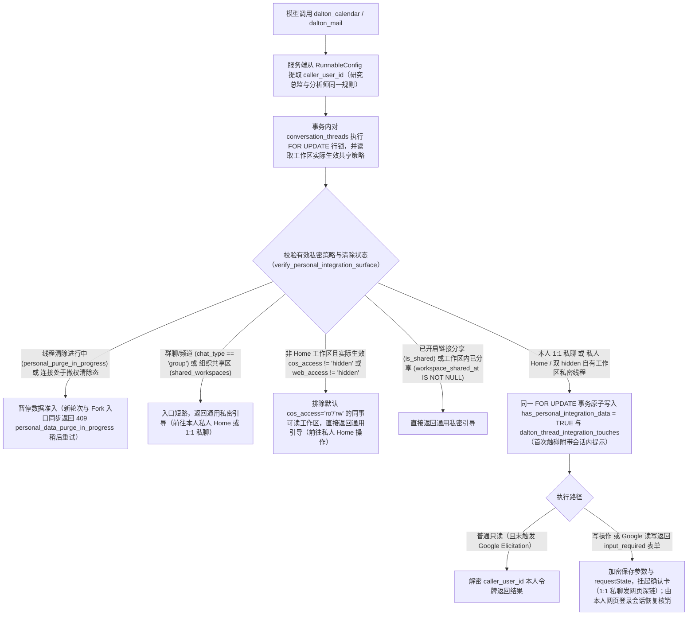
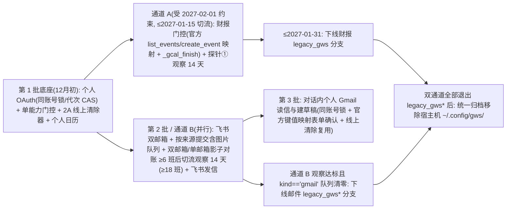

# 个人日历与邮箱接入设计方案（含 Google Workspace 官方渠道迁移与飞书双邮箱切换）

> **状态**：设计定稿 r13（2026-11-26，收口换号保留新连接、Google 同项目提前吊销、转录先传对象同事务写引用、已投递插话清理、核心设置入口、飞书 `authorized_at` 与 Fork 切点边界）  
> **合规截止范围与并行观察窗口**：**2027-02-01** Google 政策截止日期仅约束 `richard-earnings` 财报日历迁移——第 1 批个人授权底座合入后，财报日历经生产实测探针准入后于 **2027-01-15** 前切至 Google 官方 Calendar MCP（Model Context Protocol，模型上下文协议），在 **2027-02-01** 前留足 **14 天生产观察与回退窗口**；晨晚报、`funda-ai` 与图片入库已改为读取两个飞书邮箱，脱离 Gmail，独立设置并行影子比对（Shadow Compare）准入、**14 天（且跑满 ≥ 18 个实际开班正常班次）生产观察窗口**与回退规程  
> **前置与关联文档**：[standalone-core.md](./standalone-core.md)、[deployment-credentials.md](./deployment-credentials.md)、[researchdata-connectors.md](./researchdata-connectors.md)、[cos-settings-tools.md](./cos-settings-tools.md)、[cos-delivery-confirmation.md](./cos-delivery-confirmation.md)、[channel-phase2.md](./channel-phase2.md)  
> **关联核心代码**：`src/dalton/profile.py`、`src/dalton/capabilities.py`、`src/dalton/integrations/constants.py`、`src/dalton/settings.py`、`src/dalton/sharing.py`、`src/dalton/auth/sessions.py`、`src/dalton/auth/dispatch.py`、`src/observability/private_query.py`、`src/dalton/app/__init__.py`、`src/dalton/tools/__init__.py`、`src/ptc_agent/agent/agent.py`、`src/server/app/automations.py`、`src/server/database/runs/lifecycle.py`、`src/server/database/runs/outbox.py`、`src/server/services/runs/finalization.py`、`src/server/database/mcp_oauth.py`、`src/server/services/mcp_oauth/lifecycle.py`、`src/server/services/forks/service.py`、`src/server/database/conversation/queries.py`、`src/server/database/conversation/threads_write.py`、`src/server/database/conversation/thread_reach.py`、`src/server/database/conversation/turn_slices.py`、`src/server/database/replay_facts.py`、`src/server/services/history/projector.py`、`src/server/services/history/replay/refresh.py`、`src/server/services/history/replay/cold.py`、`src/server/services/runs/stream_writer.py`、`src/ptc_agent/agent/middleware/background_subagent/redis_stream.py`、`src/server/services/transcripts.py`、`src/server/database/thread_transcripts.py`、`src/server/app/threads/sharing.py`、`src/server/app/threads/messaging.py`、`src/server/app/threads/crud.py`、`src/server/models/chat.py`、`src/server/handlers/checkpoint_handler.py`、`src/server/database/search/index.py`、`src/server/services/search/index.py`、`src/ptc_agent/agent/middleware/compaction/utils.py`、`src/ptc_agent/agent/tools/code_execution.py`、`src/ptc_agent/agent/tools/bash.py`、`src/dalton/colleague_outbound_guard.py`、`src/dalton/sandbox_caller_identity.py`、`src/dalton/tools/market_digest_tools.py`、`deploy/standalone/Caddyfile`、`deploy/dalton/Caddyfile`、`scripts/dalton/ops/gws_migration_probe.py`、`scripts/dalton/market_digest_inputs.py`、`scripts/dalton/researchdata_bridge.py`、`scripts/dalton/source_identity.py`、`scripts/standalone/init.sh`、`scripts/standalone/restore.sh`、`plugins/dalton/skills/dalton-richard-earnings/SKILL.md`、`plugins/dalton/skills/dalton-richard-earnings/scripts/richard_earnings.py`、`scripts/dalton/research_runtime/skills/market-digest/scripts/market_digest_cli.py`、`scripts/dalton/research_runtime/scripts/funda_ai.py`、`scripts/dalton/research_runtime/scripts/research_image_ingest.py`、`web/src/pages/Settings/sections.ts`、`web/src/pages/Settings/panels/IntegrationsPanel.tsx`、`web/src/pages/ChatAgent/session/interrupts/toolApprovalCard.ts`

---

## 1. 背景、已确认事实与统一设计范围

### 1.1 业务与合规双重驱动

1. **Google 官方智能体渠道、交互确认协议与数据保留条款要求（2027-02-01 生效）**：
   - 2026-11-24，Google 正式全面开放（GA，General Availability）官方托管的 **Google Workspace MCP 服务器** 与 **官方 Google Workspace CLI（Command-Line Interface，命令行界面，`gwscli`）**。
   - 根据《Workspace AI Tools Addendum》（Workspace 人工智能工具补充条款）与配额分层规则：**2027-02-01 起**，人工智能智能体（AI Agent）及相关自动化任务访问 Google Workspace 数据须走官方托管 Workspace MCP 或官方 `gwscli`，并使用带有 `is_agentic`（智能体专用客户端）标识的 OAuth 2.0（Open Authorization 2.0，开放授权协议 2.0）凭据；沿用社区版 `@googleworkspace/cli`（可执行文件名 `gws`）直连传统 Google REST（Representational State Transfer，表述性状态转移）API（Application Programming Interface，应用程序编程接口）的智能体请求将受基础档位与频控限制。
   - 官方托管 `/mcp/v1` 端点采用无状态多轮请求协议（Multi Round-Trip Request），支持按安全策略对读写调用发起表单交互确认（Form Mode Elicitation，服务端表单交互确认协议）。本方案的数据存储与清理按 §8.4 已确认决定执行：对话检查点与提问表按现状明文保存，用户断开或撤销授权时立即清理线上关联数据；数据库、配置与异地备份维持现有 8 周周期自然过期（详见 §4.5 与 §8.4）。
2. **团队与独立核心安装用户的个人日历与邮箱接入需求**：
   - 成员希望通过个人账号授权连接自己的 **Google 日历** 与 **飞书日历**，在本人私密会话中查询日程、新建、修改、删除日历事件与自定义提醒。
   - 成员希望在本人私密会话中原生连接 **飞书邮箱**（检索、阅读邮件，并按需经二次确认发信）与 **Gmail**（检索、阅读邮件，并保存邮件草稿）。

### 1.2 已确认的核心事实与架构定案（2026-11-26）

本版设计按已确认的生产事实与架构定案统一边界：

1. **投研邮件实际全部位于两个飞书邮箱**：
   - 卖方投研邮件位于**属主本人的飞书个人邮箱**（即晨晚报属主在 Dalton 已绑定的飞书账号对应邮箱）；
   - `funda`（`fundaai@substack.com` 等独立研究订阅邮件）位于公司专门的**飞书公共邮箱（Public Mailbox）**。
2. **`market-digest`（市场晨晚报）、`funda-ai` 与 `research_image_ingest` 直接改读上述两个飞书邮箱，脱离 Gmail 且免受 2027-02-01 Google 截止日期限制**：
   - 本人飞书邮箱采用该属主用户的飞书个人 OAuth 授权（`user_access_token`，用户访问令牌）只读拉取；
   - 公司飞书公共邮箱采用 Dalton 飞书企业自建应用身份（`tenant_access_token`，租户访问令牌）只读拉取，由飞书管理员在后台将该公共邮箱单独纳入应用的数据权限范围；长班次运行中个人用户令牌与应用租户令牌按各自真实剩余寿命独立续期，且由宿主机父进程只读代理持有令牌代发只读请求；
   - 现有团队投研检索库与原件归档（`vectors.db`、`state/funda-ai/`、`state/research-images/`、`digest_*.json`、`emails.json`）数据源自企业自有飞书邮箱，按团队知识库规则长期保留供跨月检索。
3. **Google 渠道聚焦三项明确用途（其中仅财报日历迁移受 2027-02-01 截止日期约束）**：
   - ① **个人 Google 日历对话连接**（私密会话查询、新建、修改、删除事件与提醒）；
   - ② **`richard-earnings` 财报日历迁移**（保留沙箱 `call_research(route="gcal")` 入口，由宿主机研究桥在 HTTP〔Hypertext Transfer Protocol，超文本传输协议〕分发层透传原签名请求头转发至后端门控切往官方 Google Calendar MCP，返回前仍经桥上 `_gcal_finish` 封装信封与脱敏，于 **2027-01-15** 前完成切流）；
   - ③ **对话内个人 Gmail 读信与建草稿**（第 3 批独立交付，仅用于真人私密会话交互）。
4. **Google Cloud 项目与部署客户端分离定案**：
   - **Everflow 生产环境**：使用独立免绑结算账号项目 **`dalton-workspace`**（锁定免费 Standard Tier〔标准免费档〕，每日每产品 5,000 次请求）；Google Auth Platform（Google 身份认证平台）受众类型选 **External（外部应用模式）**，发布状态切至 **In production（正式发布态，维持未验证正式态运行）**，外部用户首次网页授权确认一次提示页即可获取长期有效的刷新令牌（Refresh Token），上限 100 名用户；品牌页（Branding）固定为应用名称 `Dalton`、应用首页 `https://everflowinv.com`、隐私权政策 `https://dalton.everflowinv.com/help/everflow/privacy/`、已获授权网域 `everflowinv.com`；财报周扫任务属主固定为 `DALTON_TRACKER_CALENDAR_OWNER_ID=991a99ad-8ff2-4bd8-bf08-e5963a248798`（UUID，Universally Unique Identifier，通用唯一识别码）；
   - **独立核心安装（`DALTON_PROFILE=core`）**：客户自建 Google OAuth 客户端与飞书应用，授权网域与回调主机名等于该部署的 `PUBLIC_APP_URL`，客户端与飞书验签凭据在网页「部署设置 → 集成凭据」维护并统一通过 [deployment-credentials.md](./deployment-credentials.md) §2.3 的 `get_credential_group(...)` 读取。
5. **Gmail 采用经 `is_agentic` 客户端实测验证的窄权限，支持同账号增量共存与显式换号**：
   - 对照 Google 官方 Gmail MCP 工具文档列出的细粒度权限（草稿创建 `gmail.drafts.create` 与邮件只读 `gmail.readonly`），在第 3 批上线前使用真实 `is_agentic` Web OAuth 客户端实测可获授范围；同一 `(oauth_client_id, sub)` 已有 Google 连接时默认启用增量授权（`include_granted_scopes=true`）请求范围并集并写回该账号每一行，管理员轮换客户端后同一 `sub` 重新授权原地重绑并完整保留对话历史，同时提供显式「换账号」流程（前端确认清除旧账号个人数据后以 `prompt=select_account` + `include_granted_scopes=false` 跳转，回调 `sub` 变化且携带新 `refresh_token` 时复用第 1 阶段锁线程登记 2A 清除后再整行替换新账号），连接与每次续期均按实际授予范围更新功能门控。

### 1.3 统一架构范围概览

1. **统一个人授权、同账号共用凭据加锁与单向生命周期底座（`dalton_user_integrations`）**：本文唯一定义个人连接 OAuth 2.0 + PKCE（Proof Key for Code Exchange，授权码交换证明密钥）授权流程、回调路由常量与能力元数据并导出供部署凭据管理页引用，部署客户端与飞书验签凭据统一调 `get_credential_group(...)` 读取；回调为免持有者令牌（Bearer，持有者令牌认证头）顶层跳转，由服务端 10 分钟一次性 `state` 表原子核销并按认证模式（`local` 调 `verify_local_session_active`、`oss` 核对 `state_row.user_id` 等于当前免密主体、`supabase`〔托管身份认证服务〕采用短时效 `state` + 发起时校验 + 回调后页面带登录态确认）核验原会话，回调查询串 `code` 与 `state` 在两版 Caddy（边缘反向代理服务器）、Uvicorn（Python 异步网页服务器）访问日志与 OpenTelemetry（开源可观测性与分布式追踪框架）请求追踪跨度（Span）中全链路脱敏。Google 换票通过 OIDC（OpenID Connect，开放身份认证协议）`id_token` 验签保存稳定 `sub`：同一 `(oauth_client_id, sub)` 共用一把刷新锁，刷新比较并交换（CAS，Compare-And-Swap）冲突分支返回令牌前强制核对同一 `(oauth_client_id, sub, auth_epoch)`，客户端轮换后同一 `sub` 重连原地重绑保留对话，续期后按实际授予范围更新功能门控；飞书保持 `offline_access`（离线访问权限范围）与跨工作进程（Worker）串行刷新，补齐 `refresh_ambiguous → needs_reauth` 转换路径。触发方案 2A 清除的条件严格限定为「用户主动断开（含确认换账号）」与「官方文档确认表示用户本人撤权的事件或专属撤权码」（Google `invalid_grant` 与飞书 `20024`、`20063`、`20037` 等常规失效统一置为 `needs_reauth`）；断开任务在首次封锁线程的同一事务内登记，本地清除与远端撤权分别记录进度，本地清除提交即解封线程，Google 远端吊销按 `(Google 项目, sub)` 在发起新授权前持互斥锁同步处理可吊销旧票（新票已签发时旧票任务直接标 `superseded`〔已由新授权取代〕停止吊销）。
2. **共用线程授权私密门禁与收紧后的方案 2A 线上清除**：直接工具（Direct Tools）`dalton_calendar` 与 `dalton_mail` 对研究总监（`chief_of_staff`）和分析师（`analyst`）执行同一调用者本人规则，仅放行私人 `Home`、实际生效策略 `cos_access=='hidden' && web_access=='hidden'` 的自有工作区私密线程与 1:1 私聊；在 `conversation_threads` 行锁（`FOR UPDATE`）下使私密打标、对话分支复制（Fork）继承与两类线程分享互斥，并将私密标记校验统一收口至 `require_thread_access`。私密线程首次触碰个人连接时在会话内提示用户。线上清除器在第 1 批随日历上线：**清除门禁下沉至轮次 START 事务（`src/server/database/runs/lifecycle.py:start_run`）与 Fork 源线程行锁内**，统一拦截 HTTP、自动化、唤醒与重试全部入口；回放刷新（`project_turns`）、实时回放持久化（`read_replay_page(persist=True)`）、搜索写回（`write_turns`）与转录写回（`transcripts.py:_save`）等全部写回路径在写回事务内先执行 `SELECT ... FROM conversation_threads WHERE ... FOR SHARE`（共享行锁）核对 `personal_purge_in_progress IS FALSE AND personal_purge_generation = expected_purge_gen`，并在清除开始（第 1 阶段）与本地清除提交两处分别递增代次；取消排空在途运行后，按方案 2A 将首次触碰轮次起的后缀轮次（普通用户消息、`conversation_queries.content`、运行插话、模型回答、`AIMessage.tool_calls` 参数、`ToolMessage` 及合并了触碰后内容的压缩摘要三处副本）替换为脱敏占位，同步清理 `turn_slices`、`task_run_slices`、`replay_facts`、已投递、待投递与失败插话发件箱（Outbox）记录、Redis（内存键值数据库）按 `run_id` 与子任务的事件流、线程转录、对话归档抽卡、后缀内全部服务的审批记录及财报受管日程；全文搜索守卫采用记录清除启动时最大 `turn_index` 的闭区间（编辑或重生成截断轮次时同步裁至截断点之前，Fork 按实际复制轮次同一边界保留区间），使清除完成后的新对话与重编辑轮次照常建索引可搜索；离线备份维持现有 8 周周期自然过期，从备份恢复时在数据库迁移完成后、启动后端与定时调度前在同一组前置语句清空存量令牌、`oauth_states` 及 `supabase` 待确认记录并置 `needs_reauth`。
3. **保留沙箱入口的服务端门控转发与飞书双邮箱独立演进**：财报周扫保留沙箱 `call_research(route="gcal")`，研究桥 HTTP 分发层将原签名 `X-Dalton-Caller-Token` 交予 `gcal` 分支转发至后端 `/api/v1/dalton/mcp/tracker-calendar` 统一选路（`official_mcp` 按官方 Calendar MCP 契约将 `list_events` 转换为本地时间 `startTime/endTime` 加 IANA〔Internet Assigned Numbers Authority，互联网号码分配局标准时区库〕`timeZone`、`pageSize/fullText`，映射 `insert_event` → `create_event`，复用 `_gcal_is_tracker` 删除新旧受管日程；`legacy_gws` 由后端用 `DALTON_BRIDGE_URL` 回呼桥内部路由并将 `health_check` 转换为窄窗口 `list_events(limit=1)`，返回前统一经桥上 `_gcal_finish` 封装）；晨晚报切换前用 `gws` 按 `email_chunks.email_id`（Gmail 消息 ID）回读 RFC（Request for Comments，互联网标准技术规范）`Message-ID` 补齐去重键（缺头时兜底统一规范化正文 SHA-256〔Secure Hash Algorithm 256-bit，256 位安全散列算法〕），解耦生产源与影子源以支持双邮箱 `shadow_compare`、单邮箱 `shadow_compare_user_only` 及单飞书生产向双飞书平滑升级的 `feishu_user_prod_plus_public_shadow` 写入独立 `feishu_shadow_ledger.sqlite`，生产提交按来源分流将图片队列持久化入队纳入提交条件并保留每班 `funda_ai.Store.index_pending` 向量构建与积压重试。
4. **双形态单能力自包含与双通道退出后凭据清理**：四个个人连接能力通过共用路由逐服务门控与 `DALTON_TOOL_REGISTRY` 任一能力装配支持单能力独立开启；第 1 批底座合入后，财报日历切流受 **2027-02-01** 合规截止约束（最晚 **2027-01-15** 切流），飞书双邮箱并行推进并按独立准入与观察窗口切换，待财报与邮件两条通道全部退出 `legacy_gws*` 且旧 Gmail 图片队列清零后统一归档清理宿主机 `~/.config/gws/`。

---

## 2. 现状全仓清查与迁移前后行为对照

### 2.1 现有直连外部日历与扫描邮箱的任务清单（需改造迁移）

| 序号 | 任务 / 模块名称 | 精确代码位置（`文件:行号`） | 当前读写方式与协议 | 当前访问谁的账号与凭据位置 | 调用频率与数据量 | 新底座复用与迁移定案 |
|---|---|---|---|---|---|---|
| **1** | **`gcal` 日历路由与 Richard 财报日期周扫（`dalton-richard-earnings`）** | 1. 宿主机研究桥：`scripts/dalton/researchdata_bridge.py:3199-3244, 6827-6858, 7290-7374, 11785-12069, 13791-13792, 25834-25884`<br>2. 技能说明与脚本：`plugins/dalton/skills/dalton-richard-earnings/SKILL.md:16, 24-43`、`scripts/richard_earnings.py:195-207, 392-407, 585-616, 795-847, 1012-1028`<br>3. 身份签发钩子：`src/ptc_agent/agent/tools/code_execution.py:270-308`、`src/ptc_agent/agent/tools/bash.py:23, 349`、`src/dalton/sandbox_caller_identity.py:94-153`<br>4. 溯源与体检：`scripts/dalton/source_identity.py:1074-1143`、`src/dalton/data_map/sources.yaml:121-128`、`src/dalton/data_map/health.py:451-466, 863-878` | 沙箱脚本调 `call_research(route="gcal")`，宿主机子进程调用社区版 `gws calendar events list/insert/get/delete` 直连 Google Calendar REST API v3 | **Richard 的专用财报 Google 日历**（`DALTON_GCAL_CALENDAR_ID`；令牌位于宿主机 `~/.config/gws/`） | 每周六 07:00 ET（Eastern Time，美国东部时间）运行 1 次 + 偶发自检；常规周 **5–45 次/周**，财报季高峰 **50–120 次/周**（日均 **< 20 次/天**）；单次载荷 **< 50 KB** | **唯一受 2027-02-01 约束的迁移项**：保留沙箱 `call_research(route="gcal")`，研究桥 `:25834` 分发层将原签名 `X-Dalton-Caller-Token` 传至 `gcal` 分支转发后端 `/api/v1/dalton/mcp/tracker-calendar`；`code_execution.py` 钩子签入 `(run_id, turn_origin_automation_id, automation_execution_id)`；后端按 `DALTON_GCAL_BACKEND` 选路（`official_mcp` 将 `list_events` 转换为本地时间 `startTime/endTime` + IANA `timeZone` + `pageSize/fullText`、`insert_event` → `create_event`、`delete_event` 复用 `_gcal_is_tracker` 兼容历史标记、`health_check` 调窄窗 `list_events(pageSize=1)`；`legacy_gws` 由后端用 `DALTON_BRIDGE_URL` 调桥内部路由并将 `health_check` 转为窄窗 `list_events(limit=1)`），返回前统一经桥上 `_gcal_finish` 封装信封、声明 `_sources` 与脱敏日历 ID；于 **2027-01-15** 前完成切流 |
| **2** | **`market-digest` 市场晨报 / 晚报卖方邮件拉取** | 1. 拉取与切块：`scripts/dalton/research_runtime/skills/market-digest/scripts/market_digest_cli.py:158-280, 360-402, 429-504, 608-629, 643-770, 1309-1360`<br>2. 后端工具与鉴权：`src/dalton/tools/market_digest_tools.py:40-43, 145-260`、`src/dalton/database/market_digest.py:52-131`<br>3. 宿主机编排：`scripts/dalton/market_digest_inputs.py:1390-1435, 2113-2150`、`scripts/dalton/researchdata_bridge.py:20047-20250, 24748` | 宿主机调用 `gws gmail users messages list/get/modify` 拉取未打标卖方邮件并贴 `MARKET-DIGEST` 标签 | 原为晨晚报属主（`DALTON_MARKET_DIGEST_OWNER_ID`）的 Gmail；**实际卖方邮件已在属主本人的飞书邮箱** | 每个交易日 09:00 与 21:00 HKT（Hong Kong Time，香港时间）各运行 1 次；单批 10–150 封，落盘快照约 **0.5–5 MB** | **第 2 批改读属主本人飞书邮箱（脱离 Gmail，按准入推进）**：切流前用 `gws` 按 `email_chunks.email_id` 回读 RFC `Message-ID` 补键；经父进程只读代理按「`only_unread=false` + 飞书平台收件时间判定 48 小时重叠水位 + 顶部段与深页段独立页预算续扫」拉取；解耦生产源与影子源支持 `shadow_compare`、`shadow_compare_user_only` 及单邮箱生产升级双邮箱的 `feishu_user_prod_plus_public_shadow` 写入独立 `feishu_shadow_ledger.sqlite`，生产按 `sales-notes` / `funda-ai` 来源分阶段完成切片、图片任务持久化入队与快照落盘后再写 `ingested_mail_dedupe` 与 `committed`，并保留每班 `funda_ai.Store.index_pending` 向量构建与积压重试 |
| **3** | **`funda-ai`（`fundaai@substack.com` 独立研究邮件增量归档）** | `scripts/dalton/research_runtime/scripts/funda_ai.py:55-62, 80-116, 162-227`（由 `market_digest_cli.py:608-629, 674` 调入）；离线导入 `:339-355`（读取 MBOX〔电子邮箱归档文件格式〕） | 原与序号 2 共用内存邮件对象，依赖 RFC 2822（互联网电子邮件消息格式标准）`Date`、`Message-ID`、`X-Original-From`、`Reply-To`、`X-Mailgun-Variables` 及 MIME（Multipurpose Internet Mail Extensions，多用途互联网邮件扩展）部件写入 `state/funda-ai/index.sqlite` | **实际收件箱为公司专用飞书公共邮箱**（由 `DALTON_FEISHU_PUBLIC_MAILBOX_ID` 指定地址） | 随每次 `market-digest` 晨晚报顺带处理（单批通常 0–5 封） | **第 2 批通过飞书应用身份直读该公共邮箱**：使用 Dalton 飞书应用 `tenant_access_token`（管理员限定单个公共邮箱数据范围，按飞书租户票实际剩余寿命独立续期；支持 `legacy_gws_plus_feishu_public` 在个人飞书连接异常时独立直读公共邮箱）拉取飞书消息详情中的 `raw`（原始 `.eml` 字节流），经 `BytesParser` + `funda_ai.mime_payload` 还原转发头、分类头与 MIME 树并保存 `.eml` 原件 |
| **4** | **`research_image_ingest.py`（邮件研究图表异步抓取）** | `scripts/dalton/research_runtime/scripts/research_image_ingest.py:38-64, 209-276`；存储位于 `scripts/dalton/research_runtime/scripts/research_images.py:57-180` | 遍历 MIME `text/html`（HyperText Markup Language，超文本标记语言）抽取 HTTPS（Hypertext Transfer Protocol Secure，安全超文本传输协议）外链图片下载；对未内联字节流的 `cid:`（Content-ID，邮件内嵌资源标识）附件原调 `gws gmail ... attachments get` | 与序号 2、3 对应同一批投研邮件 | 随每次 `market-digest` 末尾排空队列（`max_images=48, seconds=120`），日均 **0–96 次/天**，数据量 **0–30 MB/批** | **第 2 批切至飞书图片源并保留按 `kind` 排空兼容**：单封邮件提交阶段先幂等持久化 `state/research-images/queue/*.json` 任务；HTTPS 外链图与 `.eml` 内联字节图直接提取，外置大附件经父进程只读代理调用飞书 `attachments/download_url`（1 次/秒限速）内存拉取字节流；待财报与邮件两条通道全部退出 `legacy_gws*` 且历史 `kind=='gmail'` 队列项清零后再移除本地 `~/.config/gws/` 凭据 |

### 2.2 现有间接消费本地邮件库或内部台账的任务清单

| 类别 | 精确代码位置（`文件:行号`） | 当前数据源与运行方式 | 合规与迁移影响评估 |
|---|---|---|---|
| **`sales-notes` 手动粘贴入库与只读检索层** | `scripts/dalton/research_runtime/scripts/sales_notes_store.py:1-120`、`src/dalton/tools/ingest_tools.py:6`、`scripts/dalton/research_runtime/scripts/research_library.py:163, 303, 368` | `add-note` 接收用户手动上传纪要写入 `state/sales-notes/` 与 `vectors.db`；`research_library.py` 只读查询 | 手动上传纪要与第 2 批飞书双邮箱入库邮件均属企业自有数据源，**全量跨月历史检索与向量索引照常长期保留** |
| **`tmtb` 买方科技简报同步** | `scripts/dalton/research_runtime/scripts/tmtb_alphaengine_sync.py:1-60` | 从 AlphaEngine 接口拉取 TMTB（Tech, Media & Telecom Briefing，科技、媒体与电信简报）文档写入 `vectors.db` | 独立于电子邮箱通道，保持现状 |
| **消费 `sales-notes` / `funda-ai` 的投研技能** | `plugins/dalton/skills/dalton-richard-coverage-weekly/scripts/sales_notes_search.py:1-80`、`dalton-thesis-delta/scripts/collect.py:916-928`、`dalton-bullbear-tracker/scripts/collect.py:51`、`dalton-sector-delta/scripts/collect_sector.py:12`、`gs_prime_positioning.py:44`、`semi_rescue_alert.py:313` | 只读查询 `vectors.db` 与 `state/funda-ai/index.sqlite` 中的已索引切片 | SQLite（轻量级单文件关系型数据库）表结构与查询契约保持兼容，跨月历史对比与检索连续可用 |
| **内部财报日历台账（`dalton-earnings-calendar`）** | `plugins/dalton/skills/dalton-earnings-calendar/SKILL.md:15-24, 191`、`scripts/calendar_state.py:1-120` | 扫描公司投资者关系官网维护 `Home/dalton/earnings-calendar.json` | 保持现状；个人日历上线后成员可在本人私密会话中按需将关注的公开日程写入个人日历 |
| **飞书云文档读写与机器人渠道网关** | `src/dalton/feishu.py:1-167`、`src/dalton/tools/feishu_tools.py:1-120`、`src/dalton/services/channel_vault_credentials.py:1-131`、`src/dalton/database/channel_gateway.py:4105-4165` | 使用应用级 `tenant_access_token` 操作知识库文档与机器人收发消息 | Everflow 环境复用 `DALTON_FEISHU_APP_ID` / `DALTON_FEISHU_APP_SECRET` 与 `dalton_channel_identities` 的 `open_id` 核验；公共邮箱读取复用同一应用的 `tenant_access_token` 并由平台数据权限范围严格限定单个公共邮箱（见 3.2 与 4.3 节） |
| **其他非 Workspace Google 服务** | `src/server/services/llm/provider_models/wire.py:28`、`src/dalton/web_search/gemini_grounding.py:36`、`src/dalton/llm/providers/antigravity/oauth.py:34-45`、`scripts/dalton/ops/dalton_db_offsite.sh:103-225`、`web/index.html:341-345` | Gemini 推理与嵌入、Antigravity 通道、运维备份工具 `rclone`、静态字体 CDN（Content Delivery Network，内容分发网络） | 均独立于 Google Workspace 办公套件智能体通道，保持现状 |

### 2.3 迁移前后用户可见行为对照汇总

| 场景 | 迁移前行为（或基础对话缺口） | r13 定案后的用户可见行为 | 验收方式 |
|---|---|---|---|
| **晨晚报、`funda-ai`、去重与回退** | 宿主机用 `gws` 扫单个 Gmail；缺单邮箱生产平滑升级双邮箱路径，且 `funda-ai` 提交需衔接每班向量构建 | 卖方邮件读属主飞书个人邮箱，`funda` 读飞书公共邮箱；切流前用 `gws` 按 `email_id` 回读 RFC `Message-ID` 补齐去重键；解耦生产源与影子源，支持 `shadow_compare`、`shadow_compare_user_only` 及单飞书生产向双飞书平滑升级的 **`feishu_user_prod_plus_public_shadow`** 写入独立 `feishu_shadow_ledger.sqlite`；生产按来源分阶段完成切片/`funda` 归档、**图片任务持久化入队**与快照落盘后提交，**每班继续运行 `funda_ai.Store.index_pending` 生成并补建待索引向量**；支持 `legacy_gws_plus_feishu_public` 独立直读公共邮箱 | 第 2 批探针实测 `raw` 头还原与发信 `dedupe_key`，跑满 ≥ 6 班独立库影子比对（含 `feishu_user_prod_plus_public_shadow` 连续升级验收），验证图片入队崩溃重放、`index_pending` 下班补建向量与 `public_only` 独立回退 |
| **对话内发信、Google 表单审批与草稿边界** | 常规工具无逐请求服务端动态表单恢复协议与逐收件人投递核查 | **Gmail 仅开放第 3 批个人对话读信与 `create_draft`（保存草稿）**；Google MCP 审批按官方 `<request_key>` 键值对象结构解析 `inputRequests[key].params` 并回传 `inputResponses[key]`；**「允许在对话中发送」仅对个人飞书邮箱生效**，经网页 L2 二次确认与服务端一次性核销后发送，调用官方 `send_status` 端点核查逐收件人投递状态，超时查 `SENT` 详情核对唯一 `Message-ID` 后补查 `send_status`，未确认保持 `send_ambiguous` 未知态 | 设置面板、`dalton_calendar` 与 `dalton_mail` 单测：以官方样例覆盖 `<request_key>` 映射首次解析、`accept`、`decline` 与 `cancel`，验证 `send_status` 状态解析及父进程只读代理物理隔离 |
| **私密会话、Fork 继承与事后网页开放门禁** | 普通工作区默认同事可读，且开放网页共享后历史对话对工作区读者可见 | 仅放行私人 `Home`、显式双 `hidden` 自有工作区私密线程与 1:1 私聊（DM，Direct Message）；在 `conversation_threads` 行锁下原子打标并由 Fork 继承，**在共用授权函数 `require_thread_access` 与网页线程列表中统一拦截非创建者访问（含事后开放网页共享后的消息回放与运行中流订阅）** | 回归测试覆盖：「读取日程/邮件 → Fork 新线程 → 尝试两种分享拦截」及「事后将工作区改为 `web_access='ro'` → 同事调用网页回放、流订阅与列表均被拒绝」 |
| **OAuth 会话核销、客户端轮换/换号分开处理、串行刷新与撤权边界** | 顶层浏览器回调无 `Bearer` 头；客户端轮换、换账号、部分授权、飞书刷新超时未知态及普通凭据故障需精确分流 | 服务端 10 分钟 `state` 原子核销并按 `local` / `oss` / `supabase` 分开核验原会话，回调查询串在 Caddy、Uvicorn 与追踪日志全链路脱敏；Google 保存 `sub`，同 `sub` 客户端轮换原地重绑并保留历史对话，切换至不同 `sub` 前提示确认并按「封锁并替换 → 清旧后缀 → 解封」清除旧号后缀且保留新连接，CAS 冲突返回前核对 `(oauth_client_id, sub, auth_epoch)`，日历缺 `calendar.events` 拒绝入库提示重授、Gmail 缺草稿范围仅开放只读；飞书持久化 `authorized_at`（刷新不变）、保持 `offline_access`、跨 worker 串行刷新、`refresh_ambiguous → needs_reauth` 及所有事件入口统一走 `authorized_at` 与本人撤销过滤；**仅用户主动断开（含确认换号）或官方确认本人撤权触发 2A 清除，Google `invalid_grant` 与飞书 `20024`/`20063`/`20037` 均只标 `needs_reauth`** | 验收客户端轮换后旧对话可读可搜、换号确认后旧号后缀被 2A 清除且新连接仍可用、日历缺 `calendar.events` 拒入库与 Gmail 部分授权、双 worker 过期票单次消费与超时重连、`local`/`oss`/`supabase` 回调会话校验、回调实际日志脱敏，以及普通凭据失效仅标 `needs_reauth` |
| **首次触碰提示、行锁双代次 2A 后缀清除闭环与备份恢复前置清空** | 普通对话断开外部连接后历史工具调用参数、事件流与回放切片仍留在原会话中 | 私密线程首次触碰展示会话内提示；首次封锁线程同事务登记清除任务并首次递增代次，轮次 `start_run` 事务与全写回路径（`FOR SHARE` 行锁）核对清除状态与代次；本地清除按 2A 改写后缀消息、`AIMessage.tool_calls` 参数、`conversation_queries.content`、运行插话与压缩摘要三处副本，清理切片、`replay_facts`、已投递/待投递/失败插话 outbox、Redis `run_id` 事件流、闭区间搜索索引（截断与 Fork 按实际保留轮次同口径裁剪）、转录与后缀全部审批，提交时**再次递增代次并立即解封线程**（按 `(Google 项目, sub)` 在发起新授权前同步处理可吊销旧票，新票已签发时旧票标 `superseded`）；备份维持 8 周自然过期，恢复时在迁移完成后、启动后端与调度前清空存量令牌、`oauth_states` 及 `supabase` 待确认记录并置 `needs_reauth` | 单测验收同事务任务登记、吊销成功后新票仍可刷新、清除前与清除中及转录「对象已上传引用未写」交错下均安全拦截、摘要三处副本与归档+outbox 插话清理、编辑及两类 Fork 切点新内容可搜、隔离测试栈 `calendar-purge-drill` 及恢复前置清空 |

---

## 3. Google 与飞书官方接口、最小权限范围与配额（查阅日期：2026-11-26）

### 3.1 Google 官方渠道、无状态 `_meta` 表单确认协议与项目模式（Calendar MCP + Gmail MCP）

#### （1）官方文档来源（查阅日期：2026-11-26）
1. **Workspace AI Tools Addendum**：`https://workspace.google.com/terms/ai-tools/`（查阅日期：2026-11-26）
2. **Workspace 定价与配额分层**：`https://developers.google.com/workspace/pricing`、`https://developers.google.com/workspace/guides/quota-usage-tiers`、`https://developers.google.com/workspace/gmail/api/guides/quotas#gmail-mcp-server-quotas`（查阅日期：2026-11-26）
3. **Workspace MCP 配置与 `is_agentic` 授权指南**：`https://developers.google.com/workspace/guides/configure-mcp-servers`（查阅日期：2026-11-26）
4. **Workspace MCP 无状态表单交互确认协议（Form Mode Elicitation、`params._meta`、`requestState` 与 `inputResponses`）**：`https://developers.google.com/workspace/guides/mcp-elicitation`（查阅日期：2026-11-26）
5. **Google Calendar MCP 工具参考（`list_events`、`create_event`、`get_event`、`update_event`、`delete_event` 含 `overrideReminders`）**：`https://developers.google.com/workspace/ai/mcp-calendar`、`https://developers.google.com/workspace/calendar/api/v3/reference/mcp/tools_list/create_event`、`https://developers.google.com/workspace/calendar/api/v3/reference/mcp/tools_list/update_event`（查阅日期：2026-11-26）
6. **Gmail MCP 工具参考（`search_threads`、`get_thread`、`get_message`、`create_draft`）**：`https://developers.google.com/workspace/ai/mcp-gmail`、`https://developers.google.com/workspace/gmail/api/reference/mcp/tools_list/search_threads`、`https://developers.google.com/workspace/gmail/api/reference/mcp/tools_list/get_message`、`https://developers.google.com/workspace/gmail/api/reference/mcp/tools_list/create_draft`（查阅日期：2026-11-26）
7. **Google OAuth 2.0 授权（含 `include_granted_scopes`）、OpenID Connect 身份令牌验签与撤销规范**：`https://developers.google.com/identity/protocols/oauth2/web-server#offline`、`https://developers.google.com/identity/protocols/oauth2/web-server#incrementalAuth`、`https://developers.google.com/identity/openid-connect/openid-connect`、`https://developers.google.com/identity/protocols/oauth2/web-server#tokenrevoke`（查阅日期：2026-11-26）

#### （2）无状态请求 `_meta` 结构、官方键值映射 Elicitation 恢复协议与后台探针准入
后端通过 Python `httpx` 异步客户端以 Streamable HTTP（流式超文本传输协议传输层）和 JSON-RPC 2.0（JavaScript Object Notation Remote Procedure Call 2.0，基于 JSON 的远程过程调用协议）直连 Google 官方托管无状态远端端点（`https://calendarmcp.googleapis.com/mcp/v1`、`https://gmailmcp.googleapis.com/mcp/v1`），按调用者 `user_id` 动态注入短期 `Bearer <access_token>`（持有者访问令牌）：

1. **真人交互对话路径（每次 `tools/list` 与 `tools/call` 携带 `params._meta`，按官方请求键对象结构解析并重发 `inputRequests` / `inputResponses`）**：
   - 遵循 Google Workspace MCP 无状态多轮请求规范，客户端在**每一次 `tools/list` 与 `tools/call` 请求（覆盖首次调用与恢复重发调用）**的 `params._meta` 中统一传入客户端元信息与表单能力声明（文档未单独列明的 `io.modelcontextprotocol/*` 细部键名与协议版本日期字符串由探针①②确认，不通过不切流）：
     ```json
     "params": {
       "name": "<tool_name>",
       "arguments": { ... },
       "_meta": {
         "io.modelcontextprotocol/protocolVersion": "2026-07-28",
         "io.modelcontextprotocol/clientInfo": {
           "name": "dalton",
           "version": "<dalton_version>"
         },
         "io.modelcontextprotocol/clientCapabilities": {
           "elicitation": {
             "form": {}
           }
         }
       }
     }
     ```
   - 当 `/mcp/v1` 对写操作或敏感读操作返回官方 `InputRequiredResult` 时，响应中的 **`inputRequests` 为按请求键 `<request_key>`（例如 `"approval_choice"`）索引的 JSON 对象，每项内含 `"method": "elicitation/create"` 与表单定义 `"params": {"mode": "form", "message": "<markdown_preview>", "requestedSchema": {...}}`**（`requestedSchema` 为 JSON Schema〔JSON 数据结构定义〕对象，例如枚举属性下含 `title`、`enum` 与 `enumNames`），并附带绑定原调用参数的不透明上下文字符串 **`requestState`**：
     ```json
     {
       "resultType": "input_required",
       "requestState": "<opaque_request_state>",
       "inputRequests": {
         "approval_choice": {
           "method": "elicitation/create",
           "params": {
             "mode": "form",
             "message": "<server_markdown_preview>",
             "requestedSchema": {
               "type": "object",
               "properties": {
                 "approval_choice": {
                   "title": "<confirmation_question>",
                   "enum": ["ALLOW_ONCE", "DENY_ONCE"],
                   "enumNames": ["Allow once", "Don't allow"]
                 }
               }
             }
           }
         }
       }
     }
     ```
   - 服务端执行读写统一的私密恢复协议（详见 5.2 节）：
     - **挂起确认**：后端将 `{mcp_endpoint, mcp_tool_name, exact_mcp_arguments, pgp_sym_encrypt(requestState), input_requests_map, auth_epoch}` 持久化至 `dalton_integration_action_approvals`（类型 `dalton_google_mcp_elicitation`，TTL〔Time To Live，有效存活时长〕10 分钟），向发起人本人私密会话下发确认卡片（安全渲染各项 `params.message` 并按 `params.requestedSchema` 生成操作按钮或表单项）；
     - **提交表单决策恢复（`accept`）**：令牌主人本人在网页登录会话选择或填写答案后，后端原子核销该记录、复核会话仍处于私密态且 `auth_epoch` 一致，随即向同一 `/mcp/v1` 端点发出携带相同 `params._meta` 的第二次 `tools/call`——**传入首次调用原样的 `name` 与 `arguments`，并在顶层 `params` 中附带解密还原的 `requestState` 及按同一 `<request_key>` 索引的 `inputResponses` 对象**（包括用户在枚举项中点选允许如 `"ALLOW_ONCE"` 或单次拒绝项如 `"DENY_ONCE"`，均按 `accept` 附 `content` 提交）：
       ```json
       "params": {
         "name": "<tool_name>",
         "arguments": { ... },
         "_meta": { ... },
         "requestState": "<opaque_request_state>",
         "inputResponses": {
           "approval_choice": {
             "action": "accept",
             "content": {
               "approval_choice": "ALLOW_ONCE"
             }
           }
         }
       }
       ```
       若上游继续返回下一步 `input_required`，则创建新一条审批记录衔接，直至返回最终结果；
     - **关闭或取消弹窗（`decline` / `cancel`）**：当用户直接关闭或取消确认弹窗时，后端原子更新本地审批记录为 `rejected`，并按同一 `<request_key>` 映射构造省略 `content` 的取消响应 `{"<request_key>": {"action": "decline"}}`（或 `{"action": "cancel"}`）通知 `/mcp/v1` 触发 `UserDeniedAction` 收尾，向模型返回用户取消结果。
2. **后台无人值守任务路径（`richard-earnings` 财报日历周扫）**：
   - `richard-earnings` 在第 1 批切流前通过 7.1 节**探针①**在属主账号（`991a99ad-8ff2-4bd8-bf08-e5963a248798`）与目标财报日历上逐项实测 `list_events`、`create_event`、`get_event`、`delete_event` 的真实请求响应与无人值守表现，**探针①全部通过后才执行切流**；若探针受阻则保持 `legacy_gws` 并按 7.2 节预案 A 执行。

#### （3）工具参数细节、配额与 `dalton-workspace` 发布模式
- **Google Calendar MCP 自定义提醒映射**：`CreateEventRequest` 与 `UpdateEventRequest` 原生声明 `overrideReminders: [{"method": "popup" | "email", "minutes": <int>}]`；文档未写明的默认提醒继承与清空单事件提醒字段组合由探针①②确认，不通过不切流。
- **Gmail MCP 对话读信与建草稿（第 3 批）**：
  - `search_threads` 按查询词返回匹配的会话摘要（单会话内联最多 5 条消息摘要）；`dalton_mail(action="search_messages")` 在服务端对命中的前 N 个会话补充调用 `get_thread`（`METADATA_ONLY`）展开会话内消息列表，返回每封消息的独立 `message_id`、发件人、主题、时间及所属会话总封数；
  - `get_message` 默认采用 `FULL_CONTENT` 获取清洗正文与附件元数据；`create_draft` 支持纯邮箱地址数组 `to/cc/bcc`、`subject`、`body`、`htmlBody`、`replyToMessageId`。
- **配额与 `dalton-workspace` 未验证正式态说明**：
  - 项目 `dalton-workspace` 维持免绑结算账号，稳居免费 **Standard Tier**（Calendar MCP、Gmail MCP 各自独立享有 **5,000 次请求 / 天**；团队日常个人对话加上每周 1 次财报周扫日均总调用 **< 150 次/天**，低于免费额度 3%），同时规避 2027-04-01 起扩容计费档（Scaled Tier）的首单计费；
  - 同意屏幕设为 **External + In production（未验证正式态）**：项目内累计最多 **100 名用户**可完成授权，用户首次授权点击一次「高级 → 继续前往 Dalton」即可长期持有有效 `refresh_token`。

---

### 3.2 飞书开放平台接口、双邮箱收件源与最小数据范围（日历 v4 + 邮箱 v1）

#### （1）官方文档来源（查阅日期：2026-11-26）
1. **OAuth 2.0 获取与刷新 `user_access_token`、应用 `tenant_access_token` 及余寿续期规则**：`https://open.feishu.cn/document/authentication-management/access-token/obtain-oauth-code`、`https://open.feishu.cn/document/authentication-management/access-token/get-user-access-token`、`https://open.feishu.cn/document/authentication-management/access-token/refresh-user-access-token`、`https://open.feishu.cn/document/server-docs/authentication-management/access-token/tenant_access_token_internal`、`https://open.feishu.cn/document/server-docs/api-call-guide/calling-process/get-access-token?lang=zh-CN`（查阅日期：2026-11-26）
2. **撤销用户授权事件（`auth.user_access_token.revoked_v4`）**：`https://open.feishu.cn/document/uAjLw4CM/ukTMukTMukTM/authentication-management/access-token/events/revoked`（查阅日期：2026-11-26）
3. **飞书 API 权限列表与数据权限范围配置**：`https://open.larkoffice.com/document/ukTMukTMukTM/uYTM5UjL2ETO14iNxkTN/scope-list`（查阅日期：2026-11-26）
4. **飞书日历 v4 与飞书邮箱 v1（消息列表/详情、附件下载、发送与 `send_status` 投递状态）接口**：`https://open.feishu.cn/document/server-docs/calendar-v4/calendar-event/create`、`https://open.feishu.cn/document/mail-v1/user_mailbox-folder/list`、`https://open.feishu.cn/document/mail-v1/user_mailbox-message/list`、`https://open.feishu.cn/document/mail-v1/user_mailbox-message/get`、`https://open.feishu.cn/document/mail-v1/user_mailbox-message-attachment/download_url`、`https://open.feishu.cn/document/mail-v1/user_mailbox-message/send`、`https://open.feishu.cn/open-apis/mail/v1/user_mailboxes/:user_mailbox_id/messages/:message_id/send_status`（对应飞书官方 Go SDK〔Software Development Kit，软件开发工具包〕`larksuite/oapi-sdk-go` `service/mail/v1/resource.go` 定义，查阅日期：2026-11-26）

#### （2）双身份访问模型（本人个人授权 + 公共邮箱应用身份）
1. **用户个人日历与本人飞书邮箱（`user_access_token`）**：
   - `user_access_token` 有效期约 **7,200 秒（2 小时）**，`refresh_token` 有效期约 **30 天**且每次刷新后旧 `refresh_token` 立即单次作废（跨 worker 串行刷新确保同代次仅消费一次；刷新超时进入 `refresh_ambiguous`，在访问票到期后经单次核验收敛为 `needs_reauth`）；后端订阅 `auth.user_access_token.revoked_v4` 事件回调（Webhook，事件回调通知），用户在飞书客户端移除授权推送该事件（或返回官方文档确认专指用户撤权的错误码）时自动封禁纪元并清理线上连接凭据与关联数据。
   - 调用路径统一固定 `:user_mailbox_id = "me"`（如 `GET /open-apis/mail/v1/user_mailboxes/me/messages`），锁定在授权用户本人邮箱内。
2. **公司飞书公共邮箱（`tenant_access_token` 应用身份，专供 `funda-ai` 收件）**：
   - 飞书邮箱 Mail v1 接口对公共邮箱复用同一资源路径，将 `:user_mailbox_id` 设为公共邮箱完整地址（由部署环境变量 **`DALTON_FEISHU_PUBLIC_MAILBOX_ID`** 固定配置，例如 `funda@everflowinv.com`），请求头携带 Dalton 飞书企业自建应用的 `Authorization: Bearer <tenant_access_token>`。
   - **平台与服务端双重范围收窄**：
     - **飞书后台数据权限范围隔离**：飞书管理员在开发者后台开通应用身份的 5 项邮件只读权限后，在「权限管理 → 数据权限范围」中将可访问邮箱范围显式设为**「指定范围」并仅勾选这一个公司公共邮箱**（访问范围外邮箱在飞书平台侧直接返回 `403` / 错误码 `1230002`）；
     - **Dalton 服务端硬编码目标锁定**：应用身份邮箱客户端仅从服务端配置读取唯一定值 `DALTON_FEISHU_PUBLIC_MAILBOX_ID` 构造请求 URL（Uniform Resource Locator，统一资源定位符），仅暴露文件夹列举、消息读取与附件下载链接获取三个只读方法。

#### （3）飞书双邮箱独立预算双段续扫、影子/生产台账分离、历史回读补键与分阶段提交契约
1. **影子与生产台账分离、平台收件时间水位及顶部/深页独立页预算续扫**：
   - 飞书 `GET .../user_mailboxes/{mailbox_id}/messages` 返回消息 ID 列表（`items`）及分页标记 `page_token` / `has_more`（`page_size=20`），两个邮箱均传 **`only_unread=false`** 遍历目标文件夹（默认 `INBOX` 及配置的投研子文件夹 ID）。水位判定统一采用飞书详情接口返回的**平台权威收件时间戳 `internal_date`（毫秒）**（RFC 2822 `Date` 头仅用于展示归档，消除发件端时钟偏斜或转发延迟干扰）。
   - **影子台账与生产台账物理隔离**：双邮箱影子 `shadow_compare` 与单邮箱影子 `shadow_compare_user_only` 统一写入宿主机 `DALTON_RESEARCH_HOME/state/mail-ingest/feishu_shadow_ledger.sqlite` 输出对账报告；生产模式 `feishu_mail`、`legacy_gws_plus_feishu_public` 与 `feishu_user_only` 独立使用生产台账库 **`feishu_ledger.sqlite`**——包含分阶段提交表 `feishu_ingested_messages(mailbox_key, feishu_message_id PRIMARY KEY, source_type, dedupe_key, rfc_message_id, internal_date_ms, stage_mask, staged_payload_path, status, batch_id, committed_at)` 与文件夹游标表 `feishu_folder_cursors(mailbox_key, folder_id PRIMARY KEY, watermark_internal_date_ms, top_resume_page_token, backfill_page_token, backfill_target_floor_ms, candidate_new_watermark_ms, updated_at)`：
     - **生产切流初始水位锚定规则（三者取最早，完整保留停班期与影子期飞书独有信）**：首次切入生产飞书模式（`feishu_mail`、`feishu_user_only`，以及单邮箱生产升级双邮箱时新增的公共邮箱）时，`watermark_internal_date_ms` 统一按与 §7.4 一致的**「三者取最早」公式**计算——取 **`MIN(已在生产产物 vectors.db 与 state/funda-ai/index.sqlite 核实落盘的最后一班起始毫秒时间 - 48 小时, feishu_shadow_ledger.sqlite 中尚未进入生产库的飞书独有信最早 internal_date_ms - 1 小时〔有待补飞书独有信时计入〕, 切换时刻 - 48 小时)`**，覆盖影子启动前曾停班且影子期存在飞书独有信的全部场景，使切流首班自动将全部飞书独有邮件补入生产库，已由前序生产通道入库的共有邮件命中 `ingested_mail_dedupe` 自动幂等跳过；
     - **第 0 步（未完结提交重放与定点错误重试）**：每班开工先扫描 `feishu_ingested_messages` 中 `status IN ('in_progress', 'retryable_error')` 的记录——对 `'in_progress'` 记录按 `stage_mask` 幂等补完剩余落盘步骤直至 `'committed'`，对 `'retryable_error'` 记录重调详情接口抓取落盘；
     - **第 1 段（顶部新信扫描段，专属页预算 `max_top_pages`，默认 `25` 页）**：
       - **当 `backfill_page_token IS NULL`（当前无深页积压游标）**：从第 1 页（或 `top_resume_page_token`）用 `max_top_pages` 向下扫描，记录本轮最大平台收件时间更新 `candidate_new_watermark_ms`；若在 `max_top_pages` 内扫至 `internal_date_ms < watermark_internal_date_ms - 48 小时` 或 `has_more == false`，直接将 `watermark_internal_date_ms` 推进至 `MAX(watermark_internal_date_ms, candidate_new_watermark_ms)` 并清空 `candidate_new_watermark_ms`；若用满 `max_top_pages` 仍未抵达下界，则初始化深页游标 `backfill_page_token = next_page_token`、`backfill_target_floor_ms = watermark_internal_date_ms - 48 小时` 并标记 `_fetch_coverage.more_unfetched = true`，随即在本班进入第 2 段继续深扫；
       - **当 `backfill_page_token IS NOT NULL`（已有未跑完的深页续扫游标）**：顶部段使用自身的 `max_top_pages` 预算从第 1 页（或 `top_resume_page_token`）向下仅吸收衔接上次 `candidate_new_watermark_ms - 10 分钟` 以来的新到邮件并更新 `candidate_new_watermark_ms`（若顶部新信自身超出 `max_top_pages`，将顶部续扫位置存入 `top_resume_page_token`，**全程保持 `backfill_page_token` 与 `backfill_target_floor_ms` 原值不变**），随后转入第 2 段；
     - **第 2 段（深页续扫段，专属独立页预算 `max_backfill_pages`，默认 `25` 页）**：只要 `backfill_page_token` 非空，本班使用独立的 `max_backfill_pages` 预算直接从 `backfill_page_token` 向深页翻页补拉积压邮件，每完成一页落盘推进 `backfill_page_token = next_page_token`（若上游返回游标过期错误码，则从第 1 页快进跳过已 `committed` 消息 ID 定位回深页位置）；**待深页段越过 `backfill_target_floor_ms`（或 `has_more == false`）且 `top_resume_page_token IS NULL` 后，才将 `watermark_internal_date_ms` 抬升至 `MAX(watermark_internal_date_ms, candidate_new_watermark_ms)` 并清空 `backfill_page_token`、`backfill_target_floor_ms` 与 `candidate_new_watermark_ms`**；
     - **分流规则**：属主本人邮箱按白名单卖方域名（同时匹配 `From`、`X-Original-From`、`Reply-To`）筛选进入 `sales-notes` / 晨晚报；公共邮箱筛选 `fundaai@substack.com` 及配置的独立研究源进入 `funda-ai`（任一邮箱中出现另一类订阅信时按 `is_funda(mail)` 自动分流归档）。
2. **切流前按 Gmail `email_id` 回读 RFC `Message-ID` 补键与双通道统一去重**：
   - 在 `vectors.db` 新增跨通道幂等表 `ingested_mail_dedupe(dedupe_key PRIMARY KEY, gmail_email_id, rfc_message_id, body_sha256, source_channel, source_msg_id, ingested_at)`。针对 `market_digest_cli.py:196, 429-495` 现有实时卖方邮件在 `email_chunks` 中保存了 Gmail 消息 ID（`email_id`）而 `message_id` 为空的现状，切流前运行幂等命令 `market_digest_cli.py backfill-dedupe-keys` 按两级规则补键：
     - **第 1 级（按 `email_id` 回读标准 RFC `Message-ID`）**：对 `email_chunks` 中去重后的 `email_id`，调用宿主机仍只读可用的 `gws gmail users messages get --params '{"userId":"me","id":"<email_id>","format":"metadata","metadataHeaders":["Message-ID","Date","From","Subject"]}'` 取回原始邮件头，规范化 `Message-ID`（去尖括号与首尾空白并转小写，生成 `rfc:<normalized_id>`）回填至 `email_chunks.message_id` 并写入 `ingested_mail_dedupe`；
     - **第 2 级（无头邮件统一全文规范化散列兜底与影子差异单列）**：仅当原邮件本身缺失 `Message-ID` 头或已在 Gmail 物理清除时，提取还原出完整原始正文（剥离 `chunk_email` 拼接的 `From:/Subject:` 前缀），按与飞书拉取器完全一致的 `_html_to_text` 及空白折叠规则计算 `sha256:<hex>` 写入 `ingested_mail_dedupe`，并在 `shadow_compare` 对账报告中单列「无 `Message-ID` 仅靠散列比对 / 双端正文散列差异」样本供人工核验；
   - 飞书拉取路径与旧 Gmail 拉取路径在入库前均先查 `ingested_mail_dedupe`（优先匹配 `rfc:<id>`，无 `Message-ID` 时匹配 `sha256:<hex>`）；当回退至旧 Gmail 路径时，对命中去重键的历史未打标邮件在跳过重复入库的同时调用 `label_emails` 补打 `MARKET-DIGEST` 标签。
3. **基于飞书 `raw`（`.eml`）的无损 MIME 重建与可重放分阶段落盘顺序**：
   - 拉取器对飞书消息详情返回的 Base64URL（URL 安全的 Base64 编码）字段 `raw` 执行 `BytesParser(policy=policy.default).parsebytes(eml_bytes)` 与 `funda_ai.mime_payload(msg)`，重建 `mail` 字典与 `_mime_payload` 并向 `funda_ai.Store.capture(mail, raw=eml_bytes)` 传入 `.eml` 原件；单封邮件缺失可解析 `raw`、收件时间或正文时记为 `status = 'retryable_error'` 供下一班第 0 步定点重抓。
   - **按来源分流的可重放分阶段提交（将研究图片队列任务持久化入队纳入提交条件）**：单封新邮件先在 `feishu_ingested_messages` 登记 `source_type`（`'funda-ai'` 或 `'sales-notes'`）、`status = 'in_progress'` 与暂存快照，对齐 `market_digest_cli.py:699-761` 与 `funda_ai.py:217-226` 的现有分流边界，按所属来源执行三步幂等阶段位 `stage_mask`：
     - **当 `source_type == 'funda-ai'` 时**：① `STAGE_FUNDA_CAPTURE`——写入 `.eml` 原件与 `state/funda-ai/index.sqlite` 文档及回执（按别名与 `Message-ID` 幂等）；② **`STAGE_IMAGE_QUEUE`**——当邮件含研究图表时，按幂等文档键将图片任务写入 `state/research-images/queue/*.json` 并 `fsync`（文件数据同步落盘；纯文本邮件直接置该阶段完成位）；③ `STAGE_DIGEST_SNAPSHOT`——合并写入批次快照 `digest_{date}_{period}.json` 临时文件、`fsync` 并原子重命名；
     - **当 `source_type == 'sales-notes'` 时**：① `STAGE_EMAIL_CHUNKS`——在 `vectors.db` 中先按确定性 `email_id` 清理残片再写入 `email_chunks` 并提交事务；② **`STAGE_IMAGE_QUEUE`**——当邮件含内联图、HTTPS 外链图或飞书外置附件图时，按幂等邮件键将图片任务（含 `kind="feishu"` 载荷项）持久化写入 `state/research-images/queue/*.json` 并 `fsync`（纯文本邮件直接置该阶段完成位）；③ `STAGE_DIGEST_SNAPSHOT`——合并写入 `emails.json` / `digest_{date}_{period}.json` 临时文件、`fsync` 并原子重命名；
     - **最终原子提交与每班 `funda_ai` 语义向量补建**：仅当所属来源的上述三个阶段位（含 `STAGE_IMAGE_QUEUE` 图片队列任务落盘）全部完成后，最后一步写入 `ingested_mail_dedupe` 并将 `feishu_ingested_messages.status` 更新为 `'committed'`。任意中间节点发生中断，下一班第 0 步均按 `source_type` 与 `stage_mask` 从断点幂等补齐剩余阶段（含补建图片队列任务）。**每班提交完成后，照常调用现有的 `funda_ai.Store.index_pending(..., max_docs=20)`（对齐 `market_digest_cli.py:620-628`）为当班新捕获及历史待索引的 `funda-ai` 文档生成语义嵌入向量**；当某班无新邮件但 `state/funda-ai/index.sqlite` 已存在，或前序班次因嵌入接口瞬时报错返回 `status="partial"` 时，下一班仍自动运行 `store.index_pending` 补建积压向量。
4. **飞书内嵌图表与外置附件二进制下载（`attachments/download_url`）**：
   - `research_image_ingest.py` 对 `raw` MIME 树中已带内联字节（`body.data`）的 `cid:` 图片与 HTML 中的 HTTPS 外链图直接复用现有解码与下载逻辑；
   - 对未内联字节流的大体积图片附件（队列项标记 `kind="feishu"`，携带 `{mailbox_key, feishu_message_id, attachment_id}`），入库工作协程（Worker）经宿主机父进程只读本地代理调用飞书 `GET .../messages/{message_id}/attachments/download_url?attachment_ids=...`（内置令牌桶按飞书官方 **1 次/秒**限速，在进程内存拉取二进制字节流）；遇到瞬时限流或超时记为可重试 `status="error"`。

---

### 3.3 最小权限范围（Least-Privilege Scopes）矩阵

回调入库与后续每次刷新续期均精确记录授权服务器实际返回的 `granted_scopes`，按实际授予范围动态更新功能门控（部分授权时仅开放已获授范围覆盖的动作并自动收敛缺失权限的可选偏好开关；缺少服务最低基础范围时拒绝首次入库或在续期后置为 `needs_reauth`），每次工具动作执行前双重校验对应最小权限已在 `granted_scopes` 内且功能开关处于开启状态；同一用户使用同一 Google 客户端连接日历与 Gmail 时默认启用增量授权（`include_granted_scopes=true`）合并范围，显式「换账号」时使用 `prompt=select_account` 与 `include_granted_scopes=false` 独立请求当前服务范围：

| 连接项 / 身份类型 | 授权档位 | 请求的最小 OAuth / API Scope（权限范围标识） | 覆盖的工具与业务边界 | 权限收敛说明 |
|---|---|---|---|---|
| **Google 日历**<br>（个人 OAuth，`google / calendar`） | 标准个人连接（及财报周扫属主） | **最低基础范围（两项必选）**：<br>1. `https://www.googleapis.com/auth/calendar.calendarlist.readonly`<br>2. `https://www.googleapis.com/auth/calendar.events`<br>*(若同账号已连 Gmail，自动并入已有 Gmail 授权范围)* | `list_calendars`、`list_events`、`get_event`、`search_events`、`create_event`、`update_event`、`delete_event`（含 `overrideReminders`） | 仅限日历列表只读与事件增删改查，排除修改日历 ACL（Access Control List，访问控制列表）或删除整本子日历的全量 `.../auth/calendar`；用户取消勾选 `calendar.events` 时按缺少最低基础范围拒绝首次入库（续期丧失时置 `needs_reauth`），页面提示重新授权并勾选日历事件权限 |
| **Google 邮箱**<br>（第 3 批个人 OAuth，`google / mail`） | **档位 1：默认连接（纯只读）** | `https://www.googleapis.com/auth/gmail.readonly`<br>*(若同账号已连日历，自动带 `include_granted_scopes=true` 并入日历范围)* | 仅限本人私密对话中的 `list_labels`、`search_messages`（`search_threads` + `get_thread`）、`read_message`（`get_message`） | 仅限对话内读取与检索，排除草稿创建、标签修改与邮件删除权限 |
| **Google 邮箱**<br>（第 3 批个人 OAuth，`google / mail`） | **档位 2：勾选「允许创建 Gmail 草稿」（`allow_create_draft=true`）** | 在 `gmail.readonly`（及同账号已有日历范围）基础上增量请求 **`https://www.googleapis.com/auth/gmail.drafts.create`**<br>*(实测兜底规则：第 3 批接入时在 `dalton-workspace` 的真实 `is_agentic` Web 客户端上验证 Google OAuth 端点对 `gmail.drafts.create` 的签发结果；若标准 OAuth 端点对特定账号要求回退 `https://www.googleapis.com/auth/gmail.compose`，前端授权弹窗与已连接卡片显式标明实际授予范围；服务端执行 `create_draft` 时强制同时满足 `preferences.allow_create_draft == True` 且 `granted_scopes` 含 `gmail.drafts.create` 或 `gmail.compose`)* | 在档位 1 基础上开放本人私密对话 L1 确认后的 `create_draft`（保存草稿）；服务端仅提供草稿接口 | 投研扫信已迁至飞书，移除 `gmail.modify` / `gmail.messages.modify` 与全量 `https://mail.google.com/` |
| **飞书日历**<br>（个人 OAuth，`feishu / calendar`） | 标准个人连接 | `offline_access`、`calendar:calendar:readonly`、`calendar:calendar.event:read`、`calendar:calendar.event:create`、`calendar:calendar.event:update`、`calendar:calendar.event:delete` | 查询本人主/子日历列表，查询、新建、修改、删除本人日程与提醒 | 仅限本人日程管理，排除全员会议室与公共日历管理权限 |
| **飞书邮箱**<br>（个人 OAuth，`feishu / mail`） | **档位 1：默认连接（纯只读，同时满足晨晚报属主扫信）** | `offline_access`、`mail:user_mailbox.folder:read`、`mail:user_mailbox.message:readonly`、`mail:user_mailbox.message.address:read`、`mail:user_mailbox.message.subject:read`、`mail:user_mailbox.message.body:read` | 列出本人邮箱文件夹、搜索与读取邮件头/正文/`.eml` 原件、附件下载链接及已发邮件 `send_status` 投递状态 | 纯只读，无需写标签权限，排除公共邮箱与外发权限 |
| **飞书邮箱**<br>（个人 OAuth，`feishu / mail`） | **档位 2：勾选「允许在对话中发送」（`allow_send_mail=true`）** | 在档位 1 基础上增量请求：`mail:user_mailbox.message:send` | 本人私密对话经网页 L2 二次确认回执与服务端一次性核销后调用 `POST /messages/send` 发信 | 发信前校验 `preferences.allow_send_mail == True` 与 `granted_scopes`；晨晚报后台拉取经父进程只读代理隔离，子进程零接触访问令牌 |
| **飞书公共邮箱**<br>（应用身份 `tenant_access_token`，仅后台 `funda-ai` 收件） | 企业管理员指定单个公共邮箱只读授权 | 应用身份开通：`mail:user_mailbox.folder:read`、`mail:user_mailbox.message:readonly`、`mail:user_mailbox.message.address:read`、`mail:user_mailbox.message.subject:read`、`mail:user_mailbox.message.body:read`（可选加 `mail:public_mailbox:readonly` 供 `self-test` 连通核对），且**飞书后台「数据权限范围」仅勾选指定该单个公共邮箱** | 仅允许晨晚报受控后台任务读取 `DALTON_FEISHU_PUBLIC_MAILBOX_ID` 内的 `funda` 等研究订阅邮件与附件 | 平台数据范围隔离 + 服务端固定地址锁定，排除公共邮箱发信、修改配置及访问任何员工个人邮箱 |

---

## 4. 统一个人授权模型、并发安全状态机、私密边界与线上数据清除

### 4.1 后台任务凭据归属与晨晚报长任务令牌交接契约

1. **两类后台任务凭据锚定（零宿主机 `~/.config/gws/` 本地凭据依赖）**：
   - **`richard-earnings`（财报日历周扫，第 1 批）**：锚定 `DALTON_TRACKER_CALENDAR_OWNER_ID=991a99ad-8ff2-4bd8-bf08-e5963a248798` 名下的 `('google', 'calendar')` 个人授权，目标日历固定取该连接 `preferences.tracker_calendar_id` 或环境变量 `DALTON_GCAL_CALENDAR_ID`。
   - **`market-digest` + `funda-ai` + `research_image_ingest`（第 2 批）**：
     - 卖方邮件源锚定 `DALTON_MARKET_DIGEST_OWNER_ID` 名下的 `('feishu', 'mail')` 个人只读授权（`user_access_token`）；
     - 公共邮箱源锚定部署配置的 `DALTON_FEISHU_PUBLIC_MAILBOX_ID` 与 Dalton 飞书应用的 `tenant_access_token`。
2. **晨晚报长任务（最长 7,260 秒）双令牌按实际余寿独立续期、多模式请求结构与父进程只读代理契约**：
   - `src/dalton/tools/market_digest_tools.py:40` 的 `_PREPARE_HTTP_TIMEOUT_S` 为 `7260.0` 秒。依据飞书开放平台凭证规范，`user_access_token` 标准有效期约 7,200 秒；而应用级 `tenant_access_token/internal` 在当前令牌剩余寿命 `>= 1,800` 秒（30 分钟）时原样返回同一令牌，仅在剩余寿命 `< 1,800` 秒时才签发新的 7,200 秒令牌。为使两路令牌跨 2 小时班次全程有效、支持公共邮箱在个人连接断开时独立回退、并物理隔离个人发信权限，执行以下五步契约：
     1. **宿主机 `prepare` 多模式版本化请求结构（独立配置生产源与影子源，支持单邮箱生产连续升级双邮箱）**：
        - 扩展 `scripts/dalton/researchdata_bridge.py:20047-20066, 24748` 的 `handle_market_digest_prepare` 请求白名单与 `src/dalton/tools/market_digest_tools.py:248` 的 `_post_market_digest_prepare`，在 `mail_bundle` 中将**生产主源 `production_source`、可选影子源 `shadow_source`、所需令牌集合 `mode`（`"dual_feishu" | "user_only" | "public_only"`）与运行角色 `run_mode`（`"shadow" | "production"`）**独立配置：
          - `DALTON_MAIL_INGEST_BACKEND=legacy_gws`：保持原有双键请求 `{period, automation_execution_id}`；
          - `DALTON_MAIL_INGEST_BACKEND=shadow_compare`（双邮箱影子对账）：发送 `schema_version: 2` 请求体，`mail_bundle = {mode: "dual_feishu", run_mode: "shadow", production_source: "legacy_gws", shadow_source: "dual_feishu", mail_exchange_handle, user_mailbox, public_mailbox, ingest_backend: "shadow_compare"}`——生产主流程走 `legacy_gws` 产出晨晚报，影子支路拉取双飞书邮箱写 `feishu_shadow_ledger.sqlite` 输出对账报告；
          - **`DALTON_MAIL_INGEST_BACKEND=shadow_compare_user_only`（预案 B 公共邮箱待批时的个人单邮箱影子对账模式）**：发送 `schema_version: 2` 请求体，`mail_bundle = {mode: "user_only", run_mode: "shadow", production_source: "legacy_gws", shadow_source: "user_only", mail_exchange_handle, user_mailbox: {...}, public_mailbox: null, ingest_backend: "shadow_compare_user_only"}`——签发句柄与换票接口仅校验属主个人飞书连接，生产主流程走 `legacy_gws`，影子支路拉取属主个人飞书邮箱（含同步转发入内的 `funda` 邮件，经 `is_funda(mail)` 分流）写入 `feishu_shadow_ledger.sqlite` 逐封对账；
          - `DALTON_MAIL_INGEST_BACKEND=feishu_user_only`（个人单邮箱影子跑满 ≥ 6 班达标后的生产模式）：发送 `schema_version: 2` 请求体，`mail_bundle = {mode: "user_only", run_mode: "production", production_source: "feishu_user_only", shadow_source: null, mail_exchange_handle, user_mailbox: {...}, public_mailbox: null, ingest_backend: "feishu_user_only"}`，写入生产 `feishu_ledger.sqlite` 与生产库；
          - **`DALTON_MAIL_INGEST_BACKEND=feishu_user_prod_plus_public_shadow`（单飞书邮箱生产向双飞书邮箱平滑升级的连续影子模式）**：当 `feishu_user_only` 已承载生产后公共邮箱获批时启用，发送 `schema_version: 2` 请求体，`mail_bundle = {mode: "dual_feishu", run_mode: "shadow", production_source: "feishu_user_only", shadow_source: "public_only", mail_exchange_handle, user_mailbox: {...}, public_mailbox: {...}, ingest_backend: "feishu_user_prod_plus_public_shadow"}`——**生产主流程保持 `feishu_user_only` 写入 `feishu_ledger.sqlite` 持续产出含飞书独有邮件的正式晨晚报，同时影子支路独立拉取飞书公共邮箱写入 `feishu_shadow_ledger.sqlite` 与生产支路转发的 `funda` 邮件对账**，跑满 ≥ 6 班对账全绿后直接切入 `feishu_mail`；
          - `DALTON_MAIL_INGEST_BACKEND=feishu_mail`（双邮箱生产模式）：发送 `schema_version: 2` 请求体，`mail_bundle = {mode: "dual_feishu", run_mode: "production", production_source: "feishu_mail", shadow_source: null, mail_exchange_handle, user_mailbox, public_mailbox, ingest_backend: "feishu_mail"}`；
          - `DALTON_MAIL_INGEST_BACKEND=legacy_gws_plus_feishu_public`（局部回退：卖方信走旧 Gmail，`funda-ai` 直读飞书公共邮箱）：发送 `schema_version: 2` 请求体，`mail_bundle = {mode: "public_only", run_mode: "production", production_source: "legacy_gws_plus_feishu_public", shadow_source: null, mail_exchange_handle, user_mailbox: null, public_mailbox: {tenant_access_token, expires_at, mailbox_id}, ingest_backend: "legacy_gws_plus_feishu_public"}`；此时签发句柄与换票接口**仅核验六元组在途 `running` 执行及 `DALTON_FEISHU_PUBLIC_MAILBOX_ID` 配置**，即使属主个人飞书连接处于待重连态，公共邮箱 `funda-ai` 仍照常入库；
        - 在 `scripts/dalton/market_digest_inputs.py:1390` 的 `_RUNTIME_KEYS` 中注册 `mail_bundle`，使 `_persist` 写 `attempt.json` 时自动剥离内存凭据。
     2. **开工按真实余寿预刷与绑定模式的短期执行句柄（`mail_exchange_handle`）**：
        - 在 `market_digest_tools.py:159-186` 通过 `authorize_market_digest_execution(user_id, workspace_id, thread_id, run_id, automation_id, execution_id, period)` 核验后：对包含 `user_mailbox` 的模式（`dual_feishu`、`user_only`，涵盖影子与生产），调用 `ensure_fresh_access_token(owner_id, 'feishu', 'mail', min_remaining_seconds=1800)` 确保属主个人飞书令牌剩余寿命 `>= 1,800` 秒（不足时刷新获取新 7,200 秒令牌）；对包含 `public_mailbox` 的模式（`dual_feishu`、`public_only`），调用 `tenant_access_token/internal` 取得飞书返回的真实 `(tenant_access_token, expire)` 并计算精确 `expires_at = now + expire`（至少 `>= 1,800` 秒）；
        - 后端使用 `DALTON_BRIDGE_ADMIN_TOKEN` 经独立 HKDF（HMAC-based Key Derivation Function，基于哈希消息认证码的密钥派生函数）子密钥（`info=b"dalton-md-mail-exchange-v1"`）签发短期 HMAC-SHA256（基于安全散列算法 256 位的哈希消息认证码）令牌 **`mail_exchange_handle`**，载荷绑定 `{mode, run_mode, user_id, workspace_id, thread_id, run_id, automation_id, execution_id, period, bound_provider_account_id, bound_auth_epoch, exp=now+7500}`（`public_only` 模式下 `bound_provider_account_id=""`、`bound_auth_epoch=0`），通过 `Cache-Control: no-store` 传入宿主机受控父进程。
     3. **两路令牌按各自真实 `expires_at` 独立换新与原纪元强验**：
        - 后端挂载 `POST /api/v1/dalton/internal/market-digest/mail-token`（受 `CapabilityId.FUND_AUTOMATIONS` 与 `X-Dalton-Bridge-Token` 保护），请求体为 `{"mail_exchange_handle": "<signed_token>", "refresh_user": false | true, "refresh_tenant": false | true, "check_only": false | true, "seen_auth_epoch": <int>, "seen_token_generation": <int>}`；
        - 后端收到请求后依次核验：① 验证签名与 `exp`；② 调用 `authorize_market_digest_execution(...)` 实时确认该 `execution_id` 仍处于 `running` 状态；③ 若句柄 `mode` 含 `user_mailbox`，核对 `user_id == DALTON_MARKET_DIGEST_OWNER_ID`、`bound_auth_epoch` 未在封禁集中，且库内 `('feishu', 'mail')` 行满足 `status == 'connected' AND provider_account_id == bound_provider_account_id AND auth_epoch == bound_auth_epoch`（已断开或重连新纪元立即返回 `403 integration_epoch_revoked`）；④ 当 `check_only == false` 时，按请求标志独立续期：`refresh_user == true` 时调用 `ensure_fresh_access_token(..., min_remaining_seconds=1800, force_refresh=...)` 返回新个人令牌与精确 `expires_at`；`refresh_tenant == true` 时（父进程仅在 `public_mailbox.expires_at - now < 300` 秒或遇 `401/99991663` 时置真，此时已进入飞书 `< 1,800` 秒换新窗口，必得全新 7,200 秒令牌）重调 `tenant_access_token/internal` 返回最新租户令牌与精确 `expires_at`。两路令牌各自在剩余寿命 `< 300` 秒时独立续期，完整覆盖 7,260 秒长班次。
     4. **父进程本地只读代理持有令牌（子进程物理隔离个人发信权限）**：
        - `DALTON_BRIDGE_ADMIN_TOKEN`、`user_access_token` 与 `tenant_access_token` 全程仅驻留于宿主机父进程（`researchdata_bridge.py` / `market_digest_inputs.py`）内存中；`scripts/dalton/market_digest_inputs.py:1400-1424` 保持 `_child_env` 最小环境白名单，父进程为当次运行创建权限 `0600` 的临时本地 Unix 域套接字（UDS，Unix Domain Socket，本地进程间通信套接字）**只读动作代理**，经标准输入流（`stdin`）仅向拉取子进程与图片入库子进程传入本地代理路径及单次会话口令；
        - 本地 UDS 代理仅开放四个只读动作（`list_folders`、`list_messages`、`get_message`、`get_attachment_download_url`，且个人邮箱路径锁定 `"me"`、公共邮箱路径锁定 `DALTON_FEISHU_PUBLIC_MAILBOX_ID`，其余路径直接返回 `403`）。即便属主为个人对话开启了档位 2「允许发信」，后台拉取与图片子进程也仅能通过本地代理执行只读拉取。
     5. **宿主机运行期纪元存活检查与即时停用**：
        - 父进程代理在含 `user_mailbox` 模式下每累计转发 **5 页列表请求（或每满 60 秒）**以及子进程请求提交批次归档前，向后端 `mail-token` 发送 `check_only=true` 纪元核验；一旦收到 `integration_epoch_revoked`，父进程立即擦除内存令牌并通知子进程中止丢弃未提交批次，后端在 `market_digest_tools.py` 的 `read` 与收尾阶段同步复核 `bound_auth_epoch` 有效。

---

### 4.2 数据库结构、OAuth 状态核销、换号/部分授权、串行刷新与断开协议

#### （1）个人集成表结构、Google 同账号/换号规则、免 `Bearer` 状态核销与迁移顺接（`d058` 或合入时的下一个空号）
新增 Dalton Alembic（Python 数据库结构迁移工具）脚本命名为 **`d058_user_integrations.py`（使用 `d058` 或合入当时的下一个空号，`down_revision` 顺接合入时实际唯一链头）**，创建全局单调序列 **`dalton_integration_auth_epoch_seq`**（`BIGINT START WITH 1 INCREMENT BY 1 NO CYCLE`）及以下数据表，以真实自然人 `user_id` 隔离存储：

1. **`dalton_user_integrations`（个人外部连接主表，复合主键 `(user_id, provider, service)`）**：
   - 身份与范围列：`user_id TEXT NOT NULL`、`provider TEXT NOT NULL CHECK (provider IN ('google', 'feishu'))`、`service TEXT NOT NULL CHECK (service IN ('calendar', 'mail'))`、`oauth_client_id TEXT NOT NULL`、`provider_account_id TEXT NOT NULL`（Google `sub` 或飞书 `open_id`）、`provider_union_id TEXT`、`provider_email TEXT`、`granted_scopes TEXT NOT NULL`；每次读取连接或发起刷新前先核对 `oauth_client_id` 与当前 `get_credential_group(...)` 返回的客户端 ID 一致，客户端变更时将该行置为 `status = 'needs_reauth'` 引导重新授权；
   - **Google `sub` 验签、同客户端增量授权、客户端轮换重绑、显式「换账号」与部分授权门控规则**：
     - 授权发起接口 `POST /api/v1/dalton/integrations/google/{service}/authorize` 支持 `switch_account: bool = False`，固定附加 `access_type=offline` 与 `openid email`：鉴于 Google 远端吊销作用于同一 Google Cloud 项目下该用户的全部授权，发起新授权签发 `state` 跳转前先按 `(Google 项目〔由 oauth_client_id 的数字项目前缀标识〕, sub)` 协调——若当前用户名下在同一 Google 项目存在可吊销的待处理旧授权（账本 `remote_revoke_status IN ('pending', 'failed_retryable')`，或 `switch_account == False` 客户端轮换重连时旧客户端已无其他活跃兄弟行的旧票），先获取吊销互斥锁排空在途请求并同步处理一次吊销（见 §4.2(3)）；当 `switch_account == False` 且当前 `user_id` 在同一 `oauth_client_id` 下已有有效 Google 连接时，传 `include_granted_scopes=true`、`prompt=consent`，请求 `scope` 取「目标服务所需范围 ∪ 同客户端已有连接的 `granted_scopes` ∪ `{openid, email}`」；当用户点击显式 **「换账号」**（`switch_account == True`）时，前端在发起跳转前弹窗提示 **「换账号会清除旧账号在对话中留下的个人数据」**，经用户确认后再发起请求，服务端与首次连接统一传 **`prompt=select_account consent`（强制弹出账号选择器并签发刷新票）与 `include_granted_scopes=false`**，仅请求当前单项服务最小范围 ∪ `{openid, email}`；
     - 回调在数据库事务外完成 `code -> token` 换票，使用 Google 官方 JWKS（JSON Web Key Set，JSON 网络密钥集）公钥验签 OIDC `id_token`（核对 `iss`、`aud == oauth_client_id`、`exp > now`），提取稳定标识 **`sub` 保存为 `provider_account_id`**、已验证 `email` 保存为 `provider_email`，并按实际授予的 `granted_scopes` 更新功能门控（缺少服务最低基础范围——如日历缺少 `calendar.calendarlist.readonly` 或 `calendar.events`——时拒绝首次入库并在页面提示重新授权勾选对应权限；Gmail 缺少可选 `gmail.drafts.create`/`gmail.compose` 写范围时自动置 `preferences.allow_create_draft = False` 并在卡片标注部分授权，仅开放已获授只读动作）；
     - **按单向锁序依次获取 `(user_id, 'google')` 生命周期锁、所涉外部账号刷新锁与 `(Google 项目, sub)` 吊销互斥锁（同类多把锁按锁键升序获取）**：
       - **同账号同客户端（新建行，或现有 `provider_account_id == sub` 且 `oauth_client_id` 相同）**：在同一事务内按主键升序锁定该用户名下同一 `(oauth_client_id, sub)` 的全部行，当回调返回新 `refresh_token` 时同步将新加密 `refresh_token`、`access_token`、`expires_at`、实授 `granted_scopes` 写回每一行并递增各行 `token_generation`、清空 `refresh_inflight_gen = NULL`（兄弟行保留原 `auth_epoch` 与 `authorized_at`，新建或从 `needs_reauth` 恢复的服务行分配新 `auth_epoch` 并写入 `authorized_at = NOW()`）；增量回调未返回新 `refresh_token` 时继承同 `(oauth_client_id, sub)` 已有行的加密 `refresh_token` 并递增 `token_generation`（后续首次刷新续期时按刷新响应实授范围校准 `granted_scopes`）；此时新票已签发，同一 `(Google 项目, sub)` 下仍处于 `pending | failed_retryable` 的旧票账本任务直接清空密文并标为 `remote_revoke_status = 'superseded'`，停止吊销；
       - **同账号客户端轮换重绑（现有 `provider_account_id == sub` 且 `oauth_client_id` 变化，管理员更换 OAuth 客户端后用户按 `needs_reauth` 重新授权）**：回调包含新 `refresh_token` 时使用新刷新票，**回调未携带新 `refresh_token` 但新 `(oauth_client_id, sub)` 上已有兄弟服务行持有有效 `refresh_token` 时直接继承该刷新票**（仅当回调未带新刷新票且新 `(oauth_client_id, sub)` 无已有刷新票时拒绝本次回调并保持原行原状）；在同一事务原地重绑新 `oauth_client_id`、加密令牌、实授 `granted_scopes`、`authorized_at = NOW()`，置 `token_generation = 1`、`refresh_inflight_gen = NULL`、`status = 'connected'` 并分配新 `auth_epoch = nextval('dalton_integration_auth_epoch_seq')`；旧刷新票移交 **`local_purge_status = 'not_required'`〔无需本地清除〕** 的 `dalton_integration_purge_ledger` 记录——**仍有兄弟服务行留在旧 `oauth_client_id` 时旧票状态写 `remote_revoke_status = 'not_applicable'`，该 `sub` 的最后一行离开旧客户端时才标 `remote_revoke_status = 'pending'`**（若新旧客户端属同一 Google 项目，因同一 `(Google 项目, sub)` 新票已签发，该旧票任务直接清空密文标为 `superseded`，停止吊销），**对话历史完整保留**；
       - **显式换账号（现有行存在且回调 `sub != provider_account_id`，用户点「换账号」并选了另一账号）**：统一按 **「封锁并替换 → 清旧后缀 → 解封」** 执行——**仅当本次回调响应包含新 `refresh_token` 时**，在同一事务**只复用 §4.2(3) 第 1 阶段**（封禁旧行 `auth_epoch`、`SELECT ... FOR UPDATE` 锁定受影响私密线程、置 `personal_purge_in_progress = TRUE`、首次递增 `personal_purge_generation`、写入闭区间 `[first_touched_turn_index, current_max_turn_index]` 并登记 `local_purge_status = 'running'` 的清除账本；旧 `sub` 在旧客户端下仍有兄弟服务行时旧票置 `remote_revoke_status = 'not_applicable'`，最后一行离开旧客户端且同一 `(Google 项目, 旧 sub)` 无已签发新票时置 `remote_revoke_status = 'pending'` 并移交旧 `refresh_token` 密文），再在同一事务将连接行原地替换为新账号（`provider_account_id = sub`、`provider_email`、`oauth_client_id`、新加密令牌、实授 `granted_scopes`、`authorized_at = NOW()`，重置子日历等账号专属偏好、`token_generation = 1`、`status = 'connected'` 并分配新 `auth_epoch = nextval('dalton_integration_auth_epoch_seq')`）；**事务提交后保留新连接行，只对旧账号留下的对话后缀执行 §4.5(2) 的 6 层清除，并在清除提交事务里第二次递增 `personal_purge_generation`、置 `personal_purge_in_progress = FALSE` 与 `local_purge_status = 'completed'` 解封线程**；回调缺少新 `refresh_token` 时返回 `missing_refresh_token_on_account_switch` 拒绝回调，保持原连接行原状；
   - 加密凭据列（复用 `src.server.database.encryption.get_encryption_key()` 与 `pgcrypto`〔PostgreSQL 加密扩展〕的 `pgp_sym_encrypt` / `pgp_sym_decrypt`）：`access_token BYTEA`、`refresh_token BYTEA`；
   - 全局唯一授权纪元、本次授权激活时间与并发状态列：**`auth_epoch BIGINT NOT NULL DEFAULT nextval('dalton_integration_auth_epoch_seq')`**、**`authorized_at TIMESTAMPTZ NOT NULL DEFAULT NOW()`（本次授权激活时间，Google 与飞书首次连接、重新授权激活、客户端重绑及换号时写入 `NOW()`，刷新令牌时保持原值）**、`token_generation BIGINT NOT NULL DEFAULT 1`、`status TEXT NOT NULL DEFAULT 'connected'`（枚举：`connected | needs_reauth | refresh_ambiguous | disconnect_pending | revoked_purging`）、`refresh_inflight_gen BIGINT`、`refresh_started_at TIMESTAMPTZ`、`expires_at TIMESTAMPTZ`、`last_refresh_at TIMESTAMPTZ`、`needs_reauth_at TIMESTAMPTZ`、`last_error_code TEXT`、`reauth_notified_at TIMESTAMPTZ`、`preferences JSONB NOT NULL DEFAULT '{}'::jsonb`（含 `primary_calendar_id`、`tracker_calendar_id`、`allow_create_draft`、`allow_send_mail` 等）、`created_at`、`updated_at`。
2. **`dalton_user_integration_oauth_states`（服务端 10 分钟单次授权状态表，免 `Bearer` 回调原子核销与分认证模式会话核验）**：
   - 存储 `state_hash TEXT PRIMARY KEY`（`SHA-256(state)`）、发起成员 `user_id TEXT NOT NULL`、`auth_mode TEXT NOT NULL`（`'local' | 'supabase' | 'oss'`）、原登录会话 `session_id TEXT`（`local` 模式下从访问 JWT〔JSON Web Token，JSON 网络签名令牌〕提取的 `sid`）、`user_email TEXT`、`provider TEXT NOT NULL`、`service TEXT NOT NULL`、发起时的 `oauth_client_id TEXT NOT NULL`、`intent TEXT NOT NULL DEFAULT 'connect'`、加密 PKCE `code_verifier`、`requested_scopes`、`redirect_uri`、站内相对路径 `return_to`、`expires_at`（**严格 10 分钟过期**）；并为 `supabase` 回调后登录态确认配套短期暂存列/记录（5 分钟过期）；
   - **免 `Bearer` 原子核销与分模式原会话检查**：浏览器顶层跳转到达 `GET /api/v1/dalton/integrations/{provider}/callback` 时请求无 `Authorization: Bearer` 头，服务端先按 `state_hash` 执行单次原子核销 `DELETE FROM dalton_user_integration_oauth_states WHERE state_hash = %s AND provider = %s AND expires_at > clock_timestamp() RETURNING *`（单次消费即废），核对当前部署生效客户端等于 `state_row.oauth_client_id` 且单项能力已启用，再按 `state_row.auth_mode` 分开核验原会话有效性：
     - **`local` 模式与 `oss` 模式**：`local` 模式换票前直接调用 `src/dalton/auth/sessions.py:427` 的 **`verify_local_session_active(user_id=state_row.user_id, session_id=state_row.session_id)`**，在 `dalton_local_sessions` 中确认原会话活跃、未注销且晚于 `password_changed_at` 后换票落库；**`oss` 模式（核心安装回环默认，见 `scripts/standalone/init.sh:12`）在 `state` 核销后核对当前生效认证模式为 `oss` 且 `state_row.user_id` 等于当前免密主体即可换票落库**；
     - **`supabase` 模式（服务端无本地会话表）**：采用 **「10 分钟短时效一次性 `state` 原子核销 + 发起时 `verify_dalton_token` 登录态与准入校验 + 换票前复核 `is_team_member(state_row.user_email)` 仍在准入名单 + 回调后页面带当前登录态确认」** 四步判定——回调换票后将加密令牌暂存为绑定 `state_row.user_id` 的 5 分钟待确认记录（未确认前对工具与后台任务不可见）并 `302` 跳回站内 `return_to`，前端「设置 → 集成」页面携带当前浏览器的 Supabase `Bearer` 令牌调用 `POST /api/v1/dalton/integrations/confirm` 复核当前登录身份 `current_user_id == state_row.user_id` 后正式激活写入 `dalton_user_integrations`（超时未确认自动销毁暂存密文）。
3. **`dalton_integration_action_approvals`（写操作确认与 Google Elicitation 一次性核销表）**：
   - 主键 `approval_id UUID`：绑定 `caller_user_id`、`thread_id`、`run_id`、`interrupt_id`、`action_type`、`provider`、`service`、`provider_account_id`、`auth_epoch`、`token_generation`、`payload_sha256`、`input_requests_map JSONB`、`encrypted_elicitation_state BYTEA`、`idempotent_message_id`、`status TEXT NOT NULL CHECK (status IN ('pending', 'executing', 'succeeded', 'rejected', 'send_ambiguous', 'failed', 'expired'))`、`expires_at`、`consumed_at`。
4. **`dalton_thread_integration_touches`（私密会话触碰轮次与闭区间清除边界）**：
   - 复合键 `(thread_id, response_id, provider, service, auth_epoch)`：记录 `turn_index`、`user_id`、`provider_account_id`、`touched_at`、`purged_at TIMESTAMPTZ`；同时为 `conversation_threads` 增加 `has_personal_integration_data BOOLEAN NOT NULL DEFAULT FALSE`、`personal_purge_in_progress BOOLEAN NOT NULL DEFAULT FALSE`、`personal_purge_generation BIGINT NOT NULL DEFAULT 0` 与 **`personal_purged_turn_ranges JSONB NOT NULL DEFAULT '[]'::jsonb`**（按序保存每次清除开始封锁线程时记录的闭区间 `[first_touched_turn_index, purge_start_max_turn_index]`）。
5. **`dalton_integration_purge_ledger`（本地线上清除与远端撤权分轨进度表）**：
   - 主键 `purge_id UUID`：记录 `(user_id, provider, service, oauth_client_id, provider_account_id, auth_epoch_upto, trigger_reason, local_purge_status, purged_max_turn_by_thread, tracker_reconcile_needed, local_completed_at, remote_revoke_status, encrypted_revoke_token, retry_count, next_retry_at, last_remote_error, remote_completed_at, disconnected_at, completed_at)`，将本地 2A 线上清除进度（`local_purge_status`：`running | completed | not_required`）与远端吊销进度（`remote_revoke_status`：`pending | succeeded | failed_retryable | superseded | not_applicable`）独立建模跟踪（见 4.5 节）。
6. **`dalton_integration_webhook_events`（外部回调事件幂等去重表）**：
   - 复合主键 `(provider, event_id)`，记录 `received_at TIMESTAMPTZ NOT NULL DEFAULT NOW()`，与清除账本登记放在同一数据库事务内原子写入去重（见 4.5(3) 节）。

#### （2）按共用凭据加锁的单向刷新协议（CAS 冲突三要素核对、续期更新范围门控、飞书 `refresh_ambiguous` 收敛与严格撤权分流）
对齐 `src/server/services/mcp_oauth/lifecycle.py:239-424`，全系统统一采用**单向锁序**（生命周期锁 `dalton_integration_user_lifecycle` → 凭据刷新锁 `dalton_integration_refresh`；刷新路径仅获取 `dalton_integration_refresh`），并以**共用凭据的实际外部账号**为刷新并发控制单位：

1. **刷新锁键定义（同 Google 账号日历与 Gmail 共持同一把锁）**：
   - 读取连接行并记录调用起始绑定的 **`(start_oauth_client_id, start_sub, start_auth_epoch, start_token_generation)`**（先确认 `start_oauth_client_id` 匹配当前生效客户端配置）后构造刷新锁键：
     - **Google（同一 `(oauth_client_id, sub)` 共用 `refresh_token`）**：使用账号级锁键 **`advisory_key('dalton_integration_refresh', user_id, 'google', oauth_client_id, provider_account_id)`**，使同一 Google 账号下的日历刷新、Gmail 刷新、增量授权回写与断开排空严格串行；
     - **飞书（日历与邮箱分别签发独立单次 `refresh_token`）**：使用服务级锁键 `advisory_key('dalton_integration_refresh', user_id, 'feishu', oauth_client_id, provider_account_id, service)`，在同一数据库连接上持锁跨过 HTTP 刷新直至写库完成。
2. **快路径**：当 `not force_refresh`、`status IN ('connected', 'refresh_ambiguous')`、`auth_epoch` 未在封禁集中且 `expires_at - NOW() >= min_remaining_seconds`（常规对话调用传 `600` 秒；晨晚报个人令牌传 `1800` 秒）时，直接返回当前 `access_token`。
3. **第 1 步——获取凭据刷新锁、兼容 `refresh_ambiguous` 到期核验与等待者三要素校验**：
   - 获取非阻塞会话级刷新锁 `pg_try_advisory_lock(refresh_lock_key)`（`finally` 中以 `anyio.CancelScope(shield=True)` 确保释放）；
   - **等待者轮询与三要素核对**：未抢到锁时（如两个 worker 同时遇到过期飞书票），等待者绝不自行请求上游刷新端点，仅在等待预算（最长 12 秒，每 200ms 轮询）内重读库行——若行状态变为 `disconnect_pending` / `revoked_purging` 或 **`(oauth_client_id, provider_account_id, auth_epoch)` 任一偏离 `(start_oauth_client_id, start_sub, start_auth_epoch)`（并发换号或重连），立即抛出 `integration_epoch_revoked` 中止原调用**；若变为 `needs_reauth` 立即返回待重连错误；仅当三要素一致、`status == 'connected'` 且剩余寿命满足 `min_remaining_seconds`（`force_refresh` 时还要求 `token_generation > start_token_generation`）时返回新票，等待超时返回可重试忙碌错误；
   - **胜出协程重读与 `refresh_ambiguous` 收口入口**：胜出协程开启短事务按主键升序 `SELECT ... FOR UPDATE` 重读目标行（Google 同账号含兄弟行），先核对 `(oauth_client_id, provider_account_id, auth_epoch)` 与起始三要素完全一致且 `status IN ('connected', 'refresh_ambiguous')`；若发现前序进程崩溃遗留 `refresh_inflight_gen == token_generation`，对飞书连接先置为 `status = 'refresh_ambiguous', refresh_inflight_gen = NULL`；若剩余寿命已被前序同账号刷新推进至 `>= min_remaining_seconds`（且 `not force_refresh`、`status == 'connected'`），直接返回库内新票；若飞书行处于 `refresh_ambiguous` 且库内 `refresh_token IS NULL`，直接置 `status = 'needs_reauth', needs_reauth_at = NOW()` 返回待重连；其余情况写入 `refresh_inflight_gen = token_generation, refresh_started_at = NOW()` 提交短事务。
4. **第 2 步——数据库事务外执行单次 HTTP 刷新**：
   - 在事务外使用起始快照中的 `refresh_token` 调用 Google 或飞书刷新端点（连接超时 5 秒、读取超时 10 秒）；收到飞书 HTTP `200` 新 `(access_token, refresh_token)` 后，若写库遇瞬时数据库闪断，在进程内存对提交步骤做最多 3 次退避重试。
5. **第 3 步——行锁 CAS 提交、冲突分支三要素核对、实授范围更新与严格撤权分流**：
   - 开启短事务按主键升序对目标行（Google 同 `(oauth_client_id, sub)` 全部行）执行 `SELECT ... FOR UPDATE`：
     - **常规提交与实授范围门控更新（校验 `status IN ('connected', 'refresh_ambiguous') AND oauth_client_id == start_oauth_client_id AND provider_account_id == start_sub AND auth_epoch == start_auth_epoch AND token_generation == start_token_generation`）**：原子递增 `token_generation = start_token_generation + 1`、置 `refresh_inflight_gen = NULL, status = 'connected', last_refresh_at = NOW(), updated_at = NOW()`（**保持 `authorized_at` 原值**；Google 同账号各有效行同步更新新密文并各自递增 `token_generation`；**当刷新响应返回实际授予的 `scope` 时，同步更新各行的 `granted_scopes` 并按实授范围收敛功能开关，若某服务行已丧失最低基础范围则将该行单独置为 `status = 'needs_reauth'`**）；
     - **CAS 代次冲突分支（`token_generation != start_token_generation`）**：先强制核对当前行的 **`(oauth_client_id, provider_account_id, auth_epoch) == (start_oauth_client_id, start_sub, start_auth_epoch)` 且 `status == 'connected'`**——核对全部通过时放弃旧覆盖并返回库内最新 `access_token`（同时校验本次动作所需范围仍在最新 `granted_scopes` 内）；**一旦发现客户端、`sub` 或 `auth_epoch` 已因并发换号或重连而改变，立即丢弃旧结果并抛出 `integration_epoch_revoked`，防止旧请求拿到新账号令牌**；
     - **并发断开已介入（当前 `status == 'disconnect_pending'`）**：丢弃新 `access_token`，置 `refresh_inflight_gen = NULL`——对 Google 单服务断开且同账号兄弟行仍 `connected` 的情形按新票更新仍在用的兄弟行；对飞书连接直接清空令牌密文并销毁内存新票；
   - **鉴权失效与外部撤权严格分流（仅当三要素及 `token_generation` 与起始快照全部一致时生效）**：
     - **常规凭据失效统一置为 `needs_reauth`（保留线上对话数据）**：**Google 返回 `400/401 invalid_grant`**（涵盖过期、轮换失效或客户端调整），以及**飞书返回 `20024`（客户端与凭据不匹配）、`20063`（请求格式错误）、`20037`（`refresh_token` 过期）、`20005`（令牌过期）或 `20064`（刷新票已使用/失效，含 `refresh_ambiguous` 到期核验命中已消费旧票）**，统一清空失效令牌密文并置 **`status = 'needs_reauth', refresh_inflight_gen = NULL, needs_reauth_at = NOW(), last_error_code = <code>`**（从此完成飞书 `refresh_ambiguous → needs_reauth` 闭环，用户可在设置页一键重新连接）；
     - **刷新响应中仅官方文档确认的用户本人撤权码触发 4.5 节 2A 线上清除**：刷新路径仅在匹配显式白名单 `FEISHU_CONFIRMED_REVOKED_CODES`（仅收录飞书官方文档明确定义专表「用户本人已撤销授权」的错误码）时，置 `status = 'revoked_purging'` 并在同一事务登记清除任务进入 4.5 节（外部异步撤权事件统一由 §4.5(3) 经 `authorized_at` 时间比对、撤销原因过滤与同事务去重后处理）；
   - **瞬时网关错误与 `refresh_ambiguous` 到期兜底**：当三要素与代次未变时，Google 遇超时、`429` 或 `5xx` 置 `refresh_inflight_gen = NULL` 保持 `connected`；飞书在请求发出后遇读取超时、`502/504` 或损坏响应时，若当前 `expires_at > NOW()` 仍可用则置 `status = 'refresh_ambiguous', refresh_inflight_gen = NULL`，**若当前 `expires_at <= NOW()` 访问票已过期无法继续服务，则直接收敛置为 `status = 'needs_reauth', refresh_inflight_gen = NULL, last_error_code = 'refresh_timeout_after_expiry'`**（设置页对 `needs_reauth` 与 `refresh_ambiguous` 均开放「重新连接」入口）。

#### （3）单向分步断开协议（封锁线程同事务登记任务 + 本地清除提交即解封线程 + 远端撤权独立可重试）
1. **两阶段单向加锁与分轨收尾**：
   - **第 1 阶段（生命周期锁原子登记事务）**：获取 `(user_id, provider)` 生命周期锁 `pg_advisory_lock(advisory_key('dalton_integration_user_lifecycle', user_id, provider))`，在**同一个短事务**内：① 将目标连接行置为 `status = 'disconnect_pending'`（外部撤权置 `'revoked_purging'`）并记录封禁 `auth_epoch`；② `SELECT ... FOR UPDATE` 锁定全部受影响私密线程，置 `personal_purge_in_progress = TRUE`、递增 `personal_purge_generation` 并将闭区间 `[first_touched_turn_index, current_max_turn_index]` 合入 `personal_purged_turn_ranges`；③ **立即插入 `dalton_integration_purge_ledger` 任务行**（置 `local_purge_status = 'running'`；需调用 Google 远端吊销时置 `remote_revoke_status = 'pending'` 并暂存 `encrypted_revoke_token`，本地断开、飞书断开或外部已撤权置 `remote_revoke_status = 'not_applicable'`），提交事务后立即同步进程内/Redis 封禁集并**释放生命周期锁**；
   - **第 2 阶段（排空刷新 → 仅断开/撤权按账本旧 `auth_epoch` 删除连接行 → 清旧后缀并在清除事务第二次递增代次解封 → 远端撤权异步可重试）**：获取对应 `dalton_integration_refresh` 锁等待任何在途 HTTP 刷新收尾后释放刷新锁；**删除 `dalton_user_integrations` 连接行只用于主动断开和撤权，且任何删除统一按账本记录的旧 `auth_epoch` 限定（`DELETE FROM dalton_user_integrations WHERE user_id = %s AND provider = %s AND service = %s AND auth_epoch <= %s`，参数取 `ledger.auth_epoch_upto`）**，显式换账号已在第 1 阶段完成「封锁并替换」，保留新连接行直接进入下一步；随即对旧连接留下的对话后缀执行 4.5 节 6 层本地线上数据清除，**本地清除事务提交时在同一 `FOR UPDATE` 事务同步将受影响线程置回 `personal_purge_in_progress = FALSE`、第二次递增 `personal_purge_generation`、置 `local_purge_status = 'completed'` 立即解封线程**（线程恢复对话与 Fork 无需等待远端撤权）；若 `remote_revoke_status == 'pending'`，持吊销互斥锁独立推进远端受管日程清理与 `POST https://oauth2.googleapis.com/revoke`，成功（`200` 或 `400 {"error": "invalid_token"}`）置 `remote_revoke_status = 'succeeded'` 并擦除 `encrypted_revoke_token`，遇超时、`429` 或 `5xx` 置 `remote_revoke_status = 'failed_retryable'` 按指数退避 `next_retry_at` 后台自动重试（同时支持界面手动重试）；
   - **按 `(Google 项目, sub)` 协调旧票吊销、发起新授权前同步处理与新票签发后 `superseded` 收敛**：Google 吊销作用于同一 Google 项目下该用户的全部授权，同步吊销、后台自动重试与手动重试共用同一把会话级互斥锁 `advisory_key('dalton_integration_revoke', user_id, google_project, sub)`。**能吊销的旧授权统一在发起新授权之前（`POST .../google/{service}/authorize` 签发 `state` 跳转前）处理**：先获取该互斥锁排空在途吊销，再对同一 Google 项目下待处理的旧票（账本 `remote_revoke_status IN ('pending', 'failed_retryable')`，或 `switch_account == False` 客户端轮换重连时旧客户端已无其他活跃兄弟行的旧票）同步执行一次远端吊销，成功置 `succeeded` 并清空密文，失败则清空 `encrypted_revoke_token` 并标为 `remote_revoke_status = 'superseded'` 停止重试；**当新票已由 Google 签发时**（回调换票后，或后台/手动重试持锁复核发现同一 `(Google 项目, sub)` 已持有新签发授权），先持该互斥锁排空在途吊销，再将该 `(Google 项目, sub)` 下的未完结旧票任务直接清空密文并标为 `remote_revoke_status = 'superseded'`，停止执行远端吊销（若用户名下存在同服务 `local_purge_status == 'running'` 任务，回调先等待本地清除提交完成，再按「生命周期锁 → 凭据刷新锁」单向顺序写入新凭据并分配新 `auth_epoch`）。
2. **Google 连接：单服务与全服务断开选项**：
   - **单服务断开（`DELETE /api/v1/dalton/integrations/google/{calendar|mail}?mode=remote_if_sole|local_only`）**：当同一 `(oauth_client_id, provider_account_id)` 仅绑定当前一项服务时，默认主按钮为 **「断开并在 Google 吊销授权（推荐）」**（`mode=remote_if_sole`，本地清除提交解封线程的同时异步执行远端 `revoke`；若为 `DALTON_TRACKER_CALENDAR_OWNER_ID` 的 Google 日历且令牌有效，先限时清理专用财报子日历受管日程再调 `revoke`，远端瞬时失败则标记 `tracker_reconcile_needed = true` 并对 `revoke` 退避重试），次级按钮为「仅在 Dalton 本地断开」（`mode=local_only`，展示 `https://myaccount.google.com/permissions` 链接）；当同一 Google 账号同时绑定日历与 Gmail 时，提供 **「仅断开此项服务（保留另一服务可用）」** 与 **「断开全部 Google 服务并在 Google 吊销授权」**；
   - **全部 Google 断开（`DELETE /api/v1/dalton/integrations/google`）**：同一事务封锁受影响线程并登记清除与按账号去重的远端吊销任务，本地清除提交后立即解封线程，远端 `revoke` 逐账号执行并支持失败退避重试。
3. **飞书连接：本地封禁销毁与独立撤权事件回调闭环**：
   - **本地断开（第 1–3 步）**：按上述第 1 阶段原子置 `disconnect_pending`、封锁受影响线程并登记 `dalton_integration_purge_ledger`（`remote_revoke_status = 'not_applicable'`），排空在途刷新后直接删除本地连接行与全部令牌密文，提交 4.5 节本地清除并立即解封线程，返回 `{local_disconnected: true, local_tokens_destroyed: true, remote_revocation_mode: "manual_or_ttl", remote_access_token_max_ttl_seconds: 7200}` 引导用户按需前往飞书客户端移除授权；
   - **独立飞书撤权事件接收端点与全事件入口统一过滤（第 4 步，兼容关闭渠道网关的核心安装）**：在 `src/dalton/app/integrations_router.py` 挂载公开回调端点 **`POST /api/v1/dalton/integrations/feishu/events`**（按第 6 节第 1 项 `mode="manage"` 门控）：通过 `get_credential_group(...)` 读取飞书事件 `Encrypt Key` 与 `Verification Token`，完成 `url_verification` 握手、AES-256-CBC（256 位高级加密标准密码块链接模式）解密、`X-Lark-Signature` SHA-256 验签（5 分钟防重放窗口）与令牌核验；该端点与飞书渠道网关事件转发入口共用同一处理器，收到官方撤权事件 `auth.user_access_token.revoked_v4` 后按 §4.5(3) 统一对照连接行的 `authorized_at` 过滤事件时间与本人撤销原因，按 `(oauth_client_id, open_id/union_id)` 定位连接行，**在同一个数据库事务内完成 `event_id` 去重写入、封禁 `auth_epoch`、封锁受影响线程并登记清除任务**，完成本地 2A 清除后解封线程。

---

### 4.3 权威回调路由常量、凭据统一读取契约与回调查询串全链路脱敏

1. **导出权威回调路由常量与动态源站拼接（供部署凭据管理页直接引用）**：
   - 在 `src/dalton/integrations/constants.py` 唯一定义并导出回调与事件路径常量：`GOOGLE_OAUTH_CALLBACK_PATH = "/api/v1/dalton/integrations/google/callback"`、`FEISHU_OAUTH_CALLBACK_PATH = "/api/v1/dalton/integrations/feishu/callback"`、`FEISHU_INTEGRATION_EVENTS_PATH = "/api/v1/dalton/integrations/feishu/events"`，以及基于 `src/dalton/settings.py:1748` `get_dalton_public_app_url()` 的完整地址构造函数 `build_integration_redirect_uri(provider)` 与 `build_feishu_integration_events_url()`；个人授权流程与 [deployment-credentials.md](./deployment-credentials.md)「部署设置 → 集成凭据」管理页展示及客户端探测统一引用该组导出常量。
2. **统一通过凭据设计 §2.3 `get_credential_group(...)` 读取客户端与验签凭据**：
   - Google OAuth 客户端凭据（`Client ID / Client Secret`）与飞书应用及事件验签双键（`App ID / App Secret`、`Encrypt Key`、`Verification Token`，由凭据设计统一负责加密存储与键名定义）**一律调用 [deployment-credentials.md](./deployment-credentials.md) §2.3 的 `get_credential_group(...)` 读取**（来源优先级以凭据设计为准：环境变量 > 已保存数据库凭据 > Vault〔密钥保险库〕只读回退）；
   - 当飞书连接的 `oauth_client_id` 与渠道网关飞书应用相同且该用户在 `dalton_channel_identities`（`platform='feishu'`）已有绑定时，回调核对 `open_id == platform_user_id`；核心安装或独立飞书应用按该 `oauth_client_id`（含 `union_id` 时一并核对）独立绑定。
3. **OAuth 回调查询串（`code`、`state`）四层统一脱敏**：
   - 在核心版边缘配置 `deploy/standalone/Caddyfile` 与 Everflow 版边缘配置 `deploy/dalton/Caddyfile` 的 `request>uri query` 日志过滤规则中同步配置 `replace code REDACTED` 与 `replace state REDACTED`（Everflow 版对齐补充 `replace ticket REDACTED` 与 `resp_headers>Location delete`）；
   - 在后端 Uvicorn 访问日志过滤器 `src/dalton/auth/dispatch.py:137` 的 `_SENSITIVE_QUERY_PARAM_RE`（`SensitiveQueryLogFilter`）中扩展匹配 `code=` 与 `state=` 替换为 `REDACTED`；
   - 在请求追踪与上游访问日志过滤模块 `src/observability/private_query.py:47` 的 `is_private(path, query)` 中（附 `DALTON-HOOK(personal-integrations)`）纳入 `/api/v1/dalton/integrations/` 下的 `/callback` 路径，使 `AccessLogQueryFilter` 与 OpenTelemetry `drop_span_query` 在成功与失败回调中统一剥离查询串。
4. **独立核心安装单能力自包含**：`GOOGLE_CALENDAR`、`GOOGLE_GMAIL`、`FEISHU_CALENDAR`、`FEISHU_MAIL` 均独立于 `CHANNEL_GATEWAY` 与 `RESEARCHDATA_BRIDGE`，共用 OAuth 路由在解析 `state` 或路径参数后逐服务检查单项能力，`DALTON_TOOL_REGISTRY` 支持任一关联能力开启即挂载对应对话工具（详见第 6 节）。

---

### 4.4 服务端有效私密策略、首次触碰提示、Fork 继承与可见性入口原子锁拦截



围绕私密边界、首次触碰提示、Fork 继承与可见性互斥拦截，实施以下六条服务端硬约束：

1. **研究总监（`chief_of_staff`）与分析师执行同一调用者本人规则**：个人日历与邮箱工具通过独立服务端守卫 `verify_personal_integration_surface()` 直接从 `RunnableConfig` 提取真实发起人 `caller_user_id`（忽略模型入参、`workspace.user_id` 与 `task_owner`）；分析师轮次若处于同事受限态（`is_run_outbound_blocked == True`）直接拒绝。
2. **按工作区「实际生效共享策略」判定私密载体**：
   - 在 `src/dalton/sharing.py:82, 228, 472, 2869-2911` 中，`dalton_workspace_sharing` 无行时默认 `cos_access='ro'`，且开启同事调度（`is_colleague_dispatch_enabled()`）时 `dalton_user_sharing` 无行默认全员非 Home 工作区 `cos_access='rw'`。守卫**严格依据实际生效策略**判定工作区私密性：
     1. **本人私人 `Home` 工作区**（`is_home_row(ws) == True`，天然不在同事工作区列表中）：满足线程私密条件即可进入；
     2. **本人自有非 `Home` 工作区**：要求 `ws.user_id == caller_user_id`、不在上游 `shared_workspaces` 表中（`is_holder(ws.user_id) == False`），且在启用同事共享（`_sharing_auth_enabled()`）时**实际生效的 `web_access == 'hidden'` 且实际生效的 `cos_access == 'hidden'`**——即当 `is_colleague_dispatch_enabled()` 为真时，要求 `dalton_user_sharing.cos_rw_enabled IS FALSE` 且 `COALESCE(dalton_workspace_sharing.web_access, 'hidden') == 'hidden'`；当 `is_colleague_dispatch_enabled()` 为假时，要求 `dalton_workspace_sharing` 存在显式记录且 `cos_access == 'hidden' AND web_access == 'hidden'`（其余常规工作区一律短路并引导用户前往本人私人 `Home` 会话）；
     3. **机器人渠道**：仅放行绑定至本人私人 `Home`（或独立私密载体）的 **1:1 私聊（`chat_type == 'dm'`）**；飞书群/话题、Discord 频道/子区（`chat_type == 'group'`）一律在入口短路返回通用引导。
3. **`conversation_threads` 行锁（`FOR UPDATE`）下的原子打标、首次触碰提示与全可见性入口互斥拦截**：
   - **写入侧加锁打标、首次触碰会话提示与清除期间暂停准入**：`verify_personal_integration_surface()` 在发起外部请求前及写入返回前，在同一数据库事务内执行 `SELECT is_shared, workspace_shared_at, has_personal_integration_data, personal_purge_in_progress FROM conversation_threads WHERE conversation_thread_id = %s FOR UPDATE`（并对工作区行加 `FOR SHARE` 复核生效策略）——当 `personal_purge_in_progress IS TRUE` 或目标连接处于 `disconnect_pending | revoked_purging` / 存在未完结线上清除任务时，暂停该连接的数据准入；确认线程满足私密条件后，原子更新 `has_personal_integration_data = TRUE` 并插入 `dalton_thread_integration_touches` 记录。**当该线程首次由 `has_personal_integration_data == FALSE` 变为 `TRUE` 时，在当前会话内向用户展示一次提示（说明本对话已接入个人日历/邮箱私密数据，仅限创建者本人访问；后续若断开该连接，将从本轮起向后清除同线程后续对话内容，纯研究讨论建议另开新线程）**。
   - **全部可见性入口共用原子守卫**：在共用底层函数——同时覆盖公开/组织链接分享 `update_thread_sharing`（被 `src/server/app/threads/sharing.py:174` 调用）、工作区内线程分享 `src/server/database/conversation/thread_reach.py:175`（`set_shared`）以及创建即共享分支 `create_thread(..., shared_with_workspace=True)`——在同一 `FOR UPDATE` 行锁事务内强制检查：凡 `has_personal_integration_data IS TRUE`，任何尝试将 `is_shared` 置为 `TRUE` 或写入 `workspace_shared_at` 的请求一律原子拒绝并返回 `403`（`personal_integration_thread_not_sharable`，提示「该对话包含个人日历或邮箱私密内容，请新建纯研究对话后再分享」）。
   - **事后开放工作区网页或研究总监访问时的统一线程门禁（覆盖网页消息回放、运行中流订阅与全列表过滤）**：
     1. **收口至共用授权函数 `require_thread_access`**：在 `src/dalton/sharing.py:1405` 的 `require_thread_access()`（`conv_db.get_thread_auth_meta` 一并查出 `has_personal_integration_data`）及基础 `thread_access` 中增加统一校验——凡 `has_personal_integration_data IS TRUE` 且 `caller_user_id != thread_owner`，在 `channel="web"` 与 `channel="cos"` 的全部读写路径统一返回 `404 Thread not found`。由此一次性覆盖网页历史消息回放（`src/server/app/threads/messaging.py:1659` `get_thread_messages_replay`）、运行中 SSE（Server-Sent Events，服务端推送事件）流重连与实时订阅（`messaging.py:106-128` 及流订阅入口）、线程元数据查询（`src/server/app/threads/crud.py:325`）、任务/命令/溯源/反馈子路由以及研究总监 `_commands.py`；
     2. **网页工作区列表与同事跨区列表同步过滤**：在网页按工作区拉取线程列表 `get_workspace_threads`（被 `crud.py:239` 调用）、跨工作区线程列表 `threads_with_shared`、同事跨区线程列表及 `colleague_workspace.read_thread` 中统一增加过滤条件 `(t.user_id = %(viewer_user_id)s OR NOT COALESCE(t.has_personal_integration_data, FALSE))`——即使属主事后将该工作区开放为 `web_access='ro'/'rw'` 或 `cos_access='ro'/'rw'`，历史已打标的私密线程在网页列表、消息回放与实时流中仍仅对创建者本人可见。
4. **Fork（对话分支复制）清除期间源线程锁内暂停与全链路标记继承**：
   - 在 `src/server/services/forks/service.py:116-126, 255-272` 的 `fork_thread` 事务内，在执行 `_copy_chains` 之前统一先对源线程 `req.source_thread_id` 执行 `hold_thread_row` 行锁，核查源线程 `personal_purge_in_progress IS TRUE` 以及截至所选切点（`cut`）是否包含 `purged_at IS NULL` 且关联 `dalton_integration_purge_ledger.local_purge_status == 'running'` 的触碰记录——**一旦命中清除进行中状态，立即通过 `ForkRefused(409, "personal_data_purge_in_progress", ...)` 暂停 Fork 准入**，待本地清除提交解封后再放行；
   - 当源线程无在途清除且被复制轮次链中包含个人集成触碰或历史清除记录时，派生新线程在 `create_thread` 时**同步原子写入 `has_personal_integration_data = TRUE`（强制 `shared_with_workspace = False`），且 `personal_purged_turn_ranges` 的保留区间与 Fork 实际复制的轮次（`src/server/services/forks/snapshot.py:66-92` 的 `snapshot.turn_indexes`）采用同一个边界（与 `truncate_thread_from_turn` 同口径：`ThroughTurn`〔包含切点轮次的分叉切点〕复制 `turn_index <= cut.turn_index` 含切点那一轮，保留区间裁至 `<= cut.turn_index`；`BeforeTurn`〔位于切点轮次之前的分叉切点〕复制 `turn_index < cut.turn_index` 不含切点那一轮，保留区间裁至 `<= cut.turn_index - 1`，无复制轮次时置 `'[]'::jsonb`）**，并按 `plan.run_map` 重映射后的新 `response_id` 同步复制该边界内的有效 `dalton_thread_integration_touches` 记录（保留起始 `turn_index`），使分享拦截、回放门禁、闭区间搜索守卫与 2A 断开后缀清除完整覆盖多级派生分支。
5. **可见性中途变更（`scope_changed`）自动作废**：挂起确认卡期间若工作区共享策略或线程状态发生变化，恢复时 `settle_resume_request` 置 `scope_changed = True`，工具立即作废审批单并终止执行。
6. **确认恢复统一锚定令牌主人本人的网页登录会话**：
   - 全部写操作确认卡与 Google 读写 Elicitation 表单确认，统一通过 `POST /api/v1/threads/{thread_id}/messages` 由令牌主人本人的网页/桌面端已认证会话恢复，服务端强制校验 `principal.auth == "session"` 且 `principal.user_id == caller_user_id`（其余成员会话、计算机令牌 `computer` 与外部 PAT〔Personal Access Token，个人访问令牌〕统一返回 `403`）；
   - 在 1:1 私聊中触发确认时，渠道网关向本人私聊发送脱敏确认通知及基于 `get_dalton_public_app_url()` 拼接的该私密线程登录深链，引导用户在本人网页登录会话完成核对与批准。

---

### 4.5 线上数据清除、方案 2A 后缀脱敏与备份恢复前置重连（第 1 批起交付）

#### （1）数据存储口径与备份恢复前置清空规则
1. **企业自有飞书双邮箱数据（晨晚报、`funda-ai`、`research_image_ingest`）**：源自企业自有飞书租户与成员飞书邮箱，宿主机 `DALTON_RESEARCH_HOME` 下的 `vectors.db`、`state/funda-ai/index.sqlite`、`originals/`、`state/research-images/`、`digest_*.json`、`emails.json` 按团队知识库规则长期保留。
2. **个人日历与邮箱对话及派生数据（Google 与飞书统一线上清除口径）**：
   - LangGraph（有状态智能体图编排框架）线程检查点（`checkpoints` / `checkpoint_blobs` / `checkpoint_writes`）、应用库提问表 `conversation_queries.content` 与回放记录按现状明文保存；
   - 对话归档抽卡（`src/dalton/conversations/`）与 `BaseStore` 长期记忆在入口直接跳过 `has_personal_integration_data = TRUE` 的私密线程；
   - 连接存续期间，私密对话正文、回放切片、全文搜索索引与线程转录按常规对话规则保留；管理员更换 OAuth 客户端后同一外部账号（同一 `sub`）按 `needs_reauth` 重新授权时原地重绑并完整保留对话历史（`local_purge_status = 'not_required'`）；**仅当用户主动断开连接（含确认「换账号」切换至另一外部账号），或系统收到官方文档确认表示用户本人撤权的事件/专属撤权码时，立即执行方案 2A 线上数据清除**。
3. **备份保留与恢复启动前清空凭据规则（按 §8.4 用户决定）**：
   - 数据库备份、配置备份与异地备份维持现有脚本与保留范围，照常按现有 **8 周**周期自然过期；
   - **从备份恢复数据库时，统一在 `pg_restore` 恢复且 Alembic 迁移执行完成后、启动 `backend` 服务进程与任何定时调度器之前，在同一组前置语句里清空恢复库中存量 `dalton_user_integrations` 行的 `access_token` / `refresh_token` 密文（置为 `status = 'needs_reauth'` 需重新连接）、清空 `dalton_integration_purge_ledger.encrypted_revoke_token`，并一并清空 `dalton_user_integration_oauth_states` 与 `supabase` 待确认暂存记录**——独立核心版写入 `scripts/standalone/restore.sh`（Step 5 `migrate` 后、Step 7 `compose_cmd up -d` 前，外部托管 PostgreSQL 恢复文档同步列出）与 Everflow 生产手工恢复规程（§8.1）同步强制执行，使恢复后的历史连接必须经本人重新网页授权后方可调用。

#### （2）轮次 START 事务门禁、行锁双代次写回围栏与方案 2A 线上清除（本地清除提交即解封线程）
主动断开连接（含确认换绑另一外部账号）或收到官方确认的用户本人撤权时，按以下三步完成线上清除：
1. **首次封锁同事务登记清除任务、首次递增代次与记录闭区间边界**：在 4.2(3) 第 1 阶段同一数据库事务内锁定全部受影响私密线程（`SELECT ... FROM conversation_threads WHERE ... FOR UPDATE`），查询当时该线程已存在的最大轮次号 `purge_start_max_turn_index`，置 **`personal_purge_in_progress = TRUE`**、**首次递增 `personal_purge_generation`**、将闭区间 `[first_touched_turn_index, purge_start_max_turn_index]` 合入 `personal_purged_turn_ranges`，并**在同一事务插入 `dalton_integration_purge_ledger`（`local_purge_status = 'running'`，远端撤权进度独立记入 `remote_revoke_status`）**；
2. **轮次 START 事务与 Fork 源线程行锁双入口原子门禁**：HTTP 消息入口 `src/server/app/threads/messaging.py:269`（`_admit`）前置快检返回 `409 Conflict`（错误码 `personal_data_purge_in_progress`，响应头带 `Retry-After: 3`），**同时在轮次 START 事务 `src/server/database/runs/lifecycle.py:368`（`start_run` 事务内 `lock_run_workspace` 之后，通过 `DALTON-HOOK(personal-integrations)` 加锁复核线程行）及分支复制入口 `src/server/services/forks/service.py:116`（源线程锁内、`_copy_chains` 前）执行权威原子校验**——凡目标线程 `personal_purge_in_progress IS TRUE`（或存在 `purged_at IS NULL` 且关联 `local_purge_status == 'running'` 的触碰行），在事务内立即拒绝启动，统一覆盖网页/渠道 HTTP 消息、定时自动化调度、唤醒轮次、后台回报与服务端重试全部入口；
3. **跨进程取消排空、写回事务 `FOR SHARE` 行锁核对 + 两次递增代次与本地清除提交即解封线程**：对受影响线程存在 `conversation_responses.status == 'in_progress'`（及后缀启动的活跃 `subagent_runs`）的在途运行，经 Redis `TurnCancelListener` 广播取消并结合 `writer_guard.thread_key(thread_id)` 等待结案排空（对在途财报周扫同步中止 `automation_executions` 并在落盘前复核 `auth_epoch`）；**所有写回路径——包括后台回放刷新 `src/server/services/history/replay/refresh.py:73` 调用的 `project_turns` / `cold.py`（`turn_slices.py` 的 `upsert_turn_slices`、`upsert_run_slices`、`update_turns`）、实时回放持久化 `read_replay_page(..., persist=True)`、全文搜索写回 `src/server/database/search/index.py:183` `write_turns`、以及线程转录保存 `src/server/services/transcripts.py:216` `_save`（`thread_transcripts.py:save_stored`）——在读取检查点前采集起始 `expected_purge_gen`，并在写回数据库事务内先执行 `SELECT personal_purge_in_progress, personal_purge_generation FROM conversation_threads WHERE conversation_thread_id = %s FOR SHARE`，持锁后核对 `personal_purge_in_progress IS FALSE AND personal_purge_generation = expected_purge_gen`**。清除开始（第 1 阶段）递增一次代次，依次完成以下 6 层本地线上清除后，**在提交本地清除结果的同一 `FOR UPDATE` 事务内将 `personal_purge_in_progress` 置回 `FALSE`、再次递增一次 `personal_purge_generation`、更新 `purged_at = NOW()` 与 `local_purge_status = 'completed'` 立即解封线程**，使清除开始前读出以及清除进行中才读出的快照在解封后均被拒绝（远端撤权独立推进与退避重试；若中途进程重启，后端启动扫描 `local_purge_status == 'running'` 任务幂等续清）：

| 线上数据层 | 仓库内精确表名 / 存储位置 | 主动断开或收到官方确认撤权时的线上立即清除动作 |
|---|---|---|
| **1. 对话检查点、工具调用参数、插话归档与用户提问表（方案 2A 后缀替换）** | ① 检查点库 `checkpoints`、`checkpoint_blobs`、`checkpoint_writes`（含原线程与 Fork 派生线程；回放工具投影见 `src/server/services/history/projector.py:327, 665`；压缩摘要见 `src/ptc_agent/agent/middleware/compaction/utils.py:1049, 1072`）<br>② 应用库提问表 `conversation_queries.content`（`src/server/database/conversation/queries.py:105`）与运行插话归档 `conversation_responses.metadata.steering_inputs`（`src/server/services/runs/finalization.py:209`） | ① 在受影响私密线程检查点中，对闭区间 `[first_touched_turn_index, purge_start_max_turn_index]` 内的全部普通用户 `HumanMessage` 正文、`ToolMessage`、挂起中断参数、主/子智能体 `AIMessage` 回答与推理正文，以及合并了该区间轮次的**压缩摘要三处副本（`lc_source == 'summarization'` 摘要消息正文、`AIMessage.response_metadata.context_summary.summary_text`、检查点 `ui` 记录里的 `metadata.replaced_summary.summary_text`）**统一改写为明文占位 `[已因断开个人连接清除相关个人数据]`；**同步将后缀主/子智能体 `AIMessage.tool_calls`（含 `invalid_tool_calls`、`additional_kwargs.tool_calls` 与内容块中的工具调用项）的参数字段改写为 `{"_purged": True}`，仅保留回放配对所需的 `id`、`name`、`type` 标识**（`turn_index < first_touched_turn_index` 的纯研究轮次原样保留），删除含被替换内容的无引用旧 `checkpoint_blobs` 与 `checkpoint_writes`；<br>② 同步将该区间内 `conversation_queries.content` 及 `conversation_responses.metadata.steering_inputs` 中的插话正文改写为同一占位文本 |
| **2. 回放切片、插话 Outbox、归档事件流与 Redis 按 `run_id` 事件流** | ① `turn_slices` 与 `task_run_slices`（`src/server/database/conversation/turn_slices.py`）<br>② `conversation_responses.replay_facts`（含 `archive`、`legacy` 与 `failed_steers`）、`subagent_runs.replay_facts`、`provenance_records` 及线程插话 `hook_outbox`（`src/server/database/runs/outbox.py:3693, 3704, 3737` 的 `list_delivered_steers` / `list_pending_steers` / `list_failed_steers_for_status`）<br>③ Redis 事件流 `workflow:stream:{thread_id}:{run_id}`、`workflow:events:meta:{thread_id}:{run_id}`（`src/server/services/runs/stream_writer.py:24-37`）与子任务流 `subagent:stream:{thread_id}:*`、`subagent:events:meta:{thread_id}:*`（`redis_stream.py:30-46`） | ① 删除受影响后缀轮次及关联 `subagent_runs` 在 `turn_slices`、`task_run_slices` 与 `provenance_records` 中的行，将对应 `conversation_responses.replay_facts` 与 `subagent_runs.replay_facts` 置为 `NULL`，**按受影响后缀全部轮次的 `run_id` 把 `hook_outbox` 已投递（及已退回）插话行的 `payload.content` 一并清除为脱敏占位，并将该线程待投递和失败的插话 `hook_outbox` 记录（`list_pending_steers` / `list_failed_steers_for_status`）标为终止且脱敏 `payload.content`**；<br>② **按受影响后缀全部轮次的 `run_id`（`conversation_response_id` 全部尝试行）及关联子任务的 `task_id` / `task_run_id` 删除 Redis 中的保留事件流与元数据键**，使旧 `run_id` 重连 `/messages/stream` 返回 `410 stream_expired` 并统一走脱敏检查点回放；`project_turns` / `cold.py` 与 `read_replay_page(persist=True)` 在写回事务内先执行 `SELECT ... FROM conversation_threads WHERE ... FOR SHARE` 并核对 `personal_purge_in_progress IS FALSE AND personal_purge_generation = expected_purge_gen` |
| **3. 线程转录文件与对象存储副本（行锁代次核对 + 先上传登记对象再同事务写引用）** | `thread_transcripts`、`thread_transcript_files`（`src/server/database/thread_transcripts.py`）及 S3（Simple Storage Service，兼容对象存储服务）/ MinIO（开源对象存储服务）用户 Blob（Binary Large Object，二进制大对象，`workspace_file_blobs`） | 立即删除受影响线程在 `thread_transcripts`、`thread_transcript_files` 的全部行并清理仅被该转录引用的对象存储 Blob；**沿用现有对象存储契约「先上传并登记对象，再写引用」：`transcripts.py:_save`（`thread_transcripts.py:save_stored`）在写回事务内先执行 `SELECT personal_purge_in_progress, personal_purge_generation FROM conversation_threads WHERE conversation_thread_id = %s FOR SHARE` 核对 `personal_purge_in_progress IS FALSE AND personal_purge_generation = expected_purge_gen` → 核对通过后上传并登记对象（`workspace_file_blobs`）→ 在同一事务写 `thread_transcripts` 与 `thread_transcript_files` → 提交事务；核对失败或回滚时按引用安全清理/释放（`release_blob`，按引用条件淘汰未引用对象）本次上传的对象**；清除提交后调用 `schedule_thread_export` 重新导出脱敏转录 |
| **4. 线程全文搜索索引（闭区间守卫与截断裁剪，清除后新轮次与重编辑可搜）** | `thread_search_turns`（`src/server/database/search/index.py:49-62, 166-251` 中的 `user_text` / `answer_text` 及 FTS〔Full-Text Search，全文检索〕索引）；轮次截断 `src/server/database/conversation/threads_write.py:499` `truncate_thread_from_turn` | 将闭区间 `[first_touched_turn_index, purge_start_max_turn_index]` 内轮次的 `thread_search_turns` 按当前 `conversation_response_id` 原地覆写为已读空占位（`user_text = ''`、`answer_text = ''`、`answer_read = TRUE`、`read_failures = 0`、`retry_at = NULL`、`read_at = clock_timestamp()`）；在 `src/server/services/search/index.py:53` `index_turns` 挂载闭区间守卫（`write_turns` 在写回事务内持 `FOR SHARE` 行锁核对 `personal_purge_in_progress IS FALSE AND personal_purge_generation = expected_purge_gen`），仅对落在 `personal_purged_turn_ranges` 闭区间内的历史已清除轮次强制写空串 `""`，线程解封后继续产生的新轮次（`turn_index > purge_start_max_turn_index`）照常索引并可搜索命中；**编辑或重生成调用 `truncate_thread_from_turn(..., from_turn_index)` 截断 `turn_index >= from_turn_index`（不含截断点那一轮）时同步把 `personal_purged_turn_ranges` 裁至 `<= from_turn_index - 1`；Fork 的保留区间与 Fork 实际复制的轮次（`snapshot.py:66-92`）使用同一个边界（`ThroughTurn` 含切点那一轮、裁至 `<= cut.turn_index`，同 `from_turn_index = cut.turn_index + 1`；`BeforeTurn` 不含切点那一轮、裁至 `<= cut.turn_index - 1`，同 `from_turn_index = cut.turn_index`）** |
| **5. 团队对话归档抽卡与长期记忆** | `dalton_conversation_cards`（`src/dalton/migrations/versions/d009_conversation_archive.py:26`）及已渲染工作区 Markdown（`src/dalton/conversations/render.py:363`）、LangGraph `BaseStore` 记忆条目 | 抽卡器与记忆提炼器入口直接跳过 `has_personal_integration_data = TRUE` 的私密线程；清除器兜底按 `session_id = thread_id`（及含 `thread_id` 的 `session_key`）扫描 `dalton_conversation_cards`，若命中异常历史卡片则记录其 `date_et` 与 `rendered_locations`、删除卡片行并调用 `render_and_write_conversation_digests` 重绘对应日期摘要以清除已渲染工作区 Markdown 副本，同时按 `thread_id` 删除 `BaseStore` 关联记忆条目 |
| **6. 后缀全服务审批记录、缓存与财报远端跟踪日程** | ① `dalton_integration_action_approvals`<br>② 财报目标子日历经 `_gcal_is_tracker` 判定（标题匹配 `_GCAL_TRACKER_SUMMARY_RE`，且描述含 `Created by Dalton earnings tracker` 或历史标记 `"Scanned "` / `"扫描日期："`）的受管日程，以及工作区 `state/richard-earnings/watchlist.json`、`scans/*/apply.json` 与 `roll.json`<br>③ Redis / 内存缓存 | ① 立即删除该用户被断开 `(provider, service)` 的全部审批记录，**并按受影响线程后缀的全部 `run_id` 删除 `dalton_integration_action_approvals` 中落在该后缀内的所有服务审批记录**及关联缓存；<br>② 若断开者为 `DALTON_TRACKER_CALENDAR_OWNER_ID` 的 Google 日历：先清空工作区 `watchlist.json`、`scans/*/apply.json` 与 `scans/*/roll.json` 中的事件 ID；主动断开且令牌有效时复用 `_gcal_is_tracker` 删除专用子日历上的新旧受管跟踪日程（远端瞬时不可达或令牌已失效时置 `tracker_reconcile_needed = true`，不阻塞本地解封，待属主重连同一子日历后的首班周扫启动时自动清理改期旧日程、复用同槽位日程） |

#### （3）外部撤权捕获与 12 小时健康巡检（严格区分用户撤权与待重连）
1. **实时撤权捕获**：独立回调端点 `/api/v1/dalton/integrations/feishu/events` 与渠道网关事件转发等**所有飞书事件入口**统一走连接行持久化的本次授权激活时间 **`authorized_at`**（令牌刷新时保持原值）与撤销原因过滤——验签通过的飞书 `auth.user_access_token.revoked_v4` 事件时间早于当前连接 `authorized_at` 时只记日志，官方事件字段区分撤销原因时只把用户本人撤销纳入 2A，**并将 `event_id` 去重（写入 `dalton_integration_webhook_events`）与置 `status = 'revoked_purging'`、封锁受影响线程、登记 `dalton_integration_purge_ledger` 清除任务放在同一数据库事务内原子提交**；匹配当前 `(oauth_client_id, sub/open_id, auth_epoch, token_generation)` 且属于飞书官方文档明确定义用户本人撤权白名单的专属错误码，或 Google 官方确认的用户撤权事件，同样在同一事务置 `status = 'revoked_purging'`、封锁受影响线程并登记清除任务执行本地 2A 清除。
2. **12 小时低频巡检与 `refresh_ambiguous` 收口**：后端守护协程每 **12 小时**对 `status IN ('connected', 'refresh_ambiguous')` 的连接行执行令牌核验——遇到 Google `invalid_grant` 或飞书 `20024`、`20063`、`20037`、`20005`、`20064`（含已过期的 `refresh_ambiguous` 连接）时统一置为 `status = 'needs_reauth'` 提醒用户重新连接（保留线上对话）；仅在命中上述官方确认的用户撤权证据时才触发 2A 线上清除。

---

## 5. 对话工具、确认恢复状态机与专用财报跟踪服务端门控

### 5.1 服务端直接工具契约与 `DALTON_TOOL_REGISTRY` 装配（零沙箱凭据暴露）

全部个人日历与邮箱对话能力封装为后端进程内直接工具（Direct LangChain Tools），通过 `src/dalton/tools/__init__.py` 的 `DALTON_TOOL_REGISTRY` 装配至主智能体（`src/ptc_agent/agent/agent.py` 经 `DALTON-HOOK(dalton-tools)` 调用 `build_dalton_tools`，沙箱与子智能体零令牌暴露）：

1. **`DALTON_TOOL_REGISTRY` 单能力与双能力兼容注册契约**：
   - 在 `src/dalton/tools/__init__.py:41-56, 565` 的 `DaltonToolRegistration` 中新增可选字段 `any_capabilities: tuple[CapabilityId, ...] = ()`（当 `any_capabilities` 非空时，只要当前生效能力集合 `active_caps` 命中其中**任意一项**即挂载该工具）：
     - `dalton_calendar`（`src/dalton/tools/calendar_tools.py`）：`any_capabilities=(CapabilityId.GOOGLE_CALENDAR, CapabilityId.FEISHU_CALENDAR)`，单开 Google 日历或单开飞书日历时均正常挂载，工具内部按 `active_caps` 限定允许的 `provider` 分支；
     - `dalton_mail`（`src/dalton/tools/mail_tools.py`）：`any_capabilities=(CapabilityId.FEISHU_MAIL, CapabilityId.GOOGLE_GMAIL)`，单开飞书邮箱或单开 Gmail 时均正常挂载，工具内部按 `active_caps` 限定对应平台分支。
2. **`dalton_calendar`（`provider="auto" | "google" | "feishu"`）**：
   - 单平台已连接时 `provider="auto"` 自动选用；双平台均已连接时，只读查询合并展示并标注 `[Google 日历]` / `[飞书日历]`，写操作未指定平台时通过 `AskUserQuestion` 请用户点选；
   - 支持动作：`list_calendars`、`list_events`、`get_event`、`create_event`、`update_event`、`delete_event`（完整支持飞书 `reminders` 与 Google `overrideReminders` / `useDefaultReminders`）。
3. **`dalton_mail`（第 2 批开放 `feishu` 分支，第 3 批开放 `google` 分支；支持 `provider="auto" | "feishu" | "google"`）**：
   - **通用只读动作**：`list_folders`（或 Gmail `list_labels`）、`search_messages`（飞书查文件夹列表匹配关键词；Gmail 调 `search_threads` 并对前 N 个会话调 `get_thread` 展开消息级 `message_id`、发件人、主题、时间与所属会话总封数）、`read_message`（单封清洗正文上限 30,000 字符及附件元数据清单）；
   - **Gmail 专属保存草稿动作（第 3 批）**：`create_draft`——双重强制校验 `preferences.allow_create_draft == True` 且 `granted_scopes` 包含 `gmail.drafts.create`（或实测回退下的 `gmail.compose`）；对 Gmail 调用 `send_message` 时直接返回结构化指引请用户改用 `create_draft` 后前往 Gmail 手动发送；
   - **飞书个人邮箱按需发信动作（第 2 批）**：`send_message`——仅支持 `feishu / mail`，要求 `preferences.allow_send_mail == True` 且 `granted_scopes` 含 `mail:user_mailbox.message:send`。

### 5.2 确认分级表、无状态 Google 表单恢复与飞书发信 `send_status` 四重闭环

全部确认卡片均在 4.4 节验证通过的私密线程内挂起，并统一由令牌主人本人的网页登录会话（`principal.auth == "session"`）核销恢复：

| 操作类别 | 中断类型标识（`action_requests[0].type`） | 确认等级与 TTL | 确认卡片要素与服务端核销 / 恢复状态机 |
|---|---|---|---|
| **Google MCP 服务端动态表单确认（覆盖读写操作）** | `dalton_google_mcp_elicitation` | **按服务端表单要求确认**<br>（TTL **10 分钟**） | 当 `/mcp/v1` 对读或写 `tools/call` 返回 `resultType: "input_required"` 时挂起：按官方 `<request_key>` 映射解析 `inputRequests[request_key].params.{mode, message, requestedSchema}`，卡片展示 Google 下发的 Markdown（轻量级标记语言）预览与选项/表单输入项；`dalton_integration_action_approvals` 加密存储 `requestState + name + arguments` 与 `input_requests_map`；本人登录会话通过 `HITLDecision`（Human-in-the-Loop Decision，人工介入确认决策对象）提交按键映射的 `elicitation_responses` 后原子核销（`pending -> executing`），复核会话私密态与 `auth_epoch` 一致，在 `params._meta` 携带客户端声明并附顶层 `params.requestState` 与同键映射 `params.inputResponses`（`{"<request_key>": {"action": "accept", "content": {...}}}`）重发；用户关闭或拒绝弹窗时置为 `rejected`，并按 `{"<request_key>": {"action": "decline" | "cancel"}}` 收尾 |
| **个人日历单人写操作** | 1. `dalton_calendar_create_event`<br>2. `dalton_calendar_update_event`<br>3. `dalton_calendar_delete_event`<br>*(无外部 `attendees`)* | **L1 低风险确认**<br>（TTL **30 分钟**） | 展示平台与日历名、操作类型、标题、起止时间（含时区）、提醒设置及修改前后对照；`confirm_token` 绑定 `SHA-256(approval_id, caller_user_id, provider, provider_account_id, auth_epoch, calendar_id, action, event_id, pre_read_updated_marker, normalized_payload)`，本人网页登录会话一次性核销（若执行时 `/mcp/v1` 进一步返回 `input_required`，创建下一条表单确认记录继续衔接） |
| **含他人参会通知的日历写操作** | `dalton_calendar_create_event / update_event / delete_event`<br>*(含外部 `attendees`)* | **L2 中风险二次确认**<br>（TTL **10 分钟**） | 醒目列出全部参会人邮箱与会议通知发送提示，要求勾选二次确认并通过 `HITLDecision` 提交 `second_confirm_acknowledged: true` 与 `confirmed_payload_sha256`，服务端校验回执后一次性核销 |
| **Gmail 保存草稿（第 3 批）** | `dalton_mail_create_draft` | **L1 低风险确认**<br>（TTL **30 分钟**） | 展示发件 Gmail 账号、`To / Cc / Bcc` 地址、主题、正文预览及「保存至本人 Gmail 草稿箱」说明；恢复时服务端复核 `preferences.allow_create_draft == True` 与 `auth_epoch` 一致后一次性核销 |
| **飞书个人邮箱正式外发（第 2 批）** | `dalton_mail_send`（仅 `feishu / mail`） | **L2 中风险强制二次确认**<br>（TTL **10 分钟**） | 执行下方**「飞书外发邮件四重服务端安全闭环（含 `send_status` 核查）」** |

#### 真实请求模型、恢复守卫钩子与前端序列化字段契约
1. **扩展 `src/server/models/chat.py:106-124` 的 `HITLDecision` 模型**：在现有 `confirm_token` 旁新增三个可选字段（附 `# DALTON-HOOK(personal-integrations)`）：
   - `second_confirm_acknowledged: Optional[bool] = Field(default=None)`（L2 二次确认勾选布尔回执）；
   - `confirmed_payload_sha256: Optional[str] = Field(default=None)`（客户端展示并经用户确认的载荷 SHA-256 摘要）；
   - `elicitation_responses: Optional[Dict[str, Dict[str, Any]]] = Field(default=None)`（按 `inputRequests` 的 `<request_key>` 一一索引的响应字典，每项为 `{"action": "accept", "content": {...}}` 或省略 `content` 的 `{"action": "decline" | "cancel"}`，直接映射至 `params.inputResponses`）。
2. **接入 `src/server/handlers/checkpoint_handler.py:556-590` 的 `settle_resume_request`**：将 `DALTON_INTEGRATION_APPROVAL_TYPES` 纳入 `_is_web_confirm_interrupt` 与 `_verify_web_confirm_resume` 保护范围——在进入图执行前校验 `principal.auth == "session"` 且 `principal.user_id == caller_user_id`，核验批准路径的 `confirm_token`、L2 回执字段及 `elicitation_responses` 的键集合与各项 `content` 符合 `input_requests_map[key].params.requestedSchema`（`decline` / `cancel` 分支直接校验动作枚举并将本地审批置为 `rejected`），在构造 `Command(resume=...)` 时完整透传传入工具协程；若线程私密策略中途变更则置 `scope_changed = True` 作废中断。
3. **前端独立审批类型挂载**：在 `web/src/pages/ChatAgent/session/interrupts/toolApprovalCard.ts` 及聊天恢复请求构造器中新增 `DALTON_INTEGRATION_APPROVAL_TYPES`，按 `<request_key>` 遍历 `inputRequests[key].params` 渲染 Google 动态表单控件（含枚举快捷按钮及关闭取消按钮）或 L2 二次确认复选框；1:1 私聊触发时推送脱敏通知与 `[前往网页端核对并确认]` 私密线程深链。

#### 飞书外发邮件四重服务端安全闭环（绑定 `Message-ID` / `dedupe_key` 与官方 `send_status` 投递核实）
1. **收件人、真实附件字节 SHA-256 快照与幂等标识绑定**：挂起中断前，后端读取受控工作区内待发附件字节流计算 `(filename, size_bytes, content_sha256)`，汇总生成 `payload_sha256`，同时生成唯一 RFC 2822 头 `Message-ID: <dalton-{approval_id}@mail.dalton.internal>`（及经 7.1 节探针②实测确认兼容时的飞书平台幂等键 `dedupe_key = f"dalton-send-{approval_id}"`；若探针发现目标租户接口仅收标准邮件体则发送带唯一 `Message-ID` 的标准 `.eml` 载荷）存入 `dalton_integration_action_approvals.idempotent_message_id`。
2. **服务端强制校验二次确认回执与本人网页会话**：恢复入口在 `settle_resume_request` 与工具内双重校验 `principal.auth == "session"`、`principal.user_id == caller_user_id`、`decision.second_confirm_acknowledged is True` 及 `decision.confirmed_payload_sha256 == row.payload_sha256`（缺失或不匹配返回 `400 second_confirmation_required`）。
3. **原子一次性核销、连接纪元与实时发信开关复核**：执行 `UPDATE dalton_integration_action_approvals SET status = 'executing', consumed_at = NOW() WHERE approval_id = %s AND caller_user_id = %s AND status = 'pending' AND expires_at > NOW() RETURNING *`（`rowcount == 1` 方可继续）；重读 `dalton_user_integrations` 确认 `status == 'connected'`、`provider_account_id` 未变、`auth_epoch == approval.auth_epoch`、`preferences.allow_send_mail is True` 且 `'mail:user_mailbox.message:send' in granted_scopes`，复核附件字节 SHA-256 后发起 `POST /open-apis/mail/v1/user_mailboxes/me/messages/send`。
4. **基于官方 `send_status` 端点的逐收件人投递状态核查与未知态保留**：
   - **已返回飞书业务 `message_id` 时**：调用飞书官方投递状态端点 **`GET /open-apis/mail/v1/user_mailboxes/me/messages/{message_id}/send_status`** 查询逐收件人投递状态（状态码：`1` 正在投递、`2` 失败重试、`3` 退信、`4` 投递成功、`5` 待审批、`6` 审批拒绝），将审批单置为 `succeeded` 并向用户回报受理结果及逐收件人投递状态（遇退信或审批拒绝显式高亮提示）；
   - **网络在返回 `message_id` 前超时或遇到 `502/504` 时**：先将审批单置为 `status = 'send_ambiguous'`，随后调用 `GET .../folders` 定位 `SENT`（已发送）文件夹，列举最新一页（前 10 个 `message_id`）并逐封调用详情接口 `GET .../messages/{id}` 解析原始邮件头核对唯一 `Message-ID == approval.idempotent_message_id`——**若详情精确命中同一封原件，取出该 `message_id` 再调用 `GET .../messages/{message_id}/send_status` 获取逐收件人状态后置为 `succeeded`**；若详情未查到匹配原件，**保持 `send_ambiguous` 未知态**，向用户与智能体返回未知态提示请用户先在飞书邮箱「已发送」文件夹核实后再决定后续操作。

---

### 5.3 专用财报跟踪：桥 HTTP 签名交接、官方 Calendar MCP 字段映射、`DALTON_BRIDGE_URL` 回呼与 `_gcal_finish` 统一收口

按以下端到端链路实施，使沙箱 `richard_earnings.py:195-207, 392-407, 805-847` 在既有调用入参下平滑切换至官方 Google Calendar MCP：

1. **研究桥 HTTP 分发层原签名透传、双向内部基址与返回前统一走 `_gcal_finish`**：
   - **HTTP 分发层签名透传**：修改宿主机 `scripts/dalton/researchdata_bridge.py:25834-25884` 的 `rpc_method == "tools/call"` 分发层——在校验 `x-dalton-caller-scope == "per-request"` 与 `supplied_caller_token` 生成 `caller_identity` 的同时，将原始签名头字符串 `raw_caller_token = supplied_caller_token` 传入 `bridge.handle_tools_call(..., caller_identity=caller_identity, raw_caller_token=supplied_caller_token)`，并在 `:13791-13792` 的 `tool_name == "research" and route == "gcal"` 分支传入 `self._handle_gcal_call(req_id, arguments, eff_timeout, raw_caller_token=raw_caller_token)`；
   - **正向转发（研究桥 → 后端门控）**：研究桥配置内部后端基址 `DALTON_BACKEND_INTERNAL_URL`（容器部署默认 `http://backend:8000`，本机直跑默认 `http://127.0.0.1:8000`），`_handle_gcal_call` 携带 `X-Dalton-Bridge-Token: ${DALTON_BRIDGE_ADMIN_TOKEN}`、`X-Dalton-Caller-Scope: per-request` 与原样 `X-Dalton-Caller-Token` 请求 **`POST ${DALTON_BACKEND_INTERNAL_URL}/api/v1/dalton/mcp/tracker-calendar`**（连接超时 `5.0` 秒，总超时 `min(float(eff_timeout), 30.0)` 秒）；
   - **反向回退（`DALTON_GCAL_BACKEND=legacy_gws` 时，后端 → 研究桥内部路由，含 `health_check` 自检转换）**：在研究桥 `_ROUTE_SPECS["gcal"]["operations"]`（`researchdata_bridge.py:3202`）中登记 `"health_check"`；当服务端 `DALTON_GCAL_BACKEND=legacy_gws` 时，后端门控在完成鉴权后**复用后端已配置的 `DALTON_BRIDGE_URL`（与 `src/dalton/tools/market_digest_tools.py` 同一内部桥地址）**及 `X-Dalton-Bridge-Token`，回调研究桥私有路由 **`POST ${DALTON_BRIDGE_URL}/internal/tracker-calendar/legacy-gws`**（超时 `min(float(eff_timeout), 25.0)` 秒）——桥内对 `list_events`、`insert_event`、`delete_event` 直接调用现有 `self._gcal_run(arguments, operation, timeout_s)`，**对 `operation == "health_check"` 则在适配层转换为带合法 24 小时时间窗（`time_min = now_utc_iso`、`time_max = (now_utc + 1d)_iso`、`limit = 1`）的 `self._gcal_run(..., "list_events", timeout_s)` 探针调用**，按返回 `ok` 状态归一化为 `{"ok": True, "status": "ok", "data": {"calendar_ok": True}}`（失败时返回 `calendar_ok: False` 及原错误详情），保障回退至 `legacy_gws` 时第 4 步冒烟自检顺畅通过；
   - **返回沙箱前统一走桥上现有 `_gcal_finish`**：后端门控无论走 `official_mcp` 还是 `legacy_gws`，均向研究桥 `_handle_gcal_call` 返回与 `_gcal_run` 完全同构的 `{payload, calendar_id}`；**研究桥在返回沙箱前统一调用现有的 `self._gcal_finish(operation, arguments, payload, calendar_id)`（`researchdata_bridge.py:11821-11850`）与 `self._make_tool_result_response`**，完整保留错误/空结果契约、`source_identity.declare` 写入 `_declared_sources` / `_sources` 以及 `_gcal_redact` 将真实日历 ID 脱敏为 `[calendar]` 的既有行为。
2. **沙箱 `route="gcal"` 操作与 Google 官方 Calendar MCP 工具、本地时间 + IANA 时区转换及历史标记兼容对照表**：
   - 后端 `official_mcp` 执行器在调用 `https://calendarmcp.googleapis.com/mcp/v1` 前，原样执行与桥 `_gcal_run` 一致的参数边界校验（400 天窗口上限、`_GCAL_QUERY_RE`、`limit` 1–250、`_GCAL_TRACKER_SUMMARY_RE` 标题格式、`_GCAL_DESCRIPTION_MAX`、`_gcal_when` 顺序及 `_GCAL_EVENT_ID_RE`），并按官方 Calendar MCP 契约转换入参与出参（公开文档未列明的响应嵌套细节与重复日程展开行为统一由探针①②确认）：

| 沙箱 `route="gcal"` `operation` 与入参 | 官方 Calendar MCP 工具名与请求 `arguments` 映射 | 官方 MCP 响应与归一化返回 `payload`（经桥 `_gcal_finish` 前） | 对应 `richard_earnings.py` 消费位置 |
|---|---|---|---|
| **`list_events`**<br>`{time_min, time_max, query?, limit?}` | 调用 **`list_events`**（`ListEventsRequest`）：<br>• `calendarId`: 目标财报子日历 ID<br>• **本地时间与 IANA 时区转换**：解析传入的带偏移时间戳（如 `...Z` / `+08:00`）或按 UTC 午夜解释的 `YYYY-MM-DD`，统一转换至目标 IANA 时区 **`timeZone = "America/New_York"`**（或目标子日历配置的 IANA 时区，准确处理美东标准时 EST 与夏令时 EDT 切换边界），格式化为无偏移本地时间字符串 `YYYY-MM-DDTHH:MM:SS` 填入 **`startTime`** 与 **`endTime`**，并同步传入 **`timeZone`**<br>• **`pageSize`**: `limit`（默认 `50`）<br>• **`pageToken`**: 翻页游标（读取响应 `nextPageToken` 按上限续拉）<br>• **`orderBy`**: `"startTime"`<br>• **`fullText`**: `arguments["query"]`（有值时传入） | 从返回 `events` 数组逐条归一化为 `{"id": item["id"], "summary": item.get("summary",""), "description": item.get("description",""), "start": item["start"], "end": item["end"]}`，封装 `{"ok": True, "status": "ok", "data": {"events": events, "event_count": len(events), **({"truncated": True} if next_page_token else {})}}` | `:392-399` `_events_from(listed)` 读取 `result["data"]["events"]` 及每项 `event["id"]` 做同槽位复用匹配（`:822-830`） |
| **`insert_event`**<br>`{summary, description, start, end}` | 调用 **`create_event`**（`CreateEventRequest`）：<br>• `calendarId`: 目标财报子日历 ID<br>• `summary`: `summary.strip()`<br>• `description`: `_gcal_with_marker(description)`（末尾追加 `\nCreated by Dalton earnings tracker`）<br>• 定时日程 `start={"dateTime", "timeZone"}`（BMO/AMC 标准形态）：映射为 **`startTime = start["dateTime"]`**（若入参附偏移则按 `start["timeZone"]` 转为无偏移本地时间串）、**`endTime = end["dateTime"]`**、**`timeZone = start["timeZone"]`**、**`allDay = False`**<br>• 全天日程 `start={"date"}`：映射为 **`startTime = start["date"]`**、**`endTime = end["date"]`**、**`allDay = True`** | 官方 `create_event` 返回 Google Calendar `Event` 资源对象（主键字段 **`id`** 与 REST v3 / `gws` 处于同一事件 ID 空间，起止时间为结构化 `start` / `end`），经 `_gcal_normalize_event` 归一化后返回 **`{"ok": True, "status": "ok", "data": {"id": created["id"], "summary": ..., "description": ..., "start": ..., "end": ...}}`** | `:401-407` `_event_id_from(inserted)` 读取 `result["data"]["id"]` 写入 `calendar_event_id`（`:833-837, 854`） |
| **`delete_event`**<br>`{event_id}` | 两步调用：<br>① 先调 **`get_event`**（`{calendarId, eventId: event_id}`），**复用 `researchdata_bridge.py:7290` 的 `_gcal_is_tracker(event)` 判定规则**（核验 `summary` 匹配 `_GCAL_TRACKER_SUMMARY_RE`，且 `description` 包含新标记 `Created by Dalton earnings tracker` 或历史标记 `"Scanned "` / `"扫描日期："`；不满足则返回 `refused_not_tracker_event`）；<br>② 核验通过后调 **`delete_event`**（`{calendarId, eventId: event_id, notificationLevel: "NONE"}`） | 返回 **`{"ok": True, "status": "ok", "data": {"deleted": True, "id": event_id}}`** | `:839-847` 改期替换删除 `old_event_id`（含历史旧标记事件）及 `pending_delete_event_ids` 补偿删除 |
| **`health_check`**<br>`{}`（自检专用） | `official_mcp` 下对 `calendarId` 执行一次带当前美东本地 24 小时时间窗、`timeZone="America/New_York"` 与 **`pageSize=1`** 的 **`list_events`** 探针；`legacy_gws` 下适配层转换为带合法 24 小时时间窗、`limit=1` 的 `_gcal_run(..., "list_events")` | `gcal` 操作统一返回 **`{"ok": True, "status": "ok", "data": {"calendar_ok": True}}`**（失败时 `calendar_ok: False`） | `:585-616` `cmd_self_test`（脚本自身保留 `universe_ok` 标的池检查）；`source_identity.py` 对 `health_check` 返回空来源 `[]` |

3. **`code_execution.py` 与 `sandbox_caller_identity.py` 签入三项执行 ID 及后端独立验签**：
   - 修改 `src/dalton/sandbox_caller_identity.py:94-153` 的 `sign_caller_token` 与 `src/ptc_agent/agent/tools/code_execution.py:270-308` 的 `_bound_caller_identity(config, fallback_thread_id)`（由 `ExecuteCode` 与 `Bash` 共用），从 `RunnableConfig["configurable"]` 提取 `run_id`、`turn_origin_automation_id` 与 `automation_execution_id` 签入 `DALTON_CALLER_TOKEN`；
   - 后端 `/api/v1/dalton/mcp/tracker-calendar` 校验 `X-Dalton-Bridge-Token` 并直接独立验签原始 `X-Dalton-Caller-Token` 提取完整六元组，核对 `claims["user"] == DALTON_TRACKER_CALENDAR_OWNER_ID`（`991a99ad-8ff2-4bd8-bf08-e5963a248798`）：对 `list_events`、`insert_event`、`delete_event` 强制核对 `claims["run_origin"] == "automation"`、六元组完整非空、PostgreSQL 中该 `automation_execution_id` 当前处于 `running` 状态且所属自动化匹配 `DALTON_TRACKER_CALENDAR_AUTOMATION_ID`；对 `health_check` 在核实属主后返回 `calendar_ok` 布尔值。

---

## 6. 双形态分离、权威能力常量导出、单能力路由门控与前端面板挂载

遵循 [standalone-core.md](./standalone-core.md)，将四个通用个人连接能力与 Everflow 基金专属自动化分离。**本节与 4.3 节唯一权威定义四个个人连接器的能力键名（`CapabilityId` / `DALTON_CAP_*`）、Everflow 与独立核心版默认值、交付批次及 OAuth 回调路由常量**，并在 `src/dalton/integrations/constants.py` 导出 `PERSONAL_INTEGRATION_CONNECTOR_SPECS` 与回调路径常量供 [deployment-credentials.md](./deployment-credentials.md)「部署设置 → 集成凭据」管理页挂载三态开关与展示回调地址；同时在 `src/dalton/capabilities.py` 的 `get_capabilities_payload()` 中输出脱敏就绪摘要 `connector_providers` 并纳入 `capabilities_fingerprint`：

| 能力标识（`CapabilityId`） | 显式环境变量覆盖 | `everflow_default` | `core_default` | 交付批次 | 运行期就绪条件（全部满足方可启用该单项能力） | 精确门控范围（个人连接与对话工具） |
|---|---|---|---|---|---|---|
| `GOOGLE_CALENDAR`（`"google_calendar"`） | `DALTON_CAP_GOOGLE_CALENDAR` | `True` | **`False`** | 第 1 批 | `get_credential_group(...)` 读取 Google OAuth 客户端凭据就绪、`get_dalton_public_app_url()` 与 `encryption_configured()` | 网页「设置 → 集成」中的「Google 日历」卡片、`dalton_calendar` 工具 Google 分支 |
| `FEISHU_CALENDAR`（`"feishu_calendar"`） | `DALTON_CAP_FEISHU_CALENDAR` | `True` | **`False`** | 第 1 批 | `get_credential_group(...)` 读取飞书应用凭据就绪、`get_dalton_public_app_url()` 与 `encryption_configured()` | 网页「设置 → 集成」中的「飞书日历」卡片、`dalton_calendar` 工具飞书分支 |
| `FEISHU_MAIL`（`"feishu_mail"`） | `DALTON_CAP_FEISHU_MAIL` | `True` | **`False`** | 第 2 批 | `get_credential_group(...)` 读取飞书应用凭据就绪、`get_dalton_public_app_url()` 与 `encryption_configured()` | 网页「设置 → 集成」中的「飞书邮箱」卡片、`dalton_mail` 工具飞书分支 |
| `GOOGLE_GMAIL`（`"google_gmail"`） | `DALTON_CAP_GOOGLE_GMAIL` | `True` | **`False`** | 第 3 批 | `get_credential_group(...)` 读取 Google OAuth 客户端凭据就绪、`get_dalton_public_app_url()` 与 `encryption_configured()` | 网页「设置 → 集成」中的「Gmail」卡片、`dalton_mail` 工具 Gmail 读信与草稿分支 |

1. **共用路由在 `DALTON_ROUTE_CAPABILITY_REGISTRY`（`src/dalton/capabilities.py:908`）的单能力门控契约（区分发起授权与断开清理）**：
   - 鉴于 `DALTON_ROUTE_CAPABILITY_REGISTRY` 中能力元组语义为「全部能力同时启用（ALL required）」，`integrations_router.py` 下的共用路由在注册表中统一登记为 `CORE_CAPABILITY`，并在路由处理器入口通过统一辅助函数 `require_personal_integration_capability(provider, service, *, mode="connect" | "manage")` 逐服务精细鉴权：
     - **发起授权（`POST /integrations/{provider}/{service}/authorize`）、`supabase` 回调后登录态确认（`POST /integrations/confirm`）与修改偏好（`PATCH /integrations/{provider}/{service}`）**：使用 `mode="connect"`，按目标 `(provider, service)` 映射至唯一单项 `CapabilityId`（如 `('google','calendar') -> GOOGLE_CALENDAR`），校验该单项能力已在 `effective_capabilities()` 中启用且凭据配置就绪（未启用返回 `404`，凭据未配置返回 `503 personal_integrations_not_ready`）；
     - **共用免 `Bearer` OAuth 回调（`GET /integrations/{provider}/callback`）**：先在 `dalton_user_integration_oauth_states` 服务端原子核销 `state` 解出绑定的 `(user_id, auth_mode, session_id, oauth_client_id, provider, service)`，按 4.2(1) 完成原会话检查并以 `mode="connect"` 仅校验该具体 `(provider, service)` 对应的**单项能力**已启用且就绪，确保核心安装单开任一能力即可完整走通回调；
     - **状态列表（`GET /integrations`）、断开与远端吊销重试（`DELETE /integrations/{provider}/{service}`、`DELETE /integrations/{provider}`、`POST /integrations/purges/{purge_id}/retry-revoke`）与独立飞书撤权回调（`POST /integrations/feishu/events`）**：使用 `mode="manage"`——状态列表返回已启用能力及当前用户名下任何现存连接行或待重试远端撤权项；**断开、远端重试与飞书事件接收接口只要用户名下存在连接/待重试记录（或已通过 `get_credential_group(...)` 配置飞书回调验签双键接收 `url_verification`）即始终放行**，确保管理员事后关闭 `DALTON_CAP_*` 或关闭 `CHANNEL_GATEWAY` 时仍能完成断开清除与撤权事件响应。
2. **Everflow 专属自动化归口 `FUND_AUTOMATIONS`**：`/api/v1/dalton/mcp/tracker-calendar`、`/api/v1/dalton/internal/market-digest/mail-token`、设置卡片上的「专用财报跟踪子日历选择」下拉框、`dalton-richard-earnings` 与 `dalton-market-digest` 统一由 `CapabilityId.FUND_AUTOMATIONS`（`core_default=False`）门控。
3. **`sections.ts` 设置区门控、搜索目录注册与 `IntegrationsPanel.tsx` 薄委托挂载**：
   - 第 1 批同步修改 `web/src/pages/Settings/sections.ts:138-149` 的 `sectionShown('integrations', ctx)` 设置区门控及 `web/src/pages/Settings/components/SettingsRail.tsx` 的 `useDaltonSettingsVisibility`（均附 `// DALTON-HOOK(personal-integrations)`）：除渠道能力外，按 `useCapabilities()`（前端能力读取钩子）的单项个人连接能力（`'google_calendar' | 'feishu_calendar' | 'feishu_mail' | 'google_gmail'` 任一开启）或「存在历史连接」（当前用户存在个人连接行或待清理远端撤权记录，`ctx?.hasPersonalIntegrations === true`）显示 `integrations` 设置区，并在 `sections.ts:293` 邻近位置按同一条件注册 `daltonPersonalIntegrations` 搜索条目；
   - 在 `web/src/pages/Settings/panels/IntegrationsPanel.tsx:27-44` 中当 `useCapabilities()` 任一个人能力开启或存在历史连接时挂载 `web/src/pages/Settings/panels/dalton/PersonalIntegrationsCard.tsx`，卡片内按单项能力独立渲染对应服务行，并在能力关闭后继续为历史连接提供断开与清理入口。

---

## 7. 准入探针、日历截止倒排与飞书观察里程碑、三批开发计划、回退规程与测试验收

### 7.1 各批上线切流前实测准入清单（探针未通过时保持原通道运行）

#### （1）第 1 批切流前探针①清单（专用测试连接清除演练与生产财报子日历只读/限定日程验证物理隔离）
在将服务端 `DALTON_GCAL_BACKEND` 从 `legacy_gws` 切换至 `official_mcp` 前，分两阶段运行 `scripts/dalton/ops/gws_migration_probe.py`，**全部子项通过作为硬准入条件**：
1. **阶段 A——隔离测试栈走生产同一清理路径验收断开与 2A 清除（`gws_migration_probe.py calendar-purge-drill`，物理隔离生产属主与生产日历）**：清除演练在独立隔离测试栈运行，**前置条件将该测试栈的 `DALTON_TRACKER_CALENDAR_OWNER_ID` 配成专用测试账号、财报目标日历（`DALTON_GCAL_CALENDAR_ID` / `tracker_calendar_id`）配成专用测试子日历**（`calendar-purge-drill` 启动时前置强校验当前配置的目标账号与子日历非生产属主与生产财报日历），完整走通与生产完全相同的第 6 层清理路径并逐项实测：① 首次触碰展示会话内提示；② 触发断开时同一封锁事务登记清除任务并首次递增代次，清除期间 HTTP 消息、轮次 `start_run` 与 Fork 统一返回 `409` 暂停准入，本地清除提交时再次递增代次并立即解封线程；③ 2A 后缀内普通用户消息、`conversation_queries.content`、运行插话、回答正文、`AIMessage.tool_calls` 参数、压缩摘要三处副本替换为脱敏占位，回放切片、`replay_facts`、插话 outbox、Redis 按 `run_id` 事件流、转录、后缀内全部服务审批记录及专用测试子日历受管日程与测试工作区台账全部清除；④ **解封后在同一测试线程继续发送新轮次对话并编辑一个已清除轮次续聊，验证旧受影响后缀搜不到、新增与重编辑轮次正文均可正常搜索命中**；
2. **阶段 B1——生产属主身份核对与无交互 `list_events` 本地时间 + IANA 时区连通实测（`gws_migration_probe.py calendar`，仅验证连通性与限定测试日程）**：确认生产属主（`991a99ad-8ff2-4bd8-bf08-e5963a248798`）经 OIDC `id_token` 绑定的 `sub` / `provider_email` 与原 `gws` 账号一致、`tracker_calendar_id == DALTON_GCAL_CALENDAR_ID`；调用 `/mcp/v1` `list_events`（传入美东本地 `startTime`、`endTime`、`timeZone="America/New_York"`、`pageSize`、`fullText`、`pageToken` 与 `orderBy="startTime"`，覆盖标准时 EST 与夏令时 EDT 切换日期）查询未来 400 天时间窗与 `health_check`（`pageSize=1`），确认完整返回事件列表且无 `input_required` 拦截；
3. **阶段 B2——限定唯一 `[PROBE-<uuid>]` 测试日程跨通道往返与标记兼容实测**：仅针对脚本临时创建、带唯一 `[PROBE-<run_uuid>]` 标题标识的测试日程，通过官方 Calendar MCP `create_event` 创建并取回 `Event.id`，用宿主机 `gws calendar events get` 按同一 ID 精确读回核对一致；分别在临时创建的测试日程上通过 `get_event` + `_gcal_is_tracker` 验证新标记 `Created by Dalton earnings tracker` 与历史标记 `"Scanned "` / `"扫描日期："` 的识别与按该限定 `event_id` 精确 `delete_event` 删除（全程保持生产既有受管跟踪日程原封不动）；
4. **阶段 B3——沙箱技能入口、桥 `_gcal_finish` 与新旧双通道 `health_check` 闭环实测**：在真实自动化上下文运行 `richard_earnings.py` `--dry-run` / `self-test` 及限定测试标的验证沙箱 `call_research(route="gcal")` → 研究桥 `:25834` 分发层透传原签名头 → 后端门控（分别验证 `legacy_gws` 经 `DALTON_BRIDGE_URL` 回呼桥内部路由转换 `health_check` 为 `list_events(limit=1)` 与 `official_mcp`）→ 桥 `_gcal_finish` 声明来源与脱敏日历 ID，确认 `cmd_self_test` 保留 `universe_ok` 检查。

#### （2）第 2 批切换前探针②与独立库影子比对清单（飞书双邮箱 / `market-digest` + `funda-ai` + 图片）
在将 `DALTON_MAIL_INGEST_BACKEND` 从 `legacy_gws` 经影子模式切至生产飞书模式前，逐项完成以下实测与对账（**探针②全部通过作为硬准入条件**）：
1. **探针②第 1 步——真实双邮箱 `raw`（`.eml`）转发头还原、数据范围隔离与发信 `dedupe_key` 实测**：
   - 从属主个人飞书邮箱与公共邮箱 `DALTON_FEISHU_PUBLIC_MAILBOX_ID` 各取 1 封真实转发邮件，验证飞书消息详情返回的 `raw` 字段经 `BytesParser` 完整解析出带时区 `Date`、`Message-ID`、`X-Original-From`、`Reply-To`、`X-Mailgun-Variables`、`article_url` 及 MIME 树（若详情接口缺 `raw`，切换飞书官方原始邮件导出接口重测）；实测用同一 `tenant_access_token` 请求任意范围外个人邮箱返回 `403`（`1230002`）；
   - 同时向属主本人邮箱发一封自收自发测试信：确认发信请求体对 `dedupe_key` 字段的接收表现以及 `GET .../messages/{message_id}/send_status` 投递状态返回格式；
2. **按 Gmail `email_id` 回读 `Message-ID` 补键与独立页预算双段续扫实测**：执行 `market_digest_cli.py backfill-dedupe-keys`，核验已按 `email_chunks.email_id` 调 `gws` 回读标准 RFC `Message-ID` 写入 `ingested_mail_dedupe`；人为将 `max_top_pages` 与 `max_backfill_pages` 均调小（如各 `2` 页）模拟积压同时顶部持续来新信，验证已有 `backfill_page_token` 时顶部段保持深页游标原值、深页段每班按独立预算推进并在越过 `backfill_target_floor_ms` 后抬升 `watermark_internal_date_ms`；
3. **按来源分阶段落盘（含图片队列入队前后崩溃注入）与 `funda_ai` 向量补建实测**：验证 HTTPS 外链图、`.eml` 内联图及经父进程只读代理调用飞书 `attachments/download_url`（1 次/秒限速）外置大附件图全部入库；对 `'funda-ai'` 与 `'sales-notes'` 两类来源邮件，分别在 `STAGE_FUNDA_CAPTURE` / `STAGE_EMAIL_CHUNKS`、**`STAGE_IMAGE_QUEUE` 入队前与入队后**、`STAGE_DIGEST_SNAPSHOT` 各节点注入中断，验证下一班第 0 步按 `stage_mask` 完整补齐图片队列任务与生产产物后再写 `ingested_mail_dedupe` 与 `'committed'`；同时验证提交后每班自动运行 `funda_ai.Store.index_pending` 生成向量，且在模拟嵌入接口报错后下一班无新信时仍能补建积压文档向量；
4. **3 个实际开班交易日（连续 ≥ 6 个正常晨晚报班次）独立台账影子比对（双邮箱 `shadow_compare` 或公共邮箱待批时的单邮箱 `shadow_compare_user_only`）**：主流程维持 `legacy_gws` 产出生产晨晚报，同时后台以影子角色写入独立的 **`feishu_shadow_ledger.sqlite`** 输出对账报告（包含仅靠正文 SHA-256 比对及散列差异样本单），确认覆盖集合、`Message-ID`、正文提取及图片任务数量一致；
5. **跨 2 小时（> 7,200 秒）双令牌按真实余寿独立续期、父进程只读代理与 `public_only` 独立回退实测**：模拟班次运行超过 `7,200` 秒且初始 `tenant_access_token` 余寿为 `2,000` 秒（33 分钟），验证个人令牌与租户令牌各自在 `< 300` 秒窗口独立换新；验证向本地 UDS 代理发写请求返回 `403`；模拟属主个人飞书连接断开下运行 `legacy_gws_plus_feishu_public`，验证公共邮箱 `funda-ai` 经 `mode="public_only"` 正常入库。

#### （3）第 3 批上线前实测清单（个人 Gmail 对话读信与建草稿）
1. **`is_agentic` Web 客户端窄权限、同账号增量与显式换号/部分授权实测**：在 `dalton-workspace` 项目的真实 `is_agentic` Web OAuth 客户端上验证同一 Google 账号先连日历、再带 `include_granted_scopes=true` 增量连接 Gmail（`gmail.readonly` + `gmail.drafts.create`），验证部分授权（取消勾选草稿范围）仅开放只读与首次续期范围校准，并验证专用测试账号显式换号（`prompt=select_account` + `include_granted_scopes=false`）及账号级刷新锁三要素核对；
2. **官方 `<request_key>` 映射表单往返及断开清除与闭区间搜索实测**：验证 `/mcp/v1` 返回 `input_required` 时按 `<request_key>` 解析 `inputRequests[key].params` 并回传 `inputResponses[key]` 完成恢复或取消；在专用测试线程验证断开 Gmail 时 `start_run` 与 Fork 暂停准入、本地清除提交即解封，闭区间后缀消息、`AIMessage.tool_calls` 参数、`conversation_queries.content`、压缩摘要、切片、Redis `run_id` 事件流、转录及后缀全服务审批记录全部脱敏清除，且解封后继续发送的新轮次正常建索引可搜。

---

### 7.2 日历合规截止倒排里程碑、飞书分步准入与三批并行开发计划

#### （1）里程碑时间表（仅通道 A 受 2027-02-01 Google 截止约束；通道 B 按独立准入与观察窗口推进）

晨晚报、`funda-ai` 与图片入库已改为读取企业自有飞书双邮箱，脱离 Gmail，**2027-02-01 Google 政策截止日期仅约束通道 A（`richard-earnings` 财报日历迁移）**；通道 B 在第 1 批底座合入后并行推进，按先后有序的两个准入决策点与按实际调度日历计算的观察窗口切流：

| 迁移通道 | 合规截止属性 | 最晚 / 目标开工日 | 前置审批与准入决策点（先后有序） | 切流目标日 / **合规硬红线** | 生产观察与回退窗口 |
|---|---|---|---|---|---|
| **通道 A：`richard-earnings` 财报日历切至 Google 官方 Calendar MCP** | **受 2027-02-01 Google 政策截止约束** | **2026-12-01**（启动第 1 批底座、清除器与财报门控开发） | 客户端创建：**2026-12-15**<br>探针①目标完成日：**2026-12-18**<br>**探针①最晚决策日：2027-01-08（周五）** | 目标切流日：**2026-12-24**<br>**最晚合规硬红线：2027-01-15（周五）** | 目标观察期：`2026-12-25 – 2027-01-07`（覆盖 `12-26`、`01-02` 两次周六实跑）<br>**最晚观察期：`2027-01-16 – 2027-01-30`**（覆盖 `01-16`、`01-23`、`01-30` 三次周六实跑，在 `2027-02-01` 前完成财报 `legacy_gws` 退役） |
| **通道 B：`market-digest` + `funda-ai` + 图片切至飞书双邮箱** | **读飞书邮箱，按工程目标与对账质量推进** | **2026-12-14**（第 1 批底座合入后并行开工，同步提交飞书后台审批） | **决策点 B1（进入影子比对前）**：目标 `2026-12-22` 完成飞书公共邮箱发版审批与探针②；<br>**影子比对期**：决策点 B1 通过后跑满 **3 个实际开班交易日（连续 ≥ 6 个正常晨晚报班次）**；<br>**决策点 B2（影子比对跑完对账当日）**：对账全部达标后决定切流 | 工程目标切流日：**2026-12-29**（以决策点 B2 对账全绿为准） | 自实际切入 `feishu_mail`（或 `feishu_user_only`）次日起算，**连续满 14 个自然日且按实际调度日历跑满 ≥ 18 个正常晨晚报班次**（扣除美股/港股休市停班日，如 `2027-01-18` 马丁·路德·金纪念日 NYSE〔New York Stock Exchange，纽约证券交易所〕休市），观察达标且 `kind=='gmail'` 图片队列清零后下线邮件 `legacy_gws*` 代码分支；待通道 A 与通道 B 全部退出 `legacy_gws*` 后再统一清理宿主机共用 `~/.config/gws/` |

#### （2）分阶段应急预案（日历合规兜底预案 A + 飞书分步过渡预案 B）

1. **预案 A（有截止红线）——若财报日历探针①未通过（例如官方 `/mcp/v1` 在无人值守后台写日历时触发交互确认阻塞）**：
   - **过渡保持时限**：维持服务端 `DALTON_GCAL_BACKEND=legacy_gws` 保障周六周扫，最长运行至 **2027-01-24（周日）**（在此期间保留宿主机 `~/.config/gws/` 共用凭据可用）；
   - **在探针①最晚决策日（2027-01-08 前）立即启动的替代路径**：
     1. **首选路径（切换服务端内部执行器至 Google 官方 CLI `gwscli`）**：复用同一 `dalton-workspace` 的 `is_agentic` OAuth 凭据，在 `/api/v1/dalton/mcp/tracker-calendar` 后增加 `official_gwscli` 分支，于 **2027-01-15** 前完成探针并切流；
     2. **兜底路径（改写属主飞书专用财报子日历或私密线程单张合并确认卡）**：将周六任务切换为写入属主本人的**飞书专用财报子日历**（复用第 1 批飞书日历 v4 个人授权无人值守落盘）或在属主私密线程生成单张合并确认卡，于 **2027-01-24** 前切完并在 **2027-01-31** 前永久停用财报 `legacy_gws`。
2. **预案 B（按双决策点分步推进）——若通道 B 在决策点 B1 或决策点 B2 需调整**：
   - **决策点 B1 分支 1（飞书公共邮箱管理员审批尚未生效，且属主个人飞书邮箱探针②已通过）**：将 `fundaai@substack.com` 同步转发至属主个人飞书邮箱，**先开启个人单邮箱影子模式 `DALTON_MAIL_INGEST_BACKEND=shadow_compare_user_only`**（主流程保持 `legacy_gws` 产出生产晨晚报，影子支路以 `mode="user_only", run_mode="shadow"` 经 `is_funda(mail)` 分流卖方信与 `funda` 写入 `feishu_shadow_ledger.sqlite` 对账），跑满 3 个实际开班交易日（连续 ≥ 6 个正常班次）对账全绿后，切至个人单邮箱生产模式 **`DALTON_MAIL_INGEST_BACKEND=feishu_user_only`**；**后续公共邮箱审批生效后，切入连续过渡模式 `DALTON_MAIL_INGEST_BACKEND=feishu_user_prod_plus_public_shadow`（生产主流程继续维持 `feishu_user_only` 保障飞书独有信连续进入正式晨晚报，新增公共邮箱跑影子支路写 `feishu_shadow_ledger.sqlite` 对账满连续 ≥ 6 个正常班次），达标后平滑升级至双邮箱生产 `feishu_mail` 并停用个人邮箱侧临时转发规则**；
   - **决策点 B1 分支 2（详情接口缺 `raw` 字段）**：切用飞书官方原始邮件导出接口或在转发规则中保留原始头，重验探针②通过后再进入 3 个开班日影子比对；
   - **决策点 B2（≥ 6 班影子比对完成后发现正文散列或分流差异）**：保持当前生产通道稳定运行，修复解析/分流差异并重跑满连续 6 个正常班次影子对账全绿后再切入生产飞书模式。

#### （3）三批开发计划与文件级任务拆分



##### 第 1 批：个人 OAuth 底座 + 权威能力/回调导出与脱敏 + 个人日历（Google / 飞书）+ 2A 线上清除器 + 财报日历迁移
1. **权威常量导出、数据库迁移、OAuth 会话核销、换号/部分授权、串行刷新与分轨断开服务**：
   - 新增 `src/dalton/integrations/constants.py` 并更新 `src/dalton/capabilities.py`：权威定义并导出 `GOOGLE_OAUTH_CALLBACK_PATH`、`FEISHU_OAUTH_CALLBACK_PATH`、`FEISHU_INTEGRATION_EVENTS_PATH`、`PERSONAL_INTEGRATION_CONNECTOR_SPECS` 及 `get_capabilities_payload()` 中的 `connector_providers` 指纹供凭据管理页直接引用；
   - 新增 `src/dalton/migrations/versions/d058_user_integrations.py`（使用 `d058` 或合入时的下一个空号，`down_revision` 顺接当时唯一链头）：创建 `dalton_integration_auth_epoch_seq`、`dalton_user_integrations`（含持久化本次授权激活时间 `authorized_at`）、`dalton_user_integration_oauth_states`（含 `auth_mode`、`session_id`、`user_email`、`oauth_client_id` 与 10 分钟 `expires_at` 及 `supabase` 待确认记录）、`dalton_integration_action_approvals`、`dalton_thread_integration_touches`、`dalton_integration_purge_ledger`（分列 `local_purge_status` 与 `remote_revoke_status`）、`dalton_integration_webhook_events`（`(provider, event_id)` 事件幂等去重表），并为 `conversation_threads` 增加 `has_personal_integration_data`、`personal_purge_in_progress`、`personal_purge_generation` 与闭区间列 `personal_purged_turn_ranges`；
   - 实现 `src/dalton/database/user_integrations.py` 与 `src/dalton/services/user_integrations_lifecycle.py`：统一通过凭据设计 §2.3 `get_credential_group(...)` 读取 Google OAuth 客户端与飞书应用/事件验签双键；实现免 `Bearer` 服务端 `state` 原子核销与分认证模式会话核验（`local` 调 `verify_local_session_active(user_id, sid)`、`oss` 核对 `state_row.user_id` 等于当前免密主体、`supabase` 采用短时效 `state` + 发起校验 + `POST /integrations/confirm` 带登录态确认）；落地 Google 保存验签 `sub`，**将同 `sub` 客户端轮换重绑（新 `(oauth_client_id, sub)` 已有刷新票时回调未带新刷新票也继承，原地更新客户端与令牌；仍有兄弟服务行留在旧客户端时旧票写 `not_applicable`、最后一行离开时才标 `pending`，保留历史对话）与不同 `sub` 显式换账号（按「封锁并替换 → 清旧后缀 → 解封」只复用第 1 阶段并在提交后对旧后缀做 6 层清除、清除事务第二次递增代次解封；删除连接行仅用于主动断开与撤权且按账本旧 `auth_epoch` 限定）分开处理**；CAS 冲突分支核对 `(oauth_client_id, sub, auth_epoch)`，日历强制校验最低基础范围 `calendar.calendarlist.readonly` + `calendar.events`、连接与续期按实授范围动态更新门控；落地飞书持久化 `authorized_at`（令牌刷新时保持原值）、`offline_access`、跨 worker 串行刷新、`refresh_ambiguous → needs_reauth` 转换，以及所有飞书事件入口统一走 `authorized_at` 时间与本人撤销原因过滤、将 `event_id` 去重与清除任务登记放在同一事务；收紧 2A 触发条件（Google `invalid_grant` 与飞书 `20024`、`20063`、`20037` 等一律只标 `needs_reauth`）；实现首次封锁线程同事务登记清除任务、分轨进度跟踪，以及 **按 `(Google 项目, sub)` 协调 Google 旧票吊销（能吊销的旧授权在发起新授权之前处理，同步吊销与后台、手动重试共用互斥锁并先排空在途吊销；新票已签发时旧票任务直接标 `superseded` 停止吊销）**；
   - 实现 `src/dalton/app/integrations_router.py`（挂载至 `src/dalton/app/__init__.py` 与 `DALTON_ROUTE_CAPABILITY_REGISTRY`），同步改造 `deploy/standalone/Caddyfile`、`deploy/dalton/Caddyfile`、`src/dalton/auth/dispatch.py:137`（`SensitiveQueryLogFilter`）与 `src/observability/private_query.py:47`（`is_private` / `drop_span_query`）完成回调查询串 `code` 与 `state` 四层统一脱敏，上线 Everflow `/help/everflow/privacy/`。
2. **轮次 START 事务门禁、行锁双代次写回围栏、方案 2A 后缀清除器与备份恢复前置清空**：
   - 实现线上清除器 `src/dalton/services/integration_data_purge.py`，并在上游入口挂载 `DALTON-HOOK(personal-integrations)`：① 在轮次 START 事务 `src/server/database/runs/lifecycle.py:368`（`start_run` 内 `lock_run_workspace` 后）、HTTP `src/server/app/threads/messaging.py:269` 与 `src/server/services/forks/service.py:116`（源线程锁内）原子拦截清除进行中线程（`409 personal_data_purge_in_progress`），经 `TurnCancelListener` 与 `writer_guard.thread_key` 取消排空在途运行；② 在回放刷新与持久化（`src/server/services/history/replay/cold.py`、`src/server/services/history/replay/__init__.py` `read_replay_page`、`src/server/database/conversation/turn_slices.py`）、全文搜索写回（`src/server/database/search/index.py:183` `write_turns`）与线程转录保存（`src/server/services/transcripts.py:216` `_save`、`src/server/database/thread_transcripts.py`）的写回事务内先执行 `SELECT ... FROM conversation_threads WHERE ... FOR SHARE` 核对 `personal_purge_in_progress IS FALSE AND personal_purge_generation = expected_purge_gen`（**转录沿用「先上传并登记对象，再写引用」：写回事务内 `FOR SHARE` 核对代次 → 核对通过后上传并登记对象 → 在同一事务写 `thread_transcript_files` → 提交，核对失败或回滚时按引用安全清理/释放本次上传的对象**），并在清除开始第 1 阶段与本地清除提交两处分别递增代次；③ 按方案 2A 改写闭区间 `[first_touched_turn_index, purge_start_max_turn_index]` 内检查点消息正文、**压缩摘要三处副本**（摘要消息正文、`AIMessage.response_metadata.context_summary.summary_text`、`src/server/services/history/projector.py:665` `ui` 记录 `metadata.replaced_summary.summary_text`）、**`AIMessage.tool_calls` 参数（仅留配对标识）**、`conversation_queries.content` 与**运行插话归档 `conversation_responses.metadata.steering_inputs`**（`src/server/services/runs/finalization.py:209`），删除后缀 `turn_slices`、`task_run_slices`、`provenance_records`、置空 `replay_facts`、**按后缀 `run_id` 把 `hook_outbox` 已投递行（`src/server/database/runs/outbox.py:3693`）的 `payload.content` 一并清除并将待投递与失败插话记录（`outbox.py:3704, 3737`）标为终止且脱敏 `payload.content`**、**清理 Redis 按 `run_id` 与子任务的事件流键**（`stream_writer.py` / `redis_stream.py`）、删除转录与**后缀内全部服务的审批记录**，提交本地清除的同时再次递增代次并将 `personal_purge_in_progress` 置回 `FALSE` 解封线程；④ 对财报属主按 `_gcal_is_tracker` 处理受管日程与本地事件 ID，启动时扫描 `local_purge_status == 'running'` 幂等续清；
   - 挂载闭区间搜索、截断与 Fork 同口径裁剪、归档与恢复前置清空守卫：在 `src/server/services/search/index.py:53`（`index_turns`）按闭区间 `personal_purged_turn_ranges` 仅对清除启动时已存在的后缀轮次写空串，**并在 `src/server/database/conversation/threads_write.py:499`（`truncate_thread_from_turn`）截断 `turn_index >= from_turn_index` 时把 `personal_purged_turn_ranges` 裁至 `<= from_turn_index - 1`，Fork 按实际复制轮次同一边界保留区间（`ThroughTurn` 含切点当轮裁至 `<= cut.turn_index`、`BeforeTurn` 不含切点当轮裁至 `<= cut.turn_index - 1`）**；在 `src/dalton/conversations/` 与长期记忆入口跳过私密集成线程（兜底按 `session_id = thread_id` 清理卡片并调 `render_and_write_conversation_digests` 清理工作区渲染副本）；在 `scripts/standalone/restore.sh`（Step 5 `migrate` 完成后、Step 7 `compose_cmd up -d` 启动后端与调度之前）及 Everflow 恢复规程同一组前置语句清空存量 `dalton_user_integrations` 令牌密文（置 `status = 'needs_reauth'`）、`dalton_integration_purge_ledger.encrypted_revoke_token`、`dalton_user_integration_oauth_states` 及 `supabase` 待确认暂存记录。
3. **共用线程授权私密门禁、首次触碰提示、官方键值映射 Google 表单契约、工具注册与前端挂载**：
   - 实现 `src/dalton/services/personal_integration_guard.py`（含私密线程首次触碰时的会话内提示下发），并在 `src/dalton/sharing.py:1405`（`require_thread_access`）、`get_workspace_threads`、`threads_with_shared`、`update_thread_sharing`、`src/server/database/conversation/thread_reach.py:175`、`create_thread`、同事跨区列表/`read_thread`、`src/server/app/threads/messaging.py` 及 `src/server/services/forks/service.py` 挂载守卫；
   - 扩展 `src/server/models/chat.py:106`（`HITLDecision`）与 `src/server/handlers/checkpoint_handler.py:556`（`settle_resume_request`）；
   - 实现 `src/dalton/integrations/google_calendar.py`（按官方 `<request_key>` 映射结构解析 `inputRequests[key].params` 并回传 `inputResponses[key]`，覆盖 `accept`、`decline`、`cancel`）、`src/dalton/integrations/feishu_calendar.py` 与 `src/dalton/tools/calendar_tools.py`；修改 `src/dalton/tools/__init__.py`（新增 `any_capabilities` 并注册 `dalton_calendar`）；同步修改 `web/src/pages/Settings/sections.ts:138-149, 293`（`sectionShown('integrations')` 与搜索目录，按 `useCapabilities()` 单项个人连接能力或存在历史连接门控，附 `DALTON-HOOK(personal-integrations)`）、`web/src/pages/Settings/components/SettingsRail.tsx`（`useDaltonSettingsVisibility`）、`IntegrationsPanel.tsx`（`PersonalIntegrationsCard.tsx`，含 Google「换账号」清除旧号数据确认提示、缺少 `calendar.events` 重新授权提示、Gmail 部分授权展示、能力关闭后的历史连接断开清理与远端吊销重试按钮）与 `toolApprovalCard.ts`。
4. **上线探针脚本与财报日历迁移（桥 `:25834` 分发层传原签名、本地时间 + IANA 时区映射、`_gcal_is_tracker` 复用、`legacy_gws` 自检适配与 `_gcal_finish` 保持）**：
   - 新增上线准入与排空探针脚本 **`scripts/dalton/ops/gws_migration_probe.py`**（封装在隔离测试栈将 `DALTON_TRACKER_CALENDAR_OWNER_ID` 配成专用测试账号、财报目标日历配成测试子日历的前置条件校验与走生产同一清理路径的 `calendar-purge-drill` 断开清除演练，生产财报子日历只读连通与限定 `[PROBE-<uuid>]` 测试日程往返核验，以及切换排空 `drain`）；
   - 修改 `src/ptc_agent/agent/tools/code_execution.py:270-308` 与 `src/dalton/sandbox_caller_identity.py:94-153`（扩展 `sign_caller_token` 签入 `(run_id, turn_origin_automation_id, automation_execution_id)`）；
   - 实现后端门控 `POST /api/v1/dalton/mcp/tracker-calendar`（独立验签原始 `X-Dalton-Caller-Token`，按 5.3 节完成 `list_events` 本地时间 `startTime/endTime` + IANA `timeZone` + `pageSize/fullText`、`insert_event` → `create_event`、复用 `_gcal_is_tracker` 的 `delete_event`、`health_check` `pageSize=1` 映射；`legacy_gws` 分支使用 `DALTON_BRIDGE_URL` 调用桥 `POST /internal/tracker-calendar/legacy-gws`）；
   - 修改宿主机 `scripts/dalton/researchdata_bridge.py:3202`（登记 `health_check`）、`:12045-12069`（`legacy-gws` 将 `health_check` 转为窄窗 `list_events(limit=1)`）、`:13791-13792` 与 `:25834-25884`；
   - 更新 `richard_earnings.py`（`cmd_self_test` 调 `health_check` 并保留 `universe_ok` 检查，支持重连首班旧日程回收）、`SKILL.md`、`source_identity.py`、`sources.yaml`、`health.py`、`check_hooks.sh` 与 `dalton_paths.txt`；完成探针①后于 **2027-01-15** 前切流 `DALTON_GCAL_BACKEND=official_mcp`。

##### 第 2 批：飞书双邮箱客户端 + 晨晚报 / `funda-ai` / 图片切换飞书邮箱 + 对话内飞书邮箱
1. **飞书邮箱双身份客户端与设置面板扩展**：
   - 开放 `FEISHU_MAIL` 能力与 `PersonalIntegrationsCard.tsx` 飞书邮箱卡片；实现 `src/dalton/integrations/feishu_mail.py`（个人 `:user_mailbox_id="me"` 客户端含 `send_status` 查询 + 锁定 `DALTON_FEISHU_PUBLIC_MAILBOX_ID` 的应用 `tenant_access_token` 只读客户端）。
2. **晨晚报、`funda-ai` 与图片入库切换双飞书邮箱**：
   - 修改 `src/dalton/tools/market_digest_tools.py:159-260`、`/api/v1/dalton/internal/market-digest/mail-token` 与 `scripts/dalton/researchdata_bridge.py:20047-20100, 24748`：独立配置生产源与影子源，支持 `shadow_compare`、`shadow_compare_user_only`、`feishu_user_prod_plus_public_shadow`、`feishu_mail`、`feishu_user_only`、`legacy_gws_plus_feishu_public` 与旧双键 `legacy_gws` 请求体，两路令牌按各自真实 `expires_at` 独立换新；
   - 改造 `scripts/dalton/market_digest_inputs.py`（`_RUNTIME_KEYS` 剥离、父进程本地 UDS 只读动作代理持有令牌与周期纪元核验）、`market_digest_cli.py`（`backfill-dedupe-keys` 回读 RFC `Message-ID`、影子与生产台账物理分离、平台 `internal_date` 三者取最早初始水位、独立页预算续扫、**按 `'funda-ai'` / `'sales-notes'` 来源分阶段完成包含 `STAGE_IMAGE_QUEUE` 在内的三阶段落盘后再写 `ingested_mail_dedupe` 与 `committed`**、**保留每班 `funda_ai.Store.index_pending` 向量构建与下班积压重试**、回退补打 `MARKET-DIGEST` 标签及 `self-test`）、`funda_ai.py` 与 `research_image_ingest.py`（按 `kind` 分派排空）；
   - 跑满连续 ≥ 6 个正常班次影子对账全绿后切换至生产飞书模式。
3. **对话内个人飞书邮箱读信与 L2 二次确认发信**：
   - 实现 `src/dalton/tools/mail_tools.py` 并在 `src/dalton/tools/__init__.py` 注册 `dalton_mail`（`any_capabilities=(FEISHU_MAIL, GOOGLE_GMAIL)`），落地 5.2 节官方 `send_status` 投递核查、`SENT` 详情 `Message-ID` 核对与未知态保留闭环。

##### 第 3 批：对话内个人 Gmail 读信与建草稿
1. 实测验证 `is_agentic` Web 客户端对 Gmail 窄权限与同客户端 `include_granted_scopes=true` 增量授权共存表现；
2. 开放 `GOOGLE_GMAIL` 能力与 `PersonalIntegrationsCard.tsx` Gmail 卡片（含 `allow_create_draft` 开关）；
3. 实现 `src/dalton/integrations/google_mail.py`（每次请求附带无状态 `params._meta`，复用第 1 批 `<request_key>` 映射恢复状态机、清除期准入暂停与 2A 后缀线上清除器）并接入 `dalton_mail`。

##### 收尾清理微批（分通道下线回退代码，双通道全部退出且旧队列清零后再移除共用 `~/.config/gws/`）
- **通道 A 分支退役**：财报日历 `official_mcp`（或预案 A 替代路径）稳定观察满 **14 天**（覆盖 ≥ 2 次周六实跑）后，于 **2027-01-31** 前移除财报 `legacy_gws` 回退分支；
- **通道 B 分支退役**：飞书邮箱生产模式稳定观察满 **14 个自然日且 ≥ 18 个实际开班正常班次**，并核验 `state/research-images/queue/*.json` 中 `kind=='gmail'` 未完成任务数为 `0` 后，移除邮件 `legacy_gws` / `legacy_gws_plus_feishu_public` 分支；
- **共用凭据目录最终归档移除**：**待通道 A 与通道 B 的上述退役条件同时达成（两条通道均已退出全部 `legacy_gws*` 模式且 `kind=='gmail'` 图片队列清零）后**，再统一归档移除宿主机 `~/.config/gws/`，保障任一通道尚处观察或预案回退窗口期间凭据持续可用。

---

### 7.3 与研究数据桥拆分的协同关系

对照 [researchdata-connectors.md](./researchdata-connectors.md)：
1. **清晰的进程与存储职责**：`dalton_user_integrations` 加密凭据、2A 线上数据清除器、`/api/v1/dalton/mcp/tracker-calendar` 及 `/api/v1/dalton/internal/market-digest/mail-token` 全部运行在 **`backend`** 进程内；宿主机 `DALTON_RESEARCH_HOME` 存储企业自有飞书邮箱与 AlphaEngine 投研数据。
2. **桥拆分顺畅衔接**：第 1 批将桥上 `route="gcal"` 收敛为透传原签名请求头并调用现有 `_gcal_finish` 的薄转发层后，桥拆分第 4 批直接复用该契约并集中处理腾讯会议 `dalton-tmeet`；桥拆分第 5 批搬迁宿主机晨晚报入口时直接复用第 2 批的飞书双邮箱拉取器与父进程只读代理契约。

---

### 7.4 独立回退开关、五步暂停排空切回规程、飞书独有信连续性与图片队列排空

1. **回退开关枚举与各模式独立运行契约**：
   - 财报周扫后台通道：**`DALTON_GCAL_BACKEND=legacy_gws | official_mcp`**；
   - 晨晚报邮件入库通道：**`DALTON_MAIL_INGEST_BACKEND=legacy_gws | shadow_compare | shadow_compare_user_only | feishu_user_only | feishu_user_prod_plus_public_shadow | feishu_mail | legacy_gws_plus_feishu_public`**——其中 `shadow_compare_user_only` 支撑公共邮箱待批期间的单邮箱影子对账，`feishu_user_prod_plus_public_shadow` 支撑单飞书邮箱生产运行期间保持生产主流程连续产出同时对新增公共邮箱跑满 ≥ 6 班影子对账，`legacy_gws_plus_feishu_public` 采用 4.1 节 `mode="public_only"` 协议独立保持飞书公共邮箱 `funda-ai` 实时入库；四个个人能力开关与之保持正交。
2. **标准化五步切换与回退操作规程（含 `POST /automations/{id}/pause` 状态核对、排空退出条件、双端生效顺序与恢复命令）**：
   - **前置准备（首次切流前一次性执行）**：运行 `market_digest_cli.py backfill-dedupe-keys` 按 `email_chunks.email_id` 调 `gws` 回读标准 RFC `Message-ID` 补齐 `ingested_mail_dedupe`；首次切入生产飞书模式时，`feishu_ledger.sqlite` 初始水位取已核实落盘生产产物的最后一班起始时间减 48 小时、影子期未入生产库的飞书独有信最早时间减 1 小时与切换时刻减 48 小时中的最早值；
   - **第 1 步——暂停目标定时自动化调度并核对返回状态**：由管理员已认证会话调用后端接口 **`POST /api/v1/automations/{automation_id}/pause`**（`src/server/app/automations.py:823`，或在网页「自动化」面板点击暂停，亦可由 `gws_migration_probe.py` 封装调用；公司级脚本自动化传入 `expected_config_version`；财报操作 `DALTON_TRACKER_CALENDAR_AUTOMATION_ID`，晨晚报同时操作 AM 与 PM 两条自动化），**核对接口响应体（及 `GET /api/v1/automations/{automation_id}`）确认状态已变为 `paused`**，阻止切换窗口内触发新班次；
   - **第 2 步——排空在途运行与宿主机锁核验（超时非零退出中止）**：执行 `uv run python scripts/dalton/ops/gws_migration_probe.py drain --target {calendar|mail} --wait-seconds 600`，轮询确认 PostgreSQL `automation_executions` 中目标自动化 `status == 'running'` 行数为 `0`，对晨晚报同步校验宿主机无活跃 `market_digest_inputs` 批次锁及 `state/research-images/worker.lock`；**失败退出条件**：若超出 `600` 秒仍有在途运行未结案，脚本以退出码 `2` 终止操作并保持调度暂停，待在途班次自然结案后再重新执行第 2 步；
   - **第 3 步——按双端兼容顺序更新配置并重启生效**：
     - 财报日历正向切入 `official_mcp`：**先更新 `backend` 的 `DALTON_GCAL_BACKEND=official_mcp` 并滚动重启 `backend`，再更新宿主机研究桥配置（`~/.config/dalton/researchdata-bridge.env` 中的 `DALTON_GCAL_BACKEND=official_mcp`）并重启宿主研究桥（`research-host` / `researchdata_bridge.py`）**；财报日历反向回退 `legacy_gws`：**先更新并重启宿主研究桥切回 `DALTON_GCAL_BACKEND=legacy_gws`，再更新并滚动重启 `backend` 切回 `DALTON_GCAL_BACKEND=legacy_gws`**；
     - 晨晚报正向切入 `shadow_compare / shadow_compare_user_only / feishu_user_only / feishu_user_prod_plus_public_shadow / feishu_mail / legacy_gws_plus_feishu_public`：**先更新并重启宿主机 `research-host`（`researchdata_bridge.py`，兼容旧双键与 `schema_version: 2`），再更新并重启 `backend`**；晨晚报反向退回纯 `legacy_gws`：**先更新并重启 `backend` 切回双键请求，再更新并重启 `research-host`**；
   - **第 4 步——执行通道感知 `self-test` 冒烟核验（失败立即回滚退出）**：运行 `richard_earnings.py --json self-test`（`official_mcp` 与 `legacy_gws` 适配层均通过窄窗 `list_events` 探针确认 `calendar_ok: true`，返回实际执行通道 `backend` 等于目标值 `official_mcp` 或 `legacy_gws`，并确认本地 `universe_ok: true`）或 `market_digest_cli.py self-test`（确认目标邮箱/去重库连通）；若自检失败或返回的 `backend` 与目标通道不一致，立即按第 3 步逆序还原双端配置并重启回滚，保持调度暂停排障；
   - **第 5 步——恢复定时自动化调度并保障跨通道数据连续**：自检通过后调用 **`POST /api/v1/automations/{automation_id}/resume`**（`src/server/app/automations.py:875`，或在网页「自动化」面板点击恢复），**核对接口返回状态已恢复为 `active`**：
     1. **去重与回退补打标签**：观察期内回退至 `legacy_gws`（或 `legacy_gws_plus_feishu_public`）时，旧 Gmail 拉取器对未打标邮件先查 `ingested_mail_dedupe`（匹配 RFC `Message-ID` 或统一规范化正文 SHA-256），命中时跳过重复入库并同步调 `label_emails` 补打 `MARKET-DIGEST` 标签；
     2. **飞书独有邮件连续性与事后补抓**：局部回退选用 `legacy_gws_plus_feishu_public` 实时保持公共邮箱 `funda-ai` 入库；若因飞书整体维护短暂退回纯 `legacy_gws`，生产 `feishu_ledger.sqlite` 水位定格在维护前最后一班，恢复后运行 `market_digest_cli.py catchup-feishu`（或切回 `feishu_mail`）即从原水位补齐窗口内全部飞书独有信；
     3. **图片队列按原 `kind` 分派与双通道退役对账**：`research_image_ingest.py` 按 `item['kind']` 分派下载源，回退期间 `kind=='feishu'` 项遇通道暂停记 `channel_paused` 免扣重试上限；待财报日历与晨晚报邮件两条通道均退出 `legacy_gws*` 且 `kind=='gmail'` 未完成队列数为 `0` 后，再归档清理宿主机 `~/.config/gws/`。

---

### 7.5 测试与验收标准

1. **后端单元测试与跨 Worker 竞态契约测试（`tests/unit/dalton/`，测试替身统一使用 `create_autospec`）**：
   - **OAuth 免 `Bearer` 原子核销、三认证模式原会话校验与回调日志全链路脱敏单测**：验证 10 分钟 `state` 单次原子核销（重放或超时拒绝）与 `get_credential_group(...)` 读取及 `oauth_client_id` 变更置 `needs_reauth`；验证 `local` 模式在已注销/过期/改密后经 `verify_local_session_active(user_id, sid)` 拦截换票、**`oss` 模式核对 `state_row.user_id` 等于当前免密主体即可换票**、`supabase` 模式走通「发起校验 + 10 分钟 `state` 核销 + 准入邮箱复核 + 回调后页面带 `Bearer` 调 `POST /integrations/confirm` 校验同一 `user_id` 激活」（跨用户或退出登录态无法激活）；**分别触发成功（`302`）与失败（无效/过期 `state`、上游拒绝授权带 `state`）回调，核验两版 `Caddyfile`、Uvicorn `SensitiveQueryLogFilter` 与 `private_query.py` 请求追踪 Span 的实际输出中均已抹除 `code` 与 `state` 明文**。
   - **Google 客户端轮换与换号分流、最低范围与部分授权、首次续期更新门控及飞书串行刷新与撤权边界单测**：验证 Alembic 双迁移链 `upgrade head` 成功；① **Google 客户端轮换、显式换号、范围校验与首次续期**：验证管理员轮换客户端后同一 `sub` 重新授权原地重绑（`local_purge_status = 'not_required'`，**仍有兄弟服务行留在旧客户端时旧票状态为 `not_applicable`、最后一行离开时标 `pending`，同 Google 项目新票已签发时标 `superseded`；新 `(oauth_client_id, sub)` 已有刷新票时增量回调未带新刷新票亦继承**），**旧对话仍可读、可搜**；验证用户点「换账号」确认提示后切换至不同 `sub`（`prompt=select_account` + `include_granted_scopes=false`），有新 `refresh_token` 时**按「封锁并替换 → 清旧后缀 → 解封」只复用第 1 阶段替换新账号、对旧账号后缀做 6 层清除并在清除事务第二次递增代次解封，断言解封后新连接仍处于 `connected` 且可正常调用与刷新**（删除连接行仅用于主动断开和撤权，且按账本记录的旧 `auth_epoch` 限定；回调缺少新 `refresh_token` 则拒绝且原行保持原状）；验证日历在途刷新遇并发换号或重绑时，CAS 冲突与等待者分支均通过 `(oauth_client_id, sub, auth_epoch)` 三要素核对拦截抛出 `integration_epoch_revoked`；**验证用户取消勾选 `calendar.events` 时按缺少日历最低基础范围（`calendar.calendarlist.readonly` + `calendar.events`）拒绝首次入库并在页面提示重新授权勾选日历事件权限**，取消勾选 `gmail.drafts.create`（Gmail 部分授权）时仅开放只读动作并自动收敛 `allow_create_draft = False`，以及继承旧刷新票后首次续期按新票实授范围同步更新 `granted_scopes` 与功能门控；② **飞书并发过期单次消费与 `refresh_ambiguous → needs_reauth`**：验证两个 worker 同时遇到过期飞书票时仅持锁 worker 请求一次飞书刷新端点（只消费一次单次刷新票），模拟刷新读取超时进入 `refresh_ambiguous` 后在访问票到期时自动收敛为 `needs_reauth` 并可重新连接；③ **撤权安全边界与事件过滤**：验证 Google `invalid_grant` 与飞书 `20024`、`20063`、`20037`、`20005`、`20064` 一律只置 `needs_reauth` 保留历史对话；验证飞书连接刷新令牌后 `authorized_at` 保持原值（刷新前发生、刷新后送达的本人撤权仍触发 2A，早于 `authorized_at` 的旧事件只记日志保留对话），独立端点 `/integrations/feishu/events` 与渠道网关转发等全部事件入口统一走 `authorized_at` 与本人撤销原因过滤，且 `event_id` 去重与清除任务登记在同一事务原子提交。
   - **共用线程授权私密门禁与 Fork 切点边界回归测试**：验证默认无行（`cos_access='ro'`）、同事调度默认 `rw` 工作区、群聊及 `shared_workspaces` 入口短路；**验证多级 Fork 的保留区间与实际复制轮次使用同一边界（拦截两类分享）：分别覆盖 `ThroughTurn(k)`（含切点那一轮 `k`：派生线程保留 `<= k` 的已清除区间，后续第 `k + 1` 轮新内容可搜）与 `BeforeTurn(k)`（不含切点那一轮 `k`：派生线程仅保留 `< k` 的已清除区间，派生线程首条新轮次复用第 `k` 轮时新内容正常建索引可搜）**；回归「双 `hidden` 工作区私密线程读取个人数据 → 属主事后开放工作区 `web_access='ro'` 与 `cos_access='ro'` → 其他成员请求网页线程列表、网页消息回放 `GET /threads/{id}/messages/replay`、运行中 SSE 流订阅及详情均返回 `404`」。
   - **同事务登记与 Google 按项目提前吊销、双连接交错行锁双代次围栏、2A 完整范围（含已投递插话）、截断裁剪可搜、隔离栈演练与恢复前置清空单测**：验证私密线程首次触碰下发会话内提示；① **首次封锁同事务登记、本地先解封与按 `(Google 项目, sub)` 旧票吊销协调**：模拟断开第 1 阶段提交后进程退出确认 `dalton_integration_purge_ledger` 同事务落库可续清、本地清除提交即解封线程；**验证按 `(Google 项目, sub)` 在发起新授权之前持共用互斥锁排空在途请求并同步吊销旧票——吊销成功后签发的新票仍可正常刷新，吊销遇 `5xx` 失败或新票已签发时旧票任务清空密文直接标为 `superseded` 停止吊销**；② **START 事务门禁与双连接交错写回测试**：验证 `lifecycle.py:start_run` 在事务内拦截 HTTP、自动化、唤醒与重试全部入口返回 `409`；**构造双数据库连接交错测试——覆盖「清除开始前读出」、「清除进行中才读出」两类旧快照下的 `project_turns`（含 `read_replay_page(persist=True)`）、`write_turns` 与转录 `_save`，以及转录按「事务内 `FOR SHARE` 核对代次 → 上传登记对象 → 同事务写 `thread_transcript_files` → 提交」执行时「对象已上传、引用未写入时启动清除」与核对失败/回滚按引用安全删除本次上传对象的交错场景，验证解封后无旧正文残留或孤立引用**；③ **2A 完整清除范围**：验证触碰前纯研究轮次原样保留，闭区间后缀内消息正文、`AIMessage.tool_calls` 参数、`conversation_queries.content`、**同时核验运行插话归档 `conversation_responses.metadata.steering_inputs` 与 `hook_outbox`（按后缀 `run_id` 关联的已投递行及待投递、失败行）中的 `payload.content` 原文**及**压缩摘要三处副本（摘要消息正文、`response_metadata.context_summary.summary_text`、`ui` 记录 `metadata.replaced_summary.summary_text`）**全部清除为脱敏占位，旧 `run_id` 重连 `/messages/stream` 返回 `410` 无残留 Redis 事件流，同一后缀内其他服务的审批记录一并删除；④ **闭区间搜索与编辑截断裁剪**：验证清除解封后继续发送新轮次可搜，**以及清除后编辑一个已清除轮次并续聊（`truncate_thread_from_turn` 将闭区间裁至 `< from_turn_index`），新内容可正常搜索命中**；⑤ **隔离测试栈演练与恢复前置清空**：验证隔离测试栈（将 `DALTON_TRACKER_CALENDAR_OWNER_ID` 配成专用测试账号、财报目标日历配成测试子日历）运行 `gws_migration_probe.py calendar-purge-drill` 前置校验与生产同路径第 6 层清理通过；验证核心 `restore.sh` 与手工恢复 SQL 在迁移完成后、启动后端与调度之前已在同一组语句清空存量令牌密文（置 `needs_reauth`）、`encrypted_revoke_token`、`dalton_user_integration_oauth_states` 及 `supabase` 待确认暂存记录。
   - **官方 `<request_key>` 映射 Google 表单确认与飞书 `send_status` 单测**：以 Google 官方样例验证 `inputRequests` 键值对象解析（读取 `params.mode`、`params.message`、`params.requestedSchema`）以及 `params.inputResponses` 同键回传（覆盖 `accept`、`decline`、`cancel`）；验证飞书发信调 `GET .../messages/{message_id}/send_status`、超时查 `SENT` 详情核对唯一 `Message-ID` 后补调 `send_status` 及未命中时保持 `send_ambiguous`。
   - **财报本地时间 + IANA 时区映射、历史标记兼容、`legacy_gws` 自检回退与暂停恢复单测**：验证研究桥 `:25834` 分发层透传原始 `X-Dalton-Caller-Token` 并由后端独立验签六元组；验证 `official_mcp` 下 `list_events` 将偏移时间转换至 `America/New_York` 本地 `startTime / endTime` 并附 `timeZone`（覆盖美东标准时 EST 与夏令时 EDT 边界）、`insert_event` 映射 `create_event`、`delete_event` 复用 `_gcal_is_tracker` 删除新标记与历史 `"Scanned "` / `"扫描日期："` 标记日程；验证 `legacy_gws` 下 `health_check` 转换为窄窗 `list_events(limit=1)` 返回 `calendar_ok: True`，以及 `POST /automations/{id}/pause` 与 `/resume` 状态流转核验。
   - **飞书按来源分阶段提交（含图片队列与 `index_pending` 补建）、单升双连续影子与双票独立续期测试**：① 验证 `'funda-ai'` 与 `'sales-notes'` 按各自三阶段掩码推进，在 `STAGE_IMAGE_QUEUE` 入队前后注入故障重跑均完整持久化图片任务后再标 `committed`，且每班调用 `funda_ai.Store.index_pending` 并在嵌入失败后于下一班补建向量；② 验证三者取最早初始水位公式、`shadow_compare_user_only` 单邮箱影子对账，以及 `feishu_user_only` 经 **`feishu_user_prod_plus_public_shadow`** 保持单飞书生产产出同时跑公共邮箱影子升级至 `feishu_mail`；③ 验证跨 7,250 秒班次双票独立续期、父进程只读 UDS 代理 `403` 写拦截与 `legacy_gws_plus_feishu_public`（`mode="public_only"`）独立回退。
2. **独立核心安装（`DALTON_PROFILE=core`）空库 HTTPS 回调联调与四项单能力端到端验收**：
   - 在 `DALTON_PROFILE=core`（关闭 `CHANNEL_GATEWAY` 及全部渠道能力）空库环境下，通过「部署设置 → 集成凭据」保存自建客户端与飞书事件验签双键，**直接使用该管理页由本文导出常量生成的 HTTPS 回调地址**跑通端到端授权联调；分别单独开启四个个人能力中的每一项，逐项验证 `connector_providers` 指纹更新、**从网页「设置」左侧导航进入 `integrations` 面板渲染卡片**、免 `Bearer` `/callback` 单项鉴权、飞书独立事件撤权清除、工具挂载，**以及关闭该单项能力后仍能从设置导航进入面板完成历史连接断开与清理**。
3. **前端测试与仓库门禁**：
   - Vitest（前端单元测试框架）覆盖 `sections.ts`（`sectionShown('integrations')` 在核心安装单开任一个人能力、能力全关但存在历史连接、能力全关且无历史连接下的显隐门控）、`SettingsRail.tsx`、`IntegrationsPanel.tsx`、`PersonalIntegrationsCard.tsx`（含显式换号清除旧号数据确认提示、日历缺少 `calendar.events` 重授提示、Gmail 部分授权展示、能力关闭后的历史连接断开清理、`supabase` 回调确认与远端吊销重试）与 `toolApprovalCard.ts`（覆盖 `<request_key>` 表单渲染及 `accept` / `decline` / `cancel` 序列化）；
   - 运行 `bash scripts/dalton/check_hooks.sh --strict`、`pnpm typecheck` 与提示词/工具描述语言检查全部通过。

---

### 7.6 探针与开发阶段验证清单

以下细节项统一在 12 月生产探针与开发单测阶段逐条收口核验（探针项通过后才执行对应通道切流）：

- **财报 `gwscli` 与兜底载体 12 月前移演练确认**：在 12 月探针①阶段即用真实属主与目标子日历实测官方 `gwscli` 无人值守建、查、删限定测试日程，并在 12 月内提前完成飞书子日历或私密确认卡兜底载体的演练与属主确认，为 1 月 24 日兜底切换与 1 月 31 日退役留出充足缓冲窗口。
- **Google 表单连续两轮恢复响应保留核验**：个人 Google 审批单测补充连续两轮返回 `input_required` 的表单用例，验证第 2 轮恢复请求在 `params.inputResponses` 中完整保留前序轮次的 `<request_key>` 响应映射。
- **飞书租户真实样本与排班核算**：探针②使用真实转发邮件核验 `raw` 是否完整保留原始头与外置附件、分页是否按平台收件时间稳定续扫、公共邮箱 `tenant_access_token` 越界访问是否返回 `403`，并结合实际开班记录核算 6 班影子准入与 18 班观察窗口。
- **双形态分离盲装门禁**：核心模式按四项单能力逐一盲装验收，确认前端能力判断统一读 `useCapabilities()`、品牌走 `brand.ts`、上游仅保留带 `DALTON-HOOK` 的薄委托，切流探针置于 `scripts/dalton/ops/gws_migration_probe.py`，恢复前置重连标记置于 `scripts/standalone/restore.sh` 迁移后启动栈之前。
- **`top_resume_page_token` 清空边界**：单测验证顶部续扫到达 `candidate_new_watermark_ms - 10 分钟` 衔接边界后清空 `top_resume_page_token`，下一班从第 1 页起扫。
- **飞书独有信初始水位三者取最早**：切流首班存在影子期飞书独有信时，初始水位取 `MIN(已核实最后生产班次起始时间 - 48h, 飞书独有信最早 internal_date_ms - 1h, 切换时刻 - 48h)`。
- **同 Google 账号单服务断开范围说明**：同一 Google 账号仅断开一项服务时，界面说明保留服务的刷新令牌仍带原并集授权范围（服务端工具按连接行门控隔离），并提供对剩余单服务重新发起窄范围授权的入口。
- **Google 继承旧刷新票后的首次续期范围校准**：第 3 批实测验证同账号增量授权未发新刷新票而继承旧密文时，首次刷新续期按响应中的实际 `scope` 自动校准更新 `granted_scopes` 与功能门控。
- **后端独立验签原始 `X-Dalton-Caller-Token`**：确认已扩展 `src/dalton/sandbox_caller_identity.py:94-117` 的 `sign_caller_token` 签入全部执行字段，且后端门控直接验签原始 `X-Dalton-Caller-Token` 提取六元组（避免复用桥上仅返回四字段的 `verify_caller_token` 结果），由探针①实测卡控。
- **跨触碰边界的压缩摘要三处副本清除**：单测覆盖落在 `first_touched_turn_index` 之前检查点但合并了触碰后轮次的压缩摘要三处副本（`compaction/utils.py:1049, 1072` 的摘要消息正文与 `response_metadata.context_summary.summary_text`、`projector.py:665` `ui` 记录的 `metadata.replaced_summary.summary_text`），确认全部替换为脱敏占位。
- **Google 与飞书细部协议字段线上确认**：Google `_meta` 键名与版本日期、`create_event` / `update_event` 提醒字段组合与重复日程展开，以及飞书 `internal_date`、`raw`、`dedupe_key`、`send_status` 精确响应路径，凡无法从公开文档直接锁定的细节均由探针①②确认，不通过不切流。
- **飞书断开界面补充刷新票周期说明**：飞书本地销毁密文后，除说明短期 `access_token` 最长 7,200 秒自然过期外，对曾处于 `refresh_ambiguous` 的连接补充说明飞书侧可能留存约 30 天刷新票，引导前往飞书客户端移除应用授权。
- **`richard_earnings.py` 自检保留 `universe_ok`**：确认仅 `route="gcal"` 的 `health_check` 操作 `data` 返回 `calendar_ok`，`cmd_self_test` 原有的本地标的池 `universe_ok` 检查原样保留。
- **宿主机先行升级兼容旧双键 `prepare`**：确认 `researchdata_bridge.py` 在 `legacy_gws` 模式下继续接受 `{period, automation_execution_id}` 旧双键请求体，与 `schema_version: 2` 并存。
- **核心安装隐私政策地址解耦**：确认 `/help/everflow/privacy/` 仅用于 Everflow 形态，独立核心安装设置卡片读取部署自身配置的隐私政策 URL（未配置时隐藏链接）。

---

## 8. 外部控制台、部署配置与已确认的设计决定（区分 Everflow 生产与独立核心安装）

本节将 **Everflow 生产环境** 与 **独立核心安装（`DALTON_PROFILE=core`）** 的外部控制台及部署步骤分开列出，并在 8.4 节记录已确认的设计决定。

### 8.1 Everflow 生产环境：Google Cloud 控制台与恢复操作清单（项目：`dalton-workspace`，网域：`everflowinv.com`）

#### 【第 1 批上线前完成，最晚 2026-12-15；财报日历切流受 2027-02-01 约束】
1. **核对项目免绑卡与启用 API**：
   - 打开 Google Cloud 控制台（`https://console.cloud.google.com/`），切换至项目 **`dalton-workspace`**；
   - 在 **「结算（Billing）」** 中确认维持未绑定结算账号状态（锁定免费 Standard Tier）；
   - 在 **「API 和服务（APIs & Services）→ 库（Library）」** 中启用 `Google Calendar API`、`Google Calendar MCP API`（`calendarmcp.googleapis.com`）、`Gmail API` 与 `Gmail MCP API`（`gmailmcp.googleapis.com`）。
2. **填写品牌页（Branding）与发布状态**：
   - 在 **「Google Auth Platform → 品牌（Branding）」** 填写：应用名称 `Dalton`、应用首页 `https://everflowinv.com`、隐私权政策 `https://dalton.everflowinv.com/help/everflow/privacy/`、已获授权网域 `everflowinv.com`；
   - 在 **「Google Auth Platform → 受众（Audience）」** 确认用户类型为 **「外部（External）」**，点击 **「发布应用（Publish App）」** 使状态处于 **`In production`**（维持未验证正式态，支持最多 100 名用户获取长期有效 `refresh_token`）。
3. **创建智能体 Web OAuth 客户端**：
   - 在 **「Google Auth Platform → 客户端（Clients）→ 创建客户端」** 选择 **「Web 应用」**，名称填 `Dalton Agent Web OAuth`，勾选 **「将此客户端用于 AI 驱动的智能体（Use this client for an AI-powered agent）」**（`is_agentic=true`），已获授权的重定向 URI（Uniform Resource Identifier，统一资源标识符）添加「部署设置 → 集成凭据」管理页展示的 `https://dalton.everflowinv.com/api/v1/dalton/integrations/google/callback`。
4. **配置生产凭据并分阶段完成探针①切流（探针最晚决策日 2027-01-08，切流最晚硬红线 2027-01-15）**：
   - 在「部署设置 → 集成凭据」（或部署环境，统一经 [deployment-credentials.md](./deployment-credentials.md) §2.3 `get_credential_group(...)` 读取）配置 Google OAuth `Client ID` 与 `Client Secret`，确认 `DALTON_TRACKER_CALENDAR_OWNER_ID=991a99ad-8ff2-4bd8-bf08-e5963a248798`、`DALTON_TRACKER_CALENDAR_AUTOMATION_ID=<生产 richard-earnings 自动化 UUID>`、`DALTON_BACKEND_INTERNAL_URL`（研究桥侧）与 `DALTON_BRIDGE_URL`（后端侧）、`DALTON_GCAL_BACKEND=legacy_gws`；
   - 先在独立隔离测试栈（将该栈 `DALTON_TRACKER_CALENDAR_OWNER_ID` 配成专用测试账号、财报目标日历配成专用测试子日历）跑通走生产同一清理路径的 `gws_migration_probe.py calendar-purge-drill` 断开清除演练；再由生产属主登录 `https://dalton.everflowinv.com` 连接「Google 日历」选定专用财报子日历，运行 `gws_migration_probe.py calendar` 完成连通性与限定 `[PROBE-<uuid>]` 测试日程核验，全绿后按 7.4 节五步规程将 `DALTON_GCAL_BACKEND` 切换为 `official_mcp`（探针未通过时保持 `legacy_gws` 并按 7.2 节预案 A 执行）。
5. **Everflow 数据库手工恢复前置令牌与暂存状态清空规程**：
   - 从每日异地备份（`dalton_db_offsite.sh`）执行 `pg_restore` 恢复数据库后，**在运行完双链 Alembic `upgrade head` 之后、启动 `backend`、`research-host` 及任何定时调度之前**，必须先对恢复库执行同一组前置清空语句：`UPDATE dalton_user_integrations SET access_token = NULL, refresh_token = NULL, refresh_inflight_gen = NULL, refresh_started_at = NULL, status = 'needs_reauth', needs_reauth_at = COALESCE(needs_reauth_at, NOW()), updated_at = NOW(); UPDATE dalton_integration_purge_ledger SET encrypted_revoke_token = NULL WHERE encrypted_revoke_token IS NOT NULL; DELETE FROM dalton_user_integration_oauth_states;`（若 `supabase` 待确认暂存记录独立建表则在同一事务一并 `DELETE` 清空；存于 `dalton_user_integration_oauth_states` 同表时由上述语句一并清空）。

#### 【第 3 批上线前完成】
6. **登记实测确认的 Gmail 窄权限**：在 **「Google Auth Platform → 数据访问（Data Access）」** 中登记实测通过的 `https://www.googleapis.com/auth/gmail.readonly` 与草稿窄权限（如 `https://www.googleapis.com/auth/gmail.drafts.create`）。

---

### 8.2 Everflow 生产环境：飞书开放平台与管理后台操作清单（脱离 Gmail，按准入与观察窗口推进）

*(目标在 2026-12-14 提交企业管理员发布版本，目标 2026-12-22 前完成审批与探针②，跑满 ≥ 6 班独立库影子比对后切流。)*

1. **添加重定向 URL、开启 `offline_access` 与配置独立撤权事件接收回调**：
   - 在飞书开发者后台（`https://open.feishu.cn/app`）进入 Everflow 现有 Dalton 自建应用 → **「安全设置 → 重定向 URL」**，添加管理页展示的 `https://dalton.everflowinv.com/api/v1/dalton/integrations/feishu/callback`；
   - 开启 **`offline_access`**，在 **「事件与回调 → 事件配置 / 加密策略」** 中配置请求地址 `https://dalton.everflowinv.com/api/v1/dalton/integrations/feishu/events`（或将现有飞书网关事件中的该类型转发至同一处理器，所有事件入口统一走连接行 `authorized_at` 时间比对、用户本人撤销原因过滤及同事务 `event_id` 去重与清除任务登记），核对 `Encrypt Key` 与 `Verification Token` 已由部署集成凭据纳管并可通过 `get_credential_group(...)` 读取，开通对应权限并订阅 **`auth.user_access_token.revoked_v4`**。
2. **开通用户身份（`user_access_token`）日历与邮箱权限**：
   - 勾选日历 v4 权限：`calendar:calendar:readonly`、`calendar:calendar.event:read`、`calendar:calendar.event:create`、`calendar:calendar.event:update`、`calendar:calendar.event:delete`；
   - 勾选邮箱 v1 权限：`mail:user_mailbox.folder:read`、`mail:user_mailbox.message:readonly`、`mail:user_mailbox.message.address:read`、`mail:user_mailbox.message.subject:read`、`mail:user_mailbox.message.body:read`、`mail:user_mailbox.message:send`。
3. **开通应用身份（`tenant_access_token`）公共邮箱只读权限并锁定单个公共邮箱范围**：
   - 飞书管理员在 `admin.feishu.cn` 确认接收 `funda` 的公司公共邮箱地址正常收信；
   - 在 Dalton 自建应用的 **「应用身份权限」** 下勾选 `mail:user_mailbox.folder:read`、`mail:user_mailbox.message:readonly`、`mail:user_mailbox.message.address:read`、`mail:user_mailbox.message.subject:read`、`mail:user_mailbox.message.body:read`（及可选 `mail:public_mailbox:readonly`）；
   - 在 **「权限管理 → 数据权限范围」** 中将邮件访问范围设为 **「指定范围」并仅勾选该单个公司公共邮箱**，提交创建版本并由管理员审批生效。
4. **执行 Gmail `email_id` 历史回读补键、独立库影子比对与五步切流**：
   - 配置 `DALTON_MARKET_DIGEST_OWNER_ID` 与 `DALTON_FEISHU_PUBLIC_MAILBOX_ID`，属主在网页连接本人「飞书邮箱」；运行 `market_digest_cli.py backfill-dedupe-keys` 按 `email_id` 回读 RFC `Message-ID` 补齐去重键，开启 `DALTON_MAIL_INGEST_BACKEND=shadow_compare`（若公共邮箱尚在审批则先开 `shadow_compare_user_only` 切入 `feishu_user_only`，待公共邮箱获批后以 `feishu_user_prod_plus_public_shadow` 保持单飞书生产产出并补跑公共邮箱影子）跑完连续 ≥ 6 个正常班次且对账全绿后，按 7.4 节五步规程切入生产飞书模式，稳定观察满 14 天（且 ≥ 18 个实际开班正常班次）。

---

### 8.3 独立核心安装（`DALTON_PROFILE=core`）：自建客户端、飞书独立事件入口与网页集成凭据配置清单

独立核心安装部署在客户自有域名（`PUBLIC_APP_URL`，例如 `https://research.example.com`）上，使用客户自建的外部 OAuth 应用：

1. **客户自建 Google Cloud 项目与 `is_agentic` Web OAuth 客户端**：
   - 客户在自有 Google Cloud 账号下新建项目，启用所需 Calendar / Gmail API 与对应 MCP API；
   - 在 **「Google Auth Platform → 品牌」** 中，将应用首页、隐私政策链接设在该部署域名下，并在 **「已获授权的网域（Authorized domains）」** 中填入该部署 `PUBLIC_APP_URL` 对应的注册网域（如 `example.com`）；
   - 创建勾选 `is_agentic` 的 Web 应用 OAuth 客户端，**已获授权的重定向 URI 直接复制「部署设置 → 集成凭据」管理页展示的 `${PUBLIC_APP_URL}/api/v1/dalton/integrations/google/callback`**（主机名与 `PUBLIC_APP_URL` 完全一致）。
2. **客户自建飞书企业应用与独立撤权事件回调配置（兼容关闭渠道网关场景）**：
   - 客户在自有飞书企业开发者后台新建自建应用，在 **「安全设置 → 重定向 URL」** 中添加管理页展示的 `${PUBLIC_APP_URL}/api/v1/dalton/integrations/feishu/callback`，开启 `offline_access`，勾选所需用户身份日历/邮箱权限及撤权事件订阅权限；
   - 在 **「事件与回调 → 加密策略」** 生成 `Encrypt Key` 与 `Verification Token`，在 **「事件配置」** 中选择「将事件发送至开发者服务器」并填写 **`${PUBLIC_APP_URL}/api/v1/dalton/integrations/feishu/events`**，添加订阅 `auth.user_access_token.revoked_v4` 事件并由客户管理员审批发布。
3. **在网页「部署设置 → 集成凭据」保存凭据与备份恢复前置重连（衔接 [deployment-credentials.md](./deployment-credentials.md)）**：
   - 核心安装管理员登录网页，进入 **「部署设置 → 集成凭据」**，保存上述自建 Google OAuth 的 `Client ID / Client Secret`、自建飞书应用的 `App ID / App Secret` 以及飞书事件回调的 **`Encrypt Key` 与 `Verification Token`**（服务端统一经凭据设计 §2.3 的 `get_credential_group(...)` 按「环境变量 > 已保存凭据 > Vault 只读」优先级读取），并在该管理页（或环境变量）按需开启 `DALTON_CAP_{GOOGLE_CALENDAR,FEISHU_CALENDAR,FEISHU_MAIL,GOOGLE_GMAIL}`（成员随即从「设置 → 集成」导航进入连接，后续关闭能力时存量连接仍可从该导航进入断开清理）；执行 `scripts/standalone/restore.sh`（或对外部托管 PostgreSQL 手工恢复）时，**在数据库迁移完成后、启动 `backend` 服务与定时调度之前**，在同一组前置语句中统一清空存量 `dalton_user_integrations` 行的令牌密文（置为 `status = 'needs_reauth'`）、`dalton_integration_purge_ledger.encrypted_revoke_token`、`dalton_user_integration_oauth_states` 及 `supabase` 待确认暂存记录。

---

### 8.4 已决定事项（2026-11-26 用户拍板）

以下两项设计取舍已于 2026-11-26 由用户拍板定案，全文第 1–8 节均已按此落地：

1. **第 1 项（已决定）：仅清理线上数据，检查点明文存储，各类备份按现有 8 周周期自然过期**
   - 检查点（`checkpoints` / `checkpoint_blobs` / `checkpoint_writes`）与提问表（`conversation_queries.content`）按现状明文存储；
   - 主动断开连接（含确认「换账号」切换至另一外部账号）或收到官方确认的用户本人撤权时清理旧账号线上关联数据并销毁旧连接凭据（主动断开与撤权按账本旧 `auth_epoch` 限定删除连接行，显式换账号按「封锁并替换 → 清旧后缀 → 解封」保留新连接；管理员轮换 OAuth 客户端后同一 `sub` 重新授权原地重绑并保留历史对话）；从数据库备份恢复时，在数据库迁移完成后、启动后端服务与定时调度之前，在同一组前置语句将存量 `dalton_user_integrations` 连接行统一清空令牌密文并置为需重新连接（`status = 'needs_reauth'`），一并清空清除账本旧票密文、`dalton_user_integration_oauth_states` 与 `supabase` 待确认暂存记录，所有恢复行均需重新网页授权后方可使用；
   - 数据库备份、配置备份与异地备份照常保留，维持现有脚本、备份范围与保留周期（8 周）自然过期。
2. **第 2 项（已决定）：方案 2A——同一私密线程从首次触碰轮次起后缀清除，首次触碰时在会话内提示**
   - 支持用户在当前私密线程直接调用个人日历与邮箱，首次触碰时在会话内展示明确提示（说明本线程仅限本人私密访问；断开该连接时将从本轮起向后清除同线程已产生的后续对话内容，纯研究讨论建议另开新线程）；
   - 主动断开连接（含确认换绑另一外部账号）或收到官方确认的用户本人撤权时，按清除开始时该线程已存在的轮次闭区间 `[first_touched_turn_index, purge_start_max_turn_index]`，将该后缀内全部轮次（普通用户提问、`conversation_queries.content`、运行插话、模型回答、`AIMessage.tool_calls` 参数、工具输出、回放切片、插话 outbox、Redis 按 `run_id` 事件流、后缀内全服务审批记录及合并了触碰后内容的压缩摘要三处副本）替换为脱敏态，首次触碰之前的纯研究轮次及解封后继续产生或截断重编辑的新轮次正常保留与可搜索。

---

## 9. r13 一致性自查

在定稿前对全文第 1–8 节做逐项交叉核对，确认各章节口径、代码路径、协议字段与时间节点完全一致：

| 自查维度 | 核对涉及章节 | 一致性核对结论 |
|---|---|---|
| **1. 换号「封锁并替换 → 清旧后缀 → 解封」、按 `(Google 项目, sub)` 提前吊销与飞书 `authorized_at` 事件过滤** | §1.2、§1.3、§2.3、§4.2(1)(2)(3)、§4.5(1)(3)、§7.2 第 1 批、§7.5、§8.2、§8.4 | 全文统一：同 `sub` 客户端轮换原地重绑并保留历史对话（新 `(oauth_client_id, sub)` 已有刷新票时继承；仍有兄弟行留在旧客户端时旧票写 `not_applicable`，最后一行离开时标 `pending`）；显式换账号按「封锁并替换 → 清旧后缀 → 解封」只复用第 1 阶段并在清除事务第二次递增代次解封，新连接保持可用，删除连接行仅用于主动断开与撤权且按账本旧 `auth_epoch` 限定。Google 旧票吊销按 `(Google 项目, sub)` 协调，能吊销的旧授权在发起新授权前持共用互斥锁排空并处理，新票已签发时直接标 `superseded` 停止吊销。飞书在 Dalton 迁移中持久化 `authorized_at`（刷新不变），所有事件入口统一走 `authorized_at` 与本人撤销原因过滤，并将 `event_id` 去重与清除任务登记放在同一事务。 |
| **2. 转录「先上传登记对象再同事务写引用」、已投递插话 outbox 原文清理与 Fork 切点边界** | 文首关联代码、§1.3、§2.3、§4.2(3)、§4.4(4)、§4.5(2)、§7.1(1)、§7.2 第 1 批、§7.5、§7.6 | 全文统一：`project_turns`/`cold.py`、`read_replay_page(persist=True)`、`write_turns`、转录 `_save` 等全部写回路径在写回事务内持 `FOR SHARE` 行锁核对 `personal_purge_in_progress IS FALSE AND personal_purge_generation = expected_purge_gen` 并配合第 1 阶段与清除提交两次递增代次；转录沿用对象存储契约「写回事务内 `FOR SHARE` 核对代次 → 上传登记对象 → 同事务写 `thread_transcript_files` → 提交，失败或回滚按引用安全清理本次上传对象」；2A 覆盖压缩摘要三处副本、运行插话归档 `steering_inputs` 及 `hook_outbox` 按后缀 `run_id` 关联的已投递行与待投递/失败行的 `payload.content`；`truncate_thread_from_turn` 裁至 `< from_turn_index`，Fork 保留区间与实际复制轮次同一边界（`ThroughTurn` 含切点当轮、`BeforeTurn` 不含切点当轮）。 |
| **3. 备份恢复前置语句补全与隔离测试栈 `calendar-purge-drill` 同路径演练** | 文首关联代码、§1.3、§4.5(1)、§7.1(1)、§7.2 第 1 批、§7.5、§8.1、§8.3、§8.4 | 全文统一：核心 `scripts/standalone/restore.sh` 与 Everflow 手工恢复均在迁移完成后、启动后端与调度前在同一组前置语句清空存量令牌密文（置 `needs_reauth`）、`encrypted_revoke_token`、`dalton_user_integration_oauth_states` 及 `supabase` 待确认暂存记录；`gws_migration_probe.py calendar-purge-drill` 在隔离测试栈把 `DALTON_TRACKER_CALENDAR_OWNER_ID` 配成专用测试账号、财报目标日历配成测试子日历（带前置非生产校验），完整走通与生产相同的第 6 层清理路径。 |
| **4. 日历最低基础范围、Gmail 部分授权、CAS 三要素核对与飞书串行刷新** | §2.3、§3.3、§4.2(1)(2)、§7.2 第 1 批、§7.5、§7.6 | 全文统一：Google 日历最低基础范围为 `calendar.calendarlist.readonly` + `calendar.events`，用户取消勾选 `calendar.events` 时按缺少最低基础范围拒绝首次入库并在页面提示重新授权勾选日历事件权限；Gmail 的 `gmail.drafts.create` 部分授权规则保持原样（缺失时仅开放只读并收敛 `allow_create_draft = False`）。CAS 冲突与等待者返回前核对 `(oauth_client_id, sub, auth_epoch)`；飞书保持 `offline_access`、跨 worker 串行刷新与 `refresh_ambiguous → needs_reauth`。 |
| **5. 核心安装设置区门控（`sectionShown('integrations')`）、三模式 `state` 核销、回调脱敏与 `get_credential_group`** | 文首关联代码、§1.2、§1.3、§2.3、§4.2(1)、§4.3、§6(3)、§7.2 第 1 批、§7.5、§8.1–8.3 | 全文统一：第 1 批同步修改 `sections.ts` 的 `sectionShown('integrations')`（及 `SettingsRail.tsx`），按 `useCapabilities()` 单项个人连接能力或「存在历史连接」显示设置区与面板，支持核心安装从设置导航进入及关闭能力后断开清理；免 `Bearer` 回调由 10 分钟 `state` 表服务端原子核销，覆盖 `local`、`oss`、`supabase` 三模式；回调查询串 `code` 与 `state` 四层脱敏；凭据统一经凭据设计 §2.3 `get_credential_group(...)` 读取。 |
| **6. 双通道里程碑、官方 Calendar MCP 映射、飞书分阶段提交与 Google 表单协议** | 文首摘要、§2.1、§3.1、§3.2、§4.1、§5.2、§5.3、§7.2、§7.4、§7.5、§7.6 | 全文统一：2027-02-01 仅约束 `richard-earnings` 财报日历切流（`≤ 2027-01-15`）；官方 Calendar MCP 本地时间 + IANA 时区转换、`_gcal_is_tracker` 复用与 `_gcal_finish` 保持不变；飞书双邮箱三者取最早水位、含 `STAGE_IMAGE_QUEUE` 三阶段提交、每班 `index_pending` 补建与 Google `<request_key>` 键值表单协议保持完整一致。 |
