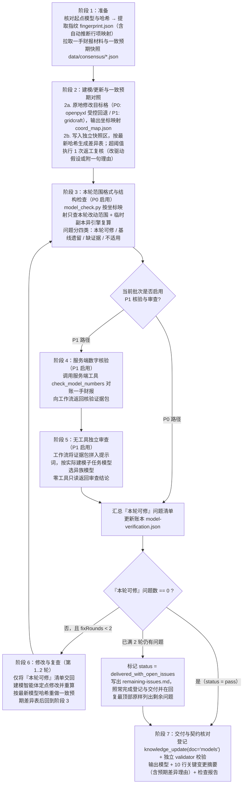

# 公司财务建模 v2 设计方案——默认格式模板、原地编辑与工作流闭环核验

> **状态**：第 3 轮修订定稿（纳入两轮审查裁决与 11 项架构决定，待按批实施）
> **适用形态**：同时支持 **Everflow 生产形态**（部署形态配置变量 `DALTON_PROFILE=everflow`）与 **独立核心安装形态**（`DALTON_PROFILE=core`，双形态分离规范见 `docs/dalton/features/standalone-core.md`）
> **演进关系**：完整沿用 `plugins/dalton/skills/dalton-model/` 与 `plugins/dalton/skills/dalton-conventions/references/model-standards.md` 的全部既有建模约定，在其之上升级默认模板投放、工作簿原地编辑、本轮范围增量检查与多阶段建模工作流；在 P1 接入 `gridcraft`（命令行电子表格原地编辑与重算工具）时同步修订 `docs/dalton/archive/dev-guide/README.md` 决定记录 `L14`

---

## 一页摘要

### 1. 核心目标

围绕核心诉求——**「保留全部既有建模约定，按原始中国电商模型的公司工作表标准格式新建模型，或在存量模型上根据新财报扩展期间、更新实际数与预测、补充和修改必要项目，保持原有格式与公式结构完好，独立建模后再对照一致预期，并通过与报告一致的工作流反馈回路保障质量，全程零额外确认步骤」**——将建模链路升级为**「模型指纹与坐标映射对齐 + 原地目标格编辑 + 独立建模后对照一致预期 + 本轮范围四分类检查与最多两轮修改回路 + 带问题顺畅交付」**。

### 2. v1 与 v2 核心机制对比

| 维度 | v1 现状（`modeling-skill.md`） | v2 方案（本文） |
|---|---|---|
| **既有建模约定与版本链** | 写在提示词中靠智能体自觉遵守；深度链解析固定匹配单公司文件名 | **100% 沿用现有建模约定与文件命名**（第 2 章）：单公司模型沿用 `model/<TICKER>-model-vNN.xlsx`（`.xlsx` 为 Excel 电子表格工作簿），多公司行业整本沿用原文件名递增版本；行业模式按家串行时显式传递上一轮完成路径与 `SHA-256`（安全哈希算法 256 位摘要），深度链与完整覆盖解析逻辑统一对齐 |
| **默认格式来源与投放** | 仅提供样式常量与统计摘要 | 以首轮会话、附件 ID 与时间线锁定改坏前的中国电商原件并经 `dalton_chat_file_uploads.actual_sha256` 校验字节，脱敏提取「公司 `sheet`（工作表）标准格式」模板，随现有技能同步机制自动投放到沙箱 |
| **编辑与异引擎复算** | 智能体常编写大型 `openpyxl`（Python 电子表格读写库）脚本整本重写 `.xlsx`；`insert.py` 强制写 `fullCalcOnLoad=1`（打开时强制全表重算属性） | **P0 采用受控 `openpyxl` 只改目标格回退**（修正 `insert.py` 写 `fullCalcOnLoad=1` 问题），**P1 接入 `gridcraft`**；两条路径统一输出插行列后的坐标映射；在临时副本上用异于写入方的引擎（`LibreOffice`〔开源办公套件〕无头重算或服务端 `gridcraft check`）复算并核验实际写回状态 |
| **检查范围、分类与勾稽** | 单智能体手写 `Checks` 页 + `model_scan.py` 全表提示性扫描 | **只检查本轮改动单元格、新增期间列与预测区**；按「原格 → 新位置」对齐合法平移；按自动推断的行项类型（流量 / 期末余额 / 均值 / 去重 `KPI`〔关键经营指标〕 / 比率）核验勾稽；问题分为**「本轮可修 / 基线遗留 / 缺证据 / 不适用」**四类，仅「本轮可修」交回修改，避免两轮被历史遗留项耗尽 |
| **一致预期隔离与对照** | 常在建模过程中向结果格直接写入目标常数或缓存值碰撞误判 | **独立建模在前、对照在后**：外部参考值写入单独标注的快照单元格区；仅在「本方结果格为常数且等于一致预期」或「公式直接/可确定间接依赖快照单元格」时判问题；每次改模后按最新哈希重做差异表 |
| **工作流、完成契约与交付** | 单步子任务派发，异常转 `null` 易中断整条深度链 | 共享流水线 `runModelingPipeline` 始终返回结构化结果；最多两轮修改后仍有问题时状态为**「带问题交付」**，独立校验器（`validator`）接受该终态，深度链与完整覆盖继续推进并在回复顶部列出剩余问题 |

### 3. 分批实施概览（严格对齐阶段、契约、工具与文件）

- **P0（母本锁定与模板同步 + 指纹与坐标对齐 + `openpyxl` 受控编辑与 `fullCalcOnLoad` 修正 + 本轮范围检查〔四分类〕与一致预期对照 + 工作流两轮回路与带问题交付 + 一轮一家 + `Home`〔主空间〕附原话）**：仅启用「准备 → 建模/更新与一致预期对照 → 本轮范围格式结构检查（含异引擎临时副本复算）→ 最多两轮修改 → 带问题交付」，P0 终态与契约仅绑定上述阶段产物。
- **P1（`gridcraft` 接入 + 服务端数字核验 + 无工具异族独立审查）**：接入 `gridcraft`（明确 Linux 二进制来源与校验摘要，或封装为服务端工具；修订 `L14`）+ 服务端执行数字核验工具 `check_model_numbers`（向工作流交付核验证据包）+ 无工具独立审查（材料由工作流放入提示词，按实际建模子任务模型选不同家族模型），并入两轮修改回路。
- **P2（历史披露数据结构化自动填充）**：法定财报 `XBRL`（可扩展商业报告语言）与财报表格结构化提取 → 行项映射持久化缓存 → 历史实际值与累计拆单季确定性回填。

---

## 1. 现状与问题（附实测证据与代码根因）

### 1.1 近期真实案例与实测证据

在中国电商多公司整本模型（连续 3 天、6 轮迭代仍无法投入使用）及龙溪模型更新任务中，暴露出四类核心故障：

1. **整本重写破坏公式链与视图版面**：
   - 智能体编写了一个约 **14 万字节**的 `openpyxl` 脚本，在 Python 中把预测数字算成浮点数后从头写出整本 `.xlsx`。
   - **公式退化为常数**：`v2.0` 交付件预测期出现 **917 个硬编码数字常数**，原本动态联动的收入、利润行变成死数字。
   - **冻结窗格严重错位**：京东主表 `Model - JD` 原冻结位置为 `xSplit=10, ySplit=2`（横向冻结 10 列、纵向冻结 2 行，对应 `topLeftCell="K3"`），重写后错位至 `xSplit=51, ySplit=101`。
   - **样式重建与未计算掩盖**：全书样式从头重设，且工作簿被写入 `fullCalcOnLoad=1` 掩盖空缓存值。
2. **「贴合一致预期」时直接改写结果行，造成集团与分部脱节**：
   - 调整预测对比市场一致预期（`Consensus`，卖方分析师预测统计均值）时，直接向利润结果格写入目标常数，绕过底层业务分部驱动。
   - `Model - JD` 中**集团营业利润（54.7B〔十亿〕）与各业务分部营业利润加总（约 44B）相差超过 10B**，上下游计算链断裂。
3. **历史披露数据空缺且缺少服务端对源核验**：
   - 分部改口径后的新口径历史可比同期数据留空，资产负债表历史核心科目缺失；已填入的历史数缺少与研究报告 `check_draft` 同级的服务端一手财报对源核验。
4. **单轮自写自查，缺少增量范围区分与受控反馈闭环**：
   - 工作簿内的 `Checks` 页与自检脚本均由同一智能体编写并自跑，在存在 917 个预测常数与 10B 分部脱节的情况下仍报告**「40/40 全通过」**；同时若对存量历史列套用刚性恒等式，又会在原模型既有的 `CIQ`（Capital IQ，标普金融终端插件）公式、受限现金口径或历史未重述列上稳定误报，耗尽修改轮次。

### 1.2 现有代码层成因定位

1. **深度链与完整覆盖的模型解析写死单公司命名，且异常转 `null` 会中断整条链**：
   - `workflows/earnings-deep-update/workflow.js:94-105,126-132` 与 `workflows/full-coverage/workflow.js:293-310,354-358` 固定执行 `ls model/${T}-model-v*.xlsx` 与正则 `/-model-v(\d+)\.xlsx$/`，遇到多公司行业整本沿原文件名递增版本时解析返回 `null` 并终止工作流；`prelude.js:82-88` 的 `parallel()` 会将子任务运行期异常收敛为 `null`，若共享建模函数直接抛错或返回 `null`，调用方无法按「两轮后带问题交付」继续后续环节；`full-coverage/workflow.js:471-476` 另有独立步骤向 `model-check.md` 写入智能体手写报告，会覆盖确定性代码检查输出。
2. **扩列与复算脚本存在默认行为冲突**：
   - 上游扩列脚本 `plugins/langalpha_deliverables/skills/xlsx/scripts/insert.py:1332` 在每次插行列后固定写入 `calc.set("fullCalcOnLoad", "1")`；
   - 重算脚本 `plugins/langalpha_deliverables/skills/xlsx/scripts/recalc.py:528-545,564-592` 默认拒绝含外部工作簿链接的模型（退出码 `1`），且在存在未匹配公式（`unmatched > 0`）但未传 `--force` 时返回退出码 `0`、`status: "incomplete"`、`written: false`（原文件实际未写回新缓存值）；
   - `gridcraft-cli`（0.19.1）目前仅安装在宿主机 `~/.local/bin/gridcraft-cli`，Linux 沙箱镜像（`Dockerfile.sandbox` 与 `_image_recipe.py`）内尚不可用（仅装有 `LibreOffice` 与 `IronCalc`〔Rust 电子表格计算引擎〕）。宿主机实测 `gridcraft-cli` 对中国电商原模型 57,173 条公式重算耗时 0.7 秒，保留冻结窗格，保存时会丢弃可选的 `calcChain.xml`（公式求值顺序缓存）与 Excel 2010 扩展条件格式（`<extLst>` / `x14`，即工作表扩展节点列表与条件格式扩展命名空间）。
3. **子智能体工具集与选模机制限制**：
   - `src/ptc_agent/agent/subagents/merge.py:130` 对所有插件/自定义子智能体默认挂载完整 `filesystem` 工具集（同时包含读写工具），仅声明 `tools: [web]` 仍具备写文件能力；工作流 `opts.reviewDraft`（`driver.py:593-597`）仅在服务端计算被审文件哈希写入运行日志，本身不会把文件内容塞进提示词，且 `QuickJS`（嵌入式轻量级 JavaScript 引擎）脚本无权直接读取工作区磁盘文件；
   - `agent_config.dalton.yaml:10,77` 中主回合模型默认为 `claude-opus-5-5-oauth`，而实际执行建模的 `general-purpose` 子智能体配置为 `grok-4.7-oauth`，`dalton-reviewer.md:3` 则静态钉死 `gpt-6.2-sol-oauth`；若按主回合模型选审稿家族，在用户调整子智能体模型后可能与实际建模子任务撞上同一模型家族；
   - 服务端治理工具（`src/dalton/tools/__init__.py`）默认仅挂载给主智能体，工作流子智能体仅在 `src/ptc_agent/agent/agent.py:1017-1029` 显式挂载了 `check_language`。
4. **`Home` 转派未附用户原话**：`src/tools/secretary/chief_of_staff.py:182-229` 的 `delegate_to_analyst` 仅传递改写后的任务说明，存在遗漏用户原始格式与口径要求的可能。

### 1.3 决定记录 `L14` 修订（在 P1 接入 `gridcraft` 时生效）

在 P1 完成 `gridcraft` 沙箱或服务端接入后，将 `docs/dalton/archive/dev-guide/README.md` 第 6.2 节 `L14` 修订为：
> **新 `L14`：「`gridcraft` 作为原地编辑引擎与异引擎交叉复算选项之一；主流程交付物与持久化载体仍是标准 `.xlsx` 文件。编辑过程导致的 Excel 2010 扩展条件格式（`<extLst>` / `x14`）丢失或变动在检查报告中如实列出，作为提示信息展示。」**

---

## 2. 沿用的现有建模约定（逐条溯源与代码检查映射）

建模 v2 是在现有 `dalton-model` 技能与 `dalton-conventions` 方法论之上的**流程编排与工具自动化升级**，完整沿用既有建模约定与文件命名规则。下表逐条列出沿用的约定、仓库原文出处及在 v2 中的自动化落点：

| 约定类别 | 沿用的具体建模约定内容 | 原文精确出处 | v2 自动化检查与执行落点 |
|---|---|---|---|
| **核心规则 1：预测期全公式与驱动调整** | 收入、成本、费用、利润等预测期金额全部由公式算出（如 `=GMV〔商品交易总额〕× Take rate〔货币化率〕`、`=去年同期×(1+增速)`、`=各分部之和`）；调预测数值只改驱动假设输入格；调建模方法可改公式结构并在变更记录写明；管理层直接给出的金额指引（如明年 `CapEx`〔资本开支〕金额）在对应区块或表下方单设输入格（套驱动假设格式，最右备注列写来源），预测行用公式引用该输入格；原模型里是公式的预测行更新后保持为公式。 | `plugins/dalton/skills/dalton-model/SKILL.md` 第 14–18 行 | 代码检查 **`C03`**（按坐标映射对齐核查本轮改动区与预测区公式保留、管理层金额指引独立输入格引用） |
| **核心规则 2：季度汇总年度列按行项类型计算** | 同表已有对应四财季列的年度列全部由公式算出，驱动假设只放在预测季度列和无季度拆分的远期年度列：<br/>- 流量（收入、成本、利润、现金流）：四季相加；<br/>- 时点期末余额（现金、债务、期末股本）：取财年最后一季；<br/>- 比率（增速、利润率、`Take rate`、占比）：用本年度列分子和分母重算；<br/>- 年度 `EPS`（每股收益）：年度利润 ÷ 年度加权平均稀释股数（兼容原表既有同口径公式）；<br/>- 用户数、活跃商家等 `KPI`：按公司披露口径（第四季期末、四季均值或披露的年度去重数）。 | `plugins/dalton/skills/dalton-model/SKILL.md` 第 19–24 行 | 指纹自动推断行项类型映射 `line_item_map` + 代码检查 **`C10`**（仅对流量行做四季加总，期末余额取末季，`KPI` 按披露口径，无法推断行标「不适用」） |
| **核心规则 3：一致预期重大差异归因** | 本方预测与一致预期或主要卖方预测存在重大差异时，拆到分部、驱动假设、费用、利息、股本查明来源：有可核实的新信息支撑就保留判断并写明理由；发现自身驱动假设遗漏或口径错误就修正驱动假设。 | `plugins/dalton/skills/dalton-model/SKILL.md` 第 25 行；`references/sanity-check.md` 第 23–30 行 | `model_consensus.py` 每次改模后按最新哈希重做差异表 + 超阈值返工复核 + 代码检查 **`C04`**（快照隔离与差异理由检查） |
| **核心规则 4：原模型维护、文件命名版本链与变更记录** | 提供或存在原模型时在原模型基础上维护，原模型保持只读，修改版另存至 `model/`：**单公司模型命名为 `model/<TICKER>-model-vNN.xlsx`；多公司行业整本模型保留整本结构，沿用原文件名格式递增版本号或日期**；在最前面的 `README & Changelog`（或原模型既有 `Change Log`）工作表写明版本号、日期、基线文件、补充的实际值、新增期间、修改的驱动假设及理由、结构调整及与一致预期的主要差异理由。 | `plugins/dalton/skills/dalton-model/SKILL.md` 第 10、26、34、60–63 行；`references/rollforward.md` 第 3、45–51 行 | `model_edit.py` 版本链生成器 + 行业串行显式传递路径与哈希 + 代码检查 **`C01`**（表顺序与变更记录更新） |
| **期间覆盖跨度与单向扩展** | - 新建模型历史跨度：年度历史至少自 `FY2018A`（或招股书最早完整财年）连续覆盖至最近完整财年；单季历史至少自 `2024Q1A` 连续覆盖至最近已披露季度；<br/>- 预测跨度：季度预测逐季覆盖本财年剩余季度与下一完整财年直至次年 `Q4`（如当前 `FY26` 做到 `4Q27E`）；年度预测至少覆盖 3 个完整财年至下下财年（如 `2026E–2028E`）；<br/>- 单向向后扩展，保留原模型全部既有历史列；非自然年结账公司在 `A2` 或表头旁注明财年截止月（如 `FY ends Mar`）。 | `plugins/dalton/skills/dalton-conventions/references/model-standards.md` 第 5–10、92–94 行；`dalton-model/references/forecast-rules.md` 第 5–11 行 | 代码检查 **`C02`**（按公司财历与本轮任务范围校验新增期间跨度、存量历史列完整保留） |
| **一手披露取数、累计拆单季与空值留空** | - 历史实际数取一手监管定期报告（美股 `SEC`〔美国证券交易委员会〕`10-K`/`10-Q`/`20-F`〔年报、季报、外国发行人年报〕，港股/A 股法定财报与业绩公告）；<br/>- 仅披露累计期间（`6M`/`9M`/`FY`）时按算术差分推导单季（`Q2=H1-Q1`、`Q3=9M-H1`、`Q4=FY-9M`），标记为披露衍生值并注明两期财报出处；<br/>- 未披露细项或未单独预测假设留空（`Blank`），确认实际发生或显式预测为零时填 `0`；<br/>- 财报更新后完成当季实际值相对前版预测的事后偏差分解并记入修订日志。 | `plugins/dalton/skills/dalton-conventions/references/model-standards.md` 第 16–33、52–65 行；`dalton-model/references/forecast-rules.md` 第 208–220 行 | 代码检查 **`C08`**（本轮新增历史列必填披露项与预测期裸 `0` 检查）+ **P1 服务端数字核验** `check_model_numbers` |
| **季节性、大促跨季与管理层指引** | - 季度路径按历史季节性设定在各季假设上；<br/>- 春节移动与 618/双十一/黑五跨季挪动单设「日历调整」驱动假设行并在相邻季度做等额反向调整；53 周财年仅计入多一周当季；<br/>- 指引记录：单设「指引」表或指引区记录发布日期、适用期间、指标、数值、实际值与兑现情况；季度预测采用全年指引时，剩余季度引用「全年指引 − 已披露累计」按季节性拆分，年度列保持四季公式之和。 | `plugins/dalton/skills/dalton-model/references/forecast-rules.md` 第 9、65–66、81–100 行 | 代码检查 **`C10`**、**`C13`**（平移后零新增循环引用）+ **P1 无工具异族独立审查** |
| **版面样板、表头与最右备注列** | - 版面列序：`A–D` 缩进与标签列 → 年度列 → 窄空隔列 → 可选 `CAGR`（复合年增长率）列 → 窄空隔列 → 季度列 → 最右备注列；行序依次为表头与 `A1` 单位、利润表（浅蓝 `99CCFF`）、`Non-GAAP`（非公认会计准则，棕红 `993300`）、分部报告（棕红）、业务拆解区（浅桃 `FFCC99`）、现金流量表（浅蓝）、资产负债表（浅蓝）；多公司模型前放行业页并以 `{TICKER}>>` 空白页分隔；<br/>- 第 1 行亮蓝底 `3366FF` 白字加粗，英文数字 `Arial` 8 号、中文 `等线` 8 号；驱动假设与管理层金额指引 `FFFFC8` 浅米黄底配 `hair` 细虚线框；存量历史年度汇总公式保留原蓝字，新增年度汇总列用黑字 `000000`；<br/>- 来源和说明写在数据区最右侧备注列（红字 `FF0000`，以 `<` 或 `<<` 开头），工作簿保持零新增单元格批注。 | `plugins/dalton/skills/dalton-model/references/forecast-rules.md` 第 13–43 行；`references/format-spec.md` 第 18–88 行 | 默认格式模板继承 + 代码检查 **`C05`**（按位置用途与原表画像规范化比较样式、备注列与批注检查）与 **`C06`**（合法平移后的窗格、列宽、分组检查） |
| **一致预期取数、口径对齐与基础检查** | - 按部署能力（`src.dalton.capabilities`）调用可用数据源取数并落盘 `data/consensus/<YYYY-MM-DD_HHMM>.json`；<br/>- 比较前先对齐财年截止日、币种、会计口径（`GAAP`〔公认会计准则〕/`IFRS`〔国际财务报告准则〕与 `Non-GAAP`）、普通股与 `ADS`（美国存托股份，`EPADS` 为每份美国存托股份收益）及是否反映最新财报；<br/>- 核对全表金额单位一致、币种换算一致、估值页目标年份引用列已同步指向新预测列。 | `plugins/dalton/skills/dalton-model/references/sanity-check.md` 第 6–21 行；`SKILL.md` 第 55 行 | `model_consensus.py` 口径核对 + 代码检查 **`C07`**（单位标识、汇总表公式与估值页引用列同步） |

---

## 3. 建模工作流、失败语义、完成契约与跨工作流复用

### 3.1 单一建模工作流 `workflows/company-model/` 与版本链约定

参照现有工作流引擎（`src/ptc_agent/agent/middleware/background_subagent/workflow/driver.py` 的 `QuickJS` 编排器与 `src/dalton/workflows/contracts.py` 完成契约），设立单一建模工作流 `workflows/company-model/`（含 `workflow.js` 与 `contract.json`），统一承载新建与滚动更新：

1. **输入参数（`args`）**：
   - `ticker`（必填）：本轮唯一目标公司股票代码（如 `"PDD"`、`"JD"`、`"META"`）；
   - `workspace_dir`（必填）：当前工作区根目录（`"."`）；
   - `as_of`（必填）：基准日期 `YYYY-MM-DD`；研究目录固定按契约已有参数构造为 `research/{as_of}-model-{ticker}`；
   - `mode`（可选，默认 `"auto"`）：`"build"`（按默认格式模板新建）、`"update"`（存量模型滚动更新）或 `"auto"`（检测到 `model_path` 或工作区已登记模型时自动走 `"update"`，否则走 `"build"`，全程零额外人工确认）；
   - `model_path`（可选）：起点模型路径；行业整本按公司串行更新时，显式传入上一家公司刚完成的整本路径；
   - `expected_baseline_sha256`（可选）：行业整本串行更新时传入上一轮完成文件的 64 位 `SHA-256`，准备阶段先校验磁盘起点文件哈希与之完全一致，确保按家串行严格衔接在同一条版本链上；
   - `consensus_thresholds`（可选）：按公司特征微调的一致预期差异复核阈值；
   - `progress_path`（可选）：断点续跑进度文件路径（默认 `research/{as_of}-model-{ticker}/.progress.json`）。
2. **文件命名与版本链规则（沿用现有约定）**：
   - **单公司模型**：输出路径沿用 `model/<TICKER>-model-vNN.xlsx`（首次为 `v01`，后续取当前最大版本号加一，如 `v02`、`v03`）；
   - **多公司行业整本模型**：识别到起点文件为多公司整本（工作簿含多个公司标签页或原文件名非单公司 `<TICKER>-model-vNN.xlsx` 形态）时，**沿用原文件名格式递增版本号或日期后缀**（例如 `model/China_Ecommerce_v03.xlsx → model/China_Ecommerce_v04.xlsx` 或 `model/ecom_20261008.xlsx → model/ecom_20261127_v01.xlsx`）；一轮只更新目标 `ticker` 所属工作表与 `README & Changelog`，其余公司工作表保持原样。



### 3.2 共享建模流水线的失败语义与完成契约

1. **共享函数 `runModelingPipeline` 的结构化返回契约（永不抛子任务异常、永不返回 `null`）**：
   - `workflows/_shared/modeling_stages.js` 中的 `runModelingPipeline(ctx)` 用 `try / catch` 内部接住每次子任务派发（`agent(...)`）的超时、空返回与工具错误（仅保留 `QuickJS` 引擎对脚本自身代码错误 `TypeError` / `ReferenceError` 的上抛约定，见 `prelude.js:47-60`），**始终返回结构化对象**：
     ```json
     {
       "status": "pass | delivered_with_open_issues | skipped_no_model | failed_unusable",
       "candidate_path": "model/PDD-model-v03.xlsx",
       "model_sha256": "4d91e0...",
       "baseline_path": "model/PDD-model-v02.xlsx",
       "baseline_sha256": "8a12bc...",
       "fix_rounds": 2,
       "artifacts": [
         "research/2026-11-27-model-PDD/model-verification.json",
         "research/2026-11-27-model-PDD/model-check.md",
         "research/2026-11-27-model-PDD/consensus-diff.md"
       ],
       "actionable_issues": ["..."],
       "open_issues_by_class": {
         "actionable": ["..."],
         "baseline_legacy": ["..."],
         "missing_evidence": ["..."],
         "not_applicable": ["..."]
       },
       "remaining_issues_path": "research/2026-11-27-model-PDD/remaining-issues.md",
       "summary_10lines": "...",
       "evidence_pack": {}
     }
     ```
   - **四态流转规则**：
     - `"pass"`：候选 `.xlsx` 可读且已写回重算缓存值，且「本轮可修」（`actionable`）问题为 0；
     - `"delivered_with_open_issues"`（**带问题交付**）：候选 `.xlsx` 可读且已写回重算缓存值，经过最多 2 轮修改后仍留有「本轮可修」问题（或某步复查子任务超时降级并已记入问题清单），已生成非空的 `remaining-issues.md`；
     - `"skipped_no_model"`：深度链未传入 `model_path` 时的无模型跳过态；
     - `"failed_unusable"`：建模阶段未能产出可由 `model_readable.py` 正常读取的 `.xlsx` 文件（此时 `candidate_path: null`，问题原因写入 `actionable_issues`，依然返回完整对象而不会让 `parallel()` 收成 `null`）。
2. **复用报告两轮反馈机制并配备建模专用完成契约**：
   - 沿用报告工作流的两轮控制结构（`workflows/earnings-deep-update/workflow.js:246` 的 `rounds < 2`）与侧车哈希绑定思想（`src/dalton/publish/language.py:620-705`、`src/dalton/tools/check_done_tools.py:3046-3071`），建立建模轮次账本 `model-verification.json`；
   - **契约路径仅使用各契约已声明的 `params_required` 参数构造**（适配 `src/dalton/workflows/contracts.py:135-184` 的 `render_template` / `render_command`，每个占位符作为独立命令行参数传递）：
     - `workflows/company-model/contract.json`：`params_required: ["ticker", "workspace_dir", "as_of"]`，研究目录写为 `research/{as_of}-model-{ticker}`；
     - `workflows/earnings-deep-update/contract.json`：`params_required: ["ticker", "quarter", "workspace_dir", "release_date"]`（模型阶段带 `"requires_param": "model_path"`），研究目录写为 `research/{release_date}-deep-{quarter}`；
     - `workflows/full-coverage/contract.json`：`params_required: ["ticker", "workspace_dir", "as_of"]`，研究目录写为 `research/{as_of}-fc`。
   - **账本绑定字段**：`model-verification.json` 记录 `workflow`、`run_id`（从驱动维护的 `.progress.json` 读取，并在 `dalton_check_done` 服务端与本次运行 `run_id` 交叉核对）、`baseline_path`、`baseline_sha256`、`enabled_stages`（P0 为 `["check", "consensus"]`，P1 扩展为 `["check", "consensus", "audit", "review"]`）、`rounds[]`（每轮候选路径、`model_sha256`、各启用阶段报告哈希与四类问题统计）以及终态 `final_status`、`final_model_path`、`final_model_sha256`、`remaining_issues`。
   - **独立建模 `validator`（接受「两轮后带问题交付」终态）**：
     - 建模契约采用独立校验命令 `python3 .agents/skills/dalton-model/scripts/model_check.py verify-done --workspace {workspace_dir} --ticker {ticker} --research-dir <契约参数拼装目录>`，并在 `src/dalton/tools/check_done_tools.py` 增加账本 `run_id` 闭合核对（不使用报告 `stage.review` 要求最终结论必须为 `"pass"` 的规则）；
     - 通过条件同时核实四项：① 账本 `run_id` 与当前工作流运行一致（手动降级路径 `manual=true` 核对本轮时间窗口）；② `final_model_path` 在工作区 `model/` 下真实可读且实时 `SHA-256` 与 `final_model_sha256` 及最后一轮各阶段证据绑定的 `model_sha256` 完全相等（包含最新的 `consensus-diff.json`）；③ 本批启用的全部阶段在末轮均有执行记录；④ 终态满足 `final_status == "pass"`，或满足 `fix_rounds == 2` 且 `final_status == "delivered_with_open_issues"` 且 `remaining-issues.md` 非空。

### 3.3 `earnings-deep-update` 与 `full-coverage` 共用流水线及解析对齐

通过 `src/dalton/content_assembly.py` 在装配期支持受控片段内联指令 `/* DALTON_INCLUDE:_shared/modeling_stages.js */`（先展开 `_shared/*.js` 再统一执行 `/* DALTON_CAP:... */` 能力条件块裁剪与 `QuickJS` 语法校验），使三条工作流共用同一份 `runModelingPipeline`：

1. **`workflows/earnings-deep-update/` 接入与保留项**：
   - **保留「无模型」分支**：当 `!args.model_path` 时，`runModelingPipeline` 直接返回 `{ status: "skipped_no_model", candidate_path: null, ... }`，深度链与现行逻辑完全一致，仅运行八节点评、校准对账与报告审稿；
   - **保留深度链原有模型附属产物**：当传入 `args.model_path` 时，`runModelingPipeline`（通过 `extraDeliverables: ["mapping.md", "model-delta.md"]` 选项）在建模阶段同步产出 `${R}/mapping.md`（财报行项与模型行项映射说明）与 `${R}/model-delta.md`（新旧版本 `EPS` 变动拆解与估值变化），继续纳入笔记两轮语言审查与最终产物核验；
   - **对齐模型路径解析**：删除深度链写死单公司文件名的 `ls model/${T}-model-v*.xlsx` 与 `/-model-v(\d+)\.xlsx$/`，改为直接读取 `modelResult.candidate_path` 与 `modelResult.model_sha256`（辅以按该精确路径核验磁盘 `sha256sum`，兼容单公司与多公司行业整本两种命名）；
   - **并行阶段标签隔离与带问题继续**：在 `parallel([八节点评, runModelingPipeline(..., { emitTopPhase: false, phaseLabel: '深度点评与模型' })])` 中，建模支线只在各子任务 `agent(..., { phase: '深度点评与模型' })` 上标阶段而不调用全局 `phase()`，避免冲掉并行主阶段标题；当 `modelResult.status` 为 `"pass"` 或 `"delivered_with_open_issues"` 时，深度链均正常进入「校准与对账 → 审稿 → 知识层修订草案」，仅在 `"failed_unusable"` 时记入 `incomplete`；若报告审稿阶段触发模型联动修改，调用共享辅助函数按同一版本链递增规则另存并重跑检查刷新 `model-verification.json`，确保报告内 `model:` 引用、账本终态哈希与磁盘文件三者一致。
2. **`workflows/full-coverage/` 接入与清理**：
   - 将第 4 阶段单步建模替换为 `runModelingPipeline`（传入完整覆盖 `15` 页新建规格 `specPath: '.agents/skills/dalton-full-coverage/references/model-spec.md'`，兼容存量模型滚动维护与无模型时新建含 `Scenarios`〔情景分析〕页的完整模型）；
   - 当返回状态为 `"pass"` 或 `"delivered_with_open_issues"` 时，完整覆盖照常进入「成稿 → 语言审查 → 独立审稿 → 修订」，在最终交付顶部附上模型剩余问题（若有）；仅在 `"failed_unusable"`（无可读模型文件）时停在成稿之前并给出 `resume` 指引；
   - 删除 `full-coverage/workflow.js:471-476` 中原有的 `只读审模型` 并行子任务（避免智能体手写文本覆盖确定性代码生成的 `${R}/model-check.md`），并将机器生成的 `model-check.md` 从 `notesReview`（第 `603` 行笔记语言审查清单）中移出；模型路径解析同步改为读取账本记录的 `final_model_path`（契约 `artifacts` 移除写死的 `model/{ticker}-model-v*.xlsx` glob，交由 `verify-done` 精确核对账本绑定的模型文件、最小字节数与可读性）。

### 3.4 单轮范围控制、行业整本串行传递与 `Home` 转派附原话

1. **一轮只更新一家公司，行业整本显式传递路径与哈希**：
   - 单次运行 `company-model` 固定接收唯一目标 `ticker`，仅修改该公司所属工作表及 `README & Changelog`；
   - 当用户在行业工作区要求更新多家成员公司时，主智能体按公司拆分为串行多次运行：第 1 家完成后，从返回结构读取 `candidate_path` 与 `model_sha256`，在启动第 2 家时显式作为 `model_path` 与 `expected_baseline_sha256` 传入，逐家累进整本版本号（如 `v01 → v02 → v03`），杜绝并发或回退到旧 `current` 底稿造成前序公司改动丢失；
   - **工作区路由守卫对齐**：在 `src/dalton/workflows/company_routing.py` 将 `"company-model"` 加入 `COMPANY_WORKFLOWS`（同步更新 `tests/unit/dalton/test_company_routing.py`），并在 `resolve_launch_company_routing` 与 `routing_hint_for_check` 共用同一判定：当当前工作区为行业工作区（`is_sector == True`）且 `model_path` 指向本工作区内的多公司整本模型时，即使调用者名下另建有该成员公司的单公司工作区，也允许在当前行业工作区就地运行并核对 `company-model`（与带整本 `model_path` 的深度链），同时继续执行 `_guard_workspace_dir` 确保产物留在当前工作区。
2. **`Home`（研究总监 `Chief of Staff`）转派自动附上用户原话**：
   - 在 `src/tools/secretary/chief_of_staff.py` 与 `src/tools/secretary/dispatch.py`（附 `# DALTON-HOOK(cos-verbatim-forward): append user verbatim message on analyst handoff` 并在 `scripts/dalton/check_hooks.sh` 登记，`DALTON-HOOK` 为 Dalton 在上游源码中标注的差异挂载点注释），`delegate_to_analyst` 从当前回合 `state["messages"]` 提取最新一条用户消息原文，若派发 `question` 未逐字包含该原文，则在末尾自动追加 `<user_verbatim_request>...</user_verbatim_request>` 原话块；同步在 `src/ptc_agent/agent/prompts/templates/components/chief_of_staff.md.j2` 写明多公司建模请求按一家公司一轮串行派发。

---

## 4. 原版母本恢复（China Ecommerce）、模板沙箱投放与模型指纹

### 4.1 改坏前中国电商母本锁定、验真与模板沙箱投放

用户原始的 **China Ecommerce（中国电商）模型在被智能体改坏之前的版本**中，各公司工作表即为团队标准格式。默认格式模板直接从该改坏前的原版母本脱敏提取，定位、校验与投放流程规定如下：

1. **原版母本定位与字节级哈希校验（首选可信上传记录，镜像与备份仅作补查）**：
   - **首选路径（会话时间线 + 可信上传台账校验原始字节）**：
     1. 查询中国电商工作区的最早对话线程与回合记录（PostgreSQL〔开源关系型数据库〕中的 `conversation_threads`、`conversation_responses` 及消息附件元数据），按时间线锁定首轮改模任务启动之前用户上传的原始 `.xlsx` 附件 ID；
     2. 读取聊天大文件上传可信台账表 `dalton_chat_file_uploads`（定义于 `src/dalton/database/chat_uploads.py:3,23-48`），核对 `upload_id`、`workspace_id`、`filename`、`created_at` 与服务端落盘实测哈希字段 **`actual_sha256`**（若走小附件通道则核对 `chat_attachments` 表记录），在 `cleaned_at IS NULL` 时从 `MinIO`（兼容 `S3`〔通用对象存储接口协议〕的对象存储服务）对应 `object_key`（或工作区只读上传落地文件 `work/uploads/<stem>_<id8>.xlsx`）提取文件字节，并二次计算 `SHA-256` 与 `actual_sha256` 严格比对一致；
     3. 同时读取工作区早期 `research/*/model_lineage.json` 的 `baseline_path` / `baseline_sha256` 与 `dalton_knowledge_versions`（`doc_key = 'models'`，仅存路径与元数据）辅助印证最初基线文件名与时间点。
   - **补查路径（仅当上传对象已超期清理时启用）**：
     1. 工作区离线文件镜像表 `workspace_files`（`src/server/database/workspace_file.py:109`，该表按 `(workspace_id, file_path)` 覆盖更新，仅在原文件名路径未被同名覆写、或底层内容寻址对象尚未被垃圾回收清理时用于补查提取）；
     2. Everflow 周度异地加密备份（`scripts/dalton/ops/dalton_data_backup.sh:58-70,270-277` 将 `MinIO` 卷与未超过 `SANDBOX_MAX_GB=5` GB 上限的沙箱 `/home/workspace` 经 `AES-256-CBC`〔高级加密标准 256 位密码分组链接模式〕加密归档至远端并保留 4 周）：由生产专用只读脚本 `scripts/dalton/ops/prod/recover_baseline_model.sh` 从改坏发生日之前且未被 `5GB` 阈值跳过的归档中流式解密补查。
   - **P0 验收前固化母本档案**：在 P0 验收前，将锁定的母本来源（线程 ID、`upload_id` / 存储键、原始文件名、上传时间戳）与 64 位 `SHA-256` 写入工程溯源说明；同时在日常滚动更新启动前检测起点文件健康度——若起点文件本身已带整本重写损坏特征（如预测区大面积退化为常数且无公式链），向工作流报告起点异常，避免把损坏文件当作格式参照母本。
2. **可解释原版特征校验与脱敏提取（`extract_default_template.py`）**：
   - 候选母本须通过四项可解释结构校验（支持通过参数显式指定已核实哈希的母本路径，不绑死单一版本精确公式条数）：① 文件时间戳早于首轮改模回合且文件名无 `-model-vNN` 智能体后缀；② `xl/workbook.xml` 的 `<calcPr>` 未被强置 `fullCalcOnLoad="1"`；③ 各公司主表预测期金额行保持完整公式链且冻结窗格位于表头与标签列交界（非 `xSplit=51, ySplit=101` 等错位值）；④ 具备原生 `Arial`/`等线` 8 号字、亮蓝表头 `3366FF`、浅米黄假设格 `FFFFC8`、三级分节底色与最右红字 `FF0000` 备注列样式槽。
   - 提取单公司标准页签骨架（`README & Changelog`、`Valuation`、`Key Metrics`、`Model`、`Subs` 与含独立快照区的 `vs Consensus`），彻底清除具体公司业务数值、代码名称与外部 `CIQ` 链接，校验产出文件 `plugins/dalton/skills/dalton-model/assets/default_model_template.xlsx` **零残留公司专有业务数据、零外部工作簿链接、零 `#REF!`（断裂引用错误）断引用**。
3. **通过现有技能同步机制投放到沙箱（双形态一致可用）**：
   - 平台现有沙箱资产同步逻辑 `src/ptc_agent/core/sandbox/assets.py:1656-1686`（`_upload_skills`）在沙箱启动与技能更新时，会自动将 `plugins/dalton/skills/dalton-model/` 下除 `__pycache__` 与 `LICENSE.txt` 外的全部子目录文件（含二进制 `.xlsx`）同步至沙箱 `.agents/skills/dalton-model/assets/default_model_template.xlsx`；
   - 因此在 `DALTON_PROFILE=everflow` 与 `DALTON_PROFILE=core`（`dalton-model` 在 `dalton_registry.py:171` 标记为 `CORE_CAPABILITY`）下，沙箱内脚本可直接读取 `.agents/skills/dalton-model/assets/default_model_template.xlsx`；
   - 若部署方通过 `src/dalton/settings.py`（形态判定走 `src.dalton.profile`）配置了自定义机构模板路径 `DALTON_MODEL_DEFAULT_TEMPLATE_PATH`（Everflow 生产配置归 `scripts/dalton/ops/prod/`，独立核心安装配置归 `scripts/standalone/`），工作流准备阶段由服务端通过 `filesystem_backend` 将该自定义模板受控同步至工作区 `.agents/modeling_cache/custom_default_template.xlsx` 供沙箱读取，无需沙箱越界访问宿主机或后端容器本地路径。

### 4.2 模型指纹规范与行项映射自动推断（内部结构，对用户隐藏）

准备阶段由 `plugins/dalton/skills/dalton-model/scripts/model_fingerprint.py` 只读解析起点模型（存量原模型或默认模板），复用 `model_style.py` 已有的主题色解析（`extract_theme_palette`）、期间字符串归一化（`normalize_period_for_knowledge`）与分节底色画像（`blocks`），在 `.agents/threads/<thread8>/modeling/<TICKER>-fingerprint.json` 输出基线指纹与自动推断的行项映射：

| 层级 | 字段路径 | 类型 | 记录内容与提取方式 | 下游用途 |
|---|---|---|---|---|
| **顶层与工作簿级** | `schema_version` / `source_path` / `source_sha256` / `source_bytes` | `int` / `str` | 指纹版本 `2`；基线 `.xlsx` 路径、64 位 `SHA-256` 与字节数；标注 `naming_mode ∈ single_company \| sector_workbook` | 核验原模型只读留存、决定新版本命名递增方式与串行哈希衔接 |
| 同上 | `calc_properties` | `object` | 解析 `xl/workbook.xml` `<calcPr>`：`full_calc_on_load`、`calc_mode`、`iterate`、`iterate_count`、`iterate_delta` | 支撑 `C13` 核对 `fullCalcOnLoad` 与原模型既有迭代计算设置 |
| 同上 | `theme_palette` / `normalized_styles` | `dict` | 解析 `xl/theme/theme1.xml` 将 `theme + tint` 与索引色统一还原为 6 位 `RGB`（红绿蓝十六进制色值），提取各工作表既有样式角色画像（兼容历史年度汇总蓝字、跨表绿/黑字与既有灰底） | 支撑 `C05` 按位置用途规范化比较样式，避免原始样式索引直比误报 |
| 同上 | `sheet_order` / `defined_names` / `external_links_baseline` | `list` / `object` | 工作表顺序、可见性、页签色与 `company_tag`（如 `"JD"`、`"PDD"` 或共享表 `null`）；工作簿级与工作表级命名区域（`defined_names`）；原模型既有的 `externalLinks` 与外链单元格集合 | 支撑 `C01`、`C04`（命名区域依赖展开）、`C13`（既有外链归入基线遗留）、`C14` |
| **工作表级**（`sheets[name]`） | `period_axis` | `object` | 表头行号、财年截止月 `fiscal_year_end_month`（1–12，从 `A2` 如 `FY ends Mar` 或财季序列识别）、单位文本与换算量纲 `unit_scale`（如 `(RMB MM) -> 1e6`、`(RMB Bn) -> 1e9`）、最右备注列 `source_note_col`、各列角色与财年四财季映射 `annual_sum_quarters` | 引导扩列位置；支撑 `C02`（按公司财历校验跨度）、`C09/C11`（按单位缩放容差）、`C10` |
| 同上 | `freeze_panes` / `column_layout` / `row_groups` / `ext_cf_summary` | `object` | `<pane>` 坐标、列宽与折叠分组、行大纲分组；`<conditionalFormatting>` 与 `<extLst>` 下 `x14:conditionalFormatting` 的工作表及规则区间清单 | 支撑 `C06` 平移后视图比对；记录扩展条件格式变化并列入检查报告提示 |
| 同上 | **`line_item_map`（自动推断行项映射）** | `dict[int, LineItemMeta]` | 对每条数据行自动推断：`row_type ∈ flow〔流量〕 \| ending_balance〔期末余额〕 \| average〔均值〕 \| dedup_kpi〔去重关键经营指标〕 \| ratio〔比率〕 \| eps〔每股收益〕 \| not_applicable〔不适用〕`、所属报表分节、单位、口径（`GAAP`/`IFRS`/`Non-GAAP`）、财历归属及同行公式依赖模板。<br/>**推断优先级**：① 存量加总年度列已有公式形态（`=SUM(四季)` → `flow`；`=末季格` → `ending_balance`；`=AVERAGE(四季)` → `average`；同列分子÷分母 → `ratio`/`eps`；加总年度列原本为独立披露输入且行属经营指标 → `dedup_kpi`）；② 数字格式（百分比/`bp`〔基点〕/倍数 → `ratio`）与 `model_style.py` 分节块（现金流量表与利润表金额行 → `flow`，资产负债表金额行 → `ending_balance`）；③ 标签词典辅助；**凡无法确定性推断的行一律标为 `not_applicable`（不适用）** | 支撑 `C08–C12` 按行项类型精准校验，杜绝把期末用户数或均值当流量四季相加 |
| 同上 | `semantic_anchors` | `object` | 结合分节底色与标签词典定位关键语义锚点行（总资产、总负债、股东权益、期初期末现金与净变动、受限现金桥接项、集团与各分部收入/营业利润、未分配总部与抵销、期初期末股数与加权稀释股数、`EPS`）；**未能定位的锚点显式标 `null`**；单独记录一致预期外部快照单元格集合 `consensus_snapshot_cells` | 支撑 `C04` 快照隔离；锚点为 `null` 时 `C09/C11/C12` 记为「缺证据」而非静默报通过 |
| 同上 | `circular_baseline` / `baseline_findings` | `list` | 原模型既有循环引用强连通分量集合；开工前对基线模型预跑一次只读静态扫描记录原已存在的不平或特殊格式项 | 平移后识别原循环引用；将原模型既有不满足项准确归类为「基线遗留」 |
| **单元格级**（`sheets[name].cells[coord]`） | `category` / `formula` / `cached_value` / `role_norm` | `object` | 单元格类别（`formula` 细分为 `same_sheet`/`cross_sheet`/`plugin`/`external_link`/`dynamic_ref`；`input` 细分为 `actual_input`/`hist_estimate`/`driver_input`/`guidance_input`/`consensus_snapshot`；`constant`）、原始公式文本、缓存值 `<v>`、规范化样式角色 `role_norm` 与批注标记 | 支撑按坐标映射对齐本轮改动范围与 `C03–C05` 检查 |

---

## 5. 原地编辑、统一坐标映射、异引擎复算与一致预期隔离

### 5.1 编辑引擎（P0 `openpyxl` 受控回退 + P1 `gridcraft`）与统一坐标映射

所有模型文件写入统一经由 `plugins/dalton/skills/dalton-model/scripts/model_edit.py` 在新版本副本上原地执行，**两条编辑引擎路径均输出完全相同格式的新旧坐标映射文件 `coord_map.json`**：

1. **统一坐标映射契约（`coord_map.json`）**：
   - 记录本轮按执行顺序发生的全部结构性插列/插行操作 `ops: [{"sheet": "Model - PDD", "axis": "col" | "row", "at_index": 53, "count": 4}]`，并据此生成确定性映射函数 `map_coord(sheet, old_row, old_col) -> (new_row, new_col)` 以及本轮显式写入的目标单元格集合 `touched_cells`、新增期间列集合 `added_period_cols`、转实际值列集合 `rollover_actual_cols`。
   - 下游 `model_check.py` 一律读取同一份 `coord_map.json`：原格 `(r, c)` 与新模型 `map_coord(r, c)` 对齐比较；合法产生的同表/跨表公式坐标顺延（如插 1 列后 `=SUM(BA8:BD8)` 平移为 `=SUM(BB8:BE8)`）、命名区域区间顺延、在冻结线左/上方插行列引起的 `x_split`/`y_split`/`top_left_cell` 等量平移、行列大纲分组区间顺延，全部自动识别为合法平移。
2. **P0 默认路径：受控 `openpyxl`「只改目标格」+ `insert.py` 修正 `fullCalcOnLoad`**：
   - 复制基线模型生成下一版本副本；需扩列或插行时调用 `plugins/langalpha_deliverables/skills/xlsx/scripts/insert.py`（带 `--copy-style-from`）在 `ZIP`（压缩归档格式）/ `OOXML`（开放式办公文档标准格式，底层为 `XML`〔可扩展标记语言〕）包层重写引用并记录 `coord_map.json`；
   - **修正 `insert.py` 写死 `fullCalcOnLoad=1` 问题**：在 `insert.py:1332` 增加 `--preserve-calc-pr` 选项（附 `# DALTON-HOOK(xlsx-preserve-calcpr): preserve workbook calcPr fullCalcOnLoad when requested` 并登记至 `scripts/dalton/check_hooks.sh`），当原工作簿未开启 `fullCalcOnLoad` 时保持原 `<calcPr>` 属性不变；
   - 用 `openpyxl.load_workbook(target_path)` 加载副本，仅对 `touched_cells` 中的目标格写入实际值、驱动假设、一致预期快照或用 `Translator`（公式坐标平移器）平移相邻同类列公式，并调用 `model_style.py` 克隆同行同类期间列样式；最后在临时副本调用 `LibreOffice` 无头重算并将计算所得 `<v>` 缓存值写回目标副本，核验 `<calcPr>` 的 `fullCalcOnLoad` 与基线一致。
3. **P1 接入路径：`gridcraft` 原地编辑（写明 Linux 二进制来源或改为服务端工具）**：
   - 鉴于当前 `gridcraft-cli` 仅装在宿主机，P1 按以下两种受控形态择一落地并在验收镜像实测：
     - **形态 A（沙箱安装官方 Linux 发行包）**：在 `Dockerfile.sandbox` 与 `src/ptc_agent/core/sandbox/providers/_image_recipe.py`（附 `# DALTON-HOOK(sandbox-gridcraft)` 并设构建参数 `INSTALL_GRIDCRAFT=1`）从官方 GitHub Release（`storytold/gridcraft` 固定版本如 `v0.19.1`）按 `amd64`（64 位 x86 架构）/ `arm64`（64 位 ARM 架构）下载 Linux 预编译二进制并校验固定 `SHA-256` 摘要；
     - **形态 B（封装为服务端编辑/复算工具）**：宿主机或后端容器受控安装固定版本 `gridcraft-cli`，通过服务端工具对工作区模型副本执行 `JSONL`（按行分隔的 `JSON`〔结构化数据交换格式〕）编辑脚本与 `check` 复算，沙箱无需内置该二进制。
   - `model_edit.py` 在 `gridcraft` 可用时优先生成 `home.insertColumns`、`edit.fillRight`、`edit.formatPainter`、`range.setValues` 与 `formulas.calculateNow` 命令流执行原地编辑并同步写出同一份 `coord_map.json`；`gridcraft` 未安装时自动无缝回退 P0 路径。
4. **异引擎临时副本复算与外链/插件/扩展条件格式处理规则**：
   - **异引擎交叉复算**：复算验证固定使用**与当前写入引擎不同的计算引擎**——P0（由 `openpyxl` 写入 + `recalc` 写回）及 P1 由 `gridcraft` 写入时，检查器在**隔离临时目录副本**上调用无头 `LibreOffice`（P1 由 `openpyxl` 写入时亦可调用服务端 `gridcraft-cli check` 解析数值结果 JSON，忽略其混合格式往返差异的退出码）独立重算，逐格比对本轮改动与预测区的公式缓存值，并在报告中输出可计算公式覆盖率；
   - **检查实际写回状态与外链兼容**：调用重算写回缓存值时，针对含既有外链的工作簿显式传入允许参数，并在代码中强制校验返回 JSON 的 `written == true` 及非外链/非插件公式的 `unmatched == 0`（防止 `recalc.py` 因外链退出或打印 `status: "incomplete", written: false` 后静默漏写缓存值）；
   - **外链、插件函数与既有迭代公式分类**：原模型基线已存在的外部工作簿链接、`CIQ` 等终端插件公式（无插件环境重算为 `#NAME?`〔函数名无法识别错误〕）及原模型既有的有意迭代计算/循环引用（经 `coord_map.json` 平移后属于 `circular_baseline`），统一归入**「基线遗留 / 不适用」**，仅对本轮新写入公式出现 `#REF!`、`#DIV/0!`（除零错误）、`#VALUE!`、`#NAME?` 或新增循环引用判为「本轮可修」；
   - **扩展条件格式如实报告**：当编辑或保存导致原模型中的 Excel 2010 扩展条件格式（`<extLst>` / `x14:conditionalFormatting`）丢失或区间未随列扩展时，`model_check.py` 对照基线指纹 `ext_cf_summary` 在检查报告提示栏列出受影响工作表与原规则区间（记为报告提示项，不做 `openpyxl` 保存回补，亦不承诺无损补回）。

### 5.2 一致预期对照与快照隔离流程

执行「**本方独立驱动建模 → 外部快照单独落格 → 按最新哈希生成差异表 → 超阈值返工复核 → 明显差异附一句理由**」闭环：

1. **先固化独立预测，外部参考值写入单独标注的快照单元格区**：
   - 建模智能体先依据一手财报、管理层指引与研究认知独立设定业务分部与费用驱动假设，由公式算出本方收入、利润与 `EPS`；
   - 按 `src.dalton.capabilities` 获取的一致预期原始数据保存至 `data/consensus/<YYYY-MM-DD_HHMM>.json`，在工作簿中写入**单独标注的一致预期快照单元格区 `consensus_snapshot_cells`**（位于 `vs Consensus` / `Street vs House` 对照页的「市场一致预期快照列/行」或主汇总表下方独立的参考区块，套 `external_input` 蓝字无底色样式，并在同行备注列或来源列写明来源与取数日期，如 `<Yahoo Finance / Visible Alpha, 2026-11-27`）；
   - 对照页中引用本方主表结果的「本方预测列」与「差异百分比列（`=本方预测格/快照格-1`）」不属于快照区，保持正常公式引用。
2. **静态依赖与常数快照检查（仅查类别与依赖，公式缓存值免于碰撞比对）**：
   - 检查器仅将以下两类实质情形归为「本轮可修」问题，本方正常公式计算得出的缓存值 `<v>` 免于与一致预期数值做近似比较（消除本方独立预测恰好贴近市场预期时的误报）：
     1. **本方结果格为常数且等于一致预期**：本方主表或汇总表的预测结果格（收入、毛利、营业利润、净利润、`EPS` 等）本身是**非公式常数**，且数值与一致预期快照（工作簿快照格或 `data/consensus/*.json`）相等；
     2. **本方预测或驱动公式引用了快照单元格**：基于公式分词器与 `AST`（抽象语法树）展开工作簿级与工作表级 `defined_names`（命名区域）及结构化表引用，递归追踪本方预测结果行与驱动假设格的**直接依赖与可确定的间接依赖**，凡依赖路径命中 `consensus_snapshot_cells` 即判为「本轮可修」；若公式含 `INDIRECT`、`OFFSET` 等静态无法确定目标地址的动态引用函数，则标记为 `dynamic_ref_for_review`，在 P0 列入检查报告提示、在 P1 交由独立审查重点核查。
3. **超阈值一次返工复核，且每次改模后按最新哈希重做差异表**：
   - 运行 `model_consensus.py diff` 先核对五大口径（财年截止月、币种、`GAAP`/`IFRS` vs `Non-GAAP`、普通股 vs `ADS`、是否已反映当季财报；若公开渠道缺一致预期数据或口径未对齐，在差异表中如实列明状态，不强凑比较），输出分部与费用拆解差异表 `<R>/consensus-diff.md/.json`；
   - 默认复核触发阈值（支持 `consensus_thresholds` 按公司覆盖）：营业总收入 **`±5.0%`**、营业利润/净利润/稀释 `EPS` **`±10.0%`**（绝对利润率 `< 3%` 盈亏平衡附近按利润率相差 **`±150bp`**）、主要分部收入 **`±8.0%`**、关键期间费用率 **`±200bp`**；
   - 超阈值时执行 1 次返工复核（沿用 `SKILL.md` 第 25 行：自身假设遗漏或口径偏差则只改驱动假设输入格；有独立研究依据支撑则保留预测并为每项超阈值差异写明一句具体理由）；
   - **哈希同步刷新**：阶段 6（修改与复查）每轮改模并重算后，**强制针对最新候选模型的 `SHA-256` 重新运行 `model_consensus.py diff`**，刷新差异表数值并校验超阈值项的差异理由与最新数字匹配。

---

## 6. 质量核验规范：本轮范围检查（四分类）、服务端数字核验与无工具独立审查

### 6.1 第一层（P0 启用）：本轮改动范围检查与四类问题分级（`model_check.py`）

确定性检查器 `plugins/dalton/skills/dalton-model/scripts/model_check.py` 遵循两条总则：
1. **只对本轮改动范围做违规判定**：检查范围限定为 `coord_map.json` 记录的**本轮修改单元格（`touched_cells`）、刚披露转实际值列（`rollover_actual_cols`）、本轮新增期间列（`added_period_cols`）、新增行及目标公司预测区**；存量未改动的历史期间列及原模型基线中本来就存在的不一致情况统一记为 `baseline_legacy`（「基线遗留」）。（在干净未改动的原始模型上运行检查器时，`actionable` 问题数恒为 `0`。）
2. **每条问题强制归入四类之一，仅「本轮可修」进入两轮修改回路**：
   - **`actionable`（本轮可修）**：本轮编辑引入的公式退化为常数、引用一致预期快照、窗格/列宽异常错位、新增预测列跨度不足、本轮新写或预测期间的三表不平/季度加总错误/分部脱节、新增公式错误或新增循环引用——**唯一交回建模智能体修改的类别**；
   - **`baseline_legacy`（基线遗留）**：原模型基线在同一映射位置已存在的历史列差额、存量蓝字年度汇总公式、既有外部链接、`CIQ` 插件 `#NAME?`、既有有意循环引用——记入报告备查，不交回修改；
   - **`missing_evidence`（缺证据）**：工作表缺少某项语义锚点行（如未单列资产负债表总计行）、法定财报未披露某细分历史口径、或公开源缺少一致预期数据——在报告中明确写出所缺锚点或数据，**不伪报 `PASS`，也不当成公式错误交回硬凑**；
   - **`not_applicable`（不适用）**：`line_item_map` 中标为 `not_applicable` 的特殊业务行、单业务无分部公司、无季度拆分的远期年度列等。

> **嵌入图片、绘图与扩展条件格式的处理**：嵌入图片（`xl/media/*`）与绘图部件（`xl/drawings/*`）的增减不设检查项与专项验收；它们与 Excel 2010 扩展条件格式（`<extLst>` / `x14`）丢失情况一样，仅在检查报告末尾作为可选提示信息列出，不产生 `actionable` 问题。

| 编号 | 检查项 | 本轮范围判定规则与四分类口径 | 代码实现方式 |
|---|---|---|---|
| **C01** | **工作簿可读性、表顺序与变更记录** | 1. 候选 `.xlsx` 通过 `model_readable.py` 流式解析；<br/>2. 原指纹 `sheet_order` 中的工作表齐全、相对顺序保持一致；<br/>3. `README & Changelog`（或原 `Change Log`）已新增对应本轮新版本的变更记录。缺变更记录标 `actionable`。 | `model_readable.py` + `sheet_order` 对比 + 变更记录新增行检测。 |
| **C02** | **期间覆盖跨度与历史列保留** | 1. 存量历史年度列与季度列按映射完整保留（删减存量列标 `actionable`）；<br/>2. 按公司 `fiscal_year_end_month`（财年截止月）与本次任务范围校验：新建或扩期任务的季度预测覆盖至下一财年 `Q4`，年度预测覆盖至少 3 个完整财年；非 12 月结账公司在表头区标明财年截止月（存量模型原本未标的记 `baseline_legacy`，新建漏标记 `actionable`）。 | 结合 `period_axis` 财历与任务 `mode`/`quarter` 核验期间序列。 |
| **C03** | **本轮范围公式保护与预测区全公式** | 1. 按 `coord_map.json` 将原格对齐到新位置：本轮改动过的原公式格变为常数时，仅放行 `justifications.json` 中登记且前序历史季同为 `actual_input` 的刚披露季明细/`KPI` 行（小计、合计、比率行改为常数标 `actionable`），以及抽离插件公式至独立输入格且原格保留引用公式的情形；<br/>2. 本轮新增预测列与修改过的预测金额/比率行须为公式（管理层金额指引走独立输入格引用）；原模型预测区未触碰的既有常数记 `baseline_legacy`。 | `coord_map.json` 新旧坐标映射 + `line_item_map` 与 `justifications.json` 校验。 |
| **C04** | **一致预期快照隔离与差异理由** | 1. 本方预测结果格为**常数**且数值等于一致预期快照值 → `actionable`；<br/>2. 展开工作簿/工作表 `defined_names` 后，本方预测行或驱动格的**直接与可确定间接依赖**命中 `consensus_snapshot_cells` → `actionable`（含 `INDIRECT`/`OFFSET` 动态引用记提示交 P1 审查）；**不比较公式缓存值与一致预期数值**；<br/>3. 快照格缺来源/日期，或最新哈希对应的 `consensus-diff.json` 超阈值项缺差异理由 → `actionable`；无可用一致预期数据源 → `missing_evidence`。 | 命名区域展开 + 静态依赖图可达性遍历 + 常数格比对 + 差异表哈希核对。 |
| **C05** | **规范化样式一致性与最右备注列** | 1. 仅检查 `touched_cells` 与 `added_period_cols`：先将样式按位置用途与原表画像规范化（还原 `theme + tint -> RGB`；**存量历史年度汇总列保留原模型蓝字 `0000FF` 记合法，新增年度汇总列采用黑字 `000000`**；跨表引用色与表底灰背景沿用当前工作表既有习惯），再与同行同用途参照格比较（避免跨实际/预测或合计边界误比）；<br/>2. 本轮新增历史估算格、指引输入格在最右备注列（红字 `FF0000`）写有 `<` 或 `<<` 来源说明，且本轮零新增 Excel 批注（存量批注记 `baseline_legacy`）。 | 位置用途样式规范化器 + 同行同角色参照选取 + 备注列与批注差集检查。 |
| **C06** | **平移对齐后的窗格、列宽与分组** | 1. 核对目标公司工作表的 `<pane>`：计入冻结线左/上方插行列引起的合法等量平移后，`x_split`、`y_split` 与原指纹一致（捕获如 `10/2 → 51/101` 的异常错位标 `actionable`）；<br/>2. 存量未改列宽保持原值，新增期间列宽与同类期间列偏差在 `±0.5` 以内；原行列大纲分组经坐标平移后完整保留。 | 结合 `coord_map.json` 平移量核对 `<pane>`、`<cols>` 与 `outlineLevel`。 |
| **C07** | **单位标识、汇总表公式与估值页同步** | 1. 新建或改动工作表表头标明金额单位；<br/>2. 本轮改动或新增期间的汇总表数据格为跨表引用公式；<br/>3. 扩期后估值页（`Valuation` / `SOTP`〔分部加总估值〕）的目标财年引用列已同步指向更新后的预测列（未同步标 `actionable`，无估值页标 `not_applicable`）。 | 表头单位解析 + 估值页跨表引用列定位。 |
| **C08** | **新披露期必填项与预测留空纪律** | 1. 原指纹非空的历史格在映射后新位置被本轮清空而无说明 → `actionable`；<br/>2. 刚披露季度列中，按财报披露行项映射（而非简单看前两期非空）核对已披露科目已填入；公司当季确未披露的细分项留空并在备注列注明（未披露且未注明的记 `missing_evidence`）；<br/>3. 本轮预测区新增无备注裸 `0` 输入格 → `actionable`。 | 映射后非空掩码对比 + 披露行项核对 + 预测区裸 `0` 检测。 |
| **C09** | **资产负债表配平与现金桥接** | 1. 仅对本轮新增/修改的历史列与预测列判定（存量未改列不平记 `baseline_legacy`）；缺少资产/负债/权益锚点行时记 `missing_evidence`；<br/>2. 容差按 `period_axis.unit_scale` 自适应换算（如百万单位容差 `1.0`，十亿单位容差 `0.002`，取 `max(unit_tol, 1e-4 × |总资产|)`）；<br/>3. 现金流量表期末现金与资产负债表同口径现金存在受限现金或定期存款差异时，有桥接行或备注说明即放行，无桥接且本轮新产生差额时标 `actionable`（提示核查受限现金口径或补说明）。 | `semantic_anchors` + 按量纲容差验算 + 受限现金桥接识别。 |
| **C10** | **按行项类型的年度 ＝ 季度汇总** | 读取 `line_item_map` 与 `period_axis.annual_sum_quarters`（支持跨自然年财年），仅检查本轮触及或新增的加总年度列：<br/>- `flow`（流量）：验证公式引用对应四财季且数值等于四季之和；<br/>- `ending_balance`（期末余额）：验证引用第四财季且数值相等；<br/>- `average`（均值）：验证均值公式；<br/>- `ratio` / `eps`：验证由本年度列分子分母计算；<br/>- `dedup_kpi`（去重 `KPI`）：允许独立披露输入（历史）或披露口径公式；<br/>- `not_applicable`：记「不适用」，跳过加总恒等式。 | `line_item_map` 分派检验 + 公式引用目标列与缓存值双重验证。 |
| **C11** | **集团 ＝ 分部 ＋ 总部与抵销** | 1. 无分部结构标 `not_applicable`；有分部结构但缺分部或集团锚点行标 `missing_evidence`；存量未改历史季度的既有差额标 `baseline_legacy`；<br/>2. 本轮新增披露列与预测列中，`集团收入` 与 `∑分部收入 + 抵销`、`集团同口径营业利润` 与 `∑分部营业利润 + 未分配总部 + 抵销` 超出按单位缩放容差且无口径调节项/备注说明时，标 `actionable`（直接捕获 `JD` 54.7B vs 44B 类脱节）。 | 分部锚点与抵销行求和对比 + 按单位容差判定。 |
| **C12** | **现金与股本滚存（兼容回购与增发/激励并存）** | 1. 缺现金或股本起止行标 `missing_evidence`；存量历史列记 `baseline_legacy`；<br/>2. 预测期硬性校验两项滚存衔接：`期初现金 == 上期期末现金` 且 `期末现金 == 期初现金 + 本期现金净变动`；`期初股数 == 上期期末股数`（若存在明细变动行则 `期末股数 == 期初股数 + 净变动`）；<br/>3. 当存在大额股份回购流出而期末股数同时受增发或 `SBC`（股权激励费用）摊薄抵销时，在容差内或已在备注列/变更记录写明抵销假设即放行，仅在回购/激励假设与股本公式完全无引用关联且无说明时提示核查。 | 期初期末跨列公式与数值衔接校验 + 股本驱动依赖或说明检查。 |
| **C13** | **`fullCalcOnLoad`、异引擎临时副本复算与基线外链豁免** | 1. 原模型未开启 `fullCalcOnLoad` 时，新模型保持未开启（开启标 `actionable`）；<br/>2. 在隔离临时副本上用异于写入引擎的计算器（`LibreOffice` 或 P1 服务端 `gridcraft`）强制重算，校验写回状态 `written == true` 并输出可计算公式覆盖率；<br/>3. `external_links_baseline` 中的既有外链、既有 `CIQ` 插件公式产生的 `#NAME?`、以及 `coord_map.json` 平移后仍属 `circular_baseline` 的既有迭代/循环引用均记为 `baseline_legacy / not_applicable`；本轮新增/修改公式出现错误值（含 `IFERROR`〔错误值兜底函数〕内部 `#REF!`）或重算缓存偏差或新增循环引用标 `actionable`。 | `<calcPr>` 校验 + 临时副本异引擎复算比对 + 基线外链/插件/循环平移过滤。 |
| **C14** | **多公司整本非目标公司表保持原状** | 多公司整本模型中，`company_tag` 明确属于其他公司（`company_tag != null && company_tag != target_ticker`）的工作表与原指纹逐格一致（改动其他公司表标 `actionable`）；`company_tag == null` 的共享工作表（`README & Changelog`、行业汇总页、整本 `Checks` 页）允许由目标公司更新引发的公式重算缓存变化及已在变更记录写明的联动更新。 | 按 `company_tag` 区分其他公司专属表与共享表核对。 |

### 6.2 第二层（P1 启用）：服务端数字核验（`check_model_numbers`，输出证据包交给工作流）

在 P1 阶段，历史披露数字核验与研究报告 `check_draft`（`src/dalton/publish/service.py:953`、`src/dalton/publish/match.py`，遵循决定记录 `L22`、`L28`、`L29`）共用服务端核验底座，**在服务端执行而非沙箱内裸跑脚本**：

1. **服务端工具注册与工作流读写边界**：
   - 在 `src/dalton/tools/model_audit_tools.py` 实现服务端异步工具 `check_model_numbers(model_path, fingerprint_path, coord_map_path, research_dir)`，登记至 `src/dalton/tools/__init__.py`（`CORE_CAPABILITY`），并在 `src/ptc_agent/agent/agent.py:1017-1029`（沿用 `check_language` 的挂载方式）挂载给执行工作流步骤的子智能体；
   - **服务端直读权威来源**：工具在后端进程内通过 `filesystem_backend` 只读提取模型中**本轮新写入或修改过的历史实际值与拆单季衍生格**（新建模型抽取最近 3 年 + 8 季核心行），直接查询服务端 PostgreSQL `provenance_records`（工作区一手财报原文段落）、公开 `dalton_sec` `XBRL` 结构化事实表及工作区上传的 `10-K`/`10-Q`/`20-F`/`6-K`（外国私人发行人临时报告）/ 港股 A 股公告 `PDF`（便携式文档格式）与 `HTML`（超文本标记语言）原文（**直接锚定一手披露原文，避免拿智能体整理的 `facts.md` 抄数与模型抄数循环互证**）；
   - 对非结构化财报附注与业绩公告表，在服务端调用 `assist_json` 定位逐字引文、期间与口径，再由服务端 Python 代码亲自完成量纲换算与算术差分验算（如 `Q4 == FY - 9M`）。
2. **向工作流交付核验证据包**：
   - 服务端将绑定当前候选 `model_sha256` 的完整 `PASS/FAIL`（通过/未通过）核验表写入 `<R>/model-audit.md` 与 `<R>/model-audit.json`，同时直接向工作流返回结构化**核验证据包**（含 `model_sha256`、核验覆盖率、`PASS / FAIL / MISSING_EVIDENCE` 计数、失败项精确坐标与原文对照表摘要）：
     - 数值、单位、期间或正负号与一手财报原文确有偏差的条目归入 **`actionable`（本轮可修）**，交回建模智能体修正；
     - 工作区尚未入库对应期间一手公告原文且未标估算备注的条目归入 **`missing_evidence`（缺证据）**，提示补源或标明估算依据。

### 6.3 第三层（P1 启用）：无工具异族独立审查（材料由工作流放进提示词，按实际建模模型选家族）

在 P1 阶段接入独立审查，严格锁定**零工具只读边界**与**实际建模模型异族选择**：

1. **零工具执行，全部审查材料由工作流放进提示词**：
   - 审查环节**不给审查模型绑定任何工具**（零 `filesystem` 读写工具、零 `Bash`/`ExecuteCode`、零 `web` 工具——工作簿与研究目录在审查期间物理上不可被审查者触碰，彻底消除审查者改坏 `.xlsx` 导致契约哈希失配的可能）；
   - 实现方式：与服务端 `src/dalton/publish/review.py:509`（`run_review` 无工具审校通道）及工作流 `reviewDraft` 的调用方哈希绑定（`driver.py:593-597`）对齐——在 `workflows/_shared/modeling_stages.js` 中，工作流将前序步骤产出的只读证据包（绑定同一 `model_sha256` 的 `model-check.md` 报告、服务端 `check_model_numbers` 返回的核验证据包、最新重算的 `consensus-diff.md` 差异表、10 行关键数字变更摘要、本轮改动公式/驱动假设切片及 `<user_verbatim_request>` 用户原话，总字符数受控裁剪在 `max_prompt_chars = 400,000` 以内）直接拼入提示词，调用专用审查通道（在 `merge.py` / `compiler.py` 为 `dalton-model-reviewer` 增加显式 `tools: []` 零工具编译分支，附 `# DALTON-HOOK(toolless-reviewer)`，并通过 `reviewDraft: candidatePath` 由驱动计算 `.xlsx` 实时 `SHA-256` 记入日志；标签命名为 `'模型独立审查'`，与报告审稿的 `'审稿|复审'` 日志正则隔离）。
2. **审查模型家族按「实际建模子任务的模型」动态选择**：
   - 鉴于主线程回合模型（如 `claude-opus-5-5-oauth`）与实际执行建模子任务的模型（如 `general-purpose` 配置的 `grok-4.7-oauth` 或用户自定义模型）往往不同，选模逻辑在服务端异步解析阶段（`src/server/services/llm/config.py:953` 与 `subagents.py`，附 `# DALTON-HOOK(subagent-cross-family-reviewer)`；`dalton-model-reviewer.md` 不写死静态 `model:` 字段，且排除在 `scripts/dalton/apply_role_models.py` 静态覆写之外）读取**本次实际运行建模子任务的有效模型 `actual_modeling_model`**，调用异步 `pick_reviewer_model(author_model=actual_modeling_model, user_id=user_id)` 选择底层厂商家族（`role_policy.family_of()`）不同的可用模型；
   - 在 `DALTON_PROFILE=core` 单家族部署或无可用异族模型时，按 `pick_reviewer_model` 既有规则回退至可用模型并在账本 `model-verification.json` 如实记录 `modeling_model`、`reviewer_model` 与 `review_mode: "cross_family" | "single_family" | "unknown_family" | "unavailable"`。
3. **审查职责与问题归类**：
   - 重点复核四件事：① 本轮调整的驱动假设、季节性、大促跨季反向调整与管理层指引兑现逻辑是否自洽（有无把一次性项目线性外推）；② `C04` 标记的动态引用（`INDIRECT`/`OFFSET`）是否间接读取了一致预期快照；③ `consensus-diff.md` 中口径是否对齐、超阈值差异的一句理由是否有据可查；④ `<user_verbatim_request>` 中用户点名补充和修改的项目是否全部落实；
   - 返回结构化 JSON `{"verdict": "pass" | "revise", "summary": "...", "must_fix": [...], "notes": [...]}`；确属本轮模型可修正的具体缺陷并入 `actionable` 进入最多两轮修改回路。

### 6.4 交付阶段输出格式（含「带问题交付」置顶规则）

每次建模工作流完成交付时，向用户输出的内容按固定顺序组织：

1. **【当终态为 `delivered_with_open_issues` 时展示】回复最顶部原样列出剩余问题清单**：
   ```markdown
   > ⚠️ **两轮自动修改复查后仍留有以下未决事项（模型已按「带问题交付」完成版本登记，供审阅参考）：**
   > - `[C11 集团与分部对账 | 本轮可修未消]` `Model - JD!BG45`（`3Q26`）：新业务分部营业利润加总与集团营业利润相差 -312 RMB MM，需补充未分配总部费用拆分
   > - `[C08 新披露期完整性 | 缺证据]` `Subs - JD!AZ19`（`3Q26` 外卖单季日均单量）：当季 6-K 未披露该细分口径，已留空待补充业绩会口径说明
   ```
2. **模型文件链接 + 约 10 行「关键数字变更摘要」**（由 `model_check.py --summary` 基于最新模型与最新哈希的 `consensus-diff.json` 生成底表）：
   - 第 1–2 行：新版本文件路径、所基于的基线版本与哈希前 8 位、本次完成动作（补入哪季实际值、预测期扩展范围）；
   - 第 3–7 行：核心指标新旧版本及一致预期对比简表（最近实际季与未来两个核心预测财年的营业总收入、核心分部利润、集团营业利润、净利润、稀释 `EPS`/`EPADS` 及估值基准，列示 `上一版 → 本版（变动%） | 一致预期（差异%）`）；
   - 第 8–10 行：本轮调整的 2–3 个关键驱动假设，以及**每一项超阈值明显偏离一致预期的指标各附一句具体支撑理由**。
3. **代码生成的检查报告（及 P1 起附数字核验表摘要）**：折叠附于回复末尾（含四类问题统计表、异引擎复算覆盖率，以及扩展条件格式或包内图形部件变动的可选一行提示）。

---

## 7. 分批实施计划（P0 / P1 / P2 对齐总表与详细清单）

所有批次严格遵守双形态分离原则：形态判断只用 `src.dalton.profile`、能力门控只用 `src.dalton.capabilities`；修改上游文件逐处标注 `# DALTON-HOOK(<topic>): <reason>` 并在 `scripts/dalton/check_hooks.sh` 登记通过 `--strict`；Everflow 生产专用恢复/运维脚本归入 `scripts/dalton/ops/prod/`，独立核心安装运维脚本归入 `scripts/standalone/`。

### 7.0 分批对齐总表（启用阶段 / 契约产物 / 工具注册 / 核心文件）

| 批次 | 启用的工作流阶段与终态规则 | 完成契约（`contract.json`）产物与校验 | 服务端工具 / 子智能体注册 | 核心新增与改动文件范围 |
|---|---|---|---|---|
| **P0** | 1. 准备（指纹 + 行项类型推断 + 模板沙箱同步）<br/>2. 建模/更新（`openpyxl` 只改目标格 + `insert.py` 保 `calcPr` + `coord_map.json`）与一致预期对照（随哈希重做差异表）<br/>3. 本轮范围检查（`C01–C14` 四分类 + `LibreOffice` 临时副本复算与写回校验）<br/>4. 修改与复查（仅「本轮可修」交回，≤ 2 轮）<br/>5. 交付（`pass` 或两轮后 `delivered_with_open_issues` 带问题交付；**不含数字核验与独立审查**） | **产物**（各契约按自有参数拼路径）：<br/>- 新版本 `.xlsx`（单公司或行业整本命名）<br/>- `<R>/model-verification.json`（仅核 P0 启用阶段：`check` + `consensus`）<br/>- `<R>/model-check.md`<br/>- `<R>/consensus-diff.md`<br/>- 深度链保留 `mapping.md`、`model-delta.md`<br/>**校验器**：`model_check.py verify-done` + `check_done_tools.py` 账本 `run_id` 与双终态核对 | 零新增服务端 `LLM`（大语言模型）工具、零新增子智能体；<br/>仅在 `chief_of_staff.py` / `dispatch.py` 增强 `delegate_to_analyst` 附用户原话；<br/>在 `check_done_tools.py` 扩展 `"company-model"` 核对 | `recover_baseline_model.sh`、`extract_default_template.py`、`default_model_template.xlsx`（随技能同步入沙箱）、`model_fingerprint.py`、`model_edit.py`、`model_consensus.py`、`model_check.py`、`insert.py`（`DALTON-HOOK`）、`content_assembly.py`、`company_routing.py`、`check_done_tools.py`、`workflows/_shared/modeling_stages.js`、`workflows/{company-model,earnings-deep-update,full-coverage}/*`、`dalton-model` 技能文档、`chief_of_staff.*`、`test_company_routing.py`、`test_modeling_v2_p0.py` |
| **P1** | 在 P0 基础上启用：<br/>- 编辑主路径切换至 `gridcraft`（无则回退 P0），与 `LibreOffice` 异引擎双向复算<br/>- **阶段 4：服务端数字核验**（返回核验证据包）<br/>- **阶段 5：无工具异族独立审查**（材料放进提示词，按实际建模子任务模型选异族）<br/>三处「本轮可修」合并进入 ≤ 2 轮回路，终态仍支持 `pass` 与 `delivered_with_open_issues` | 在 P0 契约产物上新增：<br/>- `<R>/model-audit.md` / `model-audit.json`<br/>- `model-verification.json` 的 `enabled_stages` 升级核对 `["check", "consensus", "audit", "review"]` 四项证据齐备且哈希一致 | 1. 新增服务端工具 `check_model_numbers`（注册于 `src/dalton/tools/__init__.py` 并在 `src/ptc_agent/agent/agent.py` 挂载给工作流子智能体）<br/>2. 新增零工具审查定义 `plugins/dalton/agents/dalton-model-reviewer.md`（`merge.py` 零工具编译 + `config.py`/`subagents.py` 按实际建模子任务模型异步选异族） | `Dockerfile.sandbox` + `_image_recipe.py` + `_defaults.py`（或服务端 `gridcraft` 工具封装）、`docs/dalton/archive/dev-guide/README.md`（修订 `L14`）、`src/dalton/tools/model_audit_tools.py`、`src/dalton/tools/__init__.py`、`src/ptc_agent/agent/agent.py`、`src/ptc_agent/agent/subagents/merge.py`、`src/server/services/llm/{config.py,subagents.py}`、`plugins/dalton/agents/dalton-model-reviewer.md`、`modeling_stages.js` 及三条契约更新、`test_modeling_v2_p1.py` |
| **P2** | 在 P1 阶段 2a（写入实际值）前增加结构化预填：自动解析一手 `XBRL` 与公告表格回填刚披露季度与累计拆单季实际值，再交 P1 全链路检查、核验与审查 | 沿用 P1 契约产物；工作区新增可选持久化行项映射缓存 `data/model_line_mapping_<TICKER>.json` | 复用现有公开 `dalton_sec` 与（Everflow 启用时）`researchdata` 能力，零新增后台守护进程 | `plugins/dalton/skills/dalton-model/scripts/model_actuals_autofill.py`、`modeling_stages.js`、`dalton-model/{SKILL.md,references/rollforward.md}`、`test_modeling_v2_p2_autofill.py` |

### 7.1 P0 详细交付清单与验收标准

- **实际改动与新增文件**：
  1. **母本恢复与默认模板（随技能自动同步至沙箱）**：
     - `scripts/dalton/ops/prod/recover_baseline_model.sh`（新建，Everflow 生产只读脚本）：按第 4.1 节优先从首轮会话时间线 + `dalton_chat_file_uploads.actual_sha256` 提取并核验中国电商原件字节（镜像与备份仅作补查），输出母本哈希与来源档案；
     - `plugins/dalton/skills/dalton-model/scripts/extract_default_template.py` 与 `plugins/dalton/skills/dalton-model/assets/default_model_template.xlsx`（新建）：验真母本后脱敏生成内置标准模板，经 `src/ptc_agent/core/sandbox/assets.py` 现有技能同步直接投放到沙箱 `.agents/skills/dalton-model/assets/default_model_template.xlsx`；在 `src/dalton/settings.py` 增加可选 `DALTON_MODEL_DEFAULT_TEMPLATE_PATH` 受控复制支持。
  2. **指纹、受控编辑、`fullCalcOnLoad` 修正、一致预期对照与本轮范围检查**：
     - `plugins/langalpha_deliverables/skills/xlsx/scripts/insert.py`（上游挂钩修改，附 `# DALTON-HOOK(xlsx-preserve-calcpr)` 并登记 `scripts/dalton/check_hooks.sh`）：新增 `--preserve-calc-pr`，保持原工作簿 `<calcPr>` 的 `fullCalcOnLoad` 状态；
     - `plugins/dalton/skills/dalton-model/scripts/model_fingerprint.py`（新建）：提取基线指纹、自动推断 `line_item_map` 行项类型映射与 `semantic_anchors`；
     - `plugins/dalton/skills/dalton-model/scripts/model_edit.py`（新建）：封装单公司与行业整本双命名递增、`expected_baseline_sha256` 校验、`insert.py --preserve-calc-pr` 扩列、`openpyxl` 只改目标格、输出统一 `coord_map.json`、临时副本 `LibreOffice` 重算并核对 `written == true` 写回；
     - `plugins/dalton/skills/dalton-model/scripts/model_consensus.py`（新建）：校验口径、读取单独标注的 `consensus_snapshot_cells` 与 `data/consensus/*.json`、每次改模后按最新哈希生成分部/费用拆解差异表 `consensus-diff.md/.json`；
     - `plugins/dalton/skills/dalton-model/scripts/model_check.py`（新建）：按 `coord_map.json` 对本轮改动范围执行 `C01–C14`（含四类问题分级、位置用途规范化样式比较、按 `line_item_map` 勾稽、一致预期静态依赖与常数检查、临时副本 `LibreOffice` 复算与外链/`CIQ`/既有循环归类、扩展条件格式变动报告提示）、维护绑定 `run_id` 的 P0 账本 `model-verification.json` 及独立校验入口 `verify-done`。
  3. **工作流、完成契约、行业路由与 `Home` 附原话**：
     - `src/dalton/content_assembly.py`（修改）：支持 `/* DALTON_INCLUDE:_shared/*.js */` 片段内联并覆盖片段内能力裁剪；
     - `src/dalton/workflows/company_routing.py` 与 `tests/unit/dalton/test_company_routing.py`（修改）：将 `"company-model"` 纳入 `COMPANY_WORKFLOWS`，放行行业工作区对本工作区多公司整本模型的单家就地运行与完成核对；
     - `src/dalton/tools/check_done_tools.py`（修改）：支持 `"company-model"` 完成核对与建模账本 `run_id` 绑定及「两轮后带问题交付」终态；
     - `workflows/_shared/modeling_stages.js`、`workflows/company-model/{workflow.js,contract.json}`（新建），`workflows/earnings-deep-update/{workflow.js,contract.json}`、`workflows/full-coverage/{workflow.js,contract.json}`（修改）：落地结构化返回 `runModelingPipeline`（P0 启用检查与一致预期对照两轮回路），保留深度链无模型分支与 `mapping.md`/`model-delta.md`，清理 `full-coverage` 旧 `model-check.md` 覆写步骤，统一模型路径解析；
     - `plugins/dalton/skills/dalton-model/{SKILL.md,references/rollforward.md,references/format-spec.md,references/sanity-check.md}`、`dalton-earnings-deep/SKILL.md`、`dalton-full-coverage/SKILL.md`（修改，过提示词语言审查并同步快照）；
     - `src/tools/secretary/chief_of_staff.py`、`src/tools/secretary/dispatch.py`、`src/ptc_agent/agent/prompts/templates/components/chief_of_staff.md.j2`（上游挂钩修改，附 `# DALTON-HOOK(cos-verbatim-forward)` 并登记 `check_hooks.sh`）；
     - `tests/unit/dalton/test_modeling_v2_p0.py`（新建）。
- **P0 验收标准**：
  1. 验收前记录中国电商母本来源链路与 `actual_sha256`；脱敏产出的 `default_model_template.xlsx` 零残留业务数据与断引用，在 `everflow` 与 `core` 双形态沙箱内经技能同步直接可读并正常新建单公司模型；
  2. **干净原模型零误报验证**：在未改动的原始多公司模型上运行 `model_check.py`，`actionable`（本轮可修）问题数为 **`0`**（存量蓝字汇总、既有外链/`CIQ`、历史未重述差额准确归入 `baseline_legacy / not_applicable`）；
  3. **本轮故障精准检出与对齐验证**：扩列后合法平移的公式、窗格与分组零误报；人为注入预测格改常数、结果格写一致预期常数或公式间接经 `defined_names` 引用快照格、`10/2 → 51/101` 窗格错位、`insert.py` 后 `fullCalcOnLoad=1`、新增预测期 `JD` 集团与分部利润脱节、改动非目标公司工作表，均精准标为 `actionable`；修改后差异表随最新哈希同步刷新；
  4. **两轮回路、带问题交付与行业串行验证**：构造连续两轮仍留 1 项 `actionable` 问题的场景，`runModelingPipeline` 返回 `status: "delivered_with_open_issues"`，`verify-done` 与 `dalton_check_done` 正常放行，深度链与 `full-coverage` 不中断并在回复顶部列出 `remaining-issues.md`；行业整本连续跑两家公司（`PDD → JD`）时显式衔接路径与哈希，整本版本号递增且前一家改动完整保留；`test_company_routing.py` 与 `check_hooks.sh --strict` 全绿。

### 7.2 P1 详细交付清单与验收标准（`gridcraft` + 服务端数字核验 + 无工具独立审查）

- **实际改动与新增文件**：
  1. **`gridcraft` 接入与 `L14` 修订**：
     - `Dockerfile.sandbox`、`src/ptc_agent/core/sandbox/providers/_image_recipe.py`、`src/ptc_agent/core/sandbox/_defaults.py`（附 `# DALTON-HOOK(sandbox-gridcraft)`，锁定官方版本与 `amd64`/`arm64` 双架构 `SHA-256` 安装 Linux 版 `gridcraft-cli`，支持 `INSTALL_GRIDCRAFT` 构建开关；或落地服务端 `gridcraft` 执行封装）；
     - `plugins/dalton/skills/dalton-model/scripts/model_edit.py`、`model_check.py`（修改）：`gridcraft` 可用时作首选原地编辑引擎并输出同一份 `coord_map.json`，复算时自动切换至 `LibreOffice` 临时副本异引擎复算（无 `gridcraft` 的核心安装或受限沙箱自动回退 P0 路径）；扩展条件格式丢失如实列入检查报告；
     - `docs/dalton/archive/dev-guide/README.md`（修改）：更新决定记录 `L14`。
  2. **服务端数字核验工具 `check_model_numbers`**：
     - `src/dalton/tools/model_audit_tools.py`（新建）、`src/dalton/tools/__init__.py`（注册）、`src/ptc_agent/agent/agent.py`（附 `# DALTON-HOOK(dalton-tools)` 挂载给工作流执行子智能体）：服务端直读 `provenance_records`、`dalton_sec` 与财报原文，结合 `assist_json` 与 `src/dalton/publish/match.py` 输出 `<R>/model-audit.md/.json` 并将核验证据包返回工作流。
  3. **无工具异族独立审查 `dalton-model-reviewer`**：
     - `plugins/dalton/agents/dalton-model-reviewer.md`（新建，声明零工具模式，不钉死静态模型）；
     - `src/ptc_agent/agent/subagents/merge.py`、`src/server/services/plugins/agents.py`（附 `# DALTON-HOOK(toolless-reviewer)` 登记 `check_hooks.sh`）：支持零工具（不含 `filesystem`）子智能体编译；
     - `src/server/services/llm/config.py`、`src/server/services/llm/subagents.py`（附 `# DALTON-HOOK(subagent-cross-family-reviewer)`）：按本次实际执行建模子任务的有效模型异步调用 `pick_reviewer_model` 选异族模型（兼容 `DALTON_PROFILE=core` 单家族回退并记录 `review_mode`）；
     - `workflows/_shared/modeling_stages.js` 及三条 `contract.json`（修改）：串入阶段 4 与阶段 5，工作流将证据包直接拼入审查提示词，更新账本 `enabled_stages` 核对；
     - `tests/unit/dalton/test_modeling_v2_p1.py`（新建）。
- **P1 验收标准**：
  1. 在目标 Linux 沙箱镜像实测 `gridcraft` 原地扩列、填充公式与 `LibreOffice` 异引擎临时副本复算，5.7 万条公式亚秒级编辑完成，扩展条件格式变动准确列于报告提示，移除 `gridcraft` 时自动回退 P0 路径通过全部检查；
  2. 注入历史实数单位抄错与单季差分算错样本，服务端 `check_model_numbers` 锚定一手财报原文标出 `actionable` 问题并在 1 轮内修至通过；缺少原文时标 `missing_evidence`；
  3. 验证 `dalton-model-reviewer` 编译后工具列表为空（`tools == []`），证据包由工作流完整注入提示词，且当 `general-purpose` 分别运行在 Grok、GPT、Claude、Gemini 时均按该实际建模模型选出不同家族审查模型；`DALTON_PROFILE=core` 无专有桥接、无 `gridcraft`、单模型家族环境下全流程与两轮后带问题交付均顺畅通过。

### 7.3 P2 详细交付清单与验收标准（历史披露数据结构化自动填充）

- **实际改动与新增文件**：
  - `plugins/dalton/skills/dalton-model/scripts/model_actuals_autofill.py`（新建）：按 `src.dalton.capabilities` 读取公开 `dalton_sec`（`SEC EDGAR`〔美国证券交易委员会企业电子信息披露系统〕`XBRL` 与财报表格）及上传财报 `PDF`/`HTML` 表格（`researchdata_bridge` 启用时补充标准化路由），维护持久化映射 `data/model_line_mapping_<TICKER>.json`，生成 `model_edit.py` 指令批量回填当季实际数、累计拆单季衍生值与最右备注列法定出处；
  - `workflows/_shared/modeling_stages.js`、`plugins/dalton/skills/dalton-model/{SKILL.md,references/rollforward.md}`（修改）：阶段 2a 优先调用结构化预填；
  - `tests/unit/dalton/test_modeling_v2_p2_autofill.py`（新建）。
- **P2 验收标准**：
  1. 新季报与半年报/年报拆单季场景自动完成量纲换算、差分计算与备注写入，一次通过 `C08`、`C09` 与服务端 `check_model_numbers`；
  2. `DALTON_PROFILE=core` 与 `DALTON_PROFILE=everflow` 双形态回归与专有词清零检查全绿。
