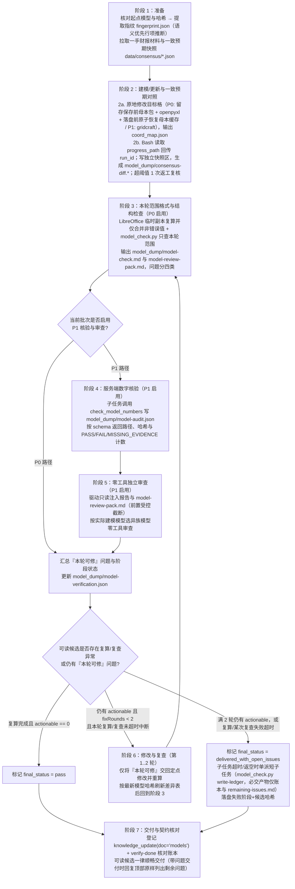

# 公司财务建模 v2 设计方案——默认格式模板、原地编辑与工作流闭环核验

> **状态**：定稿
> **适用形态**：同时支持 **Everflow 生产形态**（部署形态配置变量 `DALTON_PROFILE=everflow`）与 **独立核心安装形态**（`DALTON_PROFILE=core`，双形态分离规范见 `docs/dalton/features/standalone-core.md`）
> **演进关系**：完整沿用 `plugins/dalton/skills/dalton-model/` 与 `plugins/dalton/skills/dalton-conventions/references/model-standards.md` 的全部既有建模约定，在其之上升级默认模板投放、工作簿原地编辑、本轮范围增量检查与多阶段建模工作流；在 P1 接入 `gridcraft`（命令行电子表格原地编辑与重算工具）时同步修订 `docs/dalton/archive/dev-guide/README.md` 决定记录 `L14`

---

## 一页摘要

### 1. 核心目标

围绕核心诉求——**「保留全部既有建模约定，按原始中国电商模型的公司工作表标准格式新建模型，或在存量模型上根据新财报扩展期间、更新实际数与预测、补充和修改必要项目，保持原有格式与公式结构完好，独立建模后再对照一致预期，并通过与报告一致的工作流反馈回路保障质量，全程零额外确认步骤」**——将建模链路升级为**「模型指纹与坐标映射对齐 + 原地目标格编辑与母本包保缓存复算 + 独立建模后对照一致预期 + 本轮范围四分类检查与最多两轮修改回路 + 可读候选一律顺畅交付」**。

### 2. v1 与 v2 核心机制对比

| 维度 | v1 现状（`modeling-skill.md`） | v2 方案（本文） |
|---|---|---|
| **既有建模约定与版本链** | 写在提示词中靠智能体自觉遵守；深度链与完整覆盖契约固定匹配单公司文件名通配符 | **100% 沿用现有建模约定与文件命名**（第 2 章）：单公司模型沿用 `model/<TICKER>-model-vNN.xlsx`（`.xlsx` 为 Excel 电子表格工作簿），多公司行业整本沿用原文件名递增版本；行业工作区传入本工作区整本 `model_path` 时单列放行，按家串行显式传递上一轮完成路径与 `SHA-256`（安全哈希算法 256 位摘要）；三条链统一按账本精确核对模型路径与哈希，报告修订联动改模共用同一入口 |
| **默认格式来源与投放** | 仅提供样式常量与统计摘要 | 按大文件通道（`dalton_chat_file_uploads.actual_sha256`）或工作区首轮改模前用户回合附件历史（限定首轮改模时间上限查 `conversation_queries.metadata->'attachments'`，无 `url` 时按回合实际发送人、文件名、大小与发送时间窗枚举 `chat_attachments` 候选并以最早血统哈希 `records[0].input_sha256` 验真确认，缺失时回退改坏前 Google Drive 的 `rclone`〔命令行云存储同步工具〕加密备份）锁定验真中国电商原件，脱敏提取「公司 `sheet`（工作表）标准格式」模板，随现有技能同步机制自动投放到沙箱 |
| **编辑与复算写回** | 智能体常编写大型 `openpyxl`（Python 电子表格读写库）脚本整本重写 `.xlsx`（且整包保存会清空全书未触及公式的缓存值）；`insert.py` 写死 `fullCalcOnLoad=1`（打开时强制全表重算属性）；`recalc.py --force` 会用错误值覆盖插件格与非目标公司表缓存 | **P0 采用受控 `openpyxl` 只改目标格**（保持原 `calcPr`），**母本缓存恢复独立于复算并在候选可交付前原子完成**（从扩列后、`openpyxl` 保存前的母本包按坐标先行恢复非目标公司表及外链、插件、既有循环格与未改公式格的原始缓存 `<v>` 与 `t`），随后在临时副本上用 `LibreOffice`（开源办公套件）单引擎算值（报告如实注明只用一个引擎）并仅合并非错误计算值；**P1 接入 `gridcraft`** 实现原地编辑与双引擎独立交叉核验；两条编辑路径输出同一份坐标映射 |
| **检查范围、分类与勾稽** | 单智能体手写 `Checks` 页 + `model_scan.py` 全表提示性扫描 | **只检查本轮改动单元格、转实际值列、新增期间列与预测区**；刚披露季明细行转实际值由编辑器登记自动放行；行项类型**以报表分节与标签语义、数字格式、披露口径为主，旧公式为辅**（冲突记「缺证据」）；问题分为**「本轮可修 / 基线遗留 / 缺证据 / 不适用」**四类，仅「本轮可修」进入修改回路 |
| **一致预期隔离与对照** | 常在建模过程中向结果格直接写入目标常数或因缓存值碰撞误判 | **独立建模在前、对照在后**：外部参考值写入单独标注的快照单元格区；仅在「本方结果格为常数且等于一致预期」或「公式直接/可确定间接依赖快照单元格」时判问题；每次改模后按最新哈希重做差异表 |
| **工作流、免审落盘与终态交付** | 单步子任务派发，异常转 `null` 易中断整条深度链；机器报告落研究根目录易触发语言审查冲突；静态必检文件易卡住超时降级 | 共享流水线 `runModelingPipeline` 始终返回结构化结果；机器报告与账本统一放入免语言审查目录 `<R>/model_dump/`；契约仅将终态账本列为静态必检产物，由 `verify-done` 按终态账本分别核对已完成阶段实物或失败阶段记录，**凡存在可读候选模型一律顺畅交付**（`pass` 或 `delivered_with_open_issues`，`fix_rounds` 取 0–2 均放行），在回复顶部列出剩余问题 |

### 3. 分批实施概览（严格对齐阶段、契约、工具与文件）

- **P0（母本验真与模板同步 + 指纹与语义优先行项推断 + `openpyxl` 受控编辑、落盘前原子母本缓存恢复与复算选择性写回 + 本轮范围四分类检查与一致预期对照 + 超时短子任务补写账本、可读即交付与共享报告改模入口 + 行业工作区单列放行、一轮一家 + `Home`〔主空间〕附原话）**：启用「准备 → 建模/更新与一致预期对照（候选落盘前先从保存前母本包原子恢复豁免格与非目标表缓存，并由子任务回传 `run_id`） → 本轮范围格式结构检查（含 `LibreOffice` 临时副本单引擎复算与非错误值选择性写回）→ 最多两轮修改 → 交付（超时或返回空时单派短子任务补写终态账本）」，机器产物统一落 `<R>/model_dump/`，保持工作流宿主 `tool.py` 原状。
- **P1（`gridcraft` 接入与双引擎复算 + 服务端数字核验 + 注入只读审查摘录包的零工具异族独立审查）**：接入 `gridcraft`（修订 `L14`，开启 `independent_verify: true`）+ 子任务调用服务端 `check_model_numbers` 写 `<R>/model_dump/model-audit.json` 并返回计数（兼容报告联动改模版本衔接）+ 工作流驱动 `driver.py` 只读注入检查/核验报告与绑定候选哈希的只读审查摘录 `<R>/model_dump/model-review-pack.md` 供零工具异族审查，并入两轮修改回路。
- **P2（历史披露数据结构化自动填充）**：法定财报 `XBRL`（可扩展商业报告语言）与财报表格结构化提取 → 行项映射持久化缓存 → 历史实际值与累计拆单季确定性回填。

---

## 1. 现状与问题（附实测证据与代码根因）

### 1.1 近期真实案例与实测证据

在中国电商多公司整本模型（连续 3 天、6 轮迭代仍无法投入使用）及龙溪模型更新任务中，暴露出四类核心故障：

1. **整本重写破坏公式链与视图版面**：
   - 智能体编写了一个约 **14 万字节**的 `openpyxl` 脚本，在 Python 中把预测数字算成浮点数后从头写出整本 `.xlsx`。
   - **公式退化为常数**：`v2.0` 交付件预测期出现 **917 个硬编码数字常数**，原本动态联动的收入、利润行变成死数字。
   - **冻结窗格严重错位**：京东主表 `Model - JD` 原冻结位置为 `xSplit=10, ySplit=2`（横向冻结 10 列、纵向冻结 2 行，对应 `topLeftCell="K3"`），重写后错位至 `xSplit=51, ySplit=101`。
   - **样式重建与未计算掩盖**：全书样式从头重设，且工作簿被写入 `fullCalcOnLoad=1` 掩盖空缓存值。
2. **「贴合一致预期」时直接改写结果行，造成集团与分部脱节**：
   - 调整预测对比市场一致预期（`Consensus`，卖方分析师预测统计均值）时，直接向利润结果格写入目标常数，绕过底层业务分部驱动。
   - `Model - JD` 中**集团营业利润（54.7B〔十亿〕）与各业务分部营业利润加总（约 44B）相差超过 10B**，上下游计算链断裂。
3. **历史披露数据空缺且缺少服务端对源核验**：
   - 分部改口径后的新口径历史可比同期数据留空，资产负债表历史核心科目缺失；已填入的历史数缺少与研究报告 `check_draft` 同级的服务端一手财报对源核验。
4. **单轮自写自查，缺少增量范围区分与受控反馈闭环**：
   - 工作簿内的 `Checks` 页与自检脚本均由同一智能体编写并自跑，在存在 917 个预测常数与 10B 分部脱节的情况下仍报告**「40/40 全通过」**；同时若对存量历史列套用刚性恒等式，或把含 `CIQ`（Capital IQ，标普金融终端插件）公式的原模型强行全书重算写回，又会在既有历史列与下游公式上稳定产生错误，耗尽修改轮次。

### 1.2 现有代码层成因定位

1. **工作流模型解析、修订入口、完成契约与语言分类器存在多处断点**：
   - `workflows/earnings-deep-update/workflow.js:94-105,126-132,368-380` 与 `workflows/full-coverage/workflow.js:293-310,354-358,646-661` 固定执行 `ls model/${T}-model-v*.xlsx` 与正则 `/-model-v(\d+)\.xlsx$/`；`workflows/earnings-deep-update/contract.json:34-46` 与 `workflows/full-coverage/contract.json:72-84` 同样写死该通配产物与 `ls` 校验，且 `src/dalton/tools/check_done_tools.py:833-857` 对带 `modified_on: "today"` 但解析不出 `vNN` 版本号的文件名直接判定「无法核对」，行业整本沿原文件名递增时必定失败；
   - `workflows/full-coverage/workflow.js:526-567` 的报告修订环节自行调用 `nextVersion(modelPath)` 另存、`model_style.py lineage` 记账并按磁盘最大版本解析模型，与建模账本脱节；第 `471-476` 行另有手写 `model-check.md` 子任务；
   - `src/dalton/publish/language.py:169-171,201-218` 将 `research/` 下除 `bg_data/`、`data/`、`lenses_work/`、`model_dump/` 外的 `.md` 全部归入需两轮语言审查的正式交付物——机器生成的建模 `.md` 若直接放在研究目录根部，收尾核对会要求语言侧车，而一旦被语言审查改写又会破坏账本证据哈希；
   - `src/dalton/workflows/journal.py:491-499` 仅在启动参数显式传入 `progress_path` 时才写出 `.progress.json`（`workflow/tool.py:532-534` 无默认路径）；`prelude.js:82-88` 的 `parallel()` 会把子任务未捕获异常收敛为 `null`。
2. **扩列与复算写回脚本存在默认行为冲突**：
   - 上游扩列脚本 `plugins/langalpha_deliverables/skills/xlsx/scripts/insert.py:1332` 在每次插行列后固定写入 `calc.set("fullCalcOnLoad", "1")`；
   - 重算脚本 `plugins/langalpha_deliverables/skills/xlsx/scripts/recalc.py:308-312,528-570` 中，`IronCalc`（Rust 电子表格计算引擎）遇到 `#NAME?`（函数名无法识别错误）会退出并回退至 `LibreOffice`；工作簿含外链时须传 `--force` 才会写回，而 `--force` 会将 `LibreOffice` 对外链和 `CIQ` 算出的 `#NAME?` / `#REF!`（断裂引用错误）无差别写进全书所有工作表（含多公司整本中的非目标公司表），覆盖原模型正常数值缓存；
   - `gridcraft-cli`（0.19.1）目前仅安装在宿主机 `~/.local/bin/gridcraft-cli`，Linux 沙箱镜像（`Dockerfile.sandbox` 与 `_image_recipe.py`）内仅装有 `LibreOffice` 与 `IronCalc`。宿主机实测 `gridcraft-cli` 对中国电商原模型 57,173 条公式重算耗时 0.7 秒，保留冻结窗格，保存时会丢弃可选的 `calcChain.xml`（公式求值顺序缓存）与 Excel 2010 扩展条件格式（`<extLst>` / `x14`，即工作表扩展节点列表与条件格式扩展命名空间）。
3. **子智能体工具集、工作流读盘能力与选模机制限制**：
   - `src/ptc_agent/agent/subagents/merge.py:130` 对所有插件/自定义子智能体默认挂载完整 `filesystem` 读写工具集；`QuickJS`（嵌入式轻量级 JavaScript 引擎）宿主 `prelude.js` 仅暴露 `agent`、`phase`、`log`、`parallel`、`pipeline`，脚本自身无法读取工作区文件，而 `driver.py:593-597` 的 `reviewDraft` 只计算被审文件哈希记日志、尚未注入文件正文；
   - `agent_config.dalton.yaml:10,77` 中主回合模型与实际执行建模的 `general-purpose` 子智能体模型不同，`dalton-reviewer.md:3` 又静态钉死模型，需按实际建模子任务的模型动态选择异族审查模型；
   - 服务端治理工具默认仅挂载给主智能体，工作流子智能体仅在 `src/ptc_agent/agent/agent.py:1017-1029` 显式挂载了 `check_language`。
4. **`Home` 转派未附用户原话**：`src/tools/secretary/chief_of_staff.py:182-229` 的 `delegate_to_analyst` 仅传递改写后的任务说明，存在遗漏用户原始格式与口径要求的可能。

### 1.3 决定记录 `L14` 修订（在 P1 接入 `gridcraft` 时生效）

在 P1 完成 `gridcraft` 沙箱或服务端接入后，将 `docs/dalton/archive/dev-guide/README.md` 第 6.2 节 `L14` 修订为：
> **新 `L14`：「`gridcraft` 作为原地编辑引擎与第二复算核验引擎；主流程交付物与持久化载体仍是标准 `.xlsx` 文件。编辑过程导致的 Excel 2010 扩展条件格式（`<extLst>` / `x14`）丢失或变动在检查报告中如实列出，作为提示信息展示。」**

---

## 2. 沿用的现有建模约定（逐条溯源与代码检查映射）

建模 v2 是在现有 `dalton-model` 技能与 `dalton-conventions` 方法论之上的**流程编排与工具自动化升级**，完整沿用既有建模约定与文件命名规则。下表逐条列出沿用的约定、仓库原文出处及在 v2 中的自动化落点：

| 约定类别 | 沿用的具体建模约定内容 | 原文精确出处 | v2 自动化检查与执行落点 |
|---|---|---|---|
| **核心规则 1：预测期全公式与驱动调整** | 收入、成本、费用、利润等预测期金额全部由公式算出（如 `=GMV〔商品交易总额〕× Take rate〔货币化率〕`、`=去年同期×(1+增速)`、`=各分部之和`）；调预测数值只改驱动假设输入格；调建模方法可改公式结构并在变更记录写明；管理层直接给出的金额指引（如明年 `CapEx`〔资本开支〕金额）在对应区块或表下方单设输入格（套驱动假设格式，最右备注列写来源），预测行用公式引用该输入格；原模型里是公式的预测行更新后保持为公式。 | `plugins/dalton/skills/dalton-model/SKILL.md` 第 14–18 行 | 代码检查 **`C03`**（按坐标映射对齐核查本轮改动区与预测区公式保留，自动放行刚披露季明细行实际值，拦截小计/合计/比率改常数） |
| **核心规则 2：季度汇总年度列按行项类型计算** | 同表已有对应四财季列的年度列全部由公式算出，驱动假设只放在预测季度列和无季度拆分的远期年度列：<br/>- 流量（收入、成本、利润、现金流）：四季相加；<br/>- 时点期末余额（现金、债务、期末股本）：取财年最后一季；<br/>- 比率（增速、利润率、`Take rate`、占比）：用本年度列分子和分母重算；<br/>- 年度 `EPS`（每股收益）：年度利润 ÷ 年度加权平均稀释股数（兼容原表既有同口径公式）；<br/>- 用户数、活跃商家等 `KPI`（关键经营指标）：按公司披露口径（第四季期末、四季均值或披露的年度去重数）。 | `plugins/dalton/skills/dalton-model/SKILL.md` 第 19–24 行 | 语义优先行项类型映射 `line_item_map` + 代码检查 **`C10`**（流量四季加总、期末余额取末季、`KPI` 按披露口径；语义与旧公式冲突记「缺证据」，无法推断行标「不适用」） |
| **核心规则 3：一致预期重大差异归因** | 本方预测与一致预期或主要卖方预测存在重大差异时，拆到分部、驱动假设、费用、利息、股本查明来源：有可核实的新信息支撑就保留判断并写明理由；发现自身驱动假设遗漏或口径错误就修正驱动假设。 | `plugins/dalton/skills/dalton-model/SKILL.md` 第 25 行；`references/sanity-check.md` 第 23–30 行 | `model_consensus.py` 每次改模后按最新哈希重做差异表 + 超阈值返工复核 + 代码检查 **`C04`**（快照隔离与差异理由检查） |
| **核心规则 4：原模型维护、文件命名版本链与变更记录** | 提供或存在原模型时在原模型基础上维护，原模型保持只读，修改版另存至 `model/`：**单公司模型命名为 `model/<TICKER>-model-vNN.xlsx`；多公司行业整本模型保留整本结构，沿用原文件名格式递增版本号或日期**；在最前面的 `README & Changelog`（或原模型既有 `Change Log`）工作表写明版本号、日期、基线文件、补充的实际值、新增期间、修改的驱动假设及理由、结构调整及与一致预期的主要差异理由。 | `plugins/dalton/skills/dalton-model/SKILL.md` 第 10、26、34、60–63 行；`references/rollforward.md` 第 3、45–51 行 | `model_edit.py` 版本链生成器 + 行业串行显式传递路径与哈希 + 代码检查 **`C01`**（表顺序与变更记录更新） |
| **期间覆盖跨度与单向扩展** | - 新建模型历史跨度：年度历史至少自 `FY2018A`（或招股书最早完整财年）连续覆盖至最近完整财年；单季历史至少自 `2024Q1A` 连续覆盖至最近已披露季度；<br/>- 预测跨度：季度预测逐季覆盖本财年剩余季度与下一完整财年直至次年 `Q4`（如当前 `FY26` 做到 `4Q27E`）；年度预测至少覆盖 3 个完整财年至下下财年（如 `2026E–2028E`）；<br/>- 单向向后扩展，保留原模型全部既有历史列；非自然年结账公司在 `A2` 或表头旁注明财年截止月（如 `FY ends Mar`）。 | `plugins/dalton/skills/dalton-conventions/references/model-standards.md` 第 5–10、92–94 行；`dalton-model/references/forecast-rules.md` 第 5–11 行 | 代码检查 **`C02`**（按公司财历与本轮任务范围校验新增期间跨度、存量历史列完整保留） |
| **一手披露取数、累计拆单季与空值留空** | - 历史实际数取一手监管定期报告（美股 `SEC`〔美国证券交易委员会〕`10-K`/`10-Q`/`20-F`〔年报、季报、外国发行人年报〕，港股/A 股法定财报与业绩公告）；<br/>- 仅披露累计期间（`6M`/`9M`/`FY`）时按算术差分推导单季（`Q2=H1-Q1`、`Q3=9M-H1`、`Q4=FY-9M`），标记为披露衍生值并注明两期财报出处；<br/>- 未披露细项或未单独预测假设留空（`Blank`），确认实际发生或显式预测为零时填 `0`；<br/>- 财报更新后完成当季实际值相对前版预测的事后偏差分解并记入修订日志。 | `plugins/dalton/skills/dalton-conventions/references/model-standards.md` 第 16–33、52–65 行；`dalton-model/references/forecast-rules.md` 第 208–220 行 | 代码检查 **`C08`**（本轮新增历史列必填披露项与预测期裸 `0` 检查）+ **P1 服务端数字核验** `check_model_numbers` |
| **季节性、大促跨季与管理层指引** | - 季度路径按历史季节性设定在各季假设上；<br/>- 春节移动与 618/双十一/黑五跨季挪动单设「日历调整」驱动假设行并在相邻季度做等额反向调整；53 周财年仅计入多一周当季；<br/>- 指引记录：单设「指引」表或指引区记录发布日期、适用期间、指标、数值、实际值与兑现情况；季度预测采用全年指引时，剩余季度引用「全年指引 − 已披露累计」按季节性拆分，年度列保持四季公式之和。 | `plugins/dalton/skills/dalton-model/references/forecast-rules.md` 第 9、65–66、81–100 行 | 代码检查 **`C10`**、**`C13`**（平移后零新增循环引用）+ **P1 零工具异族独立审查** |
| **版面样板、表头与最右备注列** | - 版面列序：`A–D` 缩进与标签列 → 年度列 → 窄空隔列 → 可选 `CAGR`（复合年增长率）列 → 窄空隔列 → 季度列 → 最右备注列；行序依次为表头与 `A1` 单位、利润表（浅蓝 `99CCFF`）、`Non-GAAP`（非公认会计准则，棕红 `993300`）、分部报告（棕红）、业务拆解区（浅桃 `FFCC99`）、现金流量表（浅蓝）、资产负债表（浅蓝）；多公司模型前放行业页并以 `{TICKER}>>` 空白页分隔；<br/>- 第 1 行亮蓝底 `3366FF` 白字加粗，英文数字 `Arial` 8 号、中文 `等线` 8 号；驱动假设与管理层金额指引 `FFFFC8` 浅米黄底配 `hair` 细虚线框；存量历史年度汇总公式保留原蓝字，新增年度汇总列用黑字 `000000`；<br/>- 来源和说明写在数据区最右侧备注列（红字 `FF0000`，以 `<` 或 `<<` 开头），工作簿保持零新增单元格批注。 | `plugins/dalton/skills/dalton-model/references/forecast-rules.md` 第 13–43 行；`references/format-spec.md` 第 18–88 行 | 默认格式模板继承 + 代码检查 **`C05`**（按位置用途与原表画像规范化比较样式、备注列与批注检查）与 **`C06`**（合法平移后的窗格、列宽、分组检查） |
| **一致预期取数、口径对齐与基础检查** | - 按部署能力（`src.dalton.capabilities`）调用可用数据源取数并落盘 `data/consensus/<YYYY-MM-DD_HHMM>.json`；<br/>- 比较前先对齐财年截止日、币种、会计口径（`GAAP`〔公认会计准则〕/`IFRS`〔国际财务报告准则〕与 `Non-GAAP`）、普通股与 `ADS`（美国存托股份，`EPADS` 为每份美国存托股份收益）及是否反映最新财报；<br/>- 核对全表金额单位一致、币种换算一致、估值页目标年份引用列已同步指向新预测列。 | `plugins/dalton/skills/dalton-model/references/sanity-check.md` 第 6–21 行；`SKILL.md` 第 55 行 | `model_consensus.py` 口径核对 + 代码检查 **`C07`**（单位标识、汇总表公式与估值页引用列同步） |

---

## 3. 建模工作流、终态契约、免审落盘与跨工作流复用

### 3.1 单一建模工作流 `workflows/company-model/` 与启动参数约定

参照现有工作流引擎（`src/ptc_agent/agent/middleware/background_subagent/workflow/driver.py` 与 `src/dalton/workflows/contracts.py`），设立单一建模工作流 `workflows/company-model/`（含 `workflow.js` 与 `contract.json`），统一承载新建与滚动更新：

1. **输入参数（`args`）**：
   - `ticker`（必填）：本轮唯一目标公司股票代码（如 `"PDD"`、`"JD"`、`"META"`）；
   - `workspace_dir`（必填）：当前工作区根目录（`"."`）；
   - `as_of`（必填）：具体基准日期 `YYYY-MM-DD`；研究目录固定为 `research/{as_of}-model-{ticker}`，机器产物目录固定为 `research/{as_of}-model-{ticker}/model_dump`；
   - **`progress_path`（工作流启动必填）**：沿用 `dalton-earnings-deep` 与 `dalton-full-coverage` 的既有进度文件约定，固定传 `research/{as_of}-model-{ticker}/.progress.json`，由 `dalton-model/SKILL.md` 要求启动 `RunWorkflow` 时传入，使工作流日志器写出 `run_id` 供账本读取（契约 `params_required` 保持 `["ticker", "workspace_dir", "as_of"]`，兼容 `workflow.enabled` 关闭时的手动降级路径，不改动工作流宿主 `tool.py`）；
   - `mode`（可选，默认 `"auto"`）：`"build"`（按默认格式模板新建）、`"update"`（存量模型滚动更新）或 `"auto"`（传入 `model_path` 或工作区已有登记模型时自动走 `"update"`，否则走 `"build"`，全程零额外人工确认）；
   - `model_path`（可选）：起点模型路径；行业整本按公司串行更新时，显式传入上一家公司刚完成的整本路径；
   - `expected_baseline_sha256`（可选）：行业整本串行更新时传入上一轮完成文件的 64 位 `SHA-256`，准备阶段先校验磁盘起点文件哈希与之完全一致；
   - `consensus_thresholds`（可选）：按公司特征调整的一致预期差异复核阈值。
2. **文件命名与版本链规则（沿用现有约定）**：
   - **单公司模型**：输出路径沿用 `model/<TICKER>-model-vNN.xlsx`（首次为 `v01`，后续取当前最大版本号加一，如 `v02`、`v03`）；
   - **多公司行业整本模型**：识别到起点文件为多公司整本（工作簿含多个公司标签页或原文件名非单公司 `<TICKER>-model-vNN.xlsx` 形态）时，**沿用原文件名格式递增版本号或日期后缀**（例如 `model/China_Ecommerce_v03.xlsx → model/China_Ecommerce_v04.xlsx`）；一轮只更新目标 `ticker` 所属工作表与 `README & Changelog`，其余公司工作表保持原样。



### 3.2 终态规则、免审目录落盘与完成契约核对

1. **共享函数 `runModelingPipeline` 的结构化返回与统一四态规则（可读候选一律能交付）**：
   - `workflows/_shared/modeling_stages.js` 中的 `runModelingPipeline(ctx)` 用 `try / catch` 接住每次子任务派发的超时、空返回与工具错误（保留 `QuickJS` 对脚本代码错误 `TypeError` / `ReferenceError` 的上抛约定），始终返回结构化对象：
     ```json
     {
       "status": "pass | delivered_with_open_issues | skipped_no_model | failed_unusable",
       "candidate_path": "model/PDD-model-v03.xlsx",
       "model_sha256": "4d91e0...",
       "baseline_path": "model/PDD-model-v02.xlsx",
       "baseline_sha256": "8a12bc...",
       "fix_rounds": 1,
       "failed_stages": [],
       "artifacts": [
         "research/2026-11-27-model-PDD/model_dump/model-verification.json",
         "research/2026-11-27-model-PDD/model_dump/model-check.md",
         "research/2026-11-27-model-PDD/model_dump/consensus-diff.md"
       ],
       "actionable_issues": [],
       "open_issues_by_class": {
         "actionable": [],
         "baseline_legacy": ["..."],
         "missing_evidence": ["..."],
         "not_applicable": ["..."]
       },
       "remaining_issues_path": "research/2026-11-27-model-PDD/model_dump/remaining-issues.md",
       "summary_10lines": "..."
     }
     ```
   - **四态流转契约**：
     - **`"pass"`**：候选 `.xlsx` 可由 `model_readable.py` 正常读取、本轮复算完成，且 `actionable`（本轮可修）问题数为 `0`；
     - **`"delivered_with_open_issues"`（带问题交付）**：候选 `.xlsx` 可读，且满足以下任一条件：① 两轮修改后仍有 `actionable` 问题；② 复算或某次复查（结构检查、P1 数字核验或独立审查）失败或超时（此时将失败阶段名称与对应候选文件 `SHA-256` 写进 `<R>/model_dump/remaining-issues.md`）；③ `<R>/model_dump/remaining-issues.md` 非空；
     - **`"skipped_no_model"`**：深度链未传入 `model_path` 时的无模型跳过态；
     - **`"failed_unusable"`**：**仅用于没有可读候选 `.xlsx` 文件**的情形（`candidate_path: null`，失败原因写入返回对象）。
2. **机器生成的建模报告与账本统一放入免语言审查目录 `<R>/model_dump/`**：
   - 现有正式交付物分类器 `src/dalton/publish/language.py:169-171,201-218` 及各技能说明已将 `model_dump/` 列为免两轮语言审查的机器目录；
   - 代码与工具生成的 **`model-check.md`、`model-review-pack.md`、`consensus-diff.md`、`consensus-diff.json`、`remaining-issues.md`、`model-verification.json`** 以及 P1 的 **`model-audit.md`、`model-audit.json`** 统一存放在 **`<R>/model_dump/`** 下，无需修改分类器即可免除语言侧车要求并保护账本证据哈希；
   - 深度链由智能体撰写的 `<R>/mapping.md` 与 `<R>/model-delta.md` 保持原路径；两份笔记是否必需由 `verify-done` 按终态账本判定，凡已生成的笔记照常执行两轮语言审查。
3. **账本 `run_id` 回传、超时后短子任务补写账本、终态阶段判定与独立校验器 `model_check.py verify-done`**：
   - **进度文件 `run_id` 读取与回传顺序**：`QuickJS` 脚本仅暴露 `agent`、`phase`、`log`、`parallel`、`pipeline`（`prelude.js:108`），且 `journal.py` 在首个子任务派发落盘时写出进度文件。因此在首个派发（阶段 1 `建模准备`）结束后，**由后续 `agent()` 子任务（阶段 2 `建模与一致预期对照`，以及阶段 2 异常降级时的短账本子任务）通过 `Bash` 读取 `ctx.progressPath`**（深度链为 `research/<D>-deep-<quarter>/.progress.json`，完整覆盖为 `research/<D>-fc/.progress.json`，单独建模为 `research/{as_of}-model-{ticker}/.progress.json`），按声明 `schema` 的 `run_id` 字段回传给工作流脚本，再由工作流脚本以 `--run-id <runId>` 传入 `model_check.py` 写入账本；手动降级路径无进度文件时账本 `run_id` 记为 `null`；
   - **阶段子任务超时或返回空后的短账本子任务（`writeFallbackLedger`）**：在可读候选 `.xlsx` 已落盘的前提下，无论初次建模（`kind: "modeling"`）还是报告审稿联动改模（`kind: "report_revision"`），一旦检查、一致预期差异、P1 数字核验、P1 独立审查或深度链笔记子任务超时或返回 `null`（含阶段报告尚未生成触发 `driver.py:530-537` 空返回），工作流立即派发一个只写账本的短子任务（`label: '写入降级账本'`），调用 `python3 .agents/skills/dalton-model/scripts/model_check.py write-ledger --workspace <W> --ticker <T> --research-dir <R> --candidate <candidate_path> --kind <modeling|report_revision> --failed-stages <失败阶段列表> --run-id <runId>`，写出 `<R>/model_dump/model-verification.json`（记入 `failed_stages`、候选实时 `SHA-256`、`final_status: "delivered_with_open_issues"`）和 `<R>/model_dump/remaining-issues.md`；**该短子任务的声明必交产物 `files` 仅列 `<R>/model_dump/model-verification.json` 与 `<R>/model_dump/remaining-issues.md`**（独立于 `model-check.md` 等阶段报告），确保报告从未生成时账本与未决清单依然可靠落盘；
   - **账本核心字段**：`<R>/model_dump/model-verification.json` 记录 `workflow`、`run_id`、`baseline_path`、`baseline_sha256`、`calc_engine`（P0 为 `"libreoffice"`）、`independent_verify`（P0 为 `false`，P1 为 `true`）、`enabled_stages`（P0 为 `["check", "consensus"]`，P1 为 `["check", "consensus", "audit", "review"]`）、`fix_rounds`（仅计建模回路修改轮数 `0..2`）、`failed_stages`、`rounds[]`（含 `kind ∈ "modeling" | "report_revision"`、候选路径、`model_sha256`、本轮 `failed_stages`、各阶段证据文件路径、所绑定的 `evidence_model_sha256` 与计数）及终态 `final_status`、`final_model_path`、`final_model_sha256`、`remaining_issues_path`；
   - **契约静态产物与校验器分工**：现有 `src/dalton/tools/check_done_tools.py:1758-1778` 在阶段存在缺失 `artifacts` 时直接置 `stage_missing = True` 并跳过该阶段全部 `validators`。因此三条 `contract.json` 的建模阶段**静态 `artifacts` 统一只列终态账本 `<R>/model_dump/model-verification.json`**（包含深度链有模型分支；深度链 `mapping.md` 与 `model-delta.md` 移交 `verify-done` 按终态判定），再使用各自已声明的 `params_required` 渲染研究目录调用 `python3 .agents/skills/dalton-model/scripts/model_check.py verify-done --workspace {workspace_dir} --ticker {ticker} --research-dir <研究目录>`，由终态账本决定本轮必须核对的阶段实物与笔记；
   - **`verify-done` 与 `check_done_tools.py` 四项闭合核对**：
     1. **`run_id` 与降级核对**：当前线程存在工作流运行记录时，核对账本 `run_id` 与本次工作流 `run_id` 一致；无工作流运行且调用方传 `manual=true` 时，账本 `run_id` 允许为 `null`，走 `check_done_tools.py` 已有的手动降级与本轮时间窗口核对；
     2. **模型路径、可读性与已完成阶段证据哈希对齐**：账本 `final_model_path` 在工作区 `model/` 下真实存在且通过 `model_readable.py` 读取，磁盘实时 `SHA-256` 等于 `final_model_sha256`；对末轮**已完成阶段**，逐项核对盘上对应报告文件（`<R>/model_dump/model-check.md`、`<R>/model_dump/consensus-diff.md/.json`，及 P1 `<R>/model_dump/model-audit.md/.json`）真实存在、非空且所记录计数与账本一致；其中 `check` 与 `consensus` 的 `model_sha256` 等于 `final_model_sha256`，P1 `audit` 的 `model_sha256` 等于 `final_model_sha256`（或在末轮为仅改预测格的 `report_revision` 时等于上一轮已核验模型哈希，且经本次 `coord_map.json` 证实历史实际值与拆单季衍生格零改动）；
     3. **初次建模与 `report_revision` 共用阶段失败规则，深度链笔记按终态判定**：末轮无论 `kind == "modeling"` 还是 `kind == "report_revision"`，均对本批适用阶段执行同一套核对——已完成阶段满足第 ② 项实物与哈希核对；在写出报告前超时或失败的阶段（归入 `delivered_with_open_issues`），核对账本 `failed_stages`（及 `rounds[-1].failed_stages`）与 `<R>/model_dump/remaining-issues.md` 均已记入该失败阶段名与对应候选模型 `SHA-256`。对深度链（`workflow == "earnings-deep-update"`），当 `final_status == "pass"` 时核对 `<R>/mapping.md` 与 `<R>/model-delta.md` 均在盘且非空（`≥ 50` 字节）；当在生成 `model-delta.md`（或 `mapping.md`）前超时降级为 `delivered_with_open_issues` 时，核对对应笔记阶段名（`"model_delta"` / `"mapping"`）已记入 `failed_stages` 与 `remaining-issues.md` 即放行，盘上已生成的笔记照常由语言审查覆盖；
     4. **终态放行规则**：满足 `final_status == "pass"`，或满足 `final_status == "delivered_with_open_issues"` 且 `<R>/model_dump/remaining-issues.md` 非空；**`fix_rounds` 取 `0–2` 均放行**，账本如实记录实际轮数与失败阶段。

### 3.3 `earnings-deep-update` 与 `full-coverage` 契约对齐及共享报告改模入口

通过 `src/dalton/content_assembly.py` 在装配期展开 `/* DALTON_INCLUDE:_shared/modeling_stages.js */`，使三条工作流共用建模流水线与报告联动改模入口：

1. **`workflows/earnings-deep-update/` 接入与契约改动**：
   - **无模型分支与按终态管理笔记**：`!args.model_path` 时直接返回 `skipped_no_model`；传入 `args.model_path` 时，`ctx` 传入本链进度文件 `research/${D}-deep-${Q}/.progress.json`，机器报告统一写入 `${R}/model_dump/`，智能体笔记 `${R}/mapping.md` 与 `${R}/model-delta.md` 写入 `${R}/`；并行派发时建模支线仅在子任务选项标阶段标签，保持主流程阶段标题稳定；
   - **深度链完成契约与工作流动态消费对齐**：在 `workflows/earnings-deep-update/contract.json` 的「模型更新」阶段保留 `"requires_param": "model_path"`（无模型时整段跳过），移除原有的 `model/{ticker}-model-v*.xlsx` 通配产物（含 `modified_on: "today"`）与 `ls model/{ticker}-model-v*.xlsx | sort -V | tail -1` 校验命令，**静态 `artifacts` 仅设终态账本 `research/{release_date}-deep-{quarter}/model_dump/model-verification.json`**，统一运行 `model_check.py verify-done` 按终态账本核对模型文件、阶段证据以及 `mapping.md` / `model-delta.md`（`pass` 时两份笔记必在盘，超时降级时允许缺席笔记记入 `failed_stages`）。同步在 `workflows/earnings-deep-update/workflow.js` 移除 `resolveFinalModel` 通配解析，并将校准材料引用（`:188`）、`finish` 与最终返回 `model_delta` 字段（`:227, :446`）、`notesReview` 清单（`:324`）及 `deliverables` 哈希核验数组（`:414-416`）改为按流水线 `artifacts` 中实际已生成的笔记路径纳入 `${R}/mapping.md` 与 `${R}/model-delta.md`（及对应 `.language.json` 侧车），使已生成的笔记照常完成两轮语言审查，同时在 `model-delta.md` 生成前超时仍可顺畅走完后续阶段；
   - **可读候选照常推进**：`status` 为 `"pass"` 或 `"delivered_with_open_issues"` 时均正常进入校准对账与审稿，仅在 `"failed_unusable"` 时记入 `incomplete`。
2. **`workflows/full-coverage/` 全量消费者迁移与两条链共用的报告联动改模入口**：
   - **`workflows/full-coverage/workflow.js` 与 `contract.json` 中 `mcheck` 及旧报告路径的全量迁移清单**：
     1. **顶部描述与建模阶段（`workflow.js:4, 282-399`、`contract.json:70-86`）**：将单步 `model`、`modelFileIn`、`nextVersion`、`resolveFinalModel` 与 `modelReadableProbe` 替换为 `runModelingPipeline`（`ctx` 传入 `research/${D}-fc/.progress.json` 与 15 页模型规格路径），在脚本内维护 `modelPath`、`modelSha`、`modelStatus` 与盘上实存检查报告路径 `modelCheckPath`（`artifacts` 含 `${R}/model_dump/model-check.md` 时取该路径，否则取 `null`）；`modelStatus === "failed_unusable"` 时调用 `gateBlock` 停在成稿前，`"pass"` 与 `"delivered_with_open_issues"` 均照常进入成稿；`contract.json`「建模」阶段静态 `artifacts` 改为 `research/{as_of}-fc/model_dump/model-verification.json`，校验器改为 `model_check.py verify-done`；
     2. **独立审稿阶段（`workflow.js:470-486`、`contract.json:104-118`）**：移除并行派发中的手写 `只读审模型`（`mcheck`）子任务，单独派发 `dalton-reviewer` 审阅备忘录；同步移除 `contract.json:106-110`「审模型与独立审稿」阶段中的旧 `research/{as_of}-fc/model-check.md` 产物；
     3. **提前返回 `finish()` 与退出模型解析（`workflow.js:500-514`）**：移除 `resolveOnExit` 通配解析及 `model_check: mcheck && "${R}/model-check.md"`，改为直接读取当前流水线/账本状态，返回 `model: modelPath`、`model_status: modelStatus`、`model_verification: "${R}/model_dump/model-verification.json"`、`model_check: modelCheckPath` 与 `remaining_issues`（`modelStatus === "delivered_with_open_issues"` 时为 `"${R}/model_dump/remaining-issues.md"`，否则 `null`）；
     4. **修订循环与修订提示（`workflow.js:531-567`）**：先调用共享函数 `reviseModelForReport` 处理联动改模并同步刷新 `modelPath`、`modelSha`、`modelStatus`、`modelCheckPath` 与 `${memoModelMeta}`，再在备忘录修订提示（`:538`）中把固定引用的 `${R}/model-check.md` 改为拼入 `artifacts` 中实际存在的报告路径（已生成的 `${R}/model_dump/model-check.md`、`${R}/model_dump/consensus-diff.md`，及带问题交付时的 `${R}/model_dump/remaining-issues.md`），移除修订后的 `modelFileIn` 与 `resolveFinalModel`；
     5. **笔记语言审查与循环结束模型确认（`workflow.js:597-605, 646-662`）**：从 `notesReview` 清单（`:603`）移除 `${R}/model-check.md` 并声明跳过 `model_dump/`；移除循环结束后的 `resolveFinalModel`（`:646-662`），直接采用流水线与 `reviseModelForReport` 维护的 `modelPath`；
     6. **`incomplete` 判定（`workflow.js:674`）**：移除 `if (mcheck === null) incomplete.push('只读审模型失败')`，改为按建模流水线终态判定——`modelStatus` 为 `"pass"` 或 `"delivered_with_open_issues"` 均属建模合格完成，仅当联动改模未能维持可读候选或缺失终态账本时推入 `incomplete`；
     7. **`deliverables` 核验数组与最终返回对象（`workflow.js:680-699, 751-765`）**：从 `deliverables` 移除 `${R}/model-check.md` 与 `${R}/model-check.md.language.json`（`:696-697`），改为核验 `modelPath`、`${R}/model_dump/model-verification.json`（及带问题交付时的 `${R}/model_dump/remaining-issues.md`）；最终 `return` 对象（`:760`）与 `finish()` 一致，返回 `model_status`、`model_verification`、实存 `model_check: modelCheckPath` 与 `remaining_issues`；
   - **报告审稿触发改模共用单一入口（与初次建模共用阶段失败规则）**：`workflows/_shared/modeling_stages.js` 提供共享改模函数 `reviseModelForReport`（签名、标签隔离与参数见第 8 节「实现备注」），**深度链和完整覆盖的报告修订环节在需要改模时都调用它**：
     1. 经 `model_edit.py` 按同一版本链规则另存新版本并在可交付落盘前原子完成母本缓存恢复（单公司递增 `vNN`，行业整本沿原文件名递增）；
     2. 单遍运行 P0 检查与一致预期差异表刷新（保持单次检查，不开启新的两轮修改回路）；在 P1 已启用数字核验时，若本次 `coord_map.json` 未触碰历史实际值与拆单季衍生格则沿用既有已通过的 `model-audit.json` 证据并在账本标记适用版本，若修改了历史格则对新候选补跑一次单遍 `check_model_numbers`；**上述任一检查、差异刷新或补核验子任务若发生超时或返回空，与初次建模共用 `writeFallbackLedger` 派发只写账本的短子任务（必交产物仅 `model-verification.json` 与 `remaining-issues.md`），记录 `failed_stages` 与新候选哈希并以 `delivered_with_open_issues` 放行**；
     3. 在 `<R>/model_dump/model-verification.json` 追加一条 `kind: "report_revision"` 的轮次记录（**`report_revision` 轮次独立记录，不计入 `fix_rounds` 的两轮上限**）；
     4. 更新账本 `final_model_path`、`final_model_sha256`、`final_status` 与 `<R>/model_dump/remaining-issues.md`；
     5. 将报告中的 `model:` 引用（及深度链已生成的 `model-delta.md`、完整覆盖模型元数据文件）更新为该新路径后再送复审；
   - 完整覆盖与深度链修订环节及循环结束后原有的 `nextVersion(modelPath)` 另存、`model_style.py lineage` 记账及 `resolveFinalModel` 按磁盘最新版本解析模型的写法，统一改为调用该共享函数并读取账本终态。

### 3.4 单轮范围控制、行业工作区路由单列放行与 `Home` 转派附原话

1. **一轮只更新一家公司，行业整本显式传递路径与单列路由放行**：
   - 单次运行 `company-model` 固定接收唯一目标 `ticker`，仅修改该公司所属工作表及 `README & Changelog`；
   - 在行业工作区更新多家成员公司时，主智能体按公司拆分为串行多次运行：前一家完成后，将其返回的 `candidate_path` 与 `model_sha256` 显式作为下一家的 `model_path` 与 `expected_baseline_sha256` 传入，逐家累进整本版本号；
   - **行业工作区启动与完成核对单列放行**：现有 `src/dalton/workflows/company_routing.py` 将行业工作区排除在「目标公司自己的工作区」之外（`not is_sector`），一旦调用者同时拥有成员公司（如 `PDD`、`JD`）的独立工作区，仅将 `"company-model"` 加入 `COMPANY_WORKFLOWS` 会在启动和 `dalton_check_done` 两个入口被直接拒绝。因此，在将 `"company-model"` 纳入 `COMPANY_WORKFLOWS` 的同时，在 `resolve_launch_company_routing` 与 `routing_hint_for_check` 中**共用同一条单列放行规则**：当 `workflow == "company-model"`、当前工作区为行业工作区（`is_sector == True`），且 `model_path` 非空并落在当前工作区目录内（未越出 `workspace_root`）时，校验 `workspace_dir` 后直接放行就地执行，跳过成员公司独立工作区反查（在非行业工作区或未传本工作区 `model_path` 新建单公司模型时，照常路由至目标公司自己的工作区）。
2. **`Home`（研究总监 `Chief of Staff`）转派自动附上用户原话**：
   - 在 `src/tools/secretary/chief_of_staff.py` 与 `src/tools/secretary/dispatch.py`（附 `# DALTON-HOOK(cos-verbatim-forward)` 并登记 `scripts/dalton/check_hooks.sh`，`DALTON-HOOK` 为 Dalton 在上游源码中标注的差异挂载点注释），`delegate_to_analyst` 提取当前回合最新用户消息原文，若派发说明未逐字包含则自动追加 `<user_verbatim_request>...</user_verbatim_request>`；同步在 `chief_of_staff.md.j2` 写明多公司建模请求按一家公司一轮串行派发。

---

## 4. 原版母本恢复（China Ecommerce）、模板沙箱投放与模型指纹

### 4.1 改坏前中国电商母本锁定与模板沙箱投放

用户原始的 **China Ecommerce（中国电商）模型在被智能体改坏之前的版本**中，各公司工作表即为团队标准格式。在 P0 验收前执行一次性生产溯源提取，定位与投放规则如下：

1. **按两种附件通道分别取回原始字节并核对血统哈希**（可执行 `SQL`〔结构化查询语言〕见第 8 节「实现备注」）：
   - **大文件通道（`dalton_chat_file_uploads`）**：按中国电商工作区 `workspace_id` 与首轮改模前时间上限（`created_at <= before_first_edit_ts`）定位上传记录，从 `MinIO`（兼容 `S3`〔通用对象存储接口协议〕的对象存储服务）对应 `object_key`（或工作区上传目录 `work/uploads/` 未覆盖落地文件）取回字节，计算 `SHA-256` 并与服务端入库实测字段 **`actual_sha256`** 及母本血统哈希比对一致；
   - **小附件与会话历史通道（`conversation_queries` 联 `conversation_threads`、`conversation_responses` + `chat_attachments`）**：按中国电商工作区 `workspace_id` 与首轮改模前时间上限（`q.created_at <= before_first_edit_ts`）查询用户回合的 `conversation_queries.metadata->'attachments'`：有 `url` 时直接按对象存储键（`attachments/<attachment_id>/...` 或 `attachments/<thread_id>/...`）或工作区 `work/uploads/*.xlsx` 未覆盖落地文件读取字节；当回合附件元数据为数据库内联记录（仅有 `name`、`type`、`size`，缺省 `url` 与 `attachment_id`，见 `src/server/utils/multimodal_context.py:163-198`）时，按该回合实际发送人（`conversation_responses.user_id`，缺省时取 `t.created_by` 与 `w.user_id`）、精确文件名、字节大小与该回合发送时间窗在 `PostgreSQL`〔开源关系型数据库〕`chat_attachments` 表中枚举全部候选行（读取 `object_key` 或 `content` 二进制列），逐条计算 `SHA-256` 并以工作区最早一条 `research/*/model_lineage.json` 中的母本血统哈希 **`records[0].input_sha256`**（及 `records[0].input_file`）确认唯一原件；
   - **备份回退与验真固化**：当候选记录已清理、对象不可读或哈希未命中 `records[0].input_sha256` 时（注：`workspace_files` 按 `(workspace_id, file_path)` 唯一键原地覆盖同名路径，仅用于读取未被后续覆盖的上传文件），由 `scripts/dalton/ops/prod/recover_baseline_model.sh` 从首轮改模前位于 Google Drive `rclone` 远端的 `AES-256-CBC`（高级加密标准 256 位密码分组链接模式）加密备份（`scripts/dalton/ops/dalton_data_backup.sh` 周度数据备份与 `scripts/dalton/ops/dalton_db_offsite.sh` 每日数据库备份）只读提取并验真哈希；P0 验收仍以实际取得并验真母本原件及 64 位 `SHA-256` 为准。
2. **结构特征核验与脱敏提取（`extract_default_template.py`）**：
   - 核验母本时间戳早于首轮改模、`<calcPr>` 未强置 `fullCalcOnLoad="1"`、各公司主表预测期保持公式链且冻结窗格位于表头与标签列交界、具备原生 `Arial`/`等线` 8 号字与标准底色槽；
   - 脱敏提取单公司标准页签骨架（`README & Changelog`、`Valuation`、`Key Metrics`、`Model`、`Subs` 与含独立快照区的 `vs Consensus`），清除全部公司业务数值、代码名称与外部 `CIQ` 链接，产出零专有数据、零外链、零 `#REF!` 的 `plugins/dalton/skills/dalton-model/assets/default_model_template.xlsx`。
3. **通过现有技能同步投放到沙箱（双形态一致可用）**：
   - 现有 `src/ptc_agent/core/sandbox/assets.py:1656-1686` 自动将 `plugins/dalton/skills/dalton-model/assets/default_model_template.xlsx` 同步至沙箱 `.agents/skills/dalton-model/assets/default_model_template.xlsx`，在 `DALTON_PROFILE=everflow` 与 `DALTON_PROFILE=core` 下直接可读；若通过 `src/dalton/settings.py`（形态走 `src.dalton.profile`）配置了自定义模板路径 `DALTON_MODEL_DEFAULT_TEMPLATE_PATH`，准备阶段由服务端经 `filesystem_backend` 受控复制至工作区 `.agents/modeling_cache/custom_default_template.xlsx`。

### 4.2 模型指纹契约与语义优先行项推断（内部结构，对用户隐藏）

准备阶段由 `plugins/dalton/skills/dalton-model/scripts/model_fingerprint.py` 只读解析起点模型，在 `.agents/threads/<thread8>/modeling/<TICKER>-fingerprint.json` 输出基线指纹：

| 层级 | 字段路径 | 类型 | 记录内容与契约规则 | 下游用途 |
|---|---|---|---|---|
| **顶层与工作簿级** | `schema_version` / `source_path` / `source_sha256` / `source_bytes` | `int` / `str` | 指纹版本 `2`；基线 `.xlsx` 路径、64 位 `SHA-256` 与字节数；标注 `naming_mode ∈ single_company \| sector_workbook` | 核验原模型只读留存、决定新版本命名递增方式与串行哈希衔接 |
| 同上 | `calc_properties` | `object` | 解析 `xl/workbook.xml` `<calcPr>`：`full_calc_on_load`、`calc_mode`、`iterate`、`iterate_count`、`iterate_delta` | 支撑 `C13` 核对 `fullCalcOnLoad` 与既有迭代计算设置 |
| 同上 | `theme_palette` / `normalized_styles` | `dict` | 将主题色与索引色统一还原为 6 位 `RGB`（红绿蓝十六进制色值），提取各工作表既有样式角色画像（兼容存量历史年度汇总蓝字、跨表引用色与表底灰背景） | 支撑 `C05` 按位置用途规范化比较样式 |
| 同上 | `sheet_order` / `defined_names` / `external_links_baseline` | `list` / `object` | 工作表顺序、可见性、页签色与 `company_tag`（如 `"JD"`、`"PDD"` 或共享表 `null`）；工作簿级与工作表级命名区域 `defined_names`；既有外链集合 | 支撑 `C01`、`C04`（命名区域依赖展开）、`C13`（外链保缓存与豁免）、`C14` |
| **工作表级**（`sheets[name]`） | `period_axis` | `object` | 表头行号、财年截止月 `fiscal_year_end_month`（1–12）、单位文本与量纲 `unit_scale`、最右备注列 `source_note_col`、各列角色与财年四财季映射 `annual_sum_quarters` | 引导扩列位置；支撑 `C02`、`C09–C11` |
| 同上 | `freeze_panes` / `column_layout` / `row_groups` / `ext_cf_summary` | `object` | `<pane>` 坐标、列宽与折叠分组、行大纲分组；`<conditionalFormatting>` 与 `<extLst>` 下 `x14:conditionalFormatting` 的工作表及规则区间清单 | 支撑 `C06` 平移后视图比对；记录扩展条件格式变动并列于报告提示 |
| 同上 | **`line_item_map`（行项类型映射）** | `dict[int, LineItemMeta]` | 对每条数据行推断：`row_type ∈ flow〔流量〕 \| ending_balance〔期末余额〕 \| average〔均值〕 \| dedup_kpi〔去重关键经营指标〕 \| ratio〔比率〕 \| eps〔每股收益〕 \| missing_evidence〔缺证据〕 \| not_applicable〔不适用〕`、所属报表分节、单位、口径与财历归属。<br/>**推断优先级**：**① 报表分节与标签语义、数字格式、披露口径为主**；**② 存量年度列公式形态作辅助印证**。**当①与②冲突时（如标签语义为期末或去重活跃用户，而存量年度列写了四季相加），该行记为 `missing_evidence`，在检查报告中列出，不交回修改**；其余无法推断的行标为 `not_applicable`（细则见「实现备注」） | 支撑 `C08–C12` 按语义类型核验勾稽，防止将原模型既有错误加总当作正确口径沿用 |
| 同上 | `semantic_anchors` | `object` | 定位三表、现金桥接、集团与分部、股本与 `EPS` 等关键语义锚点行；**未能定位的锚点显式标 `null`**；单独记录一致预期外部快照单元格集合 `consensus_snapshot_cells` | 支撑 `C04` 快照隔离；锚点为 `null` 时 `C09/C11/C12` 记为 `missing_evidence` |
| 同上 | `circular_baseline` / `baseline_findings` | `list` | 原模型既有循环引用强连通分量集合及基线静态扫描既有差异项 | 支撑 `C13` 平移后保留既有循环格原缓存并归入 `baseline_legacy` |
| **单元格级**（`sheets[name].cells[coord]`） | `category` / `formula` / `cached_value` / `role_norm` | `object` | 单元格类别（`formula` 含 `same_sheet`/`cross_sheet`/`plugin`/`external_link`/`dynamic_ref`；`input` 含 `actual_input`/`hist_estimate`/`driver_input`/`guidance_input`/`consensus_snapshot`；`constant`；**输入子类无法推断的格标为 `not_applicable`，不进修改回路**，推断规则见「实现备注」）、公式文本、缓存值 `<v>`、规范化样式角色与批注标记 | 支撑按坐标映射对齐本轮改动范围与 `C03–C05`、`C13` 检查 |

---

## 5. 原地编辑、统一坐标映射、复算写回与一致预期隔离

### 5.1 编辑引擎、统一坐标映射与豁免格保缓存复算

所有模型文件写入统一经由 `plugins/dalton/skills/dalton-model/scripts/model_edit.py` 在新版本副本上原地执行，两条编辑路径输出完全相同格式的坐标映射文件 `coord_map.json`：

1. **统一坐标映射契约（`coord_map.json`）**：
   - 记录本轮按序执行的全部插列/插行操作 `ops`、本轮写入单元格集合 `touched_cells`、新增期间列集合 `added_period_cols`、刚披露转实际值列集合 `rollover_actual_cols`，以及**本轮写入 `rollover_actual_cols` 的明细行实际值单元格集合 `rollover_actual_cells`**（供 `C03` 自动放行）；
   - 下游 `model_check.py` 按 `coord_map.json` 将原格与新位置对齐比较：合法产生的同表/跨表公式坐标顺延、命名区域区间顺延、冻结线左/上方插行列引起的窗格坐标等量平移、行列大纲分组顺延，均识别为合法平移。
2. **P0 默认编辑路径：受控 `openpyxl` 只改目标格 + 保持 `calcPr` + 保存前母本缓存保留**：
   - 复制基线模型生成新版本底稿；需扩列或插行时先调用 `plugins/langalpha_deliverables/skills/xlsx/scripts/insert.py` 在 `ZIP`（压缩归档格式）/ `OOXML`（开放式办公文档标准格式，底层为 `XML`〔可扩展标记语言〕）包层重写引用（该步原样保留全书既有 `<v>` 缓存），并在 `insert.py:1332` 增加保持 `<calcPr>` 选项（附 `# DALTON-HOOK(xlsx-preserve-calcpr)` 并登记 `scripts/dalton/check_hooks.sh`），使原工作簿未开启 `fullCalcOnLoad` 时保持原状；
   - **保留保存前缓存母本并在候选可交付前原子恢复**：将扩行列后的 `OOXML` 包留作缓存母本 `cache_donor_path`（因 `openpyxl` 整包保存会把全书所有未触及工作表和公式格的 `<v>` 缓存置空）；`model_edit.py` 先在临时文件 `<output>.editing.tmp` 上用 `openpyxl` 仅修改 `touched_cells` 中的目标格（写入实际值、驱动假设、一致预期快照或平移相邻同类列公式）并克隆同行同类期间样式，保存后**立即调用纯 `OOXML` 恢复函数 `restore_donor_cache`（独立于 `LibreOffice` 复算）从 `cache_donor_path` 恢复全部非目标公司表、豁免格与未改公式格的原始 `<v>` 和 `t`，再通过 `os.replace` 原子落盘至可交付候选路径**，随后交第 4 条在临时副本上执行复算与非错误值合并。
3. **P1 接入路径：`gridcraft` 原地编辑（形态 A / B 开工实测择一）**：
   - **形态 A（沙箱安装官方 Linux 发行包）**：在 `Dockerfile.sandbox` 与 `src/ptc_agent/core/sandbox/providers/_image_recipe.py`（附 `# DALTON-HOOK(sandbox-gridcraft)`）按 `amd64`（64 位 x86 架构）/ `arm64`（64 位 ARM 架构）安装固定版本官方预编译包并校验 `SHA-256`；
   - **形态 B（封装为服务端编辑/复算工具）**：宿主机或后端容器受控安装固定版本 `gridcraft-cli`，经服务端工具执行 `JSONL`（按行分隔的 `JSON`〔结构化数据交换格式〕）原地编辑与 `check` 复算；
   - `gridcraft` 可用时作首选原地编辑引擎并输出同一份 `coord_map.json`，未安装环境自动回退 P0 路径。
4. **母本缓存恢复与临时副本复算解耦、选择性写回及分阶段引擎如实记录**：
   - **第一步（落盘前原子恢复母本缓存，独立于 `LibreOffice` 复算）**：
     - **恢复范围与执行时机**：外链单元格（`external_links_baseline`）、终端插件单元格（`CIQ` 等）、`circular_baseline` 平移后的既有循环引用单元格、多公司整本中的非目标公司工作表（`C14` 范围）以及本轮未改动的其余公式格，在 `model_edit.py` 产出可交付候选前（以及单独调用 `recalc.py --keep-cache-spec` 启动 `soffice_calculate` 之前）**先行由 `restore_donor_cache` 按坐标从扩列后母本包（`cache_donor_path`）原子写回原始缓存 `<v>` 与单元格值类型属性 `t`**；即使后续 `LibreOffice` 复算超时或无产物退出，候选文件已完整保有母本原缓存；
   - **第二步（临时副本运行 `LibreOffice` 复算并仅合并非错误新值）**：
     - **其余公式格的合并条件**：`soffice_calculate` 在临时目录产出重算包后，`transfer_values()` 跳过已恢复的非目标公司表与豁免格，对其余公式格仅当临时副本算出的新值**为非错误值**（`t != "e"` 且文本非错误码）时原子合并写回交付副本；若某公式在临时副本算出错误值而原母本包有非空缓存，保留已恢复的母本原缓存并从临时重算输出采集错误供 `C13` 判定；
     - **P0 `recalc.py` 挂钩支持**：在 `plugins/langalpha_deliverables/skills/xlsx/scripts/recalc.py` 将母本缓存恢复拆为前置原子步骤 `restore_donor_cache`，并支持显式选择 `LibreOffice` 引擎、仅合并非错误值与 `soffice` 异常捕获返回（函数签名、执行顺序与错误采集方式见第 8 节「实现备注」，附 `# DALTON-HOOK(xlsx-recalc-keep-cache)` 并登记 `scripts/dalton/check_hooks.sh`）；
     - **下游缓存偏差归类**：引用了上述豁免格的下游公式在重算时出现的缓存偏差，记为 **`baseline_legacy`（基线遗留）**，不进入修改回路。
   - **计算引擎分阶段如实表述**：
     - **P0 阶段**：写入用 `openpyxl`（本身不计算公式），算值用 `LibreOffice`（与写入方不同）；**P0 没有第二个独立计算引擎**，账本如实记录 `calc_engine: "libreoffice"`、`independent_verify: false`，检查报告固定写明一行：**「本轮复算只用一个引擎」**；
     - **P1 阶段**：接入独立第二计算引擎 `gridcraft`（`gridcraft` 写入时在临时副本用 `LibreOffice` 独立核验；`openpyxl` 回退写入时用 `gridcraft` 与 `LibreOffice` 交叉核验），账本记录 `independent_verify: true`；
     - 复算若发生超时或无产物退出，已完成第一步母本缓存恢复的可读候选文件直接按第 3.2 节经短账本子任务归入 `delivered_with_open_issues`（把失败阶段与候选哈希记入 `model-verification.json` 与 `model_dump/remaining-issues.md`），照常交付。
   - **扩展条件格式如实报告**：编辑或保存引起原模型 Excel 2010 扩展条件格式（`<extLst>` / `x14`）丢失或区间未随列扩展时，对照基线指纹 `ext_cf_summary` 在检查报告提示栏如实列出受影响工作表与原规则区间。

### 5.2 一致预期对照与快照隔离流程

执行「**本方独立驱动建模 → 外部快照单独落格 → 按最新哈希生成差异表 → 超阈值返工复核 → 明显差异附一句理由**」闭环：

1. **先固化独立预测，外部参考值写入单独标注的快照单元格区**：
   - 建模智能体先依据一手财报、管理层指引与研究认知独立设定分部与费用驱动假设，由公式算出本方收入、利润与 `EPS`；
   - 按 `src.dalton.capabilities` 获取的一致预期数据落盘 `data/consensus/<YYYY-MM-DD_HHMM>.json`，并在工作簿写入**单独标注的一致预期快照单元格区 `consensus_snapshot_cells`**（位于 `vs Consensus` / `Street vs House` 对照页的市场快照列/行或主汇总表下方独立参考块，套蓝字无底色输入样式，同行备注列写明来源与取数日期）；对照页中的本方预测引用列与差异百分比公式列不属于快照区。
2. **静态依赖与常数快照检查（仅查类别与依赖，公式缓存值免于碰撞比对）**：
   - 仅将以下两类情形归为 `actionable`（本轮可修），本方正常公式算出的缓存值不做数值碰撞比对：
     1. **本方结果格为常数且等于一致预期**：本方主表或汇总表的预测结果格（收入、毛利、营业利润、净利润、`EPS` 等）本身是非公式常数，且数值等于一致预期快照；
     2. **本方预测或驱动公式引用了快照单元格**：基于公式分词器与 `AST`（抽象语法树）展开工作簿级与工作表级 `defined_names` 及结构化表引用，递归追踪本方预测结果行与驱动假设格的直接与可确定间接依赖，命中 `consensus_snapshot_cells` 即判 `actionable`；含 `INDIRECT`、`OFFSET` 等静态无法解析目标地址的动态引用标记为提示项，在 P1 交由独立审查核查。
3. **超阈值一次返工复核，每次改模后按最新哈希刷新差异表**：
   - `model_consensus.py diff` 先核对五大口径（财年截止月、币种、`GAAP`/`IFRS` vs `Non-GAAP`、普通股 vs `ADS`、是否已反映最新财报；缺公开数据或口径未对齐时如实列明），输出 `<R>/model_dump/consensus-diff.md` 与 `<R>/model_dump/consensus-diff.json`；
   - 默认复核触发阈值为**营业总收入 `±5%`、利润与稀释 `EPS` `±10%`**（支持 `consensus_thresholds` 按公司调整，分部与盈亏平衡微调阈值见「实现备注」）：超阈值时执行 1 次返工复核（自身假设遗漏则只改驱动假设格；有独立研究依据则保留并为每项明显差异附一句具体理由）；
   - 每轮修改重算（含报告审稿触发的联动改模）后，针对最新候选 `SHA-256` 重新生成 `<R>/model_dump/consensus-diff.md/.json`。

---

## 6. 质量核验规范：本轮范围检查（四分类）、服务端数字核验与驱动注入独立审查

### 6.1 第一层（P0 启用）：本轮改动范围检查与四类问题分级（`model_check.py`）

确定性检查器 `plugins/dalton/skills/dalton-model/scripts/model_check.py` 输出 `<R>/model_dump/model-check.md`，遵循两条总则：
1. **只对本轮改动范围做违规判定**：检查范围限定为 `coord_map.json` 记录的**本轮修改单元格（`touched_cells`）、刚披露转实际值列（`rollover_actual_cols`）、本轮新增期间列（`added_period_cols`）、新增行及目标公司预测区**；存量未改动的历史期间列及原模型基线既有不一致项统一记为 `baseline_legacy`（在干净未改动的原模型上运行时，`actionable` 恒为 `0`）。
2. **每条问题归入四类之一，仅「本轮可修」进入两轮修改回路**：
   - **`actionable`（本轮可修）**：本轮引入的预测公式退化为常数、转实际值列把小计/合计/比率行改成常数、引用一致预期快照、窗格异常错位、新增预测列跨度不足、本轮新写或预测期间的三表不平/季度加总错误/分部脱节、非豁免公式新增错误或新增循环引用——**唯一交回建模智能体修改的类别**；
   - **`baseline_legacy`（基线遗留）**：原模型基线已存在的历史列差额、存量蓝字汇总公式、既有外链、`CIQ` 插件格、既有循环引用，以及引用这些豁免格的下游公式缓存偏差——记入报告备查，不进修改回路；
   - **`missing_evidence`（缺证据）**：工作表缺少语义锚点行、行项语义与存量年度公式形态冲突、财报未披露细分口径、或公开源缺一致预期数据——在报告中明确列出，不伪报通过，也不交回修改；
   - **`not_applicable`（不适用）**：行项类型或输入子类无法推断而标为 `not_applicable` 的行/格、单业务无分部公司、无季度拆分的远期年度列等，不进修改回路。

> **嵌入图片、绘图与扩展条件格式的处理**：嵌入图片（`xl/media/*`）与绘图部件（`xl/drawings/*`）的增减不设检查项与专项验收，与 Excel 2010 扩展条件格式（`<extLst>` / `x14`）变动一样，仅在检查报告末尾作可选一行提示，不产生 `actionable` 问题。

| 编号 | 检查项 | 本轮范围判定规则与四分类口径 | 代码实现方式 |
|---|---|---|---|
| **C01** | **工作簿可读性、表顺序与变更记录** | 1. 候选 `.xlsx` 通过 `model_readable.py` 流式解析；<br/>2. 原指纹 `sheet_order` 中的工作表齐全、相对顺序保持一致；<br/>3. `README & Changelog`（或原 `Change Log`）已新增本轮版本的变更记录。缺变更记录标 `actionable`。 | `model_readable.py` + `sheet_order` 对比 + 变更记录新增行检测。 |
| **C02** | **期间覆盖跨度与历史列保留** | 1. 存量历史年度列与季度列按映射完整保留（删减存量列标 `actionable`）；<br/>2. 按公司 `fiscal_year_end_month` 与本次任务范围校验：新建或扩期任务的季度预测覆盖至下一财年 `Q4`，年度预测覆盖至少 3 个完整财年；非 12 月结账公司在表头区标明财年截止月（存量未标记 `baseline_legacy`，新建漏标记 `actionable`）。 | 结合 `period_axis` 财历与任务 `mode`/`quarter` 核验期间序列。 |
| **C03** | **本轮范围公式保护与转实际值自动放行** | 1. 按 `coord_map.json` 对齐原格与新位置：**`model_edit.py` 记入 `coord_map.json`（`rollover_actual_cells`）的转实际值列明细/`KPI` 行实际值自动放行**（插件公式抽离为独立输入格且原格保留引用公式同样放行）；**小计、合计、比率行在转实际值列改为常数仍判 `actionable`**（判定方法见「实现备注」）；<br/>2. 本轮新增预测列与修改过的预测金额/比率行保持为公式（管理层金额指引走独立输入格引用）；输入子类无法推断的格标 `not_applicable`，原模型预测区未触碰的既有常数记 `baseline_legacy`。 | `coord_map.json` 坐标对齐 + `rollover_actual_cells` 自动放行 + 小计/合计/比率行守卫。 |
| **C04** | **一致预期快照隔离与差异理由** | 1. 本方预测结果格为**常数**且数值等于一致预期快照值 → `actionable`；<br/>2. 展开工作簿/工作表 `defined_names` 后，本方预测行或驱动格的**直接与可确定间接依赖**命中 `consensus_snapshot_cells` → `actionable`（含 `INDIRECT`/`OFFSET` 动态引用记提示交 P1 审查）；公式缓存值免于与一致预期数值做碰撞比对；<br/>3. 快照格缺来源/日期，或最新哈希对应的 `model_dump/consensus-diff.json` 超阈值项缺差异理由 → `actionable`；无可用一致预期数据源 → `missing_evidence`。 | 命名区域展开 + 静态依赖图遍历 + 常数格比对 + 差异表哈希核对。 |
| **C05** | **规范化样式一致性与最右备注列** | 1. 仅检查 `touched_cells` 与 `added_period_cols`：按位置用途与原表画像规范化比较样式（存量历史年度汇总列保留原蓝字 `0000FF` 记合法，新增年度汇总列采用黑字 `000000`；跨表引用色与表底灰背景沿用本表既有习惯），与同行同用途参照格对比；<br/>2. 本轮新增历史估算格、指引输入格在最右备注列（红字 `FF0000`）写有 `<` 或 `<<` 来源说明，且本轮零新增 Excel 批注（存量批注记 `baseline_legacy`）。 | 位置用途样式规范化器 + 同行同角色参照对比 + 备注列与批注差集检查。 |
| **C06** | **平移对齐后的窗格、列宽与分组** | 1. 核对目标公司工作表的 `<pane>`：计入冻结线左/上方插行列引起的合法等量平移后，`x_split`、`y_split` 与原指纹一致（如 `10/2 → 51/101` 错位标 `actionable`）；<br/>2. 存量未改列宽保持原值，新增期间列宽与同类期间列一致（容差见「实现备注」）；原行列大纲分组经平移后完整保留。 | 结合 `coord_map.json` 平移量核对 `<pane>`、`<cols>` 与 `outlineLevel`。 |
| **C07** | **单位标识、汇总表公式与估值页同步** | 1. 新建或改动工作表表头标明金额单位；<br/>2. 本轮改动或新增期间的汇总表数据格为跨表引用公式；<br/>3. 扩期后估值页（`Valuation` / `SOTP`〔分部加总估值〕）的目标财年引用列已同步指向更新后的预测列（未同步标 `actionable`，无估值页标 `not_applicable`）。 | 表头单位解析 + 估值页跨表引用列定位。 |
| **C08** | **新披露期必填项与预测留空纪律** | 1. 原指纹非空的历史格在映射后新位置被本轮无说明清空 → `actionable`；<br/>2. 刚披露季度列按财报披露行项核对已披露科目已填入；公司当季未披露的细分项留空并在备注列注明（未披露且未注明的记 `missing_evidence`）；<br/>3. 本轮预测区新增无备注裸 `0` 输入格 → `actionable`。 | 映射后非空掩码对比 + 披露行项核对 + 预测区裸 `0` 检测。 |
| **C09** | **资产负债表配平与现金桥接** | 1. 仅对本轮新增/修改的历史列与预测列判定（存量未改列记 `baseline_legacy`）；缺资产/负债/权益锚点行记 `missing_evidence`；<br/>2. 配平容差按表头量纲 `unit_scale` 自适应换算（细节见「实现备注」）；<br/>3. 现金流量表期末现金与资产负债表同口径现金存在受限现金或定期存款差异时，有桥接行或备注说明即放行，无桥接且本轮新产生差额标 `actionable`。 | `semantic_anchors` + 量纲自适应容差验算 + 受限现金桥接识别。 |
| **C10** | **按语义行项类型的年度 ＝ 季度汇总** | 读取 `line_item_map` 与 `period_axis.annual_sum_quarters`（支持跨自然年财年），仅检查本轮触及或新增的加总年度列：<br/>- `flow`：验证公式引用对应四财季且数值等于四季之和；<br/>- `ending_balance`：验证引用第四财季且数值相等；<br/>- `average`：验证均值公式；<br/>- `ratio` / `eps`：验证由本年度列分子分母计算；<br/>- `dedup_kpi`：允许独立披露输入（历史）或披露口径公式；<br/>- `missing_evidence`（语义与旧公式冲突）：在报告列出，跳过修改回路；<br/>- `not_applicable`：跳过加总恒等式。 | `line_item_map` 分派检验 + 公式引用目标列与缓存值验证。 |
| **C11** | **集团 ＝ 分部 ＋ 总部与抵销** | 1. 无分部结构标 `not_applicable`；缺分部或集团锚点行标 `missing_evidence`；存量未改历史列既有差额标 `baseline_legacy`；<br/>2. 本轮新增披露列与预测列中，集团收入与分部收入加抵销、集团同口径营业利润与分部营业利润加未分配总部及抵销超出按量纲换算容差且无调节项/备注说明时，标 `actionable`。 | 分部锚点与抵销行求和对比 + 按量纲容差判定。 |
| **C12** | **现金与股本滚存（兼容回购与增发/激励并存）** | 1. 缺现金或股本起止行标 `missing_evidence`；存量历史列记 `baseline_legacy`；<br/>2. 预测期校验：`期初现金 == 上期期末现金` 且 `期末现金 == 期初现金 + 本期现金净变动`；`期初股数 == 上期期末股数`（有明细变动行时 `期末股数 == 期初股数 + 净变动`）；<br/>3. 大额回购与增发或 `SBC`（股权激励费用）摊薄并存时，在容差内或已在备注列/变更记录写明抵销假设即放行。 | 期初期末跨列公式与数值衔接校验 + 股本驱动关联或说明检查。 |
| **C13** | **`fullCalcOnLoad`、落盘前母本缓存恢复与临时副本复算合并** | 1. 原模型未开启 `fullCalcOnLoad` 时，新模型保持未开启（开启标 `actionable`）；<br/>2. 候选可交付落盘前已由 `restore_donor_cache` 从扩列后母本包原子恢复外链、插件、`circular_baseline` 与非目标公司表的原始 `<v>` 和 `t`；随后在临时副本运行复算（P0 显式选用 `LibreOffice` 单引擎，报告注明「本轮复算只用一个引擎」，账本记 `calc_engine: "libreoffice", independent_verify: false`；P1 接入 `gridcraft` 双引擎独立核验），其余公式格仅合并非错误计算值；<br/>3. 外链、插件（`CIQ` 等）、`circular_baseline` 既有循环引用，以及**引用豁免格的下游公式出现的缓存偏差**，均记 `baseline_legacy`；仅本轮非豁免公式新出现的错误值（含 `IFERROR`〔错误值兜底函数〕内部 `#REF!`）或新增循环引用标 `actionable`。 | `<calcPr>` 校验 + 前置母本缓存恢复 + 临时副本重算错误采集与下游偏差归类。 |
| **C14** | **多公司整本非目标公司表保持原状（以扩列后母本公式为预期值）** | 多公司整本模型中，对 `company_tag` 属于其他公司的工作表：<br/>1. **以扩列后的母本包（`cache_donor_path`，无扩行列操作时取原指纹）作为预期基准**，核对候选文件与 `cache_donor_path` 在**公式文本、输入常数与缓存值 `<v>`** 上逐格一致（忽略 `openpyxl` 共享样式索引号重排）；<br/>2. **校验相对原指纹的变化来源**：对 `cache_donor_path` 中相对 `fingerprint.json` 发生变化的每个公式格，按 `coord_map.json` 登记的目标表插列/插行操作验算引用偏移（同 `insert.py` 的 `Shift.formula` 规则），验证变化**全部来自指向目标表的跨表引用平移**；出现非平移公式改动、常数改动或缓存缺失标 `actionable`；<br/>3. `company_tag == null` 的共享工作表（`README & Changelog`、行业汇总页、整本 `Checks` 页）允许由目标公司更新引发的缓存变化及已记入变更记录的联动更新。 | 以 `cache_donor_path` 为预期值逐格比对公式、常数与 `<v>` + 按 `coord_map.json` 校验跨表引用平移。 |

### 6.2 第二层（P1 启用）：服务端数字核验（沿用「子任务返回 + 完成核对」方式）

在 P1 阶段，历史披露数字核验与研究报告 `check_draft` 共用服务端核验底座：

1. **服务端直读一手披露源执行核验**：
   - 在 `src/dalton/tools/model_audit_tools.py` 实现服务端异步工具 `check_model_numbers`，登记至 `src/dalton/tools/__init__.py` 并在 `src/ptc_agent/agent/agent.py:1017-1029` 挂载给工作流子智能体；
   - 工具在后端进程内提取模型中本轮新写或修改过的历史实际值与拆单季衍生格（新建模型抽最近 3 年 + 8 季核心行），直接比对服务端 `provenance_records`、公开 `dalton_sec` `XBRL` 事实表及工作区上传的 `10-K`/`10-Q`/`20-F`/`6-K`（外国私人发行人临时报告）/ 港股 A 股公告 `PDF`（便携式文档格式）与 `HTML`（超文本标记语言）原文，结合 `assist_json` 定位引文并由服务端 Python 代码验算量纲与算术差分。
2. **证据交接、超时降级与报告联动改模版本衔接**：
   - `check_model_numbers` 将绑定当前候选 `model_sha256` 的核验明细写入 **`<R>/model_dump/model-audit.md` 与 `<R>/model_dump/model-audit.json`**；
   - 子任务按工作流声明的 `schema` 返回核验文件路径、`model_sha256` 及 **`PASS / FAIL / MISSING_EVIDENCE` 计数**，工作流脚本按返回计数判定是否进入修改回路（`FAIL` 归入 `actionable`，`MISSING_EVIDENCE` 归入 `missing_evidence`）；若子任务在写出文件前超时或报错，账本将其记入 `failed_stages: ["audit"]` 与 `remaining-issues.md` 并以 `delivered_with_open_issues` 放行；
   - 当后续发生报告审稿联动改模（`kind: "report_revision"`）时，账本显式记录 `model-audit.json` 适用的模型版本：仅改预测驱动/公式时沿用上一轮已通过的 `model-audit.json`（由 `verify-done` 结合 `coord_map.json` 证实历史格零改动），改及历史实际值/衍生格时对新候选补跑一次单遍 `check_model_numbers`（不重开两轮修改回路，缺口记入 `remaining-issues.md`）；收尾由 `model_check.py verify-done` 按终态账本核对实物、版本绑定与计数完全闭合。

### 6.3 第三层（P1 启用）：零工具异族独立审查（驱动只读注入报告与模型摘录包，按实际建模模型选家族）

1. **零工具执行，由工作流驱动从工作区只读注入报告与绑定候选哈希的模型摘录包**：
   - 审查子智能体 `dalton-model-reviewer` 声明显式零工具模式（在 `merge.py` 编译为空工具列表 `tools: []`，附 `# DALTON-HOOK(toolless-reviewer)`），物理隔离工作区文件写入；
   - **绑定候选哈希的只读审查摘录包**：因零工具审查员无法直接读取 `.xlsx`，`model_check.py` 在每次检查完成时同步输出一份绑定当前候选 `model_sha256` 的只读摘录 **`<R>/model_dump/model-review-pack.md`**，固定包含：① 约 10 行关键数字变更摘要；② 本轮新增或修改的驱动假设行、管理层指引区及 `README & Changelog` 本轮记录；③ `C04` 标记的全部动态引用（`INDIRECT` / `OFFSET` 等）公式全文及其上下游依赖格摘录，以及关键收入/利润/`EPS` 预测行公式抽样；④ 用户原始要求 `<user_verbatim_request>`（若有）；
   - **驱动侧只读附件注入**：在工作流驱动 `src/ptc_agent/agent/middleware/background_subagent/workflow/driver.py`（及同目录派发参数校验 `validation.py`，附 `# DALTON-HOOK(workflow-attach-files)` 并登记 `scripts/dalton/check_hooks.sh`）为 `agent()` 增加只读附件选项（选项名、前置截断顺序与标签隔离见第 8 节「实现备注」）：驱动从工作区只读取出 `<R>/model_dump/model-review-pack.md`、`<R>/model_dump/model-check.md`、`<R>/model_dump/model-audit.md`（若已生成）与 `<R>/model_dump/consensus-diff.md`，计算各文件 `SHA-256` 写进运行日志，在提示词长度校验与重放摘要计算之前拼入提示词（总长受现有 `max_prompt_chars` 默认 `400,000` 约束，超长按文件截断注明），并通过 `reviewDraft` 记录候选 `.xlsx` 的实时 `SHA-256`。
2. **按「实际建模子任务的模型」动态选择异族审查模型**：
   - 在 `src/server/services/llm/config.py` 与 `subagents.py`（附 `# DALTON-HOOK(subagent-cross-family-reviewer)`）读取本次实际运行建模子任务的有效模型 `actual_modeling_model`，调用异步 `pick_reviewer_model` 选取不同厂商家族的可用模型（单家族部署按既有规则回退并在账本如实记录 `review_mode`）。
3. **审查职责与缺证据边界**：
   - 基于注入的报告与 `model-review-pack.md` 复核驱动假设与季节性/指引自洽性、`C04` 动态引用是否间接读取快照、`consensus-diff.md` 超阈值理由是否有据、`<user_verbatim_request>` 点名事项是否落实；返回结构化 JSON `{"verdict": "pass" | "revise", "summary": "...", "must_fix": [...], "notes": [...]}`，确有明确证据证实的本轮模型问题并入 `actionable` 进入最多两轮回路；若只读摘录证据不足以判定某项细节，按 `missing_evidence` 记入 `notes` 并在报告中列出，保持修改回路收敛。

### 6.4 交付阶段输出格式（含「带问题交付」置顶规则）

每次建模交付向用户输出的内容按固定顺序组织：

1. **【当终态为 `delivered_with_open_issues` 时展示】回复最顶部原样列出 `<R>/model_dump/remaining-issues.md` 内容**（包含两轮后未消的 `actionable` 条目，或复算/复查超时失败的阶段名称与对应候选文件 `SHA-256`）：
   ```markdown
   > ⚠️ **模型已按「带问题交付」完成版本登记，以下未决事项或降级阶段供审阅参考：**
   > - `[C11 集团与分部对账 | 本轮可修未消]` `Model - JD!BG45`（`3Q26`）：新业务分部营业利润加总与集团营业利润相差 -312 RMB MM，需补充未分配总部费用拆分
   > - `[阶段降级记录]` 若发生复算或复查超时，此处列出失败阶段名与对应候选模型 SHA-256 前 12 位
   ```
2. **模型文件链接 + 约 10 行「关键数字变更摘要」**（由 `model_check.py --summary` 基于最新模型与 `<R>/model_dump/consensus-diff.json` 生成）：
   - 第 1–2 行：新版本文件路径、所基于的基线版本与哈希前 8 位、本次完成动作；
   - 第 3–7 行：核心指标新旧版本及一致预期对比简表（`上一版 → 本版（变动%） | 一致预期（差异%）`）；
   - 第 8–10 行：本轮调整的 2–3 个关键驱动假设，以及每项超阈值明显差异的一句支撑理由。
3. **代码生成的检查报告（及 P1 数字核验表摘要）**：折叠附于回复末尾（含四类问题统计表、复算引擎说明〔P0 写明「本轮复算只用一个引擎」〕与可算公式覆盖率、扩展条件格式或图形部件变动的可选一行提示）。

---

## 7. 分批实施计划（P0 / P1 / P2 对齐总表与详细清单）

所有批次严格遵守双形态分离原则：形态判断只用 `src.dalton.profile`、能力门控只用 `src.dalton.capabilities`；修改上游文件逐处标注 `# DALTON-HOOK(<topic>): <reason>` 并在 `scripts/dalton/check_hooks.sh` 登记通过 `--strict`；Everflow 生产专用脚本归入 `scripts/dalton/ops/prod/`，独立核心安装运维脚本归入 `scripts/standalone/`。

### 7.0 分批对齐总表（启用阶段 / 契约产物 / 工具注册 / 核心文件）

| 批次 | 启用的工作流阶段与终态规则 | 完成契约（`contract.json`）产物与校验 | 服务端工具 / 子智能体注册 | 核心新增与改动文件范围 |
|---|---|---|---|---|
| **P0** | 1. 准备（母本验真与模板同步 + 指纹 + 语义优先行项推断）<br/>2. 建模/更新（`openpyxl` 只改目标格 + `insert.py` 保 `calcPr` + 候选落盘前由 `restore_donor_cache` 原子恢复母本缓存 + 子任务 `Bash` 读进度文件回传 `run_id`）与一致预期对照<br/>3. 本轮范围检查（`LibreOffice` 临时副本单引擎复算仅合并非错误值 + `C01–C14` 四分类，`C14` 以扩列后母本公式为预期值并核对 `coord_map` 引用平移）<br/>4. 修改与复查（仅 `actionable` 交回，≤ 2 轮）与共享报告联动改模入口（`kind: "report_revision"` 共用阶段失败规则）<br/>5. 交付（检查/复查超时或返空时单派短子任务补写账本；可读候选一律可交付：`pass` 或 `delivered_with_open_issues`，`fix_rounds` 0–2 放行；**不含数字核验与独立审查**） | **三条契约建模阶段静态必检产物**：<br/>- 统一仅列 `<R>/model_dump/model-verification.json`（深度链 `mapping.md` 与 `model-delta.md` 移交 `verify-done` 按终态核对，已生成笔记照常两轮语言审查）<br/>**由 `model_check.py verify-done` 按终态账本核对的证据**：<br/>- 初次建模与 `report_revision` 共用阶段失败核对：已完成阶段核对 `model-check.md`、`consensus-diff.md/.json` 实物与哈希；超时/失败阶段核对账本 `failed_stages` 与 `remaining-issues.md` 记录<br/>- 深度链（保留 `requires_param: "model_path"`）与完整覆盖均移除 `model/{ticker}-model-v*.xlsx` glob 与 `ls` 校验，三条契约统一跑 `verify-done` + `check_done_tools.py` 核对 `run_id` / `manual=true` | 零新增服务端 `LLM`（大语言模型）工具、零新增子智能体、**保持工作流宿主 `tool.py` 原状**；<br/>在 `company_routing.py` 为行业工作区本工作区整本 `model_path` 单列放行；<br/>在 `chief_of_staff.py` / `dispatch.py` 增强 `delegate_to_analyst` 附用户原话；<br/>在 `check_done_tools.py` 接入 `"company-model"` | `recover_baseline_model.sh`、`extract_default_template.py`、`default_model_template.xlsx`、`model_fingerprint.py`、`model_edit.py`、`model_consensus.py`、`model_check.py`、`insert.py`（`DALTON-HOOK`）、**`recalc.py`（`DALTON-HOOK`）**、`content_assembly.py`、`company_routing.py`、`check_done_tools.py`、`workflows/_shared/modeling_stages.js`、`workflows/{company-model,earnings-deep-update,full-coverage}/{workflow.js,contract.json}`、`dalton-model` / `dalton-earnings-deep` / `dalton-full-coverage` 技能文档、`chief_of_staff.*`、`test_company_routing.py`、`test_modeling_v2_p0.py` |
| **P1** | 在 P0 基础上启用：<br/>- 编辑主路径切换至 `gridcraft`（无则回退 P0），开启双引擎独立复算（`independent_verify: true`）<br/>- **阶段 4：服务端数字核验**（子任务调工具落盘并返回计数，兼容报告改模版本衔接）<br/>- **阶段 5：零工具异族独立审查**（驱动只读注入报告与 `model-review-pack.md` 模型摘录包，按实际建模模型选异族）<br/>三处 `actionable` 合并进入 ≤ 2 轮回路，可读候选仍一律支持 `pass` 与 `delivered_with_open_issues` | 契约静态必检产物仍为终态账本 `model-verification.json`；<br/>`verify-done` 升级按终态账本核对 `enabled_stages: ["check", "consensus", "audit", "review"]`：已完成阶段核对 `<R>/model_dump/model-audit.md/.json` 与 `model-review-pack.md` 哈希及计数（支持 `report_revision` 版本衔接），首次核验超时未生成报告文件时核对 `failed_stages` 与 `remaining-issues.md` 放行 | 1. 新增服务端工具 `check_model_numbers`（注册于 `src/dalton/tools/__init__.py` 并在 `agent.py` 挂载给工作流子智能体）<br/>2. 新增零工具审查定义 `plugins/dalton/agents/dalton-model-reviewer.md`（`merge.py` 零工具编译 + `config.py`/`subagents.py` 按实际建模模型异步选异族）<br/>3. 驱动 `driver.py` 支持只读附件注入 | `Dockerfile.sandbox` + `_image_recipe.py` + `_defaults.py`（或服务端 `gridcraft` 封装）、`docs/dalton/archive/dev-guide/README.md`（修订 `L14`）、`src/dalton/tools/model_audit_tools.py`、`src/dalton/tools/__init__.py`、`src/ptc_agent/agent/agent.py`、`src/ptc_agent/agent/subagents/merge.py`、**`src/ptc_agent/agent/middleware/background_subagent/workflow/{driver.py,validation.py}`（`DALTON-HOOK(workflow-attach-files)`）**、`src/server/services/llm/{config.py,subagents.py}`、`plugins/dalton/agents/dalton-model-reviewer.md`、`modeling_stages.js` 及三条 `contract.json`、`test_modeling_v2_p1.py` |
| **P2** | 在 P1 阶段 2a（写入实际值）前增加结构化预填：自动解析一手 `XBRL` 与公告表格回填刚披露季度与累计拆单季实际值，再交 P1 全链路检查、核验与审查 | 沿用 P1 契约产物；工作区新增可选持久化行项映射缓存 `data/model_line_mapping_<TICKER>.json` | 复用现有公开 `dalton_sec` 与（Everflow 启用时）`researchdata` 能力，零新增后台守护进程 | `plugins/dalton/skills/dalton-model/scripts/model_actuals_autofill.py`、`modeling_stages.js`、`dalton-model/{SKILL.md,references/rollforward.md}`、`test_modeling_v2_p2_autofill.py` |

### 7.1 P0 详细交付清单与验收标准

- **实际改动与新增文件**：
  1. **母本恢复与默认模板（随技能自动同步至沙箱）**：
     - `scripts/dalton/ops/prod/recover_baseline_model.sh`（新建，Everflow 生产只读脚本）：按第 4.1 与 8.5 节支持大文件通道（`dalton_chat_file_uploads.actual_sha256`）与工作区首轮改模前用户回合小附件通道（限定 `q.created_at <= before_first_edit_ts` 查 `conversation_queries`；无 `url` 或 `attachment_id` 时按回合实际发送人、文件名、大小、发送时间窗枚举 `chat_attachments` 候选并以母本血统哈希 `records[0].input_sha256` 验真确认），未命中时回退 Google Drive `rclone` 远端的改坏前加密备份恢复原件；
     - `plugins/dalton/skills/dalton-model/scripts/extract_default_template.py` 与 `plugins/dalton/skills/dalton-model/assets/default_model_template.xlsx`（新建）：验真母本后脱敏生成内置标准模板，经 `assets.py` 现有技能同步自动投放到沙箱；在 `src/dalton/settings.py` 增加可选 `DALTON_MODEL_DEFAULT_TEMPLATE_PATH` 受控复制。
  2. **指纹、受控编辑、落盘前母本缓存恢复与复算写回、一致预期对照与本轮范围检查**：
     - `plugins/langalpha_deliverables/skills/xlsx/scripts/insert.py`（上游挂钩修改，附 `# DALTON-HOOK(xlsx-preserve-calcpr)` 并登记 `scripts/dalton/check_hooks.sh`）：支持保持原工作簿 `<calcPr>` 的 `fullCalcOnLoad` 状态；
     - `plugins/langalpha_deliverables/skills/xlsx/scripts/recalc.py`（上游挂钩修改，附 `# DALTON-HOOK(xlsx-recalc-keep-cache)` 并登记 `scripts/dalton/check_hooks.sh`）：将母本缓存恢复独立为纯 `OOXML` 函数 `restore_donor_cache`，在启动 `LibreOffice` 前先行对非目标公司表及外链、插件、`circular_baseline` 和未改公式格按坐标从 `cache_donor_path` 原子恢复原始 `<v>` 和 `t`；随后显式调用 `LibreOffice` 在临时副本算值并仅合并非错误值，捕获 `soffice` 超时或无产物退出以保留已恢复缓存并返回结构化失败状态；
     - `plugins/dalton/skills/dalton-model/scripts/model_fingerprint.py`（新建）：提取基线指纹、以语义优先/旧公式辅助推断 `line_item_map`（冲突记 `missing_evidence`）及输入子类（无法推断记 `not_applicable`）；
     - `plugins/dalton/skills/dalton-model/scripts/model_edit.py`（新建）：封装单公司与行业整本双命名递增、`expected_baseline_sha256` 校验、保持 `calcPr` 扩列、留存 `cache_donor_path`、在 `<output>.editing.tmp` 上由 `openpyxl` 只改目标格、写出含 `rollover_actual_cells` 的 `coord_map.json`、在 `os.replace` 生成可交付候选前先调 `restore_donor_cache` 完成母本缓存恢复，再调 `recalc.py` 执行临时副本算值合并；
     - `plugins/dalton/skills/dalton-model/scripts/model_consensus.py`（新建）：校验口径、每次改模后按最新哈希在 `<R>/model_dump/` 生成 `consensus-diff.md/.json`；
     - `plugins/dalton/skills/dalton-model/scripts/model_check.py`（新建）：提供 `check`（输出 `model-check.md`、`remaining-issues.md`、`model-verification.json`；`C03` 自动放行 `rollover_actual_cells`；`C13` 如实记 `calc_engine: "libreoffice", independent_verify: false`；`C14` 以扩列后母本 `cache_donor_path` 公式为预期值并按 `coord_map.json` 校验跨表引用平移）、`write-ledger`（供检查/复查超时后短子任务单独写出 `model-verification.json` 与 `remaining-issues.md`）与 `verify-done`（初次建模与 `report_revision` 共用阶段失败核对，深度链笔记按终态判定，`fix_rounds` 0–2 放行）三个子命令。
  3. **工作流、完成契约、共享报告改模入口、行业工作区单列放行与 `Home` 附原话**（保持 `workflow/tool.py` 原状）：
     - `src/dalton/content_assembly.py`（修改）：支持 `/* DALTON_INCLUDE:_shared/*.js */` 片段内联与能力裁剪；
     - `src/dalton/workflows/company_routing.py` 与 `tests/unit/dalton/test_company_routing.py`（修改）：将 `"company-model"` 纳入 `COMPANY_WORKFLOWS`，并在 `resolve_launch_company_routing` 与 `routing_hint_for_check` 中为「当前是行业工作区 `is_sector == True` 且 `model_path` 落在本工作区内」单列放行；
     - `src/dalton/tools/check_done_tools.py`（修改）：接入 `"company-model"`（未显式重传 `model_path` 时从本次 `args.json` 继承供路由检查共用）及账本 `run_id` / `manual=true` 核对；
     - `workflows/_shared/modeling_stages.js`、`workflows/company-model/{workflow.js,contract.json}`（新建）：落地 `runModelingPipeline`、`reviseModelForReport` 与超时兜底 `writeFallbackLedger`（首个派发结束后由子任务 `Bash` 读取 `ctx.progressPath` 按 `schema` 回传 `run_id` 并写入账本；超时短子任务声明 `files` 仅含 `model-verification.json` 与 `remaining-issues.md`；`contract.json` 静态机器产物仅列 `model-verification.json`）；
     - `workflows/earnings-deep-update/{workflow.js,contract.json}`（修改）：接入 `runModelingPipeline` 与 `reviseModelForReport`；`contract.json`「模型更新」阶段保留 `requires_param: "model_path"`，静态 `artifacts` 仅列 `model_dump/model-verification.json` 并跑 `model_check.py verify-done`；`workflow.js` 按流水线实际已生成产物纳入 `mapping.md` 与 `model-delta.md`（已生成笔记照常跑两轮语言审查）；
     - `workflows/full-coverage/{workflow.js,contract.json}`（修改）：按第 3.3 节清单将建模阶段、独立审稿、提前返回 `finish()`、修订提示、`notesReview`、循环后解析、`incomplete` 判定、`deliverables` 与最终返回中的 `mcheck`、旧 `${R}/model-check.md`、`nextVersion`、`lineage`、`resolveFinalModel` 全部迁移至 `runModelingPipeline` / `reviseModelForReport` 终态与实存报告路径，`contract.json` 同步移除旧 `model-check.md` 并以 `model_dump/model-verification.json` + `verify-done` 核对；
     - `plugins/dalton/skills/dalton-model/{SKILL.md,references/rollforward.md,references/format-spec.md,references/sanity-check.md}`、`dalton-earnings-deep/SKILL.md`、`dalton-full-coverage/SKILL.md`（修改，`dalton-model/SKILL.md` 明确启动 `company-model` 时必填 `progress_path: "research/{as_of}-model-{ticker}/.progress.json"`，过提示词语言审查并同步快照）；
     - `src/tools/secretary/chief_of_staff.py`、`src/tools/secretary/dispatch.py`、`src/ptc_agent/agent/prompts/templates/components/chief_of_staff.md.j2`（上游挂钩修改，附 `# DALTON-HOOK(cos-verbatim-forward)` 并登记 `check_hooks.sh`）；
     - `tests/unit/dalton/test_modeling_v2_p0.py`（新建）。
- **P0 验收标准**：
  1. **母本原件取得与验真**：实际取得并按血统哈希验真改坏前的中国电商母本原件（记入 64 位 `SHA-256` 与来源档案），单测覆盖无 `url`/`attachment_id` 内联小附件按实际发送人、文件名、大小、发送时间窗枚举并以 `records[0].input_sha256` 确认；脱敏产出的 `default_model_template.xlsx` 零残留业务数据与断引用，在 `everflow` 与 `core` 双形态沙箱内经技能同步直接可读并正常新建模型；
  2. **干净原模型、正常滚季、扩列跨表平移与 `LibreOffice` 无产物退出下的原缓存验证**：未改动原多公司模型运行 `model_check.py` 的 `actionable == 0`；正常财报更新将刚披露季明细行转为实际数（`rollover_actual_cells`）零误报，把小计/合计行改为常数精准判 `actionable`；`Model - JD` 扩列引起其他表跨表引用按 `coord_map.json` 平移时，`C14` 以扩列后母本公式为预期值核验通过（`actionable == 0`）；在**正常完成复算**与**模拟 `LibreOffice` 超时或无产物退出**两种场景下，逐格比对候选文件的 `BABA` 等非目标公司表与 `CIQ` 豁免格 `<v>` 缓存值均与扩列后母本完全一致，下游偏差归为 `baseline_legacy`；行项语义与旧公式冲突时归入 `missing_evidence`；
  3. **本轮故障检出与免审目录验证**：预测格改常数、结果格写一致预期常数或经 `defined_names` 引用快照格、窗格错位、`fullCalcOnLoad=1`、新增预测期集团与分部利润脱节、对非目标公司表做非平移改动均精准判 `actionable`；`<R>/model_dump/` 下机器报告在 `dalton_check_done` 收尾时无需 `.language.json` 侧车即顺畅通过，深度链已生成的 `mapping.md`/`model-delta.md` 照常完成两轮语言审查；
  4. **两条超时降级路径、完整覆盖迁移、报告联动改模与行业工作区就地串行验证**：覆盖 ① **检查或复算在写出 `model-check.md` 前超时（报告文件从未生成，含初次建模与 `report_revision` 报告返修两条路径）**、② **深度链在产出可读候选后、写出 `model-delta.md` 前超时（已生成的 `mapping.md` 照常过两轮语言审查）**，以及 ③ **满两轮仍留 `actionable`** 三类场景，均经短子任务或检查器写出带本次 `run_id` 的 `model-verification.json` 与 `remaining-issues.md`，并以 `delivered_with_open_issues` 通过 `verify-done` 和 `dalton_check_done`；完整覆盖各返回出口、修订提示与 `incomplete` 判定全部切至流水线终态与实存报告路径，深度链与完整覆盖在报告修订阶段触发改模走同一共享入口（`kind: "report_revision"`）；**在成员公司（`PDD`、`JD`）均已建有各自独立工作区的条件下**，在行业工作区传入本工作区整本 `model_path` 连续就地跑 `PDD → JD`，启动与 `dalton_check_done` 均顺畅放行且版本累进保留前序改动；`check_hooks.sh --strict` 全绿。

### 7.2 P1 详细交付清单与验收标准（`gridcraft` + 服务端数字核验 + 驱动注入独立审查）

- **实际改动与新增文件**：
  1. **`gridcraft` 接入、双引擎复算与 `L14` 修订**：
     - `Dockerfile.sandbox`、`src/ptc_agent/core/sandbox/providers/_image_recipe.py`、`src/ptc_agent/core/sandbox/_defaults.py`（附 `# DALTON-HOOK(sandbox-gridcraft)`，安装官方固定版本双架构 Linux 二进制并校验 `SHA-256`，或落地服务端 `gridcraft` 工具封装；开工时实测择定）；
     - `plugins/dalton/skills/dalton-model/scripts/model_edit.py`、`model_check.py`（修改）：`gridcraft` 可用时优先原地编辑并输出同一份 `coord_map.json`，开启 `LibreOffice` 与 `gridcraft` 双引擎独立核验（`independent_verify: true`），并在检查阶段同步产出绑定候选哈希的只读审查摘录 `<R>/model_dump/model-review-pack.md`；无 `gridcraft` 环境自动回退 P0；
     - `docs/dalton/archive/dev-guide/README.md`（修改）：修订决定记录 `L14`。
  2. **服务端数字核验工具 `check_model_numbers`**：
     - `src/dalton/tools/model_audit_tools.py`（新建）、`src/dalton/tools/__init__.py`（注册）、`src/ptc_agent/agent/agent.py`（附 `# DALTON-HOOK(dalton-tools)` 挂载给工作流子智能体）：服务端直读一手披露源，将绑定 `model_sha256` 的结果写入 `<R>/model_dump/model-audit.md/.json`；子任务按 `schema` 返回路径、哈希与 `PASS / FAIL / MISSING_EVIDENCE` 计数，`verify-done` 按终态账本核对实物、哈希及 `report_revision` 版本衔接。
  3. **驱动只读附件注入与零工具异族独立审查 `dalton-model-reviewer`**：
     - `src/ptc_agent/agent/middleware/background_subagent/workflow/driver.py` 与 `validation.py`（上游挂钩修改，附 `# DALTON-HOOK(workflow-attach-files)` 并登记 `scripts/dalton/check_hooks.sh`）：为 `agent()` 增加只读附件选项，在长度校验与重放摘要前从工作区读取报告与 `model-review-pack.md`、按 `max_prompt_chars`（默认 `400,000`）受控截断注明并记录哈希；
     - `plugins/dalton/agents/dalton-model-reviewer.md`（新建，声明零工具模式，动态选模）；
     - `src/ptc_agent/agent/subagents/merge.py`、`src/server/services/plugins/agents.py`（附 `# DALTON-HOOK(toolless-reviewer)` 登记 `check_hooks.sh`）：支持 `tools: []` 零工具子智能体编译；
     - `src/server/services/llm/config.py`、`src/server/services/llm/subagents.py`（附 `# DALTON-HOOK(subagent-cross-family-reviewer)`）：按实际执行建模子任务的有效模型异步调用 `pick_reviewer_model` 选异族模型；
     - `workflows/_shared/modeling_stages.js` 及三条 `contract.json`（修改）：串入阶段 4 与阶段 5（契约静态产物保持为终态账本 `model-verification.json`，由 `verify-done` 核对 P1 阶段证据）；
     - `tests/unit/dalton/test_modeling_v2_p1.py`（新建）。
- **P1 验收标准**：
  1. 在目标 Linux 环境实测 `gridcraft` 原地扩列、填充公式与 `LibreOffice` 双引擎复算，5.7 万条公式亚秒级编辑完成，移除 `gridcraft` 时自动回退 P0 路径顺畅通过；
  2. 注入历史实数单位抄错与单季差分算错样本，子任务调 `check_model_numbers` 写出 `model_dump/model-audit.json` 并返回 `FAIL` 计数，工作流在 1 轮内修至通过；验证首次数字核验超时（`model-audit.json` 从未生成）时契约不报缺文件，按终态账本顺畅以 `delivered_with_open_issues` 交付；验证报告联动改模（仅改预测驱动 vs 改历史格）两种场景的 `model-audit.json` 版本衔接闭合；
  3. 验证 `dalton-model-reviewer` 工具列表为空（`tools == []`），驱动只读注入 `model-review-pack.md`（含关键变更摘要、驱动假设与待抽查动态引用公式及依赖）与三份报告并在超长样本下受控截断注明，缺证据事项记入 `missing_evidence`，按实际建模子任务模型选出异族模型；`DALTON_PROFILE=core` 单家族、无专有桥接、无 `gridcraft` 环境下全链路与带问题交付均顺畅通过。

### 7.3 P2 详细交付清单与验收标准（历史披露数据结构化自动填充）

- **实际改动与新增文件**：
  - `plugins/dalton/skills/dalton-model/scripts/model_actuals_autofill.py`（新建）：按 `src.dalton.capabilities` 读取公开 `dalton_sec`（`SEC EDGAR`〔美国证券交易委员会企业电子信息披露系统〕`XBRL` 与财报表格）及上传财报 `PDF`/`HTML` 表格（`researchdata_bridge` 启用时补充标准化路由），维护持久化映射 `data/model_line_mapping_<TICKER>.json`，生成 `model_edit.py` 指令批量回填当季实际数、累计拆单季衍生值与最右备注列法定出处；
  - `workflows/_shared/modeling_stages.js`、`plugins/dalton/skills/dalton-model/{SKILL.md,references/rollforward.md}`（修改）：阶段 2a 优先调用结构化预填；
  - `tests/unit/dalton/test_modeling_v2_p2_autofill.py`（新建）。
- **P2 验收标准**：
  1. 新季报与半年报/年报拆单季场景自动完成量纲换算、差分计算与备注写入，一次通过 `C08`、`C09` 与服务端 `check_model_numbers`；
  2. `DALTON_PROFILE=core` 与 `DALTON_PROFILE=everflow` 双形态回归与专有词清零检查全绿。

---

## 8. 实现备注

本节收纳正文各契约与决定对应的具体函数签名、`CLI`（命令行界面）参数形式、推断规则、`SQL` 语句、截断预算与容差细则，供按批编码时直接对照实现。

### 8.1 报告审稿联动改模共享函数签名、标签隔离与 P1 证据衔接

- **共享函数名与参数**（定义于 `workflows/_shared/modeling_stages.js`）：
  ```javascript
  async function reviseModelForReport(ctx)
  // ctx: {
  //   workspaceDir, ticker, researchDir, progressPath,
  //   currentModelPath, currentModelSha256,
  //   reportPath, reviewFeedback,
  //   extraSyncPaths,   // 深度链传 [`${R}/model-delta.md`]，完整覆盖传 [memoModelMeta]
  //   phaseLabel        // 深度链传 '审稿'，完整覆盖传 '修订'（仅作阶段标题 phase，子任务 label 固定用 '模型联动修订'）
  // }
  // 返回: { changed: boolean, modelPath: string, modelSha256: string, status: "pass" | "delivered_with_open_issues", openIssues: string[] }
  ```
- **子任务 `label` 与审稿收集正则隔离**：`src/dalton/tools/check_done_tools.py:62,1218` 使用 `_REVIEW_LABEL_RE = re.compile("审稿|复审")` 收集本轮审稿记录并要求最后一条为有效审稿 JSON；因此 `reviseModelForReport` 内部派发的所有子任务 `label` 固定使用 `'模型联动修订'`（仅 `phase` 可传 `phaseLabel`），保持审稿记录链纯净。
- **内部执行顺序与 P1 证据版本衔接**：
  1. 若审稿意见仅涉及报告文字、无需改动模型数字或假设，子任务核对原模型哈希未变后直接返回 `{ changed: false, modelPath: currentModelPath, modelSha256: currentModelSha256 }`，账本保持原终态；
  2. 若需改模：调用 `model_edit.py` 基于 `currentModelPath` 按原版本链规则另存下一版本（落盘前先由 `restore_donor_cache` 原子完成母本缓存恢复，再做临时副本复算合并） → 单次运行 `model_consensus.py diff` 与 `model_check.py check --append-revision`（P0 单遍检查，保持原两轮上限不变）；在 P1 启用 `audit` 时，检查本次 `coord_map.json` 的 `touched_cells` 是否命中历史期间实际值或拆单季衍生格——仅改动预测格时账本沿用上一轮已通过的 `model-audit.json` 并标记其 `evidence_model_sha256`；触碰历史格时对新候选补跑一次单遍 `check_model_numbers`。**上述检查、差异表刷新或 P1 补核验子任务一旦超时或返回 `null`，与初次建模共用 `writeFallbackLedger` 立即单派只写账本的短子任务（`label: '写入降级账本'`，运行 `model_check.py write-ledger --kind report_revision`，声明必交 `files` 仅含 `model-verification.json` 与 `remaining-issues.md`）**，在 `<R>/model_dump/model-verification.json` 的 `rounds[]` 追加带 `failed_stages` 的 `kind: "report_revision"` 轮次记录，同步更新 `final_model_path`、`final_model_sha256`、`final_status: "delivered_with_open_issues"` 与 `<R>/model_dump/remaining-issues.md`，并在返回值附带实际已生成的 `artifacts` 列表；
  3. 同步将 `reportPath` 正文中的 `model:` 引用、深度链已生成的 `${R}/model-delta.md` 或完整覆盖 `memoModelMeta`（供 `validate_memo.py --mode full` 校验）更新为新模型路径与新哈希，随后交回外层循环跑 `dalton-reviewer` 复审。

### 8.2 `recalc.py` 母本缓存前置原子恢复与临时副本复算解耦实现

- **新增选项与函数拆分**（`plugins/langalpha_deliverables/skills/xlsx/scripts/recalc.py`，附 `# DALTON-HOOK(xlsx-recalc-keep-cache)`）：
  - 命令行支持 `--keep-cache-spec=<json_path>` 与只恢复母本缓存的 `--restore-donor-only`（`main()` 先剥离 `--keep-cache-spec=` 前缀参数，再校验布尔 `FLAGS` 与位置参数 `[timeout_seconds]`，保持上游原有调用方式完全兼容）；
  - `<json_path>` 内容结构：
    ```json
    {
      "cache_donor_path": ".agents/threads/1a2b3c4d/modeling/JD-pre-openpyxl.xlsx",
      "engine": "libreoffice",
      "allow_external_links": true,
      "skip_sheets": ["Model - BABA", "Subs - BABA"],
      "skip_cells": {
        "Model - JD": ["C12", "D12", "BG88"],
        "Valuation": ["E5"]
      },
      "touched_formula_cells": {
        "Model - JD": ["BH10", "BH15"]
      },
      "skip_error_writeback": true
    }
    ```
- **执行顺序（母本缓存恢复与 `LibreOffice` 复算彻底解耦）**：
  1. **生成扩列后母本包**：`model_edit.py` 在执行扩行列（`insert.py`）之后、`openpyxl` 打开编辑之前，将保留全书原始 `<v>` 缓存的 `OOXML` 包保存为 `cache_donor_path`，并按指纹 `external_links_baseline`、插件格（`category == "plugin"`）、经 `coord_map.json` 平移后的 `circular_baseline`、非目标公司表（`company_tag != null && company_tag != ticker`）以及本轮改写过公式的 `touched_formula_cells` 生成上述 JSON；
  2. **候选落盘前原子执行 `restore_donor_cache`（零 `LibreOffice` 依赖）**：`model_edit.py` 在临时文件 `<output>.editing.tmp` 完成 `openpyxl.save()` 后，立即调用 `recalc.py` 暴露的纯 `OOXML` 函数 `restore_donor_cache(editing_tmp, spec)`——从 `cache_donor_path` 读取基线缓存索引，对 `skip_sheets`、`skip_cells` 及不在 `touched_formula_cells` 内的全部未改公式格按坐标写回 `cache_donor_path` 的原始 `<v>` 文本与 `t` 属性，刷新图表缓存 `refresh_charts`，再经 `os.replace(editing_tmp, candidate_path)` 原子发布可交付候选文件；`recalc.py:recalculate()` 在收到 `--keep-cache-spec` 时亦在调用 `soffice_calculate` 之前先对 `src` 幂等执行一次 `restore_donor_cache` 并原子替换；
  3. **临时副本 `LibreOffice` 算值与异常保缓存退出**：随后 `recalculate()` 以 `allow_external_links: true` 与 `engine: "libreoffice"`（跳过 `IronCalc`）在 `try / except` 内调用 `soffice_calculate(work, tmp_dir / "out", timeout)`：
     - **正常产出重算包时**：`transfer_values(src, patched, values, spec)` 跳过 `skip_sheets` 与 `skip_cells`（保持第 2 步已恢复的母本 `<v>` 与 `t`），对其余公式格仅在重算结果 `t != "e"` 且文本非错误码时写入新值（重算为错误且母本有原缓存时保留母本值），更新图表缓存后经 `os.replace(staged, src)` 原子写回，并从 `produced_payload` 输出 `errors` 与 `kept_cache_count`；
     - **`LibreOffice` 超时、非零退出或无产物文件时**：捕获异常并保持第 2 步已完成母本缓存恢复的 `src` 原封不动，返回结构化 JSON `{"status": "recalc_failed", "donor_cache_restored": true, "kept_cache_count": ..., "reason": "..."}`，由工作流记入 `failed_stages` 并以 `delivered_with_open_issues` 交付。

### 8.3 输入子类推断规则、行项推断与内部辅助接口

- **单元格输入子类推断规则（`model_fingerprint.py`）**：
  1. 位于显式标注的一致预期参考区块 / 对照页市场快照列 → `consensus_snapshot`；
  2. 位于历史期间列（列头不带 `E`/`F` 预测后缀且早于首个预测期）的非公式数值常数 → `actual_input`（若套用历史估算样式或同行最右备注列标有估算说明则记 `hist_estimate`）；
  3. 位于预测期间列且底色规范化后命中浅米黄假设色槽（`FFFFC8`）的非公式常数 → `driver_input`（位于指引表/指引区且备注列写明管理层指引出处的记 `guidance_input`）；
  4. **其余无法归入上述规则的非公式常数格 → 一律标为 `not_applicable`**，不进入修改回路。
- **`line_item_map` 语义优先推断细则**：
  - 第一优先级（语义、数字格式与披露口径）：数字格式含 `%` / `0.0x` / `bps`（基点）标 `ratio`；行标签命中每股收益（`EPS` / `EPADS`）标 `eps`；资产负债表分节金额行标 `ending_balance`；利润表与现金流量表金额行标 `flow`；业务指标分节中标签含期末（`Ending` / `期末` / `截止`）标 `ending_balance`，含日均/月均/均值（`Average` / `MAU`〔月活跃用户〕均值口径）标 `average`，含年度活跃买家/去重活跃用户（`Annual Active` / `AAC` / `去重`）标 `dedup_kpi`；
  - 第二优先级（存量加总年度列公式辅助印证）：核对存量已有四财季拆分的年度列公式（`=SUM(四季)`、末季引用、`=AVERAGE(四季)`、同列分子÷分母）；若第一优先级给出明确非流量类型（如 `ending_balance` 或 `dedup_kpi`）而存量年度列使用了 `=SUM(四季)`，判定为冲突并标 `missing_evidence`；
  - 复用 `model_style.py` 的 `extract_theme_palette`、`normalize_period_for_knowledge`；`coord_map.json` 暴露确定性坐标映射函数 `map_coord(sheet, old_row, old_col) -> (new_row, new_col)`；P1 `gridcraft` 命令流使用 `home.insertColumns`、`edit.fillRight`、`edit.formatPainter`、`range.setValues`、`formulas.calculateNow`。

### 8.4 小计、合计与比率行的判定方法

用于 `model_edit.py` 过滤 `rollover_actual_cells` 以及 `C03` 拦截「转实际值列把汇总/比率行改成常数」，满足以下任一条即判定为小计、合计或比率行：
1. **原指纹同行公式结构**：原模型中该行在相邻历史季或原预测列为同列纵向聚合公式（`SUM`、`SUBTOTAL` 或同列多个子项加减如 `=G10+G11-G12`），或同列比率计算公式（如 `=G15/G8`、`=G8/C8-1`）；
2. **行标签与版面层级**：行标签命中汇总词（`Total`、`Subtotal`、`合计`、`小计`、`总收入`、`Gross Profit`、`毛利`、`Operating Income/Profit`、`营业利润`、`EBITDA`〔税息折旧及摊销前利润〕、`Net Income/Profit`、`净利润`），或该行缩进列层级高于上方连续明细行且带顶细线/底双线汇总边框；
3. **比率数字格式**：该行数据区数字格式为百分比（`%`）、基点（`bp`）或倍数（`x`）。

### 8.5 中国电商母本双通道定位可执行 SQL 与备份回退细则

`scripts/dalton/ops/prod/recover_baseline_model.sh`（只读查询，严禁写库）先从工作区最早一条 `research/*/model_lineage.json` 读取首轮改模时间上限 `before_first_edit_ts` 与母本血统哈希 `records[0].input_sha256`（及 `records[0].input_file`），再按以下顺序取字节验真：

1. **大文件上传通道（`dalton_chat_file_uploads`）**：
   ```sql
   SELECT upload_id, workspace_id, filename, size_bytes, object_key,
          actual_sha256, state, created_at, used_at, cleaned_at
   FROM dalton_chat_file_uploads
   WHERE workspace_id = %(workspace_id)s::text
     AND created_at <= %(before_first_edit_ts)s
     AND filename ILIKE '%%.xlsx'
   ORDER BY created_at ASC;
   ```
   注：受表约束 `chk_dalton_chat_file_uploads_cleaned_terminal` 限制，`state = 'ready'` 行的 `cleaned_at` 恒为 `NULL`；脚本直接按 `object_key` 向 `MinIO` 发起只读拉取并校验字节 `SHA-256 == actual_sha256` 且等于 `records[0].input_sha256`，若对象已被桶生命周期规则清理则继续下述通道或备份恢复。

2. **工作区首轮改模前会话回合附件历史与小附件通道（`conversation_queries` + `conversation_threads` + `conversation_responses` + `chat_attachments`）**：
   ```sql
   -- 2a. 限定首轮改模时间上限，定位目标工作区用户回合携带的 .xlsx 附件元数据及该回合实际发送人
   SELECT q.conversation_thread_id, q.turn_index, q.created_at AS turn_created_at,
          r.user_id AS turn_sender_id, t.created_by AS thread_created_by,
          w.user_id AS workspace_owner_id, att AS attachment_entry
   FROM conversation_queries q
   JOIN conversation_threads t ON t.conversation_thread_id = q.conversation_thread_id
   JOIN workspaces w ON w.workspace_id = t.workspace_id
   LEFT JOIN LATERAL (
       SELECT cr.user_id
       FROM conversation_responses cr
       WHERE cr.conversation_thread_id = q.conversation_thread_id
         AND cr.turn_index = q.turn_index
         AND cr.user_id IS NOT NULL
       ORDER BY cr.attempt_no ASC
       LIMIT 1
   ) r ON TRUE
   CROSS JOIN LATERAL jsonb_array_elements(COALESCE(q.metadata->'attachments', '[]'::jsonb)) AS att
   WHERE t.workspace_id = %(workspace_id)s::uuid
     AND q.created_at <= %(before_first_edit_ts)s
     AND COALESCE(att->>'name', '') ILIKE '%%.xlsx'
   ORDER BY q.created_at ASC, q.turn_index ASC;

   -- 2b. 当 attachment_entry 无 url 与 attachment_id（数据库内联小附件）时，
   --     按回合实际发送人、精确文件名、字节大小与发送时间窗枚举全部候选记录
   SELECT attachment_id::text AS attachment_id, user_id, name, size,
          object_key, (content IS NOT NULL) AS has_inline_content,
          state, created_at, sent_at, cleaned_at
   FROM chat_attachments
   WHERE user_id = ANY(%(sender_user_ids)s)
     AND name = %(att_name)s
     AND size = %(att_size)s::bigint
     AND created_at <= LEAST(%(before_first_edit_ts)s, %(turn_created_at)s + INTERVAL '5 minutes')
     AND (sent_at IS NULL OR sent_at BETWEEN %(turn_created_at)s - INTERVAL '10 minutes'
                                         AND %(turn_created_at)s + INTERVAL '10 minutes')
   ORDER BY ABS(EXTRACT(EPOCH FROM (COALESCE(sent_at, created_at) - %(turn_created_at)s))) ASC;
   ```
   - `2a` 命中含 `url` 的条目时，解析出对象键（`attachments/<attachment_id>/<name>` 或 `attachments/<thread_id>/...`，即使 `chat_attachments` 行满 7 天被 `prune_sent` 清理，对象仍留存于 `MinIO`）或读取工作区 `work/uploads/*.xlsx` 未覆盖落地文件并校验 `SHA-256 == records[0].input_sha256`；
   - `2a` 条目缺省 `url` 与 `attachment_id` 时（`src/server/utils/multimodal_context.py:163-198` 对数据库内联附件仅写入 `{name, type, size}`），以 `sender_user_ids`（`turn_sender_id` 非空时取 `[turn_sender_id]`，为空时取 `[thread_created_by, workspace_owner_id]` 去空列表）、`att->>'name'`、`(att->>'size')::bigint` 与 `turn_created_at` 前后时间窗执行 `2b` 枚举候选行，逐条从 `object_key` 或 `SELECT content FROM chat_attachments WHERE attachment_id = %(attachment_id)s::uuid`（`BYTEA` 二进制字节数组列类型）读取字节计算 `SHA-256`，以命中 `records[0].input_sha256` 确认唯一母本原件。

3. **备份回退**：若上述候选均已清理、对象不可读或哈希未命中 `records[0].input_sha256`，从首轮改模日期之前位于 Google Drive `rclone` 远端的 `AES-256-CBC` 加密备份对象（`scripts/dalton/ops/dalton_data_backup.sh` 上传至 `${RCLONE_REMOTE}:${RCLONE_DRIVE_DIR}/weekly/<date>/` 的 `MinIO`/工作区归档，及 `scripts/dalton/ops/dalton_db_offsite.sh` 上传至 `${RCLONE_REMOTE}:${RCLONE_DRIVE_DIR}/db/<date>/` 的 `PostgreSQL` 归档）只读流式解密提取对应文件，校验 `SHA-256 == records[0].input_sha256` 后固化。

### 8.6 工作流驱动只读附件注入选项名、前置截断顺序与标签约定

- **调用选项名与标签隔离**（`driver.py` 与 `validation.py`，附 `# DALTON-HOOK(workflow-attach-files)`）：
  ```javascript
  await agent(prompt, {
    agentType: 'dalton-model-reviewer',
    label: '模型独立审查',   // 固定使用不含「审稿」「复审」的标签，与报告审稿收集正则隔离
    phase: '模型独立审查',
    schema: MODEL_REVIEW_VERDICT,
    reviewDraft: candidatePath,
    attachFiles: [
      `${R}/model_dump/model-review-pack.md`,
      `${R}/model_dump/model-check.md`,
      `${R}/model_dump/model-audit.md`,
      `${R}/model_dump/consensus-diff.md`,
    ],
  })
  ```
- **前置读取、截断、重放摘要与日志绑定顺序**：
  1. `validation.py` 校验 `opts.attachFiles` 为非空相对路径字符串数组（最多 10 个文件，每个路径 `≤ 512` 字符，规范化后留在当前工作区内）；
  2. **必须在 `check_prompt_cap`、`find_replayable` 与 `prompt_digest` 之前完成读取、截断与拼接**：`driver.py` 先通过 `self.spec.backend` 只读读取 `attachFiles` 中实际存在的文件（若某前序阶段降级未生成对应报告，在注入块中如实标注 `[文件未生成：<path>]`）并调用 `digest_paths` 计算 `SHA-256`；
  3. **字符预算与前置截断**：设 `available_budget = caps.max_prompt_chars - len(prompt) - len(schema_instruction) - 2000`（默认 `max_prompt_chars = 400,000`，预留 `2,000` 字符给单次 `schema` 校验失败重试提示 `validation_error`）；若全部附件总字符数 `≤ available_budget` 则全文拼入 `<attached_file path="..." sha256="...">...</attached_file>`；若超长，优先完整保留 `model-review-pack.md` 与短文件，对超配额长文件保留前 70% 与后 30% 配额并在中间插入显式说明：`"\n...[附件 <path> 已按 max_prompt_chars 截断：原长 <N> 字符，已省略中间 <M> 字符]...\n"`；拼接完成后再执行 `check_prompt_cap`、`find_replayable` 与运行日志 `prompt_digest` 记录（同时写入 `attached_files` 元数据列表）。

### 8.7 各检查项容差细节与比较口径微调

- **`C06` 列宽容差**：新增期间列宽与同行区相邻同类期间列宽偏差在 `±0.5` 字符宽度以内视为一致；
- **`C09` / `C11` 按量纲自适应容差**：根据 `period_axis.unit_scale` 确定基础单位容差 `unit_tol`（百万元/百万美元 `1e6` 对应 `1.0`；十亿元/十亿美元 `1e9` 对应 `0.002`；千元 `1e3` 对应 `10.0`），实际判定容差取 `max(unit_tol, 1e-4 × |比较基准规模|)`（比较基准分别为总资产或集团收入/营业利润绝对值），消除四舍五入尾差误报；
- **`C12` 股本滚存容差**：无显式增发/回购股数拆解行时，稀释加权平均股数环比变动与备注说明做一致性提示；有显式期初/增发/回购/期末股数行时按 `1e-4 × 期初股数` 核对算术闭合；
- **`C14` 非目标公司表预期值与跨表引用平移校验口径**：`check_c14_non_target_sheets` 以扩列后的母本包 `cache_donor_path`（本轮无扩行列操作时取 `fingerprint.json`）作为预期基准，逐格核对候选工作簿非目标公司表的公式文本（归一化前导 `=`）、非公式输入常数及公式缓存值 `<v>`（数值按 `1e-9` 相对容差比较，忽略 `openpyxl` 保存时对共享样式表 `style_id` 索引号的无语义重排）；同时对 `cache_donor_path` 相对原指纹 `fingerprint.json` 发生变化的每个公式格，按 `coord_map.json` 登记的目标表插列/插行操作调用 `Shift.formula`（与 `insert.py:691-727` 同一平移规则）重算预期公式，验证变化仅来自指向目标表的跨表引用平移；
- **`§5.2` 一致预期复核边界微调**：除默认总收入 `±5.0%`、利润/稀释 `EPS` `±10.0%` 外，当营业利润率或净利率绝对值 `< 3.0%`（盈亏平衡附近小基数放大百分比）时改按利润率绝对差值 **`±150bp`** 判定；主要业务分部收入参考阈值 **`±8.0%`**，关键期间费用率参考阈值 **`±200bp`**。

### 8.8 编码阶段落地的工程衔接细则（实现时处理）

以下细节不涉及顶层契约变更，统一在按批**实现时处理**：
1. **`content_assembly.py` 片段内联顺序（实现时处理）**：先递归展开 `/* DALTON_INCLUDE:_shared/modeling_stages.js */`（限制在 `workflows/_shared/` 目录内并防循环引用），再执行 `/* DALTON_CAP:... */` 能力裁剪与预构建 `QuickJS` 语法检查，单测覆盖具名工作流启动、预构建缓存与 `resume` 脚本一致性匹配。
2. **滚动更新起点模型健康度预检（实现时处理）**：`model_fingerprint.py` 在 `update` 模式下检查起点文件是否已遭整本重写损坏（如预测期金额行全为常数且无公式、窗格坐标异常偏离数据区）；若起点自身已损坏，向工作流输出明确告警并回退读取历史上一未损坏版本或提示确认，防止把损坏件收作基线。
3. **末尾扩列后的横向聚合与条件格式区间顺延（实现时处理）**：在已有最末列右侧扩列时，`model_edit.py` 核查并顺延横向 `SUM` / `CAGR` 起止列与标准 `<conditionalFormatting>` 的 `sqref` 覆盖范围。
4. **`as_of`、`.progress.json` 子任务 `Bash` 读取与 `schema` 回传细则（实现时处理）**：`journal.py` 在首个子任务追加日志时写出 `.progress.json`，而 `QuickJS` 无文件读取接口（`prelude.js:108`）；因此阶段 1（`建模准备`）派发返回后，阶段 2（`建模与一致预期对照`，以及异常兜底的 `写入降级账本` 短子任务）在沙箱执行 `python3 -c "import json,os; p='${ctx.progressPath}'; print(json.load(open(p)).get('run_id','') if os.path.exists(p) else '')"`，通过 `STAGE2_OUT` / `LEDGER_OUT` 的 `run_id: { type: ['string', 'null'] }` 字段回传 `modeling_stages.js`，再由工作流脚本拼入后续 `model_check.py check --run-id <runId>` 与 `model_check.py write-ledger --run-id <runId>` 写入账本，同时兼容服务端交易日自动填充后的 `as_of` 路径。
5. **`dalton_check_done` 继承 `company-model` 的 `model_path` 参数（实现时处理）**：`check_done_tools.py:3798-3808` 在调用 `routing_hint_for_check` 前，若 `workflow == "company-model"` 且调用方 `params` 未显式重传 `model_path`，与继承 `as_of` 一样从本次运行 `args.json` 读取 `model_path` 补入 `params`，确保收尾核对与启动路由命中同一条行业工作区单列放行规则。
6. **P1 零工具审查子智能体编译与防静态覆写（实现时处理）**：`merge.py` 对 `dalton-model-reviewer` 跳过默认 `filesystem` 挂载（编译后 `tools == []`），并在 `scripts/dalton/apply_role_models.py` 中排除 `dalton-model-reviewer.md`，确保部署脚本不会写入静态 `model:` 字段覆盖运行期异族选模。
7. **P1 `gridcraft` 落地形态与 P0 误报率实测调优（实现时处理）**：`gridcraft` Linux 二进制采用沙箱安装（形态 A）还是服务端封装（形态 B）在 P1 开工时实测决定；小计标签词典、行项推断词典与样式规范化容差在 P0 验收「干净原模型零误报」时按实测收紧微调。

## 后续事项

- `openpyxl` 整包保存会丢数据验证、透视表、迷你图和绘图（P1 评估）；周备份实际在 Google Drive 的 `rclone` 对象中。
