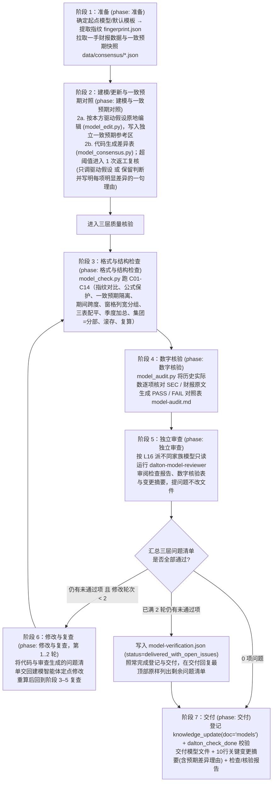
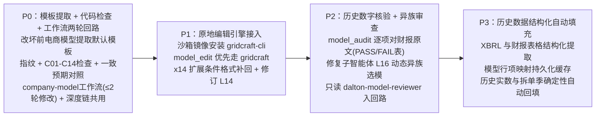

# 公司财务建模 v2 设计方案——默认格式模板、原地编辑与工作流闭环核验

> **状态**：第 2 轮修订定稿（纳入用户 6 项补充要求，待实施）
> **适用形态**：同时支持 **Everflow 生产形态**（部署形态配置变量 `DALTON_PROFILE=everflow`）与 **独立核心安装形态**（`DALTON_PROFILE=core`，分离规范见 `docs/dalton/features/standalone-core.md`）
> **演进关系**：完整沿用 `plugins/dalton/skills/dalton-model/` 与 `plugins/dalton/skills/dalton-conventions/references/model-standards.md` 的全部既有建模约定，在其之上升级工作簿原地编辑工具、一致预期独立对照流程与多阶段建模工作流；同步修订 `docs/dalton/archive/dev-guide/README.md` 决定记录 `L14`

---

## 一页摘要

### 1. 核心目标

围绕核心诉求——**「保留全部既有建模约定，按原始中国电商模型的公司工作表标准格式新建模型，或在存量模型上根据新财报扩展期间、更新实际数与预测、补充和修改必要项目，保持原有格式与公式结构完好，独立建模后再对照一致预期，并通过与报告一致的工作流检查回路保障质量，全程零额外确认步骤」**——将建模链路升级为**「模型指纹引导 + 原地最小化编辑 + 独立建模后对照一致预期 + 三层检查核验与最多两轮修改反馈回路」**。

### 2. v1 与 v2 核心机制对比

| 维度 | v1 现状（`modeling-skill.md`） | v2 方案（本文） |
|---|---|---|
| **既有建模约定** | 写在 `dalton-model` 与 `model-standards.md` 提示词中，靠智能体自觉遵守 | **100% 沿用现有建模约定**（逐条保留，见第 2 章），并将可自动判定的规则（预测期全公式、季度加总年零假设、期间覆盖跨度、空值留空、表头与最右红字备注列等）全部落实为确定性代码检查项 |
| **默认格式来源** | 仅提供粗粒度样式常量与统计摘要 | 从**中国电商原始模型（被改坏前的版本）**提取「公司 `sheet`（工作表）标准格式」生成内置脱敏模板，双形态开箱可用且无需用户额外提供模板 |
| **工作簿编辑方式** | 智能体自由编写大型 `openpyxl`（Python 电子表格读写库）脚本，常整本重写 `.xlsx`（Excel 电子表格工作簿） | **原地最小化编辑**：主路径用 `gridcraft`（`gridcraft-cli`，命令行电子表格原地编辑与重算工具）插列、向右填充公式、格式刷套样式；回退路径加载原文件副本配合 `XML`（可扩展标记语言）扩列定点改格 |
| **一致预期对照** | 常在建模过程中直接向结果格填目标常数硬凑一致预期 | **先按本方驱动假设独立建模，算出结果后再对照**：代码生成分部与费用拆解差异表，超阈值（默认收入 `±5%`、利润/`EPS`〔每股收益〕`±10%`）进入一次返工复核（只调驱动假设或保留判断并附一句理由）；预测行填一致预期常数或引用一致预期参考区均列为问题交回修改 |
| **流程编排与质量回路** | 单智能体手写 `Checks` 页 + `model_scan.py` 提示性扫描，无数字对源与异族审查 | 建成标准工作流 `workflows/company-model/`（与 `earnings-deep-update` 共用同一组阶段）：**准备 → 建模/更新与一致预期对照 → 格式与结构检查 → 历史数字核验（`PASS/FAIL`〔通过/未通过〕表）→ 不同家族模型只读审查 → 修改与复查（最多两轮）→ 交付**；两轮后仍有未通过项时照常交付，并在回复顶部原样列出剩余问题 |
| **单轮范围与转派** | 单轮可混改多公司页签；`Home`（主空间）转派仅传改写摘要 | **一轮只更新一家公司**（多公司请求按家串行拆轮，其余公司工作表保持零改动）；研究总监（`Chief of Staff`）转派时由代码自动附上用户原话 |

### 3. 分批实施概览

- **P0（指纹、默认模板提取、代码检查与工作流回路）**：从改坏前的中国电商模型提取默认格式模板 + `model_fingerprint.py` 指纹提取 + `model_check.py` 格式结构与一致预期隔离检查 + `model_consensus.py` 差异表生成 + `workflows/company-model/`（含最多两轮修改回路，并与 `earnings-deep-update` 共用阶段）+ 一轮一家锁定 + `Home` 转派附用户原话。
- **P1（`gridcraft` 原地编辑引擎接入）**：沙箱镜像集成 `gridcraft-cli` + `model_edit.py` 优先走 `gridcraft` 脚本化原地编辑 + Excel 2010 扩展条件格式（`extLst`/`x14`）自动补回 + 修订决定记录 `L14`。
- **P2（历史数字核验与异族模型独立审查）**：`model_audit.py` 历史披露数逐项对一手财报原文（输出 `PASS/FAIL` 表，复用报告数字核验架构）+ 修复子智能体按 `L16` 动态选不同家族模型 + 只读审查子智能体 `dalton-model-reviewer` 接入两轮修改回路。
- **P3（历史披露数结构化自动填充）**：法定财报 `XBRL`（可扩展商业报告语言）与财报表格解析 → 模型行项映射持久化缓存 → 历史实际值与累计拆单季确定性自动回填。

---

## 1. 现状与问题（附实测证据与代码根因）

### 1.1 近期真实案例与实测证据

在中国电商多公司整本模型（连续 3 天、6 轮迭代仍无法投入使用）及龙溪模型更新任务中，暴露出四类核心故障：

1. **整本重写破坏公式链与视图版面**：
   - 智能体编写了一个约 **14 万字节**的 `openpyxl` 脚本，在 Python 中把预测数字算成浮点数后从头写出整本 `.xlsx`。
   - **公式退化为常数**：`v2.0` 交付件预测期出现 **917 个硬编码数字常数**，原本动态联动的收入、利润行变成死数字。
   - **冻结窗格严重错位**：京东主表 `Model - JD` 原冻结位置为 `xSplit=10, ySplit=2`（横向冻结 10 列、纵向冻结 2 行，对应 `topLeftCell="K3"`），重写后错位至 `xSplit=51, ySplit=101`，打开工作表后主视口无法正常滚动。
   - **样式重建与未计算掩盖**：全书单元格样式从头重设，且工作簿被写入 `fullCalcOnLoad=1`（打开工作簿时强制全表重算属性）掩盖空缓存值。
2. **「贴合一致预期」时直接改写结果行，造成集团与分部脱节**：
   - 当智能体试图调整预测贴近市场一致预期（`Consensus`，多位卖方分析师预测的统计均值）时，直接向利润结果格写入目标常数，绕过底层业务分部驱动。
   - `Model - JD` 中**集团营业利润（54.7B〔十亿〕）与各业务分部营业利润加总（约 44B）相差超过 10B**，上下游计算链断裂。
3. **历史披露数据空缺且未经对源核验**：
   - 分部改口径后的新口径历史可比同期数据留空未填，资产负债表历史核心科目缺失；已填入的历史数也缺少像研究报告 `check_draft` 那样的逐项对一手财报原文核验。
4. **单轮自写自查，缺乏工作流级的修改闭环**：
   - 工作簿内的 `Checks` 页与自检脚本均由同一智能体编写并自跑，在存在 917 个预测常数与 10B 分部脱节的情况下依然报告**「40/40 全通过」**；现有流程缺少独立的代码基线指纹对比、历史数字核验、异族模型只读审查及受控轮次的返工反馈回路。

### 1.2 现有代码层成因定位

1. **缺少原模型基线指纹对比与约定自动化检查**：`plugins/dalton/skills/dalton-model/scripts/model_scan.py` 仅扫描单本新文件，未与原模型逐格比对，无法识别「原预测公式被改成常数」「原冻结窗格从 `10/2` 跳到 `51/101`」「预测行直接抄入一致预期常数」或「顺手改坏其他公司工作表」。
2. **建模尚未做成标准多阶段工作流**：正式研报在 `workflows/earnings-deep-update/workflow.js` 与 `workflows/bullbear-doc/workflow.js` 中已具备「语言审查 → 审稿 → 修改 → 复审（最多两轮）」与 `check_draft` 数字核验环节，而单次建模任务仍靠智能体自由发挥，且 `earnings-deep-update/workflow.js:84-90` 中的「模型更新」仅为一个单步子任务派发，与独立建模技能存在两套维护面。
3. **沙箱尚未内置 `gridcraft-cli` 原地编辑工具**：宿主机实测 `gridcraft-cli`（0.19.1）对中国电商原模型 **57,173 条公式重算仅需 0.7 秒**，**57,018 条与原缓存一致**（155 条差异来自 `CIQ`〔Capital IQ，标普金融终端插件〕函数与原模型既有迭代计算），打开再保存完整保留全部冻结窗格与图形部件（仅丢弃可选的 `calcChain.xml`〔公式求值顺序缓存〕与 Excel 2010 扩展条件格式 `<extLst>`/`x14`）；但当前 Docker 沙箱镜像（`Dockerfile.sandbox` 与 `src/ptc_agent/core/sandbox/providers/_image_recipe.py`）尚未安装 Linux 版二进制。
4. **`Home` 转派未附用户原话，且审查子智能体写死单一模型**：`src/tools/secretary/chief_of_staff.py:182-229` 的 `delegate_to_analyst` 仅传递改写后的任务描述；`plugins/dalton/agents/dalton-reviewer.md:3` 写死 `model: gpt-6.2-sol-oauth` 且 `src/server/services/llm/subagents.py:268-345` 未按 `role_policy.family_of()` 动态切换不同家族模型。

### 1.3 决定记录 `L14` 修订

将 `docs/dalton/archive/dev-guide/README.md` 第 6.2 节 `L14` 修订为：
> **新 `L14`：「`gridcraft` 作为原地编辑引擎与第二复算引擎；主流程交付物与持久化载体仍是标准 `.xlsx` 文件。`gridcraft` 保存丢失的 Excel 2010 扩展条件格式（`<extLst>` / `x14`）由后处理脚本从原文件 XML 节点（或通过 `openpyxl`）补回，并在代码检查报告末尾一行提示信息中说明。」**

---

## 2. 沿用的现有建模约定（逐条溯源与代码检查映射）

建模 v2 是在现有 `dalton-model` 技能与 `dalton-conventions` 方法论之上的**流程编排与工具自动化升级**，完整保留全部既有财务建模约定。下表逐条列出沿用的约定、仓库原文出处及在 v2「格式与结构检查 / 数字核验」中的自动化落点：

| 约定类别 | 沿用的具体建模约定内容 | 原文精确出处 | v2 自动化检查与执行落点 |
|---|---|---|---|
| **核心规则 1：预测期全公式与驱动调整** | 收入、成本、费用、利润等预测期金额全部由公式算出（如 `=GMV〔商品交易总额〕× Take rate〔货币化率〕`、`=去年同期×(1+增速)`、`=各分部之和`）；调预测数值只改驱动假设输入格；调建模方法可改公式结构并在变更记录写明；管理层直接给出的金额指引（如明年 `CapEx`〔资本开支〕金额）在对应区块或表下方单设输入格（套驱动假设格式，最右备注列写来源），预测行用公式引用该输入格；原模型里是公式的预测行更新后仍是公式。 | `plugins/dalton/skills/dalton-model/SKILL.md` 第 14–18 行 | 代码检查 **`C03`**（逐格核查原公式格保持公式、预测期金额列零裸常数、管理层金额指引走独立输入格引用） |
| **核心规则 2：季度汇总年度列口径** | 同表已有对应四财季列的年度列全部由公式算出，驱动假设只放在预测季度列和无季度拆分的远期年度列：<br/>- 流量（收入、成本、利润、现金流）：四季相加；<br/>- 时点余额（现金、债务、期末股本）：取财年最后一季；<br/>- 比率（增速、利润率、`Take rate`、占比）：用本年度列分子和分母重算；<br/>- 年度 `EPS`：年度利润 ÷ 年度加权平均稀释股数（与公司披露口径一致；维护原模型时兼容原表既有同口径公式）；<br/>- 用户数、活跃商家等 `KPI`（关键经营指标）：按公司披露口径（第四季期末、四季均值或年度去重数）。 | `plugins/dalton/skills/dalton-model/SKILL.md` 第 19–24 行 | 代码检查 **`C10`**（按 `annual_sum_quarters` 逐行检验加总年度列零驱动常数及流量/余额/比率/EPS 公式与数值恒等关系） |
| **核心规则 3：一致预期重大差异归因** | 本方预测与一致预期或主要卖方预测存在重大差异时，拆到分部、驱动假设、费用、利息、股本查明来源：有可核实的新信息支撑就保留判断并写明理由；发现自身驱动假设遗漏或口径错误就修正驱动假设。 | `plugins/dalton/skills/dalton-model/SKILL.md` 第 25 行；`references/sanity-check.md` 第 23–30 行 | `model_consensus.py` 超阈值返工复核 + 代码检查 **`C04`**（预测行与一致预期隔离及明显差异理由齐备检查）+ 异族审查 |
| **核心规则 4：原模型维护、只读留存与变更记录** | 提供或存在原模型时在原模型基础上维护，沿用结构、预测方法和格式；原模型文件保持只读，修改版另存为 `model/` 下的新版本文件；在最前面的 `README & Changelog`（或原模型既有 `Change Log`）工作表写明版本号、日期、基线文件、补充的实际值、新增期间、修改的驱动假设及理由、结构调整及与一致预期的主要差异理由。 | `plugins/dalton/skills/dalton-model/SKILL.md` 第 10、26、60–63 行；`references/rollforward.md` 第 3、45–51 行 | 指纹 `source_sha256` 原件只读校验 + 代码检查 **`C01`**（表顺序与 `README & Changelog` 本轮更新记录检查） |
| **期间覆盖跨度与单向扩展** | - 新建模型历史跨度：年度历史至少自 `FY2018A`（或招股书最早完整财年）连续覆盖至最近完整财年；单季历史至少自 `2024Q1A` 连续覆盖至最近已披露季度；<br/>- 预测跨度：季度预测逐季覆盖本财年剩余季度与下一完整财年直至次年 `Q4`（如当前 `FY26` 做到 `4Q27E`）；年度预测至少覆盖 3 个完整财年至下下财年（如 `2026E–2028E`），无季度拆分的远期年份直接在年度列放驱动假设；<br/>- 单向向后扩展，完整保留原模型全部既有历史列；非自然年结账公司在 `A2` 或表头旁注明财年截止月（如 `FY ends Mar`）。 | `plugins/dalton/skills/dalton-conventions/references/model-standards.md` 第 5–10、92–94 行；`dalton-model/references/forecast-rules.md` 第 5–11 行 | 代码检查 **`C02`**（自动解析 `period_axis` 校验历史起始年/季、预测截止季/年跨度、存量历史列零删减、非自然年标注） |
| **一手披露取数、累计拆单季与空值留空** | - 历史实际数只取一手监管定期报告（美股 `SEC`〔美国证券交易委员会〕`10-K`/`10-Q`/`20-F`〔年报、季报、外国发行人年报〕，港股/A 股法定财报与业绩公告），配套可追溯来源元数据；<br/>- 仅披露累计期间（`6M`/`9M`/`FY`）时按算术差分推导单季（`Q2=H1-Q1`、`Q3=9M-H1`、`Q4=FY-9M`），标记为披露衍生值并注明两期财报出处；<br/>- 未披露细项或未单独预测假设一律留空（`Blank`），仅在确认实际发生或显式预测为零时填 `0`；<br/>- 财报更新后完成当季实际值相对前版预测的事后偏差分解并记入修订日志。 | `plugins/dalton/skills/dalton-conventions/references/model-standards.md` 第 16–33、52–65 行；`dalton-model/references/forecast-rules.md` 第 208–220 行 | **数字核验阶段** `model_audit.py`（逐格对源与拆单季验算）+ 代码检查 **`C08`**（历史格完整性、未预测项留空与无备注裸 `0` 检查） |
| **季节性、大促跨季与管理层指引** | - 季度路径按历史季节性（同比或历史季度结构）设定在各季假设上，避免写成「占全年比例 × 本年合计」引发循环引用；<br/>- 春节移动与 618/双十一/黑五跨季挪动单设「日历调整」驱动假设行，并在相邻季度做等额反向调整（同财年内全年合计保持不变，跨财年分别反映两年影响，远期趋势维持常态）；53 周财年仅计入多一周当季；<br/>- 指引记录：单设「指引」表或指引区逐条记录发布日期、适用期间、指标、形式与数值、实际值与兑现情况（区分年初首次全年指引与年内修订）；季度预测直接采用全年指引时，剩余季度引用「全年指引 − 已披露累计」按季节性拆分，年度列保持四季公式之和。 | `plugins/dalton/skills/dalton-model/references/forecast-rules.md` 第 9、65–66、81–100 行 | 代码检查 **`C10`**（年度列四季公式汇总）、**`C13`**（零新增循环引用）+ 异族审查 `dalton-model-reviewer`（核查指引兑现表、季节性与跨季反向调整逻辑） |
| **版面样板、表头与最右备注列** | - 版面列序：`A–D` 层级缩进标签列 → 年度列 → 窄空隔列 → 可选 `CAGR`（复合年增长率）列 → 窄空隔列 → 季度列 → 最右备注列；行序依次为期间表头与 `A1` 单位、利润表（浅蓝 `99CCFF`）、`Non-GAAP`（非公认会计准则，棕红 `993300`）、分部报告（棕红）、业务拆解区（浅桃 `FFCC99`）、现金流量表（浅蓝）、资产负债表（浅蓝），衍生比率斜体分组；多公司模型前放行业页并以 `{TICKER}>>` 空白页分隔各公司；<br/>- 第 1 行亮蓝底 `3366FF` 白字加粗，`A1` 左对齐写单位，期间列右对齐；英文数字 `Arial` 8 号、中文 `等线` 8 号；驱动假设与管理层金额指引 `FFFFC8` 浅米黄底配 `hair` 四边细虚线框；<br/>- 来源和说明统一写在数据区最右侧备注列（红字 `FF0000`，以 `<` 或 `<<` 开头指向左侧数据），工作簿内保持零单元格批注。 | `plugins/dalton/skills/dalton-model/references/forecast-rules.md` 第 13–43 行；`references/format-spec.md` 第 18–88 行 | 默认格式模板继承 + 代码检查 **`C05`**（样式角色、字号表头色、最右红字 `<`/`<<` 备注列、零新增 Excel 批注）与 **`C06`**（窗格、列宽、分组） |
| **一致预期取数、口径对齐与基础检查** | - 按部署能力调用 `researchdata.finance(route="estimates")` 或公开 `yf_analysis` / `fundamentals` 取数，原始数据落盘 `data/consensus/<YYYY-MM-DD_HHMM>.json`；<br/>- 比较前先对齐财年截止日、币种、会计口径（`GAAP`〔公认会计准则〕/`IFRS`〔国际财务报告准则〕与 `Non-GAAP`）、普通股与 `ADS`（美国存托股份，`EPADS` 为每份美国存托股份收益）及是否已反映最新财报；<br/>- 核对全表金额单位一致、币种换算一致、估值页目标年份/倍数对应 `EPS`/净现金引用已指向更新后的预测列。 | `plugins/dalton/skills/dalton-model/references/sanity-check.md` 第 6–21 行；`SKILL.md` 第 55 行 | `model_consensus.py` 快照读取与口径元数据核对 + 代码检查 **`C07`**（单位标识、估值页跨表引用列更新检查） |

---

## 3. 建模工作流与「最多两轮」反馈回路设计

### 3.1 合并单一工作流 `workflows/company-model/`（支持新建与更新双模式）

参照现有报告工作流引擎（`src/ptc_agent/agent/middleware/background_subagent/workflow/engine.py` 的 `QuickJS`〔嵌入式轻量级 JavaScript 引擎〕编排器 + `src/dalton/workflows/contracts.py` 完成契约），择简设立**单一建模工作流 `workflows/company-model/`**（包含 `workflow.js` 与 `contract.json`），通过参数 `mode` 统一承载新建与更新：

- **输入参数（`args`）**：
  - `ticker`（必填）：本轮唯一目标公司股票代码（如 `"PDD"`、`"JD"`、`"META"`）；
  - `workspace_dir`（必填）：当前工作区根目录（`"."`）；
  - `as_of`（必填）：基准日期 `YYYY-MM-DD`（财报更新场景可传 `release_date`）；
  - `mode`（可选，默认 `"auto"`）：`"build"`（按默认格式模板新建）、`"update"`（存量模型滚动更新）或 `"auto"`（工作区或 `model_path` 已有匹配模型时自动进 `"update"`，无存量模型时进 `"build"`，全程无需询问用户确认）；
  - `model_path`（可选）：用户本轮上传或指定的起点 `.xlsx` 路径；缺省时自动按 `data/models.json` `current` 与 `model/` 最新版本解析；
  - `quarter`（可选）：本次更新对应的最新披露财季（如 `"3Q26"`），用于命名研究目录 `research/{as_of}-model-{ticker}`（或接入深度链时复用 `research/{release_date}-deep-{quarter}`）；
  - `consensus_thresholds`（可选）：按公司特征微调的一致预期差异复核阈值覆盖项；
  - `progress_path`（可选）：断点续跑进度文件路径（默认 `research/{as_of}-model-{ticker}/.progress.json`）。



### 3.2 复用现有报告核验的轮次与反馈机制（代码出处与对齐设计）

现有仓库中，正式报告的质量核验由三处代码协同实现「反馈修改 + 固定轮次上限 + 日常交付可带未决项列明交付」：

1. **工作流两轮修改循环（`workflows/earnings-deep-update/workflow.js:244-315`、`workflows/bullbear-doc/workflow.js:315`、`workflows/topic-research/workflow.js:373`）**：
   - 现有报告工作流通过 `let rounds = 0; while (finalReview && verdictOf(finalReview) === 'revise' && rounds < 2) { rounds += 1; ... }` 控制「发现问题 → 交回主笔智能体修订 → 重新核验」**最多执行 2 轮**。
2. **轮次侧车账本与哈希绑定（`src/dalton/publish/language.py:408-425,620-705` 与 `src/dalton/tools/check_done_tools.py:2601-2677`）**：
   - `run_check_language(round=1|2)` 将每轮检查的模型、草稿 `SHA-256`（安全哈希算法 256 位摘要）与问题数组追加写入 `<draft>.language.json` 的 `rounds[]` 列表，并生成给人读的 `<draft>.language.md` 修改清单。
3. **数字核验非阻断日常交付语义（`src/dalton/publish/service.py:953-1132`、`plugins/dalton/skills/dalton-publish/SKILL.md:38-42`、`src/dalton/tools/check_done_tools.py:3046-3071`）**：
   - `run_check_draft()` 生成 `.audit.md` 问题清单供智能体按行修正，日常交付允许在明确列出未核实项后交付；`dalton_check_done` 的 `_check_draft_sidecar()` 核对 `.audit.md` 已针对当前最终文件的 `SHA-256` 跑完核验，而非因残留个别未决项卡死整个会话。

**建模 v2 对上述机制的直接复用与统一落盘**：
- 在 `workflows/company-model/workflow.js`（及共用阶段模块）中采用完全相同的 `let fixRounds = 0; while (openIssues.length > 0 && fixRounds < 2)` 循环：
  - **初检（`round = 0`）**：阶段 2 产出候选新版本 `model/<TICKER>-model-v<NN>.xlsx` 后，依次运行阶段 3（`model_check.py`）、阶段 4（`model_audit.py`）与阶段 5（`dalton-model-reviewer`），由聚合脚本 `model_check.py merge-issues` 汇总三处未通过项，生成统一的待修清单 `<R>/model-issues-round0.md` 并追加记录至轮次账本 `<R>/model-verification.json`。
  - **交回修改与复查（`fixRounds = 1, 2`）**：只要 `openIssues` 非空且 `fixRounds < 2`，把 `<R>/model-issues-round<k>.md` 交回建模智能体，在当前新版本工作副本上通过 `model_edit.py` 定点修正并重算（原模型基线文件始终保持只读），随后重跑阶段 3–5 验证修改结果并追加写入 `rounds[]`。
  - **两轮封顶照常交付**：当 `openIssues.length === 0` 时，账本标记 `status = "pass"`；当 `fixRounds === 2` 后仍有未解决项时，循环立即终止，账本标记 `status = "delivered_with_open_issues"` 并将剩余问题固化到 `<R>/remaining-issues.md`；`knowledge_update(doc="models")` 照常登记新版本（在版本记录 `reason` / 元数据中如实记录核验状态），智能体在**交付回复的最顶部原样贴出 `<R>/remaining-issues.md` 中的剩余问题清单**。
- **完成契约校验（`src/dalton/tools/check_done_tools.py` + `contract.json`）**：
  - `workflows/company-model/contract.json` 的 `validators` 调用 `python3 .agents/skills/dalton-model/scripts/model_check.py verify-done --workspace {workspace_dir} --ticker {ticker} --ledger {research_dir}/model-verification.json`（`pass_when: "exit_zero"`）：核对磁盘最终模型可读且已重算，核对 `model-verification.json` 最后一轮记录的 `model_sha256` 与磁盘最终模型实时 `SHA-256` 完全一致，且终态满足 `status == "pass"` 或（`fix_rounds == 2` 且 `status == "delivered_with_open_issues"` 且 `remaining-issues.md` 非空）。这与 `_check_draft_sidecar` 和 `_check_language_record` 的哈希绑定校验完全一致：既确保三层检查与必要的两轮修改真实跑完、未跳步，又保证两轮后仍有疑难项时顺畅交付。

### 3.3 `earnings-deep-update`（及 `full-coverage`）如何共用同一条建模流水线

核查工作流引擎代码，子智能体不持有主智能体专属的 `RunWorkflow` 工具（`src/ptc_agent/agent/middleware/background_subagent/workflow/tool.py:257`），且 `QuickJS` 运行时不提供运行时跨文件 `import` 模块加载器（`workflows/full-coverage/workflow.js:101-102`），但所有预置 `workflow.js` 在编译与启动前均统一经过 `src/ptc_agent/agent/middleware/background_subagent/workflow/prebuilt.py:20,45` 的 `read_assembled_workflow_file()`（调用 `src/dalton/content_assembly.py`）。

为彻底消除两套建模逻辑，采用**「源码期单一阶段模块 + 装配期自动内联 + 同一校验器」**方案：

1. **抽取唯一共享阶段实现 `workflows/_shared/modeling_stages.js`**：
   - 将「准备 → 建模/更新与一致预期对照 → 格式与结构检查 → 数字核验 → 异族独立审查 → 最多两轮修改与复查 → 解析最终模型与验证账本」封装为单一异步函数 `runModelingPipeline(ctx)`，存放在 `workflows/_shared/modeling_stages.js`。
   - 在 `src/dalton/content_assembly.py` 新增受控白名单片段展开指令 `/* DALTON_INCLUDE:_shared/modeling_stages.js */`（仅允许引用 `workflows/_shared/*.js`，在能力条件块裁剪后做确定性文本内联，随后交 `QuickJS` `compile_check` 校验语法与缓存）。
2. **`workflows/company-model/workflow.js` 直接调用**：
   - 顶层声明 `export const meta = { name: 'company-model', ... }`，内联 `_shared/modeling_stages.js` 后直接调用 `return await runModelingPipeline({ ...args, standalone: true })`。
3. **`workflows/earnings-deep-update/workflow.js` 替换原单步「模型更新」**：
   - 在 `phase('深度点评与模型')` 的 `parallel([...])` 中，将原本第 `84–90` 行单次派发 `agent(..., { label: '模型更新' })` 替换为调用同一个 `runModelingPipeline({ ticker: T, company: C, quarter: Q, workspace_dir: W, as_of: D, mode: 'update', model_path: args.model_path, research_dir: R, standalone: false })`；
   - 财报深度链的模型支线由此在进入「校准与对账 → 审稿」之前，自动走完**指纹提取、原地更新、一致预期对照、格式检查、财报数字核验、异族模型审查及最多两轮修改复查**全套环节；
   - 若后续深度报告「审稿」阶段（`workflow.js:246`）对模型提出联动修订，同样调用 `_shared/modeling_stages.js` 中的单轮复查辅助函数 `reverifyModelAfterEdit(...)` 刷新 `model-verification.json` 哈希绑定；若模型在两轮修改后留有 `remaining-issues.md`，深度链工作流继续正常完成（`ok` 按已完成两轮核验放行），并在推送稿与最终回复顶部原样附上模型剩余问题清单；
   - `workflows/earnings-deep-update/contract.json` 第 `22–48` 行的「模型更新」阶段与 `workflows/company-model/contract.json` 共用同一组产物声明（新增 `model-verification.json`、`model-check.md`、`model-audit.md`、`consensus-diff.md`）与同一条 `model_check.py verify-done` 校验命令。`workflows/full-coverage/` 同步采用同一方式接入。

### 3.4 单轮范围控制与 `Home` 转派保真

1. **一轮只更新一家公司（兼顾多公司行业工作区路由）**：
   - 包含多家公司工作表的行业整本模型（如中国电商模型含 `BABA`、`JD`、`PDD` 等）中，每次运行 `company-model` 严格指定唯一目标 `ticker`，只允许修改该公司所属工作表（如 `Valuation - PDD`、`Key Metrics - PDD`、`Model - PDD`、`Subs - PDD`）及 `README & Changelog`；多公司更新需求由主智能体按公司拆分为串行独立运行，每次基于上一家完成后的最新文件提取指纹并独立走完核验。
   - **行业工作区路由兼容**：修改 `src/dalton/workflows/company_routing.py`（将 `company-model` 纳入路由守卫的同时，当当前工作区为行业工作区 `is_sector == True` 且 `model_path` 指向本工作区内的多公司整本模型时，允许在行业工作区就地对成员公司 `ticker` 运行 `company-model`，同时继续执行 `_guard_workspace_dir` 保证产物留在当前工作区内）。
2. **`Home`（研究总监 `Chief of Staff`）转派自动附上用户原话**：
   - 在 `src/tools/secretary/chief_of_staff.py` 与 `src/tools/secretary/dispatch.py`（附 `# DALTON-HOOK(cos-verbatim-forward)` 并在 `scripts/dalton/check_hooks.sh` 登记，`DALTON-HOOK` 为 Dalton 在上游源码中标注的差异挂载点注释）中，当 `delegate_to_analyst` 派发任务时，服务端从当前回合 `state["messages"]` 提取最新一条用户消息原文，若派发 `question` 未逐字包含该原文，则在派发消息末尾自动追加 `<user_verbatim_request>...</user_verbatim_request>` 原话块；同步在 `src/ptc_agent/agent/prompts/templates/components/chief_of_staff.md.j2` 说明多公司建模请求按一家公司一轮派发。

---

## 4. 默认格式模板提取（源自改坏前的中国电商模型）与模型指纹

### 4.1 从改坏前的原始中国电商模型定位与提取默认模板

用户原始的 **China Ecommerce（中国电商）模型在被智能体改坏之前的版本**中，各家公司的工作表（公司 `sheet`）即为团队标准格式。本方案明确规定：**直接从该模型被改坏之前的原始版本提取「公司工作表标准格式」作为新建模型的默认模板，确保使用的是未经智能体改写过的纯净原版**。

#### （1）在工作区历史与备份中精确定位「改坏前原版」的四级方法

按以下从近到远的四条只读路径查找原始中国电商 `.xlsx`（如 v1 实测记录的 40 页原件 `ecom_20261008.xlsx`），找到首个通过第（2）步全部验真断言的文件即锁定为母本：

1. **路径 1 —— 聊天上传原始对象存储与沙箱上传落地目录（首选，字节级保留首次上传原件）**：
   - 查询数据库 `dalton_chat_uploads` 表（`src/dalton/services/chat_uploads.py:625-637`）与中国电商工作区关联的最早 `.xlsx` 上传记录，核对 `sha256` 与上传时间 `created_at`，从 `MinIO`（兼容 S3 协议的对象存储服务）桶路径 `chat-uploads/<workspace_id>/<upload_id>/<safe_filename>`（`src/dalton/chat_upload_storage.py:223`）或工作区只读落地目录 `work/uploads/<stem>_<id8>.xlsx` 直接读取原始字节；
   - 若原件通过常规附件通道上传，同步查询 `chat_attachments` 表（`src/server/services/chat_attachments.py:28,88`）对应的对象存储键，或检查工作区 `sources/`、`models/` 目录中修改时间早于首轮智能体运行的文件。
2. **路径 2 —— 模型血统记录与知识层首版台账**：
   - 读取工作区 `research/*/model_lineage.json`（由 `model_style.py lineage --baseline` 生成）中最早一条记录的 `baseline_path` 与 `baseline_sha256`，以及 `dalton_knowledge_versions` 表中 `doc_key = 'models'` 的最早版本记录，顺藤定位最初作为输入基线的原件路径。
3. **路径 3 —— 工作区离线文件镜像表 `workspace_files`**：
   - 查询 PostgreSQL `workspace_files` 表（`src/dalton/channel_deliverables.py:15,646`）中该工作区 `sandbox_modified_at` 早于 3 天 6 轮迭代起始时刻的 `.xlsx` 快照哈希与底层存储对象。
4. **路径 4 —— Everflow 周度加密异地备份恢复（当工作区原文件已被覆盖或清理时使用）**：
   - Everflow 现网每周由 `scripts/dalton/ops/dalton_data_backup.sh:192-298` 将 `MinIO` 卷（`minio-<YYYY-MM-DD>.tar.gz.enc`）与全部沙箱容器 `/home/workspace`（`sandbox-langalpha-sandbox-*-<YYYY-MM-DD>.tar.gz.enc`）经 `AES-256-CBC`（高级加密标准 256 位密码分组链接模式）加密备份至 `gdrive:DaltonBackup/weekly/<YYYY-MM-DD>/`（保留 4 周）。
   - 由宿主机生产专用只读提取脚本 `scripts/dalton/ops/prod/recover_baseline_model.sh`（严格归入 `scripts/dalton/ops/prod/`，不混入独立核心包）选取**本轮 6 次改写发生日期之前最近一期**的周度归档，在宿主机隔离临时目录只读流式解密提取出中国电商原始 `.xlsx` 文件，全程不触碰运行中容器与现网数据库。

#### （2）提取前的四项「未改动原版」硬性验真标准

运行一次性模板提取脚本 `plugins/dalton/skills/dalton-model/scripts/extract_default_template.py` 时，必须先对候选中国电商模型通过以下 4 项只读验真断言，确认其确系改坏前的原始版本：
1. **文件身份与时间线验真**：文件命名与属性不含智能体生成的 `-model-vNN` 或 `v2.0` 标记，且上传/归档时间戳早于首轮改坏脚本执行时间；
2. **公式规模与计算属性验真**：全工作簿公式总数约 `57,173` 条（含约 `155` 处原始 `CIQ` 终端插件公式），`xl/workbook.xml` 中 `<calcPr>` 未被写入强制 `fullCalcOnLoad=1`，预测期计算行均为动态公式（零出现 `v2.0` 中 917 个预测硬编码常数的重写特征）；
3. **标志性冻结窗格坐标验真**：`Model - JD` 工作表的 `<pane>` 精确为原始 `xSplit=10, ySplit=2`（`topLeftCell="K3"`），排除 `xSplit=51, ySplit=101` 等被脚本重排后的版本；
4. **原生样式槽验真**：公司页签具备完整的 `Arial` / `等线` 8 号字、第 1 行亮蓝表头 `3366FF`、浅米黄假设格 `FFFFC8` 配 `hair` 细虚线框、浅蓝 `99CCFF` / 棕红 `993300` / 浅桃 `FFCC99` 三级分节条及最右红字 `FF0000` 备注列。

#### （3）标准公司页签骨架脱敏提取与双形态读取

1. **提取内容**：从通过验真的原始中国电商模型中选取标准单公司页签组合（`Model` 主计算表、`Key Metrics` 关键经营指标表、`Subs` 子业务拆解表、`Valuation` 估值表，并在最前配齐标准 `README & Changelog`、在末尾配齐标准 `vs Consensus` 一致预期对照页），清空特定公司的商业数据、股票代码、公司名称与外部 `CIQ` 链接，完整保留原始列序布局、列宽、行分组、早年列折叠大纲、冻结窗格（如 `K3` / `E2`）、全套样式槽与通用三表及分部勾稽公式骨架，生成 `plugins/dalton/skills/dalton-model/assets/default_model_template.xlsx`。
2. **双形态分离加载（遵循 `docs/dalton/features/standalone-core.md`）**：
   - 形态判定统一调用 `src.dalton.profile`，路径解析函数 `get_model_default_template_path()` 置于 `src/dalton/settings.py`：优先读取部署环境变量 `DALTON_MODEL_DEFAULT_TEMPLATE_PATH`（Everflow 生产配置归 `scripts/dalton/ops/prod/`，独立核心安装客户自定义自有机构模板配置归 `scripts/standalone/`，解析逻辑单点共用）；未设置时默认读取随包脱敏模板 `plugins/dalton/skills/dalton-model/assets/default_model_template.xlsx`（位于 `plugins/dalton/` 白名单内，`everflow` 与 `core` 双形态开箱可用，且不含任何专有商业数据）。

### 4.2 模型指纹规范（内部结构，对用户隐藏）

开工准备阶段由 `plugins/dalton/skills/dalton-model/scripts/model_fingerprint.py` 只读解析起点模型（存量原模型或 `default_model_template.xlsx`），在 `.agents/threads/<thread8>/modeling/<TICKER>-fingerprint.json` 生成完整基线指纹（仅系统内部读取，不暴露给用户）：
- 供建模智能体读取：`model_fingerprint.py summary` 输出紧凑结构地图（表清单、期间列字母映射、分节行号、勾稽锚点行号、代表列公式模板与样式槽编号）；
- 供格式与结构检查读取：`model_check.py` 读取全量 `fingerprint.json` 与新版本逐格比对。

| 层级 | 字段路径 | 类型 | 记录内容与提取方式 | 下游用途 |
|---|---|---|---|---|
| **顶层与工作簿级** | `schema_version` | `int` | 固定为 `1` | 指纹结构版本兼容 |
| 同上 | `source_path` / `source_sha256` / `source_bytes` | `str` / `int` | 基线 `.xlsx` 路径、64 位十六进制 `SHA-256` 摘要与字节数 | 核验原模型保持字节级只读 |
| 同上 | `calc_properties` | `object` | 解析 `xl/workbook.xml` `<calcPr>`：`full_calc_on_load`、`calc_mode`、`iterate`、`iterate_count`、`iterate_delta` | 检查 **`C13`** 核对 `fullCalcOnLoad` 与原模型既有迭代计算设置 |
| 同上 | `theme_palette` / `style_catalog` | `dict` | 解析 `xl/theme/theme1.xml` 12 主题色槽（支持 `theme + tint` 还原为 6 位 `RGB`〔红绿蓝十六进制色值〕），建立去重样式字典 `"s0".."sN"`（字体、字号、加粗/斜体、字色、底色、四边边框、`number_format`、对齐） | 检查 **`C05`** 逐格常数时间比对同行同类列样式一致性 |
| 同上 | `sheet_order` | `list[SheetTab]` | 全部工作表顺序：`index`、`name`、`state`（`visible`/`hidden`/`veryHidden`）、`tab_color`、`sheet_type`（`content_sheet`/`blank_divider`/`hidden_sheet`）、`company_tag`（如 `"JD"`、`"PDD"` 或 `null`） | 检查 **`C01`** 工作表完整性与 **`C14`** 非目标公司工作表零改动 |
| 同上 | `defined_names` / `package_summary` | `list` / `object` | 内部命名区域（如汇率 `hkd`、`ex`）与 `OOXML`（Office Open XML，开放式办公文档标准格式）包部件概览（图表、数据验证、迷你图、媒体与绘图计数） | 维护命名区域引用；包内媒体/绘图计数仅用于生成报告末尾一行提示信息 |
| **工作表级**（`sheets[name]`） | `period_axis` | `object` | `header_row`、`sub_header_rows`、`fiscal_year_end_month`（1–12，从 `A2` 如 `FY ends Mar` 或财季归属识别）、`unit_label`（如 `"(RMB MM)"`）、`source_note_col`（最右红字备注列字母）、`columns`（每列角色 `label\|spacer\|annual_actual\|annual_forecast\|quarter_actual\|quarter_forecast\|cagr_delta\|consensus_ref\|source_note`、`fy`、`fq`、`annual_sum_quarters`） | 引导扩列位置；支撑 **`C02`**（期间覆盖跨度）、**`C08`**（历史期完整）、**`C10`**（年度＝四季之和） |
| 同上 | `freeze_panes` / `column_layout` / `row_groups` / `merged_ranges` | `object` | 工作表 XML `<pane>`（`x_split`、`y_split`、`top_left_cell`、`show_grid_lines`）、列宽与列折叠大纲（`width`、`outline_level`、`hidden`）、行分组与合并单元格区间 | 检查 **`C06`** 精确核对冻结窗格、列宽与行列分组保留 |
| 同上 | `conditional_formats` | `object` | 标准 `<conditionalFormatting>` 与 `<extLst>` 下 `x14:conditionalFormatting` 的规则区间及原始 XML 片段备份 | `gridcraft` 保存后自动无损补回 `x14` 扩展条件格式 |
| 同上 | `semantic_anchors` | `object` | 关键语义锚点行号与区块坐标：利润表/`Non-GAAP`/分部/现金流/资产负债表起止行、集团与各分部收入及营业利润行、总部及抵销行、总资产/总负债/股东权益行、期初期末现金与净变动行、期初期末股数与回购流出及加权稀释股数行、`EPS` 行、管理层指引区、**一致预期参考区块/对照表坐标集合 `consensus_ref_ranges`** | 支撑 **`C04`**（一致预期隔离）、**`C09`**（配平）、**`C11`**（集团＝分部）、**`C12`**（滚存）及生成一致预期差异表与 10 行摘要 |
| 同上 | `circular_baseline` | `list[str]` | 原模型已存在的循环引用强连通分量单元格集合 | 保留原模型既有有意循环引用，仅识别本轮新增循环引用 |
| **单元格级**（`sheets[name].cells[coord]`） | `category` / `formula` / `cached_value` / `style_id` | `object` | 单元格分类（`formula`：`same_sheet`/`cross_sheet`/`plugin`/`array`；`input`：`actual_input`/`hist_estimate`/`driver_input`/`guidance_input`/`external_input`；`constant`：`numeric_const`/`label`/`source_note`/`error_literal`）、原始公式文本、缓存值 `<v>`、样式键 `style_id` 及是否存在单元格批注 `has_comment` | 智能体定位可编辑驱动格；支撑 **`C03`**–**`C05`** 及历史数字核验抽数 |

---

## 5. 原地编辑引擎与一致预期独立对照流程

### 5.1 原地编辑引擎（`model_edit.py`：`gridcraft-cli` 主路径 + 受控回退路径）

所有工作簿写入统一通过 `plugins/dalton/skills/dalton-model/scripts/model_edit.py` 在新版本副本上原地修改目标单元格，保持其余工作表、未改动历史列、命名区域与视图结构原样留存：

1. **主编辑引擎：`gridcraft-cli` 脚本化原地编辑（P1 装入沙箱镜像后默认启用）**：
   - `model_edit.py` 将扩列、填实数、调假设与套格式编译为 `JSONL`（按行分隔的 `JSON`〔结构化数据交换格式〕命令流）脚本，调用 `gridcraft-cli run --in <base.xlsx> --script <ops.jsonl> --out <target.xlsx> --quiet` 一次性执行：
     - **扩列与公式平移**：`home.insertColumns` 插入新预测季度/远期年度列（自动顺延同表公式、跨表引用、命名区域与图表系列） → `edit.fillRight` 从相邻同类预测列向右平移填充全部公式行 → `edit.formatPainter` + `home.columnWidth` 克隆相邻同类期间列的完整样式与列宽；当某远期年度凑齐完整四季时，自动将该年度列切换为四季汇总公式并将驱动假设下沉至季度列；
     - **新披露季度转实际值**：更新列头去掉预测后缀（如 `3Q26E → 3Q26`），仅对前序历史季度原本就是 `actual_input` 的明细行与 `KPI` 行用 `range.setValues` 填入一手财报实际数、用 `home.formatCells` 套历史实数样式（蓝字 `#0000FF`、无底色），并将原驱动假设行切换为当季实际反算比率公式（斜体无底色），自动写入 `justifications.json`；**小计、合计、利润率、同比增速与跨表引用公式原封保留**；
     - **补充新披露项与微调驱动假设**：`home.insertRows` 在对应分部/子业务块内插行补入新披露明细及历史重述可比数据；预测调整仅写入 `driver_input` / `guidance_input` 输入格及最右红字 `source_note` 备注列；
     - **全表重算与 `x14` 扩展条件格式补回**：末尾执行 `formulas.calculateNow` 亚秒级重算回写 `<v>` 缓存值；针对 `gridcraft-cli` 保存会丢弃工作表尾部 `<extLst>`（含 `x14:conditionalFormatting` 扩展条件格式）的特性，由 `model_edit.py` 内置后处理器通过 `zipfile` + `lxml`（Python XML 解析库）对照原模型指纹提取原 `<extLst>` 子树（顺延扩列后的 `<xm:sqref>` 坐标区间）无损写回输出文件，或在简单单表场景用 `openpyxl` 补齐。
2. **回退编辑路径：受控原文件副本改格 + XML 包级扩列（P0 默认及无 `gridcraft` 环境自动兜底）**：
   - 仅接受原模型或默认格式模板路径复制生成新版本副本；需要插列/插行时先调用仓库现有 `plugins/langalpha_deliverables/skills/xlsx/scripts/insert.py`（带 `--copy-style-from`）在 ZIP（压缩归档格式）/ XML 层平移坐标与重写公式；
   - 对常规表格用 `openpyxl.load_workbook(target_path)` 仅定点改写目标单元格值、用 `Translator`（`openpyxl` 公式坐标平移器）平移公式并调用 `model_style.py` 的 `clone_period_column_style` / `apply_cell_style` 套样式；对含矢量图或复杂 `<extLst>` 的工作簿直接在工作表 XML 中定点更新目标 `<c>` 节点的 `<f>`、`<v>` 与同角色样式索引 `s`；
   - 最后调用 `plugins/langalpha_deliverables/skills/xlsx/scripts/recalc.py`（优先 `IronCalc`〔Rust 电子表格计算引擎〕，自动回退 `LibreOffice`〔开源办公套件无头重算〕）回写全部公式 `<v>` 缓存值，并将 `<calcPr>` 的 `fullCalcOnLoad` 恢复为原模型指纹状态。

### 5.2 一致预期对照流程（先独立建模 → 代码出差异表 → 超阈值返工复核 → 明显差异附理由）

严格执行「**本方独立驱动建模在前、一致预期对照在后、参考数据与本方预测物理隔离**」四步闭环：

1. **第 1 步 —— 独立建模与一致预期参考快照落表**：
   - 建模智能体先依据公司一手财报、管理层指引与工作区研究认知独立设定各业务分部与费用驱动假设，由公式链算出本方收入、营业利润、净利润与 `EPS`；
   - 一致预期数据按双形态能力（`src.dalton.capabilities`：`researchdata.finance(route="estimates")` 或公开 `yf_analysis` / `fundamentals` 及卖方报告检索）获取后保存至 `data/consensus/<YYYY-MM-DD_HHMM>.json`，**允许写入模型中单独的一致预期对照表（如 `vs Consensus` / `Street vs House` 工作表）或汇总表下方独立的参考区块**：参考格采用外部输入样式（`role="external_input"`，蓝字无底色常数快照），并在最右备注列（或对照表「来源类型与日期」列）明确写出数据来源与取数日期（如 `<Visible Alpha / Yahoo Finance, 2026-11-26` 或 `<GS 2026-11-17`）；
   - **隔离边界**：本方主模型与汇总表中的收入、成本、费用、营业利润、净利润、现金流、`EPS` 等预测行全部由本方驱动假设经公式算出；一致预期参考格仅作为对比基准被「差异计算列」（如 `=本方预测格/一致预期参考格 - 1`）单向读取。
2. **第 2 步 —— 代码自动生成「我们 vs 一致预期」分拆差异表（`model_consensus.py diff`）**：
   - 独立建模重算完成后，运行确定性脚本 `plugins/dalton/skills/dalton-model/scripts/model_consensus.py diff`：先校验比较口径对齐（财年截止月、报表币种、`GAAP`/`IFRS` 或 `Non-GAAP`、普通股或 `ADS`、是否已反映最新季报），再自动读取本方模型结果与一致预期参考快照，输出 `<R>/consensus-diff.md` 与 `<R>/consensus-diff.json`：
     - **核心汇总层**：下一季度、本财年、下一财年及远期财年的**营业总收入、营业利润、净利润、稀释 `EPS`/`EPADS`**，逐项列出「本方预测 | 一致预期 | 绝对差额 | 差异百分比（近零或盈亏方向相反时标绝对差额与方向）」；
     - **业务分部与关键费用拆解层**：按各业务分部收入、分部营业利润/利润率，以及毛利率、销售费用率、研发费用率、管理费用率、净利息收入、有效税率、稀释股数拆开对比（有卖方分项预期时直接算差额，仅有一致预期总量时并列展示本方隐含增速/费用率变化以定位偏离点）。
3. **第 3 步 —— 超阈值触发一次「返工复核」（可按公司调整阈值）**：
   - **默认复核触发阈值**（定义在 `model_consensus.py` 默认配置，支持通过工作流 `consensus_thresholds` 参数按公司高增长/盈亏平衡特征调整；用户在原话中点名关注的指标无条件纳入）：
     - 营业总收入：差异超过 **`±5.0%`**；
     - 营业利润、归母净利润、稀释 `EPS`/`EPADS`：差异超过 **`±10.0%`**（利润率接近盈亏平衡即绝对利润率 `< 3%` 时，改为营业利润率或净利率相差超过 **`±150bp`**〔基点，1bp = 0.01%〕）；
     - 主要业务分部收入：差异超过 **`±8.0%`**；关键期间费用率：相差超过 **`±200bp`**。
   - 当任一指标超出阈值时，工作流在阶段 2b 自动触发**一次「一致预期返工复核」**：智能体逐项拆解到具体分部、量价/`Take rate` 驱动假设、费用率、利息、税率与股本，核查分歧根源（严格沿用 `SKILL.md` 第 25 行规则）：
     - **发现本方假设遗漏或口径偏差**（如漏计新披露重组费用、`ADS` 换算比未对齐、季节性基数误含一次性损益）→ 通过 `model_edit.py` **修改对应的驱动假设输入格**，让公式重新算出结果；
     - **有可核实的新信息或独立研究判断支撑**（如最新电话会管理层投放表态、高频渠道数据、指引一贯保守规律）→ **保留本方驱动假设与预测结果，无需贴合一致预期**，为该项差异写明具体支撑理由。
4. **第 4 步 —— 交付时每个明显差异附一句理由，并由代码检查一致预期隔离**：
   - 返工复核后重新运行 `model_consensus.py diff` 更新差异表，确保每一项超阈值明显差异在工作簿对照表「差异说明」列、`README & Changelog` 及交付摘要中均附有一句清晰理由（例如：「结合我们的研究，认为主站货币化率提升带动收入增速快于市场预期，同时海外新业务投入使销售费用率高于市场预期」）；
   - 在阶段 3 的代码检查 **`C04`** 中强制核查本方预测行与一致预期参考区的隔离关系及来源日期完整性（详见第 6.1 节）。

---

## 6. 三层质量核验规范（格式结构检查 + 数字核验 + 异族审查）

### 6.1 第一层：格式、结构与建模约定代码检查（`model_check.py`，共 14 项）

新增确定性检查脚本 `plugins/dalton/skills/dalton-model/scripts/model_check.py`，在阶段 3 与每次返工修改后执行，对照基线指纹（`fingerprint.json`）、变更豁免登记（`justifications.json`）与第 2 章建模约定逐项检查，输出结构化结果 `model-check.json`（每项含 `code`、`status ∈ PASS | FAIL`、精确到 `工作表!单元格坐标` 的问题列表与修复指引）及给人读的 `model-check.md`。凡检出 `FAIL` 条目，即进入第 3.2 节问题清单交回建模智能体修改（最多两轮）。

> **嵌入图片与绘图部件的处理口径**：工作簿内嵌入图片（`xl/media/*`）与绘图部件（`xl/drawings/*`）的增减**免于列入检查项与验收标准**；`model_check.py` 仅在检查报告末尾附一行简短提示信息（如存在 `x14` 扩展条件格式自动补回或包部件变动时顺带提示一行），绝不产生 `FAIL` 项。

| 编号 | 检查项（含对应建模约定） | 确定性判定规则 | 代码实现方式（`model_check.py`） |
|---|---|---|---|
| **C01** | **工作簿可读性、表顺序与变更记录更新** | 1. 文件为合法 `.xlsx` 且全部工作表 XML 流式解析完整；<br/>2. 存量更新模式下，原模型指纹 `sheet_order` 中的工作表齐全、相对顺序未变；<br/>3. 工作簿包含 `README & Changelog`（或原模型既有 `Change Log`）工作表，且本轮新增了对应当前新版本号的变更记录行。 | 复用 `model_readable.py` 流式解析器 + 比对新旧 `sheet_order` + 检查变更记录表新增文本。 |
| **C02** | **期间覆盖跨度与历史列保留（约定映射）** | 1. **存量更新**：原模型指纹中的全部历史年度列与历史季度列完整保留（单向扩展，零删减早年列）；<br/>2. **新建模型**：年度历史自 `FY2018`（或公司上市最早完整财年）连续覆盖至最近完整财年，单季历史自 `1Q24` 连续覆盖至最近已披露季；<br/>3. **预测跨度**（新建及扩展预测任务）：季度预测连续覆盖至下一财年 `Q4`（如 `4Q27E`），年度预测至少覆盖 3 个完整财年（如 `2026E–2028E`）；非 12 月结账公司在 `A2` 或表头区标有财年截止月。 | 解析主计算表 `period_axis`，按当前基准日与公司财年截止月校验起止期间连续性。 |
| **C03** | **预测期全公式与公式变常数检查（核心规则 1）** | 1. **存量格对比**：计入扩列/插行坐标平移后，原指纹 `category == "formula"` 的单元格在新模型变为常数时，逐格核查 `justifications.json`：仅放行两类合法转换——① 刚披露季度列中前序历史季度原本就是 `actual_input` 的明细/`KPI` 行（**小计、合计、利润率、同比增速等衍生行在刚披露季仍须保持公式，改为常数即判 `FAIL`**）；② 抽离外部终端插件至独立输入格且原格保留引用公式；<br/>2. **新增预测列与新建模型**：预测期间列中所有财务结果金额行与衍生比率行均为公式（管理层金额指引须写在独立 `guidance_input`/`driver_input` 输入格并由结果行公式引用，结果行直接填数字常数即判 `FAIL`）。 | 基于扩列平移映射表 `insert_log.json` 对齐新旧 `(sheet, row, col)`，检查公式存在性与 `justifications.json` 前序历史行角色。 |
| **C04** | **一致预期隔离、参考区来源日期与差异理由检查（补充要求 6）** | 1. **防公式引用一致预期**：用 `openpyxl.formula.tokenizer.Tokenizer` 递归解析主计算表与汇总表全部预测行（收入、成本、费用、营业利润、税前利润、净利润、现金流、`EPS`、目标价）及驱动假设格的依赖树，凡直接或间接引用一致预期参考区块/对照表（`consensus_ref_ranges`）即判 `FAIL`；<br/>2. **防填一致预期相同常数**：本方预测结果行出现任何数值常数（含与 `data/consensus/*.json` 或模型内一致预期参考格数值相同的常数，相对误差 `< 1e-4`）即判 `FAIL`；<br/>3. **一致预期参考区规范**：模型内一致预期参考区块允许填常数快照（`external_input`），其同行最右备注列或对照表来源列须写明来源名称与取数日期；且 `consensus-diff.json` 中超阈值的明显差异项均已填写非空差异理由。 | 公式依赖图遍历 + 预测格与一致预期快照数值碰撞比对 + 参考区备注列正则核验。 |
| **C05** | **单元格样式、表头与最右备注列规范（约定映射）** | 1. 本轮新增或修改的单元格样式与同表同行相邻同类期间列一致（新建模型对照默认模板：`Arial`/`等线` 8pt、第 1 行亮蓝表头 `3366FF` 白字加粗且 `A1` 左对齐写单位、假设格浅米黄 `FFFFC8` 配 `hair` 框、历史实数蓝字 `0000FF` 无底色、公式黑字/跨表绿字 `008000`、比率斜体、合计加粗）；<br/>2. 历史估算格、管理层指引输入格在最右备注列（红字 `FF0000`）标有 `<` 或 `<<` 开头的来源说明；<br/>3. 本轮未新增任何 Excel 单元格批注（`xl/comments*.xml`）。 | 还原 `theme + tint -> RGB` 比对同行参照列 `style_id`，检查最右备注列与批注部件。 |
| **C06** | **冻结窗格、列宽与行列分组保留** | 1. 每张内容表的冻结行数 `y_split` 与原指纹相等，冻结列数 `x_split` 与原指纹相等（仅允许因在冻结线左侧插列产生等量平移，精准捕获如 `10/2 → 51/101` 的错位）；<br/>2. 存量列宽偏差在 `±0.5` 字符以内，新增期间列宽与相邻同类列偏差在 `±0.5` 以内；<br/>3. 原指纹中的早年列折叠分组与衍生比率行分组（`outline_level`、`hidden`）完整保留。 | 解析工作表 XML `<pane>`、`<cols><col>` 与 `<row outlineLevel=...>` 与基线指纹逐表对比。 |
| **C07** | **单位标识、汇总表全公式与估值页引用同步** | 1. 各计算表 `A1`（或表头单位格）标明统一金额单位；<br/>2. `Summary` / `Key Metrics` 汇总表的历史与预测数据格全部为引用主计算表的公式；<br/>3. 滚动更新扩展期间后，`Valuation` / `SOTP`（分部加总估值）页的目标财年引用列已指向更新后的预测年度 `EPS`/利润与净现金列。 | 检查 `A1` 单位文本、汇总表非公式数据格及估值页跨表引用列号。 |
| **C08** | **历史期完整性与空值留空纪律（约定映射）** | 1. 原模型指纹中非空的历史期间单元格在新模型保持非空；<br/>2. 新增已披露季度列、分部重述同期列及历史资产负债表中，前序连续 2 期非空的科目若留空，须在最右备注列及 `justifications.json` 注明法定财报未披露原因；<br/>3. 未单独预测的科目在预测期保持空白（`Blank`），预测期新增裸 `0` 输入格而无最右备注列一手依据说明的判 `FAIL`。 | 遍历历史列与预测列非空掩码，结合 `justifications.json` 与备注列核验。 |
| **C09** | **资产负债表配平与现金表对齐** | 1. 含完整资产负债表的工作表，每期满足 `\|总资产 - (总负债 + 股东权益)\| ≤ max(1.0, 1e-4 × \|总资产\|)`；<br/>2. 现金流量表期末现金与资产负债表同口径现金（或现金＋受限现金）逐期相等。 | 读取 `semantic_anchors` 资产、负债、权益与现金行缓存值逐列验算。 |
| **C10** | **年度 ＝ 季度公式汇总（核心规则 2）** | 同表存在完整四财季列的年度列（含跨自然年财年，如 3 月结账 `FY27 = 2Q26..1Q27`）：<br/>1. 预测加总年度列**零手填驱动常数**，全部为公式；<br/>2. 流量行＝四财季之和，时点余额行＝第四财季值，比率行由本年度列分子分母公式计算，年度 `EPS` 与归母净利润÷年度加权稀释股数（或原表既有同口径公式）一致。 | 按 `period_axis.annual_sum_quarters` 逐行检验公式形态与数值恒等式。 |
| **C11** | **集团 ＝ 分部 ＋ 未分配总部与抵销** | 存在分部报告或 `Subs` 子表汇总时，全部预测期与可比历史期满足：<br/>- `集团总收入 == ∑各分部收入 + 分部间抵销`<br/>- `集团同口径营业利润 == ∑各分部营业利润 + 未分配总部项 + 分部间抵销`（容差 `max(1.0, 1e-4 × \|集团值\|)`；直接捕获类似 `JD` 54.7B vs 44B 的脱节）。 | 读取集团行、分部行与总部抵销行逐期核算差额（仅豁免公司未重述且对账行已留空备注的早期历史季）。 |
| **C12** | **现金与股本滚存连贯** | 预测期每期 `期初现金 == 上期期末现金` 且 `期末现金 == 期初现金 + 本期现金净变动`；`期初股数 == 上期期末股数`，且存在股份回购现金流出时股本同步扣减并与稀释股数、`EPS` 分母联动。 | 跨列校验期初期末公式衔接与数值恒等关系。 |
| **C13** | **`fullCalcOnLoad`、公式缓存值与零新增错误/循环** | 1. 原模型未开启 `fullCalcOnLoad` 时保持关闭；<br/>2. 全部非插件公式均带 `<v>` 缓存值；<br/>3. 本轮新增或受影响区域零公式错误值（`#REF!`〔断裂引用错误〕、`#DIV/0!`〔除零错误〕、`#VALUE!`、`#NAME?`、`#N/A`、`#NUM!`，含 `IFERROR`〔错误值兜底函数〕内部 `#REF!`）；<br/>4. 零出现 `circular_baseline` 之外的新增循环引用。 | 解析 `<calcPr>`、`<c><f>/<v>`、公式词法标记与 `Tarjan` 有向图强连通分量差集。 |
| **C14** | **多公司整本模型非目标公司表零改动** | 多公司工作簿中，除本轮目标 `ticker` 所属工作表与 `README & Changelog` 外，其余公司专属工作表的公式、输入值与版面结构与原指纹 100% 一致。 | 遍历 `company_tag != target_ticker` 的工作表逐格核对哈希。 |

#### 合法公式转实际数登记格式（`justifications.json`）

`model_edit.py` 在将刚披露季度列由预测切换为财报实际值时自动生成 `justifications.json`（`model_check.py` 校验该行在前一历史季度确实也是 `actual_input`，防止把合计或利润率公式误覆盖为常数）：

```json
{
  "target_ticker": "PDD",
  "actual_rollover_columns": [
    {
      "sheet": "Model - PDD",
      "col": "AZ",
      "old_header": "3Q26E",
      "new_header": "3Q26",
      "filing_source": "PDD 3Q26 6-K Earnings Release (2026-11-20)"
    }
  ],
  "cell_overrides": [
    {
      "sheet": "Valuation - PDD",
      "cell": "D6",
      "reason_kind": "plugin_extraction",
      "source": "抽离原 CIQ 股价公式至独立输入格 D6，原格改为 =D6（收盘价截至 2026-11-26）"
    }
  ]
}
```

### 6.2 第二层：历史数字核验（`model_audit.py`，逐项核对一手财报原文输出 `PASS/FAIL` 表）

与正式报告数字核验 `check_draft`（`src/dalton/publish/service.py:953`、`src/dalton/publish/audit.py`、`src/dalton/publish/match.py`，遵循决定记录 `L22`、`L28`、`L29`）采用**完全一致的核验方法与来源底座**，新增脚本 `plugins/dalton/skills/dalton-model/scripts/model_audit.py`（并封装为分析师可调工具 `check_model_numbers`）：

1. **待核验历史格抽取**：
   - **滚动更新模式**：抽取本轮全部新写入或修改过的历史披露格（刚披露季度的全部 `actual_input` 明细与 `KPI` 格、累计期间拆单季衍生格、新增披露行与分部重述同期历史格、本轮补填的历史资产负债表与现金流单元格）；
   - **新建模式**：抽取最近 3 个完整历史财年与最近 8 个历史季度的核心报表行、分部行、期末现金/债务与稀释股数。
2. **双轨对源匹配（确定性优先 + 轻量模型原文锚定 + 代码复算）**：
   - **轨道 A（结构化确定性对账）**：美股与外国发行人直接匹配 `dalton_sec.get_company_facts` 归一化 `XBRL` 事实表（含 `R1–R10` 单季衍生值）及工作区 `facts.md` 机器账本，按工作表单位（如 `(RMB MM)`、`(US$'000)`）自动换算量纲并在容差内（复用 `src/dalton/publish/match.py:values_within_tolerance`）判定 `PASS` 或 `FAIL`；
   - **轨道 B（财报原文锚定 + 代码算术核验，遵循 `L28/L29`）**：对 `6-K`（外国私人发行人临时报告）业绩公告、港股/A 股公告 `PDF`（便携式文档格式）/ `HTML`（超文本标记语言）、财报附注分部表或累计拆单季项目，从工作区 `provenance_records` 与上传财报文本中检索候选段落，调用 `assist_json` 定位财报原文中的逐字引文与原始数字，再由 **Python 代码亲自执行量纲换算、正负号对齐与累计拆单季算术差分（如验算 `Q4 == FY - 9M`）**，核对与模型单元格数值一致后判 `PASS`，数值/单位/期间/正负号不符判 `FAIL`，未找到一手披露依据且未标历史估算样式判 `UNVERIFIED`。
3. **固定输出 `PASS/FAIL` 核验表（`<R>/model-audit.md` 与 `<R>/model-audit.json`）**：
   ```markdown
   ### 模型历史数字核验报告（model_audit.py，绑定模型 sha256: 4d91e0...）
   - 核验统计：共核验 54 格 | PASS 52 | FAIL 2 | UNVERIFIED 0
   | 坐标 | 行标签 | 期间 | 模型值 (RMB MM) | 一手财报原文值与出处 | 换算/拆单季核验 | 结论 |
   |---|---|---|---|---|---|---|
   | Model - PDD!AZ8 | Online marketing services | 3Q26 | 49,351 | 49,351.2 RMB MM (3Q26 6-K p.2) | 四舍五入至整数匹配 | PASS |
   | Model - PDD!AZ14 | Transaction services | 3Q26 | 50,000 | 49,998.5 RMB MM (3Q26 6-K p.2) | 差 +1.5 (> 容差 1.0) | FAIL |
   | Model - PDD!AZ68 | Diluted ADS (MM) | 3Q26 | 1,482.4 | 5,929.6M 普通股 ÷ 4 = 1,482.4M ADS (6-K p.9) | 1 ADS = 4 普通股匹配 | PASS |
   ```
   凡结论为 `FAIL` 或 `UNVERIFIED` 的单元格自动汇入阶段 6 待修清单交回建模智能体修正。

### 6.3 第三层：不同家族模型独立只读审查（`dalton-model-reviewer`，遵循 `L16`）

1. **动态异族选模（修复 `subagents.py`，双形态兼容）**：
   - 在 `src/server/services/llm/subagents.py`（附 `# DALTON-HOOK(subagent-cross-family-reviewer)`）为 `dalton-reviewer` 与新增的 `dalton-model-reviewer` 统一接入 `src/dalton/publish/review.py:pick_reviewer_model()`：按当前回合主模型 `turn_model`，通过 `src.dalton.llm.role_policy.family_of()` 自动挑选底层厂商家族不同于主模型的可用审稿模型；在 `DALTON_PROFILE=core` 单家族或自定义网关部署下自动回退复用客户已配可用模型并记录 `review_mode: "single_family" | "unknown_family"`。
2. **只读子智能体 `plugins/dalton/agents/dalton-model-reviewer.md`**：
   - 前置声明 `tools: [web]`（仅具备工作区只读文件读取权限，无 `Write`/`Edit`/`Bash`/`ExecuteCode` 写盘能力），系统提示词固定为「只读检查报告、数字核验表、一致预期差异表与变更切片，只提问题、不改文件」。
   - **四项审查重点**：① 复核 `model-check.md` 与 `model-audit.md` 中口径与期间匹配是否准确；② 检查新增预测驱动假设、季节性、大促跨季反向调整与管理层指引兑现记录是否自洽合理（有无把一次性项目线性外推）；③ 检查 `consensus-diff.md` 中五大比较口径是否真正对齐、超阈值明显差异的一句理由是否有据可查；④ 逐字对照 `<user_verbatim_request>` 确认用户要求补充和修改的项目均已到位。
   - **结构化输出**：返回 `{"verdict": "pass" | "revise", "summary": "...", "must_fix": [...], "notes": [...]}`；`must_fix` 条目并入阶段 6 的两轮修改反馈回路。

### 6.4 交付阶段输出格式（含两轮后剩余问题置顶规则）

每次建模工作流完成交付时，智能体向用户回复的内容按固定顺序组织：

1. **【仅当两轮修改后仍有未通过项时展示】回复最顶部原样列出剩余问题清单**：
   ```markdown
   > ⚠️ **两轮自动复查后仍留有以下未通过项（已照常交付最新版本，供审阅参考）：**
   > - `[C11 集团与分部对账]` `Model - JD!BG45`（`2Q25`）：公司未重述早期单季新分部营业利润，差额 -312 未在备注列补齐说明
   > - `[数字核验 UNVERIFIED]` `Subs - JD!AZ19`（`3Q26` 京东外卖单季订单量）：6-K 正文未直接披露该细分数字，需补充电话会或估算来源备注
   ```
2. **模型文件链接 + 约 10 行「关键数字变更摘要」**（由 `model_check.py --summary` 从新旧缓存值与 `consensus-diff.json` 辅助生成底表）：
   - 第 1–2 行：新版本文件路径、所基于的原模型版本、本次动作（补入哪季实际值、扩展至哪个预测季度与年度）；
   - 第 3–7 行：核心指标新旧对比与一致预期对比简表（最近实际季与未来两个核心预测财年的**营业总收入、核心分部利润、集团营业利润、净利润、稀释 `EPS`/`EPADS` 及目标价**，列示：`上一版 → 本版（变动%） | 一致预期（差异%）`）；
   - 第 8–10 行：本次调整的 2–3 个关键驱动假设，以及**每一项明显偏离一致预期的指标各附一句具体理由**（如「结合我们的研究，认为收入增速快于市场，费用率也更高」）。
3. **代码生成的格式结构检查报告与数字核验摘要**（原样附在折叠块或代码块中；工作簿内嵌入图/绘图或 `x14` 扩展条件格式变动最多在报告末尾附一行提示信息）。

---

## 7. 分批实施计划（P0 – P3）

四批按顺序独立合并，每批均遵守双形态分离原则（形态只用 `src.dalton.profile`、能力只用 `src.dalton.capabilities`、上游改动附 `# DALTON-HOOK(...)` 并过 `bash scripts/dalton/check_hooks.sh --strict`、生产专用运维脚本放 `scripts/dalton/ops/prod/`、独立核心运维脚本放 `scripts/standalone/`）。



### 7.1 P0：改坏前默认模板提取 + 指纹与代码检查 + 一致预期对照 + 工作流两轮回路

- **批次目标**：从改坏前的原始中国电商模型提取标准默认格式模板；落地模型指纹、`C01–C14` 格式结构与建模约定代码检查、一致预期独立对照流程，以及带「最多两轮修改、超时或残留问题置顶照常交付」的 `workflows/company-model/` 工作流（并与 `earnings-deep-update` / `full-coverage` 共用阶段）。
- **新增与修改文件清单**：
  - `scripts/dalton/ops/prod/recover_baseline_model.sh`（**新建**，Everflow 生产专用只读恢复辅助脚本）：按第 4.1 节路径只读提取改坏前的中国电商原始 `.xlsx` 并验证哈希（独立核心发行包排除该目录）。
  - `plugins/dalton/skills/dalton-model/scripts/extract_default_template.py` 与 `plugins/dalton/skills/dalton-model/assets/default_model_template.xlsx`（**新建**）：先执行第 4.1 节 4 项未改动原版验真断言，再从原始中国电商模型抽取单公司标准页签骨架并脱敏生成默认模板；在 `src/dalton/settings.py` 新增 `get_model_default_template_path()` 支持 `DALTON_MODEL_DEFAULT_TEMPLATE_PATH` 覆盖，双形态开箱即用。
  - `plugins/dalton/skills/dalton-model/scripts/model_fingerprint.py`（**新建**）：提取第 4.2 节 `fingerprint.json`、紧凑结构摘要 `summary` 与变更切片 `slice`。
  - `plugins/dalton/skills/dalton-model/scripts/model_edit.py`（**新建**，P0 先交付受控回退引擎）：封装原文件副本复制、`insert.py` XML 扩列、定点公式平移与改值套格式、`recalc.py` 重算、`fullCalcOnLoad` 复位及 `justifications.json` 自动生成。
  - `plugins/dalton/skills/dalton-model/scripts/model_consensus.py`（**新建**）：对比本方独立预测与 `data/consensus/*.json`（及模型内参考区），生成分部与费用拆解差异表 `consensus-diff.md/.json`，判定超阈值返工复核项。
  - `plugins/dalton/skills/dalton-model/scripts/model_check.py`（**新建**）：实现 `C01–C14` 共 14 项确定性检查（含 `IronCalc` + `LibreOffice` 第二引擎交叉复算、一致预期隔离检查、建模约定检查；包部件变动最多输出一行提示信息）、问题聚合器 `merge-issues`、轮次账本 `model-verification.json` 维护及完成契约校验入口 `verify-done`。
  - `src/dalton/content_assembly.py`、`src/dalton/workflows/company_routing.py`、`src/dalton/tools/check_done_tools.py`（**修改**）：支持 `workflows/_shared/*.js` 白名单片段内联；支持 `company-model` 工作流路由（允许行业工作区就地对本工作区多公司整本模型中的单家 `ticker` 运行）与 `dalton_check_done` 核对。
  - `workflows/_shared/modeling_stages.js`、`workflows/company-model/{workflow.js,contract.json}`（**新建**），`workflows/earnings-deep-update/{workflow.js,contract.json}`、`workflows/full-coverage/{workflow.js,contract.json}`（**修改**）：建成统一建模工作流阶段（含一致预期超阈值返工复核与最多两轮检查修改回路，两轮后留有未通过项照常完成并在回复顶部列出），替换深度链与完整覆盖中的旧单步建模逻辑。
  - `plugins/dalton/skills/dalton-model/{SKILL.md,references/rollforward.md,references/format-spec.md,references/sanity-check.md}`、`plugins/dalton/skills/dalton-earnings-deep/SKILL.md`、`plugins/dalton/skills/dalton-full-coverage/SKILL.md`（**修改**）：保留第 2 章全部建模约定，接入 `company-model` 工作流、一致预期独立对照与置顶列出两轮后剩余问题的交付规范（过提示词语言审查并更新 Everflow 快照）。
  - `src/tools/secretary/chief_of_staff.py`、`src/tools/secretary/dispatch.py`、`src/ptc_agent/agent/prompts/templates/components/chief_of_staff.md.j2`（**上游挂钩修改**，附 `# DALTON-HOOK(cos-verbatim-forward)` 并在 `scripts/dalton/check_hooks.sh` 登记）：转派自动附带 `<user_verbatim_request>` 用户原话，多公司按一家一轮派发。
  - `tests/unit/dalton/test_modeling_v2_p0.py`（**新建**）。
- **验收标准**：
  1. `extract_default_template.py` 对改坏前的原始中国电商模型通过全部 4 项原版验真断言（对被改坏的 `v2.0` 准确识别并拒绝作为母本），产出的 `default_model_template.xlsx` 在 `everflow` 与 `core` 双形态下均可正常新建单公司模型；
  2. 构造故障样本逐项验证 `C01–C14`（预测常数、预测行填入一致预期相同数字或引用一致预期参考格、一致预期参考格缺来源日期、预测跨度不足、`10/2 → 51/101` 冻结窗格错位、`JD` 集团与分部营业利润脱节、季度加总年残留假设、资产负债表不平、非目标公司表被改动），`model_check.py` 100% 检出精确坐标；同时验证嵌入图片/绘图减少仅产生最多一行提示信息、不计入问题清单；
  3. 验证反馈回路：当第 1 轮存在检查问题时工作流自动交回修改并复查；人为构造连续两轮仍残留 1 项问题的场景，工作流在第 2 轮修改复查后按上限平稳收束，照常推进完成 `knowledge_update` 版本登记与 `dalton_check_done` 契约核对，并将 `remaining-issues.md` 原样置顶输出；
  4. 验证 `earnings-deep-update` 与 `company-model` 共用 `_shared/modeling_stages.js` 零重复逻辑，`Home` 转派自动携带用户原话，`check_hooks.sh --strict` 全绿。

### 7.2 P1：沙箱接入 `gridcraft-cli` 原地编辑引擎 + `x14` 扩展条件格式补回

- **批次目标**：将 Linux 版 `gridcraft-cli` 集成进沙箱镜像，设为 `model_edit.py` 首选原地编辑引擎与第二复算引擎，落地 `x14` 扩展条件格式 XML 补回并修订决定记录 `L14`。
- **新增与修改文件清单**：
  - `Dockerfile.sandbox`、`src/ptc_agent/core/sandbox/providers/_image_recipe.py`、`src/ptc_agent/core/sandbox/_defaults.py`（**上游挂钩修改**，附 `# DALTON-HOOK(sandbox-gridcraft)` 并登记 `check_hooks.sh`）：按 `amd64`（64 位 x86 架构）/ `arm64`（64 位 ARM 架构）处理器架构校验固定 `SHA-256` 安装 `gridcraft-cli`（支持 `INSTALL_GRIDCRAFT=1` 构建参数；Everflow 生产镜像构建运维脚本归 `scripts/dalton/ops/prod/`，独立核心安装升级构建脚本归 `scripts/standalone/`）。
  - `plugins/dalton/skills/dalton-model/scripts/model_edit.py`、`model_check.py`（**修改**）：优先调用 `gridcraft-cli run` 执行插列、向右填充、格式刷与重算，保存后自动从原模型 XML 补回 `<extLst>` / `x14:conditionalFormatting`；打通 `gridcraft` 与 `LibreOffice`/`IronCalc` 双向交叉复算，无二进制环境自动平滑回退 P0 路径。
  - `docs/dalton/archive/dev-guide/README.md`（**修改**）：更新第 6.2 节 `L14`。
  - `tests/unit/dalton/test_modeling_v2_p1_gridcraft.py`（**新建**）。
- **验收标准**：
  1. 对原始中国电商模型单家公司（如 `PDD`）执行 `gridcraft` 原地扩列、向右填充预测公式、格式刷克隆样式与重算：5.7 万条公式亚秒级重算，冻结窗格与其余公司工作表保持原状，`x14` 扩展条件格式自动补回并在报告末尾一行提示中说明；
  2. 移除 `gridcraft-cli` 时自动回退受控 XML/`openpyxl` 路径并通过全部 `C01–C14` 检查。

### 7.3 P2：历史数字核验（`PASS/FAIL` 表）+ 不同家族模型独立审查

- **批次目标**：补齐工作流阶段 4（历史披露数字逐项核对 SEC / 财报原文，输出 `PASS/FAIL` 表）与阶段 5（`L16` 动态不同家族模型只读审查），并完整接入最多两轮修改回路。
- **新增与修改文件清单**：
  - `plugins/dalton/skills/dalton-model/scripts/model_audit.py` 与 `src/dalton/tools/` 对应工具封装（**新建**）：复用 `src/dalton/publish/match.py` 容差换算器与 `assist_json`（遵循 `L22/L28/L29`），将模型历史实数与拆单季衍生值逐项核对 `dalton_sec` `XBRL` 事实表、`provenance_records` 及财报原文，生成 `model-audit.md`（`PASS/FAIL` 表）与 `model-audit.json`。
  - `src/server/services/llm/subagents.py`、`src/dalton/llm/role_policy.py`（**修改**，上游文件附 `# DALTON-HOOK(subagent-cross-family-reviewer)` 并登记 `check_hooks.sh`）：为 `dalton-reviewer` 与 `dalton-model-reviewer` 动态选择不同于主模型家族的审稿模型，兼容 `DALTON_PROFILE=core` 单家族部署自动回退。
  - `plugins/dalton/agents/dalton-model-reviewer.md`（**新建**）：只读模型审查子智能体（`tools: [web]`，无写文件权限）。
  - `workflows/_shared/modeling_stages.js`、`workflows/company-model/contract.json`、`workflows/earnings-deep-update/contract.json`、`workflows/full-coverage/contract.json`（**修改**）：串入阶段 4 `model_audit.py` 与阶段 5 `dalton-model-reviewer`，三层问题统一汇总进入最多两轮修改回路。
  - `tests/unit/dalton/test_modeling_v2_p2_audit_and_review.py`（**新建**）。
- **验收标准**：
  1. 注入历史实数抄错单位（千当百万）、单季差分算错（`FY - 9M` 漏减）的测试模型，`model_audit.py` 在 `PASS/FAIL` 表中精准标为 `FAIL` 并交回建模智能体在 1 轮内修至 `PASS`；
  2. 主模型分别为 Claude、GPT、Gemini 时，`dalton-model-reviewer` 自动解析至不同家族模型且全过程对工作区文件零写入；`DALTON_PROFILE=core` 单密钥环境下自动回退运行无报错。

### 7.4 P3：历史披露数据结构化自动填充

- **批次目标**：将新季报回填、累计期间拆单季、分部重述同期补齐与历史资产负债表录入升级为确定性行项映射与自动写入，从源头减少人工抄数差错。
- **新增与修改文件清单**：
  - `plugins/dalton/skills/dalton-model/scripts/model_actuals_autofill.py`（**新建**）：
    1. 按 `src.dalton.capabilities` 读取公开 `dalton_sec`（`SEC EDGAR`〔美国证券交易委员会企业电子信息披露系统〕`XBRL` 与财报表格）及上传财报 `PDF`（便携式文档格式）/ `HTML`（超文本标记语言）表格（`researchdata_bridge` 启用时可补充标准化财报路由）；
    2. 在工作区维护持久化行项映射表 `data/model_line_mapping_<TICKER>.json`（绑定财报科目 → 模型工作表、行标签锚点、量纲系数、正负号与 `Q2=6M-Q1`/`Q3=9M-6M`/`Q4=FY-9M` 拆单季规则）；
    3. 生成标准编辑指令交 `model_edit.py` 批量回填并在最右备注列写入法定报告出处。
  - `workflows/_shared/modeling_stages.js`、`plugins/dalton/skills/dalton-model/{SKILL.md,references/rollforward.md}`（**修改**）：阶段 2 补实际值优先调用 `model_actuals_autofill.py`。
  - `tests/unit/dalton/test_modeling_v2_p3_autofill.py`（**新建**）。
- **验收标准**：
  1. 给定新季报与半年报/年报拆单季场景，`model_actuals_autofill.py` 自动完成换算、差分与备注标注，写入后一次通过 `C08`（历史期完整）、`C09`（配平）与 `model_audit.py` 全项 `PASS`；
  2. `DALTON_PROFILE=core` 与 `DALTON_PROFILE=everflow` 双形态验收与专有词清零检查全绿。
