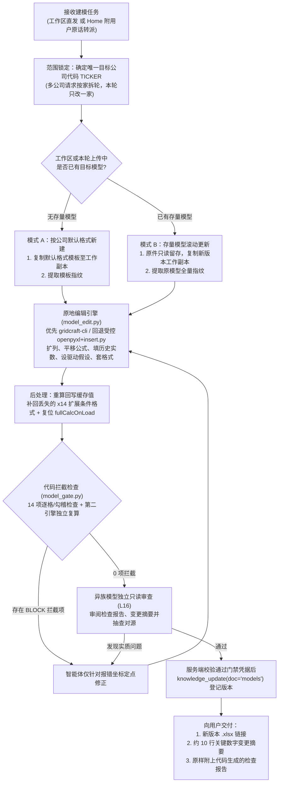

# 公司财务建模 v2 设计方案——默认格式模板、原地更新与代码拦截门禁

> **状态**：设计定稿（待实施）
> **适用形态**：同时支持 **Everflow 生产形态**（部署形态变量 `DALTON_PROFILE=everflow`）与 **独立核心安装形态**（`DALTON_PROFILE=core`，分离规范见 `docs/dalton/features/standalone-core.md`）
> **替代与演进关系**：升级 `docs/dalton/features/modeling-skill.md` 中的工作簿编辑方式、检查定位与审查闭环；修订 `docs/dalton/archive/dev-guide/README.md` 决定记录 `L14`

---

## 一页摘要

### 1. 要解决什么问题

围绕用户的核心诉求——**「遵循公司默认格式建模，或在现有模型上根据新财报扩展期间、更新实际数与预测、补充和修改必要项目，保持原有格式与结构完好，且全流程无需用户额外确认」**——将财务建模从「智能体手写大型脚本整本生成 + 提示性自检」切换为**「模型指纹引导 + 原地最小化编辑 + 交付前代码硬拦截 + 异族模型独立抽查」**。

### 2. v1 与 v2 核心机制对比

| 维度 | v1 现状（`modeling-skill.md`） | v2 方案（本文） |
|---|---|---|
| **任务模式与交互** | 4 类场景描述分散；多公司或双目录偶发追问确认 | 收敛为**按公司默认格式新建**与**存量模型滚动更新**两种模式；自动识别模式与目标公司，**零额外确认步骤** |
| **结构感知方式** | `model_style.py profile` 仅提取粗粒度字体/颜色统计摘要 | 开工前自动生成内部**模型指纹**（逐格公式/输入/常数分类、样式槽、列宽、行列分组、冻结窗格、条件格式、嵌入图与绘图、表顺序、期间轴与勾稽行锚点） |
| **工作簿编辑方式** | 智能体自由编写数千行 `openpyxl`（Python 电子表格读写库）脚本，常整本重写工作簿 | **原地最小化编辑**：主路径用 `gridcraft`（`gridcraft-cli`，命令行电子表格编辑与重算引擎）插列、向右平移填充公式、格式刷套样式；回退路径加载原文件副本仅改目标格（配合 XML〔可扩展标记语言〕级扩列保留媒体部件） |
| **质量门禁定位** | `model_scan.py` 为「提示性只读扫描、退出码恒为 `0`、不阻断交付」；契约仅调 `model_readable.py` 验文件可读 | **`model_gate.py` 代码硬拦截**：逐格对比指纹、校验版面/部件/三表勾稽/分部加总/滚存/`fullCalcOnLoad`（打开时强制全表重算属性）及第二引擎独立复算；未通过时服务端拒绝登记模型与完成交付 |
| **交付呈现与审查** | 智能体自写 `Checks` 页与口头总结；纯模型更新无独立异族审查 | 交付回复**原样附上代码生成的检查报告**与**约 10 行关键数字变更摘要**；按 `L16` 派**不同家族模型**只读抽查，只提问题、不改文件 |
| **单轮范围与转派** | 单轮可同时改多公司整本模型；Home（主空间）转派只传改写后的任务描述 | **一轮只更新一家公司**（非目标公司工作表锁定校验）；Home 研究总监（`Chief of Staff`）转派时**由代码自动附上用户原话** |

### 3. 分批路线与唯一待提供项

- **P0（止血与硬门禁）**：模型指纹提取器 + 14 项代码拦截检查与服务端门禁 + 一轮一家锁定 + Home 转派自动附用户原话 + 标准模型骨架提取器。
- **P1（原地编辑引擎）**：沙箱镜像集成 `gridcraft-cli` + 原地编辑封装器 `model_edit.py` + Excel 2010 扩展条件格式（`extLst`/`x14`）丢失检测与 XML 补回 + 修订决定记录 `L14`。
- **P2（异族审查与对源）**：修复子智能体按 `L16` 动态选不同家族模型 + 新增模型只读独立审查子智能体 + 历史披露数抽样对源核查。
- **P3（历史数自动填充）**：法定财报结构化数据（`XBRL`〔可扩展商业报告语言〕与财报表格）→ 模型行项映射缓存 → 历史实际值与累计拆单季确定性自动填充。
- **需要用户提供的事项**：仅**「公司默认格式模板 `.xlsx` 文件」**一项（在用户指定正式文件前，P0 先从现有标准模型自动脱敏提取默认模板骨架）。

---

## 1. 现状与问题（附实测证据与代码根因）

### 1.1 近期真实翻车案例与实测证据

在中国电商多公司整本模型（连续 3 天、6 轮迭代仍不可用）及龙溪模型更新任务中，暴露出四类系统性故障：

1. **整本重写摧毁公式链、视图结构与嵌入部件**：
   - 智能体编写了一个约 **14 万字节**的 `openpyxl` Python 脚本，在脚本内把预测数字算成浮点数后从头写出整本 `.xlsx`（Excel 电子表格工作簿）。
   - **公式变常数**：`v2.0` 交付件预测期出现 **917 个硬编码数字常数**，原本动态联动的收入、利润行退化为死数字。
   - **冻结窗格严重错位**：京东主表 `Model - JD` 原冻结位置为 `xSplit=10, ySplit=2`（横向冻结 10 列、纵向冻结 2 行，即固定左侧标签/早年列与顶部两行表头），重写后错位至 `xSplit=51, ySplit=101`，打开工作表后主视口无法正常滚动阅读。
   - **媒体与绘图大面积丢失**：工作簿内嵌入图片由 **18 张锐减至 2 张**，绘图部件（`xl/drawings/*`）由 **15 个锐减至 1 个**；全书单元格样式从头重建，且工作簿被写入 `fullCalcOnLoad=1` 掩盖未计算的空缓存值。
2. **「对齐一致预期」时直接改写结果数字，导致集团与分部严重脱节**：
   - 当智能体试图调整预测以贴近市场一致预期（`Consensus`，多位卖方分析师预测的统计均值）时，直接向利润结果格写入目标常数，绕过底层业务分部驱动。
   - 结果导致 `Model - JD` 中**集团营业利润（54.7B〔十亿〕）与各业务分部营业利润加总（约 44B）相差超过 10B**，上下游计算链完全断裂。
3. **历史披露数据大面积空缺**：
   - 分部改口径后的新口径历史可比同期数据留空未填，资产负债表历史期核心科目空缺，模型缺乏连续可比的历史基准。
4. **「运动员兼裁判」式自检失效，门禁形同虚设**：
   - 工作簿内的 `Checks` 页公式与核查脚本均由同一智能体编写并自跑，仅对已填入数字的少量行做简单相等判断，在存在 917 个预测常数、10B 分部脱节、16 张图片丢失和历史表空缺的情况下，依然输出**「40/40 全通过」**。

### 1.2 现有代码与规范层的根因定位

核查当前仓库代码与设计文档，上述故障在架构上有四处直接成因：

1. **检查脚本与完成契约均被设计为「不阻断」**：
   - `docs/dalton/features/modeling-skill.md:13,261` 与 `plugins/dalton/skills/dalton-model/scripts/model_scan.py:13` 明确设定扫描器「无论检出多少问题退出码恒为 `0`，不做对错裁决也不阻断交付」；
   - `workflows/earnings-deep-update/contract.json:43-45` 与 `workflows/full-coverage/contract.json:81-83` 的完成契约仅调用 `model_readable.py` 验证文件能被 `openpyxl` 打开，甚至在 `plugins/dalton/skills/dalton-earnings-deep/SKILL.md:113` 写明「只要新模型文件可读，无论重算或提示性扫描是否超时、报错或留有提示项，均调用 `knowledge_update(doc="models", ...)` 登记新版本」。
2. **缺少原模型基线指纹对比**：
   - `model_scan.py` 只看新文件单本状态，不与原模型逐格比对，因此无法识别「原模型是公式、新模型被改成了常数」「原模型历史格有数、新模型被清空」「原模型冻结在 `10/2`、新模型跳到 `51/101`」以及「顺手改坏了同工作簿内另一家公司的工作表」。
3. **缺少受控原地编辑封装，沙箱未装 `gridcraft`**：
   - `gridcraft-cli`（0.19.1）在宿主机实测表现优异：对中国电商原模型 **57,173 条公式重算仅需 0.7 秒**，**57,018 条与原缓存一致**（仅有的 155 条差异全部来自 `CIQ`〔Capital IQ，标普金融终端插件〕函数与原模型有意的循环引用）；打开再保存**完整保留 18 张嵌入图、15 个绘图与全部冻结窗格**，仅丢弃可选的 `calcChain`（`xl/calcChain.xml`，公式计算链缓存）与 Excel 2010 扩展条件格式（`<extLst>` / `x14`）；原生支持插列、向右填充、格式刷、冻结窗格与引用追踪。
   - 但当前 Docker 沙箱镜像（`Dockerfile.sandbox` 与 `src/ptc_agent/core/sandbox/providers/_image_recipe.py`）尚未安装 Linux 版 `gridcraft-cli`，智能体只能退回手写自由度过高的 `openpyxl` 脚本。
4. **Home 转派丢失用户原话，且草稿审查子智能体未实现动态异族选模**：
   - `src/tools/secretary/chief_of_staff.py:182-229` 的 `delegate_to_analyst(question=...)` 仅传递研究总监改写后的文本，未附带 `state["messages"]` 中的用户原话，常把「更新某一家财报且别乱动格式」稀释成宽泛指令；
   - `plugins/dalton/agents/dalton-reviewer.md:3` 固定写死 `model: gpt-6.2-sol-oauth` 且仅面向文字报告的 1–9 项检查，`src/server/services/llm/subagents.py:268-345` 并未像正式发布审稿 `src/dalton/publish/review.py:302` 那样调用 `role_policy.family_of()` 动态切换不同家族模型。

### 1.3 决定记录 `L14` 修订

将 `docs/dalton/archive/dev-guide/README.md` 第 6.2 节 `L14` 由原条文：
> 旧 `L14`：「gridcraft 不作为建模主路径。建模用 LangAlpha 的 xlsx 流程；gridcraft 的 `check` 留作 P3 之后可选的第二引擎复算」

正式修订为：
> **新 `L14`：「`gridcraft` 作为原地编辑引擎与第二复算引擎；主流程交付物与持久化载体仍是标准 `.xlsx` 文件。`gridcraft` 保存丢失的 Excel 2010 扩展条件格式（`<extLst>` / `x14`）在代码检查报告中逐表列出，并在需要保留时由后处理脚本从原文件 XML 节点或通过 `openpyxl` 补回。」**

---

## 2. 两种模式端到端流程（零额外确认）

系统在开工时根据工作区现有文件与用户指令自动判定进入**新建模式**或**滚动更新模式**，全程自动推进至最终交付，省去确认计划、确认目录或确认列结构的中间步骤。



### 2.1 自动模式判定与起点选择规则

按以下确定性优先级直接选定起点文件：
1. 用户在本轮消息中上传或点名的 `.xlsx` 模型文件 → 进入**滚动更新模式**；
2. 工作区 `data/models.json`（`JSON` 为结构化数据交换格式）中 `current` 指向的 `.xlsx` 文件（当 `model/` 与历史 `models/` 同时存在文件时，先比对 `SHA-256`〔安全哈希算法 256 位摘要〕去重，再取版本号最新且与目标公司股票代码 `TICKER` 匹配的模型） → 进入**滚动更新模式**；
3. 工作区尚无匹配的 `.xlsx` 模型文件 → 进入**新建模式**，直接读取公司默认格式模板作为起点。

### 2.2 模式 A：按公司默认格式新建

1. **初始化骨架**：从第 4.5 节定义的默认格式模板复制生成工作副本 `model/<TICKER>-model-v01.xlsx`，运行 `model_fingerprint.py extract` 提取模板指纹（锁定标准页签结构、Arial / 等线 8 号字体体系、亮蓝表头 `3366FF`、浅米黄假设格 `FFFFC8`、三级分节条配色、列宽、冻结窗格与标准数字格式）。
2. **填充历史期与搭建驱动链**：读取法定定期报告（美股年报 `10-K`、季报 `10-Q`、外国发行人年报 `20-F` 或港股/A 股法定财报），填入连续历史年度与历史单季实际值（累计披露项按算术差分拆出单季并在最右备注列标明出处）；按公司核心经营指标（`KPI`〔Key Performance Indicator〕，如电商 `GMV`〔商品交易总额〕与 `Take rate`〔货币化率〕）搭建分部收入 → 成本费用 → 营业利润 → 无循环期初余额计息 → 税与少数股东 → 股本滚存与 `EPS`（每股收益）/ `EPADS`（每份美国存托股份收益，`ADS` 为美国存托股份） → 现金流量表与资产负债表 → 估值与 `Street vs House`（市场预期对照表）全公式链路。
3. **门禁、异族抽查与交付**：通过第 5 章全部新建适用拦截项与第二引擎复算、经第 6 章不同家族模型抽查无误后，登记 `v01` 并输出变更摘要与原样检查报告。

### 2.3 模式 B：存量模型滚动更新（核心高频路径）

1. **原件字节级只读与全量指纹提取**：记录原模型 `SHA-256`，复制到新版本路径（单公司 `model/<TICKER>-model-v<NN>.xlsx`；多公司行业整本沿用原命名递增版本号），对原模型运行 `model_fingerprint.py extract` 生成基线指纹与目标公司工作表紧凑结构图。
2. **五步原地最小化修改**（只触碰目标公司的需要修改格）：
   - **扩展期间列**：在目标公司各计算表的季度区末尾（及必要的远期年度区）插入新预测期间列，**所有公式行直接由相邻同类期间列向右平移填充生成**，用格式刷克隆相邻预测列的完整样式、列宽与数字格式；当新增四个季度使某远期年度具备完整四季拆分时，将该年度列切换为四季汇总公式（流量求和、期末余额取第四季、比率由本年金额反算），原年度假设下沉至季度列；顺延 `CAGR`（复合年增长率）列与估值页引用列。
   - **回填新财报实际值**：将刚披露季度的列头去掉预测后缀（如 `3Q26E` → `3Q26`）；仅将前序历史季度原本填实际数的明细行与 KPI 行替换为财报披露值（套蓝字无底色实际值格式，并在 `justifications.json` 自动批量登记为「预测转披露实际值」），将原驱动假设格切换为当季实际反算比率公式（斜体无底色），**小计、合计、毛利率、同比增速与跨表引用公式保持原样不动**。
   - **补充新披露项与重述同期数**：公司新增披露细分指标或调整分部口径时，在对应业务区块内原地插行增补，同步回填财报提供的历史重述可比期间数据（避免历史同期留空），并将新分部汇总挂钩至集团分部对账行。
   - **按原公式逻辑滚动更新预测与对齐一致预期**：基于最新业绩、管理层指引及可核实证据微调预测期**驱动假设输入格**（增速、货币化率、利润率、费用率、资本开支 `CapEx`〔Capital Expenditures〕、回购额）；对照一致预期时，所有调整只落在驱动输入格，由原模型公式链自然传导至分部汇总、集团营业利润、净利润与 EPS。
   - **更新变更记录表**：在工作簿 `README & Changelog`（或原模型既有的 `Change Log`）工作表记录版本号、基线文件哈希、新增期间、补入的披露项、关键驱动调整及与一致预期的差异原因。
3. **门禁、异族抽查与交付**：运行 `model_gate.py` 与原模型指纹逐格对比并跑第二引擎复算；存在任何 `BLOCK`（拦截项）时在内部循环定点修复直至 `0 BLOCK`；经异族模型只读审查通过后登记新版本并交付。

### 2.4 范围控制：一轮只更新一家公司 + Home 转派附上用户原话

1. **一轮只更新一家公司**：
   - 单公司工作区天然绑定单一标的；在多公司行业工作区或包含多家公司页签的整本模型（如中国电商模型同时含 `BABA`、`JD`、`PDD`）中，**单轮执行严格锁定唯一一家目标公司**。
   - 若用户在一条消息中仅上传了一家公司的新财报或点名一家公司，仅修改该公司所属工作表（如 `Valuation - PDD`、`Key Metrics - PDD`、`Model - PDD`、`Subs - PDD`）及变更记录页；行业横向汇总页（如 `Peers`、`Global Comps`）仅通过既有跨表引用公式自动重算缓存值，不改动其他公司的工作表。
   - 若用户一次要求更新多家公司（如「把 BABA、JD、PDD 三季报都更新进电商模型」），智能体按公司顺序拆分为串行独立子轮次（每家公司各自提取上家完成后的基线指纹、独立过一次 `model_gate.py` 产出递增小版本或阶段快照），由 `G14` 检查项强制校验每轮除当前目标公司外的其他公司工作表零公式与零输入变动。
2. **Home（研究总监 `Chief of Staff`）转派任务自动附带用户原话**：
   - **代码层保真注入**：在 `src/tools/secretary/chief_of_staff.py` 与 `src/tools/secretary/dispatch.py`（标注 `# DALTON-HOOK(cos-verbatim-forward)`，`DALTON-HOOK` 为 Dalton 在上游源码中标注的差异挂载点注释）中，当 `delegate_to_analyst` 执行派发时，服务端直接从当前回合注入状态 `state["messages"]` 提取最新一条用户原始消息文本（`HumanMessage`，用户消息对象），当派发 `question` 尚未完整包含该原文时，在发往工作区分析师的消息末尾自动追加只读块：
     ```xml
     <user_verbatim_request>
     （用户在 Home 的原始输入原话，逐字保留）
     </user_verbatim_request>
     ```
   - **提示词同步对齐**：在 `src/ptc_agent/agent/prompts/templates/components/chief_of_staff.md.j2` 写明：转派建模与模型更新任务时，保留用户对格式、范围与具体科目的原话约束，且多公司建模需求按一家公司一轮派发。

---

## 3. 模型指纹规范（内部结构，用户不可见）

模型指纹由新增确定性脚本 `plugins/dalton/skills/dalton-model/scripts/model_fingerprint.py` 在开工前只读解析原模型（或默认格式模板）生成，保存在线程内部工作目录（`.agents/threads/<thread8>/modeling/<TICKER>-fingerprint.json`），**仅限系统内部使用（对用户隐藏）**，同时服务于两个下游：
- **供智能体读取**：通过 `model_fingerprint.py summary <fingerprint.json> --company <TICKER>` 输出数千字符以内的紧凑结构地图（表清单、期间列字母映射、分节行号、勾稽锚点行号、代表列公式模板与样式槽编号），智能体直接据此定位目标行列与公式模板；
- **供拦截检查器读取**：`model_gate.py` 读取全量 `fingerprint.json` 与新版本模型做逐格、逐列、逐部件精确比对。

### 3.1 模型指纹完整字段表

| 层级 | 字段路径 | 类型 | 记录内容与提取方式 | 下游用途 |
|---|---|---|---|---|
| **顶层与工作簿级** | `schema_version` | `int` | 固定为 `1` | 指纹格式版本兼容 |
| 同上 | `source_path` / `source_sha256` / `source_bytes` | `str` / `int` | 基线 `.xlsx` 路径、64 位十六进制 `SHA-256` 摘要与字节大小 | 校验原件只读未改、绑定拦截报告基线 |
| 同上 | `calc_properties` | `object` | 从 `xl/workbook.xml` `<calcPr>` 提取：`full_calc_on_load`（`bool`）、`calc_mode`（`auto`/`manual`）、`iterate`（`bool`）、`iterate_count`（`int`）、`iterate_delta`（`float`） | 拦截 `G12` 检查 `fullCalcOnLoad` 是否被擅自打开、识别原模型有意迭代计算 |
| 同上 | `theme_palette` | `dict[str, str]` | 解析 `xl/theme/theme1.xml` `<a:clrScheme>` 12 个主题色槽对应的 6 位十六进制 `RGB`（红绿蓝）色值 | 将主题色加色调（`theme + tint`）精确还原为统一 `RGB` 比较样式 |
| 同上 | `style_catalog` | `dict[str, StyleEntry]` | 工作簿去重样式字典（键如 `"s0"`..`"sN"`）：含 `font_name`、`font_size`、`bold`、`italic`、`font_rgb`、`fill_type`、`fill_rgb`、`borders`（四边线型与色值）、`number_format`、`horiz_align`、`locked` | 压缩数万单元格样式体积；拦截 `G04` 比对同行同类列样式一致性 |
| 同上 | `sheet_order` | `list[SheetTab]` | 按顺序排列的全部工作表：`index`、`name`、`xml_part`（如 `xl/worksheets/sheet3.xml`）、`state`（`visible`/`hidden`/`veryHidden`）、`tab_color`（`RGB` 或 `null`）、`sheet_type`（`content_sheet`/`blank_divider`/`hidden_sheet`）、`company_tag`（如 `"JD"`、`"PDD"` 或 `null`） | 拦截 `G01` 表顺序与工作表增删、拦截 `G14` 非目标公司工作表锁定 |
| 同上 | `defined_names` | `list[DefinedName]` | 工作簿级与工作表级命名区域：`scope`、`name`、`attr_text`（引用表达式）、`has_external_link`、`has_ref_error` | 保留汇率（如 `hkd`、`ex`）等内部命名区域，跟踪引用完整性 |
| 同上 | `package_parts` | `object` | OOXML（Office Open XML，开放式办公文档标准格式）包级清单：`media`（路径、扩展名、`sha256`）、`drawings`、`charts`、`external_links`、`pivot_tables`、`slicers`、`vba_project`、`has_calc_chain` | 拦截 `G06` 检查嵌入图片、绘图与图表数量及文件完整性 |
| **工作表级**（`sheets[name]`） | `period_axis` | `object` | `header_row`（主期间表头行号）、`sub_header_rows`（子区块表头行号）、`fiscal_year_end_month`（1–12，从表头旁标注如 `FY ends Mar` 或财季归属推断）、`unit_label`（如 `"(RMB MM)"`）、`columns`（每列 `col`、`idx`、`raw`、`period_key`、`role` ∈ `label\|spacer\|annual_actual\|annual_forecast\|quarter_actual\|quarter_forecast\|cagr_delta\|source_note\|other`、`fy`、`fq`、`annual_sum_quarters`〔该年度对应的四财季列字母列表〕） | 智能体定位扩列插入点与参照列；拦截 `G02`/`G07`/`G09` 判定历史期、预测期与年度＝四季之和 |
| 同上 | `freeze_panes` | `object` | 直接解析工作表 XML `<sheetViews><sheetView><pane>`：`state`（`frozen`/`frozenSplit`/`split`/`none`）、`x_split`（`int`）、`y_split`（`int`）、`top_left_cell`（如 `"K3"`）、`active_pane`、`show_grid_lines`（`bool`） | 拦截 `G05` 精确捕获 `xSplit`/`ySplit` 错位（如 `10/2` 变 `51/101`） |
| 同上 | `column_layout` | `dict[str, ColDim]` | 各列或列区间维度：`width`（浮点字符宽）、`custom_width`（`bool`）、`outline_level`（`0`–`7`）、`hidden`（`bool`）、`collapsed`（`bool`） | 拦截 `G05` 校验存量列宽漂移、早年历史列折叠分组保留与新列宽继承 |
| 同上 | `row_groups` | `dict[int, RowDim]` | 带分组、隐藏或自定义行高的行：`height`、`outline_level`、`hidden`、`collapsed` | 拦截 `G05` 校验增速/利润率子行大纲分组保留 |
| 同上 | `merged_ranges` | `list[str]` | 合并单元格坐标区间列表（如 `["A1:D1", ...]`） | 编辑时跳过非左上角合并格，防止破坏表头版面 |
| 同上 | `conditional_formats` | `object` | 分两类记录：`standard_cf`（标准 `<conditionalFormatting>` 的 `sqref`、规则类型、公式与样式摘要）；`ext_x14_cf`（`<extLst>` 下 `x14:conditionalFormatting` 的规则数、`sqref` 列表及序列化 XML 片段备份） | `gridcraft` 保存后对比并自动补回丢失的 `x14` 扩展条件格式 |
| 同上 | `attachments` | `object` | 本工作表通过 `.rels` 挂载的 `drawings`、`media`、`charts`（含每个图表系列的公式引用区间 `series_refs`）、`sparklines_count`、`data_validations_count` | 按工作表精确定位丢失的图片/绘图，扩列后校验图表数据系列区间顺延 |
| 同上 | `semantic_anchors` | `object` | 通过分节标题与行标签识别出的勾稽锚点行号映射：`sections`（利润表/非公认会计准则 `Non-GAAP`/分部报告/现金流量表/资产负债表起止行）、`group_revenue_row`、`segment_revenue_rows`、`group_op_profit_row`、`segment_op_profit_rows`、`unallocated_elim_rows`、`total_assets_row`、`total_liab_row`、`total_equity_row`、`beg_cash_row`、`end_cash_row`、`net_cash_chg_row`、`beg_shares_row`、`end_shares_row`、`buyback_cash_row`、`diluted_shares_row`、`eps_rows` | 支撑 `G08`（资产负债表配平）、`G10`（集团＝分部＋抵销）、`G11`（现金与股本滚存）及 10 行关键数字变更摘要自动提取 |
| 同上 | `circular_baseline` | `list[str]` | 原模型已存在的循环引用强连通分量单元格集合（采用 `Tarjan` 有向图强连通分量检测算法提取） | 区分「原模型既有有意循环引用」与「本轮误引入的新循环引用」 |
| **单元格级**（`sheets[name].cells[coord]`） | `category` | `str` | 必取三主类之一并附细分子类：<br/>1. `"formula"`（细分子类：`same_sheet` 同表公式 / `cross_sheet` 跨表引用 / `plugin` 外部终端插件函数 / `array` 数组公式）<br/>2. `"input"`（位于期间数据列且带输入蓝字或假设底色的可调数值格，细分子类：`actual_input` 历史披露值 / `hist_estimate` 历史估算 / `driver_input` 预测驱动假设 / `external_input` 外部参考值）<br/>3. `"constant"`（静态标签或无输入标记常数，细分子类：`numeric_const` 无输入标记的数值常数 / `label` 行列文本标签 / `source_note` 红字来源说明 / `error_literal` 错误字面量） | 智能体识别填实数行、驱动假设行与受保护公式行；拦截 `G02`/`G03`/`G07` 逐格对照 |
| 同上 | `formula` | `str \| null` | 以 `=` 开头的原始公式文本（非公式格为 `null`） | 平移生成新列公式、检测公式被改写为常数或插件函数变动 |
| 同上 | `cached_value` | `number \| str \| bool \| null` | 原文件存储的 `<v>` 缓存计算值 | 生成「关键数字变更摘要」旧值列、校验其余工作表数值保持一致 |
| 同上 | `style_id` | `str` | 指向顶层 `style_catalog` 的样式键（如 `"s14"`） | 逐格常数时间比对字体、字色、底色、边框与数字格式 |

---

## 4. 原地编辑引擎与回退机制

### 4.1 原地编辑核心铁律

1. **只改目标单元格，其余部分原样保留**：在工作副本上仅对本次任务涉及的新增列、刚披露季度列、补充披露行及需调整的驱动假设输入格执行定点操作；其余工作表、存量历史列、嵌入图、绘图、命名区域与页面打印设置保持原状。
2. **新增期间的公式一律由相邻同类期间列平移生成**：新增季度列的公式从紧邻的前一预测季度列（或同比参照季度列）向右填充/公式平移得到，新增远期年度列的公式从紧邻的前一远期年度列向右填充得到，全部保持动态公式计算。
3. **对齐一致预期只改驱动输入格**：需要校准预测水平时，只修改指纹中标为 `driver_input`（驱动假设输入格）的增长率、货币化率、利润率、费用率、利率或回购假设，让现有公式链算出新结果。

### 4.2 主编辑引擎：`gridcraft-cli` 原地脚本化编辑（P1 接入）

通过统一封装脚本 `plugins/dalton/skills/dalton-model/scripts/model_edit.py` 将高阶建模动作编译为 `gridcraft-cli run --in <base.xlsx> --script <ops.jsonl> --out <target.xlsx> --quiet` 的确定性 `JSONL`（按行分隔的 JSON 命令流）脚本一次性执行：

| 建模编辑操作 | `gridcraft-cli` 命令映射 | 保真效果 |
|---|---|---|
| **插入新增季度/年度列** | `{"command": "home.insertColumns", "params": {"cols": "<COL_START>:<COL_END>"}}`（先 `selection.set` 切至目标表） | 自动平移右侧列，自动重写同表公式、跨表公式、命名区域与图表系列引用，完整保留 `xl/media`（18 张嵌入图）与 `xl/drawings`（15 个绘图） |
| **向右平移填充预测公式** | `{"command": "edit.fillRight", "params": {"range": "<SRC_COL><R1>:<DST_COL><R2>"}}` 或 `edit.autoFill`（`mode: "copy"`） | 相对引用随列自动平移，绝对引用（`$A`）锁定不变，零手写常数 |
| **格式刷克隆同类期间列样式与列宽** | `{"command": "selection.set", "params": {"sheet": S, "range": "<SRC_COL>1:<SRC_COL><MAX_R>"}}` → `{"command": "edit.formatPainter", "params": {}}` → `{"command": "edit.formatPainter", "params": {"apply": "<DST_COL1>1:<DST_COL2><MAX_R>"}}` + `{"command": "home.columnWidth", "params": {"sheet": S, "cols": "<DST_COL1>:<DST_COL2>", "chars": W}}` | 字体、字号、底色、细虚线框、对齐方式、数字格式与列宽 100% 沿用原表同类列 |
| **刚披露季度填入实际值并切换样式** | 明细实数格用 `cell.set` / `range.setValues`（`parse: true`）写入披露数字，再用 `home.formatCells` 套该表 `actual_input` 样式（蓝字 `#0000FF`、无底色 `"none"`、清除边框）；原假设比率行用 `cell.set` 写入反算比率公式并套斜体无底色样式 | 合计行、毛利率行与跨表引用公式完全不触碰，天然保留原公式 |
| **插入新披露明细行或新口径分部行** | `{"command": "home.insertRows", "params": {"rows": "<R1>:<R2>"}}` + `edit.formatPainter` 复制同区块相邻明细行样式 + `range.setValues` 填入历史重述数与预测公式 | 若插入点在原 `SUM` 区间内部自动扩围；位于区间边界时由 `model_edit.py` 显式更新父合计行公式 |
| **微调预测驱动假设格** | 仅允许目标坐标在指纹中属于 `driver_input`（或新增预测列的同角色行）：调用 `cell.set` 更新假设参数，并在最右来源备注列（`source_note`）写入红字依据 | `model_edit.py` 在写入前校验坐标角色，若智能体尝试用常数覆写存量 `formula` 结果行且未附带合法转实数豁免，编辑封装器当场拒绝执行 |
| **冻结窗格与分组维护** | 默认保留原表 `view.freezePanes` 与 `data.group` 不动；仅当在冻结线左侧插列导致可视区偏移时调用 `view.freezePanes` 对齐原可视列数 | 杜绝冻结窗格乱跳 |
| **全表重算与错误溯源** | 编辑脚本末尾固定追加 `{"command": "formulas.calculateNow", "params": {}}`；若出现公式错误，调用 `formulas.traceError` 定位源头格 | 5.7 万条公式亚秒级重算并写入 `<v>` 缓存值 |

### 4.3 `gridcraft` 丢失扩展条件格式与 `calcChain` 的处理机制

1. **Excel 2010 扩展条件格式（`<extLst>` / `x14:conditionalFormatting`）检测与补回**：
   - `gridcraft-cli` 当前版本（0.19.1 alpha）打开再保存会丢弃工作表 XML 尾部的 `<extLst>` 节点（内含跨表引用条件格式、数据条扩展属性及迷你图）。
   - **自动补回与报告双保险**：
     - `model_edit.py` 在 `gridcraft-cli` 保存完成后，立即对照原模型指纹的 `conditional_formats.ext_x14_cf`：若某工作表在原模型含有 `<extLst>` 而在输出文件中丢失，后处理器通过 `zipfile` + `lxml`（Python XML 解析与处理库）从原模型对应工作表 XML 提取 `<extLst>` 子树（若该表执行过插列或插行，同步调用坐标平移函数顺延其中的 `<xm:sqref>` 与 `<xm:f>` 引用范围）注入回输出文件对应工作表 XML 末尾；若某条规则为简单单表条件格式且需重建，亦可通过 `openpyxl` 标准 `conditional_formatting` 接口补写。
     - `model_gate.py` 在最终检查报告的「部件与条件格式对比」小节如实列出原模型扩展条件格式条数、补回条数及任何未能平移补回的残留差异条数与所在工作表。
2. **`calcChain.xml` 丢弃说明**：
   - OOXML 规范中 `xl/calcChain.xml` 属于可选的求值顺序缓存。只要全表公式单元格均已写入准确的 `<v>` 缓存值且 `fullCalcOnLoad=0`，Excel、WPS（金山办公套件）、LibreOffice 及网页预览器打开时均直接渲染缓存值并在后台自动重建计算链。

### 4.4 回退编辑路径：受控 `openpyxl` 原地改格 + XML 扩列（P0 默认及 P1 兜底）

当运行环境尚未安装 `gridcraft-cli`（如 P0 阶段或自定义轻量环境）或 `gridcraft-cli` 对极个别特殊工作簿返回非零退出码时，`model_edit.py` 自动切换至受控原地编辑路径：

1. **强制基于原模型副本加载编辑**：回退路径只接收原模型（或默认格式模板）路径，先复制生成新版本副本并在副本上原地修改；代码门禁直接拒绝任何从空白 `openpyxl.Workbook()` 重写存量模型的产物。
2. **结构扩列先走 XML 包级 `insert.py`**：需要插列或插行时，调用仓库已有的 `plugins/langalpha_deliverables/skills/xlsx/scripts/insert.py`（带 `--copy-style-from`），直接在 ZIP（压缩归档格式）/ XML 包层平移坐标并重写公式引用，完整保留 `EMF`/`WMF`（Windows 增强型矢量图元文件）嵌入图片、绘图与 `<extLst>`。
3. **单元格定点修改分层处理**：
   - 指纹显示工作簿为常规纯表格部件时：使用 `openpyxl.load_workbook(target_path)` 加载副本，仅对变更清单中的目标单元格改值、用 `openpyxl.formula.translate.Translator` 平移相邻列公式、调用 `model_style.py` 的 `clone_period_column_style` / `apply_cell_style` 套用原表画像样式后保存；
   - 指纹显示工作簿含有 `EMF`/`WMF` 矢量图、复杂绘图或 `<extLst>`（如含 18 张嵌入图、15 个绘图的中国电商模型）时：在 `insert.py` 扩列后的副本上，由 `model_edit.py` 直接在工作表 XML 中定点更新目标 `<c>` 节点的公式 `<f>`、数值 `<v>` 与样式索引 `s`（复用原表同类单元格的 `s` 索引），保持包内媒体、绘图与冻结窗格字节级完好。
4. **统一重算与 `fullCalcOnLoad` 复位**：编辑完成后调用 `plugins/langalpha_deliverables/skills/xlsx/scripts/recalc.py`（优先 `IronCalc`〔Rust 电子表格计算引擎〕毫秒级重算，自动回退 `LibreOffice`〔`soffice` 开源办公套件无头重算〕）将计算结果回写至每个公式格的 `<v>` 缓存节点并刷新图表缓存点，最后将 `xl/workbook.xml` 中 `<calcPr>` 的 `fullCalcOnLoad` 恢复为原模型指纹记录的原始状态。
5. **同一门禁验收**：`gridcraft` 主路径与回退路径的产物统一执行第 5 章全部 14 项代码拦截检查。

### 4.5 公司默认格式模板来源与双形态分离设计

遵循 `docs/dalton/features/standalone-core.md` 的双形态分离原则，新建模型所用的「公司默认格式模板」通过统一配置与随包资产目录加载，同时兼容 Everflow 生产与独立核心安装：

1. **配置解析优先级（形态判定统一走 `src.dalton.profile`，路径解析置于 `src/dalton/settings.py`）**：
   - **优先级 1（部署自定义模板）**：环境变量 `DALTON_MODEL_DEFAULT_TEMPLATE_PATH` 或配置文件 `modeling.default_template_path`（Everflow 生产环境的模板挂载由 `scripts/dalton/ops/prod/` 运维脚本配置；独立核心安装客户通过 `scripts/standalone/` 部署配置挂载自有标准模板并设置同一变量，读取逻辑在单一实现处共用）；
   - **优先级 2（随包内置标准模板）**：`plugins/dalton/skills/dalton-model/assets/default_model_template.xlsx`（位于 `plugins/dalton/` 下，直接落入 `scripts/dalton/dalton_paths.txt` 与 `scripts/standalone/package_release.sh` 的核心发行白名单，Everflow 与 Core 双形态开箱即用）。
2. **用户提供正式模板文件前的过渡提取方案**：
   - 在收到正式「公司默认格式模板」文件前，P0 提供一次性脱敏骨架提取脚本 `plugins/dalton/skills/dalton-model/scripts/extract_default_template.py`：从现有标准实测模型中抽取单公司标准页签骨架（`README & Changelog`、`Summary`、`Key Metrics`、`Model`、`Valuation`、`Street vs House`），清空具体公司名称、商业专有数据与外部链接，保留标准列序布局（`A–D` 层级缩进标签列 → 年度列 → 窄空隔列 → `CAGR` 列 → 窄空隔列 → 季度列 → 最右红字备注列）、`Arial` / `等线` 8pt（磅）字体、亮蓝表头 `3366FF`、浅米黄假设格 `FFFFC8` 配 `hair` 细虚线框、浅蓝/棕红/浅桃三级分节条、标准数字格式、列宽、大纲分组与冻结窗格，生成通用干净的 `default_model_template.xlsx`；
   - 收到用户指定的正式默认格式模板文件后，直接替换该文件（或通过 `DALTON_MODEL_DEFAULT_TEMPLATE_PATH` 挂载）即可生效。

---

## 5. 代码拦截检查清单与门禁接入

### 5.1 替换「提示性扫描」，实行三道硬拦截接入

新增确定性门禁脚本 `plugins/dalton/skills/dalton-model/scripts/model_gate.py`，退出码严格区分：**`0` = 全部必过项通过（`0 BLOCK`）**，**`2` = 命中至少一项拦截规则（阻止交付）**，**`1` = 脚本参数或文件读取错误**。

> **与开发指南「草稿阶段不阻止保存」原则的边界对齐**：分析师在工作区磁盘上保存临时迭代副本、运行重算和排查数据的文件写入操作不受阻断；硬拦截精确卡在**「向用户正式交付模型」**的三个法定关口：
> 1. **关口 1（知识层版本登记硬校验）**：修改 `src/dalton/knowledge/service.py` 在处理 `knowledge_update(doc="models", ...)` 时，核验当次目标 `.xlsx` 对应的门禁通过凭据文件（含目标模型实时 `SHA-256`、基线模型 `SHA-256` 与 `verdict == "PASS"`，或由服务端在沙箱直接复核 `model_gate.py --verify`）；未通过或文件被事后改动导致哈希不匹配时，直接拒绝登记并返回具体的 `BLOCK` 条目清单；
> 2. **关口 2（工作流与手动完成契约硬校验）**：将 `workflows/earnings-deep-update/contract.json` 与 `workflows/full-coverage/contract.json` 中原本只跑 `model_readable.py` 的校验器替换为 `model_gate.py`（`pass_when: "exit_zero"`），同步删去 `dalton-earnings-deep/SKILL.md` 中「无论报错均登记新版本」的旧规则；
> 3. **关口 3（单技能运行交付要求）**：`dalton-model/SKILL.md` 规定交付前运行 `model_gate.py` 生成机器签名的 `.gate-report.md` 与 10 行变更摘要，原样附入最终回复。

### 5.2 代码检查项完整清单（共 14 项）

| 编号 | 检查项 | 具体判定规则与容差 | 级别 | 代码实现方式（`model_gate.py`） |
|---|---|---|---|---|
| **G01** | **工作簿可读性与表顺序完整** | 1. 交付文件为合法 `.xlsx` 且全部工作表 XML 流式解析完整；<br/>2. 滚动更新模式下，原模型指纹 `sheet_order` 中的工作表无缺失、相对顺序未变（允许按规范新增 `README & Changelog` 或对照页）。 | **拦截（`BLOCK`）** | 复用 `model_readable.py` 流式解析器 + 比对新旧指纹 `sheet_order` 列表。 |
| **G02** | **公式变常数拦截（含预测期常数）** | 1. **存量格对比**：计入插列/插行坐标平移映射后，凡原模型指纹 `category == "formula"` 的单元格在新模型变为数值常数，逐格核查 `justifications.json`：仅允许两类登记理由——① 新披露实际期列中原本在前序历史期就是 `actual_input` 的明细/KPI 行（**小计、合计、同比增速、利润率等衍生行即便在刚披露季度也必须保持公式，改成常数一律直接拦截**）；② 外部插件公式抽离（原格须改为引用独立输入格的公式，直接填常数仍拦截）。其余未登记或理由不合规的公式变常数一律拦截；<br/>2. **新增预测列与新建模型**：预测期间列中除 `driver_input`（套假设样式的驱动参数行）和 `external_input`（对照表外部预期列）外的任何数值常数一律拦截。 | **拦截（`BLOCK`）** | 基于 `insert_log.json`（扩列平移映射表）对齐原指纹与新文件 `(sheet, row, col)`，逐格检查 `formula -> constant` 跃迁并校验豁免规则。 |
| **G03** | **对齐一致预期禁改结果格** | 主计算表与汇总表的财务结果行（收入、毛利、各项费用金额、营业利润、税前利润、净利润、现金流、EPS、目标价）的公式只能向上游业务驱动或分部明细追溯，禁止直接引用 `vs Consensus` / `Street vs House` 外部预期列或嵌入硬编码凑数常数。 | **拦截（`BLOCK`）** | 用 `openpyxl.formula.tokenizer.Tokenizer` 解析预测结果行公式引用树，命中对照表外部预期区或结果行硬编码即报错拦截。 |
| **G04** | **样式与位置用途一致性** | 对本轮**新增或修改过**的单元格，核对其样式与同表同行相邻同类期间列的指纹 `style_id` 一致（新建模型对照默认模板规范）：<br/>- 公式结果格使用无底色正体（衍生比率斜体、跨表链接绿字）；<br/>- 预测驱动假设格使用该表假设底色（默认 `FFFFC8`）与蓝字；<br/>- 历史披露实际值使用该表实际值字色（默认蓝 `0000FF`）与无底色；<br/>- 字体族、字号与数字格式（整数/小数位/百分比/倍数）与同行相邻列保持一致。<br/>（原模型未触碰存量格的历史既有样式特例记为 `WARN`〔提示〕，保留原表习惯。） | 改动区违规：**拦截（`BLOCK`）**<br/>存量历史特例：**提示（`WARN`）** | 还原新文件改动格的 `theme+tint -> RGB`、字号、斜体/加粗与 `number_format`，与同行参照列指纹样式比对。 |
| **G05** | **冻结窗格、列宽与行列分组** | 1. **冻结窗格**：每张内容表的 `y_split`（冻结行数）与原指纹完全相等；`x_split`（冻结列数）与原指纹相等（仅允许因在冻结线左侧插列产生的等量平移，拦截如 `10/2` 跳变为 `51/101` 的错位或冻结丢失）；<br/>2. **列宽**：存量列宽保持在原值 `±0.5` 字符宽以内，新增期间列宽与相邻同类期间列宽保持在 `±0.5` 以内；<br/>3. **大纲分组（`Outline`）**：原指纹中的行分组与早年列折叠分组（`outline_level`、`hidden`）完整保留。 | **拦截（`BLOCK`）** | 解析工作表 XML `<pane>`、`<cols><col>` 与 `<row outlineLevel=...>`，与基线指纹逐表对比。 |
| **G06** | **嵌入图、绘图与扩展条件格式** | 1. **嵌入图与绘图/图表**：对比 `xl/media/*`、`xl/drawings/*`、`xl/charts/*` 总数与按工作表归属集合，出现任何减少即拦截；<br/>2. **数据验证与迷你图**：条数减少即拦截；<br/>3. **Excel 2010 扩展条件格式（`<extLst>`/`x14`）**：先由后处理器自动补回；若仍有因引擎限制未能平移的扩展条件格式减少，在检查报告显著列出工作表名与规则数（不单独阻断已无损保留全部图片/绘图/数据的 `gridcraft` 交付，必要时触发 XML 补回）。 | 图片/绘图/图表/验证减少：**拦截（`BLOCK`）**<br/>残留 `x14` 扩展格式差异：**提示（`WARN`，必列报告）** | 调用并增强 `model_style.py` 的 `_inspect_workbook_parts` 按工作表 `.rels` 关系链精确核对。 |
| **G07** | **历史披露期空格检查** | 1. **存量历史格防清空**：原模型指纹中非空的历史期间单元格（实际数或公式）在新模型变为空白 → 拦截；<br/>2. **新披露期与重述期防漏填**：本轮新增的已披露季度列、分部新口径重述同期列及历史资产负债表区域中，凡前序连续 2 个及以上历史同类期间非空的行出现空白，且未在最右备注列及 `justifications.json` 登记「法定财报本季未披露该项」及财报出处 → 拦截。 | **拦截（`BLOCK`）** | 遍历 `period_axis` 中所有 `annual_actual` 与 `quarter_actual` 列，对照原指纹非空掩码与前序历史期连续性。 |
| **G08** | **资产负债表配平与现金对齐** | 1. 含完整资产负债表的工作表：每个历史与预测期间须满足 `\|总资产 - (总负债 + 股东权益)\| ≤ max(1.0, 1e-4 × \|总资产\|)`（兼容报表四舍五入 1 单位尾差）；<br/>2. 现金流量表期末现金须与资产负债表同口径现金（或现金＋受限现金）行逐期相等。 | **拦截（`BLOCK`）** | 读取 `semantic_anchors` 识别的资产、负债、权益与现金行重算缓存值逐列验算。 |
| **G09** | **年度 ＝ 季度之和（加总年零假设）** | 当某财年列在同表存在完整四个财季列（按 `fiscal_year_end_month` 绑定跨自然年财季，如 3 月结账公司 `FY27 = 2Q26..1Q27`）时：<br/>1. 流量金额行：年度值 ＝ 四财季之和（相对容差 `1e-4`）；<br/>2. 时点余额行：年度值 ＝ 第四财季值；<br/>3. 衍生比率行：由本年度列自身分子分母公式计算；<br/>4. 预测加总年度列**零手填驱动常数**。 | **拦截（`BLOCK`）** | 按 `period_axis.annual_sum_quarters` 映射逐行检验公式结构与缓存数值恒等关系。 |
| **G10** | **集团 ＝ 分部 ＋ 未分配总部与抵销** | 存在分部报告（`Segment Reporting` 或 `Subs` 子表汇总）时，逐期检验：<br/>- `集团总收入 == ∑各分部收入 + 分部间抵销`<br/>- `集团营业利润（同口径 GAAP〔公认会计准则〕或 Non-GAAP）== ∑各分部营业利润 + 未分配总部项 + 分部间抵销`（容差 `max(1.0, 1e-4 × \|集团值\|)`；仅公司未重述早期历史季且对账行显式留空备注时豁免该不可比历史期，**全部预测期与可比历史期强制相等**）。 | **拦截（`BLOCK`）** | 读取 `semantic_anchors` 的集团行、分部行与总部抵销行逐期核算差额（直接拦截类似 JD 54.7B vs 44B 的脱节）。 |
| **G11** | **现金与股本滚存连贯** | 1. **现金滚存**：预测期每期 `期初现金 == 上期期末现金`，且 `期末现金 == 期初现金 + 本期现金净变动`（或 `OCF〔经营现金流〕 - CapEx + 其他投融资净额`）；<br/>2. **股本滚存**：预测期每期 `期初股数 == 上期期末股数`，且当现金流量表存在股份回购流出时，股本行同步扣减回购注销股数并与加权稀释股数、`EPS` 分母联动。 | **拦截（`BLOCK`）** | 跨列校验期初期末衔接公式与数值恒等式，核查回购现金流非零期间的股数变动符号。 |
| **G12** | **`fullCalcOnLoad`、错误值与循环引用** | 1. 原模型未开启 `fullCalcOnLoad` 时，新模型 `calcPr.fullCalcOnLoad` 保持关闭 → 开启即拦截；<br/>2. 全部非插件公式均包含 `<v>` 缓存值 → 缺失即拦截；<br/>3. 本轮新增或受影响区域出现 `#REF!`（断裂引用）、`#DIV/0!`（除零错误）、`#VALUE!`、`#NAME?`、`#N/A`、`#NUM!`、`#SPILL!`、`#CALC!`（含嵌套在 `IFERROR`〔错误值兜底函数〕内部的 `#REF!`）→ 拦截；<br/>4. 出现原模型 `circular_baseline` 之外的新增循环引用或擅自修改 `iterate` 开关 → 拦截。 | **拦截（`BLOCK`）** | 检查 `xl/workbook.xml` `<calcPr>`、工作表 XML `<c><f>` 是否伴随 `<v>`、公式词法 `#REF!` 与 `Tarjan` 强连通分量差集。 |
| **G13** | **第二引擎独立复算一致** | 使用独立于编辑器的第二计算引擎对交付文件全表求值，逐格对比重算值与交付文件 `<v>` 缓存值：<br/>- 编辑用 `gridcraft` 时，用 `LibreOffice`（或 `IronCalc`）独立复算；编辑用回退路径时，优先用 `gridcraft-cli check --json`（不可用时用另一引擎）复算；<br/>- 排除原模型指纹已登记的第三方插件公式（`CIQ`、`BQL`〔彭博查询函数〕、`BDH`〔彭博历史函数〕）及原模型既有迭代计算收敛微差后，任何公式格相对偏差 `> 1e-5`（且绝对差 `> 1e-4`）即拦截。 | **拦截（`BLOCK`）** | 在临时目录运行第二引擎重算，逐格读取计算结果与交付文件缓存值比对，统计总公式数、一致数与豁免插件数。 |
| **G14** | **单轮单公司非目标表零改动** | 多公司整本模型中，除本轮指定的唯一目标公司工作表及变更记录页外，其余公司专属工作表的公式文本、输入常数与版面结构须与原模型指纹 100% 一致。 | **拦截（`BLOCK`）** | 遍历 `sheet_order` 中 `company_tag != target_ticker` 的全部工作表，逐格断言公式与输入值哈希零变化。 |

### 5.3 公式变常数登记文件格式（`justifications.json`）

滚动更新中唯一需要把原预测公式换成数字的场景是「新财报披露后，将刚披露季度的预测明细格切换为法定财报实际披露值」。`model_edit.py` 在执行「补实际值」动作时自动生成结构化登记条目，智能体如需手工补充单格豁免也写入同一文件交 `model_gate.py` 校验：

```json
{
  "target_ticker": "PDD",
  "actual_rollover_columns": [
    {
      "sheet": "Model - PDD",
      "col": "AZ",
      "old_header": "3Q26E",
      "new_header": "3Q26",
      "filing_source": "PDD 3Q26 6-K Earnings Release (2026-11-20)"
    }
  ],
  "cell_overrides": [
    {
      "sheet": "Valuation - PDD",
      "cell": "D6",
      "reason_kind": "plugin_extraction",
      "source": "抽离原 CIQ 实时股价公式至独立蓝字输入格 D6，原结果格已改为 =D6（收盘价截至 2026-11-26）"
    }
  ]
}
```
> **防滥用校验规则**（上例 `6-K` 为外国私人发行人临时报告）：`model_gate.py` 按结构化规则核验豁免项——`actual_rollover_columns` 仅对列头已去掉 `E`/`F`/`P` 后缀的历史披露列生效，且逐行验证该行在前一历史季度（如 `AY` 列 `2Q26`）本身就是 `actual_input`；若该行在前一历史季度是 `=SUM(...)`（求和函数）或利润率公式，`model_gate.py` 直接判定 `BLOCK`。

### 5.4 交付给用户的两项固定输出格式

每次模型新建或更新交付时，智能体在对话回复中直接给出以下两部分内容：

1. **约 10 行「关键数字变更摘要」**（由 `model_gate.py --summary` 从新旧缓存值辅助生成底表，智能体补充一句驱动原因）：
   - 第 1–2 行：交付文件路径、所基于的原模型版本、本次动作（例如：补入 `3Q26` 实际值、新增 `1Q27E–4Q27E` 季度列与 `2029E` 年度列）；
   - 第 3–7 行：核心指标新旧对比与一致预期对比简表（覆盖最近实际季与未来两个核心预测财年的**营业总收入、核心分部利润、集团 Non-GAAP 营业利润、Non-GAAP 净利润、稀释 EPS/EPADS 及目标价**，列示：`上一版 → 本版（变动%） | 一致预期（差异%）`）；
   - 第 8–10 行：驱动本次预测变化的 2–3 个关键假设调整及与一致预期最主要的分歧原因。
2. **代码生成的检查报告（原样附在回复代码块或折叠块中，智能体一字不改）**：
   ```markdown
   ### 模型代码门禁报告（自动生成，sha256: 8f3a1c92...）
   - 门禁结论：PASS（0 项拦截 / 1 项提示）
   - 模式与范围：存量滚动更新 | 目标公司：PDD（其余公司工作表 31 张：0 格改动）
   - 编辑与复算引擎：编辑 = gridcraft-cli 0.19.1 | 第二复算 = LibreOffice 24.2（57,312 条公式：57,157 条一致，155 条为原表既有 CIQ/有意迭代项，0 条新增偏差）
   - 逐格与结构核对：
     - [PASS] G01–G03 公式保护：新增预测列 0 处结果常数；3Q26 预测转实数 48 格（全部匹配前序历史实数行），合计与比率公式 100% 保留
     - [PASS] G04–G06 格式与部件：改动区样式一致；冻结窗格保留（Model - PDD: K3 [10/2]）；嵌入图 18→18，绘图 15→15
     - [WARN] G06 扩展条件格式：原模型含 4 处 x14 扩展条件格式，已由 XML 后处理器原样补回 4 处（Peers 表）
     - [PASS] G07–G12 财务勾稽：历史披露期 0 新增空格；资产负债表全期配平；年度=四季之和通过；集团营业利润=分部+抵销全期吻合；现金与股本滚存连贯；fullCalcOnLoad=off，0 新增公式错误
   ```

---

## 6. 不同家族模型独立审查（遵循 `L16`）

在代码拦截检查（`0 BLOCK`）负责守住全部算术、勾稽、公式结构与格式部件之后，引入**不同模型家族的只读独立审查环节**负责把关建模逻辑、披露口径与来源真实性。

### 6.1 修复子智能体动态异族选模（严格落实 `L16` 与 `L20`）

1. **动态模型家族解析**：
   - 在 `src/server/services/llm/subagents.py` 为审查类子智能体（`dalton-reviewer` 与新增的 `dalton-model-reviewer`）接入与 `src/dalton/publish/review.py:pick_reviewer_model()` 共享的异族选模逻辑：根据当前回合主分析师模型 `turn_model`，通过 `src.dalton.llm.role_policy.family_of()`（Core 形态下用配置感知的 `resolve_model_family()`）从 `dalton_reviewer_models` 候选链中挑选**第一个底层厂商家族不同于主模型**且当前凭据可用的模型（例如主模型为 `claude-opus-5-5-oauth`〔`anthropic-claude`〕时选 `gpt-6.2-sol-oauth`〔`openai-gpt`〕或 `grok-4.7-oauth`〔`xai-grok`〕；主模型切为 `gpt-6.2-*` 时自动避开 OpenAI 家族改选 Claude / Gemini / Grok）。
   - **双形态兼容（遵循分离原则）**：在 `DALTON_PROFILE=core` 单模型或未知自定义网关部署下，按 `docs/dalton/features/standalone-core.md` 已定事项 3 自动回退复用客户已配可用模型，并在审查元数据记录 `review_mode: "single_family" | "unknown_family"`，全程零报错。

### 6.2 模型独立审查子智能体（`dalton-model-reviewer`）职责与边界

新建只读子智能体 `plugins/dalton/agents/dalton-model-reviewer.md`（与审文字报告 1–9 项结构的 `dalton-reviewer` 解耦，避免触发 `driver.py:690` 的备忘录章节契约）：

- **工具权限（严格只读）**：仅授予只读文件读取/检索与只读核查脚本输出读取权限，**不授予任何文件写入、编辑或工作簿保存工具**；系统提示词明确规定「只提问题、不改文件、不替主智能体算修补值」。
- **输入材料**：
  1. 用户原始请求（含 `<user_verbatim_request>`）；
  2. 代码生成的 `gate_report.json` / `.gate-report.md` 与 `justifications.json`；
  3. 约 10 行「关键数字变更摘要」与工作簿 `README & Changelog` 新增记录；
  4. 本轮引用的法定财报原文片段 / 一致预期快照 `data/consensus/*.json` 及新模型可读抽样切片（由 `model_fingerprint.py slice` 导出目标变更区块的公式+数值对照表）。
- **四项抽查重点**：
  1. **历史披露数抽样对源**：随机或针对重点行抽查至少 5–8 个新填入的历史实际值（含收入分项、核心分部营业利润、期末现金、稀释股数、重述同期数），核对与一手财报原文的金额、单位（百万 vs 千）、币种、正负号及单季差分计算是否完全一致；
  2. **驱动假设与管理层指引合理性**：检查新增预测期驱动假设是否反映了最新季报趋势与管理层指引，是否存在把一次性收益/补贴线性外推、或用极端不合理假设（如把未分配总部费用设为 0）硬凑目标利润的行为；
  3. **一致预期差异解释真实性**：检查 `vs Consensus` 对照表口径（`GAAP` vs `Non-GAAP`、普通股 vs `ADS`、财年截止月）是否真已对齐，重大偏离是否有据可查；
  4. **用户诉求覆盖度**：逐字对照用户原话，确认要求补充的项目已补充、要求修改的项目已修改、未要求改动的区块未受干扰。
- **结构化返回契约**：输出 JSON `{"verdict": "pass" | "revise", "summary": "...", "issues": [{"severity": "must_fix" | "note", "sheet": "...", "cells": "...", "problem": "..."}]}`。返回 `revise` 时，主分析师做一轮定点修正、重过 `model_gate.py` 后复审。

---

## 7. 分批实施计划（P0 – P3）

四批按顺序递进合并，每批完成后均可独立运行并通过基线门禁。所有形态判断统一调用 `src.dalton.profile`，能力门控统一调用 `src.dalton.capabilities`，上游文件挂钩统一附 `# DALTON-HOOK(<topic>): <reason>` 并通过 `bash scripts/dalton/check_hooks.sh --strict`。


### 7.1 P0：模型指纹 + 代码拦截检查 + 一轮一家 + Home 附原话

- **批次目标**：在不依赖新二进制入镜像的前提下，立即封堵「14 万字节脚本整本重写、公式变常数、丢图、错冻结窗格、分部脱节、自检放水、一次乱改多家、转派丢原话」全部核心出血点。
- **新增与修改文件清单**：
  - `plugins/dalton/skills/dalton-model/scripts/model_fingerprint.py`（**新建**）：只读提取第 3 章定义的完整模型指纹 `fingerprint.json` 及面向智能体的紧凑结构摘要 `summary`、面向审查的变更切片 `slice`。
  - `plugins/dalton/skills/dalton-model/scripts/model_gate.py`（**新建**）：实现第 5.2 节 `G01`–`G14` 共 14 项确定性检查、第二引擎复算对账（P0 容器内使用 `IronCalc` 与 `LibreOffice` 双引擎交叉复算，宿主机环境已装 `gridcraft-cli` 时自动纳入）、签发带文件哈希的门禁凭据 `.gate.json` / `.gate-report.md` 及生成约 10 行关键数字变更摘要底表。
  - `plugins/dalton/skills/dalton-model/scripts/model_edit.py`（**新建**，P0 先交付受控回退引擎实现）：封装 `insert.py` XML 扩列 + 定点单元格公式平移/改值/套样式（含媒体部件保护分支）+ `recalc.py` 重算 + `fullCalcOnLoad` 复位 + 自动生成 `justifications.json` 与 `insert_log.json`。
  - `plugins/dalton/skills/dalton-model/scripts/extract_default_template.py` 与 `plugins/dalton/skills/dalton-model/assets/default_model_template.xlsx`（**新建**）：从标准模型提取脱敏默认格式模板骨架，并通过 `src/dalton/settings.py` 支持 `DALTON_MODEL_DEFAULT_TEMPLATE_PATH` 自定义覆盖。
  - `src/dalton/settings.py`（**修改**）：新增 `get_model_default_template_path()`，兼容 `DALTON_PROFILE=everflow` 与 `DALTON_PROFILE=core`。
  - `src/dalton/knowledge/service.py`（**修改**）：在 `knowledge_update(doc="models", ...)` 校验目标 `.xlsx` 的 `model_gate` 通过凭据与实时 `SHA-256` 一致，未过门禁拒绝登记。
  - `plugins/dalton/skills/dalton-model/{SKILL.md,references/rollforward.md,references/format-spec.md,references/sanity-check.md}`、`plugins/dalton/skills/dalton-earnings-deep/SKILL.md`、`plugins/dalton/skills/dalton-full-coverage/{SKILL.md,references/model-spec.md,references/memo-writing.md}`（**修改**）：切换至「提取指纹 → `model_edit.py` 原地编辑 → `model_gate.py` 硬拦截 → 附原样报告与 10 行变更摘要」流程，写明一轮只更新一家公司与无需额外确认步骤，移除「提示性扫描不阻断 / 报错照常登记」旧表述（过提示词语言审查，保持 `DALTON_CAP` 双形态条件块完整并刷新 Everflow 快照）。
  - `workflows/earnings-deep-update/{workflow.js,contract.json}`、`workflows/full-coverage/{workflow.js,contract.json}`（**修改**）：将完成契约中的 `model_readable.py` 升级为 `model_gate.py` 硬校验。
  - `src/tools/secretary/chief_of_staff.py`、`src/tools/secretary/dispatch.py`、`src/ptc_agent/agent/prompts/templates/components/chief_of_staff.md.j2`（**上游挂钩修改**，附 `# DALTON-HOOK(cos-verbatim-forward)` 并在 `scripts/dalton/check_hooks.sh` 登记）：`delegate_to_analyst` 自动从 `state["messages"]` 提取当前回合用户原话附加到派发消息，提示词同步要求一轮一家转派。
  - `tests/unit/dalton/test_modeling_v2_p0.py`（**新建**）及 `tests/unit/dalton/snapshots/everflow/**`（更新快照）。
- **验收标准**：
  1. 用合成故障工作簿逐项触发 `G01`–`G14`（917 个预测常数、`10/2 -> 51/101` 冻结错位、丢嵌入图/绘图、JD 集团与分部差 10B、历史格清空、资产负债表不平、年度≠四季之和、`fullCalcOnLoad=1`、非目标公司页被改），`model_gate.py` 100% 返回退出码 `2` 并准确报出坐标，且 `knowledge_update(doc="models")` 拒绝写入；
  2. 对真实中国电商整本模型执行单公司（如 `PDD`）原地扩列更新测试：保留全部 18 张嵌入图、15 个绘图与原冻结窗格，其余公司工作表零改动，`model_gate.py` 返回 `0` 并输出完整检查报告与 10 行摘要；
  3. Home 转派单测验证分析师收到的消息自动包含 `<user_verbatim_request>` 用户原话；
  4. `check_hooks.sh --strict`、核心态黑名单门禁与 Everflow 快照测试全绿。

### 7.2 P1：原地编辑接入 `gridcraft` + 扩展条件格式补回 + 决定记录修订

- **批次目标**：将 `gridcraft-cli` 正式装入沙箱环境并设为 `model_edit.py` 的首选原地编辑引擎与第二复算引擎，补齐 `x14` 扩展条件格式 XML 无损恢复闭环。
- **新增与修改文件清单**：
  - `Dockerfile.sandbox`、`src/ptc_agent/core/sandbox/providers/_image_recipe.py`、`src/ptc_agent/core/sandbox/_defaults.py`（**上游挂钩修改**，附 `# DALTON-HOOK(sandbox-gridcraft)` 并登记 `check_hooks.sh`）：下载并按处理器架构（`amd64`〔64 位 x86 架构〕/ `arm64`〔64 位 ARM 架构〕）校验固定 `SHA-256` 安装 Linux 版 `gridcraft-cli` 至 `/usr/local/bin/gridcraft-cli`，提供构建参数 `INSTALL_GRIDCRAFT=1`（默认开启；无二进制环境自动走 P0 回退路径；Everflow 生产镜像构建脚本归入 `scripts/dalton/ops/prod/`，独立核心安装构建与升级脚本归入 `scripts/standalone/`，共用安装步骤统一维护在 `Dockerfile.sandbox` 与 `_image_recipe.py`）。
  - `plugins/dalton/skills/dalton-model/scripts/model_edit.py`（**修改**）：新增 `GridcraftBackend`，优先使用 `gridcraft-cli run --in ... --script ... --out ...` 执行插列、向右填充、格式刷、改值与重算；内置 `restore_preserved_extlst()` 在保存后自动比对并从原模型 XML 补回丢失的 `<extLst>` / `x14:conditionalFormatting`（含扩列坐标顺延）；`gridcraft-cli` 不可用时无缝回退 P0 引擎。
  - `plugins/dalton/skills/dalton-model/scripts/model_gate.py`（**修改**）：打通「`gridcraft` 编辑 → `LibreOffice` 第二引擎复算」与「回退引擎编辑 → `gridcraft-cli check --json` 第二引擎复算」双向交叉验证，并在报告中输出 `x14` 扩展条件格式补回明细。
  - `docs/dalton/archive/dev-guide/README.md`（**修改**）：更新第 6.2 节 `L14` 决定记录条文。
  - `tests/unit/dalton/test_modeling_v2_p1_gridcraft.py`（**新建**）。
- **验收标准**：
  1. 在安装 `gridcraft-cli` 的环境中对中国电商模型执行插列、向右填充预测公式、格式刷克隆样式与重算保存：5.7 万条公式亚秒级重算，18 张嵌入图、15 个绘图与冻结窗格原样保留，原模型的 `x14` 扩展条件格式经后处理器补回并在检查报告列明；
  2. 模拟移除 `gridcraft-cli` 后，`model_edit.py` 自动切入回退路径并通过全部 `G01`–`G14` 门禁；
  3. 双向第二引擎复算准确识别人工注入的缓存值篡改并放行已登记的 `CIQ` 插件格。

### 7.3 P2：不同家族模型独立审查 + 历史数据抽样对源

- **批次目标**：落地 `L16` 动态异族审查机制，补上代码算术检查覆盖不到的「财报源数据抄错口径/单位、假设脱离指引、遗漏用户原话诉求」语义抽查关口。
- **新增与修改文件清单**：
  - `src/server/services/llm/subagents.py`、`src/dalton/llm/role_policy.py`（**修改**，上游文件附 `# DALTON-HOOK(subagent-cross-family-reviewer)`）：为审查类子智能体动态调用 `pick_reviewer_model(turn_model, user_id=...)` 选择与当前主模型不同底层家族的模型，并在 `DALTON_PROFILE=core` 单家族部署下平滑回退且记录 `review_mode`。
  - `plugins/dalton/agents/dalton-model-reviewer.md`（**新建**）：定义只读模型独立审查子智能体提示词与输出 JSON Schema（结构化数据校验格式），不授予任何写文件工具。
  - `plugins/dalton/skills/dalton-model/scripts/model_source_sample.py`（**新建**）：从本轮新填入的历史实际值与重述同期值中按重要性分层抽取核查样本表（附单元格坐标、模型值、单位、备注出处），供 `dalton-model-reviewer` 与财报原文逐条核对。
  - `plugins/dalton/skills/dalton-model/SKILL.md`、`workflows/earnings-deep-update/{workflow.js,contract.json}`、`workflows/full-coverage/{workflow.js,contract.json}`（**修改**）：在 `model_gate.py` 通过后串接 `dalton-model-reviewer` 只读抽查（`revise` 时定点修一轮并重过门禁）。
  - `tests/unit/dalton/test_modeling_v2_p2_review.py`（**新建**）。
- **验收标准**：
  1. 当主模型分别为 Claude、GPT、Gemini 家族时，`dalton-model-reviewer` 与 `dalton-reviewer` 均自动解析到不同家族模型；`DALTON_PROFILE=core` 仅配单一商业模型密钥（`API Key`）时自动回退执行；
  2. 审查子智能体仅绑定只读工具，对故意填反单位（千当百万）或漏补用户点名科目的测试样例返回 `verdict: "revise"` 并指出具体单元格坐标，目标文件哈希保持只读一致。

### 7.4 P3：历史数据结构化自动填充

- **批次目标**：将最耗时且易漏填的「历史实际数录入、新口径同期重述补齐、累计披露拆单季、历史资产负债表填充」升级为结构化对表与确定性自动写入。
- **新增与修改文件清单**：
  - `plugins/dalton/skills/dalton-model/scripts/model_actuals_autofill.py`（**新建**）：
    1. **多源结构化取数（遵循 `src.dalton.capabilities` 双形态能力门控）**：美股与外国发行人优先读取公开 `dalton_sec`（`SEC EDGAR`〔美国证券交易委员会企业电子信息披露系统〕`XBRL` 事实表与财报 `HTML`〔超文本标记语言〕表格解析）；当 `has_capability(CapabilityId.RESEARCHDATA_BRIDGE)` 为真时可补充桥接财报标准化数据，核心安装形态直接使用 `dalton_sec` 与用户上传至 `sources/` 的财报 `PDF`（便携式文档格式）/ `HTML` 表格提取器；
    2. **行项映射持久化记忆**：在工作区维护 `data/model_line_mapping_<TICKER>.json`（记录财报标准科目名/标签 → 模型工作表名、行标签锚点、单位换算系数、正负号方向、是否由 `6M - Q1` / `9M - 6M` / `FY - 9M` 累计差分拆单季）；首次建立后历次季报更新直接复用映射（行号因插行移动时按指纹行标签锚点自动重定位）；
    3. **确定性批量回填**：生成经单位换算与累计差分校验的标准编辑指令交 `model_edit.py` 一次性写入，自动填充完整利润表、资产负债表、现金流量表与分部重述同期数据，并在最右备注列自动写入法定报告出处（如 `<20-F FY25 p.82`、`<3Q26 6-K, FY-9M derived`）。
  - `plugins/dalton/skills/dalton-model/{SKILL.md,references/rollforward.md}`（**修改**）：滚动更新补实际值与新建模型填历史期优先调用 `model_actuals_autofill.py`。
  - `tests/unit/dalton/test_modeling_v2_p3_autofill.py`（**新建**）。
- **验收标准**：
  1. 给定新披露季报（含仅披露累计数的半年报/年报拆单季场景及分部改口径重述表），`model_actuals_autofill.py` 自动完成单位换算、正负号对齐、单季差分推导与最右红字出处标注，填充后一次通过 `G07`（历史期完整）与 `G08`（资产负债表配平）；
  2. 在 `DALTON_PROFILE=core` 与 `DALTON_PROFILE=everflow` 下均顺畅运行并通过全量专有词清零检查。

---

## 8. 需要用户提供的事项

日常建模与滚动更新全程自动执行至交付；落地本方案仅需用户提供以下 **1 项材料**：

- **公司默认格式模板文件（`.xlsx`）**：一份代表团队标准版面、配色、字体、表头与常用页签结构的 Excel 模型文件，作为「新建模型」模式与默认模板指纹的标准母本。
  - **提供前的过渡安排**：在收到该文件前，P0 先运行 `extract_default_template.py` 从现有标准实测模型中脱敏提取单公司骨架生成 `default_model_template.xlsx`，收到正式模板文件后直接替换即可生效。
