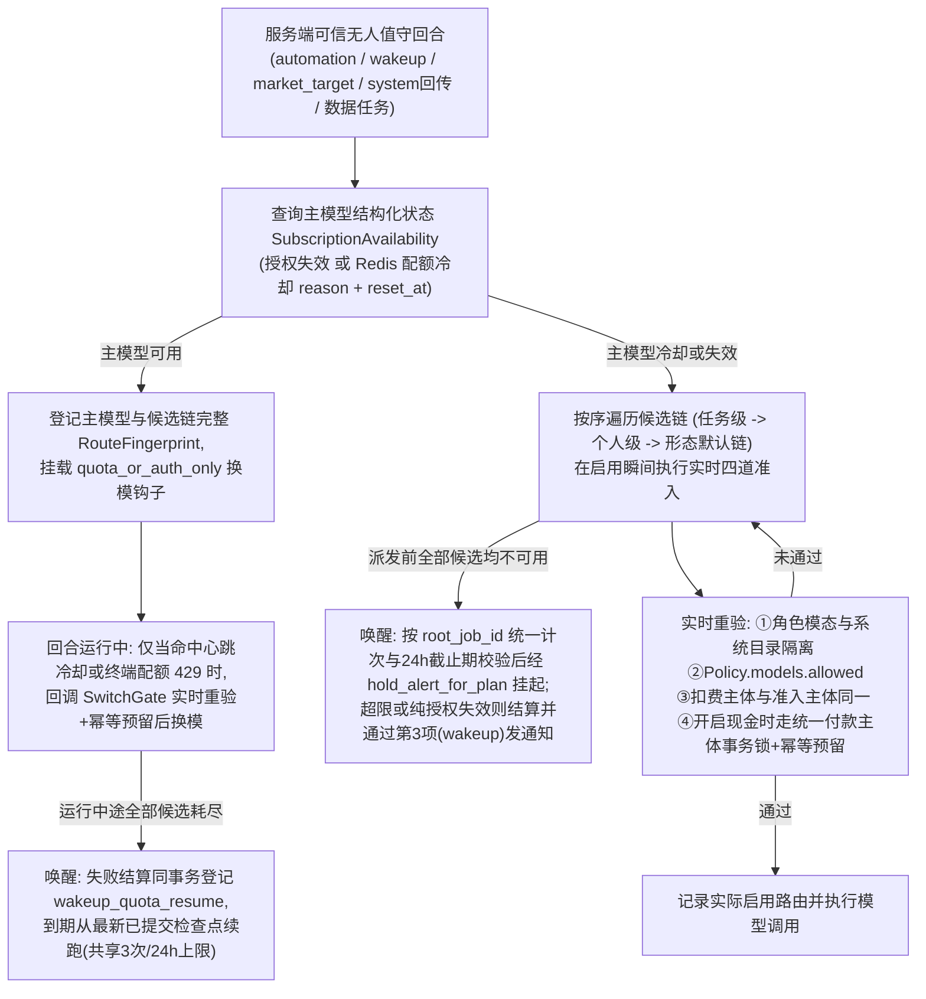
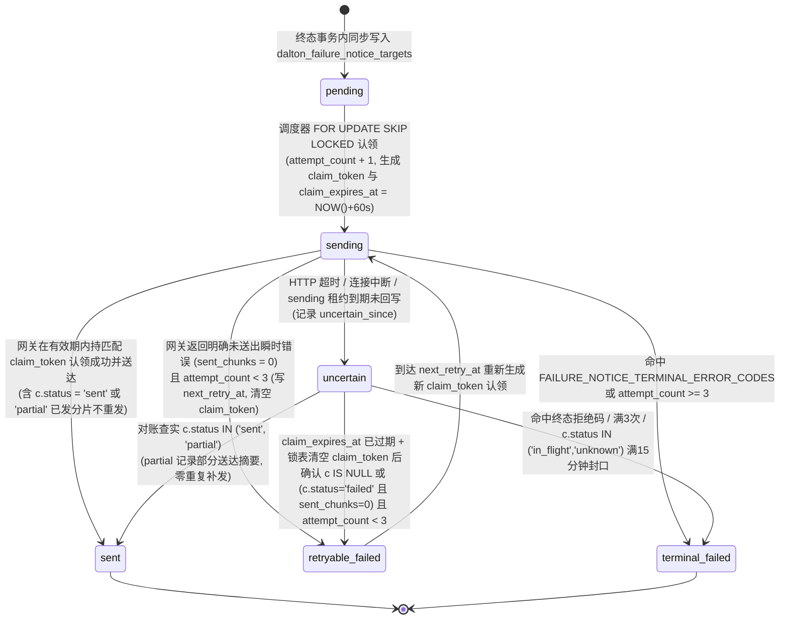
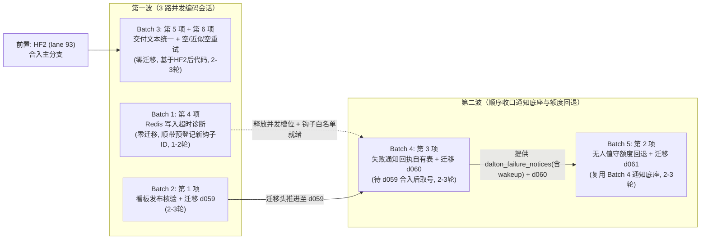

# 生产审计第二批（6 项）设计方案（第 3 稿）

> **基线快照**：分支 `design/prod-audit-2`（基于主分支 `b6d8ae2b4`，Dalton 迁移链当前头节点 `d058`）  
> **架构遵循**：严格执行 [standalone-core.md](./standalone-core.md) 双形态分离规范（安装形态统一由 `src.dalton.profile` 判定，可选能力统一由 `src.dalton.capabilities` 与前端 `useCapabilities()` / `brand.ts` 门控；配置开关统一经 `src/dalton/settings.py` 访问器读取；上游文件仅留 1–5 行 `DALTON-HOOK`〔Dalton 在上游源码中的差异挂载注释〕；自 `d045` 起新增数据库迁移只操作 `dalton_*` 自有表〔`standalone-core.md:413`〕；运维脚本严格区分 `scripts/dalton/ops/prod/` 与 `scripts/standalone/`）及 `src/server/AGENTS.md` 多进程规范（业务状态统一存于 PostgreSQL〔开源关系型数据库〕，Redis〔内存键值与流数据存储服务〕仅承担跨进程协调与实时流传输）。

---

## 一页摘要（给负责人与开发者）

| 编号 | 审计项 | 一句话结论 |
|---|---|---|
| **1** | **看板发布核验** | 先独立暂存候选版本（对外指针与 `share_links` 访客字段保持旧版可读），读取实际入口字节计算 SHA-256 比对 `snap.entry_sha256`、逐项核验依赖并经候选探测验证公开文件服务，通过后单事务原子推进访客指针；首轮与重放共用 PostgreSQL 租约认领并绑定冻结快照目录，行情快照用 `as_of`、采集健康用单调 `attempt_seq` 双轴独立控制。 |
| **2** | **无人值守额度回退** | 基于服务端可信回合来源识别无人在线回合，仅在明确的订阅授权失效或终端配额耗尽时触发换模，当前默认锁定 `$0` 订阅池回退（开启现金回退时与普通现金调用共用同一付款主体事务锁与幂等预留入口）；唤醒以初始 `root_job_id` 在 `dalton_wakeup_quota_deferrals` 统一计次与 24 小时截止期，运行中途耗尽同事务登记从最新已提交检查点续跑。 |
| **3** | **额度类失败通知回执** | 新建 `dalton_failure_notices`、`dalton_failure_notice_targets` 与 `dalton_failure_notice_streaks` 承接个人自动化、公司自动化、数据任务与唤醒四类失败通知，在各业务现有终态事务内同步入队，用 PostgreSQL 部分唯一索引原子去重连续失败，为 `sending` 落库 `claim_token` 与过期时间拦截迟到网关认领，仅对确认零送出的目标执行有界重试。 |
| **4** | **Redis 写入超时诊断** | 先诊断后修复：将看门狗抓栈阈值降至 `1.5s` 并为关键同步序列化打上 `heavy_task` 标签，在连接子类 `InstrumentedAsyncConnection` 借出后的套接字发送与响应读取处采集纯 `wire_ms`（覆盖单命令、事务管道与复用连接 `PING` 拆分），按进程分写客户端窗口并统一使用专用连接上的单一 PostgreSQL 会话锁选主采样服务端指标。 |
| **5** | **最终回复取交付文本** | 统一后端检查点（Checkpoint，工作流状态快照）、历史回放投影与渠道网关实时 SSE（Server-Sent Events，服务端推送事件流）的交付文本契约：回放合并前保留块级 `phase` 剥离 `commentary`，续写调用前预先发出 `continuation_link` 使首个实时块与检查点携带同一前驱 ID，并复用网关 `dalton_channel_deliveries` 按规范化目标与实际送达状态判定跳过或补发确定性提示。 |
| **6** | **空回复与近似空回复可重试** | 以 HF2 合入主分支为前置，直接复用 HF2 的 `is_refusal_reply` 判据、全拒答重试上限与耗尽提示语义；仅在非拒答时累加 `empty_like_retries` 使普通空答与近似空答共用 1 次补答子预算，明确跨类型混合序列总上限（外层最多 3 次调用）与终局提示优先级，闭环前端残片撤回与耗尽提示实时流输出。 |

---

## 与生产修复 HF2（lane 93）及并行修复的边界说明

当前主分支（`b6d8ae2b4`）待合入生产修复 HF2（lane 93，位于 `src/dalton/llm/refusal_fallback.py` 与 `src/ptc_agent/agent/middleware/tool/empty_call_retry.py`）。由于 HF2 与本方案第 6 项共同修改 `_retry_kind`、同步循环 `wrap_model_call` 与异步循环 `awrap_model_call`，边界与推进顺序按以下规则锁定：

1. **硬性前置与行号重锚定**：
   - 本方案 **Batch 3（第 5 项 + 第 6 项）以 HF2 合入主分支为前置条件**；启动开发时直接拉取合入 HF2 后的 `empty_call_retry.py` 与 `refusal_fallback.py` 重锚定行号并叠加修改。
2. **职责边界与语义衔接（零改动保留 HF2 拒答判据与循环预算）**：
   - **HF2 范围（原样保留）**：直接调用 HF2 在 `refusal_fallback.py:34-57` 实现的 `is_refusal_reply(ai_msg)` 作为唯一合规拒答判据（删除第 2 稿自拟的停因名单）。当 `is_refusal_reply(ai_msg)` 为真时，`_retry_kind`（lane 93 `empty_call_retry.py:329-340`）继续返回 `"empty_reply"`，同步/异步循环保持 `self.max_retries = 2`（最多 3 次模型调用）与 `all_refused` 追踪（`:564-567`），耗尽时满足 `failure_kind == "empty_reply" and all_refused` 照常进入 `handle_refusal_exhausted`（`:586-613`）。
   - **本方案第 6 项范围**：处理 `not is_refusal_reply(ai_msg)`、停止原因属于正常结束（如 `end_turn`、`STOP`、`stop`）且无工具调用，而可见输出为空白或无语义极短残片（如 11-26 飞书私聊中的单个框线符 `"═"`）的生成异常。
   - **`_retry_kind` 判定顺序与独立子计数**：保持 HF2 合入后的分支顺序：① `_compaction_call(request)` 返回 `None`；② `self._should_retry(ai_msg)` 返回 `"tool_calls"`；③ `output_cap_stop_reason(ai_msg)` 返回 `"output_cap"`；④ `malformed_call_stop_reason(ai_msg)` 返回 `"malformed_call"`；⑤ `_user_sent_turn` 下 `is_refusal_reply(ai_msg)` 或 `_visible_reply_empty(ai_msg)` 返回 `"empty_reply"`；⑥ `_user_sent_turn` 下调用 `is_near_empty_reply(ai_msg, _turn_messages(request))`（内部首行若 `is_refusal_reply(ai_msg)` 为真直接返回 `False`）返回 `"near_empty_reply"`。循环内子计数器 `empty_like_retries` **仅在 `kind in {"empty_reply", "near_empty_reply"} and not is_refusal_reply(ai_msg)` 时累加**，上限为 `1` 次重试，确保全程拒答完整保留 HF2 的 2 次重试与拒答提示。
3. **与并行读图修复的边界**：
   - 并行推进的读图修复仅改动多模态消息输入构造；交付文本提取器（`deliverable_text.py` / `deliverable-text.ts`）与 `src/server/services/runs/sse_producer.py:617-622`（`stream_mode == "custom"` 自定义流事件透传分支）独立归属本方案，代码范围完全正交。

---

## 1. 看板发布核验

### 1.1 现状与证据

监控面板与确定性数据任务看板目前包含四条更新路径：① 工作区手动发布/重发（`src/dalton/monitors/service.py:440-592, 691-798`）；② 对话回合或文件修改后自动更新 `keep_updated`（`service.py:819-922`、`src/server/services/artifacts/snapshot.py:926-965, 1094-1123`）；③ 数据任务运行后静态面板自动发布 `maybe_publish_data_job_monitor`（`src/dalton/data_jobs/scheduler.py:1668-1685` → `service.py:1212-1295, 1364-1409`）；④ 宿主机守护进程实时推送动态键值 `PUT /api/v1/dalton/monitors/internal/{slug}/data/{key}`（`scripts/dalton/monitor_feeds/run_feeds.py:227-629` → `src/dalton/monitors/db.py:1669-1734`）。

生产运行中出现两类不一致现象，代码证据如下：

1. **现象 A：发布接口或数据任务显示成功，对外页面仍展示旧内容**
   - **前端查看页版本号固定与公开接口缺少缓存控制头**：
     - `web/src/pages/Monitors/MonitorViewer.tsx:52-61` 中 `detailQuery` 仅设置 `staleTime: 30_000`，缺少定时刷新与窗口聚焦重查；`:100-124` 每 12 小时续签访问令牌时调用 `POST /api/v1/dalton/monitors/{slug}/grant`（`service.py:422-437`），该接口只返回 `monitor_grant` 与 `frame_base`，未携带最新已核验版本号，前端一直停留在初始打开时的 `v/{effectiveSeq}`。
     - 匿名公开详情接口 `GET /api/v1/dalton/monitors/public/{slug}`（`src/dalton/monitors/router.py:235-238`）缺少显式 `Cache-Control` 响应头，浏览器会对详情 JSON（JavaScript Object Notation，轻量级结构化数据交换格式）执行启发式缓存。
   - **运行时动态加载的数据文件漏进快照**：
     - 依赖扫描函数 `walk_manifest`（`src/server/services/artifacts/manifest.py:486-535`）以及快照采集入口 `capture_workspace_monitor_snapshot`（`src/server/services/artifacts/snapshot.py:553-573`）与 `capture_reader_monitor_snapshot`（`snapshot.py:577-625`）仅解析 HTML（HyperText Markup Language，超文本标记语言）/ CSS（Cascading Style Sheets，层叠样式表）/ JS（JavaScript，网页脚本语言）中的静态引用及预览已记录的 `loaded_files`。当页面脚本运行时动态拼接路径读取同目录 `.json` 文件，且回合后自动更新（`service.py:886`）或 `dependencies_only=True` 数据任务绑定（如 `relative-strength`，`src/dalton/monitors/data_job_registry.py:165`、`service.py:981`）仅更新了 `.json` 数据而 `index.html` 未变时，`_cut`（`src/server/database/artifacts/versions.py:448-452`）计算文件 SHA-256（安全哈希摘要算法）集合相等，返回 `cut=False`，保持旧版序号不变。
   - **数据任务脚本部分子源失败仍返回退出码 `0`，覆盖发布旧缓存并清空错误记录**：
     - `pm-market-state`（`scripts/dalton/monitor_feeds/pm_cockpit/run.py:53-55`、`scripts/dalton/monitor_feeds/common.py:382-383`）：`_pm_publish_ok` 计算 `all(L1) and any(L2)`，美股源成功而 A 股源失败时仍退出 `0`，重发旧缓存并由 `_cut_and_finalize_monitor_in_cur`（`db.py:1269`）将 `last_publish_error` 清为 `NULL`。
     - `sentiment-dashboard-refresh`（`src/dalton/data_jobs/evaluators.py:113, 545-547`）缺少产物新鲜度评估器；`richard-relative-dashboard-refresh`（`scripts/dalton/data_assets/skills/kweb-dashboard/scripts/kweb_dashboard_cli.py:1758-1769`）在 `--no-upload` 模式下遇到 ETF（Exchange-Traded Fund，交易型开放式指数基金）模块失败仍退出 `0`。
   - **实时推送在采集异常时用墙上时钟推进 `as_of`，恢复后遭 HTTP 409 拒绝**：
     - `scripts/dalton/monitor_feeds/run_feeds.py:423, 562` 在采集失败时用当前墙上时间（如 `15:05:00Z`）作为 `as_of` 写入 `stale: true` 载荷；下一轮采集恢复后，真实收盘行情时间（如 `15:00:00Z`）早于墙上时间，被 `upsert_monitor_data`（`db.py:1686-1693, 1719-1726`）的 `WHERE EXCLUDED.as_of > dalton_monitor_data.as_of` 拦截返回 HTTP（HyperText Transfer Protocol，超文本传输协议）409，页面长期停在报错状态。
   - **工作区文件面板保存时提前返回**：
     - `_after_change`（`snapshot.py:1106-1112`）仅检查 `artifacts_db.list_kept_updated(workspace_id)`，而可见性为 `own` / `members` / `company` 的监控面板未写 `share_links.kept_at`，在文件面板直接编辑保存时跳过了监控面板自动更新。

2. **现象 B：看板发布实际失败，数据任务或对外指针已处于异常状态**
   - **`finalize_task_run` 先提交 `succeeded` 再裸调发布，且既有重放队列使用本地 JSON 文件**：
     - `src/dalton/data_jobs/scheduler.py:1588-1622` 先将 `dalton_data_task_runs.status` 提交为 `'succeeded'`，随后在 `:1669-1685` 直接调用 `maybe_publish_data_job_monitor` 并仅以 `logger.warning` 吞掉异常；而现有的 `_durable_publish_data_job_monitor`（`:1801-1905`）通过读写本地文件 `var/dalton/pending_monitor_publishes.json` 维护队列，多工作进程（Multi-worker）并发读写会互相覆盖丢失记录，且重放无次数上限。
   - **版本切分在核验前直接推进公开指针并写死运行去重**：
     - `db.py:1235-1275` 与 `versions.py:453, 509` 在核验前即将 `dalton_monitors.published_seq` 和 `share_links.shared_seq` 推进到新版本，并在 `dalton_monitor_publish_runs`（`db.py:1257, 1345`、`service.py:1012`）登记 `run_id` 已处理。由于公开路由 `serve_public_monitor_file`（`service.py:1536`）强制校验 `int(seq) == monitor.published_seq`，一旦新版本存储块缺失或损坏，旧版本已被公开路由拒绝，同一 `run_id` 重放也会被 `has_processed_monitor_run` 提前跳过；同时 `service.py:1165-1195` 首次创建面板分两步提交，失败会留下 `published_seq = 0` 的空壳行。

### 1.2 根因

1. **指针切换先于可读性核验**：现有流程在确认候选版本文件完整可读之前就推进了 `published_seq` / `shared_seq` 与 `run_id` 去重表，一旦核验失败既破坏线上可读旧版，又堵死同任务恢复。
2. **数据任务面板发布缺少 PostgreSQL 级持久队列与有界重试**：本地 JSON 队列违背多进程共享真相放 PostgreSQL 的架构原则，且 `dalton_data_task_runs` 缺少面板发布状态字段。
3. **行情数据时间戳与采集器健康状态混用同一单调列**：用系统墙上时间充当错误态 `as_of` 污染了行情业务水位线，而简单放宽为 `>=` 又会让同时间戳迟到的降级包反向覆盖已恢复的新鲜行情。

### 1.3 方案

- **决定 1（「独立暂存候选版本 → 全量字节/依赖与候选探测核验 → 单事务原子切换访客指针 + 公开入口复核」三段式闭环）**：
  新建 `src/dalton/monitors/verify.py`，将手动发布、回合后自动更新和数据任务发布统一改造为「先全量核验、通过后再原子切换对外指针」的提交流程：
  1. **阶段一（独立暂存候选版本，保持全部对外指针与共享字段不动）**：
     - 在 `db.py:stage_monitor_candidate_version_tx` 中仅锁定或新建 `share_links` 产物行，调用 `_cut(..., to_visitors=False, share=False)`（`src/server/database/artifacts/versions.py:421-525`）写入 `artifact_versions` 与 `artifact_version_files`，仅推进内部 `latest_seq = candidate_seq`；
     - **保持 `share_links.shared_seq`、`share_links.files`、`dalton_monitors.published_seq`、`dalton_monitors.last_verified_seq`、`dalton_monitor_versions` 与 `dalton_monitor_publish_runs` 完全停留在上一已核验状态**。首次新建面板时阶段一无需写入 `dalton_monitors` 与 `dalton_monitor_versions`（彻底避开 `d039_monitor_publish_runs.py:36-41` 中 `dalton_monitor_versions.monitor_id` 外键约束，同时消除 `published_seq = 0` 的中间行）；版本裁剪逻辑同时保护 `latest_seq` 与 `COALESCE(last_verified_seq, published_seq)`。若工作进程在阶段一或阶段二任意时刻退出，外部访客全程稳定读取上一可用版本。
  2. **阶段二（切指针前完成实际字节摘要、逐项依赖与候选公开路由探测 `verify_candidate_monitor_version`）**：
     - **入口文件实际字节与单文件哈希比对**：读取 `(artifact_id, candidate_seq, entry_path)` 的 `stored`（`artifacts_db.get_version_file`），实际拉取原始字节（内联 `stored.content` 或对象存储 `fetch_blob(stored.user_id, stored.sha256)`），计算 `actual_sha256 = hashlib.sha256(raw_bytes).hexdigest()`，校验 `actual_sha256 == stored.sha256 == snap.entry_sha256`（`snapshot.py:146-147` 单文件入口摘要，区别于聚合路径与多文件哈希的 `snap.page_sha256` `:150-166`）；随后执行 `with_bridge(raw_bytes, bridge_for("view"))`（`service.py:1466, 1491`）确认桥接注入后正文非空且 UTF-8 编码合法；
     - **逐项校验全部依赖文件**：遍历 `snap.files[1:]` 中的每一个静态资源与同目录 `.json` 依赖，在 `artifact_version_files` 读取 `(artifact_id, candidate_seq, f.path)`，逐项校验 `row.sha256 == f.sha256`；对内联内容与 `<= 2 MiB` 的 `.json` 文件实际读取字节校验 SHA-256 一致，对大体积外部存储块执行 `head_blob(row.user_id, row.sha256)` 确认可读；
     - **切指针前候选文件服务实测**：当目标可见性为 `public` 时，对外路由 `serve_public_monitor_file`（`service.py:1519-1561`）对普通匿名请求始终服务 `effective_seq = monitor.last_verified_seq or monitor.published_seq`（保持旧版可读）；同时支持内部回环请求携带由 `server_keys['monitor_grant']` 签名的短效 HMAC（Hash-based Message Authentication Code，基于哈希的消息认证码）头 `X-Dalton-Candidate-Probe`（绑定 `artifact_id`、`candidate_seq` 与 30 秒有效期），在切换对外指针之前走完整 FastAPI 文件服务栈预检候选响应，断言返回 HTTP 200、`Cache-Control: private, no-cache`（`service.py:1471`），且响应头 `ETag` 以入库的 `"{stored.sha256}` 开头（匹配桥接后的 `"{stored.sha256}-{bridge.digest}"` 或非 HTML 的 `"{stored.sha256}"`，`service.py:1467`）。
  3. **阶段三（单事务 CAS 原子切换全部访客指针 + 真实匿名公开入口复核）**：
     - 阶段二全部通过后，执行 `db.py:promote_verified_monitor_version_tx` 在单个 PostgreSQL 事务内完成对外上线：
       - **首次发布**：原子执行 `INSERT INTO dalton_monitors (..., published_seq = candidate_seq, last_verified_seq = candidate_seq, last_verified_at = NOW()) RETURNING monitor_id`、写入 `dalton_monitor_versions (monitor_id, candidate_seq)` 与 `dalton_monitor_publish_runs`（若有 `run_id`），并同步更新 `share_links` 访客共享字段（`shared_seq = candidate_seq`、`files = sorted(paths)`、`legacy_refused = NULL`，以及 `visibility == 'public'` 时的 `shared_at = COALESCE(shared_at, NOW())` 与 `revision` 递增，对齐 `versions.py:497-504`）；
       - **存量更新**：在 `share_links` 与 `dalton_monitors` 的 `FOR UPDATE` 行锁下校验 CAS（Compare-And-Swap，比较并交换）单调条件 `dalton_monitors.published_seq < candidate_seq`（拦截慢速旧核验覆盖新版本），原子写入 `dalton_monitor_versions`、登记 `dalton_monitor_publish_runs`、更新 `dalton_monitors`（`published_seq = candidate_seq`、`last_verified_seq = candidate_seq`、`last_verified_at = NOW()`、`last_publish_error = NULL`、`last_publish_failed_at = NULL`），并同步推进 `share_links` 的 `shared_seq`、`files`、`legacy_refused` 及公开态 `shared_at` / `revision`；
     - 当 `visibility == 'public'` 时，紧接着以不带任何内部探测头的纯匿名回环请求复核两处真实公开路由：① 详情接口 `GET /api/v1/dalton/monitors/public/{slug}`（`service.py:311-337`）仅验收 HTTP 200、`Cache-Control: no-cache` 及响应体 `monitor.last_verified_seq >= candidate_seq`（详情 JSON 无文件哈希 `ETag`）；② 文件接口 `GET /api/v1/dalton/monitors/public/{slug}/v/{effective_seq}/{entry_path}` 验收 HTTP 200 且 `ETag` 以 `"{stored.sha256}` 开头。

- **决定 2（首轮与重放共用 PostgreSQL 租约认领 + 逐面板绑定冻结快照 + 跨轮取代终态）**：
  1. 新增 Dalton 迁移 `d059_monitor_publish_verification.py`（仅操作 `dalton_*` 自有表）：
     - 在 `dalton_monitors` 增加 `last_verified_seq INTEGER`、`last_verified_at TIMESTAMPTZ`（历史已发布行回填 `last_verified_seq = NULLIF(published_seq, 0)`）；
     - 在 `dalton_data_task_runs` 增加 `monitor_publish_status VARCHAR(32) NOT NULL DEFAULT 'not_applicable'`（取值 `'not_applicable'` | `'pending'` | `'publishing'` | `'retrying'` | `'published'` | `'unchanged'` | `'partial_failed'` | `'failed'` | `'superseded'` | `'disabled'`）、`monitor_publish_attempts INTEGER NOT NULL DEFAULT 0`、`monitor_publish_claim_epoch BIGINT NOT NULL DEFAULT 0`、`monitor_publish_claimed_by TEXT`、`monitor_publish_lease_expires_at TIMESTAMPTZ`、`monitor_publish_next_retry_at TIMESTAMPTZ` 与 `monitor_publish_detail JSONB NOT NULL DEFAULT '{}'::jsonb`；
     - 在 `dalton_monitor_data` 将快照列 `payload`、`as_of`、`sha256` 放宽为可空（附加全空或全非空一致性 `CHECK` 约束以承接首次采集即失败的无快照状态），并增加独立采集健康列 `attempt_seq BIGINT NOT NULL DEFAULT 0`、`is_stale BOOLEAN NOT NULL DEFAULT FALSE`、`last_attempt_at TIMESTAMPTZ`、`last_error TEXT`（存量行回填 `is_stale = COALESCE((payload->>'stale')::boolean, FALSE)`）。
  2. **绑定单次运行不可变冻结快照，淘汰共享可变目录重读与本地 JSON 队列**：
     - `scheduler.py:finalize_task_run`（`:1588-1667`）在任务运行成功切入终态前，先调用扩展后的冻结函数（基于 `src/dalton/data_jobs/freeze.py:353` `freeze_task_run_artifacts`）将该次运行绑定的全部面板入口 HTML、静态资源与同目录 `.json` 复制到单次运行专属不可变目录 `{data_root}/.freeze/{job_key}/runs/{run_id}/`；随后在更新 `dalton_data_task_runs.status = 'succeeded'` 的**同一个 PostgreSQL 事务内**写入初始 `monitor_publish_status = 'pending'`、`monitor_publish_next_retry_at = NOW()` 及 `monitor_publish_detail = {"frozen_dir": ..., "panels": {slug: {"status": "pending"}}}`（若 `is_artifact_publishing_enabled()` 关闭则记为 `'disabled'`）；
     - 后续无论首轮还是跨轮延迟重放，一律只从该运行绑定的 `frozen_dir`（或阶段一已落库的 `(artifact_id, candidate_seq)`）读取文件，彻底隔离下一轮任务对共享 `data_root` 的覆盖。
  3. **首轮与后台扫描共用单一 PostgreSQL 租约认领、超时接管与跨轮取代（`superseded`）**：
     - 首轮触发（`claim_monitor_publish_run_tx(run_id=claimed.run_id)`）与后台重放扫描（`replay_pending_monitor_publishes` 按 `FOR UPDATE SKIP LOCKED` 批量选取）调用**同一个原子认领事务**：仅认领满足 `(monitor_publish_status IN ('pending', 'retrying') AND monitor_publish_next_retry_at <= NOW())` 或 `(monitor_publish_status = 'publishing' AND monitor_publish_lease_expires_at <= NOW())`（120 秒租约超时接管）的行；若认领时 `monitor_publish_attempts >= 3`（第 3 次尝试期间崩溃超时），直接结算为 `'failed'` / `'partial_failed'`；否则原子更新 `monitor_publish_status = 'publishing'`、`monitor_publish_attempts = monitor_publish_attempts + 1`、`monitor_publish_claim_epoch = monitor_publish_claim_epoch + 1`、`monitor_publish_lease_expires_at = NOW() + INTERVAL '120 seconds'`，保证首轮与扫描器同时到达时严格只有 1 个执行者获准开工；
     - 逐面板进度持久化在 `monitor_publish_detail["panels"][slug]`（已完成 `'published'` / `'unchanged'` 的面板在后续重试中直接跳过；已暂存 `candidate_seq` 的面板直接从阶段二继续）；
     - **跨轮乱序取代规则**：若认领或切版前发现同一 `job_key` 下存在更新时段（`scheduled_slot_utc` 更大，或手动运行 `completed_at` 更新）的成功运行已进入 `'publishing'` / `'published'` / `'unchanged'` / `'partial_failed'`，旧运行跳过剩余切版并直接收敛为终态 `'superseded'`；
     - 提交结果时执行围栏条件 `WHERE run_id = %s AND monitor_publish_status = 'publishing' AND monitor_publish_claim_epoch = %s`（慢工唤醒自动丢弃），最多尝试 `MAX_MONITOR_PUBLISH_ATTEMPTS = 3` 次（退避 `60s`、`300s`），耗尽后收敛为 `'failed'` 或 `'partial_failed'` 并触发 1 次运维告警。
  4. **状态查看入口（基于现有界面与运维链路）**：
     - 通过三处真实入口暴露：① `Monitors` 列表与 `MonitorViewer.tsx` 顶部状态栏（鉴权视图读取 `detail.monitor.last_publish_error`，公开视图读取 `detail.monitor.has_recent_publish_issue`）；② 生产运维导出器 `scripts/dalton/ops/prod/export_ops_status.py` 与 `ops-alerts.ts` 汇总 `dalton_data_task_runs.monitor_publish_status IN ('failed', 'partial_failed', 'disabled')`；③ PostgreSQL `dalton_data_task_runs` 巡检查询。

- **决定 3（`serialize_monitor` 补齐核验字段、查看页读取 `detail.monitor.last_verified_seq` 与续签同步）**：
  1. `GET /api/v1/dalton/monitors/public/{slug}` 与 `GET /api/v1/dalton/monitors/{slug}` 统一附加响应头 `Cache-Control: no-cache`（鉴权接口为 `private, no-cache`）；公开详情在 `(monitor.last_verified_seq or monitor.published_seq) <= 0` 时返回 HTTP 404；
  2. 在 `service.py:340-368` 的 `serialize_monitor` 中新增 `"last_verified_seq": monitor.last_verified_seq` 与 `"has_recent_publish_issue": bool(monitor.last_publish_error)`；`get_public_monitor_detail`（`service.py:316-330`）保留 `serialized` 上的 `last_verified_seq` 与布尔型 `has_recent_publish_issue`（继续剥离原始错误详情 `last_publish_error`）；`POST /api/v1/dalton/monitors/{slug}/grant`（`service.py:422-437`）返回载荷补充 `published_seq`、`last_verified_seq`、`entry_path` 与 `updated_at`；
  3. 更新 `web/src/pages/Monitors/api.ts:20-46, 71-77` 的 `MonitorSummary` 与 `MonitorGrantResponse` 类型定义；在 `web/src/pages/Monitors/MonitorViewer.tsx:126-128` 中，公开模式渲染序号改为 `detail.monitor.last_verified_seq ?? detail.monitor.published_seq`，鉴权模式改为 `selectedSeq ?? (detail.monitor.last_verified_seq ?? detail.monitor.published_seq ?? detail.versions[0]?.seq ?? 1)`，并为 `detailQuery` 开启 `refetchInterval: 60_000` 与 `refetchOnWindowFocus: true`：当 `detail.monitor.has_recent_publish_issue` 为真时稳定展示上一可用 `last_verified_seq` 并提示「最近一次更新未生效，当前展示上一可用版本」。

- **决定 4（同目录 `.json` 注入快照采集、多面板策略参数化与行情双轴状态机 `as_of` + `attempt_seq`）**：
  1. **同目录 `.json` 明确落点**：在 `src/server/services/artifacts/snapshot.py` 的 `capture_workspace_monitor_snapshot`（`:553-573`）与 `capture_reader_monitor_snapshot`（`:577-625`）中委托 Dalton 辅助函数枚举入口 HTML 所在目录及直接 `data/` 子目录下满足体积上限的 `.json` 文件并入 `entries`，在 `_open_binding_reader_source`（`service.py:981`）对 `dependencies_only=True` 绑定放行该目录 `.json` 枚举，并在 `snapshot.py:_after_change`（`:1106-1112`）并入 `monitor_db.has_workspace_auto_update_monitors(workspace_id)` 检查。
  2. **多面板数据任务切版策略与「待用户决定 3」对齐**：将 `pm-market-state` 源健康检查拆分为按面板独立评估（美股面板验 `us`，A 股面板验 `cn` + `cn_valuation`），为 `sentiment-dashboard-refresh` 注册新鲜度评估器，修正 `kweb_dashboard_cli.py` 在 `--no-upload` 下 ETF 失败返回非零退出码；在 `src/dalton/settings.py` 提供 `monitors.multi_binding_publish_mode`（`"per_panel"` 或 `"all_or_nothing"`），待用户拍板「待决定 3」后写入默认配置。
  3. **实时行情快照轴 `as_of` 与采集健康轴 `attempt_seq` 双轴独立演进（覆盖新失败、无快照首败与乱序包）**：
     - `run_feeds.py` 为每个 `(slug, data_key)` 生成单调递增采集序号 `attempt_seq = max(prev_seq + 1, time.time_ns() // 1_000_000)`（进程重启后依然严格递增）：采集成功时上报 `{attempt_seq, is_stale: False, as_of, payload}`；采集失败时上报 `{attempt_seq, is_stale: True, error, last_attempt_at}`（省略新快照载荷，保留库内已有快照或首次无快照态）；
     - `db.py:upsert_monitor_data`（`:1669-1734`）在单条事务内按两条独立单调轴更新：
       1. **行情快照轴（`payload`、`as_of`、`sha256`）**：仅当请求携带有效新鲜快照（`is_stale = False` 且 `payload IS NOT NULL`）时评估——① 库内 `as_of IS NULL`（首次成功）或 `incoming.as_of > stored.as_of`：直接写入新快照；② `incoming.as_of = stored.as_of`：相同 `sha256` 幂等通过，或覆盖历史 `(stored.payload->>'stale')::boolean IS TRUE` 旧包；③ `incoming.as_of < stored.as_of`：当存量行为历史墙上时间污染行（`(stored.payload->>'stale')::boolean IS TRUE`）时执行单次纠偏回写为真实收盘 `as_of`，其余新鲜行遇到倒退行情时间照常返回 HTTP 409。失败上报（`is_stale = True`）首次建行时写入 `payload = NULL, as_of = NULL, sha256 = NULL`，存量已有快照时保持 `payload`、`as_of`、`sha256` 原封不动；
       2. **采集健康轴（`attempt_seq`、`is_stale`、`last_attempt_at`、`last_error`）**：严格按 **`incoming.attempt_seq > stored.attempt_seq`** 单调推进——正常成功后发生的**新**采集失败因 `attempt_seq` 更大，立即将 `is_stale` 置为 `TRUE` 并记录 `last_error`（同时保留上一份成功行情 `payload` 与 `as_of`）；随后同一收盘时间 `as_of` 采集恢复时，更大的 `attempt_seq` 将 `is_stale` 恢复为 `FALSE`；而网络乱序迟到的旧失败包因 `attempt_seq` 更小被直接忽略；
     - **读取接口透传健康与空快照状态**：升级 `service.py:1564-1596` 的 `_read_monitor_data_response`，在响应体中除 `as_of`（无快照时为 `null`）、`sha256`、`data`（无快照时为 `null`）外，统一返回 `attempt_seq`、`is_stale`、`last_attempt_at` 与 `has_fetch_error`（鉴权接口额外返回 `last_error`），且 `ETag` 基于完整响应体计算，`is_stale` 翻转时自动触发客户端刷新。

### 1.4 改动文件清单

| 路径分类 | 文件路径 | 改动说明（上游文件标出钩子位置与行数） |
|---|---|---|
| Dalton 新增 | `src/dalton/monitors/verify.py` | 实现三段式核验（实际读取入口字节计算 SHA-256 比对 `snap.entry_sha256`、逐项校验依赖、切指针前 HMAC 候选文件探测及切指针后真实公开路由复核） |
| Dalton 迁移 | `src/dalton/migrations/versions/d059_monitor_publish_verification.py` | `dalton_monitors` 加 `last_verified_seq`/`at`；`dalton_data_task_runs` 加持久认领租约（`claim_epoch`/`lease_expires_at`）与逐面板详情列；`dalton_monitor_data` 快照列改为可空并加 `attempt_seq`/`is_stale`/`last_attempt_at`/`last_error` |
| Dalton 自有 | `src/dalton/settings.py` | 新增 `is_monitor_verify_readback_enabled()` 与 `get_monitor_multi_binding_publish_mode()` 访问器 |
| Dalton 自有 | `src/dalton/monitors/service.py` | 独立暂存→全量核验→CAS 提升流程；`serialize_monitor`（`:340`）与 `get_public_monitor_detail`（`:311`）补 `last_verified_seq` 与 `has_recent_publish_issue`；`_read_monitor_data_response`（`:1564`）透传健康状态与无快照失败态 |
| Dalton 自有 | `src/dalton/monitors/db.py`、`models.py` | 实现独立 `stage_monitor_candidate_version_tx`（支持首发无 `dalton_monitors` 行暂存）与 `promote_verified_monitor_version_tx`（含 `share_links.files` 等共享字段原子推进）；升级 `upsert_monitor_data`（`:1669`）双轴规则 |
| Dalton 自有 | `src/dalton/monitors/router.py` | 公开与鉴权详情接口（`:235-238` 等）补充 `Cache-Control: no-cache`；内部行情推送接口接收 `attempt_seq` 与无快照失败上报 |
| Dalton 自有 | `src/dalton/monitors/data_job_registry.py`、`src/dalton/data_jobs/freeze.py` | 支持按面板声明源健康检查钩子；扩展 `freeze.py:353` 生成单次运行不可变面板冻结目录 |
| Dalton 自有 | `src/dalton/data_jobs/scheduler.py` | `finalize_task_run`（`:1588-1686`）先冻结单次运行产物再同事务登记 `pending`，首轮与 `replay_pending_monitor_publishes`（`:1908`）共用 `claim_monitor_publish_run_tx` 租约认领、120s 超时接管与跨轮 `superseded` 收敛 |
| Dalton 自有 | `src/dalton/data_jobs/evaluators.py` | 注册 `sentiment-dashboard-refresh` 输出完整性与新鲜度评估器 |
| Dalton 运维（生产） | `scripts/dalton/ops/prod/export_ops_status.py`、`integrations/dalton-channel-gateway/src/ops-alerts.ts` | 导出并告警 `dalton_data_task_runs` 面板发布终态失败（排除正常取代态 `superseded`） |
| Dalton 脚本 | `scripts/dalton/monitor_feeds/pm_cockpit/run.py`、`common.py`、`scripts/dalton/monitor_feeds/run_feeds.py`、`scripts/dalton/data_assets/skills/kweb-dashboard/scripts/kweb_dashboard_cli.py` | 分面板源状态输出、`run_feeds.py` 上报单调 `attempt_seq` 与 `is_stale`、`--no-upload` ETF 失败退出码修正 |
| Dalton 前端 | `web/src/pages/Monitors/MonitorViewer.tsx`、`api.ts` | 读取 `detail.monitor.last_verified_seq ?? detail.monitor.published_seq`、60 秒轮询与聚焦重查、展示最近更新未生效及行情 `is_stale` 提示 |
| **上游文件** | `src/server/services/artifacts/snapshot.py`（`:553-596` 与 `:1106-1112`，`# DALTON-HOOK(monitors)`，**2 处各 4 行**） | 在两个监控快照采集入口并入同目录 `.json` 发现辅助函数；在 `_after_change` 早退判断中并入工作区自动更新面板检查 |

### 1.5 测试计划

1. **单元测试**：
   - `tests/unit/dalton/test_monitors_verify.py`：验证实际读取入口字节计算 SHA-256 与 `snap.entry_sha256` 比对及逐项依赖校验；验证**首次发布**在阶段一无需 `dalton_monitors` 行即可暂存、核验失败不留空壳行、核验通过后 `share_links.files` / `shared_seq` 与 `dalton_monitors` 原子就位；验证公开详情接口验收 `200 + Cache-Control`、公开文件接口验收 `200 + ETag` 前缀 `"{stored.sha256}`。
   - `tests/unit/dalton/test_monitor_feeds.py` & `test_data_jobs.py`：完整验证四步序列 **「成功（`seq=10, as_of=T1`）→ 新失败（`seq=11`，保留 `T1` 快照但 `is_stale=True`）→ 同一行情时间恢复（`seq=12, as_of=T1, is_stale=False`）→ 迟到旧失败包（`seq=11`，被忽略仍为健康）」**，以及首次启动即失败（`payload=None, as_of=None, is_stale=True`）落库与 `_read_monitor_data_response` 透传、历史墙上时间污染行首包自愈。
   - 前端单测 `web/src/pages/Monitors/__tests__/Monitors.test.tsx`：验证公开与鉴权模式均从 `detail.monitor.last_verified_seq ?? detail.monitor.published_seq` 取值，核验失败时保持旧版画面并显示 `has_recent_publish_issue` 提示。
2. **真实库与双工作进程故障注入集成测试**：
   - `tests/integration/dalton/test_monitors_publish_verify_db.py`：在真实 PostgreSQL + 双 worker 环境下覆盖：① **核验中途强杀 worker**：断言对外真实公开入口 `/api/v1/dalton/monitors/public/{slug}` 与文件路由全程返回上一可用版本；② **首轮与扫描器并发争抢 + 认领后崩溃**：验证同一时刻仅 1 个 worker 认领成功，模拟崩溃 120 秒租约到期后另一 worker 凭借新 `claim_epoch` 接管完成且迟到旧 worker 写回被围栏拦截；③ **跨轮乱序重放**：模拟 Run 1 重试期间共享 `data_root` 已被 Run 2 覆盖且 Run 2 已发布上线，断言 Run 1 仅读取自身 `frozen_dir` 并自动收敛为 `'superseded'`，Run 2 线上版本保持不变。
3. **需要 Lead 在生产只读核对的项**：
   - 只读查询 `SELECT slug, published_seq, last_publish_error, last_publish_failed_at FROM dalton_monitors ORDER BY category, sort_order;`；
   - 只读核对生产 `.env` 中 `DALTON_ARTIFACT_PUBLISHING_ENABLED` 当前值；
   - 只读查询 `SELECT m.slug, d.data_key, d.as_of, d.payload->>'stale' AS stale FROM dalton_monitor_data d JOIN dalton_monitors m USING (monitor_id);`，确认现存墙上时间倒挂记录以便上线后验证首包自愈。

### 1.6 风险与回退

- **风险**：阶段二对候选版本执行一次入口字节哈希与回环探测，单面板总核验耗时约 10–40 毫秒；运行专属 `frozen_dir` 随版本保留周期同步清理，磁盘占用极小。
- **回退**：新增列均为兼容增量列；通过 `src/dalton/settings.py` 将 `monitors.verify_readback_enabled` 设为 `false` 即可切回原提交流程。

---

## 2. 无人值守额度回退

### 2.1 现状与证据

在自动化任务、定时唤醒、后台回传与数据任务等无人在线回合中，当订阅模型（基于 OAuth〔Open Authorization，开放授权协议〕连接，如 `claude-opus-5-5-oauth`）配额耗尽时，系统当前直接报错终止；11-25 生产环境中亦有同事连续发送 4 条渠道消息因 Opus 订阅额度耗尽报错。代码链路存在 4 处阻断证据：

1. **运行期弹性中间件对 `oauth` 主模型直接清空备选列表，且对非配额故障也会无差别换模**：
   - `src/llms/llm.py:976, 1094-1099` 将订阅模型客户端标记为 `billing_type="oauth"`（路由封装见 `src/server/services/llm/clients.py:756-776`）；`src/ptc_agent/agent/middleware/model_resilience.py:1959-1980` 的 `_on_its_payer` 检测到主模型 `billing_type == "oauth"` 时直接返回 `[]`。
   - 在团队凭据共享模式下（`src/dalton/credentials.py:253-290`），全体成员共享同一把 Redis 冷却键 `dalton:quota_exhausted:{holder}:{provider}:...`（`model_resilience.py:308-369`）；主模型冷却后 `awrap_model_call`（`:2249-2260`）跳过主模型并直接抛出 `_RemoteQuotaExhaustedError`。同时 `awrap_model_call`（`:2288-2315`）对普通备选链在遇到非配额类错误（如瞬时 5xx）时也会跨模型切换。
2. **预构建候选与单次余额读取无法兑现并发跨付款方准入及恢复路由校验**：
   - `src/server/services/llm/clients.py:1364-1380` 中 `platform_ok = not is_own_key_turn(config)` 使订阅回合跳过服务端目录模型构建；
   - `src/dalton/budget/gate.py:77-135` 的 `enforce_local_admission` 只在回合启动前检查一次 `available >= floor_usd`，而 `LocalBudgetPort.acquire`（`src/dalton/budget/port.py:108-120`）初始插入 `reserved_usd = 0`，若仅做静态余额读取而不加行锁预留额度，两个并发 worker 同时从 `$0` 订阅降级到现金模型会争抢穿透最后一份现金预算；
   - 检查点恢复校验 `verify_resume_route`（`src/dalton/services/team_model_catalog/snapshot.py:399-445`）比对 `effective_catalog_snapshot["models"]` 中的 6 元组路由指纹，若只登记原主模型键，恢复时既无法感知实际切换后的路由，也无法拦截候选模型在暂停期间发生的端点/凭据变更。
3. **服务端回合来源、唤醒结算时序与预检返回类型不匹配**：
   - 依据 `src/server/contracts/turn_kinds.py:16-33, 69-96`，服务端发起的回传回合实际以 `query_type == "system"` 且 `platform is None` 投递（`posted_by_server`），唤醒为 `"wakeup"` / `"market_target"`；客户端请求中的 `query_type` 已在入口剥离，不可伪造。
   - `src/dalton/services/automation_subscription_fallback.py:41-70` 仅捕获 3 类登录失效错误并返回展示文案；
   - 在 `src/server/services/wakeups/delivery.py:451-464, 505-517` 中，只要 `post_notification_turn` 返回 `outcome == "dispatched"`（即已创建 `run_id`），第 `:463` 行立即调用 `_settle_wake(wake, run_id)` 结清唤醒任务；挂起函数实为 `src/server/database/runs/outbox.py:741` 的 `hold_alert_for_plan`，且 `notify_turn.py:908-924` 的 `_plan_limited` 仅识别准入阶段返回的 `type == "claude_code_off"`。一旦回合启动后中途耗尽额度，原唤醒任务早已结清，无法退回派发前挂起分支。
4. **数据任务内部补全身份与失败通知路径不一致**：
   - `POST /api/v1/dalton/internal/llm/complete`（`src/dalton/app/internal_llm_router.py:146-182`）限定在 `get_allowed_host_oauth_models()` 白名单内，并以主管理员身份 `primary_admin_id = await get_primary_admin_user_id()`（`:166-174`）调用 `dalton_complete`；而网关通知白名单 `src/dalton/database/automation_notifications.py:266-268` 显式拒绝 `automation_id` 或 `route_key` 以 `data:` 开头的行，数据任务无法借道旧 `dalton_notify_deliveries` 发送网关失败提醒。

### 2.2 根因

1. **无人值守回合缺少基于可信服务端来源的「仅限授权/配额耗尽触发」切换契约**。
2. **跨计费源切换缺少换模瞬间的动态重验、PostgreSQL 行锁原子额度预留与全候选路由指纹归档**。
3. **唤醒投递的派发前准入拒绝与派发后运行中耗尽分处两个生命周期阶段，数据任务调用身份与通知账本也未对齐**。

### 2.3 方案



- **决定 1（严格使用服务端可信来源识别无人值守回合，返回结构化冷却状态）**：
  新建 `src/dalton/llm/unattended_fallback.py`：
  1. **可信来源判定**（仅采信服务端内部盖章字段，客户端传入字段已在入口剥离）：
     - 自动化回合：`classify_origin(run_meta, query_type) == "automation"` 或携带服务端 `automation_execution_id`；
     - 服务端主动投递的通知与唤醒回合：`posted_by_server(query_type, platform)` 为真（`turn_kinds.py:21-33`，即 `platform is None` 且 `query_type in {"system", "market_target", "wakeup"}`），以及中断恢复时 `run_unwatched(run) is True`（`turn_kinds.py:46-50`）或研究总监工具内部派发的分析师回合；
     - 宿主机数据任务内部补全 `/api/v1/dalton/internal/llm/complete` 与后台结构化提取 `assist_json`。
  2. **结构化冷却探测**：实现 `inspect_subscription_availability(user_id, model_name) -> SubscriptionAvailability`，返回 `{available: bool, kind: "auth_unavailable" | "quota_cooldown" | None, refusal_code: str | None, provider: str | None, reset_at: datetime | None, cooldown_key: str | None}`，供准入层、唤醒挂起与通知层统一消费。

- **决定 2（当前批次按默认 `$0` 订阅池交付 + 扣费主体严格合一）**：
  1. 候选顺序依次为：**任务显式 `fallback_models` → 归属用户个人 `fallback_models`（仅显式 `disable_fallback: true` 时停用）→ 当前形态（`resolve_profile()`）默认备用链**，自动跳过同一共享冷却键下的同厂商变体。
  2. **当前批次交付默认范围**：`settings.py` 中 `autonomy.allow_cash_fallback_on_unattended` 默认为 `False`，**当前批次按 `$0` 已授权订阅池内回退（`oauth -> oauth`）交付**；当用户批准「待决定 2」开启现金保底后，直接启用决定 3 第 2 条的统一原子现金预留入口。
  3. **准入身份与扣费身份严格合一**：
     - 个人自动化与个人会话唤醒/回传：准入检查主体与模型扣费主体均为 `owner_user_id`；
     - 公司级自动化：准入检查主体与扣费主体均为 `system:dalton-company`；
     - 数据任务内部补全 `/api/v1/dalton/internal/llm/complete`（`internal_llm_router.py:146-182`）：候选模型限定在 `get_allowed_host_oauth_models()` 订阅白名单内，准入主体与调用主体统一为同一个 `primary_admin_id`。

- **决定 3（仅因明确额度/授权原因触发换模 + 统一原子现金预留入口 + 路由快照全覆盖）**：
  1. **限定换模触发原因**：在 `ModelResilienceMiddleware` 中，跨凭据/跨计费源备选客户端标记 `switch_policy="quota_or_auth_only"`，**仅当当前模型命中 Redis 配额冷却（`_aquota_skipped`）或收到已确认的终端配额拒绝（`plan_limit` / `quota_exceeded` / `out_of_credit` / `plan_excludes`）及 OAuth 授权失效时才切往下一候选**；瞬时网络抖动或 5xx 留在当前模型内按既有退避重试处理。同时在 `error_handling.py:157-169` 对已耗尽全部候选的终端配额拒绝跳过外层 3 次同模型重跑。
  2. **换模前即时重验与统一付款主体原子现金预留（`acquire_fallback_candidate_live`）**：无论回合启动前还是中途第 N 步切换，真正启用候选前即时执行：
     - 重新读取最新组织策略 `require_policy(subject_user_id)` 校验 `Policy.models.allowed`、订阅/密钥开关、角色工具与图像模态要求，以及代管/公司任务强制 `ignore_custom_models=True`；
     - 若目标候选属于平台计费（`platform`），即时执行 `enforce_credit_limit`；
     - **若批准开启现金回退且目标候选属于 Dalton 现金计费（`cash`），与常规现金调用 `LocalBudgetPort.acquire`（`src/dalton/budget/port.py:78-235`）共用同一个原子事务入口 `acquire_cash_lease_tx(user_id=subject_user_id, run_ref=run_id, call_id=model_call_id, min_floor_usd=admission_floor_usd)`**：
       1. 调用 `resolve_user_budget_config(conn, subject_user_id)`（`budget/service.py:466-514`）解析有效配置（覆盖无 `dalton_budget_config` 表行而走 `dalton.yaml` 默认额度的用户；`configured=False` 或 `daily_cap_usd <= 0` 时直接拒绝）并计算当地 `budget_day`；
       2. **统一以稳定付款主体加事务级排他锁**：调用现成 `acquire_budget_advisory_lock(conn, subject_user_id, b_day)`（`src/dalton/database/budget.py:29-34`，执行 `SELECT pg_advisory_xact_lock(hashtext('dalton_budget:' || user_id || ':' || b_day))`），无需依赖 `dalton_budget_config` 存在表行，且将常规现金 `LocalBudgetPort.acquire` 与无人值守现金回退严格串行化在同一把锁下；
       3. **建行与按 `(run_ref, call_id)` 幂等记账**：通过 `INSERT INTO dalton_budget_reservations (...) VALUES (..., 0, ...) ON CONFLICT (run_ref) DO UPDATE`（`port.py:108-141`）确保首次从订阅切入现金的回合立即创建 `'open'` 预留行；随后基于 `this_floor = max(observed_usd, usage_for_run)`（`:198`）校验当日剩余额度 `available >= min_floor_usd` 且单任务剩余额度充足。若当前 `reserved_usd >= this_floor + min_floor_usd` 或 `last_fallback_call_id == call_id`（同一模型调用重试或预留余量充足），直接幂等返回既有 `LeaseVerdict`（零重复累加 `$0.25`）；否则令 `new_reserved = max(reserved_usd, this_floor + grant)`（至少覆盖 `this_floor + min_floor_usd`）写回 `dalton_budget_reservations` 并计入当日在途占用，绑定回合 `CreditLease`。
  3. **实际路由记录与检查点恢复校验（`snapshot.py:399-445`）**：
     - 回合启动时将主模型与所有预审候选的 6 元组 `RouteFingerprint` 一并写入 `effective_catalog_snapshot["models"]`，运行期换模时在运行元数据记录 `active_fallback_route`；
     - `/retry` 或唤醒检查点续跑调用 `verify_resume_route` 时，在实际切入任一备选模型前同步比对该备选当前的 `RouteFingerprint` 与快照记录，端点、凭据指纹或计费类型已变更的候选直接跳过（全部变更则按 `catalog_route_changed` 安全终止）。

- **决定 4（以初始唤醒 ID 持久化共享挂起账本、处理未知/超限恢复时间、同事务登记检查点续跑）**：
  1. **新建纯 Dalton 自有表 `dalton_wakeup_quota_deferrals`（迁移 `d061_wakeup_quota_deferrals.py`）统一计次与幂等**：
     - 主键 `root_job_id UUID PRIMARY KEY`（取首次触发时的原始 `hook_outbox.hook_outbox_id`，后续续跑任务一路透传同一 `root_job_id`），字段含 `wakeup_id TEXT NOT NULL`、`thread_id UUID NOT NULL`、`owner_user_id VARCHAR(255) NOT NULL`、`first_due_at TIMESTAMPTZ NOT NULL`（首次应触发时间，创建后恒定）、`deadline_at TIMESTAMPTZ NOT NULL`（固定为 `first_due_at + INTERVAL '24 hours'`）、**共享总计次 `defer_count INTEGER NOT NULL DEFAULT 0`**（派发前挂起与运行中途续跑共用同一计数器）、幂等步键 `last_step_key TEXT NOT NULL`（派发前取 `"pre:" || job_id || ":" || attempts`，运行中途取 `"mid:" || failed_run_id`，重复回调幂等返回既有结果）、`resume_from_run_id VARCHAR(255)`、`resume_checkpoint_id TEXT`、`status TEXT NOT NULL CHECK (status IN ('deferred', 'settled', 'exhausted_failed'))`。
  2. **恢复时间缺失与超 24 小时边界规则（派发前与运行中共用）**：
     - **纯授权失效直接终止**：若全部候选均为 `kind == "auth_unavailable"`（无任何配额冷却候选），等待无法自愈，直接标记 `status = 'exhausted_failed'`、结清唤醒并通过第 3 项（`subject_kind = 'wakeup'`）通知会话所有者重新授权；
     - **配额冷却缺少 `reset_at` 时的确定性探测时间**：若存在 `quota_cooldown` 候选但服务商未返回 `reset_at`（`reset_at is None`），按 `effective_reset_at = NOW() + INTERVAL '30 minutes'` 计算默认重探时间并标记 `held_known = False`（对齐 `wakeups/delivery.py:370`）；
     - **次数与 24 小时截止期双重门控**：由于 `hold_alert_for_plan`（`outbox.py:682`）实际调度时间为 `scheduled_wake_at = effective_reset_at + INTERVAL '1 minute'`，准入挂起前统一校验 **`defer_count + 1 <= 3 AND scheduled_wake_at <= deadline_at`**。一旦超过 3 次或预计恢复加 1 分钟已越过 `first_due_at + 24h`（含单次超长 7 天冷却超出 24 小时的情形），立即判定超限：在同一事务内将 `dalton_wakeup_quota_deferrals.status` 置为 `'exhausted_failed'`，结清当前 `hook_outbox` 任务并调用 `enqueue_failure_notice_in_tx(subject_kind='wakeup', ...)` 发送 1 次额度耗尽提醒。
  3. **派发前挂起 vs 运行中途检查点续跑（防止重做已执行工具）**：
     - **派发前全部候选冷却（创建 `run_id` 前）**：准入阶段在 `dalton_wakeup_quota_deferrals` 校验通过并递增 `defer_count` 后返回 HTTP 400 `{"type": "dalton_subscription_cooldown", "reason": "plan_limited", "held_until": effective_reset_at.isoformat(), "held_known": held_known}`，`notify_turn.py:_plan_limited`（`:908-924`）交由 `wakeups/delivery.py:505-517` 调用 `outbox_db.hold_alert_for_plan` 挂起至 `effective_reset_at + 1m`；
     - **运行中途全部候选耗尽（原任务已在 `delivery.py:463` `_settle_wake` 结清）**：在 `error_handling.py` 将失败回合 `conversation_responses.status` 置为 `'failed'` 的**同一个 PostgreSQL 事务内**，读取该回合最新已提交 LangGraph 检查点 ID `latest_checkpoint_id`（`get_retry_checkpoint(thread_id, None)`，若首步模型调用前即失败尚无本轮检查点则为 `None`），更新 `dalton_wakeup_quota_deferrals`（递增共享 `defer_count`、写入 `resume_from_run_id = run_id` 与 `resume_checkpoint_id = latest_checkpoint_id`），并同步向 `hook_outbox` 插入一条 `hook_type = 'wakeup_quota_resume'` 任务（`next_retry_at = effective_reset_at + INTERVAL '1 minute'`，携带 `root_job_id`、`failed_run_id`、`turn_index`、`resume_checkpoint_id`，幂等请求键 `f"wakeup_resume:{root_job_id}:{defer_count}"`）；
     - **检查点续跑执行**：`wakeup_quota_resume` 到期由任意活跃 worker 认领后，复用 `/retry` 内部续跑路径（`src/server/app/threads/messaging.py:2331-2375` + `src/server/services/runs/pending_input.py:229-244` `retried_wake_fields(thread_id, turn_index)`），指定 `retry_of_run_id = failed_run_id` 与 `retry_checkpoint_id = resume_checkpoint_id` 发起续跑。由于前序步骤已完成的工具调用与 `ToolMessage` 结果已固化在 `resume_checkpoint_id` 中，续跑直接从耗尽失败的那一步模型节点继续推理，**已完成工具零重复执行**（若期间用户已在该线程发起更新回合推进了分支，续跑任务自动标为 `settled` 安全礼让）。

- **决定 5（精准文案、唤醒收件人归属与统一走第 3 项失败通知底座）**：
  1. 区分 `oauth_auth_unavailable`（提示重新连接授权）与 `subscription_quota_exhausted`（附带香港时间恢复预期或未知恢复时间说明）。
  2. 四类无人值守主体统一接入第 3 项 `dalton_failure_notices` 持久通知底座：① 个人自动化（`personal_automation`）发归属人私聊；② **定时/条件唤醒（`wakeup`）发会话所有者 `owner_user_id`（`delivery.py:345` 解析）私聊**；③ 公司级自动化（`company_automation`）发主管理员私聊；④ 数据任务（`data_task`）发主管理员私聊。
  3. 团队共享凭据进入冷却首次引发无人值守降级或失败时，通过第 3 项 `dedup_window_key = f"admin_cooldown:{cooldown_key}"` 的 PostgreSQL 部分唯一索引确保每个冷却窗口向主管理员最多发送 1 条汇总提醒。

### 2.4 改动文件清单

| 路径分类 | 文件路径 | 改动说明（上游文件标出钩子位置与行数） |
|---|---|---|
| Dalton 迁移 | `src/dalton/migrations/versions/d061_wakeup_quota_deferrals.py` | 新建纯 Dalton 自有表 `dalton_wakeup_quota_deferrals`（按 `root_job_id` 持久化共享 `defer_count`、24h `deadline_at`、步幂等键与续跑检查点 ID） |
| Dalton 新增 | `src/dalton/llm/unattended_fallback.py` | 实现可信来源判定、结构化冷却探测、换模前四道准入重验、唤醒共享挂起/检查点续跑调度及第 3 项通知调用 |
| Dalton 自有 | `src/dalton/settings.py` | 新增 `is_unattended_quota_fallback_enabled()` 与 `allow_cash_fallback_on_unattended()`（默认 `False`）访问器 |
| Dalton 自有 | `src/dalton/budget/port.py` | 抽离常规 `LocalBudgetPort.acquire`（`:78-235`）与现金回退共用的原子入口 `acquire_cash_lease_tx`（基于 `acquire_budget_advisory_lock` 锁付款主体、`INSERT ... ON CONFLICT (run_ref)` 建行并按 `(run_ref, call_id)` 幂等记账） |
| Dalton 自有 | `src/dalton/services/team_model_catalog/snapshot.py` | 扩展快照记录全部准入候选 `RouteFingerprint`，支持恢复与运行期换模前核验候选路由一致性 |
| Dalton 自有 | `src/dalton/services/automation_subscription_fallback.py`、`automation_thread_model.py` | 接入结构化冷却预检、唤醒派发前统一计次与 24h 校验后返回 `dalton_subscription_cooldown` HTTP 400 |
| Dalton 自有 | `src/dalton/app/internal_llm_router.py`、`src/dalton/llm/assist.py` | `/internal/llm/complete`（`:146-182`）保持同一 `primary_admin_id` 在白名单订阅池内回退；`assist_json` 开启默认链配额 429 切换 |
| **上游文件** | `src/ptc_agent/agent/middleware/model_resilience.py`（`:1959-1980` 与 `:2256-2315`，`# DALTON-HOOK(automation-subscription-fallback)`，**2 处各 4 行**） | 放行带 `quota_or_auth_only` 策略的无人值守备选链，并在实际切入候选前回调异步准入与统一现金租约钩子 |
| **上游文件** | `src/server/services/llm/clients.py`（`:1364-1380`，`# DALTON-HOOK(automation-subscription-fallback)`，**新增 4 行**） | 委托 `unattended_fallback` 构建无人值守回合候选列表并打上换模触发策略标记 |
| **上游文件** | `src/server/handlers/chat/error_handling.py`（`:157-169` 与失败结算事务钩子，`# DALTON-HOOK(quota-exhaustion)`，**2 处各 3–4 行**） | 终端配额拒绝跳过外层同模型自动重试；唤醒运行中途耗尽在失败结算同事务内登记 `wakeup_quota_resume` 检查点续跑意图 |
| **上游文件** | `src/server/services/report_back/notify_turn.py`（`:908-924`）& `src/server/services/wakeups/delivery.py`（`:505-517` 及 `wakeup_quota_resume` 分发，`# DALTON-HOOK(quota-exhaustion)`，**各新增 4 行**） | `_plan_limited` 识别 `dalton_subscription_cooldown`（含 `held_known`）；接入共享上限判定与跨 worker 检查点续跑派发 |

### 2.5 测试计划

1. **单元测试**：
   - `tests/unit/dalton/test_unattended_quota_fallback.py`：验证基于 `turn_kinds.posted_by_server` / `classify_origin` 的可信判定；验证瞬时 502 保持原模型重试、仅配额冷却或终端 429 换模；验证默认 `allow_cash_fallback_on_unattended=False` 时仅走 `$0` 订阅池；验证同一 `(run_ref, call_id)` 重复进入现金预留幂等零多扣。
   - `tests/unit/dalton/test_wakeup_quota_hold.py`：覆盖 ① **派发前挂起与运行中途耗尽交替累计**（如第 1 次派发前 `hold_alert_for_plan` → 第 2 次进入第 2 步工具后耗尽写检查点续跑 → 第 3 次派发前挂起 → 第 4 次触发 `defer_count > 3` 立即终止并发出 `subject_kind='wakeup'` 通知）；② **未知恢复时间**（`reset_at=None` 按 30 分钟 `held_known=False` 挂起）与**单次恢复时间越过 `first_due_at + 24h`**（直接拒绝挂起并转失败通知）；③ 纯 `auth_unavailable` 零等待立即通知会话所有者。
2. **真实库与双工作进程并发集成测试**：
   - `tests/integration/dalton/test_unattended_fallback_settlement_db.py`：
     - **常规现金调用 vs 回退现金调用并发争抢测试（含无 `dalton_budget_config` 行的默认额度用户）**：构造数据库无 `dalton_budget_config` 行（走 `default_daily_cap_usd`）且剩余额度仅够 1 次 `$0.25` 的用户，worker 1 执行常规现金回合 `LocalBudgetPort.acquire`，worker 2 同时触发无人值守订阅 429 切向 `deepseek-flash`，断言 `acquire_budget_advisory_lock` 将两路严格串行化、新建预留行计入当日在途占用，恰好 1 路获批、另 1 路安全拒绝零透支；
     - **跨 worker 检查点续跑防重做工具测试**：模拟 worker 1 在唤醒回合第 1 步执行记录副作用的工具后于第 2 步遭遇全候选配额耗尽并结算，到期后由 worker 2 认领 `wakeup_quota_resume` 从 `resume_checkpoint_id` 恢复完成，断言第 1 步工具全过程严格只执行 **1 次**；
     - **恢复路由变更注入测试**：检查点暂停期间修改候选模型 `base_url` 或凭据指纹，断言恢复时准确跳过变更候选。
3. **需要 Lead 在生产只读核对的项**：
   - 只读查询 `SELECT user_id, daily_cap_usd, default_task_cap_usd FROM dalton_budget_config WHERE user_id = 'system:dalton-company';`；
   - 只读统计 `user_preferences` 中 `fallback_models = '[]'::jsonb` 的内部成员数量。

### 2.6 风险与回退

- **风险**：主力订阅长时冷却期间唤醒任务顺延可能推迟盘中提醒；通过优先遍历其余异构 `$0` 订阅模型后再挂起、共享限制最多 3 次 / 24 小时并向会话所有者发送明确通知，兼顾及时性与可预期性。
- **回退**：通过 `src/dalton/settings.py` 将 `autonomy.unattended_quota_fallback_enabled` 设为 `false` 即可恢复原单模型行为。

---

## 3. 额度类失败通知回执

### 3.1 现状与证据

自动化执行或数据任务因额度类限制（`usage_limit`、`claude_plan`、`plan_limit`）失败并经渠道网关发送通知时，此前在 lane 62 经历 4 轮修改仍未收敛（于 `5a1566e25` 回滚）。对照当前主分支代码与架构规范，核心症结共 6 处：

1. **分离规范要求新迁移仅操作 `dalton_*` 自有表**：
   - `docs/dalton/features/standalone-core.md:413` 规定自 `d045` 起的新增迁移只操作 `dalton_*` 自有表，保持上游 `automation_executions` 表结构原样（对比现网业务交付汇总 `ExecutionDeliverySummary`〔`src/server/models/automation.py:817-830, 852`〕正是通过 `src/dalton/services/execution_delivery_status.py:930-960` 在读取时从 Dalton 自有表动态装配）。
2. **`sync_terminal_undelivered_execution` 无条件改写非完成执行的 `delivery_result` 与 `result_excerpt`**：
   - `src/dalton/notify/dispatch.py:83-205`（由 `retry_failed_notify_deliveries` 在 `:5532` 调用）未核对 `automation_executions.status == 'completed'`，在 `:178` 直接调用 `exec_db.record_delivery`（`src/server/database/automation_executions.py:927-935`）整列覆盖 `delivery_result`，并在 `:184-194` 向失败执行的 `result_excerpt` 追加 `"投递状态：已生成但未送达"`。
3. **原 `dalton_notify_deliveries` 受限于 4 态约束与三列 `ON CONFLICT`，且网关拦截 `data:` 任务**：
   - `src/dalton/migrations/versions/d014_notify_deliveries.py:24-25, 31` 定义了 `CHECK (status IN ('pending', 'sent', 'failed', 'skipped'))` 与 `UNIQUE (execution_id, channel, target)`；报告与数据任务业务投递（`dispatch.py:2816-2886`、`data_task_notifications.py`）大量使用三列 `ON CONFLICT (execution_id, channel, target)` 与旧 4 态重试查询；同时 `src/dalton/database/automation_notifications.py:266-268` 仅放行非 `data:` 前缀行。
4. **终态拒绝码集合过窄**：
   - `dispatch.py:61-63` 中 `NON_RETRYABLE_TERMINAL_ERROR_CODES` 仅含 `attempts_exhausted` 与 `card_limit_exceeded`，缺少 `not_allowed`、`http_403`、`weixin_context_token_stale`、`weixin_session_expired` 等确定性拒绝码。
5. **现有不确定状态对账在网关返回 `unknown`、部分送达或迟到认领时缺少安全收口**：
   - `automation_notifications.py:1064-1123` 的 `reconcile_uncertain_automation_notify_deliveries` 仅筛选 `EXISTS (... c.status IN ('sent', 'failed'))`（`:1111-1117`）；若旧 HTTP 请求因网络停顿超过 60 秒后才到达网关认领，或网关留下 `partial` / `in_flight` / `unknown`，外层缺少令牌围栏与有界封口规则。
6. **需在业务终态同事务内原子登记，并与上游 `hook_outbox(automation_finish)` 去重及并发防刷屏**：
   - `src/server/services/automation_settlement.py:380-395` 位于事务提交后的 `_after_settling` 且限定在 `outcome is Outcome.COMPLETED` 分支内，失败结算既进不去该分支，在事务外补写也会在进程退出时漏掉通知；只有挂入 `exec_db.settle_execution`（`automation_executions.py:698-731`）的 `in_transaction=leave_finish`（`automation_settlement.py:199-246`）与 `scheduler.py:finalize_task_run` 的终态事务（`:1588-1649`）才能做到零漏发。同时绑定渠道会话的自动化（`delivery.held == True`，`:356-368`）已走 `hook_outbox` 发送结束通知，连续失败去重也需依赖数据库唯一键防止双 worker 同时放行。

### 3.2 根因

1. **缺少专属于失败通知的 Dalton 自有持久化账本与同事务入队挂载点**。
2. **后端认领与网关认领之间缺少带过期时间的令牌围栏（`claim_token` + `claim_expires_at`），且连续失败缺少 PostgreSQL 唯一键级原子去重**。

### 3.3 方案

- **决定 1（新建纯 Dalton 自有回执表与连续失败轮次表，支持四类任务并在终态同事务入队）**：
  在 Batch 2 的 `d059` 合入后顺接取号新增迁移 `d060_failure_notice_receipts.py`（仅新建 `dalton_*` 表）：
  1. **主表 `dalton_failure_notices`（每次失败事件 1 行，含唤醒）**：
     - 字段：`notice_id UUID PRIMARY KEY`、**`subject_kind TEXT NOT NULL CHECK (subject_kind IN ('personal_automation', 'company_automation', 'data_task', 'wakeup'))`**、`subject_id TEXT NOT NULL`（存 `automation_execution_id`、`data_task_run_id` 或唤醒 `root_job_id`，建唯一约束 `UNIQUE (subject_kind, subject_id)`）、`source_key TEXT NOT NULL`（存 `automation_id`、`job_key` 或 `wakeup_id`）、`recipient_user_id TEXT NOT NULL`、`failure_reason TEXT NOT NULL`、`dedup_window_key TEXT`（用于原子防刷屏）、`aggregate_status TEXT NOT NULL CHECK (aggregate_status IN ('not_applicable', 'unconfigured', 'suppressed', 'retrying', 'delivered', 'partial_failed', 'failed'))`、`summary_json JSONB`、`created_at` / `updated_at`；
     - **PostgreSQL 部分唯一索引原子去重**：`CREATE UNIQUE INDEX uq_dalton_failure_notices_dedup_key ON dalton_failure_notices (subject_kind, source_key, dedup_window_key) WHERE dedup_window_key IS NOT NULL AND aggregate_status NOT IN ('failed', 'partial_failed')`。
  2. **连续失败轮次表 `dalton_failure_notice_streaks`（支撑无冷却键场景下的原子去重）**：
     - 字段：`subject_kind TEXT NOT NULL`、`source_key TEXT NOT NULL`、`recovery_epoch BIGINT NOT NULL DEFAULT 0`、`updated_at TIMESTAMPTZ NOT NULL DEFAULT NOW()`，`PRIMARY KEY (subject_kind, source_key)`。每当同一 `(subject_kind, source_key)` 发生一次成功结算（`Outcome.COMPLETED` 或数据任务 `succeeded`），在终态事务内将 `recovery_epoch = recovery_epoch + 1`。
  3. **目标明细表 `dalton_failure_notice_targets`（带认领令牌与过期时间围栏）**：
     - 字段：`target_receipt_id UUID PRIMARY KEY`、`notice_id UUID NOT NULL REFERENCES dalton_failure_notices(notice_id) ON DELETE CASCADE`、`channel TEXT NOT NULL`、`target TEXT NOT NULL`、`status TEXT NOT NULL CHECK (status IN ('pending', 'sending', 'uncertain', 'retryable_failed', 'sent', 'terminal_failed'))`、`attempt_count INTEGER NOT NULL DEFAULT 0`、`max_attempts INTEGER NOT NULL DEFAULT 3`、**`claim_token UUID`**、**`claim_expires_at TIMESTAMPTZ`**、`next_retry_at TIMESTAMPTZ`、`uncertain_since TIMESTAMPTZ`、`error_code TEXT`、`error_message TEXT`、`platform_message_ids JSONB`、`payload_json JSONB`、`UNIQUE (notice_id, channel, target)`，建部分索引 `idx_dalton_failure_notice_targets_work` 加速待处理扫描。
  4. **原表零侵入与读取时装配**：
     - 保持上游 `automation_executions` 与存量 `dalton_notify_deliveries` 表结构原样；在 `dispatch.py:sync_terminal_undelivered_execution`（`:83-205`）入口及 `UPDATE` 语句强制加上 `AND status = 'completed'` 守卫；
     - 在 `src/server/models/automation.py:852` `AutomationExecutionResponse` 上声明可选字段 `failure_notice: Optional[FailureNoticeSummary] = None`，由 `src/dalton/services/execution_delivery_status.py:930` 批量查询 `dalton_failure_notices` 动态挂载。

- **决定 2（认领令牌过期围栏、终态拒绝码集合与「仅确认零送出才重试」对账状态机）**：



  1. **用 `claim_token` + `claim_expires_at` 封死迟到网关认领竞态**：
     - 后端调度器认领目标行转入 `sending` 时，原子写入全新 `claim_token = gen_random_uuid()` 与 `claim_expires_at = NOW() + INTERVAL '60 seconds'`，随请求发往渠道网关，幂等键为 `failure_notice:{target_receipt_id}:item:0`；
     - 网关调用 `src/dalton/database/failure_notice_claims.py:authorize_and_claim_failure_notice(target_receipt_id, claim_token, ...)` 时，**在同一个 PostgreSQL 事务内先执行 `SELECT status, claim_token, claim_expires_at FROM dalton_failure_notice_targets WHERE target_receipt_id = %s FOR UPDATE`**：
       - 仅当 `status = 'sending' AND claim_token = %(claim_token)s AND claim_expires_at > NOW()`（或 `dalton_channel_deliveries` 已完成幂等回放）时才获准认领并写入 `dalton_channel_deliveries`；
       - 一旦 `claim_expires_at <= NOW()` 或 `claim_token` 已被对账器清空/轮换，网关立即收到 `claim_status = "denied", code = "claim_expired_or_superseded"` 并放弃外部平台调用，从根源上杜绝「60 秒无记录触发重试后，旧请求迟到认领造成双发」。
  2. **明确终态拒绝码集合 `FAILURE_NOTICE_TERMINAL_ERROR_CODES`**：
     - 包含：`not_allowed`、`not_gateway_notification`、`http_400`、`http_401`、`http_403`、`http_404`、`invalid_target`、`dm_binding_missing`、`recipient_not_found`、`bot_not_in_chat`、`weixin_context_token_stale`、`weixin_session_expired`、`weixin_account_inactive`、`card_limit_exceeded`、`attempts_exhausted`、`delivery_outcome_unknown_timeout`。命中任一错误码立即写入 `terminal_failed` 并重算主表 `aggregate_status`。
  3. **严格执行「仅明确零送出才重试」对账规则（覆盖迟到认领、部分送达 `partial` 与 `unknown`）**：
     - 对账函数 `reconcile_uncertain_failure_notice_targets` 先在事务内对 `claim_expires_at <= NOW()` 的 `sending` / `uncertain` 目标行加 `FOR UPDATE` 行锁并清空 `claim_token = NULL`（使任何在途旧请求此后必被网关拒绝），再左连接 `dalton_channel_deliveries c`（`c.delivery_key = 'failure_notice:' || target_receipt_id || ':item:0'`）：
       - **`c.status = 'sent'`** → 推进为 `sent`；
       - **`c.status = 'partial'`**（已有部分分片发到聊天窗口，`sent_chunks > 0`）→ 为避免重发已送达分片，直接收敛为终态 `sent` 并在 `payload_json` 记录 `partial_delivery: true`（与 `agent-routes.ts:1138` 保持一致，零整条重发）；
       - **`c.status = 'failed'` 且 `COALESCE(c.sent_chunks, 0) = 0`**（确认零分片发出）→ 若错误码可重试且 `attempt_count < 3` 转 `retryable_failed`，否则转 `terminal_failed`（若 `c.sent_chunks > 0` 则按已部分发出收敛为 `terminal_failed` 停止重发）；
       - **`c.delivery_key IS NULL`（且上方已锁表确认 `claim_expires_at <= NOW()` 并作废了旧 `claim_token`）** → 100% 确认旧请求未入网关且此后再无可能认领，若 `attempt_count < 3` 转 `retryable_failed`，否则转 `terminal_failed`；
       - **`c.status IN ('in_flight', 'unknown')`** → 保留 `uncertain` 等待网关自身对账，满 **`15 分钟`**（`NOW() - uncertain_since >= INTERVAL '15 minutes'`）仍未落定则直接封口为 `terminal_failed`（`error_code = 'delivery_outcome_unknown_timeout'`）。

- **决定 3（现有业务终态同事务入队、与 `automation_finish` 目标去重、PostgreSQL 唯一键原子防刷屏）**：
  1. **各业务在现有终态事务内原子登记通知（消除事务后退出漏发窗口）**：
     - **自动化失败（修正第 2 稿挂载位置）**：挂入 `src/server/services/automation_settlement.py:199-221` 的事务回调 `leave_finish(conn, settled)`（该回调作为 `in_transaction=leave_finish` 传入 `exec_db.settle_execution` `:228-246`，与 `automation_executions.status = 'failed'` 在**同一个 PostgreSQL 事务**内提交）：当 `not deleted and policy.status == "failed"` 时调用 `await enqueue_failure_notice_in_tx(conn, ...)`（成功完成 `Outcome.COMPLETED` 时在同一回调内调用 `bump_failure_notice_recovery_epoch_in_tx(conn, ...)`）；事务提交后的 `_after_settling`（`:351-380`）仅负责异步唤醒通知派发协程；
     - **数据任务失败**：在 `src/dalton/data_jobs/scheduler.py:1588-1649` `finalize_task_run` 的终态 `async with conn.transaction():` 块内，当 `not claimed.is_trial` 且 `terminal_status != "succeeded"` 时同步调用 `await enqueue_failure_notice_in_tx(conn, subject_kind="data_task", ...)`（当 `terminal_status == "succeeded"` 时递增其 `recovery_epoch`）；
     - **唤醒超限失败**：在第 2 项 `dalton_wakeup_quota_deferrals` 置为 `'exhausted_failed'` 的同一事务内调用 `enqueue_failure_notice_in_tx(conn, subject_kind="wakeup", ...)`。
  2. **与上游 `hook_outbox(automation_finish)` 按目标去重防双发**：
     - `enqueue_failure_notice_in_tx` 规范化提取当前执行已由 `delivery.held == True`（`automation_finish`）接管的会话目标 `(channel, canonical_target)` 并从 `dalton_failure_notice_targets` 剔除，仅向未被 `automation_finish` 覆盖的归属人/管理员私聊目标建行；
     - 同步修正 `integrations/dalton-channel-gateway/src/agent-routes.ts:1185-1237`（`executeAutomationRunFinishDetailed`）：`noticeRes` 瞬时失败时保持 `dalton_channel_automation_runs.status` 未封口并返回 HTTP 503 交由 `hook_outbox` 重试。
  3. **PostgreSQL 部分唯一索引原子防刷屏（消除双 worker「查最近一条」并发穿透）**：
     - 在 `enqueue_failure_notice_in_tx` 内先读取/初始化 `dalton_failure_notice_streaks` 的当前 `recovery_epoch`，构造确定性去重键：`dedup_window_key = cooldown_window_key or f"{failure_reason}:epoch:{recovery_epoch}"`；
     - 执行 `INSERT INTO dalton_failure_notices (..., dedup_window_key, aggregate_status) VALUES (..., 'retrying') ON CONFLICT (subject_kind, source_key, dedup_window_key) WHERE dedup_window_key IS NOT NULL AND aggregate_status NOT IN ('failed', 'partial_failed') DO NOTHING`：两个 worker 同时结算失败时由 PostgreSQL 唯一索引严格保证仅 1 条获准生成待发送目标行；冲突落败方随即以 `dedup_window_key = NULL, aggregate_status = 'suppressed'` 插入静默审计行；若获准的那条通知最终投递失败（`aggregate_status IN ('failed', 'partial_failed')`），部分索引条件自动释放槽位，允许渠道恢复后的下一次失败补发 1 条。

### 3.4 改动文件清单

| 路径分类 | 文件路径 | 改动说明（上游文件标出钩子位置与行数） |
|---|---|---|
| Dalton 迁移 | `src/dalton/migrations/versions/d060_failure_notice_receipts.py` | 新建纯 Dalton 自有表 `dalton_failure_notices`（含 `'wakeup'` 与 `uq_dalton_failure_notices_dedup_key` 部分唯一索引）、`dalton_failure_notice_streaks` 与 `dalton_failure_notice_targets`（含 `claim_token`/`claim_expires_at`） |
| Dalton 新增 | `src/dalton/notify/failure_receipts.py` | 实现终态同事务入队 `enqueue_failure_notice_in_tx`、唯一键原子防刷屏、带 `claim_token` 租约的认领发送、终态错误码与 `uncertain`/`partial`/`unknown` 对账状态机 |
| Dalton 新增 | `src/dalton/database/failure_notice_claims.py` | 实现网关 I-6 授权认领 `authorize_and_claim_failure_notice`（`FOR UPDATE` 校验 `claim_token` 与 `claim_expires_at > NOW()`，覆盖四类 `subject_kind` 私聊目标） |
| Dalton 自有 | `src/dalton/settings.py`、`src/dalton/app/channels_router.py` | 新增 `is_failure_notice_enabled()` 开关；挂载失败通知网关认领与回执接口 |
| Dalton 自有 | `src/dalton/notify/dispatch.py` | 加固 `sync_terminal_undelivered_execution`（`:83-205`）强制校验 `automation_executions.status = 'completed'`；后台轮询调度 `failure_receipts` 重试与对账 |
| Dalton 自有 | `src/dalton/services/execution_delivery_status.py` | 在 `enrich_executions_with_delivery_summary`（`:930-960`）批量读取 `dalton_failure_notices` 挂载 `failure_notice` 摘要 |
| Dalton 自有 | `src/dalton/data_jobs/scheduler.py` | 在 `finalize_task_run` 终态事务块（`:1588-1649`）内同步调用 `enqueue_failure_notice_in_tx` 或递增 `recovery_epoch` |
| Dalton 网关 | `integrations/dalton-channel-gateway/src/agent-routes.ts` | 透传 `claim_token` 执行 `failure_notice` 认领发送；`executeAutomationRunFinishDetailed`（`:1185-1237`）瞬时错误返回 HTTP 503 |
| **上游文件** | `src/server/services/automation_settlement.py`（`:199-221` `leave_finish` 事务内与 `:351-380` 唤醒派发器，`# DALTON-HOOK(dalton-notify)`，**2 处各 4 行**） | 在 `settle_execution` 同一数据库事务内写入失败回执（`policy.status == "failed"`）或推进恢复纪元，提交后唤醒后台发送 |
| **上游文件** | `src/server/models/automation.py`（`:852` `AutomationExecutionResponse`，`# DALTON-HOOK(execution-delivery-status)`，**新增 2 行**） | 声明可选响应字段 `failure_notice: Optional[FailureNoticeSummary] = None` |

### 3.5 测试计划

1. **单元测试**：
   - `tests/unit/dalton/test_failure_receipt_state_machine.py`：覆盖 ① 终态拒绝码（`weixin_context_token_stale`、`not_allowed` 等）直接转 `terminal_failed`，`automation_executions.delivery_result` 与 `result_excerpt` 零改动；② **迟到认领拦截**：模拟第 1 次请求卡顿超 60 秒、对账器清空 `claim_token` 并触发第 2 次重试后，第 1 次迟到请求到达 `authorize_and_claim_failure_notice` 被 `claim_expired_or_superseded` 拒绝；③ **部分送达 `partial` 与 `unknown`**：`c.status = 'partial'` 直接收敛为 `sent` 零整条重发，`c.status = 'unknown'` 满 15 分钟收敛为 `terminal_failed`；④ 与 `delivery.held == True` 同目标去重；⑤ 四类 `subject_kind`（含 `wakeup`、`data_task`）认领授权通过。
2. **真实库与双工作进程并发集成测试**：
   - `tests/integration/dalton/test_failure_receipt_isolation_db.py`：① 验证自动化失败结算事务提交瞬间（模拟 `_after_settling` 执行前进程退出）回执已在 PostgreSQL 落库并由另一 worker 正常发出；② **双 worker 同时结算同一源连续失败**：验证 `uq_dalton_failure_notices_dedup_key` 唯一索引保证严格只有 1 条进入待发、另 1 条原子落为 `suppressed`；③ 双 worker 并发认领发送 + 并发 `automation_finish` 写 `delivery_result`，断言零重发、零锁冲突。
3. **需要 Lead 在生产只读核对的项**：
   - 只读查询历史受污染记录数：`SELECT count(*) FROM automation_executions WHERE status <> 'completed' AND result_excerpt LIKE '%已生成但未送达%';`。

### 3.6 风险与回退

- **风险**：新表完全独立于 `automation_executions` 与 `dalton_notify_deliveries`，建表零锁存量业务表。
- **回退**：通过 `src/dalton/settings.py` 将 `notify.failure_notice_enabled` 设为 `false` 即可停用派发，存量业务投递无感运行。

---

## 4. Redis 写入超时诊断

### 4.1 现状与证据

生产日志出现 Redis 流/缓存写入超时（`[EventBuffer] write recovered...`、`Cache set error`、乃至 `transport_lost` 终止回合）并伴随 `[loop-lag]` 告警。遵循「**先诊断，后修复**」原则，核查现有代码定位出 4 处诊断缺口：

1. **看门狗抓栈阈值（`5.0s`）高于流写入单次超时（`3.5s`），且主进程重计算打标缺失**：
   - `src/utils/cache/stream_append.py:54, 82-91, 212` 单次写入超时为 `3.5s`；而 `src/observability/loop_lag.py:31-41, 243-269` 抓栈阈值 `_STALL_THRESHOLD_S = 5.0s`，`1.5s ~ 4.9s` 的事件循环卡顿足以令 Redis 写入超时却未采集线程栈；且 `src/observability/heavy_tasks.py:1-69` 目前仅在独立子进程 `src/dalton/heavy_compute.py:176` 调用，主进程内无埋点。
2. **连接获取、健康检查与命令/事务管道耗时混在 `redis-py` 内部，外围计时无法拆分**：
   - `src/utils/cache/stream_append.py:213-221` 调用 `cache.pipelined_event_buffer`（`src/utils/cache/redis_cache.py:735-767`），内部既有直接 `self.client.xadd(...)`（`:752`），也有事务管道 `async with self.client.pipeline(transaction=True) as pipe: ... await pipe.execute()`（`:754-762`）。由于 `redis-py` 在 `xadd()` 与 `pipe.execute()` 内部才调用 `pool.get_connection()` 并触发 `health_check_interval=30` 的空闲 `PING`（`:204-212`，缺少 `src/utils/cache/stream_pool.py:61-76` 的 `_bounded_handshake` 限时），仅在函数外围计时无法拆出 `acquire_ms` 与 `wire_ms`。
3. **多工作进程生命周期并发写单文件会互相覆盖并触发重复告警，且生产导出器路径位于 `ops/prod/`**：
   - 后端每个 worker 进程都会执行 `src/server/app/setup.py:775-790` 的生命周期启停：若所有 worker 共启服务端采样并共写同一个 JSON 文件，既会相互覆盖各自进程的慢写统计窗口，也会使同一故障按 worker 数量重复发出多条告警；
   - 生产运维状态导出器实际路径为 `scripts/dalton/ops/prod/export_ops_status.py`（见启动配置 `scripts/dalton/launchd/com.dalton.ops-status-exporter.plist.template:26`）。
4. **Redis 容器 RDB（Redis Database Snapshot，内存快照持久化）`fork()` 与慢查询缺少采样**：
   - `docker-compose.yml:39-41` 默认启用 RDB 快照，高频三副本子智能体流写入（`src/ptc_agent/agent/middleware/background_subagent/redis_stream.py:435-558`）易触发后台 `BGSAVE` 页表复制与磁盘争抢，目前无 `INFO persistence` 与 `SLOWLOG` 观测。

### 4.2 根因（待通过诊断数据实证归类的四类候选根因）

- **候选根因 A（进程内事件循环 / GIL〔Global Interpreter Lock，Python 全局解释器锁〕阻塞）**：主进程内大检查点或大 JSON 同步序列化阻塞事件循环 `1.5s ~ 4.5s`，协程未能及时读取已到达的 Redis 响应。
- **候选根因 B（连接池槽位排队或空闲连接健康检查/握手阻塞）**：`cache` 池并发占满排队，或空闲连接重用 `PING` / 重连握手耗时耗尽 `3.5s` 预算。
- **候选根因 C（单帧超大载荷或子智能体多副本高频写放大）**：大体积事件或并发子智能体三副本 `XADD` 占满往返带宽。
- **候选根因 D（Redis 服务端 RDB `fork()` 或宿主机磁盘 I/O〔Input/Output，输入输出读写〕停顿）**：`BGSAVE` 期间 Redis 主线程短暂挂起所有连接命令。

### 4.3 方案（本阶段交付多进程安全的分层诊断、单领导者采样与汇总去重告警）

- **决定 1（升级 `EventLoopLagMonitor` 至 `1.5s` 抓栈 + 暴露滑动窗口 + 明确主进程 `heavy_task` 打标点）**：
  1. 在 `src/observability/loop_lag.py` 维护最近 5 秒与 60 秒无锁环形窗口，提供只读快照 `snapshot_recent_lag()` 返回 `{max_5s_ms, max_60s_ms, over_300ms_count_60s, last_heartbeat_age_ms}`；
  2. 将默认抓栈阈值 `_STALL_THRESHOLD_S` 从 `5.0s` 下调至 **`1.5s`**（保留 `60s` 冷却，支持 `LOOP_LAG_STALL_THRESHOLD_S` 覆盖），慢循环警告阈值 `_WARN_THRESHOLD_MS` 下调至 **`300ms`**；
  3. 明确主进程 `heavy_task` 打标范围（写入改动文件清单）：在 `src/utils/cache/redis_cache.py` 大体积缓存值序列化（`>= 256 KiB`）与 `src/server/services/runs/stream_writer.py` 大帧编码外围包裹 `with heavy_task(...)`，使 `1.5s` 抓栈直接打印正在执行的同步重负载标签。

- **决定 2（下沉至 `InstrumentedAsyncConnection` 借出后的套接字读写接缝采集纯 `wire_ms`）**：
  新建 `src/dalton/observability/redis_diagnostics.py`，由于 `redis.asyncio` 在 `client.xadd()` 与 `Pipeline.execute()` 内部才调用 `pool.get_connection()` 及连接复用健康检查 `conn.check_health()`（`redis.asyncio.connection.Connection.send_packed_command` 在真正写套接字前还会对达到 `health_check_interval` 的复用连接发送一次空闲 `PING`），外围包裹命令会把取连接与 `PING` 混入网络耗时。本方案通过 `InstrumentedBlockingConnectionPool` 搭配连接子类 **`InstrumentedAsyncConnection(redis.asyncio.Connection)`**（经 `connection_class` 注入 `redis_cache.py:204` 及 `redis_stream.py` 连接池），结合单次命令/管道 `ContextVar` 跨度精确拆分三段耗时：
  1. **连接池槽位排队耗时 `pool_queue_ms`**：在 `InstrumentedBlockingConnectionPool.get_connection` 内仅包裹空闲连接队列出队等待（不含出队后的握手与健康检查）；
  2. **握手与复用连接 `PING` 耗时 `health_check_ms`**：在 `InstrumentedAsyncConnection.connect_check_health` 与 `check_health`（设置内部标记 `_in_health_check = True`，完整捕获新建 TCP/AUTH 握手及复用连接空闲 `PING` 往返，含 `send_packed_command` 内触发的 `check_health`）上累加计时，定义 `acquire_ms = pool_queue_ms + health_check_ms`；
  3. **纯命令/事务管道线缆读写耗时 `wire_ms`**：仅在连接已借出且 `_in_health_check == False` 时，直接包裹 `InstrumentedAsyncConnection._send_packed_command`（纯套接字写入与 `drain()`）与 `InstrumentedAsyncConnection.read_response`（纯 `_parser.read_response(...)` 响应读取）累加耗时。无论上层走单命令 `client.xadd`（`redis_cache.py:752`）、`client.set`、子智能体流写入（`redis_stream.py:435-485`），还是事务管道 `pipe.execute()`（`:754-762`，`MULTI + XADD + EXPIRE + EXEC` 批量打包发送并逐条读取响应，标记 `is_pipeline=True` 与批内命令数），`wire_ms` 均只反映纯粹的命令发送与响应读取时间；
  4. 当单次调用总耗时 `>= 500ms`、重试恢复或超时报错时，输出含 `worker_id`（`hostname:pid`）、`op`（`xadd` / `pipeline_xadd` / `set`）、脱敏 `key_prefix`、`payload_bytes`、`pool_queue_ms`、`health_check_ms`、`acquire_ms`、`wire_ms`、连接池活跃/空闲数、`loop_lag_max_5s_ms` 与 `last_heartbeat_age_ms` 的单行结构化日志，并记入本 worker 内存滑动窗口。

- **决定 3（按 Worker 分写客户端窗口 + 专用连接单一 PostgreSQL 会话锁选主 + 汇总端去重告警）**：
  1. **客户端指标按 worker 独立落盘**：每个后端 worker 每 30 秒（及发生 `transport_lost` / 超时边沿时）原子替换写入各自独立文件 `var/dalton/ops/redis_diag_worker_{pid}.json`（含 `worker_id`、`pid`、`updated_at` 与最近 5 分钟慢写/超时/卡顿统计）。
  2. **服务端指标统一由单一 PostgreSQL 会话锁选主采样（彻底消除双锁脑裂）**：参照 `src/dalton/data_jobs/scheduler.py:209-235`（`try_scheduler_lock` / `check_scheduler_lock`），每个 worker 采样协程持有 **1 条池外独立长连接 `AsyncConnection`（`autocommit=True`）**，全集群统一争抢**唯一一把 PostgreSQL 会话级咨询锁** `SELECT pg_try_advisory_lock(hashtextextended('dalton:diag:redis_sampler_leader', 0))`。获锁的唯一领导者每 30 秒（及边沿冷却 60 秒）执行 `INFO persistence,memory,stats,clients`、`SLOWLOG GET 5` 与 `LATENCY LATEST`（若本轮 Redis 采样自身超时，在写盘前通过同一专用连接的 `SELECT 1` 校验领导者身份后记录服务端超时状态），原子写入 `var/dalton/ops/redis_diag_server.json`；领导者进程退出或连接断开时 PostgreSQL 自动释放会话锁，备用 worker 在下一周期无缝接管。
  3. **汇总端聚合与统一去重告警**：
     - Everflow 生产形态由单一宿主任务 `scripts/dalton/ops/prod/export_ops_status.py` 读取 `redis_diag_server.json` 并合并所有存活（`updated_at <= 180s`）的 `redis_diag_worker_*.json`（自动清理已退出旧 PID 文件），由 `integrations/dalton-channel-gateway/src/ops-alerts.ts` 在**集群汇总层执行告警判定与 30 分钟冷却去重**：
       - **P1 立即告警**：集群任意 worker 新增 `transport_lost >= 1`（按事件窗口去重单发 1 条）；
       - **P2 退化告警**（30 分钟冷却）：5 分钟集群累计恢复 `>= 5` 次、任一池占用 `>= 80%`、任一 worker `loop_lag >= 1500ms`、或服务端 `latest_fork_usec >= 200,000` / 新增 `>= 100ms` 慢查询；
       - **P3 预警**：单帧 `payload_bytes >= 512 KiB`。
     - 独立核心形态通过结构化日志及管理员只读接口 `GET /api/v1/dalton/admin/diagnostics/redis` 聚合返回相同数据。

- **决定 4（上线后四步根因定案决策树）**：
  1. **看 `loop_lag_max_5s_ms` / `last_heartbeat_age_ms >= 1000ms`** → 定案根因 A（进程内事件循环阻塞），直接按 `1.5s` 看门狗栈与 `heavy_task` 标签将重计算迁出主循环；
  2. **看 `acquire_ms >= 1000ms`（细看 `pool_queue_ms` vs `health_check_ms`）** → 定案根因 B（池饱和排队或空闲连接 `PING`/握手卡顿），补齐 `cache` 池 `_bounded_handshake` 或收敛并发占用；
  3. **看 `acquire_ms < 20ms`、`wire_ms` 高且伴随大 `payload_bytes` 或高子智能体写吞吐** → 定案根因 C（写放大），裁剪子智能体冗余流副本或批量合并；
  4. **看多 worker 小包同时高 `wire_ms` 且重合 `rdb_bgsave_in_progress=1` / 高 `latest_fork_usec` / `SLOWLOG`** → 定案根因 D（服务端持久化阻塞），定向调整容器 RDB 策略与完结流回收。

### 4.4 改动文件清单

| 路径分类 | 文件路径 | 改动说明（上游文件标出钩子位置与行数） |
|---|---|---|
| Dalton 新增 | `src/dalton/observability/redis_diagnostics.py` | 实现 `InstrumentedBlockingConnectionPool` + `InstrumentedAsyncConnection`（在借出后套接字读写处拆分 `pool_queue_ms`、`health_check_ms`、`wire_ms`）、按 PID 写客户端窗口、专用连接单一 PG `advisory_lock` 选主采样及只读诊断接口 |
| Dalton 自有 | `src/dalton/settings.py` | 新增 `is_redis_diagnostics_enabled()` 访问器 |
| Dalton 运维（生产） | `scripts/dalton/ops/prod/export_ops_status.py`、`integrations/dalton-channel-gateway/src/ops-alerts.ts` | 聚合 `redis_diag_server.json` 与活跃 `redis_diag_worker_*.json`，在汇总层统一执行 P1/P2/P3 去重告警 |
| 共享门禁白名单 | `scripts/dalton/check_hooks.sh`（`:25-95` `ALLOWED_HOOKS`） | 预注册 `"redis-write-diag"`（与后续批次共享钩子白名单协调说明见分批章节） |
| **上游文件** | `src/observability/loop_lag.py`（`:31-41, 243-269`，`# DALTON-HOOK(loop-stall-stack)`，**新增 5 行**） | 默认抓栈阈值调为 `1.5s`、警告阈值 `300ms`，暴露 5s/60s 滑动窗口快照 |
| **上游文件** | `src/utils/cache/redis_cache.py`（`:204-214, 241-250, 340-360, 748-766`，`# DALTON-HOOK(redis-write-diag)`，**4 处各 2–4 行**） | 挂载 `InstrumentedBlockingConnectionPool(connection_class=InstrumentedAsyncConnection)`、大载荷序列化 `heavy_task` 打标、命令与事务管道上下文跨度记录 |
| **上游文件** | `src/utils/cache/stream_append.py`（`:101-126, 212-230`）& `src/server/services/runs/stream_writer.py`（`:120-145`，`# DALTON-HOOK(redis-write-diag)`，**各 3 行**） | 关联单帧 `payload_bytes`、恢复/致命超时计数与大帧编码 `heavy_task` 标签 |
| **上游文件** | `src/ptc_agent/agent/middleware/background_subagent/redis_stream.py`（`:435-485`，`# DALTON-HOOK(redis-write-diag)`，**新增 4 行**） | 子智能体流写入接入连接层分段耗时与活跃流计数 |
| **上游文件** | `src/server/app/setup.py`（`:775-790`，`# DALTON-HOOK(redis-write-diag)`，**新增 3 行**） | 生命周期启停本 worker 窗口刷盘与专用连接 PG 选主采样协程 |

### 4.5 测试计划

1. **单元测试**：
   - `tests/unit/dalton/test_redis_diagnostics.py`：验证 `InstrumentedAsyncConnection` 在 ① 复用空闲连接触发 `health_check_interval` 的 `PING` 延迟时准确记入 `health_check_ms` 而 `wire_ms` 保持低值；② 事务管道 `pipeline(transaction=True).execute()` 的套接字读写延迟准确记入 `wire_ms` 而不掺杂 `pool_queue_ms`；验证多 PID 文件聚合、过期 PID 清理与汇总层告警去重。
   - `tests/unit/dalton/test_loop_lag_window.py`：验证 `1.5s` 阻塞触发线程栈采样并输出主进程 `heavy_task` 标签。
2. **真实 Redis + PostgreSQL 双工作进程故障注入集成测试**：
   - `tests/integration/dalton/test_redis_sampler_live.py`：连接本地真实 Redis 与 PostgreSQL：① `max_connections=2` 池打满验证 `pool_queue_ms` 主导；② 复用连接空闲 `PING` 慢响应验证 `health_check_ms` 主导；③ `CLIENT PAUSE` 下执行 `pipe.execute()` 验证 `acquire_ms < 20ms` 且 `wire_ms` 主导；④ **双 worker 局部 Redis 超时与领导者退出接管测试**：模拟 worker 1 对 Redis 局部超时期间 PG 单一咨询锁依然严格保证全集群最多 1 个采样者（零脑裂双写），随后终止领导者连接，验证 worker 2 自动接管采样锁。
3. **需要 Lead 在生产只读核对的项**：
   - 只读执行 `docker exec dalton-langalpha-redis-1 redis-cli -a "$REDIS_PASSWORD" INFO persistence`、`INFO memory` 与 `SLOWLOG GET 10` 记录上线前基线；
   - 只读检索近期后端日志中 `[loop-lag]` 与 `[EventBuffer]` 时间戳分布。

### 4.6 风险与回退

- **风险**：极端抖动期慢写日志增多；通过每类日志速率限制桶（栈快照 60s 1 次、边沿采样 60s 1 次、慢写逐条日志每秒上限 + 窗口汇总计数）将额外 I/O 锁死在极低水平。
- **回退**：通过 `DALTON_REDIS_DIAG_ENABLED=0` 与 `LOOP_LAG_STALL_THRESHOLD_S=5.0` 动态关闭采样并恢复原阈值。

---

## 5. 最终回复取交付文本

### 5.1 现状与证据

全仓在外部渠道投递、自动化结算摘要与跨线程读取分析结论时存在 5 处错例证据：

1. **错例 1：业务工具执行后无文本收尾时，回退抓取「工具调用前的过渡话术」**
   - 渠道网关实时流三处（`integrations/dalton-channel-gateway/src/orchestrator.ts` 的 `consumeTurnSseStream` `:4801-4952`、`consumeInFlightReplayRunStream` `:7401-7506`、`consumeBackgroundRunStream` `:8685-8804`）、回放流 `fetchReplayData`（`:6214-6302`）以及后端自动化摘要 `read_run_answer`（`src/server/services/automation_excerpt.py:140-148`）均在末尾无正文时回退使用工具调用前的过渡文本（如「我先去拉取最新财报数据……」）。
2. **错例 2：无工具间隔的多条 `AIMessage` 在网关侧按块无分隔拼接**
   - `orchestrator.ts:4839`（及 `:6304, 6465-6470, 7452, 8715`）未按 `payload.id`（`AIMessage.id`）隔离消息，模型内部重试废弃片段（如 `"═"`）会直接粘连在正式回复开头。
3. **错例 3：历史回放投影在合并文本块时抹掉了混合 `phase`，且回放工具帧缺少 `close_out` 标记**
   - 实时流 `src/server/services/runs/sse_producer.py:1545, 1641` 逐块透传 OpenAI Responses 的 `phase`（`"commentary"` 过程解说与 `"final_answer"` 正式回答）；但历史回放 `src/server/services/history/projector.py:536-571` 的 `split_content_blocks` 先执行 `"".join(texts)` 将同一条消息内不同 `phase` 的文本块合并成一个字符串，再调用 `agreed_phase(phases)`（当同时含 `"commentary"` 与 `"final_answer"` 时返回 `None`），导致 `_project_ai_message`（`:322, 343-350`）与 `_to_sse`（`:151-164`）发给网关的回放帧已混入 `commentary` 且丢失 `phase` 标签，网关断线补放时已无法剥离解说词！
   - 同时，计划收尾中间件 `src/ptc_agent/agent/middleware/plan_close_out.py:15, 48, 93-94` 在实时流中使用 `unstreamed` 静默执行（不发实时 SSE 工具帧），但检查点回放 `projector.py:323-327, 352-358` 与 `_to_sse`（`:165-178`）仍会为 `is_close_out_reply(message)` 投射一条不带收尾标记的 `"tool_calls"` 事件，若网关将所有工具调用视作重置边界，断线回放时就会把收尾 `UpdatePlan` 之前的正式回答误清空！
4. **错例 4：自动化结算读取检查点未经过开头思考标记过滤器**
   - `automation_excerpt.py:140-148` 未调用 `src/server/utils/thinking_leak.py:visible_assistant_text`，模型开头的 `<thinking>...</thinking>` 泄漏会进入飞书卡片摘要。
5. **错例 5：线程输出接口拼接整轮全部中间过程文本**
   - `src/server/services/history/committed.py:249-260` 与 `src/server/services/thread_output.py:533-556` 将整轮所有主通道文本块无差别拼接。

### 5.2 根因

后端检查点读取、历史回放投影（`projector.py`）与渠道网关流消费缺少端到端对齐的字段传递与「可交付最终文本」契约：回放层提前合并了不同 `phase` 的正文并漏传 `close_out` 与续写链标识，且未定义「工具执行完毕但模型未输出结尾正文」时的确定性交付提示。

### 5.3 方案

- **决定 1（打通实时与回放双端字段传递，区分「统一核心提取层」与「各出口空交付兜底 + 网关实际送达去重层」）**：
  新建后端提取器 `src/dalton/channels/deliverable_text.py` 与网关状态机 `integrations/dalton-channel-gateway/src/shared/deliverable-text.ts`，统一执行以下五条规则：
  1. **投影合并前保留块级 `phase`，全链路剔除 `phase="commentary"` 与思考块**：
     - 在 `src/server/services/history/projector.py:322, 343-351, 536-571` 中新增按相邻相同 `phase` 分段的 `split_phased_text_blocks(message.content)`：当单条 `AIMessage` 同时含 `phase="commentary"` 与 `phase="final_answer"` 内容块时，**在合并前按块级 `phase` 拆成独立的 `HistoryEvent("text", ..., {"content": seg, "phase": seg_phase})`** 经 `_to_sse`（`:151-164`）输出，让网关断线回放、`thread_output.py`、`automation_excerpt.py` 与实时流一致剥离所有 `phase == "commentary"` 块，只保留 `phase == "final_answer"` 或无 `phase` 的正式正文。
  2. **实时与回放统一传递计划收尾标记 `close_out: True`**：
     - 在 `projector.py:352-358` 与 `_to_sse`（`:165-178`）中，当 `is_close_out_reply(message)` 为真时为 `"tool_calls"` 事件附加 `"close_out": True`（并在 `sse_producer.py:1804-1814` 同步透传）；
     - 除 `close_out == True` 的计划勾选调用外，只要本轮发生过业务工具调用，**核心提取器仅采集最后一次业务工具调用之后的无工具 `AIMessage` 正文**，取消向工具前过渡话术的回退。
  3. **续写调用前预先登记前驱（使首个实时 `message_chunk` 与检查点同步携带 `continued_from_message_id`）**：
     - 模型流式 `message_chunk` 在 `handler(request)` 返回前即已逐帧发往 `sse_producer.py`：因此当 `EmptyToolCallRetryMiddleware` 对含可见文本的纯文本 `output_cap` 构造续写时（`empty_call_retry.py:341-348, 435-445, 535-538`），**在发起下一次 `handler(request)` 调用之前**，先通过 `get_stream_writer()` 发出内部控制事件 `{"type": "continuation_link", "agent": "main", "continued_from_message_id": sanitized.id}`；
     - `sse_producer.py`（`:617-622` 与 `:1580-1643`）收到 `continuation_link` 后将其锁入 `self._pending_continuation[agent_name] = sanitized.id`，当续写调用的**第 1 个实时 `AIMessageChunk`（携带新 `message_id`）到达时立即绑定并从首个 `message_chunk` 起全程附带 `"continued_from_message_id": sanitized.id`**（若发生非续写重试则由 `message_discarded` 清除挂起关联）；
     - 待续写 `handler(request)` 返回最终 `AIMessage` 后，同步将 `"continued_from_message_id": sanitized.id` 写入该消息的 `additional_kwargs` 随检查点落库，由 `projector.py:151-164, 343-350` 在断线回放时输出完全相同的字段；非续写重试淘汰的消息标记 `additional_kwargs["dalton_retried_attempt"] = True`，回放与提取时统一跳过。
  4. **检查点出口统一执行 `visible_assistant_text` 开头思考剥离与图片链接解析**：
     - `automation_excerpt.py`、`committed.py` 及子智能体摘要出口统一调用 `visible_assistant_text(raw_text, followed_by_tool_call=False)` 与 `resolve_image_paths`。
  5. **复用网关真实投递账本按「规范化目标 + 实际送达结果」判定跳过或补发（覆盖跨会话发送、发送失败与仅发附件）**：
     - `RunAnswer.sent`（`src/server/services/automation_excerpt.py:93-114`）仅反映工具调用参数而非真实送达结果，且 `send_message` 可发往其他会话、仅发文件或发送失败。当一轮正常完成（`Outcome.COMPLETED` / `run_end`）且核心提取器产出的最终交付正文 `extracted_text == ""`（本轮执行过业务工具但结尾无正文）时，严格按网关 PostgreSQL 账本 `dalton_channel_deliveries`（`d030_channel_gateway.py:201-222`）的实际落账状态分出口处理：
       - **外部渠道对话/后台回合（`orchestrator.ts:5366-5452, 7148, 8819, 11026-11062`）**：复用入站投递进度查询（`channel_gateway.py:13720-13765, 16350-16367`），检查当前 `run_id` 对**本回合当前来源会话**（`is_current = TRUE`，即规范化 `(platform, target_address)` 匹配当前聊天）的实际送达记录：
         1. 若当前会话已有 `kind = 'agent_send'` 且 `status IN ('sent', 'partial')` 的成功送达（无论是带正文 `has_non_empty_text = TRUE`，还是**仅发送附件成功** `jsonb_array_length(files_status) > 0`）：当前会话用户已收到本轮交付内容，网关直接跳过补发文字提示（私聊待自动补挂的产物文件仍按 `orchestrator.ts:5424-5452` `files_status` 去重正常执行）；
         2. 若 `send_message` **仅发往了其他会话**（`is_current = FALSE`）、或根本未调用 `send_message`：当前来源会话 `sent_to_current_count == 0`，网关通过既有 `settleTurnFallbackAndPartialNotice` 以**统一幂等键 `fallback:{runId}`**（无 `runId` 时为 `fallback:{threadId}:turn:{turnIndex}`，实时完成与断线 `/replay` 补放共用同一把 I-6 投递键，确保跨路径严格只发 1 次）向当前会话发送确定性提示 **`"已完成工具执行，但未生成最终文字总结；可回复“继续”获取结论，或在工作区查看执行结果。"`**；
         3. 若本轮曾向当前会话调用 `send_message` 但**全部失败**（`is_current = TRUE` 仅存在 `status = 'failed'` 行，`sent_to_current_count == 0`）：同样通过统一幂等键 `fallback:{runId}` 向当前会话发送 **`"已完成工具执行，但向当前会话发送结果未成功且未生成文字总结；可回复“继续”重发结论，或在工作区查看执行结果。"`**。
       - **自动化多目标结算（`agent-routes.ts:1103-1155`、`channel_gateway.py:18486-18506`、`automation_excerpt.py`）**：
         1. 网关在 `dalton_channel_deliveries` 按每个目标规范化地址逐一查询 `execution_id = %s AND kind = 'agent_send' AND status IN ('sent', 'partial')`（即 `t.agent_sent`）：该目标已实际送达（含仅发附件成功）则跳过摘要补发；该目标未送达时，依次取非空的 `extracted_text`、`RunAnswer.sent`（弥补模型尝试直发该目标但失败或仅发了另一目标的场景），二者皆空时通过幂等键 `automation:${executionId}:${t.entry}:summary` 发送 `"已完成工具步骤执行，未输出文字摘要。"`；
         2. 自动化列表展示摘要 `result_excerpt`：当 `extracted_text == ""` 时，核对 `dalton_channel_deliveries` 是否存在该 `execution_id` 已送达的 `agent_send` 记录——已送达则展示 `RunAnswer.sent`（仅附件时写 `"已通过渠道发送附件结果。"`），未送达则如实记录 `"已完成工具步骤执行，未输出文字摘要。"`（防止把失败的 `send_message` 参数误标为已送达）。
       - **跨线程输出接口（`GET /api/v1/threads/{id}/output`）**：直接返回核心提取器结果 `answer = ""`（保留工具与产物元数据），供研究总监准确识别分析师尚未写出文字结论。

### 5.4 改动文件清单

| 路径分类 | 文件路径 | 改动说明（上游文件标出钩子位置与行数） |
|---|---|---|
| Dalton 新增 | `src/dalton/channels/__init__.py`、`src/dalton/channels/deliverable_text.py` | 实现统一核心交付文本提取器（返回纯 `extracted_text`）及各出口空交付文案生成函数 |
| Dalton 自有 | `src/dalton/settings.py`、`src/dalton/database/channel_gateway.py` | 新增 `is_strict_deliverable_text_enabled()`；扩展 `channel_gateway.py:13720, 18486` 返回当前会话 `agent_send` 文本/附件送达与失败明细 |
| Dalton 网关 | `integrations/dalton-channel-gateway/src/shared/deliverable-text.ts`、`src/orchestrator.ts`、`src/agent-routes.ts` | 支持块级 `phase`、`close_out`、首帧 `continued_from_message_id` 与 `message_discarded`；按规范化目标真实送达进度与共享幂等键 `fallback:{runId}` 决定跳过或补发 |
| 共享门禁白名单 | `scripts/dalton/check_hooks.sh`（`:25-95` `ALLOWED_HOOKS`） | 注册 `"deliverable-text"` |
| **上游文件** | `src/ptc_agent/agent/middleware/tool/empty_call_retry.py`（`:535-538` 续写注入处，`# DALTON-HOOK(deliverable-text)`，**新增 4 行**） | 续写调用 `handler(request)` 前发出 `continuation_link` 事件，返回后同步写入 `AIMessage.additional_kwargs["continued_from_message_id"]` |
| **上游文件** | `src/server/services/history/projector.py`（`:151-178, 318-358, 536-571`，`# DALTON-HOOK(deliverable-text)`，**3 处各 3–5 行**） | 合并前按块级 `phase` 分段输出 `text` 事件；回放 `tool_calls` 透传 `close_out`；回放 `message_chunk` 透传 `continued_from_message_id` 并跳过 `dalton_retried_attempt` |
| **上游文件** | `src/server/services/runs/sse_producer.py`（`:617-622, 1580-1645, 1804-1814`，`# DALTON-HOOK(deliverable-text)`，**3 处各 3–4 行**） | 接收 `continuation_link` 并在续写消息**首个及后续实时 `message_chunk`** 附带 `continued_from_message_id`；`tool_calls` 透传 `close_out` |
| **上游文件** | `src/server/services/automation_excerpt.py`（`:136-149`）、`src/server/services/history/committed.py`（`:249-260`）、`src/server/services/thread_output.py`（`:533-556`，`# DALTON-HOOK(deliverable-text)`，**各 3–4 行**） | 统一委托 `deliverable_text` 提取清洗后的最终交付文本，自动化摘要结合真实送达状态落库 |

### 5.5 测试计划

1. **单元测试（前后端共享同一组 JSON 测试向量）**：
   - `tests/unit/dalton/test_deliverable_text.py` & `integrations/dalton-channel-gateway/test/deliverable-text.test.ts`：
     1. **实时续写首块关联验证**：模拟 `msg_0`（`output_cap`）→ `continuation_link(continued_from="msg_0")` → `msg_1` 逐 token 实时 `message_chunk`，断言第 1 个实时 `message_chunk` 即携带 `continued_from_message_id="msg_0"`，实时与回放均完整拼出 `"前半段后半段"`；
     2. **`send_message` 目标与状态四分支验证**：① `send_message` 发往**其他会话**（`is_current=False`）且本会话工具后无正文 → 当前会话照常收到完成提示（不被误跳过）；② `send_message` 发往当前会话但**发送失败**（`status='failed'`）且无结尾正文 → 当前会话收到发送未成功兜底提示；③ `send_message` 发往当前会话**仅发送附件成功**（`has_non_empty_text=False`，文件 `sent`）→ 当前会话跳过多余文字提示；④ `send_message` 发往当前会话文本成功 → 零重复发送；
     3. 收尾 `UpdatePlan`（`close_out=True`）、混合 `phase="commentary" + "final_answer"` 单消息分段投影、开头 `<thinking>` 剥离向量验证。
2. **真实检查点与四路分层一致性集成测试**：
   - `tests/integration/dalton/test_channel_deliverable_replay_db.py`：用同一轮真实模型事件序列（覆盖混合 `phase`、收尾 `UpdatePlan`、实时续写链、工具后无正文及跨会话/失败 `send_message`），分两层精确断言：
     - **第一层（核心提取结果一致性）**：断言 ① 实时 SSE 累积器 `extracted_text`、② 流中途断线切 `/replay` 累积器 `extracted_text`、③ `GET /threads/{id}/output` 的 `answer`、④ `read_run_answer` 核心文本 **四路提取结果逐字完全一致**（例如工具后无正文时四路核心提取均为 `""`）；
     - **第二层（各出口兜底策略与单次送达幂等性）**：在 `extracted_text == ""` 场景下，分别断言渠道出口经共享键 `fallback:{runId}` 在实时完成与断线 `/replay` 切换下向当前会话**严格只送达 1 次**对应提示文案、自动化出口写入 `"已完成工具步骤执行，未输出文字摘要。"`、`GET /threads/{id}/output` 保持 `answer == ""`。
3. **需要 Lead 在生产只读核对的项**：
   - 只读抽查近期 `automation_executions.result_excerpt` 中包含 `<thinking` 或停在工具前过渡话术的历史样本，纳入回归测试集。

### 5.6 风险与回退

- **风险**：若个别技能习惯把结论写在最后一个查询工具之前且工具返回后留空，渠道将展示明确的「已完成工具执行，可回复继续获取结论」提示而非误导性的工具前计划话术，行为清晰可预期。
- **回退**：通过 `src/dalton/settings.py` 将 `channels.strict_deliverable_text_enabled` 设为 `false`（或 `DALTON_STRICT_DELIVERABLE_TEXT=0`）即可切回旧模式。

---

## 6. 空回复与近似空回复可重试

### 6.1 现状与证据

1. **生产事故案例**：
   - 2026-11-26 20:20 飞书私聊回合中，`claude-opus-5-5-oauth` 在上下文压缩后思考 156 秒，仅输出单个框线符 `"═"`（Unicode〔统一字符编码标准〕`U+2550`），无工具调用，`stop_reason="end_turn"`，系统将其作为正常回复直接投递给用户。
2. **代码链路证据**：
   - **判据与重试次数问题**：`src/ptc_agent/agent/middleware/tool/empty_call_retry.py:173-181` 的 `_visible_reply_empty` 仅判断 `not visible_text(content).strip()`，放过了 `"═"`；同时中间件默认 `self.max_retries = 2`（`:572, 606`），若 `empty_reply` 与 `near_empty_reply` 分开计数，遇到 `空 → ═` 或 `═ → 空` 交替时会产生 2 次重试（共 3 次长思考调用）。
   - **上下文压缩包裹顺序**：`CompactionMiddleware` 在外层、`EmptyToolCallRetryMiddleware` 在内层（`src/ptc_agent/agent/agent.py:1711-1720`），压缩后完整用户原话须从 `_turn_messages(request)`（`empty_call_retry.py:248-251`，即 `request.state["messages"]`）读取。
   - **实时流残片撤回与耗尽提示提交路径缺口**：
     - `"═"` 在 `await handler(request)` 返回前已推入实时 SSE；自定义事件在 `src/server/services/runs/sse_producer.py:617-622`（`stream_mode == "custom"`）处理，前端流总分发入口位于 `web/src/pages/ChatAgent/session/stream/processStreamEvent.ts:235-252, 657-745`（再转交 `mainEventHandlers.ts`）；
     - 当重试耗尽时，`_exhausted_failure`（`empty_call_retry.py:511-517`）在 Python 内存直接构造合成 `AIMessage(content=_EXHAUSTED_NOTICES[kind])` 返回给图状态（仅走 `updates` 检查点写入，未经过模型流式 token 回调），若不在耗尽分支显式向实时流补发该提示消息块，在线网页与实时 SSE 网关在清空废弃 `"═"` 后将收不到耗尽提示正文！

### 6.2 根因

1. 长上下文压缩叠加超长思考后模型偶发在输出首个装饰符号后提前命中 `end_turn`，现有空回复检测未覆盖无语义符号残片与孤立半截单字。
2. `empty_reply` 与 `near_empty_reply` 缺少共享的 1 次补答预算，且前端分发入口与合成耗尽提示的实时流推送链路尚未闭环。

### 6.3 方案

- **决定 1（直接调用 `is_refusal_reply` 让路 HF2 + 统一前置交付豁免 + 明确纯符号与单字规则）**：
  新建 `src/dalton/llm/near_empty_reply.py`，在满足前置条件（① 非压缩内部调用 `_compaction_call`；② **`not is_refusal_reply(ai_msg)`〔直接调用 HF2 `refusal_fallback.py:34-57`，拒答原样留给 HF2 `empty_reply` 分支〕**，且非 `tool_calls` / `output_cap` / `malformed_call`；③ 无任何工具调用且无原生 `compaction` / 图像文件附件块；④ `_user_sent_turn(_turn_messages(request))` 为真）时执行判定：
  1. **全局前置豁免（已完成显式工具交付，同时覆盖纯符号分支与单字分支）**：
     - 检查 `_turn_messages(request)` 在本轮起点之后是否已存在执行成功（`status != "error"`）的显式交付或编排工具结果（`send_message`、`show_widget`、`dalton_monitor` 发布工具、`schedule_wakeup`、`delegate_to_analyst`）。一旦本轮已通过工具完成交付，简短收尾符号或单字一律正常放行。
  2. **第一类：有长度上限的零语义纯符号/标点残片（`len(semantic_chars) == 0` 且 `1 <= len(clean_text) <= 16`）**：
     - `clean_text` 为经 `visible_assistant_text(..., followed_by_tool_call=False).strip()` 清洗后的可见文本（`len == 0` 归入 `empty_reply`）；`semantic_chars` 为剔除空白、标点（`P*`）、符号/框线（`S*`，含 `═` `─` `—` `…` `*` `#` `~` `|` `` ` ``）及格式控制符（`C*` / `Z*`）后剩余的文字与数字（`L*` / `N*`）；
     - 当 `len(semantic_chars) == 0` 且总长度在 **`1..16` 字符**以内（覆盖 `"═"`、`"═══"`、`"---"`、`"... "`、`"**"`、`"```"`，放行超过 16 字符的正常字符画或分隔模板；若用户输入 `<= 16` 字符且显式要求输出符号则豁免），判定为 `"near_empty_reply"`。
  3. **第二类：孤立单字符残片（`len(semantic_chars) == 1` 且 `len(clean_text) <= 3`）**：
     - 覆盖半截残字 `"我"`、`"根"`、未写完序号 `"1."`（两字及以上正常短答如 `"好的"`、`"收到"`、`"是的"`、`"OK"`、`"Yes"`、`"No"` 的 `len(semantic_chars) >= 2`，直接放行）；
     - 满足以下任一精细豁免即正常放行：
       - **豁免 A（收紧的用户简短/单字/选项意图）**：从 `_turn_messages(request)` 读取本轮最新用户原话，去空白长度 `<= 8` 字符（如 `"在吗"`、`"测试"`、`"1+1"`），或命中明确单字/布尔/选项指令模式（`"是或否"`、`"对不对"`、`"好不好"`、`"行不行"`、`"只回"`、`"只需回复"`、`"只输出"`、`"一个字"`、`"单字"`、`"yes or no"`、`"true or false"`、`"reply with one"`、`"one word"`，或正则匹配选项作答要求 `r"(?:请选|选择|回复|输出)\s*[A-Da-d1-4]"`）；
       - **豁免 B（合法完整单字表意词与单数字白名单）**：去除首尾单个标点/括号后属于 `{"是", "否", "对", "好", "行", "可", "有", "无", "在", "中", "Y", "N"}`，或当用户问题含计算/数量询问时返回的 `"0"`–`"9"`（含选项列表时允许 `"A"`–`"D"`）。

- **决定 2（仅对非拒答空/近似空单独计次 `1` 次 + 明确跨类型混合序列总上限与终局提示优先级）**：
  1. **双层预算模型（外层总上限 `max_retries = 2` 即最多 3 次调用 + 非拒答空/近似空子上限 `EMPTY_OR_NEAR_EMPTY_MAX_RETRIES = 1`）**：
     - 在 `EmptyToolCallRetryMiddleware` 的同步 `wrap_model_call` 与异步 `awrap_model_call` 循环中，外层循环保持 `for attempt in range(1 + self.max_retries)`（`self.max_retries = 2`，单次模型节点跨任何类型的**总调用次数硬上限为 3 次**，原样保留 HF2 的 `all_refused` 布尔状态与 `tool_calls` / `output_cap` / `malformed_call` 的 2 次重试额度）；
     - 定义 `is_non_refusal_empty_like = (kind in {"empty_reply", "near_empty_reply"}) and not is_refusal_reply(ai_msg)`，维护独立子计数器 `empty_like_retries = 0`：
       - 当 `is_non_refusal_empty_like` 为真且 `empty_like_retries >= 1` 时，**立即 `break` 终止重试进入 `_finish_retry`**（即使此时 `attempt < self.max_retries`）；
       - 当允许发起下一次重试（`attempt < self.max_retries` 且未触发上述子上限）时，若 `is_non_refusal_empty_like` 为真则令 `empty_like_retries += 1`。
  2. **跨类型与混合序列的确定性调用次数及终局提示裁决表**：
     - **纯非拒答空/近似空序列**（`═ → 正常`、`═ → 空`、`空 → ═`、`空 → 空`、`═ → ═`）：第 1 次（`attempt=0`）置 `empty_like_retries=1` 重试 1 次；若第 2 次（`attempt=1`）仍命中非拒答空或近似空，因 `empty_like_retries >= 1` 立即终止，**总调用严格为 2 次**，输出末次对应的 `_EMPTY_REPLY_NOTICE` 或 `_NEAR_EMPTY_REPLY_NOTICE`；
     - **全程合规拒答序列**（`refusal → refusal → refusal`）：因每次 `is_refusal_reply(ai_msg)` 为真，`empty_like_retries` 始终为 `0`，跑满 `self.max_retries = 2`（**总调用 3 次**），耗尽时满足 `failure_kind == "empty_reply" and all_refused` 原样调用 HF2 的 `handle_refusal_exhausted`；
     - **近似空与截断续写混合序列**（如 `═ [attempt=0] → output_cap [attempt=1] → 续写 [attempt=2]`）：第 1 次 `═` 消耗 `empty_like_retries=1` 并撤回 `═`；第 2 次命中 `output_cap`（非空类，`attempt=1 < 2`）继续走外层剩余的 1 次重试（**总调用最多 3 次**）；若第 3 次完成则返回清洗后的截断前缀 + 续写正文，若第 3 次仍异常（无论 `output_cap` 还是 `═`），由 `_finish_retry` 按 `last_sanitized_kind == "output_cap"` 保留已流式输出的合法前缀并追加 `_EXHAUSTED_NOTICES["output_cap"]`（对齐 `empty_call_retry.py:553-561`）；
     - **拒答与非拒答空/近似空交替序列**（如 `refusal → ═ → ═` 或 `═ → refusal → refusal`）：最多执行外层上限 **3 次**调用（其中非拒答空/近似空最多触发 1 次重试）；因存在非拒答尝试使 `all_refused == False`，耗尽时不误报合规拒答，统一按末次 `failure_kind` 输出 `_EMPTY_REPLY_NOTICE` 或 `_NEAR_EMPTY_REPLY_NOTICE`。
     - 文案常量：
       - `_NEAR_EMPTY_REPLY_HINT`：`"上一条回复仅包含极短残片，尚未回答用户问题或发起工具调用。请根据用户请求，直接输出完整回答或调用所需工具。"`
       - `_NEAR_EMPTY_REPLY_NOTICE`：`"这一轮模型只输出了异常的极短片段，未能生成完整回复。如果本轮包含早期操作，请先核对结果，再决定是否重新发送。"`

- **决定 3（闭环废弃事件前端分发与耗尽提示的实时流 + 检查点双端提交路径）**：
  1. **废弃尝试撤回（实时流 + 检查点）**：
     - 对保留在 `injected` 中供签名思考校验的旧 `AIMessage` 标记 `additional_kwargs["dalton_retried_attempt"] = True`（检查点回放与 `deliverable_text.py` 自动跳过）；
     - 在判定进入非续写重试或耗尽替换（且 `last_sanitized_kind is None`）的瞬间，通过 `get_stream_writer()` 发出 `{"type": "message_discarded", "agent": "main", "id": ai_msg.id}`，由 `sse_producer.py:617-622` 透传为 `message_discarded` SSE 事件；
     - **补齐前端分发链路**：在 `web/src/pages/ChatAgent/session/stream/processStreamEvent.ts`（`:241` 先刷新缓冲帧，并在主通道分发分支新增 `if (eventType === 'message_discarded')`）调用 `mainEventHandlers.ts` 的 `handleMessageDiscarded`，精确移除对应 `message_id` 已渲染的 `"═"` 气泡内容，同时渠道网关 `DeliverableTextAccumulator` 清空对应 `message_id` 缓冲。
  2. **耗尽提示实时流补发与检查点落库一致**：
     - 当 `_exhausted_failure`（或 HF2 耗尽分支未走流式回调的合成消息）生成 `notice = AIMessage(content=..., id=...)` 时，除将其作为 `ModelResponse` 返回写入 LangGraph 检查点外，同步通过 `get_stream_writer()` 发出 `{"type": "exhausted_notice", "agent": "main", "id": notice.id, "content": notice.content}`；
     - `sse_producer.py:617-622` 将其转换为标准主通道 `message_chunk`（`id=notice.id, content=notice.content, finish_reason="stop"`）推入实时 Redis 流，使网页端与飞书/微信实时 SSE 消费者在撤回 `"═"` 后立即收到完整的失败说明正文，与断线重连 `/replay` 从检查点读出的正文逐字一致。

### 6.4 改动文件清单

| 路径分类 | 文件路径 | 改动说明（上游文件标出钩子位置与行数，基于 HF2 合入后重锚定） |
|---|---|---|
| Dalton 新增 | `src/dalton/llm/near_empty_reply.py` | 首行调用 HF2 `is_refusal_reply` 让路拒答；实现前置工具交付豁免、`1..16` 字符纯符号检测、收紧的单字豁免规则及提示词常量 |
| Dalton 自有 | `src/dalton/settings.py` | 新增 `is_near_empty_retry_enabled()` 访问器 |
| Dalton 网关 | `integrations/dalton-channel-gateway/src/shared/deliverable-text.ts` | 处理 `message_discarded` 并接收紧随其后的重试正文或耗尽提示 `message_chunk` |
| **上游文件** | `src/ptc_agent/agent/middleware/tool/empty_call_retry.py`（基于 HF2 合入后 `:329-340, 564-613` 重锚定，`# DALTON-HOOK(empty-turn-guard)`，**4 处各 3–5 行**） | 保留 HF2 `is_refusal_reply`、`max_retries=2` 与 `all_refused -> handle_refusal_exhausted`；新增 `near_empty_reply`；仅在 `not is_refusal_reply(ai_msg)` 时累加 `empty_like_retries`（上限 1）；发出 `message_discarded` 与 `exhausted_notice` |
| **上游文件** | `src/server/services/runs/sse_producer.py`（`:617-622` `stream_mode == "custom"` 分支，`# DALTON-HOOK(empty-turn-guard)`，**新增 5 行**） | 将 `message_discarded` 透传为 SSE 事件，将合成 `exhausted_notice` 编码为标准 `message_chunk(finish_reason="stop")` |
| **上游文件** | `tests/unit/server/services/history/test_event_ledger.py`（`LIVE_ONLY` 集合，`# DALTON-HOOK(empty-turn-guard)`，**新增 1 行**） | 登记 `message_discarded` 为 `live-only` 事件 |
| **上游前端** | `web/src/pages/ChatAgent/session/stream/processStreamEvent.ts`（`:740` 附近，`# DALTON-HOOK(empty-turn-guard)`，**新增 3 行**）& `mainEventHandlers.ts`（**新增 4 行**） | 在流总入口分发 `message_discarded` 并移除已渲染残片消息块 |

### 6.5 测试计划

1. **单元测试**：
   - `tests/unit/dalton/test_near_empty_reply.py`：
     - 验证纯符号长度边界（`1..16` 字符必拦，`>16` 字符分隔线放行）、全局工具交付豁免与收紧后的豁免词；
     - **验证 HF2 全拒答与混合序列规则**：① **全程拒答**（`refusal × 3`）跑满 3 次调用并触发 `handle_refusal_exhausted`；② **拒答与空/近似空交替**（`refusal → ═ → ═` 及 `═ → refusal → refusal`）最多 3 次调用且 `all_refused == False` 时输出空/近似空耗尽提示；③ **跨类型混合序列 `═ → output_cap → 续写`** 与 **`═ → output_cap → output_cap`** 最多 3 次调用，保留合法 `output_cap` 前缀与对应终局提示。
2. **压缩后飞书私聊端到端多组合测试（必过验收项）**：
   - `tests/integration/dalton/test_feishu_compacted_near_empty_e2e.py`：构造经过 `CompactionMiddleware` 压缩后的真实飞书私聊回合（完整用户长问题位于 `state["messages"]`），分别驱动以下五组模型返回序列：
     1. **`═ → 正常完整回答`**：断言总调用 `== 2`，SSE 发出 `message_discarded(id=msg_0)`，实时与 `/replay` 正文均为无 `"═"` 前缀的完整回答，飞书私聊严格送达 **1 次**；
     2. **`═ → 空("")`** 与 **`空("") → ═`**：断言非拒答共享子预算生效，总调用严格 `== 2`，实时流与断线重连正文均为对应耗尽提示，飞书私聊严格送达 **1 次**；
     3. **`═ → output_cap("前半段") → "后半段"`**：断言总调用 `== 3`，`"═"` 被撤回，`"前半段后半段"` 经首块 `continued_from_message_id` 完整拼接，飞书私聊严格送达 **1 次**；
     4. **`refusal → refusal → refusal`**：断言总调用 `== 3`，完整保留 HF2 拒答提示且飞书私聊严格送达 **1 次**。
3. **需要 Lead 在生产只读核对的项**：
   - 只读检索生产已完成主回合中可见长度 `<= 16` 且不含字母数字汉字的回复分布，确认全被 `1..16` 纯符号规则覆盖。

### 6.6 风险与回退

- **风险**：长提示词下偶发未命中豁免词的极罕见孤立单字最多触发 1 次补答调用；跨类型混合序列由外层 `max_retries = 2` 封顶（最多 3 次调用），终局提示完全确定。
- **回退**：通过 `src/dalton/settings.py` 将 `llm.near_empty_retry_enabled` 设为 `false`（或 `DALTON_NEAR_EMPTY_RETRY_ENABLED=0`）即可单独关闭近似空检测。

---

## 分批开发建议与共享文件协调

结合 HF2（lane 93）前置关系、数据库迁移号顺序（`d059 → d060 → d061`）、共享钩子白名单协调及单机最多并发 3 个编码会话的约束，拆分为 **5 个开发批次（两波推进）**，并将**双工作进程（双 worker）并发与故障注入实测**列为跨批次统一验收门槛：



| 批次 | 包含范围 | 前置依赖与共享文件协调规则 | 双 Worker 故障注入验收门槛 | 预计轮数 |
|---|---|---|---|---:|
| **Batch 1** | **第 4 项：Redis 写入超时诊断** | **零前置，立即启动**。由 Batch 1 一次性在 `check_hooks.sh` 预注册 `"redis-write-diag"` 与 `"deliverable-text"`（若 Batch 2/3 先合入则各自带入并在变基时合并）。 | 双 worker 连接真实 Redis + PG：验证复用连接 `PING` 与管道 `wire_ms` 精确分离；验证局部 Redis 超时零脑裂双写、领导者退出后备用 worker 自动接管单一 PG 咨询锁，汇总端告警单发。 | **1–2 轮** |
| **Batch 2** | **第 1 项：看板发布核验**（含迁移 `d059`） | **第一波并行**；占用迁移号 `d059`；与 Batch 1、Batch 3 业务模块独立（仅 `settings.py` 尾部追加访问器）。 | 双 worker 并发争抢首轮与重放认领、核验中途强杀 worker（验证公开入口保持旧版可读）、120s 租约超时接管、跨轮 `data_root` 覆盖下 `frozen_dir` 隔离与 `superseded` 收敛，及行情 `attempt_seq` 四步序列。 | **2–3 轮** |
| **Batch 3** | **第 5 项 + 第 6 项：最终回复取交付文本 + 空与近似空回复可重试** | **以 HF2（lane 93）合入主分支为硬前置**，拉取合入 HF2 后的 `empty_call_retry.py` 与 `refusal_fallback.py` 启动；第 5、6 项同批开发；零数据库迁移。 | 四路核心提取结果逐字一致 + 各出口兜底与共享 `fallback:{runId}` 跨实时/断线 `/replay` 单次送达；覆盖发往他处/失败/纯附件 `send_message`；跑通 `═→正常`、`═→空`、`═→output_cap`、拒答交替与全程拒答。 | **2–3 轮** |
| **Batch 4** | **第 3 项：额度类失败通知回执**（含迁移 `d060`） | **待 Batch 2（`d059`）合入主分支后创建分支并取迁移号 `d060`**；先于第 2 项交付含 `'wakeup'` 类型的 `dalton_failure_notices` 底座。 | 终态同事务入队后模拟进程退出零漏发；双 worker 并发连续失败经 PG 部分唯一索引原子去重；模拟 60s 迟到请求被 `claim_token` 围栏拒绝，验证 `partial` 零重发与 `unknown` 15m 封口。 | **2–3 轮** |
| **Batch 5** | **第 2 项：无人值守额度回退**（含迁移 `d061`） | **以 Batch 4（`d060`）合入主分支为硬前置**，顺接取迁移号 `d061` 建 `dalton_wakeup_quota_deferrals`；默认按 `$0` 订阅池交付（同时完备统一现金租约锁逻辑）。 | 常规现金调用与回退调用并发争抢无配置行用户的最后 `$0.25`（同一付款主体锁严格放行 1 路）；唤醒派发前与运行中交替计次、跨 worker 从 `resume_checkpoint_id` 恢复零重做工具、未知/超 24h 恢复时间处理。 | **2–3 轮** |

---

## 待用户决定

以下 3 项涉及产品体验边界与费用策略，请确认后写入对应批次的任务书（在确认前，代码默认按最保守的安全边界——即人工渠道保持手动换模、无人值守限定 `$0` 订阅池回退——实现）：

### 待决定 1（关联第 2 项）：飞书 / 微信 / Discord 人工聊天消息遇到订阅模型额度用完时，是否允许在 `$0` 订阅池内单轮自动换模？
- **背景**：仓库 `agent_config.dalton.yaml:17` 现有规则为对话中订阅主模型失败由用户手选，网页端输入框旁有可视化选择器，而飞书/微信聊天窗口无下拉框（11-25 同事连续 4 条消息因共享 Opus 额度冷却报错）。
- **选项 A（推荐）**：**对飞书/微信/Discord 渠道会话开启「仅限已授权 `$0` 订阅池内单轮自动回退 + 回复首行显式标注」，网页端对话保持手动选择**。渠道消息遇到主订阅冷却时自动改用下一个可用 `$0` 订阅模型（会话长期默认模型保持不变），首行注明 `（注：Opus 订阅额度冷却中，预计 HH:MM 恢复，本条由 Gemini Neon High 代答）`。
  - **推荐理由**：解决手机端无选择器导致的连续报错，零额外现金支出，且保留长期模型偏好与网页端精细控制体验。
- **选项 B**：**仅无人值守回合启用自动回退，所有人工对话（含飞书/微信/Discord 与网页端）统一由用户手动切换**，在渠道报错提示中附 `/model <模型名>` 指令说明。

### 待决定 2（关联第 2 项）：无人值守回合在所有 `$0` 订阅模型均冷却耗尽时，是否允许经行锁原子预算预留后落到末尾的现金模型（如 `deepseek-flash`）？
- **背景**：`agent_config.dalton.yaml:18-24` 在 5 个 `*-oauth` 订阅模型之后配置了现金模型 `deepseek-flash`。在拍板前，本方案默认只启用 `$0` 订阅池内回退（`allow_cash_fallback_on_unattended = False`）。
- **选项 A（推荐）**：**允许在通过该任务归属主体（个人或 `system:dalton-company`）PostgreSQL 行锁原子现金预留与单任务上限准入的前提下，使用末尾现金模型保底完成，并向主管理员发送 1 次降级提醒**。
  - **推荐理由**：5 个异构厂商订阅同时耗尽概率极低，`deepseek-flash` 单次成本通常低于 `$0.02`，可保障盘前晨报按时产出，且由行锁预留严格守住日预算上限。
- **选项 B**：**严格限定在 `$0` 订阅池内回退**；全部可用订阅均冷却时，定时唤醒挂起至最早恢复时间，定时自动化/数据任务结算失败并发送额度提醒。

### 待决定 3（关联第 1 项）：多面板数据任务（如情绪看板 6 块面板、`pm-market-state` 2 块面板）遇到单个子面板数据源异常时，采用哪种切版策略？
- **背景**：单次数据任务常同时生成美股、A 股、港股多块面板，存在单一市场接口临时限流而其余市场正常的情况（对应配置项 `monitors.multi_binding_publish_mode`）。
- **选项 A（推荐）**：**按面板独立核验切版（`"per_panel"`）+ 任务级标为 `partial_failed` 告警**。核验通过的面板正常推进 `last_verified_seq`，异常面板钉住上一可用版本并写入该面板 `last_publish_error`。
  - **推荐理由**：单一市场抖动不影响其他正常市场的读者查看最新盘前数据，同时面板提示与运维告警清晰可见。
- **选项 B**：**整批原子切版（`"all_or_nothing"`）**。任一绑定面板核验未通过时，整批全部保留上一可用版本并将任务记为 `failed`。

---

## 第 2 稿修订对照表

| 审查来源与条目 | 核心审查意见摘要（重复项已合并） | 第 2 稿修改章节 |
|---|---|---|
| **Codex #1 + Grok #1**（看板发布核验指针、哈希与重放上限） | 回读前已推进公开指针并登记 `run_id` 去重，核验失败后公开路由 `404` 且同任务无法恢复；`_serve_monitor_version_file` 注入桥接脚本后与原文哈希不一致；重放无次数上限。 | **§1.1、§1.2、§1.3 决定 1–3、§1.4、§1.5**：改为「阶段一暂存候选版本（对外指针不动）→ 阶段二比对 `with_bridge` 前原始 `stored.sha256` 及依赖 → 阶段三带 `published_seq < candidate_seq` CAS 条件原子切换并回环实测公开 URL」，查看页钉住 `last_verified_seq`，PostgreSQL 重放限制最多 3 次。 |
| **Codex #2 + Grok #2 + Grok #3**（看板持久队列、同目录 JSON、状态入口、待决定一致性与 `as_of` 乱序） | 本地 JSON 重放文件跨 worker 丢记录；`walk_manifest` 实际在 `manifest.py:486` 且同目录 `.json` 缺落点；前端无「系统任务页」；决定 4 与待决定 3 自相矛盾；`>=` 会让同时间戳迟到降级包盖掉健康行情。 | **§1.1、§1.3 决定 2 & 4、§1.4、§1.5、待决定 3**：淘汰本地 JSON 队列，在 `finalize_task_run` 同事务写 `dalton_data_task_runs` 持久状态；将 `.json` 枚举落入 `snapshot.py:553-596` 与 `service.py:981`；写清真实暴露入口；将多面板切版参数化为 `multi_binding_publish_mode` 对齐待决定 3；在 `dalton_monitor_data` 拆出 `is_stale`，同时间戳只允许新鲜覆盖陈旧并支持历史墙上时间污染行首包自愈。 |
| **Codex #3 + Grok #4**（无人值守来源、结构化冷却与唤醒派发前/运行中挂起） | 回传实为 `query_type="system"`；预检返回文案而非结构化数据；代码无 `hold_for_plan_limit`（实为 `outbox.py:741` `hold_alert_for_plan`），且唤醒一旦派发即 `_settle_wake`，运行中途耗尽接不到派发前挂起。 | **§2.1、§2.3 决定 1 & 4、§2.4、§2.5**：改用 `turn_kinds.py:16-33, 69-96` 可信服务端来源判定；预检返回结构化 `SubscriptionAvailability`；派发前全冷却在创建 `run_id` 前返回 HTTP 400 复用 `hold_alert_for_plan`，运行中耗尽补建延迟续跑唤醒，并统一设最多 3 次 / 24 小时上限。 |
| **Codex #4 + Grok #5**（换模触发条件、实时重验与行锁现金预留、恢复路由快照、数据任务身份与通知） | 静态预构建与单次查余额防不住双 worker 并发透支及非额度换模；`verify_resume_route` 未核验实际换模路由；数据任务以 `primary_admin_id` 调用但预算写成 `system:dalton-company`，且旧网关通知拦截 `data:` 前缀。 | **§2.1、§2.3 决定 2 & 3 & 5、§2.4、§2.5、待决定 2**：标记 `quota_or_auth_only` 仅因明确配额/授权原因换模；待决定 2 拍板前默认锁 `$0` 订阅池，开启现金后在换模瞬间用 PostgreSQL `SELECT ... FOR UPDATE` 原子预留 `reserved_usd`；快照登记并核验全部候选 `RouteFingerprint`；对齐数据任务 `primary_admin_id` 身份并统一走第 3 项新表发通知。 |
| **Codex #5 + Grok #6**（自有表合规、分表状态归属、不可重试码、`uncertain` 对账终态与防双发） | `d060` 改上游表违反 `standalone-core.md:413`；原 `dalton_notify_deliveries` 仅允许 4 态且存量代码依赖三列 `ON CONFLICT`；两表状态混画、缺微信过期等终态码、`unknown` 或无记录会永久挂起、可能与 `automation_finish` 双发。 | **§3.1、§3.2、§3.3 决定 1–3、§3.4、§3.5**：`d060` 改为新建纯 Dalton 自有表 `dalton_failure_notices` 与 `dalton_failure_notice_targets`（上游表与原 `dalton_notify_deliveries` 零结构修改，读取时经 `execution_delivery_status.py` 动态挂载）；明确两表各自状态与 SQL、扩展 16 项终态错误码、排除 `delivery.held` 已覆盖目标防双发，并规定无网关行满 60s 才重试、`in_flight`/`unknown` 满 15m 直接收敛 `terminal_failed` 零重发。 |
| **Codex #6 + Grok #8**（Redis 连接池/管道分段计时、多 worker 分文件与单采样者、导出器路径与 `heavy_task` 清单） | 直接 `xadd` 与事务 `pipeline` 取连接在 `redis-py` 内部，外围拆不开耗时；多 worker 共写单文件互盖且重复告警；生产导出器实为 `ops/prod/export_ops_status.py`；主进程 `heavy_task` 缺文件落点。 | **§4.1、§4.3 决定 1–3、§4.4、§4.5**：在 `InstrumentedBlockingConnectionPool` 与命令/`pipe.execute()` 层分别计时 `pool_queue_ms`、`health_check_ms`、`wire_ms`；按 `worker_{pid}.json` 分写客户端窗口、Redis/PG 锁选单一采样者写 `redis_diag_server.json`；修正 `scripts/dalton/ops/prod/export_ops_status.py` 路径并在汇总层去重告警；补齐 `redis_cache.py` 与 `stream_writer.py` 的 `heavy_task` 清单及真实 Redis 三类故障注入测试。 |
| **Codex #7 + Grok #7（前半）**（回放块级 `phase`、收尾与续写标记双端传递、工具后无正文兜底） | `projector.py:536` 先合并文本再算 `phase`，网关回放无法剔除 `commentary`；回放 `tool_calls` 缺 `close_out`；续写缺双端传递；工具后无正文写成第 6 项会补答会导致空投递。 | **§5.1、§5.3 决定 1（规则 1–5）、§5.4、§5.5、§5.6**：`projector.py` 在合并前按块级 `phase` 分段投射；实时与回放统一透传 `close_out` 与 `continued_from_message_id`；删掉第 6 项会补答的错误表述，明确未调 `send_message` 且工具后无正文时发出确定性完成提示，并用同一轮事件做四路一致性与单次送达测试。 |
| **Codex #8 + Grok #7（后半）**（空/近似空共享 1 次预算、符号长度上限、全局工具豁免、前端分发与耗尽提示流路径、消除规则矛盾） | 纯符号缺长度上限，工具交付豁免未覆盖符号分支，豁免词过宽；空与近似空分开计数会超 1 次重试；缺 `processStreamEvent.ts` 分发与合成耗尽提示实时流路径；§6.3 与 §6.6 第 2 次规则矛盾。 | **§6.1、§6.3 决定 1–3、§6.4、§6.5、§6.6**：`empty_reply` 与 `near_empty_reply` 共享 1 次补答预算（总调用 `<= 2`）；纯符号限 `1..16` 字符、收紧豁免词、工具交付豁免提升为全局前置；补齐 `processStreamEvent.ts` 分发及 `exhausted_notice -> message_chunk` 实时提交路径；统一第 2 次仍异常一律替换为失败提示，补齐 `═→正常`、`═→空`、`空→═` 压缩私聊测试。 |
| **Codex #9 + Grok #9 + 行号校准**（HF2 前置与重叠行段、读图修复边界、共享钩子白名单、`d059→d060` 顺序与双 worker 门槛） | 主干尚无 HF2，HF2 沿用同模型重试且与第 6 项同改 `_retry_kind` 和同步/异步循环；`sse_producer.py` 自定义事件在 `:617` 而非 `:950`；分批表未协调共享 `check_hooks.sh`；多处源码行号漂移。 | **「与生产修复 HF2 及并行修复的边界说明」、§6.4、「分批开发建议与共享文件协调」及全文引用行号**：明确 Batch 3 以 HF2 合入为硬前置并完整沿用 HF2 拒答判据与重试语义；写明与读图修复零代码交集；修正 `sse_producer.py:617-622`、`llm.py:976`、`d014:31`、`automation.py:852` 等全部行号；明确共享 `check_hooks.sh` 协调、`d059→d060` 取号顺序及每批双 worker 故障注入验收门槛。 |

---

## 第 3 稿修订对照表

| 第 2 稿审查条目 | 核心审查意见摘要 | 第 3 稿修改章节与落地要点 |
|---|---|---|
| **Codex R2 #1 + Grok R2 #2**（看板单文件哈希、首发暂存外键、切指针与公开探测顺序、详情/文件 `ETag` 与查看页取值路径） | `stored.sha256` 是单文件摘要而 `snap.page_sha256` 是多文件聚合哈希；首发无 `dalton_monitors` 行时写 `dalton_monitor_versions` 触发外键报错；探测前推进 `last_verified_seq` 在进程退出时暴露未探测版本且漏推进 `share_links.files`；公开详情 JSON 无文件哈希 `ETag`，文件路由 `ETag` 为 `"{stored.sha256}-{bridge.digest}` 且缓存头为 `private, no-cache`；前端序号位于 `detail.monitor` 上。 | **§1.3 决定 1 & 3、§1.4、§1.5**：阶段一仅写 `share_links` + `artifact_versions`/`files`（首发免 `dalton_monitors` 行，消除外键报错）；阶段二实际拉取入口字节算 SHA-256 比对 `snap.entry_sha256`（`snapshot.py:146-147`）、逐项校验依赖，并通过短效 HMAC 候选头在对外指针未动时预检公开文件服务（验收 HTTP 200、`Cache-Control: private, no-cache`、`ETag` 以 `"{stored.sha256}` 开头）；阶段三单事务原子推进 `dalton_monitors`、`dalton_monitor_versions` 及 `share_links.shared_seq` / `files` 等全部共享字段，公开详情仅验收 `200 + Cache-Control`；`serialize_monitor` 输出 `last_verified_seq` 与 `has_recent_publish_issue`，`MonitorViewer.tsx` 改读 `detail.monitor.last_verified_seq ?? detail.monitor.published_seq`；补测首次发布、核验中杀 worker 及真实公开入口读取。 |
| **Codex R2 #2**（看板发布首轮与扫描器并发认领、超时接管、冻结快照隔离与跨轮取代） | 提交后首轮与扫描器可同时开工，`SKIP LOCKED` 仅在认领事务内有效，缺少持久租约、超时接管与逐面板进度；从共享可变 `data_root` 重读会拿到下一轮产物。 | **§1.3 决定 2、§1.4、§1.5**：`finalize_task_run` 先将单次运行面板产物冻结至 `{data_root}/.freeze/{job_key}/runs/{run_id}/` 再同事务记 `pending`；首轮与扫描器共用 `claim_monitor_publish_run_tx` 原子递增 `monitor_publish_attempts` 与 `monitor_publish_claim_epoch` 并设 120s `lease_expires_at`（支持崩溃超时接管与围栏提交）；逐面板绑定 `frozen_dir` / `candidate_seq`，旧运行遇新运行上线自动收敛为 `'superseded'`；补测认领崩溃接管与跨轮乱序重放。 |
| **Codex R2 #3**（行情健康单调序号、成功后新失败变陈旧与无快照首次失败透传） | 正常成功后发生的新采集失败沿用同一 `as_of` 无法翻转为陈旧；现表 `payload`/`as_of`/`sha256` 非空导致首次失败无法落库，且读取接口未返回健康字段。 | **§1.3 决定 2 & 4、§1.4、§1.5**：`d059` 将 `dalton_monitor_data` 快照三列改为可空（全空或全非空一致性约束）并新增单调采集序号 `attempt_seq`；`as_of` 控制快照轴、`attempt_seq > stored.attempt_seq` 控制健康轴（`is_stale`/`last_attempt_at`/`last_error`）；`_read_monitor_data_response`（`service.py:1564`）透传无快照失败与健康字段；补测「成功→新失败→同一行情时间恢复→迟到失败」与首次无快照失败。 |
| **Codex R2 #4**（唤醒共享挂起账本、未知/超 24h 恢复时间、同事务检查点续跑与 `wakeup` 通知类型） | 派发前 `quota_hold_count` 与运行中 `quota_defer_count` 未共享计数与幂等键；未处理缺失 `reset_at` 或恢复时间越过 24 小时；运行中途重投会重做已执行工具；§3 `subject_kind` 缺少唤醒。 | **§2.3 决定 4 & 5、§2.4、§2.5、§3.3 决定 1**：新建 `dalton_wakeup_quota_deferrals`（迁移 `d061`）以原始 `root_job_id` 统一持久化 `defer_count`、24h `deadline_at` 与步幂等键；`reset_at=None` 按 30 分钟 `held_known=False` 探测，且强制 `effective_reset_at + 1m <= deadline_at`；运行中途耗尽在失败结算同事务写 `wakeup_quota_resume` 并记录 `resume_checkpoint_id`，到期复用 `/retry` + `retried_wake_fields` 从检查点续跑防止工具重做；§3 `subject_kind` 纳入 `'wakeup'` 发会话所有者私聊。 |
| **Codex R2 #5 + Grok R2 #3（后半）**（统一现金预留入口、无配置行默认额度用户加锁、首次建预留行与调用幂等） | 只锁 `dalton_budget_config` 挡不住常规 `LocalBudgetPort.acquire` 且默认额度用户无配置行可锁；订阅回合首次切现金尚无 `dalton_budget_reservations` 行，裸 `UPDATE` 命中 0 行会导致双 worker 穿透，且缺少同调用幂等。 | **§2.3 决定 2 & 3、§2.4、§2.5**：明确当前批次默认按 `$0` 订阅池交付；开启现金回退时与常规 `LocalBudgetPort.acquire`（`budget/port.py:78-235`）共用同一原子入口 `acquire_cash_lease_tx`，统一通过 `acquire_budget_advisory_lock(conn, payer_user_id, b_day)`（`database/budget.py:29`）对稳定付款主体加事务锁（兼容无配置行用户），执行 `INSERT ... ON CONFLICT (run_ref)` 创建预留行计入当日在途占用，并按 `(run_ref, call_id)` 幂等记账；补测常规现金调用与回退调用并发争抢。 |
| **Codex R2 #6 + Grok R2 #3（前半）**（终态同事务入队、修正 `automation_settlement.py` 挂载点、`claim_token` 过期围栏与 PG 唯一键去重） | `automation_settlement.py:380-395` 位于事务提交后且在 `Outcome.COMPLETED` 分支内，失败进不去且进程退出会漏通知；60s 无网关行挡不住迟到旧请求认领；查最近一条去重可被双 worker 同时穿透；缺部分送达 `partial` 规则。 | **§3.1、§3.3 决定 1–3、§3.4、§3.5**：自动化入队移入 `exec_db.settle_execution` 事务内的 `leave_finish`（`automation_settlement.py:199-221`，`policy.status == "failed"`），数据任务入队放进 `finalize_task_run` 终态事务（`scheduler.py:1588-1649`）；新增 `dalton_failure_notice_streaks` 配合 `uq_dalton_failure_notices_dedup_key` 部分唯一索引原子去重；`sending` 落库 `claim_token` 与 `claim_expires_at`，网关 `FOR UPDATE` 拒绝过期认领；`partial` 收敛为 `sent` 零重发，仅确认 `sent_chunks = 0` 未发出时重试。 |
| **Codex R2 #7**（连接借出后套接字层采集 `wire_ms` 与专用连接单一 PG 咨询锁选主） | 包裹 `client.xadd()` / `pipe.execute()` 仍把内部取连接与复用连接空闲 `PING` 算进 `wire_ms`；Redis 租约锁 + PG 后备锁在局部超时下会选出双采样者共写文件。 | **§4.3 决定 2 & 3、§4.4、§4.5**：注入连接子类 `InstrumentedAsyncConnection`，在借出后且非健康检查期间包裹 `_send_packed_command` 与 `read_response` 采集纯 `wire_ms`（复用连接 `PING` 记入 `health_check_ms`，覆盖单命令与事务管道）；移除 Redis 选主锁，统一使用池外专用连接上的单一 PostgreSQL `pg_try_advisory_lock` 选主；补测复用 `PING`、局部 Redis 超时与领导者退出接管。 |
| **Codex R2 #8**（续写调用前登记前驱使首个实时块带关联 + 四路分层一致性断言） | 模型返回后写 `additional_kwargs` 赶不上已发出的实时 `message_chunk`；§5.5 要求四路正文完全一致与 §5.3 各出口不同空交付兜底冲突。 | **§5.3 决定 1（规则 3）、§5.4、§5.5**：在发起续写 `handler(request)` 前先发出 `continuation_link` 事件，使 `sse_producer.py` 从续写第 1 个实时 `message_chunk` 起附带 `continued_from_message_id`，返回后再写入检查点 `AIMessage.additional_kwargs`；将 §5.5 拆为两层断言——先断言四路核心提取 `extracted_text` 完全一致，再分别断言渠道提示、自动化摘要、线程空串兜底及单次送达。 |
| **Codex R2 #9**（复用网关真实投递进度按规范化目标与送达内容判定跳过或补发） | `send_message` 可发往其他会话、仅发附件或失败，`RunAnswer.sent` 仅读调用参数无法证明送达，笼统跳过会吞掉当前会话应得回复。 | **§5.3 决定 1（规则 5）、§5.4、§5.5**：复用 `dalton_channel_deliveries` 按规范化目标（当前会话 `is_current = TRUE` 或自动化目标地址）与 `status IN ('sent', 'partial')` 核实真实送达（含仅发附件）；发往其他会话或发送失败时，通过实时与 `/replay` 共享的同一幂等键 `fallback:{runId}` 向当前会话补发确定性提示；补测跨会话发送、发送失败与仅发附件。 |
| **Codex R2 #10 + Grok R2 #1**（原样保留 HF2 `is_refusal_reply` 与全拒答重试语义、非拒答独立子计数及混合序列上限） | lane 93 将 `is_refusal_reply` 映射为 `empty_reply`、用 `max_retries=2` 且仅 `all_refused` 走 `handle_refusal_exhausted`；直接限 `empty_reply` 1 次或另起停因名单会破坏 HF2；且缺少 `═→output_cap` 等跨类型序列总上限说明。 | **「与生产修复 HF2 的边界说明」、§6.3 决定 1 & 2、§6.4、§6.5、§6.6**：删去自拟停因名单，直接调用 HF2 `is_refusal_reply`（`refusal_fallback.py:34-57`），保留拒答 `max_retries=2` 与 `all_refused -> handle_refusal_exhausted`；`empty_like_retries`（上限 1）仅在 `not is_refusal_reply(ai_msg)` 时累加；明确混合序列受外层 `max_retries=2`（总调用最多 3 次）约束与终局提示优先级，补测 `═→output_cap`、拒答交替与全程拒答。 |
