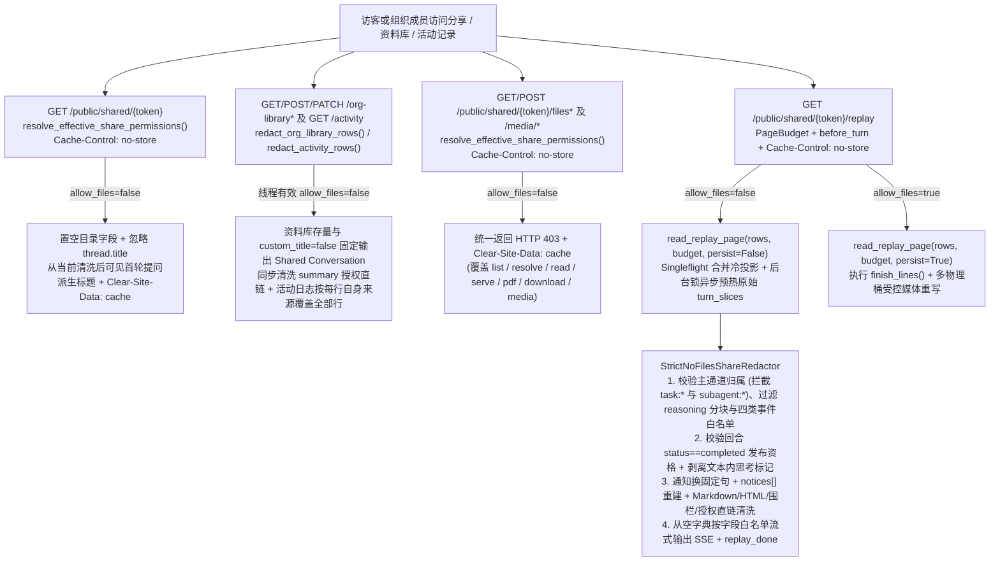

# 公开分享脱敏设计方案（AU1，安全）

> **文档状态**：定稿（r8 定稿版，已收口 r7 审查唯一高优先级问题并落实 §7 用户拍板决定：只要转写任务票据由开发回退种子 `dalton-local-dev-transcription-ticket-seed:*` 签发，无论是否配置 `LANGALPHA_OWNER_SECRET`，`/result` 与 `/result/raw` 只接受本机回环且非经反代的请求，用独立随机密钥签发的票据照常使用，`S19` 补齐「配了属主密钥 + 开发回退票据 + 远程请求 → 401」用例；§7 确认用户已选方案 A〔整桶私有，只放行头像〕，Everflow 生产唯一存储桶为仅监听 `127.0.0.1` 的本机 MinIO `dalton-asr` 且匿名读取已返回 `403`，生产无需改桶设置、上线后跑一次 `--verify`，方案 B 及存量前缀迁移只在安装说明中一句带过、不进第 1 批开发；同步更新第 9 节定稿一致性自查）
> **关联文档**：[external-member-permissions.md](./external-member-permissions.md)、[colleague-agent-access.md](./colleague-agent-access.md)、[standalone-core.md](./standalone-core.md)、[brand.md](./brand.md)

---

## 0. 核心定案、发布边界与入口处理总表

### 0.1 九项设计定案与内容发布边界

当公开分享或组织内链接分享的有效文件权限为 `allow_files=false`（文字分享模式）时，服务端在响应出口按只读白名单实时重建出站数据，存量分享链接在下次访问时立即生效。全链路执行以下九项定案：

1. **仅发布正常结束回合的模型最终文字回答、前置丢弃思考分块并剥离文本内思考标记**：工具调用、工具结果、过程产物与 CoT（Chain of Thought，模型思考链）整段省略。服务端首先按回合持久化状态校验发布资格，**仅提取正常结束回合（`status == "completed"`、零在途运行且回合内零主通道 `error` 或 `stopped` 收尾帧）的主智能体最终文字回答**；失败回合、用户或系统中止回合、以及运行中或等待审批的未完成回合，统一丢弃助手过程残段并输出对应状态的固定说明文案。提取最终回答前，先对 `message_chunk` 限定 `role == "assistant"` 且 `content_type` 属于 `("text", None)`，前置丢弃全部 `content_type` 为 `"reasoning"` 或 `"reasoning_signal"` 的思考分块；再按 Phase（模型输出阶段标记，区分 `commentary` 过程旁白与 `final_answer` 最终回答）提取结论段，无阶段标记的正常结束回合仅提取回复周期最末尾且其后零工具调用、零工具结果的连续主智能体 `text` 段；合并最终回答文本后调用 `strip_inline_thinking_markers`，按已知标记格式全文剥离任意位置、任意长度的 `<thinking_mode>…</thinking_mode>`、`<thinking>…</thinking>`、末尾未闭合思考起始残段与 `NEED MORE THINKING` 引导段落。阶段切分函数 `split_content_blocks_by_phase` 实现于 Dalton 独占模块并登记入投影摘要源，上游 `projector.py` 仅留一行 `DALTON-HOOK(share-redaction)`（Dalton 在上游源码中标注的差异挂载点注释）委托调用。**正常结束回合清洗后的模型最终回答文字即为分享内容的发布边界**，分享面板固定展示提示语「分享内容包括模型回答的全部文字」。
2. **全量图片静态占位、`mermaid` 等富渲染围栏按代码文本显示、HTML 资源属性剥离与产物授权直链清洗**：服务端采用完整 Markdown（轻量级标记语言）AST（Abstract Syntax Tree，抽象语法树）解析器配合 HTML（HyperText Markup Language，超文本标记语言）白名单重建器处理主智能体最终回答、普通用户提问与普通中途插话正文：将行内图片、引用式图片以及原始 HTML ``、`<picture>`、`<svg>`（Scalable Vector Graphics，可缩放矢量图形）内 `<image>` / `<feImage>`、`<input type="image">` 统一改写为经前端 `Markdown.tsx` 消毒链验证的 `<redacted-image alt="..."></redacted-image>` 标签；对 Markdown 输出字段与 HTML 属性同步执行白名单重建，**统一丢弃行内链接与引用式链接的 `title` 附属字段，将公开引用式链接展开为无 `title` 行内链接并移除全部引用定义行（含悬空定义行），对围栏代码块 `info`（Code Fence Info String，代码围栏信息串）仅保留纯语言名标识，将 `mermaid`（基于文本的图表描述语法与渲染引擎）等会在渲染时发起图片请求的富渲染围栏统一改写并按纯代码文本显示（前端同步跳过图表渲染器直接走代码文本高亮）**；剥离 HTML 白名单标签的 `title`、`aria-*` 等自由文本属性以及全部可加载资源的 HTML/SVG 属性（`src`、`srcset`、`imagesrcset`、`poster`、`background`、`data`、`data-*`、`xlink:href`、SVG `href`、`ping`、`action`、`formaction` 等）与 `style` 属性（阻断 CSS〔Cascading Style Sheets，层叠样式表〕内 `url()`、`image-set()` 与 `@import` 请求，消除 DOM〔Document Object Model，文档对象模型〕属性残留）；**将携带 Bearer Grant（持有即生效的路径授权凭据）的产物版本直链（`/api/v1/artifacts/g/…`、`artifact-{id}.{preview_base}/g/…`）、监控帧授权直链（`/api/v1/dalton/monitors/g/…`）及 Capability Host（主机名内嵌访问凭据的子域名，`{port}-{token}.{preview_base}`）全部纳入受保护地址识别与擦除范围**（同时保留 `/a/{code}` 独立发布页面短链自身的实时权限校验语义），将指向图片或受保护地址的链接降级为纯文本。
3. **分流前统一事件白名单、通知正文固定句与批注块清除**：严格模式下全部回放条目（含 `user_message`、Subagent〔子智能体〕事件、历史 `verbatim` 原样归档条目与存根回退条目）在进入 SSE（Server-Sent Events，服务端推送事件）序列化分流前，统一校验 `agent` 归属主通道并匹配四类事件白名单，随后从空字典按字段白名单构造输出；`query_type` 为 `wakeup` 或 `market_target` 的用户消息，以及 `steering_delivered` 中携带 `wakeup` 或 `market_alert` 的通知插话，其 `content` 统一替换为固定句 `"[定时唤醒触发]"` 或 `"[行情提醒触发]"`（去除模型提示词中的标签、Cron〔定时任务周期表达式〕、标的代码、目标价格与券商订单号），普通用户提问与普通用户插话保留清洗后的原文；正文中的 `<file-comments>…</file-comments>` 文件批注原文块与 `<system-reminder>…</system-reminder>` 块统一移除。
4. **全渠道安全标题（资料库固定通用标题、公开页取当前可见提问）、资料库 `summary`（条目摘要）清洗、活动日志全行治理与嵌套通知白名单**：文字分享模式下 Widget（内联交互组件）静态占位卡仅下发 `{"redacted": true}` 并渲染通用标题；公开元数据接口忽略 `conversation_threads.title`，仅从当前已清洗的可见首轮普通提问纯文本截取前 60 字符派生展示标题（空值、通知或纯批注会话统一输出 `"Shared Conversation"`）；**组织资料库（Organization Library）全量读写响应对迁移前存量条目与未显式保存标题的条目（`custom_title=false`）在 `allow_files=false` 下一律固定输出通用标题 `"Shared Conversation"`（完全脱离 `conversation_threads.title` 与可被编辑替换的 `queries[0]`），仅在升级后发布者显式提交非空标题保存后记录 `custom_title=true`，同时在 `redact_org_library_rows` 中对存量及降权条目的 `summary` 同步移除 `<file-comments>` 并擦除产物版本授权直链、预览凭据与敏感路径（覆盖成员列表、单条查询、管理台及发布/编辑写响应）**；活动日志写入口逐行记录标题显式来源标记，查询出口 `GET /api/v1/activity` 直接引用 `Action` 枚举（`library.item_published`、`library.item_updated`、`library.item_removed`）按每条记录自身来源判定标题，并对接口返回的**全部活动行**执行 `detail` 敏感路径与受保护引用擦除；唤醒与行情提醒元数据按真实嵌套结构逐条重建 `notices[]` 与单条 `wakeup` / `market_alert`，严格只保留 `kind`、`notice`、`seq`、`total`、`last`、`skipped`、`fired_at`、`timezone`、`target_id` 九个字段。
5. **三类存储后端按物理桶去重全前缀私有化、无密钥单人 `oss` 统一身份本机直连门控与受控媒体鉴权**：独立解析**上游主存储桶**（`STORAGE_*` / `OSS_*`）、**聊天大文件与渠道快照存储桶**（优先 `DALTON_CHAT_UPLOAD_STORAGE_*` 独立桶，缺省回退 `DALTON_ASR_STORAGE_*`〔ASR 为 Automatic Speech Recognition，自动语音识别〕存储桶）以及**独立启用的语音转写存储桶**（`DALTON_ASR_STORAGE_*`，无论专用附件桶是否同时配置均独立解析），再按物理桶合并去重（最多三个独立物理桶）；对主桶新捕获沙箱图片、内联与分片附件、大体积组件数据以及原位保留键名的工作区备份 `blobs/`、上传暂存 `uploads/`、**溢出大工具结果 `provenance/`、备忘录原始二进制 PDF（Portable Document Format，便携式文档格式）`memo/`、技能归档 `user-skills/` 与 `org-library/`**，附件桶大文件分片上传与**私聊/渠道图表快照 `channel-snapshots/`**，以及独立或回退转写桶的**转写音频/结果 `transcriptions/` 与暂存 `uploads/`**，在单次写入与分片初始化时统一附加对象级私有 ACL（Access Control List，访问控制列表），方案 B 桶策略同步对去重后各物理桶的全部上述敏感前缀配置显式匿名 `Deny`；**在统一身份依赖（`jwt_bearer`、`api` 与 `ws_auth` 中 `HOST_MODE == "oss"`〔Open-Source Self-hosted，单人开源自托管模式〕且认证模式为 `oss` 的分支）统一校验请求是否来自可信本机：未设置 `LANGALPHA_OWNER_SECRET` 时，仅接受来自本机回环传输对端且未经边缘反向代理转发的直连请求，远程或经边缘反代的无密钥请求对全部属主读接口、工作区文件、`download-url`、`messages/stream` 与 WebSocket（全双工长连接通信协议）握手一律返回 HTTP（HyperText Transfer Protocol，超文本传输协议）`401`（详见第 8 节「无密钥单人模式的访问边界」）**；属主媒体入口在多用户模式下校验 JWT（JSON Web Token，JSON 网络令牌）与实时会话读取权，在单人 `oss` 下对 `dalton_oss_media_session` Cookie（浏览器 HTTP 会话凭据）签发执行三重可信来源校验（可信本机/属主密钥 + 受信任主应用 Origin〔请求源站，由协议、主机名与端口三元组构成〕精确匹配 + Fetch Metadata〔浏览器请求元数据头，如 `Sec-Fetch-Site` 与 `Sec-Fetch-Mode`〕校验），并在属主媒体读取时同时校验有效 Cookie 与受信任同源或显式 CORS（Cross-Origin Resource Sharing，跨源资源共享）源站头，同主机其他端口携带 Cookie 请求统一返回 `401`；多桶迁移在校验字节与摘要后原子更新数据库 `object_key` 与对账表再删除旧键，实测全部实际物理桶的全量敏感前缀与迁移目标键匿名 `GET` 返回 `403`，已删旧键在源站与 CDN（Content Delivery Network，内容分发网络）返回 `403` 或 `404`。
6. **公开响应 `no-store`、旧实例下线后 60 秒排空切换生效条件与 Dalton 图片缓存模块**：全部公开元数据、回放、5 条工作区文件路由（含预览与 PDF 导出）及受控媒体路由统一返回 `Cache-Control: no-store`；新版客户端全部公开请求显式传 Fetch API（浏览器原生网络请求接口）`{ cache: 'no-store' }`，服务端在 `allow_files=false` 元数据及公开文件 `403` 响应中附带 `Clear-Site-Data: "cache"` 清空已访问新版页面浏览器的同源缓存；发布流程将**全部旧版后端实例下线满 60 秒 TTL（Time To Live，缓存存活时长）排空窗口**定为升级前 `private, max-age=60` 浏览器本地私有缓存的切换生效条件；前端 `staleTime`（React Query 数据保鲜时长配置）设为 `0`，分享图片缓存分键、代次与撤销状态机集中收进 Dalton 独占模块 `web/src/lib/dalton/sharedImageCache.ts`，上游 `WorkspaceImage.tsx` 仅留薄委托调用。
7. **文件、解析与下载路由统一门控**：元数据、回放、文件列表（`/files`）、路径解析（`POST /files/resolve`）、文本读取（`/files/read`）、原始下载（`/files/download`）、内联服务（`/files/serve/{path}` 及 `?format=pdf`）与受控媒体路由共用单一有效权限函数；有效 `allow_files=false` 时全部文件与媒体路由统一返回 `403`，消除存量 `allow_files=false, allow_download=true` 冲突记录的下载旁路。
8. **分享面板仅读存储行统计、公开回放分页字节预算与冷投影并发预热管线**：待隐藏项摘要仅在展开分享面板时请求，只扫描已落盘数据库行，调用 `finish_lines`、对象存储 I/O（Input/Output，输入输出）与 `CheckpointHistoryReader` 的次数均为 `0`；公开回放引入显式分页预算 `PUBLIC_SHARE_PAGE_BUDGET`（默认单页上限 `32 MiB` / `200` 回合，支持 `before_turn` 游标分页与 `history_page` 帧），`allow_files=false` 请求主路径传 `persist=False` 保持只读、跳过 `finish_lines`、对大体积 `tool_calls` / `tool_call_result` 走顶层标量扫描免除整串 JSON（JavaScript Object Notation，JavaScript 对象表示法）反序列化，同时在开启分享与上线脚本中预热活跃分享 `turn_slices`，并通过进程内 Singleflight（并发单飞合并机制，同键并发请求共享单次计算结果）配合后台分布式锁异步回填原始 `turn_slices`，消除升级推进 `lines_epoch()` 后的并发重复冷投影。
9. **三真实物理桶、三认证模式、无密钥单人边界、并发冷回放量化门槛与真实浏览器全栈哨兵验收**：验收套件直连真实 FastAPI（Python 异步 Web 框架）路由、真实 PostgreSQL（开源关系型数据库）、真实物理 MinIO（开源兼容 S3〔Simple Storage Service，通用对象存储协议〕对象存储服务）三存储桶（同时覆盖主桶 + 专用附件桶 + 独立 ASR 桶三桶并存与 ASR 回退桶拓扑）及真实 Chromium（开源浏览器内核）浏览器（零契约桩），覆盖 `S01`–`S19` 全量哨兵（含存量资料库 `summary` 授权直链擦除、三桶全前缀源站/CDN 匿名 `GET` `403`、远程无密钥单人模式五项属主请求与 WebSocket 全量 `401`）、`B1`–`B9` 边角回归、双独立浏览器缓存窗口实测，以及升级后 10 路并发冷回放的 TTFB（Time To First Byte，首字节响应时间）与峰值内存量化门禁。

### 0.2 数据入口与事件通道处理总表

| 数据入口 / 事件通道 | 代码位置（`文件:行号`） | `allow_files=false` 服务端处理方式 | `allow_files=false` 前端展示效果 | `allow_files=true` 行为 |
|---|---|---|---|---|
| 分享元数据接口 `GET /api/v1/public/shared/{share_token}` | `src/server/app/public.py:214-295` | 调 `resolve_effective_share_permissions` 计算有效权限；将 `root_dir`、`dir_name` 置为 `None`，`previous_root_dirs` 置为 `[]`；忽略 `thread.title`，调 `resolve_safe_share_title` 从当前清洗后可见首轮提问派生标题（为空回退 `"Shared Conversation"`）并擦除 `workspace_name` 路径前缀；设 `Cache-Control: no-store` 与 `Clear-Site-Data: "cache"` | 展示派生安全标题或通用标题，隐藏顶栏文件面板开关；请求带 `cache: 'no-store'` 且 `staleTime=0`，挂载、聚焦、可见性恢复时立即重验，降权立即清空旧视图与缓存 | 返回原始目录信息与完整文件权限，响应头保持 `no-store` |
| 组织资料库全接口与活动日志接口 `POST/PATCH/DELETE/GET /api/v1/org-library*`、`GET /api/v1/activity` | `src/server/database/org_library.py:180-296`<br>`src/server/services/org_library.py:55-106,216-258`<br>`src/server/app/org_library.py:142-386`<br>`src/server/services/activity.py:48-139`<br>`src/server/app/activity.py:24-46` | 资料库迁移前存量条目与 `custom_title=false` 条目统一输出固定通用标题 `"Shared Conversation"`，仅升级后显式提交非空 `title` 才记 `custom_title=true`；**`redact_org_library_rows` 同步对存量及降权条目的 `summary` 移除 `<file-comments>` 并调 `scrub_protected_references` 擦除产物授权直链、预览凭据与敏感路径（覆盖列表、`/published`、`/service` 与写响应）**；写活动日志逐行标记 `detail.custom_title`；`GET /api/v1/activity` 调 `redact_activity_rows` 匹配 `Action` 枚举按每行自身来源重算标题，并对**全部活动行**清洗 `detail` 敏感路径与受保护引用 | 组织成员、管理台、发布者写响应及活动审计调用方对未显式命名条目统一看到 `"Shared Conversation"`，存量摘要降权后零授权直链与敏感路径残留，后续补存显式标题时早期旧活动行仍保持 `"Shared Conversation"` | 展示原始会话标题、原始摘要或显式发布标题 |
| 工作区文件、解析与下载路由 `GET/POST /api/v1/public/shared/{share_token}/files*`（含 `POST /files/resolve`、`download` 与 `serve?format=pdf`） | `src/server/app/share_access.py:201-252`<br>`src/server/app/share_files.py:239-479`<br>`src/server/app/workspace_files/serve.py:112,300,374` | `resolve_shared_files` 统一先校验有效 `allow_files`（为假时对列表、`POST /files/resolve`、读取、内联预览、PDF 与下载统一返回 `403` 并附带 `Cache-Control: no-store`、`Clear-Site-Data: "cache"`），下载再叠加校验有效 `allow_download` | 新客户端请求带 `cache: 'no-store'` 直接收到 `403`；打开过新版分享页或满旧实例下线后 60 秒排空窗口的浏览器直访旧预览与 PDF 地址均回源收到 `403` | 按有效权限开放浏览、密钥脱敏与下载，全部公开文件响应覆盖 `Cache-Control: no-store` |
| 单人 `oss` 统一身份边界与受控会话媒体入口 `GET /api/v1/public/shared/{share_token}/media/{media_ref}`、属主 `GET /api/v1/threads/{id}/media/{media_token}` | `src/dalton/auth/dispatch.py:562-679`<br>`src/server/auth/jwt_bearer.py:220-264`<br>`src/server/utils/api.py:188-301`<br>`src/server/auth/ws_auth.py:49-64`<br>`src/dalton/share_media.py`（新建）<br>`src/dalton/channel_snapshot_storage.py:157-208` | 三类逻辑存储后端按物理桶去重（主桶、附件桶、独立 ASR 桶），单次与分片写入附加私有 ACL，方案 B 对 `private-media/*`、`blobs/*`、`uploads/*`、`provenance/*`、`memo/*`、`user-skills/*`、`org-library/*`、`channel-snapshots/*`、`transcriptions/*` 全量配置匿名 `Deny`；**统一身份依赖在单人 `oss` 无密钥时仅接受本机回环且非经边缘反代的直连请求，远程或经反代的无密钥请求对属主读接口、工作区文件、`download-url`、`messages/stream` 与 WebSocket 一律返回 `401`**；属主媒体读取同时校验 Cookie 与受信任同源/CORS `Origin`；公开媒体校验有效 `allow_files=true` | 远程或经边缘反代无密钥访客持 `thread_id` 请求属主接口与 WebSocket 统一收到 `401`；降权或关闭分享后公开媒体立即返回 `403`/`404`；同机其他端口携带 Cookie 请求属主媒体返回 `401`，本机受信任跨端口主应用以 `credentials: 'include'` 正常加载 | 按实际物理桶分派读取（大文件走 `4 MiB` 分块流式传输，补齐仅存 `upload_id` 的历史附件地址）；前端拼接 API（Application Programming Interface，应用程序编程接口）源站加载 |
| 分享回放接口 `GET /api/v1/public/shared/{share_token}/replay` | `src/server/app/public.py:327-400`<br>`src/server/services/history/replay/__init__.py:148-180,565-644`<br>`src/server/services/history/replay/cold.py:50-115` | 传入 `PUBLIC_SHARE_PAGE_BUDGET` 与 `before_turn` 分页；严格模式主路径传 `persist=False`、跳过 `finish_lines`、冷投影走 `Singleflight` 合并并后台异步预热 `turn_slices`；大工具帧走顶层标量扫描，经 `StrictNoFilesShareRedactor` 逐回合流式输出；设 `Cache-Control: no-store` | 仅接收分页头（超长会话）、清洗后提问/插话、固定句通知分隔行、正常结束回合最终文字回答（失败/中止回合为固定说明）、静态占位事件与 `replay_done` | 保持默认 `persist=True` 结合分页预算回填 `turn_slices`，执行 `finish_lines`、重写多物理桶受控媒体地址并执行通知固定句与原有 `ShareRedaction` |
| 内联组件事件 `artifact`（`artifact_type="html_widget"`） | `src/ptc_agent/agent/tools/show_widget.py:290-397`<br>`src/server/services/history/projector.py:495-516`<br>`web/src/pages/ChatAgent/components/viewers/InlineWidget.tsx:47-140` | 仅在正常结束回合保留组件位置，剥离 `payload.html`、`payload.data`、`payload.data_ref` 与工具参数 `payload.title`，固定下发 `{"redacted": true}` | 原位置渲染通用标题静态占位卡（“交互组件已隐藏”），零挂载 `<iframe>`（内联框架元素） | 正常内联数据并在沙箱化 `<iframe>` 中渲染交互组件 |
| 工具调用、过程产物、子智能体与思考分块 | `src/server/services/history/projector.py:137-249,298-482`<br>`src/server/services/history/replay/legacy.py:217-356` | 分流前统一校验 `agent in (None, "", "main")` 为主通道，丢弃全部 `task:*` 与 `subagent:*` 事件、`tool_calls`、`tool_call_result`、非组件 `artifact`、`message_chunk(content_type="reasoning" \| "reasoning_signal")`、`context_window`、`credit_usage`、`error` 及未知归档事件 | 页面仅展示问答主线，省去工具折叠栏、代码块差异、内联数据卡与思考链 | 原样下发主智能体工具时间线与思考链 |
| 主智能体最终文字回答、思考标记剥离与 Markdown/HTML/围栏清洗 `message_chunk(text)` | `src/dalton/history_phase.py`（新建）<br>`src/server/services/history/projector.py:322-351`<br>`src/server/utils/thinking_leak.py:34-60`<br>`web/src/pages/ChatAgent/components/Markdown.tsx:39-71,205,238` | 仅对正常结束回合提取 `content_type in ("text", None)` 的 `final_answer` 段（无阶段取末尾零后续工具 `text` 段），合并后调 `strip_inline_thinking_markers` 剥离全部文本内思考标记；图片转 `<redacted-image>`，`mermaid` 等围栏降级为 `text` 代码显示并擦除内部图片地址，剥离链接 `title`、引用定义、围栏附加 `info`、HTML 资源属性与 `style`，擦除产物授权直链、预览凭据与宿主机路径 | 展示完整最终回答文字或失败/中止固定说明；`mermaid` 按普通代码块展示，图片处渲染静态占位框，SSE 与 DOM 属性中均零受保护地址残留、零子资源请求 | 原样展示各阶段文字、渲染 `mermaid` 图表并通过受控媒体地址加载图片 |
| 用户提问、插话与嵌套系统通知 `user_message`、`steering_delivered` | `src/server/app/public.py:358-400`<br>`src/server/services/wakeups/delivery.py:427-433`<br>`src/server/services/wakeups/inline.py:84-89`<br>`src/server/services/market_targets/message.py:80-127` | 通知类消息与通知插话 `content` 替换为固定句 `"[定时唤醒触发]"` 或 `"[行情提醒触发]"`；普通提问与插话删 `<file-comments>` 并执行完整 Markdown/HTML 清洗（含产物授权直链擦除与 `mermaid` 纯代码显示）；按真实嵌套结构逐条重建 `notices[]` 与单条 `wakeup`/`market_alert`，只留 9 个白名单字段 | 普通提问正常展示；唤醒与行情提醒仅由受限嵌套字段渲染通用时间分割条，零暴露标签、Cron、标的、价格或订单号 | 展示附件卡片、K 线框选快照、组件快照与文件批注，通知插话正文同步隐去订单详情 |
| 分享面板提示、仅读存储行统计与分受众预览 | `src/server/app/threads/sharing.py:273-309`<br>`web/src/pages/ChatAgent/components/ShareButton.tsx:30`<br>`web/src/pages/ChatAgent/components/ThreadSharePanel.tsx:173,384-489` | `GET /api/v1/threads/{id}/share?include_summary=true` 仅扫描已落盘数据库行统计数量（对大工具行用顶层标量扫描，调用 `finish_lines`、对象存储与检查点读取器的次数全为 `0`）；开启分享时后台预热 `turn_slices` | 面板展示「分享内容包括模型回答的全部文字」及待隐藏项统计；公开受众带 `?as=visitor` 预览，组织受众复用成员会话直开 | 管理员开启 `allow_files=true` 时切换为完整文件分享说明 |

---

## 1. 现状盘点：回放数据来源与 `allow_files=false` 泄露路径

### 1.1 分享访问的数据链路与回放源

公开与组织内会话分享涉及五条服务端读取链路：

1. **会话元数据读取**：`SharePage.tsx:95` 请求 `GET /api/v1/public/shared/{share_token}`（`src/server/app/public.py:214-295`）。公开链接对访客放行；组织内链接（`audience="organization"`）经 `_shared_thread_for`（`:298-320`）校验登录成员资格并签发短期 Grant（短期访问凭据，`member_grant.token`），后续回放与文件请求以该凭据代位传入 `{share_token}` 路径参数（`src/server/app/share_access.py:68-85`）；独立发布文件或应用短链 `/a/{code}` 则经 `resolve_link`（`:235`）校验 `share_links` 表实时状态。
2. **组织资料库读写与组织活动日志链路**：成员将已开启分享链接的会话发布到组织资料库（`POST /api/v1/org-library`，`src/server/database/org_library.py:180-250`），或编辑、撤下条目（`PATCH/DELETE /api/v1/org-library/{item_id}`，`src/server/services/org_library.py:216-258`），表 `org_library_items` 同时持久化 `title` 与 `summary`（最多 1000 字符），写操作通过 `activity.record` 以枚举值 `Action.LIBRARY_PUBLISHED`（`"library.item_published"`）、`Action.LIBRARY_UPDATED`（`"library.item_updated"`）、`Action.LIBRARY_REMOVED`（`"library.item_removed"`，`src/server/services/activity.py:64-69`）将条目 `title` 写入 `activity_events` 表（其他共享、产物与连接器操作同步写入各自 `Action` 记录）；组织成员、管理台及发布写响应通过 `GET /api/v1/org-library`、`/api/v1/org-library/published`、`/api/v1/org-library/service` 与 `POST/PATCH` 返回值（`src/server/app/org_library.py:142-375`）读取 `title` 与 `summary`，活动审计通过 `GET /api/v1/activity`（`src/server/app/activity.py:24-46`）读取记录。
3. **工作区文件、产物版本授权、沙箱预览与下载链路**：`GET /files`、`POST /files/resolve`、`GET /files/read`、`GET /files/download` 与 `GET /files/serve/{path}`（含 `?format=pdf`，`src/server/app/share_files.py:239-479`）调用 `resolve_shared_files`（`src/server/app/share_access.py:201-252`），内联预览与 PDF 复用了 `src/server/app/workspace_files/serve.py:112,300,374` 的 `_WSFILES_CACHE_CONTROL = "private, max-age=60"`；此外，产物版本与沙箱预览还会签发路径或子域内嵌凭据的直链，包括 API 源站的 `/api/v1/artifacts/g/{grant}/v/{seq}/{path}`（`src/server/app/artifact_frames.py:34`）、独立预览基址下的 `artifact-{artifact_id}.{preview_base}/g/{grant}/...` 与 `{port}-{token}.{preview_base}/`（`src/server/services/preview_base.py:57-97`、`src/server/preview_proxy/artifacts.py:233`）。
4. **会话媒体、非媒体敏感对象与三类独立对象存储后端链路**：
   - **上游主对象存储桶（`STORAGE_*` / `OSS_*`）**：存放沙箱捕获图（`image_capture.py`）、内联附件（`multimodal_context.py`）、上游暂存对话附件 `attachments/{attachment_id}/{segment}`（`src/server/services/chat_attachments.py:265-512`）、大组件数据（`show_widget.py`），以及原位按内部键名读写的**工作区备份与产物版本/转录对象 `blobs/{user_id}/{sha256}`、待恢复工作区上传暂存 `uploads/{user_id}/{upload_id}`（`src/server/database/blob_keys.py:15-105,158-171`）、超过 64 KiB 溢出落桶的大工具结果正文 `provenance/{sha256}`（`src/server/database/provenance_bodies.py:96-110`）、用户备忘录原始 PDF `memo/{user_id}/{uuid}.pdf`（`src/server/services/memo_binary_storage.py:81-89`）和技能快照归档 `user-skills/{user_id}/{hash}.zip` / `org-library/{org_id}/{hash}.zip`（`src/server/services/skill_archive_storage.py:54-76`）**；
   - **Dalton 聊天大文件与渠道图表快照存储桶**：`src/dalton/chat_upload_storage.py:28-142` 优先使用独立的 `DALTON_CHAT_UPLOAD_STORAGE_*` 存储桶，未配齐四项主变量时回退至 `DALTON_ASR_STORAGE_*` 存储桶，承载分片上传附件 `<chat_prefix>chat-uploads/{workspace_id}/{upload_id}/{safe_filename}`（查询历史中仅存 `upload_id`）及**私聊/渠道图表快照 `<chat_prefix>channel-snapshots/{thread_id}/{sha16}/chart_{layer_id}.png`（`src/dalton/channel_snapshot_storage.py:29,157-208`）**；
   - **独立启用的语音转写存储桶（`DALTON_ASR_STORAGE_*`，`src/dalton/transcription_storage.py:24-98`、`src/dalton/services/transcriptions.py:164-212`）**：当专用附件桶 `DALTON_CHAT_UPLOAD_STORAGE_*` 与语音转写 `DALTON_ASR_STORAGE_*` 同时启用且指向不同桶时，转写服务仍将源音频与结果写入第 3 个独立物理桶的 `<asr_prefix>transcriptions/{workspace_id}/{job_id}/...` 与 `<asr_prefix>uploads/{workspace_id}/...`。
5. **对话历史回放流**：`SharedChatView.tsx:172` 请求 `GET /api/v1/public/shared/{share_token}/replay`（`src/server/app/public.py:327-380`），由 `get_replay_thread_data` 与 `read_replay_page`（当前未传 `PageBudget` 分页预算，一次加载整条线程，`src/server/services/history/replay/__init__.py:565-580`）组装 `Line` 列表，包含三种存储回放源：
   - **路径 A（热缓存 `turn_slices`）**：`_stored_lines`（`replay/__init__.py:686-717`）读取 `turn_slices.lines` 中已落盘的 `Line(event, flags, data_json)`（`lines.py:24-65`）；
   - **路径 B（冷检查点投影）**：缓存缺失或 `lines_key` 随 `projection_sources()` 推进时，经 `CheckpointHistoryReader` 从 LangGraph（智能体状态图编排框架）Checkpoint（状态检查点）切片按 `PROJECT_BATCH=16` 批次执行 `project_turn`（`cold.py:44-160`、`projector.py:99-249`）；
   - **路径 C（存根与归档流回退 `stub_lines`）**：缺少检查点锚点或单回合投影异常时，回退至 `stub_page` → `stub_lines`（`stubs.py:21-130`）重放 `conversation_responses.replay_facts` 归档事件。

### 1.2 代码核实的 11 类泄露与旁路清单

经逐行核对前后端源码，现有实现及边界路径在 `allow_files=false` 下存在以下 **11 类泄露或权限旁路**：

| 编号 | 暴露内容与风险路径 | 后端产生与组装位置（`文件:行号`） | 现有放行缺口（`文件:行号`） | 前端接收与触发位置（`文件:行号`） |
|---|---|---|---|---|
| **L1** | **组件 HTML 源码、工作区文件数据与工具设置的组件 `title`** | `ShowWidget`（`src/ptc_agent/agent/tools/show_widget.py:290-397`）将工具入参 `title`、`html` 及沙箱文件内容存入产物；`finish_lines`（`widgets.py:19-53`）调用 `get_bytes` 拉取对象字节；`tool_call_result.data.artifact`（`projector.py:424,434`）携带完整副本 | `public.py:348` 无条件执行 `finish_lines`；`share_redaction.py:277-308,355-369` 原样保留 `html`、`data`、`data_ref` 与 `title` | `SharedChatView.tsx:299-316` 写入状态并由 `InlineWidget.tsx:99-109` 挂载 `<iframe>` 注入 `srcDoc` 与 `window.__WIDGET_DATA__` |
| **L2** | **`user_message` 分流绕过导致 `task:*` 子智能体输入正文与全量子智能体轨迹出站** | `projector._project_human_message`（`projector.py:215-227,298-308`）将子智能体任务指令投影为 `event="user_message", agent="task:<id>"`；`turn.py:140-141` 合并 `run_lane` 子智能体轨迹 | `public.py:359-360` 对 `event_type == "user_message"` 直接走 `_shared_user_message` 绕过 `redaction.event()`，使子智能体指令与 `task:*` 事件进入 SSE 响应流 | `SharedChatView.tsx:191-193` 仅在界面层跳过渲染，原始网络响应字节已暴露子智能体指令与文件读取结果 |
| **L3** | **紧邻最终回答的 `reasoning` 分块、正文中段或超窗口的内嵌思考标记、工具前旁白及失败/中止残段** | `projector.py:137-164` 将思考链编码为无 `finish_reason` 的 `event="message_chunk", content_type="reasoning"\|"reasoning_signal"`；`thinking_leak.py:45,70` 仅剥离消息开头 `OPENING_HOLD_LIMIT=2000` 窗口内的 `<thinking>` / `<thinking_mode>` / `NEED MORE THINKING`；`stubs.py:96-112` 与 `stopped.py:15-63` 在失败或中止回合保留无阶段 `partial` 残段 | ① 选末段时若未先限定 `content_type == "text"`，紧挨最终回答前的无 `finish_reason` 思考分块会随末段一并发出；② 位于正文中段或超过 2000 字符的思考标签随普通文字出站；③ 漏判回合 `status=="completed"` 会放出失败/中止草稿 | `SharedChatView.tsx:219-250` 接收思考链或展示残留 `<thinking>` 内容与未完成草稿 |
| **L4** | **主智能体工具参数、工具结果、派生过程产物与压缩摘要** | `projector.py:165-214,352-482` 投影 `tool_calls`（含 `Write.content`、`Edit`、`ExecuteCode.code`）、`tool_call_result`（含 `Read` 文件全文、`chart_layers`）、过程 `artifact` 与 `context_window.summary_text` | `share_redaction.py:277-386` 仅清空秘书工具、`la` 命令与订单调用，其余工具参数、结果与压缩摘要全量出站 | `SharedChatView.tsx:271-294,319-355` 渲染文件差异与内联过程卡片 |
| **L5** | **自定义域名图片、`mermaid` 围栏 SVG 内嵌图片请求、HTML 资源属性、链接 `title` 等附属字段与产物/预览授权直链** | 正文可含行内/引用式图片、HTML 资源属性与 `style="background:url(...)"`、带受保护 URL（Uniform Resource Locator，统一资源定位符）的链接 `title`/引用定义/围栏 `info`、**含 `` 节点标签的 ```` ```mermaid ```` 代码围栏**，以及**已签发的产物授权直链 `/api/v1/artifacts/g/{grant}/...`、`artifact-{id}.{preview_base}/g/{grant}/...` 与预览主机名凭据 `{port}-{token}.{preview_base}`**（`preview_base.py:57-97`、`preview_proxy/artifacts.py:233`） | ① `Markdown.tsx:205,238` 调用 `MermaidDiagram.tsx:16-24,50` 渲染 SVG 时仅删除 `video`/`audio`，保留 `foreignObject`（SVG 内嵌外部 HTML 命名空间容器元素）内的 `` 触发浏览器图片请求；② 产物授权直链与主机名凭据按普通 HTTPS 外链出站；③ `Markdown.tsx:392-406` 透传 `<a title="...">` | 访客浏览器通过 `mermaid` SVG、`` 或 CSS `url()` 发出图片请求，或从 SSE 与 DOM 中获取产物/预览 Bearer 凭据及受保护路径 |
| **L6** | **用户消息与插话中的 `chart_selections`、无元数据的 `<file-comments>`、附件与组件快照** | `ptc_run.py:645-679` 向 `query_metadata` 写入 `attachments`、`widget_contexts`、`chart_selections`（含批注与 OHLCV〔Open-High-Low-Close-Volume，开高低收量 K 线数据〕`bars`）和 `artifact_comments`；`comments.py:302-330` 将 `<file-comments>` 拼入 `content` | `share_redaction.py:46-48,257-274` 仅删 3 个键，`chart_selections`、`attachments`、`widget_contexts` 及缺失元数据的 `<file-comments>` 原样出站 | `historyHandlers.ts:184-190,308-338` 渲染 K 线框选卡、附件、组件快照及 `<file-comments>` 原文 |
| **L7** | **存库通知正文、嵌套 `notices[]`、编辑首轮后残留的旧批注标题、资料库存量标题与 `summary` 授权直链、活动日志动作/旧行漏洗** | ① `wakeups/delivery.py:427-433` 与 `market_targets/message.py:80-127` 写入提示词 `content` 与嵌套 `notices[]`；② `comments.py:509-512` 用无备注批注正文生成 `conversation_threads.title`，且**编辑首轮提问（`threads_write.py:538-548`）可替换为普通提问同时保留旧 `conversation_threads.title`**；③ `database/org_library.py:202,227,260` 写入 `title` 与 `summary`，`app/org_library.py:142-168` 原样返回 `row["summary"]`，`activity.py:64-69` 存库动作名为 `library.item_published/item_updated/item_removed` | ① 按当前 `queries[0]` 为普通提问即信任 `thread.title` 会重新放行编辑首轮前留下的批注派生标题；② **资料库关联会话降为 `allow_files=false` 后，存量 `summary` 中的有效产物授权直链与敏感路径仍原样返回给列表、管理台与写响应**；③ 活动日志按条目当前 `custom_title=true` 判定会掩盖早期自动标题旧活动行 | SSE 与分割条暴露通知详情；公开元数据、组织资料库 `title`/`summary` 与 `GET /api/v1/activity` 暴露批注标题、存量授权直链或历史自动标题 |
| **L8** | **整桶公开读下 `provenance/`、`memo/`、`channel-snapshots/` 及第 3 个独立 ASR 桶直读，以及无密钥单人 `oss` 远程借 `thread_id` 调属主接口穿透** | ① 主桶除 `blobs/`、`uploads/` 外还存有大工具结果 `provenance/`（`provenance_bodies.py:96`）、原始 PDF `memo/`（`memo_binary_storage.py:81`）及技能归档 `user-skills/` / `org-library/`，附件桶存有私聊图表 `channel-snapshots/`（`channel_snapshot_storage.py:157`），且专用附件桶与 ASR 同时启用时存在第 3 个独立 ASR 物理桶；② 单人 `oss` 未设 `LANGALPHA_OWNER_SECRET` 时 `owner_requests.is_owner`（`owner_requests.py:28-34`）对任意请求为真，`jwt_bearer.py:227`、`api.py:195` 与 `ws_auth.py:56` 直接返回本机属主用户，而 `deploy/standalone/Caddyfile:125-136` 与 `deploy/dalton/Caddyfile:64-76` 将 `/api/*` 与 `/ws/*` 全量反代至后端 | ① 方案 B 遗漏 `provenance/`、`memo/`、`channel-snapshots/` 或仅收紧两个桶会留下源站直读缺口；② 若只在属主回放与媒体路由加校验，远程访客拿到公开元数据/SSE 中的 `thread_id` 即可无密钥调用 `provenance/bodies`、`provenance/{id}/body?full=true`、`GET /threads/{id}`、`/workspaces/{id}/files*` 与 `/files/download-url`（签发带签名存储直链绕过桶匿名 `Deny`）、运行中 `messages/stream` 及 WebSocket | 匿名请求直读源站 `provenance/`、`memo/`、`channel-snapshots/` 或第 3 个 ASR 桶；无密钥单人 `oss` 下远程访客凭 `thread_id` 读取工具结果全文与工作区文件 |
| **L9** | **存量不一致权限记录下的 `/files/download` 下载旁路** | `share_files.py:364` 调用 `resolve_shared_files(share_token, require_download=True)`（`require_files` 默认 `False`） | `share_access.py:222-225` 仅在 `require_files=True` 时检查 `allow_files`；存量 JSONB（二进制 JSON 存储格式）为 `{"allow_files": false, "allow_download": true}` 时仍返回 `200` | 直接请求 `/api/v1/public/shared/{token}/files/download?path=...` 绕过文字模式下载工作区文件 |
| **L10** | **升级前浏览器 60 秒本地预览/PDF 缓存、客户端 60 秒权限新鲜期与慢请求回填** | `public.py:379` 对 `/replay` 返回 `no-cache`；`serve.py:112,300,374` 对 `/files/serve/{path}` 及 `?format=pdf` 返回 `Cache-Control: private, max-age=60` | ① 未访问新版页面的浏览器在旧 `max-age=60` 剩余窗口内按原 URL 直接命中本地私有缓存（服务端轮换令牌仅影响回源请求）；② `SharePage.tsx:97` 设 `staleTime: 60_000`；③ `WorkspaceImage.tsx:18,30,120` 跨分享共用键且慢请求回填 Blob（Binary Large Object，浏览器二进制大对象）缓存 | 升级切换后 60 秒排空窗口内未刷新浏览器仍可读原缓存预览/PDF；降权后前端复用内存缓存 |
| **L11** | **历史账本事件、归档流未知事件与无预算并发冷投影开销** | `items.py:232-261` 生成 `credit_usage`；`legacy.py:230-236` 与 `stubs.py:96-104` 原样重放历史归档事件；`public.py:343` 无分页预算组装整条线程 | 黑名单遗漏账本与未知归档帧；升级推进 `lines_epoch()` 后若 `allow_files=false` 仅传 `persist=False` 且无预热与单飞合并，并发冷请求会重复全量投影检查点 | 原始 SSE 暴露用量与归档帧；长会话升级后并发冷访问产生高延迟与内存尖峰 |

---

## 2. `allow_files=false` 展示规则、面板提示与预览设计

### 2.1 各内容类型的展示规则定案

在 `allow_files=false` 时统一由服务端出口按白名单重建，前端按服务端清洗结果渲染：

| 内容类别 | 执行定案 | 设计依据 |
|---|---|---|
| **1. 正常结束回合最终回答、思考标记全量剥离与失败/中止固定说明** | **仅发布正常结束回合清洗后的最终文字回答，前置丢弃思考分块并剥离文本内思考标记**：服务端丢弃全部 `tool_calls`、`tool_call_result`、`message_chunk(content_type="reasoning" \| "reasoning_signal")`、`context_window`、`task:*` 子智能体事件、非组件 `artifact`、`error` 事件、`commentary` 旁白与工具前过渡文字；仅在回合 `status == "completed"`、零在途运行且零主通道 `error` / `stopped` 帧时提取 `content_type in ("text", None)` 的最终回答文本，合并后调用 `strip_inline_thinking_markers` 整块剥离正文中全部 `<thinking_mode>…</thinking_mode>`、`<thinking>…</thinking>`、尾部未闭合思考起始残段与 `NEED MORE THINKING` 段落（纯工具或剥离后为空的正常结束回合输出 `"*（本轮仅包含工具操作或文件修改，当前分享已省略执行过程）*"`）；失败、中止、未结束回合分别输出固定状态说明文案 | 同时封堵紧邻最终回答的 `reasoning` 分块、正文中段/超 2000 字符的内嵌思考标记以及失败/中止归档草稿出站 |
| **2. 内联交互组件（`ShowWidget`）** | **通用标题静态占位卡**：仅在正常结束回合保留组件位置，服务端剥离 `html`、`data`、`data_ref` 与工具参数 `title`，固定输出 `payload: {"redacted": true}`；前端在原段落位置渲染静态卡片，展示组件图标、通用标题“交互组件已隐藏”及说明“当前分享仅包含对话文字，交互组件与工作区数据已省略”，零挂载 `<iframe>` | 承接模型正文中“如下方组件所示”的阅读语境，消除工具参数 `title` 携带内部项目名或指标名的出站通道 |
| **3. 图片、`mermaid` 等富渲染围栏、HTML 属性及 Markdown 附属字段** | **全量图片换为静态占位框，`mermaid` 等围栏按纯代码文本显示，资源与自由文本属性统一剥离**：① 行内图、引用式图与 HTML ``、`<picture>`、`<svg>` 内 `<image>`/`<feImage>`、`input[type=image]` 统一改写为 `<redacted-image alt="{safe_alt}"></redacted-image>`；② **`mermaid`、`plantuml`、`graphviz`、`dot`、`vega`、`vega-lite`、`kroki`、`markmap`、`excalidraw` 等富渲染代码围栏统一降级为 `text` 代码围栏按纯代码文本显示（前端同步禁用图表组件渲染），并擦除围栏内嵌图片标签与图片地址**；③ 移除外部/站内资源标签，剥离保留标签上的全部资源属性、`style` 属性及 `title` / `aria-*` 自由文本属性；④ 剥离行内链接与引用式链接的 `title` 附属字段，将公开引用式链接展开为无 `title` 行内链接并删除全部引用定义行（含悬空定义行），围栏 `info` 仅保留纯语法高亮语言名；⑤ 清除 `safe_alt` 中的全部受保护地址、URL 与宿主机路径 | 封堵 `MermaidDiagram` 的 `foreignObject ` 请求、常规 ``/CSS `url()` 请求以及 `<a title="...">` 与定义行属性残留 |
| **4. 文件预览、产物/预览授权直链与代码块路径** | **隐藏文件面板，产物授权直链与预览凭据统一擦除，保留独立发布短链自身权限语义**：① 元数据置空目录字段，前端隐藏顶栏文件面板按钮与文件卡；② 对链接 `href`、链接文字 `label`、占位说明 `alt`、围栏代码块、行内代码、资料库 `summary` 及正文统一执行受保护地址识别与擦除，**完整覆盖 `/api/v1/artifacts/g/…`、`artifact-{id}.{preview_base}/g/…`、`/api/v1/dalton/monitors/g/…`、`{port}-{token}.{preview_base}` 预览主机名凭据、属主媒体地址 `/api/v1/threads/{id}/media/…`、三类存储桶全部敏感前缀（含 `blobs/`、`uploads/`、`provenance/`、`memo/`、`user-skills/`、`org-library/`、`channel-snapshots/`、`transcriptions/`）、图片扩展名链接、`protected_urls`、`data:`/`blob:`/`file:` 及宿主机/工作区路径**；独立发布短链 `/a/{code}` 予以保留，由其自身 `resolve_link` 实时权限门禁判定 | 阻断正文与资料库摘要泄漏 Bearer 产物凭据、预览主机名凭据、属主媒体令牌与源站对象直链，同时保持已单独公开的 `/a/{code}` 链接自身权限语义 |
| **5. 用户提问、插话、嵌套通知白名单与全渠道标题/摘要** | **通知换固定句，嵌套通知只留 9 键，资料库未显式命名统一用通用标题并同步清洗 `summary`，活动日志覆盖全部行**：① 通知消息与通知插话 `content` 统一换成 `"[定时唤醒触发]"` 或 `"[行情提醒触发]"`，普通提问与插话删 `<file-comments>` 后保留清洗原文；② 逐条重建 `wakeup.notices[]`、`market_target.notices[]` 及单条 `wakeup`/`market_alert`，严格只留 9 个白名单字段；③ 公开元数据忽略 `thread.title`，仅从当前清洗后可见首轮提问派生标题（否则用 `"Shared Conversation"`）；**组织资料库对迁移前存量与 `custom_title=false` 条目一律输出通用标题 `"Shared Conversation"`，并对存量及降权条目的 `summary` 同步执行 `<file-comments>` 移除与 `scrub_protected_references` 清洗**；`GET /api/v1/activity` 复用 `Action` 枚举按每条记录自身的 `detail.custom_title` 判定标题，并对**全部活动行**执行 `detail` 路径与受保护引用清洗 | 消除编辑首轮后残留的批注派生标题、资料库自动标题、存量摘要降权后的授权直链残留、后续补存显式标题对旧活动行的掩盖及全表活动日志泄露 |

### 2.2 分享面板边界提示、仅读存储行统计与分受众预览

1. **分享面板固定展示发布边界提示与待隐藏项计数（`ThreadSharePanel.tsx`）**：
   - 在分享面板权限说明区固定展示边界提示：**「分享内容包括模型回答的全部文字」**（英文词条：`"Shared content includes the full text of model responses."`）。
   - 紧随边界提示展示自动隐藏范围：存在非零项时展示具体计数说明（如 `将自动隐藏本对话中的 2 个交互组件（显示通用占位）、9 次工具调用与思考过程、3 张图片及 1 个附件`）；计数全为 `0` 时展示通用说明 `工具调用、思考过程、交互组件、图片与工作区文件均自动隐藏`。管理员勾选 `allow_files=true` 时切换为完整文件附带说明。
2. **仅在打开分享面板时按需拉取统计，且零调用检查点与对象存储**：
   - 会话顶栏常驻挂载的 `ShareButton.tsx:30` 保持默认 `GET /api/v1/threads/{thread_id}/share`（`include_summary=false`），打开会话保持零额外查询。
   - 当用户展开 `ThreadSharePanel`（`open === true`）时，请求 `GET /api/v1/threads/{thread_id}/share?include_summary=true`（以及 `POST /api/v1/threads/{thread_id}/share` 保存响应）返回 `redaction_summary: ShareRedactionSummary`（`widgets`、`tool_calls`、`images`、`attachments`）。
   - `summarize_thread_share_redaction(thread_id)` 限定只读取已落盘数据库行，**调用 `finish_lines`、对象存储读取、`stamp_replay_task_status` 与 `CheckpointHistoryReader` 的次数全部为 `0`**：
     1. 单次查询读取 `conversation_queries`（`type`、`content`、`metadata`）：跳过通知类型查询正文，累加普通查询中的 `metadata->'attachments'`、`metadata->'artifact_comments'->'comments'`（缺失元数据时按正文 `<file-comments>` 块计 1）与正文图片数；
     2. 单次查询读取当前会话已结算回合的 `turn_slices.lines`、`conversation_responses.status` 与 `conversation_responses.replay_facts`：对存在 `turn_slices.lines` 的回合按制表符切分 `event \t flags \t data_json`，其中 `event == "tool_calls"` 使用顶层标量扫描器提取主通道 `agent` 与 `calls` 数量，`event in ("artifact", "message_chunk")` 仅对非 `reasoning` 行解码统计 `html_widget` 数与正常结束回合最终回答中的图片数；对尚未生成 `turn_slices.lines` 的历史回合直接读取 `replay_facts` 中的 `images`、`legacy.widgets` 与 `legacy.verbatim` 事件头计数。
3. **按分享受众区分预览打开方式**：
   - 公开链接（`audience="public"`）：点击面板「预览访客视角」打开 `${shareState.share_url}?as=visitor`，由 `public.py:232` 将身份置为匿名访客校验公开视图；
   - 组织内成员链接（`audience="organization"`）：点击「预览成员视角」直接打开 `${shareState.share_url}`，复用当前登录成员会话经 `_shared_thread_for`（`public.py:315-319`）签发真实 `member_grant` 打开组织成员脱敏视图。

---

## 3. 服务端权威脱敏、完整 Markdown/HTML 清洗、受控媒体与缓存机制

### 3.1 统一权限判定、带预算与并发预热的回放管线及分流前白名单



核心处理细则：

1. **单一权威权限计算函数 `resolve_effective_share_permissions(thread, workspace=None)`**：
   - 实现于 `src/dalton/share_redaction.py`，返回不可变数据类 `EffectiveSharePermissions(allow_files: bool, allow_download: bool)`：
     - `allow_files = bool(perms.get("allow_files", False)) and await shared_thread_allows_files(thread, workspace)`
     - `allow_download = allow_files and bool(perms.get("allow_download", False))`
   - **全路由强制共用**：
     - `get_shared_thread_metadata`（`src/server/app/public.py:252-257`）；
     - `replay_shared_thread`（`src/server/app/public.py:338`）；
     - `resolve_shared_files`（`src/server/app/share_access.py:219-239`）：当 `require_files` 或 `require_download` 任一为真时，首先校验 `eff.allow_files`（为假直接抛 `HTTPException(403)`，同时覆盖 `GET /files`、`POST /files/resolve`、`GET /files/read`、`GET /files/download`、`GET /files/serve/{path}` 及 `?format=pdf`），`require_download=True` 时再叠加校验 `eff.allow_download`；写入口 `update_thread_share`（`src/server/app/threads/sharing.py:249-253`）在 `allow_files=False` 时同步将存储的 `allow_download` 归一为 `False`；
     - 受控媒体路由 `serve_shared_thread_media`（`src/dalton/share_media.py`）以及组织资料库与全表活动日志收敛函数 `redact_org_library_rows`、`redact_activity_rows`（`src/dalton/share_redaction.py`）。
2. **带分页预算、冷投影单飞合并与后台预热的回放管线**：
   - **公开回放分页与字节预算（消除整条巨型线程无界加载）**：
     - 在 `replay_shared_thread`（`src/server/app/public.py:328-348`）接收可选查询参数 `before_turn: int | None = Query(None, ge=0)`，调用 `read_replay_page` 时统一传入公开分页预算 `PUBLIC_SHARE_PAGE_BUDGET = PageBudget(min_turns=20, max_bytes=32 * 1024 * 1024)` 与单页回合上限 `limit = PUBLIC_SHARE_MAX_TURNS`（`200`）（复用 `src/server/services/history/replay/__init__.py:116-128,565-624` 的最新回合优先按批裁剪机制）；
     - 当 `page.has_more` 为真或传入了 `before_turn` 时，与属主回放 `messaging.py:1716-1725` 同构，在 SSE 首帧输出 `event: history_page`（仅含 `{"first_turn_index": page.first_turn_index, "has_more": page.has_more}`），前端 `SharedChatView.tsx` 顶部渲染「加载更早对话」按页向前拉取。
   - **按权限区分 `persist` + 存量分享预热与冷投影 `Singleflight` 合并**：
     - 有效 `allow_files=True` 时，调用 `read_replay_page(rows, before_turn=before_turn, limit=PUBLIC_SHARE_MAX_TURNS, budget=PUBLIC_SHARE_PAGE_BUDGET, persist=True)` 正常填充原始未脱敏 `turn_slices` 热缓存；
     - 有效 `allow_files=False` 时，公开请求主路径调用 `read_replay_page(..., persist=False)` 保持请求事务只读；为消除 `dalton/history_phase.py` 登记推进 `lines_epoch()` 后热点分享链接遭遇并发冷投影的重复开销，同步实施三层预热与合并：
       1. **开启分享时即时预热**：`update_thread_share`（`sharing.py:263`）在 `request.is_shared=True` 保存成功后，投递后台任务调用一次 `read_replay_page(rows, budget=PUBLIC_SHARE_PAGE_BUDGET, persist=True)` 预热当前 `lines_epoch` 的原始 `turn_slices`；
       2. **上线脚本批量预热**：`scripts/dalton/ops/privatize_shared_thread_objects.py --warm-shared-slices` 在发版时扫描 `conversation_threads WHERE is_shared = TRUE` 批量预热最新一页 `turn_slices`；
       3. **冷回放 `Singleflight` 合并与异步锁回填**：当未预热的分享会话在 `allow_files=False` 下触发冷投影时，同一工作进程内按 `(thread_id, before_turn, lines_epoch())` 通过 `asyncio.Future` 单飞合并并发 `read_replay_page(..., persist=False)` 调用，使并发请求共享单次检查点投影结果；同时在后台启动非阻塞预热协程，经 Redis（内存键值数据库）分布式锁 `share_slice_warm:{thread_id}:{lines_epoch()}`（TTL 60 秒）跨进程去重后执行一次原始 `read_replay_page(..., persist=True)` 落盘 `turn_slices`（`turn_slices` 仅存与权限无关的原始投影行），使后续全部请求直接命中热缓存。
   - **解码剪枝与单帧内存边界（严格模式 `allow_files=False`）**：
     1. **整段跳过 `finish_lines`**：省去 `widgets._resolve_widget_data_refs` 对象存储读取、`task_status.stamp_replay_task_status` 子智能体表/Redis 查询及二次 JSON 编解码；
     2. **按 `Line.event` 与思考分块快速剪枝 + 大工具帧顶层标量扫描**：直接跳过 `context_window`、`credit_usage`、`provenance`、`turn_placement`、`interrupt` 等账本事件；对 `line.event in ("tool_calls", "tool_call_result")` 调用 `extract_tool_line_meta(line.data_json)`（长度 `> 4 KiB` 时仅在 JSON 顶层深度 1 做词法扫描提取标量 `"agent"` 与 `"turn_index"`，免除数兆至 16 MiB `"content"` / `"args"` 字符串反转义与分配）；对 `line.event == "message_chunk"`，先快速剔除 `data_json` 含 `"content_type": "reasoning"` 或 `"content_type": "reasoning_signal"` 的思考链行（`projector.py:137-164` 将思考链编码为 `message_chunk` 事件），免除长思考文本解码；
     3. **待检消息逐回合流式释放**：仅对保留候选的 `user_message`、`steering_delivered`、非思考 `message_chunk` 与含 `"html_widget"` 的 `artifact` 执行单行 `json.loads`，每回合完成清洗并 `yield` 后立即释放临时字典。
3. **分流前统一事件白名单与按字段重建（`StrictNoFilesShareRedactor`）**：
   - 严格模式下将 `rows.responses_by_turn` 与 `rows.open_runs` 传入 `StrictNoFilesShareRedactor`，全部事件（含 `user_message`）在进入 SSE 序列化前依次执行四道关卡：
     1. **主通道归属校验**：严格限定 `data.get("agent") in (None, "", "main")`（同时满足 `agent_lane(data.get("agent")) == MAIN_LANE`、排除手动压缩通道 `agent == "agent"` 并拒绝注册表未命中时的回退前缀 `agent == "subagent:*"`），统一拦截全部子智能体事件（含子智能体 `user_message` 任务指令与归档文本帧）。
     2. **四类事件与 `content_type` 严格白名单**：仅接受主通道的 `user_message`、`steering_delivered`、`message_chunk`（限定 `data.get("role", "assistant") == "assistant"` 且 `data.get("content_type") in ("text", None)`；若 `finish_reason == "stopped"` 则登记回合中止标志，全部 `content_type in ("reasoning", "reasoning_signal")` 的思考分块一律前置丢弃）与 `artifact`（限定 `data.get("artifact_type") == "html_widget"`），外加流首可选 `history_page` 与流尾 `replay_done`（仅含 `{"thread_id": thread_id}`）。其余账本事件与归档流未知事件统一丢弃（主通道 `error` 帧在前置扫描中标记该回合为失败回合）。
     3. **回合完成状态门控**：结合 `responses_by_turn.get(turn_index)` 与 `open_runs` 判定回合状态（详见 §3.2.2），仅正常结束回合输出提取并剥离思考标记后的最终回答与组件占位卡，失败、中止与未结束回合输出单条固定状态说明。
     4. **从空字典按字段白名单构造输出**：
        - `user_message`：
          - `query_type == "system"`（内部后台汇报）整条丢弃；
          - `query_type == "wakeup"`：构造 `{"thread_id", "turn_index", "query_type": "wakeup", "content": "[定时唤醒触发]", "timestamp", "metadata": safe_meta}`（附带有效 `run_completed_at`）；
          - `query_type == "market_target"`：构造 `{"thread_id", "turn_index", "query_type": "market_target", "content": "[行情提醒触发]", "timestamp", "metadata": safe_meta}`（附带有效 `run_completed_at`）；
          - 普通用户消息：构造 `{"thread_id", "turn_index", "content", "timestamp", "metadata": safe_meta}`（附带有效 `run_completed_at`），`content` 为删除 `<file-comments>` 并经 `sanitize_shared_markdown` 清洗后的用户提问原文（纯附件无文字消息填充 `"[已附带 N 个文件（当前分享仅展示文字）]"`）；
        - `steering_delivered`：构造 `{"thread_id", "turn_index", "agent": "main", "timestamp", "count", "messages"}`；遍历原 `messages`：含 `report_source` 的后台汇报条目丢弃；含 `wakeup` 的通知条目输出 `{"content": "[定时唤醒触发]", "timestamp", "wakeup": safe_wakeup_notice}`；含 `market_alert` 的通知条目输出 `{"content": "[行情提醒触发]", "timestamp", "market_alert": safe_market_alert}`；普通用户插话条目输出 `{"content": sanitized_content, "timestamp"}`；过滤后 `messages` 为空则整条丢弃；
        - `message_chunk`（正常结束回合最终回答或固定状态说明）：统一构造 `{"thread_id", "turn_index", "agent": "main", "id", "role": "assistant", "content", "content_type": "text", "finish_reason": "stop", "phase": "final_answer"}`；
        - `artifact(html_widget)`（仅限正常结束回合）：仅构造 `{"thread_id", "turn_index", "agent": "main", "artifact_type": "html_widget", "artifact_id", "status": "completed", "payload": {"redacted": True}}`。

### 3.2 模型最终回答阶段识别、思考标记全量剥离与投影缓存登记

1. **阶段切分函数体放入 Dalton 独占文件，上游 `projector.py` 仅留一行薄钩子调用**：
   - 新建纯函数模块 `src/dalton/history_phase.py`（仅导入已在 `keys.py` 投影摘要列表中的 `src.llms.content_utils.extract_content_with_type`、`src.server.utils.text_phase` 的 `agreed_phase` / `block_phase` 及 `src.server.utils.thinking_leak.visible_assistant_text`），实现 `split_content_blocks_by_phase(content, *, followed_by_tool_call)`：
     - 单条 `AIMessage` 内全部非空文本块的 `block_phase(block)` 一致时，保持单段文本与统一 `phase`；
     - 单条 `AIMessage` 同时包含不同阶段文本块（如先 `phase="commentary"` 后 `phase="final_answer"`）时，按连续相同 `phase` 分段返回 `[(segment_text, segment_phase), ...]`（前序分段 `finish_reason=None`，末段携带原 `finish_reason`），对齐实时流 `TextPhaseTracker`（`src/server/utils/text_phase.py:29-64`）。
   - 上游 `src/server/services/history/projector.py` 保持原 `split_content_blocks` 不变，仅在 `_project_ai_message`（`:322-351`）保留一行 `# DALTON-HOOK(share-redaction)` 委托调用 `split_content_blocks_by_phase`。
   - **登记投影缓存摘要依赖**：在 `src/server/services/history/replay/keys.py:72` 的 `projection_sources()` 新增 `_SRC / "dalton/history_phase.py"`（标注 `# DALTON-HOOK(share-redaction)`），通过 `tests/unit/server/services/history/test_projection_sources.py` 门禁测试。
2. **回合发布资格校验、思考分块前置过滤与文本内思考标记全量剥离**：
   - **第一步：校验回合完成状态（阻断失败或中止回合的未完成残段）**：
     - 读取 `response = responses_by_turn.get(turn_index)` 与本回合前置扫描收集的异常/中止标志（回合主通道是否存在 `event == "error"`〔含归档 `workflow_error` 与投影回退 `replay_unavailable`〕，或是否存在 `finish_reason == "stopped"`）：
       1. **失败回合**（`response is not None and response.get("status") == "error"`，或主通道含 `event == "error"`）：丢弃本回合全部助手 `message_chunk` 与 `html_widget` 事件，输出单条固定说明：`"*（本轮运行失败，当前分享仅展示正常结束回合的最终回答）*"`；
       2. **中止回合**（`response is not None and response.get("status") == "cancelled"`，或主通道含 `finish_reason == "stopped"`）：丢弃本回合全部助手未完成残段与组件事件，输出单条固定说明：`"*（本轮已中止，当前分享仅展示正常结束回合的最终回答）*"`；
       3. **未结束或暂停回合**（`turn_index in open_runs`，或 `response is None`，或 `response.get("status") in ("in_progress", "active", "interrupted")`）：丢弃全部未结算助手输出，输出单条固定说明：`"*（本轮尚未结束，当前分享仅展示正常结束回合的最终回答）*"`；
       4. **正常结束回合**（`response is not None and response.get("status") == "completed"`、`turn_index not in open_runs` 且回合内零主通道 `error` 与 `stopped` 帧）：进入第二步按回复周期提取最终回答。
   - **第二步：前置过滤 `reasoning` 分块，按回复周期提取最终 `text` 段（以每次用户输入或主通道 `steering_delivered` 切分周期）**：
     - **前置 `content_type` 门控**：进入周期选段前，仅保留 `event == "message_chunk"`、`role == "assistant"` 且 `content_type in ("text", None)` 的非空文本分块；全部 `content_type in ("reasoning", "reasoning_signal")` 的 `message_chunk`（无 `finish_reason`）在选段前先行剔除，确保紧挨最终 `text` 前且中间零工具调用的思考分块零概率进入候选序列；
     - **情形 A（周期内任一主智能体文本块带有显式 `phase in ("commentary", "final_answer")`）**：丢弃全部 `phase == "commentary"` 文本块、全部无阶段中间文本块及其后跟随主通道 `tool_calls` 或 `tool_call_result` 的文本块，仅保留该周期内 `phase == "final_answer"` 且其后零工具调用、零工具结果的主智能体 `text` 分块并按序合并；
     - **情形 B（周期内全部主智能体文本块均无 `phase` 标记，涵盖非 Responses 协议模型与历史正常结束回合）**：仅保留该回复周期最末尾、位于全部主通道 `tool_calls` 与 `tool_call_result` 之后的最后一段连续主智能体 `text` 分块（`content_type in ("text", None)` 且 `finish_reason` 为 `"stop"` 或空，其后至周期结束零工具调用、零工具结果），工具调用前的过渡文字整段省去。
   - **第三步：合并文本后按已知标记格式全量剥离内嵌思考标记 `strip_inline_thinking_markers(text)`**：
     - 对情形 A 与情形 B 合并得到的最终回答字符串（统一覆盖冷检查点投影、热缓存 `turn_slices` 与历史归档文本帧），在送入 Markdown 清洗前先执行 `strip_inline_thinking_markers(text)`，复用 `src/server/utils/thinking_leak.py:34-60` 定义的三类已知思考标记格式并解除 `OPENING_HOLD_LIMIT = 2000` 窗口上限与句首位置限制：
       1. **全文剥离闭合思考标签块**：在围栏代码块与行内反引号代码跨度之外，按大小写无关扫描 `<thinking_mode>` 与 `<thinking>` 起始标签（兼容标签内空白如 `<\s*thinking_mode\s*>`），使用标签深度计数配对至对应闭合标签 `</thinking_mode>` / `</thinking>`，将正文开头、正文中段及长度超过 2000 字符的完整思考块整段移除；
       2. **剥离末尾未闭合思考残段**：若正文中出现未闭合的 `<thinking_mode>` 或 `<thinking>` 起始标签直至文本末尾（流截断或模型漏写闭合标签），将该起始标签起至文本末尾的残段整段移除；
       3. **剥离 `NEED MORE THINKING` 引导段落**：匹配文本起始处或空行（`\n[ \t\r]*\n`）后紧跟 `NEED MORE THINKING`（大小写无关）的段落，移除该段起至下一个空行（或文本末尾）的全部内容；
     - **纯工具或空输出正常结束回合兜底**：若正常结束的非通知回合经选段与 `strip_inline_thinking_markers` 剥离后最终文字为空白，且回合内无 `html_widget` 占位卡，在回合末尾输出单条说明：`"*（本轮仅包含工具操作或文件修改，当前分享已省略执行过程）*"`。

### 3.3 完整 Markdown/HTML 重建、`mermaid` 围栏纯代码显示与产物授权直链清洗

在 `src/dalton/share_redaction.py` 实现统一清洗管线 `sanitize_shared_markdown(text, *, protected_urls, roots)`，同时作用于主智能体最终回答（整段合并并剥离思考标记后一次性解析）、普通 `user_message.content`、普通 `steering_delivered` 插话正文与标题派生文本：

1. **统一受保护地址、产物授权直链与沙箱预览凭据识别规则 `is_protected_reference` / `scrub_protected_references`**：
   - 先对候选 URL 执行主机名小写化、去尾部点、显式默认端口归一（`:443` / `:80`）与路径百分号解码归一化，随后在**全部上下文**（链接 `href`、链接显示文字 `label`、图片占位说明 `alt`、围栏代码块内容、行内代码、普通段落、标题、资料库 `summary` 及活动日志 `detail`）中共享同一识别与擦除规则：
     1. **三类存储后端全部敏感对象路径前缀**：路径段含 `/response-images/`、`/attachments/`、`/widgets/`、`/chat-uploads/`、`/private-media/`、`/blobs/`、`/uploads/`、**`/provenance/`、`/memo/`、`/user-skills/`、`/org-library/`、`/channel-snapshots/`**、`/transcriptions/`（以及拼接了配置的 `STORAGE_KEY_PREFIX` / `DALTON_CHAT_UPLOAD_STORAGE_KEY_PREFIX` / `DALTON_ASR_STORAGE_KEY_PREFIX` 前缀）的任意公网桶域名、自定义 CDN 域名或相对路径；
     2. **API 源站受控媒体、工作区与授权凭据路由**：`/api/v1/threads/`（含已签发属主媒体地址 `/api/v1/threads/{id}/media/...`）、`/api/v1/public/shared/`、`/api/v1/workspaces/`、`/api/v1/wsfiles/`（含 `/api/v1/wsfiles/g/{grant}/...`）、**`/api/v1/artifacts/`（含产物版本授权直链 `/api/v1/artifacts/g/{grant}/v/{seq}/{path}`，`src/server/services/artifacts/grants.py:61`）**、**`/api/v1/dalton/monitors/g/` 与 `/api/v1/dalton/monitors/public/`**、`/api/v1/share-links/`、`/api/v1/pairings/`、`/api/v1/attachments`、`/api/v1/dalton/chat-uploads`、`__wsref__/`；
     3. **独立子域产物授权直链与主机名携带凭据的沙箱预览地址**（直接复用 `src/server/services/preview_base.py:57-97` 的 `preview_base()` / `artifact_base()` 解析器并叠加结构化规则）：
        - 调用当前部署 `preview_base()` 的 `base.claims(host)`、`base.parse(host)` 与 `base.parse_artifact(host)` 命中的全部预览代理与独立产物源 URL；
        - 结构化匹配主机名首标签为 `<port>-<32位base32凭据>`（`^\d{1,5}-[a-z2-7]{32}\.`，`PreviewBase.url` 签发的预览能力地址）或 `artifact-<uuid>`（`^artifact-[0-9a-f]{8}-[0-9a-f]{4}-[0-9a-f]{4}-[0-9a-f]{4}-[0-9a-f]{12}\.`）或路径含 `/g/(?:v1|m1|s1)\.[A-Za-z0-9_.-]+/`（`PreviewBase.artifact_url` 签发的产物授权直链），以及云沙箱提供商直连预览域（`*.e2b.app`、`*.e2b.dev`、`*.daytona.work`）与本线程 `artifact(preview_url)` 记录的预览地址；
     4. **非网页内联与本地协议**：`data:`、`blob:`、`file:`、`javascript:`、`vbscript:` 协议串；
     5. **本线程已登记媒体集合 `protected_urls`**：汇总自 `conversation_responses.replay_facts.images`、检查点 `captured_images` / `image_capture`、`subagent_runs.replay_facts.images` 及 `conversation_queries.metadata.attachments[*].url`；
     6. **宿主机与沙箱文件系统路径**：`roots`（`root_dir`、`previous_root_dirs`、`/home/workspace`、`/mnt/livefs`、`/Users/<name>/...`、`/home/<name>/...`）及非 `https?://` / `mailto:` 的工作区相对路径；
     7. **保留独立发布短链自身的权限语义**：形如 `/a/{12位字母数字code}` 或 `${PUBLIC_APP_URL}/a/{12位code}` 的独立发布页面短链（路径不含 `/g/` 授权凭据）在正文中保留为普通链接，点击访问时由 `GET /api/v1/public/shared/{code}` → `resolve_link` 实时按 `share_links` 表校验该发布项自身的分享开关与受众权限。
2. **前置标签擦除与文件引用归一化**：
   - 大小写无关跨行正则移除全部 `<file-comments>…</file-comments>` 块（含异常截断未闭合尾部块）与 `<system-reminder>…</system-reminder>` 块；
   - 对齐前端 `normalizeFileRefs.ts:35-101`：在围栏代码块之外解包整段单反引号包裹的独立 Markdown 图片或链接（如 `` `` ``、`` `[报告](out/memo.md)` ``），剥离 `file://` 前缀并为含空格路径补齐 `<...>`，保证服务端语法树与前端 `ReactMarkdown` 同构。
3. **基于 `markdown-it-py` + 标准库 `html.parser` 的 AST 输出字段白名单与 HTML 重建**：
   - **全部图片语法换为 `<redacted-image alt="{safe_alt}"></redacted-image>`**：
     - 覆盖行内图片 ``、引用式图片 `![alt][ref]` / `![alt][]` / `![alt]`（丢弃图片的 `title` 字段），以及原始 HTML 中的 ``、`<picture>`（伴随 `<source>` 一并吸收）、`<svg>` 内 `<image>` / `<feImage>`、`<input type="image">`；
     - `safe_alt` 经 `scrub_protected_references` 去除全部 URL、受保护存储路径、站内/预览/产物授权路由与宿主机路径（若原 `alt` 即为地址或路径则置 `alt=""` 显示“图片已隐藏”），并对 `&`、`<`、`>`、`"`、`'`、`$` 执行 HTML 实体转义。
   - **Markdown 链接、引用定义行与 `mermaid` 等代码围栏处理**：
     - **普通链接与引用式链接**：凡 `href` 以图片扩展名（`png`/`jpg`/`jpeg`/`gif`/`svg`/`webp`/`bmp`/`ico`/`avif`）结尾或命中 `is_protected_reference`（含产物授权直链与预览凭据地址），剥离链接结构，仅输出经 `scrub_protected_references` 清洗后的纯文本 `safe_label`（原 `label` 即为受保护地址时输出 `[已隐藏链接]`）；允许保留的普通公开网页链接（及独立发布短链 `/a/{code}`）统一丢弃 `title` 附属字段，并将引用式链接展开序列化为无 `title` 的行内链接 `[safe_label](safe_href)`；
     - **全部引用定义行整行移除**：文档中所有 `[id]: destination "title"` 引用定义行（含正文未引用的悬空定义行）在重建输出中整行省略；
     - **围栏代码块 `info` 白名单与 `mermaid` 等富渲染围栏按代码文本显示**：
       - 提取围栏（覆盖反引号 ```` ``` ```` 与波浪线 `~~~`）首个空白前的纯语言标识（匹配 `^[A-Za-z0-9_+#.-]{1,32}$`），丢弃其后全部 `title="..."`、`file=...`、路径或 URL 附属串；
       - 定义会在客户端触发富媒体或图表渲染的围栏语言集合 `RENDERABLE_FENCE_LANGUAGES = frozenset({"mermaid", "plantuml", "graphviz", "dot", "vega", "vega-lite", "kroki", "markmap", "excalidraw"})`（大小写无关匹配）：当 `allow_files=false` 时，**凡语言标识命中 `RENDERABLE_FENCE_LANGUAGES`，统一将输出围栏语言改写为 `text`（按普通纯文本代码块显示，跳过图表渲染），并对该围栏正文额外将一切内嵌 HTML ``/`<image>` 资源地址及任意域名图片扩展名 URL（`https?://[^\s"'<>)]+\.(?:png|jpe?g|gif|svg|webp|bmp|ico|avif)(?:[?#][^\s"'<>)]*)?`）替换为 `[redacted-image-url]`**；
       - 全部围栏代码块、缩进代码块与行内代码正文统一调用 `scrub_protected_references`，将受保护地址、产物/预览授权直链与宿主机路径替换为 `[redacted-url]` / `[redacted-path]`。
   - **原始 HTML 按标签与属性严格白名单重新序列化**：
     - 对 `html_block` 与 `html_inline` 通过 `html.parser` 解析，移除 `<video>`、`<audio>`、`<source>`、`<track>`、`<iframe>`、`<frame>`、`<embed>`、`<object>`、`<applet>`、`<portal>`、`<link>`、`<base>`、`<meta>`、`<script>`、`<style>`、`<form>`、SVG `<use>` 与 `<foreignObject>` 标签（含可读文本子节点的容器仅输出经 `scrub_protected_references` 清洗后的纯文本）；
     - 保留排版标签（`p`、`br`、`hr`、`strong`、`em`、`del`、`blockquote`、`ul`、`ol`、`li`、`table`、`thead`、`tbody`、`tr`、`pre`、`code`、`sup`、`sub`、`h1`–`h6`）输出零属性标签；`th` / `td` 仅允许整数 `colspan`、`rowspan` 与枚举 `align`（`left|center|right`）；`a` 标签通过公开网页校验时仅输出 `href="{safe_href}"`；统一剔除 `title`、`aria-*`、`alt`、全部资源加载属性、全部 `on*` 事件属性及 `style` 属性（保留客户端 `$...$` 经 `remarkMath` + `rehypeKatex` 生成的数学公式渲染）。
4. **前端真实渲染链与客户端双保险（`Markdown.tsx` + `RedactedSharePlaceholders.tsx`）**：
   - 在 `Markdown.tsx:44,56,547` 的 `sanitizeSchema` 注册 `'redacted-image'`（仅允许 `alt` 属性）并映射至 `RedactedImageInline`；
   - **前端同步禁用 `!allowFiles` 下的 `mermaid` 渲染**：在 `Markdown.tsx:205,238` 的 `CodeBlock` 中通过上下文读取 `allowDiagramRender`（`SharedChatView` 在 `!allowFiles` 时设为 `false`）；当 `!allowDiagramRender` 时，即便收到 `language === 'mermaid'` 围栏也直接返回 `<SyntaxHighlighter>` 代码文本高亮结果，跳过 `<MermaidDiagram>` 动态加载与 SVG 挂载；
   - 在 `!allowFiles` 模式下启用后置 HAST（Hypertext Abstract Syntax Tree，超文本抽象语法树）插件 `rehypeStripResourceStyles` 剔除非 `.katex` 节点的 `style` 资源函数与 `<a>` 节点的 `title` 属性，同时令 `WorkspaceImage` 在 `!allowFiles` 时直接返回 `<RedactedImageCard alt={alt} />` 静态占位框。

### 3.4 全渠道安全标题（脱离可替换首轮查询）、资料库 `summary` 清洗、活动日志全行治理与嵌套通知白名单

1. **公开分享元数据安全标题 `resolve_safe_share_title(queries, roots, protected_urls=())`（忽略 `conversation_threads.title`）**：
   - 在 `allow_files=False` 下，**完全忽略 `conversation_threads.title`**（防止会话初始由无备注文件批注创建将批注原文写入 `conversation_threads.title`、后续又经 `threads_write.py:538-548` 编辑首轮替换为普通提问时重新放行旧批注标题）；
   - 读取当前生效的首条查询记录 `queries[0]`（按 `turn_index` 升序首条）：
     - 若 `queries[0]` 存在且属于普通用户消息（`type` 非空时排除 `NOTIFICATION_QUERY_TYPES` 与 `"system"`），先移除 `<file-comments>…</file-comments>` 与 `<system-reminder>…</system-reminder>`，再经 `sanitize_shared_markdown` 转为纯文本并执行 `scrub_protected_references` 擦除受保护地址、产物授权直链与宿主机路径，截取前 60 个字符；非空时返回该派生标题；
     - 若会话无查询记录、`queries[0]` 属于通知类型，或清洗后纯文本为空（如纯文件批注无备注、纯附件提问），统一返回固定通用标题 `"Shared Conversation"`；
   - 公开元数据接口 `get_shared_thread_metadata` 在 `allow_files=False` 时同步对返回的 `workspace_name` 执行 `scrub_protected_references` 路径擦除。
2. **组织资料库固定通用标题、`summary` 清洗与活动日志全表全行治理**：
   - **新建 Dalton 标题元数据表 `dalton_org_library_title_meta`**：在迁移 `src/dalton/migrations/versions/d0XX_share_redaction_meta.py`（编号用合入时 Dalton 迁移链的下一个空号，`d058` 起）中创建 `dalton_org_library_title_meta(item_id UUID PRIMARY KEY, custom_title BOOLEAN NOT NULL DEFAULT FALSE, updated_at TIMESTAMPTZ NOT NULL DEFAULT NOW())`（UUID 为 Universally Unique Identifier，通用唯一识别码），保持上游 `org_library_items` 表结构零改动。
   - **组织资料库安全标题与 `summary` 清洗准则（零依赖可替换首条查询与线程标题，实时清除存量授权直链）**：
     - 当关联会话有效 `allow_files == False`（或关联会话已删除）时，**迁移前无元数据行的全部存量资料库条目，以及 `custom_title == FALSE` 的未显式命名条目，统一固定输出通用标题 `"Shared Conversation"`**（彻底脱离 `conversation_threads.title` 与可被编辑替换的 `queries[0]`）；
     - 仅当升级后发布者在发布（`POST /api/v1/org-library`）或编辑（`PATCH /api/v1/org-library/{item_id}`）请求中显式提交非空 `title` 保存后，在 `dalton_org_library_title_meta` 中记录 `custom_title = TRUE`，展示经 `<file-comments>` 移除与 `scrub_protected_references` 清洗后的显式标题；
     - **条目 `summary` 同步清洗**：当关联会话已删除或当前有效 `allow_files == False` 时，写入口与全部读出口对非空 `summary` 同步执行 `<file-comments>…</file-comments>` 与 `<system-reminder>…</system-reminder>` 移除，并调用 `scrub_protected_references(summary, protected_urls=..., roots=...)` 擦除产物版本授权直链（`/api/v1/artifacts/g/…`、`artifact-{id}.{preview_base}/g/…`）、监控帧授权直链、预览主机名凭据、属主媒体地址、三类存储桶全部敏感前缀与宿主机/工作区路径（保留独立发布短链 `/a/{code}` 自身权限语义），确保先在 `allow_files=true` 写入含授权直链摘要、事后降为 `allow_files=false` 的存量条目在全渠道出口零残留。
   - **写入口与活动日志逐行记录显式标题来源（`src/server/services/org_library.py:55-106,216-258`）**：
     - 直接使用 `src.server.services.activity.Action` 枚举（`Action.LIBRARY_PUBLISHED = "library.item_published"`、`Action.LIBRARY_UPDATED = "library.item_updated"`、`Action.LIBRARY_REMOVED = "library.item_removed"`），并在每次写入 `activity.record(...)` 的 `detail` 中显式附带布尔标量 `"custom_title": bool(is_explicit)`（符合 `activity.py:158-194` 的 `clean_detail` 标量键规则，使每条活动行自身持久化其标题来源，后续修改条目状态时历史活动行来源保持不变）：
       1. `publish_target`：当 `kind == "thread"` 且有效 `allow_files == False` 时，若传入非空 `summary` 先经 `<file-comments>` 移除与 `scrub_protected_references` 清洗再入库；显式传入非空 `title` 时，清洗后写入 `org_library_items.title`，置 `dalton_org_library_title_meta.custom_title = TRUE`，活动记录写 `detail={"kind": kind, "title": cleaned_title[:256], "custom_title": True}`；未传 `title` 且条目非 `custom_title == TRUE` 时，若关联线程有效 `allow_files == False` 则写入 `"Shared Conversation"`、置 `custom_title = FALSE`，活动记录写 `detail={"kind": kind, "title": "Shared Conversation", "custom_title": False}`；
       2. `edit_item`：当 `row["kind"] == "thread"` 且有效 `allow_files == False` 时，若传入非空 `summary` 先执行同等清洗再更新表；显式传入非空 `title` 时，清洗后更新表与 `custom_title = TRUE`，活动记录写 `detail={"kind": row["kind"], "title": cleaned_title[:256], "custom_title": True}`；仅修改 `summary`（`title is None`）时，读取当前条目 `is_explicit = (meta.custom_title is True)`，当 `not is_explicit` 且有效 `allow_files == False` 时将表标题与活动记录 `detail` 同步写为 `{"kind": row["kind"], "title": "Shared Conversation", "custom_title": False}`；
       3. `remove_item`：在删除 `dalton_org_library_title_meta` 行之前读取 `is_explicit = (meta.custom_title is True)`；当移除会话条目且 `not is_explicit` 且有效 `allow_files == False` 时，活动记录写 `detail={..., "title": "Shared Conversation", "custom_title": False}`（显式标题条目写清洗后标题与 `"custom_title": True`）。
   - **全资料库响应出口与活动日志全行出口实时收敛（`src/server/app/org_library.py:142-375` + `src/server/app/activity.py:24-46`）**：
     - `app/org_library.py` 全部返回条目路由（组织成员列表 `list_library`、单条查询 `find_published`、发布响应 `publish_item`、编辑响应 `edit_item`、技能安装响应 `install_skill` 与管理台列表 `list_for_console`）统一调用 `redact_org_library_rows(rows)`：凡 `kind == "thread"` 且当前关联会话缺失或有效 `allow_files == False`，标题在 `custom_title == TRUE` 时输出 `scrub_protected_references(row["title"], protected_urls=..., roots=...)`、其余全部条目（含迁移前存量条目）固定输出 `"Shared Conversation"`，**同时对 `row["summary"]` 统一移除 `<file-comments>` / `<system-reminder>` 并调用 `scrub_protected_references(row["summary"], protected_urls=..., roots=...)` 实时清洗出站**；
     - `src/server/app/activity.py:24-46`（`GET /api/v1/activity`）在构造 `ActivityPage` 前对整页记录统一调用 `redact_activity_rows(rows)`，**规则覆盖 `activity_events` 全部动作行**：
       1. 批量加载本页全部非空 `thread_id`（及资料库条目关联 `thread_id`）对应的会话有效分享权限与工作区路径 `roots`；
       2. 对 `row["action"] in (Action.LIBRARY_PUBLISHED, Action.LIBRARY_UPDATED, Action.LIBRARY_REMOVED)` 且 `detail.get("kind") == "thread"` 的记录，以及任何携带 `thread_id` 且 `detail` 含 `"title"` 的记录：**严格按该条活动记录自身的 `detail.get("custom_title") is True` 判定标题来源**（彻底脱离条目当前 `dalton_org_library_title_meta` 状态，即使同一条目后来补存了显式标题，早期 `detail.custom_title` 缺失或为 `False` 的历史活动行依然判定为自动标题）；只要关联会话已删除或当前有效 `allow_files == False` 且该行自身非 `custom_title is True`，统一将 `detail["title"]` 覆写为 `"Shared Conversation"`，并在出站前剥离内部标记键 `"custom_title"`；
       3. **全表全动作行 `detail` 清洗**：遍历本页返回的**全部活动行**（覆盖 `sharing.*`、`library.*`、`connector.*`、`org_connector.*`、`plugin.*`、`credential.*`、`computer.*`、`shared_workspace.*`、`trading.*`、`policy.refused` 全部 33 种 `Action`），当记录关联的会话有效 `allow_files == False` 且 `detail` 含文件路径键 `"path"` 时将其替换为 `"[redacted-path]"`，并对每一行 `detail` 中的全部字符串值与字符串列表元素执行 `scrub_protected_references`（擦除产物授权直链、预览主机名凭据、属主媒体地址、三类存储桶敏感路径与宿主机根目录）。
3. **通用组件标题**：
   - `StrictNoFilesShareRedactor` 对正常结束回合的 `artifact(html_widget)` 固定输出 `payload: {"redacted": True}`；前端 `InlineWidget.tsx` 渲染通用国际化标题“交互组件已隐藏”，剥离工具参数 `ShowWidget.title`。
4. **按真实嵌套结构逐条重建通知元数据（严格只留 9 个白名单字段）**：
   - 通知类 `user_message` 与带 `wakeup` / `market_alert` 的 `steering_delivered` 条目，`content` 统一输出固定句 `"[定时唤醒触发]"` 或 `"[行情提醒触发]"`（`SharedChatView.tsx` 同步接入 `handleHistorySteeringDelivered`）；
   - 白名单总字段集严格限定为 `kind`、`notice`、`seq`、`total`、`last`、`skipped`、`fired_at`、`timezone`、`target_id`（外加 `user_message.metadata` 的字符串 `msg_type` 与唤醒容器版本号 `v: 1`），按真实嵌套结构从空字典逐条重建：
     1. **`user_message.metadata.wakeup`**（`{"v": 1, "notices": [...]}`）：逐条从 `{}` 重建，仅复制 `kind`、`notice`、`seq`、`total`、`last`、`skipped`、`fired_at`（ISO 8601〔国际标准日期时间格式〕字符串）、`timezone`，丢弃 `wakeup_id`、`short_id`、`label`、`cron`、嵌套 `price`、嵌套 `order`、`set_at` 与 `next_at`；
     2. **`steering_delivered.messages[*].wakeup`**（单条 `WakeNotice`）：从 `{}` 重建，仅复制 `kind`、`notice`、`seq`、`total`、`last`、`skipped`、`fired_at`、`timezone`；
     3. **`user_message.metadata.market_target`**（兼容 `{"notices": [...]}` 与历史单对象）：逐条从 `{}` 重建，仅复制 `target_id`、`kind`、`notice`、`fired_at`，输出 `{"notices": rebuilt_targets}`，丢弃 `symbol`、`value`、`pct_from`、`armed_price`、`fired_price`、`expires_at`；
     4. **`steering_delivered.messages[*].market_alert`**（单条提醒对象）：从 `{}` 重建，仅复制 `target_id`、`kind`、`notice`、`fired_at`；
     5. **`user_message.metadata` 其余字段**：仅保留字符串 `msg_type`，其余全部键（`chart_selections`、`attachments`、`widget_contexts`、`artifact_comments`、`additional_context` 等）统一省去；
   - **前端无 `wakeup_id` 通知分割条兼容（`wakeupEvents.ts:79,167`）**：新增 3 行 `// DALTON-HOOK(share-redaction)`，当 `wakeup` 通知对象省略 `wakeup_id` 且 `kind` 合法时，由 `redacted:${kind}:${notice}:${seq}:${fired_at}` 生成稳定本地标识。

### 3.5 三类存储后端按物理桶去重全前缀私有化、无密钥单人 `oss` 统一身份门控与受控媒体鉴权

1. **三类逻辑存储后端复用运行时解析、按物理桶去重与全量敏感前缀私有写入**：
   - 在 `src/dalton/share_media.py` 实现 `resolve_active_storage_targets()`（供运行时受控媒体路由、迁移脚本与 `--verify` 统一调用）：直接调用三类逻辑存储后端在运行时实际使用的配置解析逻辑（将 `src/utils/storage/s3_client.py` 中 `StorageConfig` 含 `STORAGE_*` 向旧版 `S3_*` / `AWS_*`〔Amazon Web Services，亚马逊云服务〕回退的解析逻辑，连同 `src/utils/storage/__init__.py` 的启用与提供方判定、`oss_uploader.py` 的 `OSSConfig` 及 `key_prefix.py` 的 `KEY_PREFIX` 按需抽成共用解析部分并入 `resolve_active_storage_targets()`；附件桶与转写桶同步调用 `chat_upload_storage` 与 `transcription_storage` 的运行时解析函数），取得各后端实际生效的桶名、服务端与签名端点、键前缀及公开访问基址（如 `StorageConfig.get_public_url_base()` 解析出的 `STORAGE_PUBLIC_URL_BASE`、`S3_PUBLIC_URL_BASE` 或默认桶域名），再按归一化物理存储桶 `(provider_or_endpoint, bucket_name)` 合并去重并汇总各自敏感前缀（最多生成三个独立物理桶目标）：
     1. **上游主对象存储桶（复用 `src/utils/storage` 运行时解析：覆盖 `STORAGE_*`、旧版 `S3_BUCKET_NAME` / `S3_REGION` / `S3_ENDPOINT_URL` / `S3_PUBLIC_URL_BASE` + `AWS_ACCESS_KEY_ID` / `AWS_SECRET_ACCESS_KEY` 回退配置，以及阿里云 OSS〔Object Storage Service，阿里云对象存储服务〕`OSS_*` 与实际生效的 `STORAGE_KEY_PREFIX`）**：
        - **新写入 `private-media/` 会话媒体前缀**：沙箱捕获图 `private-media/response-images/{thread_id}/{sha16}/{basename}`（`image_capture.py:88-132`）、内联对话附件 `private-media/attachments/{thread_id}/{batch_id}/{hex8}/{safe_key}`（`multimodal_context.py:171,184`）、上游暂存对话附件 `private-media/attachments/{attachment_id}/{segment}`（`blob_keys.py:107-120`、`chat_attachments.py:283,314,368`，同时覆盖 `mode="relay"` 单次上传与 `mode="direct"` 分片上传初始化私有 ACL）、大体积组件数据 `private-media/widgets/{thread_id}/{sha256}.json`（`show_widget.py:302-305`）；
        - **原位保持键格式、统一附加私有 ACL 并纳入方案 B 匿名 `Deny` 的全部非媒体私有前缀**：工作区文件备份、已发布产物版本文件、大体积对话转录与云盘内容 `blobs/{user_id}/{sha256}`（`blob_keys.py:74-89,158-171`、`workspace_file_blobs.py:134-180`），工作区直传分片组装暂存对象 `uploads/{user_id}/{upload_id}`（`blob_keys.py:90-105`、`workspace_upload_pull.py`、`store_multipart.py`），**超过 64 KiB 溢出落桶的大体积工具结果原始正文 `provenance/{sha256}`（`provenance_bodies.py:96-110`），用户备忘录原始二进制文件 `memo/{user_id}/{uuid}.pdf`（`memo_binary_storage.py:81-89`），以及用户自定义技能与组织资料库技能快照压缩包 `user-skills/{user_id}/{hash}.zip`、`org-library/{org_id}/{hash}.zip`（`skill_archive_storage.py:54-76`）**。上述前缀全程仅经服务端凭据或短时签名 URL 读写，在 `s3_compatible.py` / `oss_uploader.py` 单次与分片写入时对除公开头像 `avatars/` 外的全部键统一附加私有 ACL（支持对象 ACL 的桶），并在 §7 方案 B 桶策略中全部配置显式匿名 `Deny s3:GetObject`。
     2. **Dalton 聊天大文件与渠道图表快照存储桶（`src/dalton/chat_upload_storage.py:43-142` + `src/dalton/channel_snapshot_storage.py:29,157-208`：配齐四项 `DALTON_CHAT_UPLOAD_STORAGE_*` 时为独立附件桶，缺省时回退至 `DALTON_ASR_STORAGE_*` 存储桶，带解析出的 `_key_prefix()`）**：
        - **聊天大文件分片附件**：`build_chat_upload_key(workspace_id, upload_id, safe_filename)` 生成 `private-media/chat-uploads/{workspace_id}/{upload_id}/{safe_filename}`（经 `resolve_full_key` 拼接实际桶 `_key_prefix()`）存入 `dalton_chat_file_uploads.object_key`；`is_chat_upload_key` 与 `is_chat_upload_key_for_workspace` 兼容新旧前缀，`chat_upload_storage.open_multipart_upload` 在初始化分片上传时附加私有 ACL；
        - **私聊与渠道图表快照 `channel-snapshots/`**：`channel_snapshot_storage.put_snapshot_bytes` 写入 `channel-snapshots/{thread_id}/{sha16}/chart_{layer_id}.png`（全程仅经服务端 `get_snapshot_bytes` 读取），在写入时同步附加私有 ACL（支持对象 ACL 的存储），并在 §7 方案 B 中对该物理桶的 `<chat_prefix>channel-snapshots/*` 原位配置显式匿名 `Deny s3:GetObject`。
     3. **独立启用的语音转写存储桶（`src/dalton/transcription_storage.py:24-98` + `src/dalton/services/transcriptions.py:164-212`，配置 `DALTON_ASR_STORAGE_*` 及 `DALTON_ASR_STORAGE_KEY_PREFIX`）**：
        - **独立解析避免三桶漏网**：无论专用附件桶 `DALTON_CHAT_UPLOAD_STORAGE_*` 是否已启用，只要 `is_transcription_storage_configured()` 为真即独立登记该物理桶及其 `<asr_prefix>transcriptions/*`（含源音频与 `result.json`）、`<asr_prefix>uploads/*` 两个敏感前缀；`transcription_storage.open_multipart_upload` 与转写结果写入同步附加私有 ACL，且当专用附件桶与转写桶指向不同物理桶时，第 3 个独立转写桶同样纳入 §7 桶策略收紧、CDN 刷新与 `--verify` 匿名 `GET` `403` 实测。
   - **对象 ACL 与桶策略优先级前提（详见 §7）**：单次 `PutObject` 与分片 `CreateMultipartUpload` 在支持对象 ACL 的存储上写入私有 ACL，在开启 `BucketOwnerEnforced` 的存储或 R2 上省略 ACL 头；由于整桶匿名 `Allow` 策略会覆盖同账号对象级私有 ACL 且省略 ACL 时新键随桶公开，上线前按 §7 对去重后的全部实际物理桶执行整桶收紧（方案 A）或对全部敏感前缀配置显式匿名 `Deny`（方案 B）。
2. **单人 `oss` 统一身份本机直连门控、属主媒体可信来源签发与公开受控媒体路由（`src/dalton/auth/dispatch.py` + `src/dalton/share_media.py`）**：
   - **统一身份依赖收口无密钥单人 `oss` 本机回环校验（闭合 `owner_requests.py:28` 远程穿透缺口，跨部署影响见第 8 节）**：
     - 在 `src/dalton/auth/dispatch.py` 实现单一权威校验函数 `is_trusted_oss_local_owner(scope)` 与 `verify_oss_local_owner(scope)`，并由统一身份依赖中 `HOST_MODE == "oss"` 且认证模式 `get_dalton_auth_mode() == "oss"` 的全部分支统一调用：
       1. 直接 JWT 依赖：`src/server/auth/jwt_bearer.py` 的 `verify_jwt_token`（`:220-229`）与 `get_current_auth_info`（`:254-263`）；
       2. 标准会话与作用域身份依赖：`src/server/utils/api.py` 的 `get_user_id_any_state`（`:188-199`，统一支撑 `get_current_user_id`、`CurrentUserId`、`AnyStateUserId`、`get_stamp_auth` 以及 `src/server/dependencies/principal.py:216` 的 `ReadUserId` / `RunUserId` / `WorkspaceWriteUserId`）与 `get_optional_user_id`（`:283-301`，校验未通过且无有效 Bearer 令牌时返回 `None` 匿名态，保证 `/s/*`、`/a/*`、`/api/v1/public/*` 公开分享路由经边缘反代照常匿名可访问）；
       3. WebSocket 握手鉴权：`src/server/auth/ws_auth.py` 的 `authenticate_websocket`（`:49-63`，在 `websocket.accept()` 前校验未通过时，优先经 Uvicorn〔基于 ASGI 的 Python Web 服务器〕支持的 ASGI〔Asynchronous Server Gateway Interface，Python 异步服务端网关接口〕`websocket.http.response` 扩展调用 `websocket.send_denial_response` 直接返回 HTTP `401`，测试桩缺少该扩展时回退 `1008` 策略码关闭连接并抛出 `WebSocketException`）；
       4. 服务端自派发与部署引导守卫：`src/server/app/threads/messaging.py` 的 `_is_service_request`（`:368-371`）与 `src/server/app/deployment_setup.py` 的 `_owner_only`（`:34`）。
     - **`is_trusted_oss_local_owner(scope)` 精确判定规则**：
       - **已配置 `LANGALPHA_OWNER_SECRET`**：调用 `owner_requests.is_owner(scope)` 恒定时间比对 `X-LangAlpha-Owner` 请求头（桌面端启动时由 Electron〔跨平台桌面应用外壳框架〕主进程生成随机密钥，并通过 `session.webRequest.onBeforeSendHeaders` 在网络层仅对后端 `stack.origin` 注入该请求头，`desktop/src/stack/owner.js:20-49`），匹配则放行，其余一律返回 `401`；
       - **未配置 `LANGALPHA_OWNER_SECRET`**：仅放行**同时满足以下四项条件**的可信本机直连请求，其余请求一律拒绝并返回 HTTP **`401 Unauthorized`**：
         1. 非桌面应用空密钥态：`os.environ.get("LANGALPHA_DESKTOP_APP") != "1"`；
         2. **传输层直连对端属于本机回环地址**：`scope.get("client")` 对端 IP（Internet Protocol，网际协议地址）经 `ipaddress.ip_address` 解析满足 `.is_loopback` 为真（仅限 `127.0.0.0/8` 或 `::1`）；
         3. **非经边缘反向代理转发**：请求头中零出现任何反向代理转发头（大小写无关检查 `forwarded`、`x-forwarded-for`、`x-forwarded-host`、`x-forwarded-proto`、`x-forwarded-port`、`x-real-ip`、`cf-connecting-ip`、`true-client-ip`；即便本机运行的 Caddy〔支持自动管理 HTTPS 证书的开源反向代理服务器〕或公网隧道以 `127.0.0.1` 连入后端，其附加的转发头也会立即触发拒绝）；
         4. **`Host` 与可选浏览器 `Origin` 属于本机受信任源**：`Host` 主机名属于 `{"127.0.0.1", "localhost", "::1"}`（对齐 `LoopbackOriginGuard`，`src/server/app/loopback_guard.py:73-95`）；若请求携带 `Origin` 头，要求其非 `"null"` 且精确命中本机同源或 `TRUSTED_APP_ORIGINS`。
     - 经此统一收口，远程或经边缘反代的无密钥访客即便从公开元数据或回放 SSE 中获知 `thread_id`，请求属主读接口（`GET /api/v1/threads/{id}/provenance/bodies`、`GET /api/v1/threads/{id}/provenance/{record_id}/body?full=true`、`GET /api/v1/threads/{id}`、`GET /api/v1/threads/{id}/messages/replay` 等）、工作区文件接口（`/api/v1/workspaces/{id}/files*`）、签名直链接口（`/api/v1/workspaces/{id}/files/download-url`）、运行中流重连（`GET /api/v1/threads/{id}/messages/stream`）及 WebSocket 握手均在身份依赖层直接收到 **`401`**。
   - **属主媒体 Cookie `dalton_oss_media_session` 签发的三重可信来源校验（Minting Trust Gate）**：
     - 定义受信任主应用源站集合 `TRUSTED_APP_ORIGINS`：由 `origin_of(PUBLIC_APP_URL)`、`origin_of(SERVER_BASE_URL)` 及配置中显式声明的前端源站组成（包含精确协议、主机名与端口，例如 `http://localhost:5173`、`http://127.0.0.1:8000`）；
     - 在单人 `oss` 模式下，仅当属主会话请求**同时满足以下三项可信来源条件**时，服务端才签发 `Set-Cookie: dalton_oss_media_session=<hmac_signed_nonce>; Path=/api/v1/threads; HttpOnly; SameSite=Strict`（HTTPS〔HyperText Transfer Protocol Secure，安全超文本传输协议〕下附加 `Secure`）并在返回的属主 `media_token = HMAC(thread_id, viewer_id, sid_hash, origin_hash, backend, ref_id, exp)`（有效期 3600 秒）中绑定该 Cookie 的 SHA-256（Secure Hash Algorithm 256-bit，256 位安全哈希算法）摘要 `sid_hash` 与可信源摘要 `origin_hash`（HMAC 为 Hash-based Message Authentication Code，哈希消息认证码）：
       1. **可信本机属主校验**：`is_trusted_oss_local_owner(request.scope)` 为真；
       2. **受信任主应用 `Origin` / `Referer` 精确匹配**：提取请求的 `Origin` 头（同源请求省略 `Origin` 时解析 `Referer` 的 `scheme://host[:port]`），要求其精确命中 `TRUSTED_APP_ORIGINS`（桌面端携带匹配 `X-LangAlpha-Owner` 时放行桌面窗口源）；无 `Origin` 且无 `Referer`（且无有效 `X-LangAlpha-Owner`）的请求、`Origin: null` 请求，或来自同主机其他端口（如本机沙箱预览端口 `http://127.0.0.1:3999`）的请求，一律拒绝签发并返回 `401`；
       3. **Fetch Metadata 上下文校验**：浏览器携带 `Sec-Fetch-Site` 头时，同源部署要求 `Sec-Fetch-Site == "same-origin"`；前后端跨端口同站部署（如 `http://localhost:5173` 请求 `http://localhost:8000`）要求 `Sec-Fetch-Site in ("same-origin", "same-site")` 且请求携带精确命中 `TRUSTED_APP_ORIGINS` 的 `Origin` 头。
   - **属主媒体入口 `GET /api/v1/threads/{thread_id}/media/{media_token}` 鉴权与同机跨端口隔离（`require_media_viewer`）**：
     1. **多用户模式（`supabase`〔Supabase 为开源托管认证与数据库平台〕与 `local`）**：强制校验有效 Bearer（持有者令牌认证方案）JWT（缺失或无效返回 `401`），核对 `viewer_id == user_id` 并实时调用 `require_thread_owner` / `thread_access` 校验会话读取权（无权限返回 `403` / `404`）；
     2. **单人 `oss` 模式（同机跨端口强隔离）**：针对浏览器按主机名共享 `127.0.0.1` Cookie 的特性，`require_media_viewer` 要求同时满足三项条件：
        - ① `is_trusted_oss_local_owner(request.scope)` 为真；
        - ② 请求携带有效 `dalton_oss_media_session` Cookie，且其 `sid_hash` 与 `media_token` 内嵌 `sid_hash` 恒定时间比对一致；
        - ③ **请求源站强校验**：同源请求要求 `Sec-Fetch-Site == "same-origin"`（若携带 `Origin` 或 `Referer` 须精确命中 `TRUSTED_APP_ORIGINS`）；跨端口主应用前端统一通过 `fetch(url, { mode: 'cors', credentials: 'include' })` 拉取媒体字节，服务端要求 `Sec-Fetch-Mode == "cors"`、`Sec-Fetch-Site in ("same-origin", "same-site")` **且请求头携带精确命中 `TRUSTED_APP_ORIGINS` 并与 `media_token.origin_hash` 一致的 `Origin` 头**（对省略 `Sec-Fetch-*` 头的客户端，仍强制要求携带精确命中 `TRUSTED_APP_ORIGINS` 的 `Origin` 或同源 `Referer`）。同主机其他端口页面（如 `http://127.0.0.1:<preview_port>`）无论使用 `` 还是 `fetch` 发起请求均直接返回 **`401 Unauthorized`**。
     3. 校验通过后，核验目标对象或 `upload_id` 归属当前 `thread_id`，以 `Cache-Control: private, no-store`、`X-Content-Type-Options: nosniff`、安全 MIME（Multipurpose Internet Mail Extensions，多用途互联网邮件扩展媒体类型）与沙箱 CSP（Content Security Policy，内容安全策略）返回字节或分块流。
   - **公开分享受控媒体入口 `GET /api/v1/public/shared/{share_token}/media/{media_ref}`**：
     - `allow_files=True` 公开回放调用 `resolve_thread_media_bindings(thread, rows.queries, items)` 收集本会话登记的上游主桶对象（`backend="upstream"`）与 Dalton 附件实际物理桶对象（`backend="chat_upload"`，针对仅存 `upload_id` 的历史附件批量查 `dalton_chat_file_uploads` 核验 `workspace_id`、`state == "ready"` 且 `cleaned_at is None` 后动态补填受控 `url`）；
     - 每次请求实时校验分享存活、当前有效 `allow_files == True`（为假立即返回 `403`）及会话资源绑定，固定返回 `Cache-Control: no-store`。
3. **多物理桶读取、历史组件补全、沙箱恢复与清理的迁移闭环**：
   - 在 `d0XX_share_redaction_meta.py` 创建迁移对账表 `dalton_storage_key_migrations(backend TEXT NOT NULL DEFAULT 'upstream', old_key TEXT NOT NULL, new_key TEXT NOT NULL, sha256 TEXT, byte_len BIGINT, migrated_at TIMESTAMPTZ NOT NULL DEFAULT NOW(), PRIMARY KEY (backend, old_key))`；
   - 上游主桶 `read_controlled_object_bytes(key)` 对历史 `response-images/...`、`attachments/...`、`widgets/...` 优先读取 `private-media/{key}`（未命中回退原键），接入 `widgets.py:44` 与 `chat_uploads.py:2419` 的 `_read_upstream_object_bytes`，并在清理时幂等删除新旧键；
   - Dalton 附件物理桶通过 `chat_upload_storage.iter_stored_object_chunks(resolved_key)` 按 `4 MiB` 分块流式返回，新增 `resolve_existing_chat_upload_key(object_key)`（兼容专用独立桶与 `DALTON_ASR_STORAGE_*` 回退桶及其 `_key_prefix()`）接入预签名直拉恢复、核心态中继恢复、摘要校验与过期清理；
   - 迁移脚本复制会话媒体对象至各自实际物理桶的 `<prefix>private-media/<old_key>`，校验长度与 SHA-256 / ETag（Entity Tag，实体校验标签）一致后，在数据库事务中原子更新 `dalton_chat_file_uploads.object_key`、`chat_attachments.object_key` 与对账表，确认沙箱恢复通过后再删除旧公开键。
4. **私有化上线、排空切换与全物理桶全前缀匿名 `GET` 实测步骤**：
   - **步骤 1（先行配置去重后的全部实际物理桶策略，见 §7）**：调用 `resolve_active_storage_targets()` 复用运行时存储解析获取实际生效的主桶（含仅配置旧 `S3_*` / `AWS_*` 变量的部署）、附件与渠道快照桶以及启用的独立 ASR 转写桶并按物理桶去重，按 §7 方案 A 整桶收紧为私有，或按 §7 方案 B 先行为主桶 `<prefix>{private-media,blobs,uploads,provenance,memo,user-skills,org-library}/*`、附件桶 `<chat_prefix>{private-media,channel-snapshots}/*` 以及独立/回退 ASR 桶 `<asr_prefix>{transcriptions,uploads}/*` 添加显式匿名 `Deny s3:GetObject` 规则；
   - **步骤 2（上线新版本前后端、执行迁移 `d0XX` 与预热活跃分享缓存）**：运行 `--warm-shared-slices` 预热活跃分享会话 `turn_slices`；全部旧版后端实例下线并静置满 **60 秒排空窗口**，使升级前浏览器的 `private, max-age=60` 本地缓存全部自然届满；
   - **步骤 3（执行存量会话媒体迁移与 CDN 全前缀刷新）**：方案 B 下运行 `privatize_shared_thread_objects.py --mode prefix-migrate --delete-legacy`（直接按 `resolve_active_storage_targets()` 解析出的实际桶、端点与键前缀执行搬迁），并刷新各桶公开访问基址（含 `S3_PUBLIC_URL_BASE` / `STORAGE_PUBLIC_URL_BASE` 关联 CDN）上 `/response-images/*`、`/attachments/*`、`/widgets/*`、`/chat-uploads/*`、`/private-media/*`、`/blobs/*`、`/uploads/*`、`/provenance/*`、`/memo/*`、`/user-skills/*`、`/org-library/*`、`/channel-snapshots/*`、`/transcriptions/*` 缓存；
   - **步骤 4（全物理桶、全敏感前缀匿名 `GET` 强制实测）**：运行 `--verify` 调用 `resolve_active_storage_targets()` 对去重后的每一个实际物理桶（涵盖三桶同时启用、ASR 回退桶以及主桶仅配置旧 `S3_*` / `AWS_*` 变量三类拓扑）的实际源站端点与公开访问基址（CDN）发起匿名 `GET` 请求，逐一实测断言：**① 新写入 `private-media/...` 键返回 `403`；② 主桶 `blobs/...`、`uploads/...`、`provenance/...`、`memo/...`、`user-skills/...`、`org-library/...`、附件桶 `channel-snapshots/...` 及独立/回退 ASR 桶 `transcriptions/...`、`uploads/...` 键全部返回 `403`；③ 迁移目标键 `private-media/<old_key>` 返回 `403`；④ 已删历史旧键返回 `403` 或 `404`**；同时验证完整分享、属主回放、大工具结果读取、备忘录下载、工作区备份与沙箱恢复均返回 `200`。

### 3.6 全链路 `no-store`、升级前 60 秒本地缓存排空条件、Dalton 图片缓存模块与 `turn_slices` 隔离

1. **服务端 `no-store` 与升级前浏览器 `max-age=60` 本地私有缓存的切换生效条件**：
   - **服务端全公开路由响应头**：`GET /api/v1/public/shared/{share_token}`、`/replay`、`share_files.py` 全部 5 条路由（`/files`、`POST /files/resolve`、`/files/read`、`/files/download`、`/files/serve/{path}` 及 `?format=pdf`）与公开/属主 `/media/*` 路由统一输出 `Cache-Control: no-store`（覆盖 `serve.py:112` 原有的 `private, max-age=60`）；当公开元数据处于 `allow_files=false` 或任意 `/api/v1/public/shared/*` 文件/媒体路由返回 `403` 时，同步附带 `Clear-Site-Data: "cache"`；
   - **新版客户端主动绕过本地缓存**：在 `web/src/pages/SharedChat/api.ts:138-324` 的全部公开 `fetch` 调用中统一传入 `{ cache: 'no-store' }`，并在 `allow_files=true` 构造预览或 `?format=pdf` 地址时附加当前元数据刷新戳查询参数；
   - **旧实例下线后 60 秒排空作为切换生效条件**：升级前 `serve.py:112` 返回 `Cache-Control: private, max-age=60`（仅浏览器本地私有缓存，CDN 原生跳过 `private` 响应）。对于升级前已缓存过某预览或 PDF 地址、且升级后尚未打开新版分享页的浏览器，在剩余 60 秒 TTL 内直接访问同一原 URL 会命中浏览器本地缓存而零发起网络请求（服务端轮换 `share_token` 仅使回源请求返回 `404`，无法远程抹除未回源浏览器的本地缓存条目）。因此发布规程明确规定：**以滚动发布完成、全部旧版后端实例下线起算满 60 秒（`T_old_down + 60s`）作为旧本地缓存排空完成的切换生效条件**；窗口内访问过新版分享页的浏览器由 `{ cache: 'no-store' }` 与 `Clear-Site-Data: "cache"` 即时清退同源缓存，满 60 秒排空窗口后全体独立浏览器复访原地址均触发回源并收到 `403`。
2. **客户端 `staleTime=0` 强制重验与 Dalton 独占图片缓存状态机**：
   - `SharePage.tsx` 将会话元数据查询设 `staleTime: 0`，开启 `refetchOnMount: 'always'`、`refetchOnWindowFocus: 'always'`、`refetchOnReconnect: 'always'` 并监听 `visibilitychange` 立即执行 `metadata.refetch({ cancelRefetch: false })`；旧缓存为 `allow_files === true` 且首次重验在途时先渲染 `<Loading />`；
   - 新建纯 TypeScript（带静态类型的 JavaScript 超集语言）模块 `web/src/lib/dalton/sharedImageCache.ts` 集中维护作用域键 `buildSharedImageScope(shareToken, allowFiles)`、单调代次表 `scopeEpochs`、在途 `AbortController` 集合、`beginScopedImageRead`、`shouldCommitScopedImageRead` 与 `revokeSharedImageScope`；上游 `WorkspaceImage.tsx` 仅留带 `// DALTON-HOOK(share-redaction)` 的薄委托调用；
   - `SharedChatView.tsx` 在权限降为 `allow_files=false` 时立即中断在途请求，调用 `revokeSharedImageScope` 清空消息、文件与对象 URL 缓存并重拉脱敏回放。
3. **`turn_slices` 数据库缓存隔离**：
   - `turn_slices` 仅存储与查看者权限无关的原始未脱敏投影行；`allow_files=false` 在内存中从空字典构造脱敏输出（请求自身 `persist=False`，预热协程写入的亦为原始未脱敏行），属主回放与 `allow_files=true` 回放读取同一 `turn_slices` 行时完整保留原始工具轨迹、思考链与元数据。

---

## 4. `allow_files=true` 时的行为保持与跨端口受控媒体加载

当 `resolve_effective_share_permissions(thread)` 判定有效 `allow_files=True` 时，完整保留交互组件、工具轨迹、`mermaid` 图表、图片与文件浏览体验，并按同源与跨端口部署形态准确传递受控媒体凭据：

| 环节 | `allow_files=true` 及属主视图行为 |
|---|---|
| 分享元数据 `GET /public/shared/{token}` | 原样返回 `title`、`root_dir`、`previous_root_dirs`、`dir_name` 与 `permissions: { allow_files: true, allow_download: ... }`（`Cache-Control: no-store`） |
| 冷缓存填充 `read_replay_page` 与组件补全 `finish_lines` | 按 `PUBLIC_SHARE_PAGE_BUDGET` 与默认 `persist=True` 调用 `read_replay_page` 回填 `turn_slices`；正常执行 `finish_lines(thread_id, page.lines, status_only=True)`，`widgets._resolve_widget_data_refs` 通过 `read_controlled_object_bytes` 兼容读取新旧键组件数据 |
| 回放脱敏、多物理桶受控媒体重写与 `upload_id` 大文件补填 | 使用上游 `ShareRedaction(items)` 执行账户标识、券商订单与秘书工具脱敏（订单唤醒插话 `content` 同步换为固定句 `"[定时唤醒触发]"`），并通过 `resolve_thread_media_bindings` 将主桶媒体对象及实际大文件物理桶（独立桶或 `DALTON_ASR_STORAGE_*` 回退桶）仅存 `upload_id` 的大文件附件统一签发为 `/api/v1/public/shared/{token}/media/{media_ref}`（响应头 `Cache-Control: no-store`） |
| 前端跨端口与同源受控媒体字节拉取及 CORS 协同 | 在 `RedactedSharePlaceholders.tsx` 实现 `resolveControlledMediaUrl(src)`（根相对 `/api/v1/...` 拼接 `VITE_API_BASE_URL`）与 `fetchControlledMediaBlob(src)`，并在 `WorkspaceImage.tsx`、`attachments.tsx` 与属主回放 `transport.ts` 薄钩子接入：<br>1. **属主请求（`/api/v1/threads/{id}/messages/replay` 与 `/api/v1/threads/{id}/media/{token}`）**：当目标源站精确属于当前页面同源或显式配置的受信任 API 源 `originOf(VITE_API_BASE_URL)` 时，统一使用 `fetch(url, { mode: 'cors', cache: 'no-store', credentials: 'include', headers: await getAuthHeaders() })`（桌面端 Electron 网络层同时自动注入 `X-LangAlpha-Owner`，单人 `oss` 跨端口前端正常接收并回传 `dalton_oss_media_session` Cookie 且附带精确 `Origin` 头，多用户模式携带 Bearer JWT）；后端 `_CORSMiddleware`（`src/server/app/setup.py:1647-1671`）已启用 `allow_credentials=True` 与 `allow_origins=allowed_origins`（包含配置的前端源站，且 `/api/v1/threads/` 保持在 `_URL_CREDENTIAL_ROUTES` 通配符路由之外，响应回显精确 `Access-Control-Allow-Origin`）；<br>2. **公开完整分享请求（`/api/v1/public/shared/{token}/media/{media_ref}`）**：统一使用 `fetch(url, { mode: 'cors', cache: 'no-store', credentials: 'omit' })` 走路径令牌鉴权与按分享隔离的 `blobCache`，零附带浏览器 Cookie |
| 工作区文件路由 `/public/shared/{token}/files*` | `/files`、`POST /files/resolve`、`/files/read`、`/files/serve/{path}`（含 `?format=pdf`）正常开放并执行 `SecretRedactor` 密钥脱敏；`/files/download` 同时校验有效 `allow_files` 与 `allow_download`；响应头均为 `Cache-Control: no-store`，客户端请求带 `{ cache: 'no-store' }` |

---

## 5. 分离原则、多部署门禁与 `DALTON-HOOK` 边界

### 5.1 部署形态与真实角色门禁一致性

1. **核心安全能力全形态一致**：公开分享脱敏、受控媒体门禁与单人 `oss` 统一身份本机边界在 `src/dalton/capabilities.py` 归属 `CORE_CAPABILITY`（`None`，全局核心能力）。Everflow 部署形态（`DeploymentProfile.EVERFLOW`，认证模式 `supabase`）、Standalone Core（独立核心安装形态，`DeploymentProfile.CORE`，标准认证模式 `local`，角色存储于 `dalton_user_roles`）与单机直连单人形态（认证模式 `oss`）共用同一套 `resolve_effective_share_permissions`、`StrictNoFilesShareRedactor` 与 `share_media` 代码路径，并在统一身份依赖中对无密钥单人 `oss` 强制执行本机回环直连且非经边缘反代校验（详见第 8 节）。
2. **单一权威入口调用**：部署形态读取走 `src.dalton.profile.resolve_profile`，可选能力判断走 `src.dalton.capabilities.has_capability`，多用户管理员文件分享门禁走 `is_dalton_multiuser_auth_enabled()` + `shared_thread_allows_files()`（同时覆盖 `supabase` 与 `local` 角色表校验，含管理员降级或非管理员历史遗留 `allow_files=true` 链接的实时自动降权）。

### 5.2 目录归属、前端首屏预算与 `DALTON-HOOK` 薄钩子约束

1. **核心状态机与业务逻辑全部收进 Dalton 独占目录**：
   - 同消息多阶段文本切分纯函数 `split_content_blocks_by_phase` 实现于新建文件 `src/dalton/history_phase.py`；
   - 后端脱敏器、正常结束回合门控、`content_type` 思考分块前置过滤、全文内嵌思考标记剥离器 `strip_inline_thinking_markers`、顶层标量扫描器 `extract_tool_line_meta`、冷投影 `Singleflight` 协调器、完整 Markdown/HTML 重建器（含 `mermaid` 围栏降级为 `text` 代码显示及产物/预览授权直链擦除）、安全标题、资料库固定通用标题与 `summary` 清洗函数 `redact_org_library_rows`、`redact_activity_rows` 全行清洗函数、嵌套通知重建器及仅读存储行统计函数实现于新建文件 `src/dalton/share_redaction.py`；
   - 单人 `oss` 统一身份本机直连校验 `is_trusted_oss_local_owner` / `verify_oss_local_owner` 实现于既有 Dalton 模块 `src/dalton/auth/dispatch.py`；三类存储后端按物理桶去重解析器 `resolve_active_storage_targets`、单次/分片私有写入、`dalton_oss_media_session` Cookie 签发/核验、多用户 JWT 鉴权、公开受控媒体路由、`upload_id` 大文件流式输出与迁移映射读取器实现于新建文件 `src/dalton/share_media.py`（配合既有 Dalton 独占模块 `src/dalton/chat_upload_storage.py`、`src/dalton/channel_snapshot_storage.py`、`src/dalton/transcription_storage.py` 与 `src/dalton/services/chat_uploads.py`）；
   - 组织资料库标题元数据表与多桶对象键迁移对账表实现于新建迁移 `src/dalton/migrations/versions/d0XX_share_redaction_meta.py`；
   - 三类存储后端按物理桶去重的历史对象私有化、活跃分享 `turn_slices` 预热与全敏感前缀（含 `blobs/`、`uploads/`、`provenance/`、`memo/`、`user-skills/`、`org-library/`、`channel-snapshots/`、独立/回退 ASR 桶 `transcriptions/`）源站/CDN 匿名 `GET` 核验脚本实现于新建文件 `scripts/dalton/ops/privatize_shared_thread_objects.py`；
   - 分享图片缓存分键、单调代次与防回填撤销状态机实现于新建文件 `web/src/lib/dalton/sharedImageCache.ts`；
   - 前端静态占位卡、图片占位框、区分属主 `credentials: 'include'` 与公开 `credentials: 'omit'` 的受控媒体字节拉取辅助、`rehypeStripResourceStyles` 插件与分享面板提示组件实现于新建文件 `web/src/components/dalton/RedactedSharePlaceholders.tsx`。
2. **遵守前端首屏 490 KiB 体积预算**：
   - `sharedImageCache.ts` 与 `RedactedSharePlaceholders.tsx` 保持零新增第三方依赖，按精确子路径由懒加载路由导入，确保首屏同步脚本体积符合 490 KiB 预算。
3. **上游文件全部保持薄委托并登记 `DALTON-HOOK(share-redaction)`**：
   - 在 `scripts/dalton/check_hooks.sh` 的 `ALLOWED_HOOKS` 白名单登记 `"share-redaction"`；上游 `projector.py`、`Markdown.tsx`、`WorkspaceImage.tsx`、`wakeupEvents.ts`、`activity.py` 等文件仅保留数行带标记的薄委托调用，符合 ±25 行钩子审计窗口并通过 `./scripts/dalton/check_hooks.sh --strict --audit` 审计。

---

## 6. 开发任务拆分与测试验收清单

### 6.1 文件级开发任务清单

| 序号 | 文件路径 | 归属类型 | Hook（代码钩子） / 路径登记 | 改动职责说明 |
|---|---|---|---|---|
| **1** | `scripts/dalton/check_hooks.sh`<br>`scripts/dalton/dalton_paths.txt` | Dalton 独占 | 归属 `scripts/dalton/` | 在 `ALLOWED_HOOKS` 登记 `"share-redaction"`；在 `dalton_paths.txt` 登记新增前端单测与真实后端 Playwright（跨浏览器自动化测试框架）配置文件路径 |
| **2** | `src/dalton/migrations/versions/d0XX_share_redaction_meta.py` | **新建（Dalton 独占）** | 归属 `src/dalton/migrations/` | 创建 `dalton_org_library_title_meta`（仅记录升级后发布者显式提交非空标题的 `custom_title=true` 条目）与 `dalton_storage_key_migrations`（记录主桶与大文件实际物理桶的旧键→新键迁移对账映射） |
| **3** | `src/dalton/history_phase.py` | **新建（Dalton 独占）** | 归属 `src/dalton/` | 实现 `split_content_blocks_by_phase`，按连续相同 `phase` 切分单条 `AIMessage` 内的文本块，仅依赖已在投影摘要源中的基础模块 |
| **4** | `src/dalton/share_redaction.py` | **新建（Dalton 独占）** | 归属 `src/dalton/` | 实现 `resolve_effective_share_permissions`、`resolve_safe_share_title`（忽略 `thread.title`，仅取当前清洗后可见首轮提问或 `"Shared Conversation"`）、`redact_org_library_rows`（迁移前与 `custom_title=false` 固定输出 `"Shared Conversation"`，**同步移除 `summary` 的 `<file-comments>` 并调 `scrub_protected_references` 擦除授权直链与敏感路径**）、`redact_activity_rows`（引用 `Action` 枚举按每行自身 `detail.custom_title` 判定并清洗全部活动行 `detail`）、冷投影 `Singleflight` 与异步锁预热、`StrictNoFilesShareRedactor`（限定 `agent in (None, "", "main")`、过滤 `reasoning` 分块、`status=="completed"` 门控、`strip_inline_thinking_markers` 剥离全部内嵌思考标记、通知固定句、9 键重建 `notices[]`/`market_alert`）、`sanitize_shared_markdown`（图片转 `<redacted-image>`、`mermaid` 等富渲染围栏改写为 `text` 代码显示并擦除内部图片地址、覆盖 `provenance/`、`memo/`、`user-skills/`、`org-library/`、`channel-snapshots/`、`/api/v1/artifacts/g/`、`artifact-{id}.{base}/g/`、`{port}-{token}.{base}` 等受保护引用擦除、保留 `/a/{code}` 短链自身权限语义）及 `summarize_thread_share_redaction` |
| **5** | `src/dalton/auth/dispatch.py`<br>`src/dalton/share_media.py`<br>`src/dalton/chat_upload_storage.py`<br>`src/dalton/channel_snapshot_storage.py`<br>`src/dalton/transcription_storage.py`<br>`src/dalton/services/chat_uploads.py`<br>`scripts/standalone/{init,upgrade}.sh` | 新建 + 既有 Dalton 独占 | 归属 `src/dalton/`、`scripts/standalone/` | `dispatch.py` 实现 `is_trusted_oss_local_owner` / `verify_oss_local_owner`（无密钥单人 `oss` 仅接受本机回环直连且无反代转发头请求，远程/反代请求对 HTTP 与 WebSocket 统一返回 `401`）；`share_media.py` 实现三类逻辑存储后端按物理桶去重解析 `resolve_active_storage_targets`、`dalton_oss_media_session` Cookie 三重可信来源签发、属主媒体读取 `require_media_viewer`、多用户 JWT 鉴权、公开受控媒体路由与 `upload_id` 大文件流式输出；`chat_upload_storage.py`、`channel_snapshot_storage.py` 与 `transcription_storage.py` 在单次/分片写入时附加私有 ACL；`init.sh` 与 `upgrade.sh` 对 Compose `edge` 下无密钥 `DALTON_AUTH_MODE=oss` 输出切换 `local` 升级提示 |
| **6** | `scripts/dalton/ops/privatize_shared_thread_objects.py` | **新建（Dalton 独占）** | 归属 `scripts/dalton/` | 调用 `resolve_active_storage_targets()` 独立解析主桶、附件桶与启用的 ASR 桶并按物理桶去重（覆盖三物理桶同时启用拓扑），迁移存量会话媒体至 `<prefix>private-media/<old_key>` 并原子更新数据库 `object_key` 后删除旧公开键；`--warm-shared-slices` 批量预热活跃分享 `turn_slices`；`--verify` 针对去重后全部物理桶源站与 CDN 实测新写入键、`blobs/*`、`uploads/*`、`provenance/*`、`memo/*`、`user-skills/*`、`org-library/*`、`channel-snapshots/*`、ASR `transcriptions/*`、迁移目标键与已删旧键的匿名 `GET` 全部返回 `403`（已删旧键 `404`/`403`） |
| **7** | `src/server/services/history/projector.py`<br>`src/server/services/history/replay/keys.py`<br>`src/server/services/history/replay/widgets.py`<br>`tests/unit/server/services/history/test_projection_sources.py` | 上游文件（薄钩子） | `# DALTON-HOOK(share-redaction)` | `projector.py` 一行委托 `split_content_blocks_by_phase`；`keys.py` 登记 `dalton/history_phase.py`；`widgets.py` 一行委托 `read_controlled_object_bytes` 并在 `test_projection_sources.py` 的 `EXCLUDED` 登记 |
| **8** | `src/server/app/share_access.py`<br>`src/server/app/share_files.py`<br>`src/server/app/public.py` | 上游文件（薄钩子） | `# DALTON-HOOK(share-redaction)` | `resolve_shared_files` 强制先判有效 `allow_files=True`；`public.py` 传入 `PUBLIC_SHARE_PAGE_BUDGET` 与 `before_turn` 分页，挂载公开媒体路由、收敛元数据、`allow_files=False` 走 `Singleflight` 只读组装与 `StrictNoFilesShareRedactor`（附带 `Clear-Site-Data: "cache"`），`allow_files=True` 保持 `persist=True` 并重写多物理桶受控媒体地址；全部公开响应设 `Cache-Control: no-store` |
| **9** | `src/server/services/org_library.py`<br>`src/server/app/org_library.py`<br>`src/server/app/activity.py` | 上游文件（薄钩子） | `# DALTON-HOOK(share-redaction)` | 资料库写入口在 `activity.record` 的 `detail` 中逐行写入布尔 `"custom_title"` 来源标记，在 `allow_files=False` 时对自动标题写 `"Shared Conversation"` 并清洗 `summary`；全部资料库读与写响应出口调 `redact_org_library_rows` 同步收敛 `title` 与 `summary`；`GET /api/v1/activity` 调 `redact_activity_rows` 覆盖全部活动行 |
| **10** | `src/server/auth/jwt_bearer.py`<br>`src/server/utils/api.py`<br>`src/server/auth/ws_auth.py`<br>`src/server/app/deployment_setup.py`<br>`src/ptc_agent/agent/middleware/image_capture.py`<br>`src/server/utils/multimodal_context.py`<br>`src/server/database/blob_keys.py`<br>`src/server/services/chat_attachments.py`<br>`src/utils/storage/s3_compatible.py`<br>`src/utils/storage/oss_uploader.py`<br>`src/ptc_agent/agent/tools/show_widget.py`<br>`src/server/app/threads/messaging.py`<br>`src/server/app/setup.py`<br>`src/server/services/share_redaction.py` | 上游文件（薄钩子） | `# DALTON-HOOK(share-redaction)` | **统一身份依赖 `jwt_bearer.py`、`api.py`、`ws_auth.py`、`messaging.py:_is_service_request` 与 `deployment_setup.py` 在 `HOST_MODE == "oss"` 且认证模式为 `oss` 分支委托 `dispatch.py` 执行可信本机直连校验**；主桶新媒体写入 `private-media/`，`s3_compatible.py` / `oss_uploader.py` 对除 `avatars/` 外的全部主桶私有前缀（含 `private-media/`、`blobs/`、`uploads/`、`provenance/`、`memo/`、`user-skills/`、`org-library/`）单次与分片写入统一附加私有 ACL；属主回放签发 `dalton_oss_media_session` Cookie 与绑定源站的属主媒体地址；`setup.py` 挂载属主媒体路由；`ShareRedaction` 对订单唤醒插话替换固定句 |
| **11** | `src/server/models/conversation.py`<br>`src/server/app/threads/sharing.py` | 上游文件（薄钩子） | `# DALTON-HOOK(share-redaction)` | `ThreadShareResponse` 增加 `redaction_summary`；`get_thread_share` 按 `include_summary=true` 调 `summarize_thread_share_redaction`；`update_thread_share` 归一 `allow_download`、返回摘要并在开启分享时后台预热 `turn_slices` |
| **12** | `web/src/lib/dalton/sharedImageCache.ts`<br>`web/src/components/dalton/RedactedSharePlaceholders.tsx` | **新建（Dalton 独占）** | 归属 `web/src/lib/dalton/`、`web/src/components/dalton/` | `sharedImageCache.ts` 实现分享图片作用域键、单调代次与防回填撤销状态机；`RedactedSharePlaceholders.tsx` 实现静态占位组件、受信任 API 源跨端口 `mode: 'cors', credentials: 'include'` 属主媒体拉取与 `credentials: 'omit'` 公开媒体拉取辅助、`rehypeStripResourceStyles` 插件及面板提示组件 |
| **13** | `web/src/pages/ChatAgent/components/Markdown.tsx`<br>`web/src/pages/ChatAgent/components/WorkspaceImage.tsx`<br>`web/src/pages/ChatAgent/components/messageList/attachments.tsx`<br>`web/src/pages/ChatAgent/components/viewers/InlineWidget.tsx`<br>`web/src/pages/ChatAgent/utils/api/transport.ts`<br>`web/src/pages/ChatAgent/hooks/utils/types.ts`<br>`web/src/pages/ChatAgent/session/wakeupEvents.ts`<br>`web/src/pages/ChatAgent/session/history/historyHandlers.ts` | 上游文件（薄钩子） | `// DALTON-HOOK(share-redaction)` | `Markdown.tsx` 注册 `'redacted-image'`、在 `!allowDiagramRender` 时令 `mermaid` 围栏跳过 `MermaidDiagram` 直接渲染代码文本并启用属性/样式过滤；`transport.ts` 对受信任 API 源属主请求传 `credentials: 'include'`；`WorkspaceImage.tsx` 与 `attachments.tsx` 薄钩子接入受控媒体拉取；`InlineWidget.tsx` 渲染占位卡；`wakeupEvents.ts` 兼容无 `wakeup_id` 分割条 |
| **14** | `web/src/pages/SharedChat/api.ts`<br>`web/src/pages/SharedChat/SharePage.tsx`<br>`web/src/pages/SharedChat/SharedChatView.tsx`<br>`web/src/types/api.ts`<br>`web/src/pages/ChatAgent/hooks/useThreadShareStatus.ts`<br>`web/src/pages/ChatAgent/components/ThreadSharePanel.tsx`<br>`web/src/locales/{zh-CN,en-US}.json` | 上游文件（薄钩子） | `// DALTON-HOOK(share-redaction)` / `i18n`（Internationalization，国际化词条） | `SharedChat/api.ts` 支持 `before_turn` 分页且全部公开 `fetch` 传 `{ cache: 'no-store' }`；`SharePage.tsx` 设 `staleTime: 0` 与重验门控；`SharedChatView.tsx` 传入 `allowDiagramRender={allowFiles}`、处理 `history_page` 分页加载、接入 `handleHistorySteeringDelivered` 并在降权时清空消息、文件与图片缓存；`ThreadSharePanel` 按需拉取统计并展示边界文案与分受众预览 |

### 6.2 测试、性能基准、真实全栈哨兵与 B 类边角回归清单

1. **后端纯函数、协议与投影源闭环单测（`tests/unit/dalton/test_share_redaction_strict.py` + `test_projection_sources.py`）**：
   - 运行 `tests/unit/server/services/history/test_projection_sources.py`，验证 `src/dalton/history_phase.py` 纳入 `projection_sources()` 且 `widgets.py` 运行期读取登记完整；
   - **思考分块过滤、全文内嵌思考标记剥离与失败/中止门控**：构造紧挨最终 `text` 分块前且中间零工具调用的 `message_chunk(content_type="reasoning")` 与 `reasoning_signal`，断言在情形 A 与情形 B 选段前即被丢弃；构造位于正文中段、长度超 3000 字符的 `<thinking>…</thinking>` 与 `<thinking_mode>…</thinking_mode>`、末尾未闭合 `<thinking>…` 残段及空行后 `NEED MORE THINKING` 段落，断言 `strip_inline_thinking_markers` 整块剥离干净；构造失败归档（`partial` 后接 `error`）、检查点失败、用户中止、`replay_unavailable` 及运行中回合，断言仅输出固定状态说明；
   - **产物/预览授权直链、三桶敏感路径前缀、`mermaid` 围栏降级与 Markdown/HTML 全字段白名单**：使用真实 `mint_artifact_grant`、`mint_artifact_member_grant`、`PreviewBase("https", "preview.example.com")` 生成 `/api/v1/artifacts/g/{grant}/v/1/index.html`、`https://artifact-{uuid}.preview.example.com/g/{grant}/v/1/index.html`、`https://8080-{token}.preview.example.com/`、`/api/v1/dalton/monitors/g/{grant}/a.html`、`/api/v1/threads/{id}/media/{token}`，以及存储源站/CDN 上的 `/provenance/{sha}`、`/memo/{uid}/a.pdf`、`/user-skills/{uid}/{sha}.zip`、`/org-library/{org}/{sha}.zip`、`/channel-snapshots/{tid}/{sha16}/chart_a.png`、`/transcriptions/{ws}/{job}/source/a.wav`，同时放入独立发布短链 `https://app.example.com/a/AbCdEf123456`，断言全部授权直链、预览凭据与存储敏感路径被降级擦除而 `/a/AbCdEf123456` 保留；验证 ```` ```mermaid ````（含内嵌 ``）改写为 ```` ```text ```` 且图片 URL 被擦除；验证链接 `title`、引用定义、悬空定义、围栏附加 `info`、HTML 资源属性与 `style` 出现 `0` 次；
   - **安全标题、资料库 `summary` 降权擦除、三桶去重解析与嵌套通知 9 键重建**：构造先由批注写入 `thread.title = "SECRET_COMMENT"`、再编辑首轮为 `"公开提问"` 的数据，断言 `resolve_safe_share_title` 返回 `"公开提问"`；构造含真实产物授权直链与宿主机路径的存量资料库 `summary`，断言关联会话降为 `allow_files=false` 后 `redact_org_library_rows` 输出通用标题且 `summary` 中授权直链与路径为 `0`；验证 `resolve_active_storage_targets()` 在三桶同开与 ASR 回退两种配置下的去重结果；验证嵌套 `wakeup.notices[]`、`market_target.notices[]` 与单条 `wakeup`/`market_alert` 仅含 9 个白名单键。
2. **三部署形态、全文件路由门控、单人 `oss` 统一身份本机门控与全表活动日志路由测试（`tests/unit/dalton/test_public_share_redaction_routes.py`）**：
   - **无密钥单人 `oss` 统一身份门控、可信来源签发与同机跨端口防越权矩阵**：
     - 验证在未设 `LANGALPHA_OWNER_SECRET` 的单人 `oss` 模式下，非回环对端 IP（如 `203.0.113.9`、`172.31.250.2`）或携带任意反代转发头（`X-Forwarded-For`、`Forwarded`、`X-Real-IP`、`X-Forwarded-Host`、`X-Forwarded-Proto`）的请求，调用直接 `jwt_bearer` 路由、属主读接口（`provenance/bodies`、`provenance/{id}/body?full=true`、`GET /threads/{id}`、`messages/replay`）、工作区文件与 `download-url`、`messages/stream` 及 WebSocket 握手，全部返回 **`401`** 且零下发 `Set-Cookie`，而公开分享接口 `GET /api/v1/public/shared/{token}` 经 `PageViewer` 正常返回 `200`；
     - 验证本机回环直连（无反代转发头）且命中受信任主应用源（`Origin: http://localhost:5173`、`Sec-Fetch-Site: same-site`、`Sec-Fetch-Mode: cors`）请求属主回放成功获签 `dalton_oss_media_session` Cookie，随后携带该 Cookie + 同一 `Origin` 请求 `/api/v1/threads/{id}/media/{media_token}` 返回 `200`（响应含精确 `Access-Control-Allow-Origin: http://localhost:5173` 与 `Access-Control-Allow-Credentials: true`）；
     - 验证同主机其他端口（`Origin: http://127.0.0.1:3999` 模拟沙箱预览页）或 `Sec-Fetch-Site: same-site, Sec-Fetch-Mode: no-cors`（模拟沙箱预览 `` 标签）携带同一有效 `dalton_oss_media_session` Cookie 请求同一已签发属主媒体地址，返回 **`401`**；无 Cookie 请求返回 `401`；
   - **资料库固定通用标题、`summary` 清洗与活动日志全行回归**：先在 `allow_files=true` 写入含真实签发产物授权直链与路径的资料库 `summary` 并通过真实 `activity.record` 写入自动标题发布行（`Action.LIBRARY_PUBLISHED`），随后将关联会话降为 `allow_files=false`，断言 `GET /api/v1/org-library`、`/published`、`/service` 列表中 `summary` 授权直链已被清除；再对该条目调用 `PATCH` 显式提交新标题 `"公开策略周报"`（写入 `Action.LIBRARY_UPDATED` 且 `custom_title=true`），另写入 `Action.FILE_PUBLISHED`、`Action.POLICY_REFUSED` 等含路径或授权直链的活动行，断言 `PATCH` 写响应 `summary` 已清洗、`GET /api/v1/activity` 中早期 `library.item_published` 旧行输出 `"Shared Conversation"`、新 `library.item_updated` 行输出 `"公开策略周报"`，且全页所有 `Action` 行的 `detail` 零敏感路径与零授权直链残留；
   - 验证存量冲突权限 `{"allow_files": false, "allow_download": true}` 下 5 条 `/files*` 路由与 `/media/*` 全部返回 `403` + `Cache-Control: no-store` + `Clear-Site-Data: "cache"`；验证面板统计调用 `finish_lines`、对象存储、`stamp_replay_task_status` 与 `CheckpointHistoryReader` 次数全为 `0`。
3. **前端渲染链、`mermaid` 纯代码显示、跨端口凭据加载与 Dalton 图片缓存单测（Vitest〔前端单元测试框架〕）**：
   - `SharedChatView.redaction.test.tsx` & `sharedImageCache.test.ts`：验证 `!allowFiles` 下 ```` ```mermaid ```` 围栏渲染为 `<pre><code>` 纯代码文本、零调用 `MermaidDiagram`、DOM 中 `<svg>` 图表、``、`<iframe>`、`url(` 样式及带受保护内容的 `title`/`data-*`/`aria-*` 属性数全为 `0`；验证属主跨端口媒体请求使用 `{ mode: 'cors', credentials: 'include' }`、公开分享媒体请求使用 `{ mode: 'cors', credentials: 'omit' }`；验证 `history_page` 分页加载与 5 秒内降权时 `sharedImageCache.ts` 代次推进阻断慢请求回填。
4. **三真实物理存储桶 + 真实后端 + 真实数据库 + 真实浏览器端到端哨兵、双浏览器缓存窗口与并发冷回放量化验收（必选合入门禁，零契约桩）**：
   - 新增真实全栈配置 `web/playwright.real-share.config.js` + 全栈验收套件 `tests/integration/dalton/test_share_redaction_e2e.py` 与 `web/e2e/share-redaction.real.spec.js`，直连真实 FastAPI、真实 PostgreSQL（应用池 + 检查点池）、真实 Redis、**三个真实 MinIO 物理存储桶（同时覆盖「主桶 + 专用 `DALTON_CHAT_UPLOAD_STORAGE_*` 附件桶 + 独立 `DALTON_ASR_STORAGE_*` 转写桶三桶同时启用」、「主桶 + 回退 `DALTON_ASR_STORAGE_*` 双桶」以及「主桶仅配置旧版 `S3_BUCKET_NAME` / `S3_ENDPOINT_URL` / `S3_REGION` / `S3_PUBLIC_URL_BASE` + `AWS_ACCESS_KEY_ID` / `AWS_SECRET_ACCESS_KEY` 变量」三组拓扑）**及真实 Chromium 浏览器：
     1. **写入覆盖全部 19 类泄露向量的真实存库哨兵会话**：
        - `S01`（**编辑首轮保留旧批注标题**、迁移前存量资料库条目、**存量 `summary` 含有效产物授权直链事后降权**及**补存显式标题后的历史活动日志**）：① 会话 A 由无备注文件批注创建（`conversation_threads.title` 含 `SECRET_COMMENT_TITLE_01`），随后调用真实首轮编辑逻辑将 Turn 0 替换为普通提问 `"请总结核心结论"` 并保留原 `conversation_threads.title`；② 会话 B 先在 `allow_files=true` 状态下调用真实 `mint_artifact_grant` / `PreviewBase.artifact_url` 生成有效产物授权直链（含 `grant_lib_summary_01`）与宿主机路径写入 `org_library.publish_target` 的 `summary`，并由真实 `activity.record` 落盘 `library.item_published` 旧事件（含 `SECRET_AUTO_LIB_01`），随后将会话 B 降权为 `allow_files=false`、改名会话为 `"改名后_SECRET_RENAMED_01"`，并调用 `PATCH /api/v1/org-library/{id}` 补存显式标题 `"公开策略周报"`（`custom_title=true`），另写入一条 `Action.FILE_PUBLISHED` 含受保护路径的活动行 `SECRET_ACT_PATH_01`；
        - `S02`（文件批注原文块）：含 `metadata.artifact_comments` 的回合与无元数据但 `content` 含 `<file-comments>SECRET_FILE_QUOTE_02</file-comments>` 的历史行；
        - `S03`（**三物理桶全敏感前缀对象、仅配置旧 `S3_*` 变量的主桶拓扑与正文直链**：主桶〔含仅配置旧 `S3_*` / `AWS_*` 变量与 `S3_PUBLIC_URL_BASE` 的拓扑〕`blobs/`、`uploads/`、**`provenance/` 大工具结果、`memo/` 原始 PDF、`user-skills/` 与 `org-library/`** 及历史附件/沙箱图直链，专用附件桶大文件与**`channel-snapshots/` 图表快照**，以及**第 3 个独立启用的 ASR 桶 `transcriptions/` 与 `uploads/`**）：在主桶（同时覆盖 `STORAGE_*` 配置与**仅配置旧 `S3_BUCKET_NAME`、`S3_ENDPOINT_URL`、`S3_REGION`、`S3_PUBLIC_URL_BASE`、`AWS_ACCESS_KEY_ID`、`AWS_SECRET_ACCESS_KEY` 缺省 `STORAGE_*` 的配置**）真实写入内联附件、`direct` 分片附件、历史 `attachments/` 与 `response-images/` 对象（含 `S3_PUBLIC_URL_BASE` 直链 `SECRET_LEGACY_S3_ATT_03`）、工作区备份 `blobs/{uid}/{sha256}`（`SECRET_BLOB_BACKUP_03`）、上传暂存 `uploads/{uid}/{upload_uuid}`（`SECRET_UPLOAD_STAGE_03`）、**溢出工具结果 `provenance/{sha256}`（`SECRET_PROV_SPILL_03`）、备忘录原始 PDF `memo/{uid}/{uuid}.pdf`（`SECRET_MEMO_PDF_03`）、技能归档 `user-skills/{uid}/{sha}.zip` 与 `org-library/{org}/{sha}.zip`**；在专用附件桶真实写入仅存 `upload_id` 的 `SECRET_LARGE_ATT_03.pdf` / `SECRET_LARGE_IMG_03.png` 与**私聊图表快照 `channel-snapshots/{tid}/{sha16}/chart_snap.png`（`SECRET_CHAN_SNAP_03`）**；在**第 3 个独立启用的 ASR 物理桶**真实写入 `transcriptions/{ws}/{job}/source/SECRET_ASR_03.wav`、`transcriptions/{ws}/{job}/result.json` 与 `uploads/{ws}/SECRET_ASR_PART_03`，并将上述源站/CDN 直链写入对话正文；
        - `S04`（K 线框选元数据）：`metadata.chart_selections` 含 `SECRET_CHART_COMMENT_04` 与收盘价 `98765.43`；
        - `S05`（组件快照元数据）：`metadata.widget_contexts` 含 `SECRET_WIDGET_SNAP_05`；
        - `S06`（唤醒与行情存库正文及真实嵌套 `notices[]` / `market_alert` 哨兵）：写入存库提示词 `SECRET_WAKE_BODY_06`、`SECRET_ALERT_BODY_06`，并在 `metadata.wakeup.notices[*]`、`steering_delivered.messages[*].wakeup`、`metadata.market_target.notices[*]`、`steering_delivered.messages[*].market_alert` 中写入 `SECRET_WAKE_LABEL_06`、`17 4 * * 3`、`SECRET_WAKE_SYM_06`、`987.65`、`988.12`、`950.01`、`SECRET_ORD_06`、`SECRET_TICKER_06`；
        - `S07`（子智能体输入、轨迹与 `subagent:` 回退前缀帧）：`agent="task:sub1"` 的 `user_message`（`SECRET_SUB_INPUT_07`）、工具结果（`SECRET_SUB_OUT_07`）及历史归档中 `agent="subagent:call_07"` 的 `message_chunk` 文本帧（`SECRET_SUBAGENT_FALLBACK_07`）；
        - `S08`（**紧邻最终回答的 `reasoning` 分块、正文中段与超 2000 字内嵌思考标记**及压缩摘要）：在最终 `text` 分块前紧挨放置一条中间零工具调用的 `message_chunk(content_type="reasoning", content="SECRET_COT_ADJ_08")`；在冷投影、热缓存与归档的无阶段最终 `text` 正文中段及 2500 字之后写入 `<thinking>SECRET_COT_MID_08</thinking>`、`<thinking_mode>SECRET_COT_LONG_08</thinking_mode>`、末尾未闭合 `<thinking>SECRET_COT_TAIL_08` 与 `NEED MORE THINKING\nSECRET_COT_NEED_08\n\n正式结论`，外加 `context_window.summary_text`（`SECRET_COMPACT_08`）；
        - `S09`（工具前文字、混合阶段旁白及失败/中止回合未完成末段）：含 `SECRET_PRETOOL_09`、`SECRET_COMMENTARY_09`、`SECRET_OLD_PRETOOL_09`、归档失败末段 `SECRET_FAILED_ARCHIVE_09`、检查点失败末段 `SECRET_FAILED_PROJ_09` 与中止末段 `SECRET_STOPPED_TAIL_09`；
        - `S10`（主智能体工具与过程产物）：`Read`/`Write`/`Edit`/`ExecuteCode` 参数与结果（`SECRET_TOOL_10`）、`chart_layers`（`SECRET_LAYER_10`）及过程 `artifact`；
        - `S11`（内联组件 Widget A）：含工具参数 `title="SECRET_WIDGET_TITLE_11"`、`html`（`SECRET_WIDGET_HTML_11`）与内联 `data`（`SECRET_WIDGET_DATA_11`）；
        - `S12`（历史纯引用组件 Widget B）：`payload` 含 `data_ref: {"key": "widgets/legacy_12.json"}`，桶内写入 `SECRET_WIDGET_REF_12`；
        - `S13`（自定义域名图片、写有地址的 `alt` 与**`mermaid` 围栏内嵌自定义域名图片**）：含普通 Markdown 图片 ``，以及 ```` ```mermaid ```` 围栏内节点 `A[""] --> B["结论"]`；
        - `S14`（引用式图片与定义）：含 `![矩阵图][ref14]` 及 `[ref14]: https://cdn.custom-domain.example/SECRET_REF_IMG_14.png "SECRET_IMG_TITLE_14"`；
        - `S15`（原始 HTML 资源属性与 CSS `style` 内 `url()`）：含 ``、`<video poster>`、`<span style="background-image: url('https://cdn.custom-domain.example/SECRET_CSS_URL_15.png')">`、`<svg><image href="..."/></svg>` 与 `<svg><foreignObject></foreignObject></svg>`；
        - `S16`（图片链接、**真实签发的产物授权直链与主机名预览凭据**、链接 `title` 及悬空引用定义）：调用真实 `mint_artifact_grant`、`PreviewBase.artifact_url` 与 `PreviewBase.url` 生成 `/api/v1/artifacts/g/{grant_16}/v/1/report.html`、`https://artifact-{uuid}.preview.local/g/{grant_16}/v/1/report.html`、`https://8080-{cap_token_16}.preview.local/` 及 `/api/v1/dalton/monitors/g/{mon_grant_16}/board.html` 写入提问、最终回答与线程标题，同时写入公开短链 `https://app.local/a/{pub_code_16}` 作对照，并包含公开链接 `title`（`SECRET_LINK_TITLE_16`）、引用定义 `title`（`SECRET_REF_TITLE_16`）、悬空定义（`SECRET_UNUSED_DEF_16`）与 `<a title="SECRET_HTML_A_TITLE_16">`；
        - `S17`（历史归档与存根未知事件）：`replay_facts.legacy.verbatim` 与 `stub_lines` 写入 `credit_usage` 及 `{"event": "legacy_debug", "data": {"dump": "SECRET_VERBATIM_17"}}`；
        - `S18`（代码块受保护路径与围栏 `info` 附属字段）：围栏 ```` ```python title="/Users/secret_alice_01/ws/SECRET_FENCE_INFO_18.py" ```` 及代码内受保护直链 `SECRET_CODE_URL_18`；
        - `S19`（已签发属主媒体地址进入正文、**无密钥单人 `oss` 远程/经边缘反代携带 `thread_id` 请求五类属主读/流/下载直链接口、WebSocket，以及无论是否配置 `LANGALPHA_OWNER_SECRET` 持开发回退转写任务票据〔Task Ticket，单任务作用域访问凭据〕请求存量 `/result` 与 `/result/raw` 拦截**、跨端口本机受信任读取与同机其他端口 Cookie 隔离）：在会话中真实写入内联工具结果正文（`SECRET_PROV_INLINE_19`）、溢出至对象存储的大工具结果正文（`SECRET_PROV_SPILL_19`，记录 `record_id_19`）、原始未脱敏 `conversation_threads.title`（`SECRET_RAW_TITLE_19`）、工作区文件 `secret_19.txt`（内容 `SECRET_WS_FILE_19`）、在途实时流事件缓冲（`SECRET_LIVE_STREAM_19`）、**已完成存量语音转写任务 `job_id_19`（历史工具输出曾记录该 `job_id`，逐字稿与原始结果含 `SECRET_ASR_TRANSCRIPT_19`、`SECRET_ASR_RAW_19`）**及已签发属主媒体地址 `/api/v1/threads/{id}/media/{media_token_19}`。
     2. **三类回放源、全接口门控、SSE 与全量 DOM 属性断言**：
        - 在冷检查点投影、热缓存 `turn_slices`、`stub_lines` / `legacy.verbatim` 三种状态下请求元数据、回放 SSE、5 条 `/files*`、公开 `/media/*`、组织资料库全部接口（`GET /api/v1/org-library`、`/published`、`/service` 及 `POST`/`PATCH` 写响应）与 `GET /api/v1/activity`：断言文件与公开媒体全部返回 `403`，`S01`–`S19` 全部敏感哨兵（含资料库降权后存量 `summary` 中的 `grant_lib_summary_01`、`grant_16`、`cap_token_16`、`media_token_19`、`SECRET_MERMAID_IMG_13.png`、`SECRET_COT_*_08`、`SECRET_SUBAGENT_FALLBACK_07`、`SECRET_COMMENT_TITLE_01`、补存显式标题前的旧活动行 `SECRET_AUTO_LIB_01`）出现次数全为 `0`；会话 A 公开元数据标题为 `"请总结核心结论"`、资料库标题为 `"Shared Conversation"`，会话 B 补存后的新标题 `"公开策略周报"` 与独立公开短链 `/a/{pub_code_16}` 正常保留；
        - 真实 Chromium 打开 `/s/{share_token}`：断言外部图片、`/files/*`、`/media/*` 网络请求数全为 `0`；`mermaid` 围栏渲染为普通代码文本块（`<svg>` 图表数为 `0`）；遍历全部 DOM 节点与全部 DOM 属性断言 `S01`–`S19` 哨兵出现 `0` 次；
        - **`S19` 无密钥单人 `oss` 与开发回退转写票据全链路实测**：① 从公开分享元数据响应提取 `thread_id`，在缺省 `LANGALPHA_OWNER_SECRET`（且 `DALTON_TRANSCRIPTION_TICKET_SECRET`、`INTERNAL_SERVICE_TOKEN`、`DALTON_BRIDGE_ADMIN_TOKEN` 均为空）的单人 `oss` 模式下，以远程或经边缘反代（带 `X-Forwarded-For` / 经 Caddy 网关）的无凭据请求依次访问 **Grok 点名的全部五个请求**：`GET /api/v1/threads/{thread_id}/provenance/bodies`、`GET /api/v1/threads/{thread_id}/provenance/{record_id_19}/body?full=true`、`GET /api/v1/threads/{thread_id}`、`GET /api/v1/workspaces/{workspace_id}/files/download-url?path=secret_19.txt`（及 `/files`、`/files/read`、`/files/download`）、`GET /api/v1/threads/{thread_id}/messages/stream`，属主回放 `GET /api/v1/threads/{thread_id}/messages/replay`、属主媒体 `/api/v1/threads/{thread_id}/media/{media_token_19}` 与 WebSocket 握手 `/ws/v1/market-data/aggregates/stocks`，**并同时在「未配置 `LANGALPHA_OWNER_SECRET`」与「已配置 `LANGALPHA_OWNER_SECRET`（如启用独立转写服务已配 `DALTON_TRANSCRIPTION_TOKEN`，但 `DALTON_TRANSCRIPTION_TICKET_SECRET`、`INTERNAL_SERVICE_TOKEN`、`DALTON_BRIDGE_ADMIN_TOKEN` 均为空）」两种拓扑下，携带由开发回退种子 `dalton-local-dev-transcription-ticket-seed:*` 签发的存量任务 `job_id_19` 有效任务票据（及无凭据）从远程或经反代请求 `GET /api/v1/dalton/transcriptions/{job_id_19}/result` 与 `GET /api/v1/dalton/transcriptions/{job_id_19}/result/raw`，实测断言全部返回 HTTP `401`（零下发 `Set-Cookie`），且全部响应体中 `SECRET_PROV_INLINE_19`、`SECRET_PROV_SPILL_19`、`SECRET_RAW_TITLE_19`、`SECRET_WS_FILE_19`、`SECRET_LIVE_STREAM_19`、`SECRET_ASR_TRANSCRIPT_19`、`SECRET_ASR_RAW_19` 出现次数均为 `0`（对照验证：本机回环直连且无反代转发头携带开发回退票据请求 `/result` 与 `/result/raw` 正常返回 `200`；显式配置独立随机密钥 `DALTON_TRANSCRIPTION_TICKET_SECRET` 时，用该独立随机密钥签发的票据从远程/沙箱请求 `/result` 与 `/result/raw` 正常返回 `200`，用开发回退种子伪造的票据返回 `401`）**；② 真实 Chromium 在宿主机本机回环直连跨端口主应用源（`http://127.0.0.1:<web_port>` 直连 `http://127.0.0.1:<api_port>`，无反代头）打开属主会话正常获签 Cookie 并以 `credentials: 'include'` 加载属主媒体返回 `200`；③ 在同一 Chromium 会话打开另一端口页面 `http://127.0.0.1:<preview_port>`（持有该 `127.0.0.1` Cookie），分别以 `` 与 `fetch(..., { credentials: 'include' })` 请求同一属主媒体地址，实测断言全部返回 **`401`**。
     3. **三物理桶（含三桶同开、ASR 回退桶及仅配置旧 `S3_*` 变量的主桶三组拓扑）全前缀匿名 `GET` 403 实测 + 双独立浏览器缓存窗口实测**：
        - 在「主桶 + 专用 `DALTON_CHAT_UPLOAD_STORAGE_*` 桶 + 独立 `DALTON_ASR_STORAGE_*` 桶三物理桶同时启用」、「主桶 + 回退 `DALTON_ASR_STORAGE_*` 桶」以及**「主桶仅配置旧版 `S3_BUCKET_NAME` / `S3_ENDPOINT_URL` / `S3_REGION` / `S3_PUBLIC_URL_BASE` + `AWS_ACCESS_KEY_ID` / `AWS_SECRET_ACCESS_KEY` 变量（缺省 `STORAGE_*`）」**三组配置下，按 §7 方案 B 部署桶策略并调用 `privatize_shared_thread_objects.py`（复用 `resolve_active_storage_targets()` 运行时解析）执行迁移与 `--verify`，对去重后全部实际物理桶的实际源站端点与公开访问基址（含 `S3_PUBLIC_URL_BASE` 模拟 CDN）发起匿名 `GET` 请求，逐一实测断言：**主桶新写入 `private-media/*`、`blobs/*`、`uploads/*`、`provenance/*`、`memo/*`、`user-skills/*`、`org-library/*`，附件桶 `private-media/*`、`channel-snapshots/*`，独立/回退 ASR 桶 `transcriptions/*`、`uploads/*` 以及全部迁移目标键均返回 `403`，历史附件/沙箱图旧公开直链（含 `S3_PUBLIC_URL_BASE` 下的旧直链）返回 `403` 或 `404`**；开启 `allow_files=true` 验证多桶受控媒体、大工具结果读取、备忘录下载、渠道快照读取、工作区备份与沙箱恢复全部返回 `200` 且 SHA-256 一致；
        - **双独立浏览器验证旧 `max-age=60` 缓存窗口内与窗口后行为**：升级前用独立浏览器 A 与独立浏览器 B 分别预热 `/files/serve/report.html` 与 `?format=pdf`（`Cache-Control: private, max-age=60`），切换至新版后端并降权为 `allow_files=false`：① 浏览器 A 在 10 秒内打开新版 `/s/{share_token}`（收到 `Clear-Site-Data: "cache"` 并使用 `cache: 'no-store'`），立即直访原预览与 PDF 地址断言回源收到 `403`；② 尚未打开新版分享页的浏览器 B 在窗口内（第 10 秒）直访原地址记录其命中本地私有缓存（服务端收到的回源请求数为 `0`），在满 60 秒排空窗口后（第 62 秒）再次直访同一原地址，断言回源到达服务端并收到 `403`（`Cache-Control: no-store`）。
     4. **升级后并发冷回放与大工具结果的可判定量化性能门禁**：
        - 构造 30 回合、含 **16 MiB 单条 `tool_call_result`**、多兆字节子智能体轨迹与纯引用组件的会话，模拟升级变更 `lines_epoch()` 使存量 `turn_slices` 全部失配，随后用客户端并发池同时发起 **10 路 `allow_files=false` 并发冷请求**，待后台预热落盘后再发起 **10 路并发热请求**，强制执行以下量化断言：
          - **延迟门槛**：10 路并发冷请求 P95（第 95 百分位延迟指标）`TTFB <= 1500 ms`（单次冷请求 `TTFB <= 800 ms`），预热后 10 路并发热缓存请求 `P95 TTFB <= 150 ms`；
          - **内存门槛**：`tracemalloc` 采样单工作进程在 10 路并发冷请求期间的 Python 堆峰值内存增量 `<= 96 MiB`，热缓存路径单请求额外解码内存增量 `<= 8 MiB`；
          - **单飞、后台回填分开计数与零外部 I/O 门槛**：单工作进程内 10 路并发冷请求的前台只读路径（`persist=False`）触发 `CheckpointHistoryReader` 投影轮数 `== 1`（`Singleflight` 生效），后台 Redis 分布式锁异步回填路径（`persist=True`）跨全进程投影轮数 `== 1`（二者分别独立计量断言），`finish_lines`、对象存储 `get_bytes` 与 `stamp_replay_task_status` 调用次数恒为 `0`；另构造 250 回合长会话断言首帧返回 `history_page(has_more=true)` 按预算截断。
5. **B 类边角与开发验收哨兵测试清单（对应 §9.2 B 类项，统一在 §6.2 单测与端到端套件中锁定）**：
   - **B1（60 秒排空窗口内未刷新独立浏览器缓存边界）**：见上方第 4.3 项浏览器 B 窗口内/窗口后对照用例；
   - **B2（畸形、嵌套与流截断思考标签变体）**：测试 `<thinking><thinking>内层</thinking>外层</thinking>`、带空白混排 `< Thinking_Mode >...</ thinking_mode >`、正文末尾半截残签 `<thinking` 以及代码围栏内字面量 `` `<thinking>` ``（代码字面量保留，正文思考块剥离）；
   - **B3（围栏语法变体与嵌套围栏）**：测试波浪线 `~~~mermaid`、大写 `MERMAID`、缩进围栏、四反引号外层包裹三反引号 `mermaid` 示例，断言一律按纯代码文本输出且零触发图表渲染与图片请求；
   - **B4（编码、端口与标点粘连的授权直链归一化）**：测试大写主机名、显式默认端口 `:443` / `:80`、路径百分号编码 `%67` 及中文括号/引号粘连的 `artifact-{uuid}.{base}:443/g/v1.xxx/...` 与 `8080-{token}.{base}`，断言 `scrub_protected_references` 全部识别擦除且保留外围标点；
   - **B5（省略 `Sec-Fetch-*` 头的客户端访问单人 `oss` 属主媒体）**：测试本机直连下剥离 `Sec-Fetch-*` 请求头但携带精确命中 `TRUSTED_APP_ORIGINS` 的 `Origin` + 有效 `dalton_oss_media_session` Cookie 的请求正常返回 `200`，而缺失可信 `Origin`/`Referer` 的裸 Cookie 请求返回 `401`；
   - **B6（关联会话已物理删除的历史资料库与活动日志分页稳定性）**：物理删除关联会话后请求 `GET /api/v1/activity` 与 `GET /api/v1/org-library/service` 多页游标 `cursor`，断言历史自动标题行稳定输出 `"Shared Conversation"`、存量 `summary` 授权直链已擦除且分页条数、`next_cursor` 顺序一致；
   - **B7（多工作进程整条回放请求内存测量、`PageBudget` 软预算、前台单飞与后台回填分别计数及 `allow_files=true` 翻页全功能验证，r5 Codex B-1、r6 Codex B-1）**：按生产配置启动 `--workers 2` 双工作进程，构造超过 `min_turns=20`（35 回合）且在同一页 20 回合保底窗口内集中放入多条大体积 `tool_call_result` 的会话（覆盖 `replay/__init__.py:545-558,604-618` 中 `PageBudget` 先读满至少 20 回合、且 `_line_bytes` 在严格过滤前对 `line.data_json` 执行 UTF-8〔8-bit Unicode Transformation Format，可变长字符编码〕编码计量的完整链路），验证读取满至少 20 回合后的软预算按批截断行为；按整条回放请求端到端测量两个工作进程在冷路径与热路径下的总内存峰值（完整覆盖分页读取计量、严格模式流式过滤与后台回填全过程，性能以双工作进程实测值为准），并将前台并发冷请求（`persist=False`）的每进程单飞投影次数与后台分布式锁异步回填（`persist=True`）的跨进程投影次数分开独立记录与断言；同时开启 `allow_files=true` 验证点击「加载更早对话」（`before_turn` 翻页）后，历史页的交互组件 `ShowWidget`、工具调用卡片、受控媒体图片与 `?format=pdf` 文件预览均完整渲染并返回 `200`；
   - **B8（核心安装发行版 Caddy 网关拓扑下的有效属主回放与公开入口拒绝验证，r5 Codex B-2）**：启动挂载真实 `deploy/standalone/Caddyfile` 的 Caddy `edge` 容器转发 `backend:8000`：① 在标准核心安装（`DALTON_AUTH_MODE=local` 登录态，以及配置 `LANGALPHA_OWNER_SECRET` 并携带 `X-LangAlpha-Owner` 的受控单人模式）下，验证本机属主经 Caddy 可正常完成会话回放（`200`）与受控媒体加载（`200`）；② 验证经 Caddy 公开入口发起的无凭据请求访问属主回放（`GET /api/v1/threads/{id}/messages/replay`）、工作区文件下载及签名直链（`/api/v1/workspaces/{id}/files/download`、`/files/download-url`）与子智能体历史接口（`GET /api/v1/threads/{id}/tasks*`）一律返回 `401` 且响应体零哨兵残留；
   - **B9（历史归档回退流中 `agent="subagent:{tool_call_id}"` 文本帧拦截哨兵，r5 Grok B-1）**：针对 `lanes.py:10-11` 的 `agent_lane` 仅识别 `task:` 前缀而 `event_capture.py` 在任务注册表未命中时会写出 `subagent:{tool_call_id}` 的边角场景，在 `replay_facts` / `stub_lines` 中注入 `agent="subagent:call_07"` 的助手 `message_chunk` 文本帧（`SECRET_SUBAGENT_FALLBACK_07`），断言 `StrictNoFilesShareRedactor` 仅放行 `agent in (None, "", "main")` 主通道并完整丢弃该文本帧。
6. **仓库合入门禁**：
   - 运行 `./scripts/dalton/check_hooks.sh --strict --audit` 校验全部上游薄钩子与 `dalton_paths.txt` 登记；
   - 运行 `bash scripts/dalton/pr_baseline.sh --baseline-only` 与 `pnpm --dir web build`（通过 490 KiB 首屏体积门禁）。

---

## 7. 需要用户决定的事项（已定案：三类存储后端按物理桶去重全前缀策略与上线核验）

> **用户决定（2026-11-26 已定案）**：
> 1. **已选方案 A（整桶私有，只放行公开头像 `avatars/*`）**：独立核心安装默认整桶私有（主桶仅显式放行公开头像 `<prefix>avatars/*`），写入安装说明。
> 2. **Everflow 生产环境核查与上线动作**：Everflow 生产唯一存储桶为本机 MinIO `dalton-asr`，只监听 `127.0.0.1`（边缘网关不转发），匿名读取已返回 `403`，生产无需改桶设置，上线后跑一次 `scripts/dalton/ops/privatize_shared_thread_objects.py --verify`。
> 3. **方案 B 与存量前缀迁移范围裁剪**：下述方案 B 及存量前缀迁移（`--mode prefix-migrate`）只在安装说明中作为备选一句带过，**不进入第 1 批开发**。

应用层已内置完成三类逻辑存储后端——**上游主存储桶**（复用 `src/utils/storage` 运行时解析：兼容 `STORAGE_*`、旧版 `S3_*` / `AWS_*` 回退及 `OSS_*`）、**聊天大文件与渠道快照存储桶**（优先 `DALTON_CHAT_UPLOAD_STORAGE_*` 独立桶，缺省回退 `DALTON_ASR_STORAGE_*` 桶）以及**独立启用的语音转写存储桶**（`DALTON_ASR_STORAGE_*`，无论专用附件桶是否同时配置均独立解析）——按物理桶去重后的单次及分片私有 ACL 附加、受控 `/media/` 鉴权路由以及多桶迁移读取器。

**需要用户重点知悉的存储桶策略事实**：
1. **省略 ACL 时新键随桶策略公开**：在开启 `BucketOwnerEnforced` 的 AWS S3 桶、Cloudflare R2 或部分托管兼容存储上，写入接口省略对象级 ACL 请求头；若存储桶仍保留整桶匿名公开读策略（`Effect: Allow, Principal: "*", Action: "s3:GetObject"`），新写入的对象仍随桶策略公开。
2. **整桶公开策略对对象 ACL 的覆盖、全敏感前缀范围与独立转写桶并存**：整桶匿名 `Allow s3:GetObject` 策略会覆盖同账号对象级 `ACL="private"`；除会话媒体外，主桶中的 `blobs/`（工作区备份、产物版本、大体积转录、云盘文件）、`uploads/`（上传组装暂存）、**`provenance/`（溢出大工具结果正文）、`memo/`（备忘录原始 PDF）、`user-skills/` 与 `org-library/`（技能压缩包）**，附件桶中的 **`channel-snapshots/`（私聊与渠道图表快照）**，以及转写桶中的 **`transcriptions/` 与 `uploads/`**（含专用附件桶与转写同时启用时的第 3 个独立转写物理桶），均须阻断源站匿名直读。

两套方案记录如下（**用户已拍板选用方案 A**；`--verify` 统一调用 `resolve_active_storage_targets()` 复用 `src/utils/storage/s3_client.py` 等运行时存储解析逻辑，直接取得实际生效的桶名、端点、键前缀与公开访问基址后按物理桶去重，覆盖主存储桶〔含仅配置旧 `S3_*` / `AWS_*` 变量的部署〕、专用附件桶与独立启用的转写桶）：

1. **方案 A（已选定，第 1 批执行）：将全部实际物理存储桶统一收紧为私有（主桶仅显式放行公开头像 `avatars/*`），并刷新 CDN 缓存**
   - **执行步骤**：
     1. 在对象存储控制台，将**聊天附件与渠道快照物理存储桶**（`DALTON_CHAT_UPLOAD_STORAGE_BUCKET_NAME`）与**独立启用的语音转写物理存储桶**（`DALTON_ASR_STORAGE_BUCKET_NAME`，启用转写时必配，与附件桶同桶时配置一次）统一设为整桶完全私有（移除全部匿名 `GetObject` 规则）；将**主存储桶**（运行时实际生效的主桶：`STORAGE_BUCKET_NAME`、旧版回退变量 `S3_BUCKET_NAME` 或 `OSS_BUCKET_NAME`）移除整桶匿名 `GetObject` 规则，仅在需要匿名直读公开头像时保留针对 `<prefix>avatars/*` 的单前缀公开读 `Allow` 规则，其余全部前缀（`private-media/*`、`blobs/*`、`uploads/*`、`provenance/*`、`memo/*`、`user-skills/*`、`org-library/*`、`response-images/*`、`attachments/*`、`widgets/*`、`chat-uploads/*`）保持私有（Everflow 生产唯一存储桶为只监听 `127.0.0.1` 的本机 MinIO `dalton-asr`，匿名读取已返回 `403`，生产无需改桶设置）；
     2. 发布新版本前后端、执行迁移 `d0XX` 并运行 `--warm-shared-slices`，静置满 60 秒排空窗口；
     3. 若桶前挂载了公开访问基址或自定义域名 CDN（如 `S3_PUBLIC_URL_BASE`、`STORAGE_PUBLIC_URL_BASE`），对 `/response-images/*`、`/attachments/*`、`/widgets/*`、`/chat-uploads/*`、`/private-media/*`、`/blobs/*`、`/uploads/*`、`/provenance/*`、`/memo/*`、`/user-skills/*`、`/org-library/*`、`/channel-snapshots/*`、`/transcriptions/*` 执行目录缓存刷新；
     4. 运行 `scripts/dalton/ops/privatize_shared_thread_objects.py --verify`（通过 `resolve_active_storage_targets()` 直接读取运行时解析出的实际桶名、端点、键前缀与公开访问基址），对去重后全部实际物理桶的源站与公开访问基址（CDN）实测上述全部敏感前缀与历史直链的匿名 `GET` 均返回 `403`。
   - **具体业务影响**：
     - 零存量对象复制与删除开销，全部物理桶的全部敏感前缀与历史外流直链在桶策略生效并刷新 CDN 后统一返回 `403`；服务端 SDK（Software Development Kit，软件开发工具包）凭据读写与沙箱 IAM（Identity and Access Management，身份与访问管理）/ AccessKey 预签名传输保持正常放行；
     - 若主存储桶中还存放了其他外部直接引用的静态公共目录，在步骤 1 中将该公共目录前缀一并列入公开读白名单即可。

2. **方案 B（备选留档：与存量前缀迁移只在安装说明中一句带过，不进第 1 批开发）：为去重后各实际物理桶的全部敏感前缀显式添加匿名 `Deny` 桶策略，迁移存量会话媒体并刷新 CDN**
   - **执行步骤**：
     1. **先行在去重后的每一个实际物理存储桶上添加针对匿名请求的显式 `Deny s3:GetObject` 规则**：
        - **主存储桶（运行时实际生效的主桶：`STORAGE_BUCKET_NAME`、旧版回退变量 `S3_BUCKET_NAME` 或 `OSS_BUCKET_NAME`）**：一条 `Deny` 规则同时覆盖 **`<prefix>private-media/*`、`<prefix>blobs/*`、`<prefix>uploads/*`、`<prefix>provenance/*`、`<prefix>memo/*`、`<prefix>user-skills/*`、`<prefix>org-library/*`** 七个前缀（S3 / MinIO 设置 `Effect: "Deny"`, `Principal: "*"`, `Action: "s3:GetObject"`, `Condition: {"StringEquals": {"aws:PrincipalType": "Anonymous"}}`，阿里云 OSS 对应拒绝匿名读取上述七个前缀）；`blobs/`、`uploads/`、`provenance/`、`memo/`、`user-skills/`、`org-library/` 原位生效，立即阻断工作区备份、大工具结果、原始备忘录 PDF 与技能包的源站直读；
        - **聊天附件与渠道快照物理存储桶（独立桶 `DALTON_CHAT_UPLOAD_STORAGE_BUCKET_NAME` 或回退桶 `DALTON_ASR_STORAGE_BUCKET_NAME`）**：若无公共静态目录直接按方案 A 移除整桶匿名读；若与其他公共目录共用同一物理桶，为 **`<chat_prefix>private-media/*` 与 `<chat_prefix>channel-snapshots/*`** 显式添加相同的匿名 `Deny s3:GetObject` 规则；
        - **独立启用的语音转写物理存储桶（`DALTON_ASR_STORAGE_BUCKET_NAME`，无论专用附件桶是否已配置，只要转写存储启用即须配置）**：若无公共静态目录直接按方案 A 移除整桶匿名读；若与其他公共目录共用同一物理桶，为 **`<asr_prefix>transcriptions/*` 与 `<asr_prefix>uploads/*`** 显式添加相同的匿名 `Deny s3:GetObject` 规则（与附件桶共用同一物理桶时合并进同一条 `Deny` 规则）；
     2. 发布新版本前后端、执行迁移 `d0XX` 并运行 `--warm-shared-slices`；
     3. 先执行 `scripts/dalton/ops/privatize_shared_thread_objects.py --mode prefix-migrate --dry-run`（调用 `resolve_active_storage_targets()` 复用运行时存储解析取得实际生效的桶名、端点与键前缀，自动覆盖仅配置旧 `S3_*` / `AWS_*` 变量的部署）预检存量会话媒体，再正式执行 `--mode prefix-migrate --delete-legacy`：将存量 `response-images/`、`attachments/`、`widgets/`、`chat-uploads/` 复制至各自物理桶 `<prefix>private-media/<old_key>`，校验长度与摘要一致后原子更新数据库 `object_key` 与对账表，确认无误后删除原公开键；
     4. 若挂载了公开访问基址或自定义域名 CDN（如 `S3_PUBLIC_URL_BASE`、`STORAGE_PUBLIC_URL_BASE`），对 `/response-images/*`、`/attachments/*`、`/widgets/*`、`/chat-uploads/*`、`/private-media/*`、`/blobs/*`、`/uploads/*`、`/provenance/*`、`/memo/*`、`/user-skills/*`、`/org-library/*`、`/channel-snapshots/*`、`/transcriptions/*` 执行边缘缓存刷新；
     5. 运行 `scripts/dalton/ops/privatize_shared_thread_objects.py --verify`（调用 `resolve_active_storage_targets()` 获取去重后各实际物理桶的桶名、源站端点、键前缀与公开访问基址），在全部实际源站与公开访问基址（CDN）上实测**新写入 `private-media/*`、`blobs/*`、`uploads/*`、`provenance/*`、`memo/*`、`user-skills/*`、`org-library/*`、`channel-snapshots/*`、`transcriptions/*` 与迁移目标键匿名 `GET` 全部返回 `403`，已删除的旧公开键（含 `S3_PUBLIC_URL_BASE` 下的历史附件直链）匿名 `GET` 返回 `404` 或 `403`**，并确认受控媒体、大工具结果、备忘录、渠道快照、工作区备份、产物版本与沙箱恢复全部返回 `200`。
   - **具体业务影响**：
     - 存储桶中其他公共目录访问保持原状，同时完整封堵主桶（含仅配置旧 `S3_*` 变量的部署）、专用附件桶与独立转写桶（含三桶并存拓扑）在整桶公开读配置下的全部源站与公开基址直读路径；
     - 会话媒体前缀迁移产生与存量媒体对象数成正比的 `CopyObject`、`HeadObject`、`DeleteObject` 及数据库更新开销，`blobs/`、`uploads/`、`provenance/`、`memo/`、`user-skills/`、`org-library/`、`channel-snapshots/`、`transcriptions/` 原位生效零数据搬迁开销。

---

## 8. 无密钥单人模式的访问边界

### 8.1 超出分享范围的统一身份安全边界

在未设置 `LANGALPHA_OWNER_SECRET` 的单人免登录模式（`HOST_MODE == "oss"` 且 `DALTON_AUTH_MODE == "oss"`）下，上游原有的 `owner_requests.is_owner` 对任意网络来源请求均返回真，而现有边缘网关配置（`deploy/standalone/Caddyfile:125-136` 与 `deploy/dalton/Caddyfile:64-76`）会将 `/api/*` 与 `/ws/*` 全量反向代理至 `backend:8000`。这不仅使外部访客可利用公开分享响应中的 `thread_id` 无凭据调用属主读接口（`provenance/bodies`、`provenance/{id}/body?full=true`、`GET /threads/{id}`、`/workspaces/{id}/files/download-url`、`messages/stream`），也使任何前置了反向代理却仍停留在免密 `oss` 模式的实例将整库属主读写与 WebSocket 接口暴露在代理可达范围内。

本方案将该缺口作为一项**超出公开分享范围的全局身份边界修复**，直接收口在统一身份依赖层（`src/dalton/auth/dispatch.py` 的 `is_trusted_oss_local_owner` / `verify_oss_local_owner`，接入 `jwt_bearer.py`、`api.py`、`ws_auth.py`、`messaging.py` 与 `deployment_setup.py`）：

1. **无密钥时严格限定本机回环直连**：当未设置 `LANGALPHA_OWNER_SECRET` 时，仅接受传输层直连对端为本机回环 IP（`127.0.0.0/8` 或 `::1`）、请求头零反向代理转发头（无 `Forwarded`、`X-Forwarded-*`、`X-Real-IP`、`CF-Connecting-IP`、`True-Client-IP`）且 `Host`（及可选 `Origin`）属于本机回环受信任源的请求；
2. **远程与经边缘反代请求统一返回 `401`**：任何来自非回环对端或经过边缘反向代理转发的无密钥请求，对全部属主读接口、工作区文件路由、签名下载直链 `download-url`、运行中流重连 `messages/stream` 及 WebSocket 握手一律返回 HTTP `401`；
3. **公开分享链路保持无感匿名访问**：公开分享接口（`/s/*`、`/a/*`、`/api/v1/public/*`）使用可选查看者依赖 `PageViewer`（`get_optional_user_id`），无令牌的远程或反代访客自动解析为 `Viewer(None)` 匿名态，照常经边缘网关读取脱敏后的公开分享内容；
4. **开发回退种子签发的转写任务票据无条件限定本机回环直连（与 `LANGALPHA_OWNER_SECRET` 解耦）**：语音转写路由（`src/dalton/app/transcriptions.py:57-77,142-167,420-456` 的 `_transcription_caller_gate`、`_resolve_caller_and_ticket` 及 `GET /api/v1/dalton/transcriptions/{job_id}/result`、`GET /{job_id}/result/raw`）在标准身份依赖之前验签转写任务票据，而票据选钥（`src/dalton/settings.py:1218-1238`）与 `LANGALPHA_OWNER_SECRET` 无关；因此，**只要票据由开发回退种子签发（`DALTON_TRANSCRIPTION_TICKET_SECRET`、`INTERNAL_SERVICE_TOKEN`、`DALTON_BRIDGE_ADMIN_TOKEN` 都为空时的 `dalton-local-dev-transcription-ticket-seed:*`），无论是否配置 `LANGALPHA_OWNER_SECRET`，`/result` 与 `/result/raw`（及转写任务票据验签入口）只接受本机回环且非经反代的请求**（传输层对端为 `127.0.0.0/8` 或 `::1`、请求头零反向代理转发头且 `Host` / 可选 `Origin` 属于本机受信任源），远程或经反向代理的请求一律返回 HTTP `401`（阻断在已配 `LANGALPHA_OWNER_SECRET` 与 `DALTON_TRANSCRIPTION_TOKEN` 但未配票据密钥的部署中，远程访客利用存量 `job_id` 与可预测开发回退种子伪造票据读取逐字稿与原始结果）；用独立随机密钥（如 `DALTON_TRANSCRIPTION_TICKET_SECRET`）签发的票据保持原有验签放行行为照常使用。

### 8.2 对独立核心安装（Standalone Core）的影响

独立核心安装（`DALTON_PROFILE=core`，通过 Docker Compose〔多容器应用编排工具〕运行 `docker-compose.yml` + `docker-compose.core.yml`）由 `edge` 容器运行 Caddy 将 `/api/*` 与 `/ws/*` 转发至 `backend:8000`，后端看到的传输层对端为 `core_internal` 容器网段地址且请求带有 Caddy 注入的 `X-Forwarded-*` 头。统一身份边界生效后，核心安装各运行场景的行为如下：

1. **标准核心安装（公网域名、企业内网域名及本机 `localhost` 容器部署）**：统一使用核心形态默认的本地账号认证模式 **`DALTON_AUTH_MODE=local`**（配合前端构建参数 `VITE_DALTON_AUTH=local` 与 `/setup/admin` 一次性管理员自举）。管理员与成员登录后凭会话 JWT 与一次性 WebSocket 票据经过 Caddy `edge` 正常使用全部功能，不受无密钥 `oss` 限制影响；
2. **宿主机进程直连开发模式**：开发者在宿主机直接启动后端与前端开发进程（如 `uv run python server.py` 与 `pnpm dev` 直连 `127.0.0.1:8000`，中间无边缘反向代理），满足本机回环直连且无反代转发头条件，可继续免密钥使用 `DALTON_AUTH_MODE=oss`（含本机直连下的开发回退转写任务票据）；
3. **桌面端、受控单人 `oss` 自动化环境与沙箱转写票据**：Electron 桌面端自带启动期随机 `LANGALPHA_OWNER_SECRET` 并向后端源站注入 `X-LangAlpha-Owner` 请求头，照常放行；CI 或受控单机测试栈若需在 `DALTON_ALLOW_DEV_OSS_AUTH=1` 下经本机回环 `edge` 运行 `auth: oss` 用例（如 `tests/standalone/checks/b1_dev_mode.py`–`b3`），须显式设置随机 `LANGALPHA_OWNER_SECRET` 并由测试客户端随请求发送 `X-LangAlpha-Owner` 头（严禁在面向公网或局域网的边缘代理配置静态注入该请求头）；启用语音转写且沙箱跨容器或跨网络回调后端的实例，配置独立随机密钥 `DALTON_TRANSCRIPTION_TICKET_SECRET` 后沙箱任务票据照常使用。

### 8.3 存量环境升级提示与操作步骤

1. **存量核心安装本机回环试用实例（旧版 `init.sh --domain localhost` 生成 `.env` 含 `DALTON_AUTH_MODE=oss`）**：
   - **升级表现**：直接升级后端后，由于浏览器请求经过 Caddy `edge` 反代且未配置 `LANGALPHA_OWNER_SECRET`，未登录请求访问属主接口将收到 `401`；
   - **切换操作**：
     1. 在部署目录 `.env` 中设置 `DALTON_AUTH_MODE=local`、`VITE_DALTON_AUTH=local` 并删除 `DALTON_ALLOW_DEV_OSS_AUTH`（若 `.env` 尚无 ≥32 字节的 `JWT_SIGNING_SECRET` 与 `BOOTSTRAP_SETUP_TOKEN`，执行 `bash scripts/standalone/init.sh --domain localhost` 自动生成补齐）；
     2. 重新构建 `edge` 前端镜像以注入 `VITE_DALTON_AUTH=local` 并更新服务栈：`env -u VITE_DALTON_AUTH docker compose -f docker-compose.yml -f docker-compose.core.yml --env-file .env build backend edge && docker compose -f docker-compose.yml -f docker-compose.core.yml --env-file .env up -d`；
     3. 打开浏览器访问 `/setup/admin`，输入一次性 `BOOTSTRAP_SETUP_TOKEN` 创建首个本地管理员账号（升级前存于 `local-dev-user` 名下的工作区与历史会话，可在建号后按需重绑至新管理员 `user_id`）；
   - **脚本联动提示**：`scripts/standalone/init.sh` 与 `scripts/standalone/upgrade.sh` 检测到 Compose `edge` 编排下 `.env` 仍为无密钥 `DALTON_AUTH_MODE=oss` 时，在终端输出显式升级提示与上述切换命令。
2. **存量自托管单人 `oss` 实例（前置 Caddy、隧道或其他反向代理）**：
   - 凡通过反向代理或远程网络暴露后端的实例，升级后经代理进入的无密钥属主请求一律返回 `401`，且**只要转写任务票据由开发回退种子签发（`DALTON_TRANSCRIPTION_TICKET_SECRET`、`INTERNAL_SERVICE_TOKEN`、`DALTON_BRIDGE_ADMIN_TOKEN` 都为空时的 `dalton-local-dev-transcription-ticket-seed:*`），无论是否配置 `LANGALPHA_OWNER_SECRET`，非本机回环或经反向代理访问存量转写任务 `/api/v1/dalton/transcriptions/{job_id}/result` 与 `/result/raw` 的请求一律返回 `401`**（公开分享链接 `/s/{token}`、`/a/{code}` 对外部访客继续正常提供服务）；实例管理员应启用 `DALTON_AUTH_MODE=local`（或 `supabase`）登录认证，或在仅限受控桌面/专属客户端连接时配置强随机 `LANGALPHA_OWNER_SECRET`，并在启用语音转写且存在跨容器、跨网络或经反代的票据调用时配置独立随机密钥 `DALTON_TRANSCRIPTION_TICKET_SECRET` 供任务票据照常使用。

---

## 9. r8 定稿一致性自查

### 9.1 跨章节设计与源码契约一致性核查表

| 核查维度 | 涉及章节 | 源码真实契约核对 | r8 定稿全文一致性结论 |
|---|---|---|---|
| **无密钥单人 `oss` 统一身份本机边界、开发回退转写票据门控与核心安装兼容** | §0.1-5/9、§0.2、§1.2-L8、§3.5.2、§5.1–2、§6.1-5/10、§6.2.2/4/5、§8 | `owner_requests.py:28-34` 未设密钥默认放行；`jwt_bearer.py:220-264`、`api.py:188-301`（支撑 `CurrentUserId` 与 `principal.py:216` 的 `ReadUserId`）、`ws_auth.py:49-64`、`messaging.py:368-371` 共担 `HOST_MODE=="oss"` 鉴权；`transcriptions.py:57-77,142-167,420-456` 在标准身份依赖前验签任务票据，且 `settings.py:1218-1238` 选钥与 `LANGALPHA_OWNER_SECRET` 无关（启用独立转写服务仅配 `DALTON_TRANSCRIPTION_TOKEN` 而 `DALTON_TRANSCRIPTION_TICKET_SECRET`、`INTERNAL_SERVICE_TOKEN`、`DALTON_BRIDGE_ADMIN_TOKEN` 都为空时，在 `oss` 下仍回退固定种子 `dalton-local-dev-transcription-ticket-seed:*`）；`deploy/standalone/Caddyfile:125-136` 与 `deploy/dalton/Caddyfile:64-76` 反代 `/api/*` 与 `/ws/*` | 全文统一：将可信本机校验 `is_trusted_oss_local_owner` 集中放入 `dispatch.py` 并覆盖统一身份依赖全部分支；**只要转写任务票据由开发回退种子 `dalton-local-dev-transcription-ticket-seed:*` 签发，无论是否配置 `LANGALPHA_OWNER_SECRET`，`/result` 与 `/result/raw` 只接受本机回环且非经反代的请求**，用独立随机密钥（如 `DALTON_TRANSCRIPTION_TICKET_SECRET`）签发的票据照常放行；远程/反代请求对属主读接口、工作区文件、`download-url`、`messages/stream`、WebSocket 握手及开发回退票据下的 `/result`、`/result/raw` 一律返回 `401`，由 `S19`（含「已配属主密钥 + 开发回退票据 + 远程请求 → 401」）全量实测 |
| **三类存储后端复用运行时解析、按物理桶去重与用户定案（方案 A）** | §0.1-5/9、§0.2、§1.1-4、§1.2-L8、§2.1-4、§3.3.1、§3.5.1/4、§5.2、§6.1-5/6/10、§6.2.1/4、§7 | `s3_client.py:75-120` 与 `storage/__init__.py:52-72` 在缺省 `STORAGE_*` 时回退读取旧版 `S3_BUCKET_NAME`、`S3_REGION`、`S3_ENDPOINT_URL`、`S3_PUBLIC_URL_BASE`、`AWS_ACCESS_KEY_ID`、`AWS_SECRET_ACCESS_KEY`（见 `.env.example:123-128`）；主桶含 `blobs/`、`uploads/`、`provenance/`、`memo/`、`user-skills/`、`org-library/`；附件桶含 `channel-snapshots/`；专用附件桶与 `DALTON_ASR_STORAGE_*` 同开时存在第 3 个独立物理桶；Everflow 生产唯一存储桶为本机 `127.0.0.1` MinIO `dalton-asr`（匿名读已返回 `403`） | 全文统一：`§3.5.1` 与 `§7` 的 `--verify` 统一调用 `resolve_active_storage_targets()`（按需抽入 `s3_client.py` 运行时存储解析逻辑），取得实际桶、端点、键前缀与公开地址后再按物理桶去重；**§7 已写入用户决定：选方案 A（整桶私有，只放行头像 `avatars/*`），Everflow 生产无需改桶设置、上线后跑一次 `--verify`，方案 B 及存量前缀迁移只在安装说明中一句带过、不进第 1 批开发** |
| **组织资料库 `summary`、固定通用标题与活动日志全行治理** | §0.1-4、§0.2、§1.1-2、§1.2-L7、§2.1-5、§3.4.1–2、§6.1-4/9、§6.2.1/2/4 | `app/org_library.py:142-375` 在列表、`/published`、`/service` 及 `POST`/`PATCH` 响应返回 `title` 与 `summary`；`threads_write.py:538` 编辑首轮保留旧 `thread.title`；`activity.py:64-69` 含 33 种 `Action` | 全文统一：公开页忽略 `thread.title` 仅从当前清洗后可见首轮提问派生；`redact_org_library_rows` 对迁移前与 `custom_title=false` 固定输出 `"Shared Conversation"`，**并同步对存量及降权条目的 `summary` 移除 `<file-comments>`、调用 `scrub_protected_references` 擦除产物授权直链与敏感路径**；`redact_activity_rows` 按每行自身 `detail.custom_title` 判定并清洗全部活动行，`S01` 实测存量 `summary` 授权直链降权后在全出口清零 |
| **思考分块、内嵌思考标记与主通道归属** | §0.1-1、§0.2、§1.2-L2/L3、§2.1-1、§3.1.2–3、§3.2.2、§6.2.4/5 | `projector.py:137-164,755` 主通道为 `"main"`，思考链为 `reasoning`/`reasoning_signal`；`lanes.py:10-11` 仅判 `task:`，而 `event_capture.py` 未命中注册表时使用 `subagent:` | 全文统一：主通道限定 `agent in (None, "", "main")`（拦截 `task:*` 与 `subagent:*`），前置丢弃思考分块，仅 `status=="completed"` 回合合并最终文本并调 `strip_inline_thinking_markers` 全文剥离思考标记，由 `S07`、`S08`、`S09` 与 `B9` 实测 |
| **`mermaid` 等富渲染围栏与产物/预览授权直链** | §0.1-2、§0.2、§1.1-3、§1.2-L5、§2.1-3/4、§3.3.1–4、§4、§6.2.1/3/4 | `Markdown.tsx:205,238` 挂 `MermaidDiagram` 会发 `foreignObject img` 请求；`artifact_frames.py:34` 与 `preview_base.py:57-97` 签发 `/api/v1/artifacts/g/`、`artifact-{id}.{base}/g/`、`{port}-{token}.{base}` | 全文统一：`allow_files=false` 下 `mermaid` 等围栏服务端改写为 `text` 代码块并擦除内部图片地址、前端禁用图表渲染；复用 `PreviewBase` 与路由规则擦除全部内嵌凭据直链，保留独立短链 `/a/{code}` 自身实时权限语义，由 `S13`、`S16` 实测 |
| **旧浏览器 `max-age=60` 缓存排空与整条回放请求预算/内存/计数** | §0.1-6/8/9、§0.2、§1.2-L10/L11、§3.1.2、§3.6.1、§6.2.4/5 | `serve.py:112` 原返回 `private, max-age=60`；`replay/__init__.py:545-558,604-618` `PageBudget` 先读满 `min_turns=20` 且 `_line_bytes` 在严格过滤前对 `data_json` 做 UTF-8 编码计量 | 全文统一：切换生效条件定为全部旧实例下线满 60 秒排空；公开回放接入 `PUBLIC_SHARE_PAGE_BUDGET` 与 `before_turn` 分页，§6.2.4 与 `B7` 将多条大工具结果放入同一页，按整条请求端到端测量 `--workers 2` 热、冷路径总内存峰值，分开独立记录与断言前台 `persist=False` 单飞投影及后台锁 `persist=True` 回填，并覆盖 `allow_files=true` 翻页保真 |

### 9.2 问题分级：(A) 生产中会实际泄露的问题 vs (B) 理论边角与开发验收问题

#### (A) 生产中会实际泄露的问题（已在核心架构与主链路正面封堵，列为上线阻断门禁）

1. **无密钥单人 `oss` 模式下远程或经边缘反代请求借公开 `thread_id` 直读属主接口、工作区文件签名直链、实时流、WebSocket，以及无论是否配置 `LANGALPHA_OWNER_SECRET` 借历史 `job_id` 与开发回退任务票据读取转写结果**（r5 Grok 高、r6 Codex 高-2、r7 Codex 高-1）：现成 Caddy 边缘转发全部 `/api/*` 与 `/ws/*`，未设 `LANGALPHA_OWNER_SECRET` 时若仅拦截属主回放与媒体，访客仍可凭 `thread_id` 读取 `provenance/bodies`、溢出大工具结果、工作区文件与 `download-url` 短时签名直链及运行中 `messages/stream`；同时转写票据选钥与 `LANGALPHA_OWNER_SECRET` 无关，即使已配属主密钥，只要 `DALTON_TRANSCRIPTION_TICKET_SECRET`、`INTERNAL_SERVICE_TOKEN`、`DALTON_BRIDGE_ADMIN_TOKEN` 都为空，仍可用固定开发回退种子 `dalton-local-dev-transcription-ticket-seed:*` 伪造票据读取存量 `/result` 与 `/result/raw`。已在 §3.5.2 与 §8.1–8.3 统一收口（无密钥属主身份与一切由开发回退种子签发的转写任务票据均只接受本机回环直连且非经反代的请求，无论是否配置 `LANGALPHA_OWNER_SECRET`，远程/反代一律返回 `401`；用独立随机密钥 `DALTON_TRANSCRIPTION_TICKET_SECRET` 签发的票据照常使用），由 `S19` 逐一实测五项属主请求、WebSocket 及「未配/已配属主密钥 + 开发回退票据 + 远程请求」下的 `/result`、`/result/raw` 全量 `401` 且响应体零哨兵。
2. **整桶公开读配置下遗漏旧 `S3_*` 配置主桶、主桶 `provenance/`、`memo/`（及 `user-skills/`、`org-library/`）、附件桶 `channel-snapshots/` 以及三桶同开时的第 3 个独立 ASR 物理桶**（r5 Codex 高-1、高-2，r6 Codex 高-1）：已在 §3.3.1、§3.5.1/4 与 §7 改为统一调用 `resolve_active_storage_targets()` 复用 `src/utils/storage/s3_client.py` 等运行时存储解析逻辑，直接读取实际生效的桶、端点、键前缀与公开地址后再按物理桶去重，将上述全部敏感前缀纳入私有 ACL、正文擦除及 `--verify` 与 `S03`（含仅配置旧 `S3_*` 变量拓扑）源站/CDN 匿名 `GET` `403` 门禁；§7 已定案采用方案 A（整桶私有，只放行头像；Everflow 生产唯一存储桶 `dalton-asr` 只监听 `127.0.0.1` 且匿名读已返回 `403`，上线后跑一次 `--verify`；方案 B 及存量前缀迁移只在安装说明中一句带过，不进第 1 批开发）。
3. **组织资料库条目存量 `summary` 原样出站泄漏已签发产物授权直链与敏感路径**（r5 Codex 高-3）：关联会话降为 `allow_files=false` 后，列表、管理台与写响应此前仍原样返回 `summary`；已在 §3.4.2 的 `redact_org_library_rows` 与写入口同步移除 `<file-comments>` 并调用 `scrub_protected_references` 清洗 `summary`，由 `S01` 用真实签发直链实测验证全出口清零。
4. **紧邻最终回答的思考链 `reasoning` 分块、正文中段/超长内嵌思考标记及失败/中止残段出站**：已在 §3.1.3 与 §3.2.2 通过 `status=="completed"` 门控、前置 `content_type` 过滤与合并后 `strip_inline_thinking_markers` 全文剥离解决，由 `S08`、`S09` 门禁实测。
5. **`mermaid` 等富渲染围栏内嵌图片触发访客浏览器请求，以及正文产物版本授权直链/沙箱预览主机名凭据按普通外链出站**：已在 §3.3.1–4 将富渲染围栏改写为 `text` 代码显示并擦除内部图片与全部 Bearer 授权直链/预览凭据（保留 `/a/{code}` 自身权限语义），由 `S13`、`S16` 门禁实测。
6. **公开元数据与资料库标题受编辑首轮后旧批注标题污染，以及活动日志动作名或补存标题掩盖历史自动标题行**：已在 §3.4.1–2 定案公开页仅从当前清洗后可见首轮提问派生标题、资料库未显式命名固定 `"Shared Conversation"`、活动日志引用 `Action` 枚举按每行自身 `detail.custom_title` 判定并清洗全部活动行，由 `S01` 门禁实测。
7. **同机沙箱预览端口借共享主机 Cookie 读单人 `oss` 属主媒体，以及升级后长会话无分页预算组装与并发冷投影尖峰**：已在 §3.5.2、§4 与 §3.1.2 实施属主媒体源站强校验、跨端口 `mode: 'cors', credentials: 'include'` 加载、`PUBLIC_SHARE_PAGE_BUDGET` 分页与 `Singleflight` + 后台锁预热，由 `S19` 与 §6.2.4 量化门槛验收。

#### (B) 理论边角与开发验收问题（保持主设计简洁，全部搬入 §6.2.5 哨兵测试清单逐条锁定）

1. **升级切换瞬间 60 秒排空窗口内未刷新独立浏览器本地私有缓存直访原预览/PDF 地址**（对应 §6.2.5-B1）。
2. **嵌套、空白混排或流中断截断的半截思考标签及代码跨度内字面量共存**（对应 §6.2.5-B2）。
3. **波浪线围栏 `~~~mermaid`、大小写混写、缩进围栏及多层反引号嵌套围栏**（对应 §6.2.5-B3）。
4. **大写协议/域名、显式默认端口 `:443`/`:80`、百分号编码路径及中文标点粘连的授权直链**（对应 §6.2.5-B4）。
5. **本机直连下剥离 `Sec-Fetch-*` 请求头的客户端访问单人 `oss` 属主媒体**（对应 §6.2.5-B5）。
6. **关联会话已被物理删除后的资料库与活动日志多页游标 `cursor` 分页稳定性**（对应 §6.2.5-B6）。
7. **多工作进程（`--workers 2`）下同一页多条大工具结果整条请求热/冷内存总峰值测量（覆盖 `PageBudget` `min_turns=20` 软预算与过滤前 `data_json` UTF-8 计量）、前台单飞与后台 `persist=True` 回填分别计数及 `allow_files=true` 翻页后组件/工具/图片/PDF 验证**（r5 Codex B-1、r6 Codex B-1，对应 §6.2.5-B7）。
8. **核心安装经过发行版 Caddy 网关运行的有效属主回放验收与公开入口拒绝属主回放、工作区下载、子智能体历史验证**（r5 Codex B-2，对应 §6.2.5-B8）。
9. **历史归档回退流中出现 `event_capture.py` 生成的 `agent="subagent:{tool_call_id}"` 助手文本帧时的主通道白名单拦截**（r5 Grok B-1，对应 §6.2.5-B9）。
