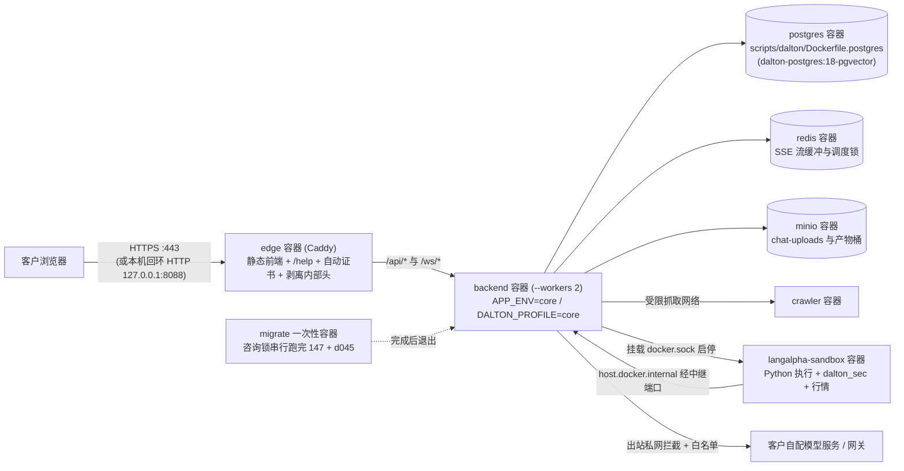
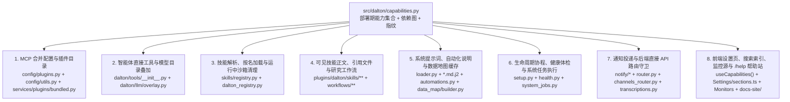
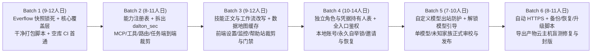

# 独立核心版本设计方案（产品化第 ① 阶段）

> **基线快照**：分支 `design/standalone-core`（基于 `fb8f2bdaa`）  
> **文档状态**：已按双模型代码审查（codex `gpt-6.2-sol` + `grok 4.7`）与用户 6 项定案修订完成，可直接按第 6 节启动开发

---

## 一页摘要（给负责人与开发者）

### 1. 做什么

把当前绑定在 Everflow 这台 Mac 上运行的 Dalton 系统，整理成**同一份代码仓库下的两种安装形态（Profile，安装形态配置档）**：

- **核心安装（`DALTON_PROFILE=core`，对应 `APP_ENV=core`）**：面向外部客户。在一台全新的 Linux 服务器上，从空数据库开始，客户只需填入**自己的域名、首个管理员账号密码和至少 1 个模型 API Key（Application Programming Interface Key，应用编程接口密钥）**，即可拉起全套容器服务，完成新建工作区、流式对话、代码沙箱分析、分片上传大文件、查看监控看板并完成研报审校发布。所有专属商业数据源、宿主机桥接程序、飞书/微信/Discord 渠道和本机定时采集任务默认关闭；凡未安装的能力，在合并后的工具配置、插件目录、技能注册与正文、研究工作流、系统提示词、设置页、帮助站和后台任务中全链路隐去，直接调用相关接口亦明确拒绝，全程零报错运行。
- **Everflow 安装（`DALTON_PROFILE=everflow`，对应 `APP_ENV=dalton` 或未设置 `APP_ENV`）**：面向我们现有的 Mac 生产环境与本地测试。原样保留全部既有数据源、宿主机桥接、Supabase（开源身份认证与后端云平台）团队登录、权限顺序、模型策略与发布脚本，任何一批改动均保证现网功能完整、数据原地保留、零停机迁移。

本阶段（第 ① 阶段）聚焦“脱离单台 Mac 独立跑起来 + 未装能力端到端干净隐去 + 交付干净发行产物”，能力开关随部署静态固定；第 ② 阶段再将 AlphaEngine、公司资料库（company wiki）等拆为可独立安装的连接器并设计跨进程在线热更新。

### 2. 分几批、大概多少人周

全部工作按“每批完成后系统可独立运行、可独立合并主分支、可独立部署现网、且同一文件只在一个批次内修改”的原则，重排为 **6 个独立开发批次（Batch 1 – Batch 6）**，单批规模适配开发代理（agy Neon High）单轮高质量交付并经双模型（codex `gpt-6.2-sol` + `grok 4.7`）审查：

- **总体工期估算**：计入全入口鉴权改造、双进程（`--workers 2`）一致性验证、已运行沙箱受管文件清理、二十余份可见技能正文与工作流去专有化改写、单模型发布链路改造、升级恢复验证及盲测修复后，合计 **51–70 人日（约 10–14 人周）**。
- **各批节奏概览**：
  1. **Batch 1（9–12 人日）**：先建 Everflow 基线快照测试，交付核心配置叠加层、Compose（多容器编排工具）覆盖文件、最小安装与干净打包脚本、Responses API（OpenAI 新一代结构化响应与工具流式接口）假模型服务，跑通 GitHub Actions（GitHub 托管的自动化持续集成运行器）空库安装与产物层检查；
  2. **Batch 2（8–11 人日）**：建立统一能力注册表，拆出独立开源插件 `dalton_sec`，完成 MCP（Model Context Protocol，模型上下文协议）合并配置、直接工具、API 路由、通知投递与后台协程的后端端到端裁剪；
  3. **Batch 3（9–12 人日）**：完成技能按名加载拦截、沙箱受管技能清理、可见技能正文与 6 个工作流改写、提示词/数据地图缓存隔离、前端设置页/监控面板/`/help` 帮助站裁剪及全量文本门禁；
  4. **Batch 4（10–14 人日）**：新增独立角色表与凭据持有人表，统一全部认证入口分派，落地 `DALTON_AUTH_MODE=local` 本地密码登录、永久自举锁、单事务邀请兑换与运维密码重置；
  5. **Batch 5（7–10 人日）**：开启自定义模型地址出站防护，解除首次模型引导对私有 OAuth（Open Authorization，开放授权协议）模型的锁定，打通单模型/未知家族正式审校与研报发布；
  6. **Batch 6（8–11 人日）**：交付自动 HTTPS 边缘网关配置、备份/恢复/平滑升级脚本与部署手册，基于打包脚本导出的干净产物完成干净云主机 AI 盲装验收并封版。

### 3. 用户已定事项（共 6 项，直接照此执行）

| 编号 | 已定事项 | 执行口径 |
|---|---|---|
| **已定 1** | 登录方案 | 核心安装默认使用自带本地账号（`DALTON_AUTH_MODE=local`）；Everflow 继续使用 Supabase（`DALTON_AUTH_MODE=supabase`）；企业 OIDC（OpenID Connect，开放身份认证单点登录协议）留待后续阶段按需追加。 |
| **已定 2** | 默认品牌 | 核心安装默认品牌名为 **`Dalton`**，客户可通过环境变量 `BRAND_NAME` 自定义修改。 |
| **已定 3** | 投研核心骨架 | 完整保留投研知识层（`knowledge`）、三情景估值卡（`underwriting`）和正式发布审校（`publish`），单模型部署下审校自动复用客户已配模型并记录单家族模式。 |
| **已定 4** | `dalton_sec` 财报插件 | 将公开美股财报工具 `dalton_sec` 拆为独立开源插件 `plugins/dalton_sec/`（`Apache-2.0` 许可证）并在核心安装默认开启，同时兼容现有的按插件包禁用记录。 |
| **已定 5** | 交付导出干净包 | 主仓库始终只维护一套代码；对外交付与盲测统一通过打包脚本按允许清单选择源码文件与构建产物，零独立补丁维护成本。 |
| **已定 6** | 主仓库保持公开 | 主仓库保持公开状态，GitHub Actions 照常使用公开托管运行器且零读取仓库 Secrets（机密变量）。如实记录：公开仓库与 Git 历史中本来就包含专有源码，打包脚本只决定客户交付物与发行镜像里带哪些内容。 |

---

## 1. 现状清单：核心安装会碰到的“绑在这台 Mac 上”的耦合项

### 1.0 代码规模核对基线（基于 `fb8f2bdaa` 实测）

- **Dalton 独占目录规模**：`src/dalton/` 共 **315 个文件**（22 个子目录与 24 个顶层模块）；`plugins/dalton/` 共 **347 个文件、51 份 `SKILL.md`**；`plugins/dalton_data/` 共 **5 个文件**；`scripts/dalton/` 共 **258 个文件、14 份 `launchd`（macOS 系统后台常驻与定时调度服务）配置（`.plist` / `.plist.template`）**；`integrations/dalton-channel-gateway/` 共 **109 个文件**；前端 `web/` 下带 Dalton 或 Monitor 命名的文件共 **119 个**（含 `web/src/pages/Settings/panels/dalton/` 42 个、`web/src/lib/dalton/` 13 个、`web/src/components/dalton/` 7 个）。
- **宿主机桥接单文件体量**：`scripts/dalton/researchdata_bridge.py` 当前共 **26,636 行**。
- **上游文件挂载点（`DALTON-HOOK`，Dalton 在上游源码中标注的差异挂载点注释）**：全仓共 **1,068 个文件、5,425 个匹配行**；与上游共同祖先 `e524325a9` 的文件交集为 **891 个上游文件、4,921 个匹配行**（分目录：`web/` 380 文件 / 2,043 行，`src/server/` 172 文件 / 1,268 行，`tests/` 149 文件 / 485 行，`src/ptc_agent/` 106 文件 / 665 行，`src/tools/` 30 文件 / 187 行，`other` 20 文件 / 60 行，`src/data_client/` 14 文件 / 89 行，`plugins/` 12 文件 / 65 行，`src/llms/` 8 文件 / 59 行）。`scripts/dalton/check_hooks.sh` 的 `ALLOWED_HOOKS` 白名单登记了 **182 个**钩子 ID，非文档源码实际引用 **181 个**（本克隆本地 `upstream/main` 领先共同祖先 **18** 个提交，Dalton 分支领先 **1,370** 个提交）。
- **数据库双迁移链**：上游 `migrations/versions/*.py` 共 **146 个脚本**（头节点 `147`）；Dalton `src/dalton/migrations/versions/*.py` 共 **43 个脚本**（`d001`–`d044`，缺省 `d034` 号，非线性段为 `d031 -> d035 -> d036 -> d032 -> d033 -> d037..d044`）。其中 **6 个迁移直接新增或修改了上游表的列、约束或索引**（`d004`、`d020`、`d035`、`d041`、`d042`、`d043`），**1 个迁移（`d038`）外键引用上游 `share_links(artifact_id)` 并向上游 `server_keys` 表写入记录**，另有 **3 个迁移的自有表外键引用上游 `workspaces` 表**（`d018`、`d028` 为级联删除，`d030` 为置空）。
- **公开仓库现状说明**：当前公开 GitHub 仓库及历史提交中已存在标注 `Proprietary`（专有）的 `plugins/dalton_data/plugin.json`、桥接源码与含内部账号的历史脚本；本设计保持公开仓库开发与无密钥 CI 运行，通过打包脚本严格控制对外交付包和发行容器镜像的文件范围。

以下按 6 个维度列出具体耦合项、现状代码行号与核心安装处理方式（分类标签：**没装时隐藏**、**改成可配置**、**核心剥离/停用**、**拆包保留**、**留到第 ②/③ 阶段插件化**）。

### 1.1 宿主机桥接程序及依赖它的工具、路由与定时任务

| 位置（文件:行号 或目录） | 当前用途与本机耦合点 | 核心安装处理方式 |
|---|---|---|
| `scripts/dalton/researchdata_bridge.py:1-26636`（HTTP〔Hypertext Transfer Protocol，超文本传输协议〕路由分发位于 `:25375-26135`） | 运行在 Mac 宿主机 `127.0.0.1:8960` 的守护进程，承载 `/mcp`（`:25456` 商业研究检索）、`/embed`（`:25375,:25626` 向量嵌入）、`/jobs/ops`（`:25645` 宿主机备份与看门狗状态）、`/notify`（`:25659` 卡片推送）、`/wiki/ingest`（`:25679`）、`/sales-notes/ingest`（`:25703`）、`/feishu/*`（`:25728` 飞书代理）、`/transcriptions/*`（`:25773` 火山 Seed-ASR〔Automatic Speech Recognition，自动语音识别〕转写）、`/internal/market-digest/*`（`:25384,:25894-25927`）、`/internal/ai-finance/*`（`:25388-25392,:25958-26051`）及 `/internal/data-tasks/host-run`（`:26129`）。且 `src/dalton/settings.py:1057-1068,1173-1174` 在未显式配置 URL 时会自动回退合成 `http://<host>:8960`。 | **核心剥离/停用 + 留到第 ② 阶段拆分**：核心安装把桥接默认 URL 改为空字符串 `""`，所有客户端调用前先查统一能力开关，默认静默关闭；对外交付包与核心镜像剔除该文件。 |
| `plugins/dalton_data/mcp.json:4-23`、`plugins/dalton_data/plugin.json:9-23`、`src/ptc_agent/config/file_utils.py:41-65`、`src/server/app/setup.py:948-959` | 整包标为 `Proprietary`，同时捆绑了 `researchdata`（HTTP 连接 `${DALTON_RESEARCHDATA_URL}`）和 `dalton_sec`（stdio〔标准输入输出本地子进程通道〕服务器，调用公开 SEC EDGAR〔美国证券交易委员会企业电子信息披露系统〕提取 XBRL〔可扩展商业报告语言〕财报事实）。当环境变量缺失时，`substitute_env_vars()`（`file_utils.py:41-65`）保留原字面量 `${DALTON_RESEARCHDATA_URL}`，导致启动连接失败进入 `booted_registry.failed_builtin_remote`，进而触发 `setup.py:948-959` 启动 `mcp-builtin-reconnect` 后台重连循环。 | **拆包保留 + 没装时隐藏**：将 `dalton_sec` 迁入独立开源插件 `plugins/dalton_sec/`（`Apache-2.0`）并在核心安装默认开启，同时在 `src/server/services/plugins/bundled.py:217-246` 兼容原有的按包禁用记录；在合并后有效 MCP 配置（`src/ptc_agent/config/utils.py:240-255`）与插件目录（`bundled.py:58-113,327-346`）两处同步过滤未装服务。 |
| `scripts/dalton/research_runtime/`（含 `scripts/data_gateway.py:39-97`、`scripts/research_library.py:38`、`scripts/guidepoint_mcp_oauth.py:1`、`skills/company-wiki/scripts/company_wiki_cli.py:87`、`scripts/tmtb_alphaengine_sync.py:4`、`scripts/sales_notes_store.py:1`、`scripts/funda_ai.py:43`） | 宿主机研究数据子系统：AlphaEngine MCP（`127.0.0.1:8950`，依赖 macOS 钥匙串 `security` 命令与桌面客户端登录态，见 `docs/dalton/OPERATIONS.md:168,192`）、Guidepoint 代理（`127.0.0.1:8943` 与本地回调 `:8942`）及本地 SQLite（轻量级单文件关系型数据库）四库检索。 | **留到第 ②/③ 阶段插件化**：核心安装跳过并从对外交付包剔除该目录；第 ② 阶段起按“客户自带授权”拆为独立连接器。 |
| `integrations/dalton-channel-gateway/`（109 个文件）与 `src/dalton/settings.py:1071-1101`、`src/dalton/app/channels_router.py:43,1031`、`src/dalton/notify/channel_transport.py:27-28,159,490`、`src/dalton/notify/dispatch.py:31-42` | 宿主机 `127.0.0.1:8962` 的 TypeScript 渠道网关（飞书、Discord、微信 iLink）；`channels_router.py:1031` 与 `settings.py:1071-1101` 在缺省时回退到 `http://127.0.0.1:8962`。 | **没装时隐藏 + 留到第 ③ 阶段插件化**：核心安装将渠道网关默认地址改为空字符串并关闭渠道能力；直接访问 `/channels/*`、`/notify/test`（`src/dalton/app/router.py:2575`）与 `/feishu/*`（`router.py:2413`）统一返回能力未启用状态码。 |
| `src/dalton/tools/__init__.py:78-362` 及具体工具工厂（`feishu_tools.py:423`、`wiki_tools.py:484`、`ingest_tools.py:72`、`issue_tools.py`、`market_digest_tools.py`、`ai_finance_*_tools.py`、`podcast_weekly_tools.py`、`notify_tools.py`、`automation_report_tools.py`、`report_delivery_tools.py`） | `build_dalton_tools()` 在 `settings.enabled=True` 时挂载 `ingest_company_wiki`（`__init__.py:225,315`）、`ingest_sales_note` / `ingest_research`（`:239,328`）、5 个 `feishu_*` 工具（`:150-156`）、内部问题上报 `report_issue`（`:158-162`）以及 `market_digest_*`、`ai_finance_*`、`podcast_weekly_*`、`dalton_notify_settings` 等桥接工具（`:78-149`）。 | **没装时隐藏**：将全部工具（含 `report_issue`）收敛到声明式能力映射表，仅在对应能力启用时挂载进智能体工具列表。 |
| `src/dalton/services/transcriptions.py:66,2543-2571,2688` 与 `src/server/app/setup.py:909-919`、`src/dalton/app/transcriptions.py` | 录音转写 5 分钟对账循环（间隔常量在 `:66`，开关判定 `is_transcription_reconciliation_enabled` 在 `:2560`，主循环 `run_transcription_reconciliation_loop` 在 `:2688`），依赖专用对象存储与桥接 `/transcriptions/*`。 | **没装时隐藏**：转写能力显式依赖 `researchdata_bridge` 与转写存储配置；核心安装默认关闭，跳过 `setup.py:915` 协程启动、隐藏相关技能/工具并拦截转写路由。 |
| `src/dalton/data_jobs/manifest.yaml:1-1070`（清单共 42 项任务：7 项 `runner: "host"`、35 项 `runner: "container"`；单项数据库初始状态见 `d029_data_tasks.py:64-66` 默认 `enabled: false`）、`runner_wrapper.py:44,322`、`container_runner.py:48,54-58,192`、`src/server/app/setup.py:921-931`、`src/dalton/app/router.py:1944` | 确定性定时数据任务调度器（`dalton.yaml:41` 默认开启总调度开关 `data_jobs.enabled: true`）：宿主机任务含 SSH（Secure Shell，远程安全登录协议）触发外部机器拉取 Bloomberg 数据；容器任务使用 `runner_wrapper.py:44` 定义的 `/Users/everflow/.openclaw/workspace` 工作目录与 `container_runner.py:192` 的 `HOME=/Users/everflow`。 | **没装时隐藏**：核心安装在 `dalton.core.yaml` 将 `data_jobs.enabled` 设为 `false`，跳过 `setup.py:927` 调度循环，拦截 `POST /system-jobs/{key}/run`（`router.py:1944`），隐藏预设数据任务视图；Everflow 保持总开关开启且单项沿用数据库既有启停状态。 |
| `src/dalton/monitors/data_job_registry.py:28-39`、`scripts/dalton/monitor_feeds/run_feeds.py`、`src/dalton/dalton.yaml:26` | 将 6 项内部数据任务绑定到监控面板自动刷新，`dalton.yaml:26` 提交的 `artifact_publishing.enabled` 代码默认值为 `false`（Everflow 现网通过环境变量开启）。 | **拆包保留 + 没装时隐藏**：保留监控面板能力供客户发布工作区生成的交互式 HTML（HyperText Markup Language，超文本标记语言）看板；`dalton.yaml` 基准默认值保持 `false` 不动，仅在 `dalton.core.yaml` 中设为 `true`，且当 `data_jobs` 关闭时隐藏内部数据任务绑定源。 |
| `src/dalton/data_map/health.py:1343` 与 `src/server/app/setup.py:900-907` | 后端启动时调用 `run_startup_health_check_once()`（`health.py:1343`），探测桥接子路由、`x_search` 与对话归档表健康态。 | **改成可配置 + 没装时隐藏**：启动体检仅探测当前能力注册表中已启用的数据源。 |

### 1.2 `launchd` 定时任务、看门狗、备份与部署脚本

| 位置（文件:行号 或目录） | 当前用途与本机耦合点 | 核心安装处理方式 |
|---|---|---|
| `scripts/dalton/launchd/*.plist.template`（6 份）、`scripts/dalton/ops/launchd/*.plist.template`（3 份）、`scripts/dalton/ops/prod/launchd/*.plist.template`（4 份）、`scripts/dalton/monitor_feeds/com.dalton.monitor-feeds.plist`（1 份），共 **14 份** | macOS 专用 `launchd` 配置，托管 Colima 虚拟机、桥接、渠道网关、AlphaEngine、Guidepoint、用量采集、看门狗与三层备份。 | **核心剥离/停用**：原样保留供 Everflow 使用；Linux 核心安装通过 Docker Compose 的 `restart: unless-stopped` 与容器内置 `healthcheck` 自愈，并在打包产物中剔除 `.plist*`。 |
| `scripts/dalton/ops/prod/deploy_main.sh:1-947`、`wait_backend_idle.sh`、`watchdog.sh`、`colima_launch.sh`、`portwatch.sh` | Everflow 生产发布脚本（共 947 行）：日志目录写死 `~/Library/Logs/Dalton/containers`（`:16`）、重启后端并在容器入口执行迁移（`:509`）、前端构建强制传 `--require-supabase`（`:709`、`:867`）。 | **原脚本零改动 + 新增通用脚本**：`deploy_main.sh` 一行不改；面向 Linux 客户新增 `scripts/standalone/{init,upgrade,backup,restore,package_release}.sh`。 |
| `scripts/dalton/ops/dalton_config_git_backup.sh`、`dalton_db_offsite.sh`、`dalton_data_backup.sh`（见 `docs/dalton/OPERATIONS.md:341-345,413`） | 依赖外置盘 `/Volumes/EveSSD`、`rclone` 上传 Google Drive `DaltonBackup/` 与私有配置仓库。 | **核心剥离 + 新增通用脚本**：`scripts/standalone/backup.sh` 与 `restore.sh` 支持导出/恢复一致性 PostgreSQL 备份与 MinIO（兼容 S3 协议的开源对象存储服务）对象归档到任意指定本地目录或兼容 S3（Simple Storage Service，通用对象存储接口协议）存储桶。 |
| `scripts/dalton/docker_build_backend.sh:12-25`、`scripts/dalton/Dockerfile.dalton:66-109` | `Dockerfile.dalton:66-81` 整目录复制 `scripts/`、`plugins/` 与 `config/dalton/`，并在构建时读取 Git 元信息生成 `/app/.build_files.sha256`。 | **复用构建定义 + 干净上下文**：复用 `Dockerfile.dalton` 与启动入口，核心发行构建以 `package_release.sh` 导出的白名单目录作为构建上下文（物理排除专有插件与内部运维脚本），支持构建参数注入版本号。 |
| `scripts/dalton/build_frontend_prod.sh:14-44` | 默认加载 `web/.env.dalton`（`Everflow` 品牌）并在 `--require-supabase` 下校验 Supabase 变量，同时编译静态帮助站 `docs-site/` 到 `web/dist/help/`。 | **改成可配置**：核心镜像构建阶段按 `.env` 注入 `BRAND_NAME`、`VITE_DALTON_UI=true` 与 `VITE_DALTON_AUTH=local`，并编译剔除 `everflow/` 专属目录后的帮助站。 |

### 1.3 写死的路径、账号、固定 ID、域名、品牌、存储、网络与模型策略

| 位置（文件:行号 或目录） | 当前用途与本机耦合点 | 核心安装处理方式 |
|---|---|---|
| `/Users/everflow/.openclaw/workspace` 与 `HOME=/Users/everflow`（`src/dalton/data_jobs/runner_wrapper.py:44,322`、`container_runner.py:48,54-58,192`、`manifest.yaml` 56 处、`d029_data_tasks.py`） | 数据任务容器运行器默认将宿主机数据目录映射到 `/Users/everflow/.openclaw/workspace` 并设置 `HOME=/Users/everflow`。 | **没装时隐藏 + 改成可配置**：核心安装关闭 `data_jobs`；同时将 `runner_wrapper.py:44` 默认工作目录提取为环境变量可覆盖路径。 |
| `/opt/homebrew/bin/*` 与 `~/Library/*`（`scripts/dalton/Dockerfile.dalton:62-64`、`scripts/dalton/ops/*`、`scripts/dalton/researchdata_bridge.py`） | macOS Homebrew 二进制路径与用户目录日志/账本路径。 | **核心剥离/改成可配置**：核心容器统一使用 `/app/.venv/bin/python` 与 `/app/var/dalton`。 |
| `src/dalton/company_identity.py:18-20`（`system:dalton-company`） | 公司级自动化任务的非人类系统属主（受 `d035:204` 检查约束保护且禁止外部令牌登录）。 | **保留内部主键 + 显示名跟随 `BRAND_NAME`**：完全兼容 `d035` 约束。 |
| **管理员角色、邀请与模型凭据持有人**（`src/dalton/migrations/versions/d016_members_and_invites.py:16-38`、`src/dalton/access_tiers.py:1-8,53-120`、`src/dalton/credentials.py:35-99`、`src/dalton/invites.py:144-176,357-391,689-820`、`src/dalton/autonomy/system_jobs.py:105-120`） | 1) `d016` 的 `dalton_members` 表以 `email` 为主键，仅有 `email, username, source, invited_by_user_id, created_at` 五列，无 `user_id` 也无 `tier` 列；<br>2) 管理员判定 `is_invite_pm` 只认环境变量 `DALTON_PM_USER_IDS`（UUID〔通用唯一识别码〕列表）；<br>3) `credentials.py:35-45` 在非 Supabase 模式下直接返回 `None`，开启时固定取 `DALTON_PM_USER_IDS[0]` 为凭据持有人；<br>4) `invites.py:170-176` 未配 Supabase Admin 密钥时直接返回 `503`。 | **分别独立建模 + 按认证模式隔离**：在迁移 `d045` 新增按 `users.user_id` 关联的角色表 `dalton_user_roles` 与显式单行持有人表 `dalton_credential_holder`；`local` 模式使用新表判定权限与共享凭据归属，并在本地单事务内完成邀请建号；`supabase` 模式（Everflow）原样保持 `DALTON_PM_USER_IDS` 顺序与现有凭据归属。 |
| `SEC_USER_AGENT` 兜底值（`src/dalton/settings.py:1177-1183`） | 缺省回退 `"DaltonResearch research@everflowinv.com"`。 | **改成可配置**：`init.sh` 引导生成 `<Brand> <admin_email>`；代码兜底改为中性占位并在日志提示。 |
| 历史一次性脚本中的内部账号与固定 ID（`scripts/dalton/migrate_owner_identity.py:54-55`、`rebind_workspaces_to_primary.py:87-88`、`realrun/_common.py:58-63`） | 历史单机迁移与内部实机脚本硬编码邮箱与工作区 UUID。 | **核心剥离**：`package_release.sh` 白名单排除这些历史脚本。 |
| 邀请合成邮箱后缀 `team.dalton.local`（`src/dalton/settings.py:1257`、`web/src/config/daltonAuth.ts:15`） | 纯用户名受邀注册时拼接的合成域。 | **改成可配置**：`init.sh` 自动设为 `team.<客户域名>`。 |
| 代理虚拟网段 `network.fake_ip_cidrs: ["198.18.0.0/15"]` 与时区 `Asia/Shanghai`（`src/dalton/dalton.yaml:3,52-60,91`） | 适配 Everflow Mac 宿主机透明代理 Fake-IP（虚拟占位 IP 地址）并发起外部 DoH（DNS over HTTPS，加密域名解析）校验；全局与预算日界时区固定为 `Asia/Shanghai`。 | **改成可配置**：`dalton.core.yaml` 将 `fake_ip_cidrs` 设为空列表 `[]`，时区与预算日界默认读取 `DALTON_TIMEZONE`（缺省 `UTC`）。 |
| **自定义模型 URL 出站信任边界**（`src/server/app/api_keys.py:460-499,643-663`、`src/server/services/llm/egress.py:107-127,193-234,618-631`） | `/api/v1/keys/test` 与自定义模型发现接受登录用户提交的 `base_url`，而现有私网/回环 SSRF（Server-Side Request Forgery，服务端请求伪造）拦截仅在 `HOST_MODE=platform` 生效；核心多用户模式运行在 `HOST_MODE=oss` 下，普通成员提交内网地址会由后端直接发起请求。 | **开启多用户出站限制 + 部署者白名单**：在 `DALTON_PROFILE=core`（`DALTON_AUTH_MODE=local`）下对模型试连、发现、保存与实际推理统一启用 `llm/egress.py` 私网/元数据地址拦截，同时提供环境变量 `DALTON_OPERATOR_LLM_ENDPOINTS` 供管理员显式放行客户内网模型网关或 CI 假模型地址。 |
| **聊天大文件对象存储与沙箱网络耦合**（`web/src/lib/dalton/chatUploadClient.ts:328`、`src/dalton/chat_upload_storage.py:25-27,61-79,128-139`、`src/ptc_agent/config/core.py:492`、`src/server/services/egress/reachability.py:45-64`、`src/server/services/livefs/mount.py:350`） | 聊天分片由浏览器上传至后端 `/api/v1/dalton/chat-uploads/*`，后端写入对象存储并签发沙箱下载 URL，但 `chat_upload_storage.py` 当前直接复用语音转写的 `DALTON_ASR_STORAGE_*` 配置；同时沙箱默认运行在 Docker `bridge` 网络，通过宿主机网关与 `EGRESS_RELAY_BASE_URL` 回连后端与 LiveFS（向沙箱挂载实时文件的虚拟文件系统服务）。 | **解耦存储配置 + 明确三视角网络**：`chat_upload_storage.py` 优先读取独立的 `DALTON_CHAT_UPLOAD_STORAGE_*`（Everflow 未设时回退 `DALTON_ASR_STORAGE_*`），启动时自动初始化存储桶，保留后端分片上传；明确配置浏览器、后端、沙箱三套可达地址并隔离沙箱对数据库/Redis/`docker.sock` 的访问。 |
| 边缘网关 `deploy/dalton/Caddyfile:1-6,64-75` | 假定前置 Tailscale Funnel 终止 TLS（Transport Layer Security，传输层加密协议），配置 `auto_https off` 并仅监听 `:8088`。 | **改成可配置**：新增 `deploy/standalone/Caddyfile`，公网与企业内网多用户部署统一启用 HTTPS（Caddy〔支持自动管理 HTTPS 证书的反向代理服务器〕自动签发证书或加载内网证书），纯 HTTP 试用仅绑定本机回环 `127.0.0.1:8088`。 |
| 品牌与前端特性标志混绑（`web/src/config/brand.ts:12-21`、`src/ptc_agent/agent/prompts/templates/system.md.j2:1`、`src/server/app/share_pages.py:29`） | `brand.ts:21` 写死 `isDaltonBuild = BRAND_MARK === 'everflow'`；若直接改成必填新变量，Everflow 现网 `deploy_main.sh:709,867` 在未改构建环境时会丢失 Dalton 界面分支。 | **向后兼容解耦**：新增 `VITE_DALTON_UI`，缺省未设置时保持 `BRAND_MARK === 'everflow'` 为 `true`（`deploy_main.sh` 零改动），核心镜像构建时显式注入 `VITE_DALTON_UI=true` 与 `BRAND_NAME`（默认 `Dalton`）。 |
| **私有 OAuth 模型目录、首次引导锁定与单模型正式发布拦截**（`src/dalton/llm/overlay.py:20-35`、`agent_config.dalton.yaml:10-24,58-66`、`web/src/config/daltonSetup.ts:35-41,66-89,197-210`、`src/dalton/publish/review.py:224-256,345-396`、`src/dalton/publish/audit.py:1548-1549`） | 1) `overlay.py:20-35` 无条件把 `native_overlay.json`（含 `grok-4.7-oauth` 等）合并进模型目录；<br>2) `daltonSetup.ts:35-41` 的 `DALTON_SETUP_CANDIDATES` 固定写死 5 个模型（`gemini-4-neon-high-oauth`、`gemini-4-carbon-medium-oauth`、`claude-opus-5-5-oauth`、`gpt-6.2-astra-oauth`、`gpt-6.2-sol-oauth`；另有 `grok-4.7-oauth` 与 `muse-wonder-1.0-oauth` 位于 `agent_config.dalton.yaml:18-24,58-66`），无命中时 `:66-89` 与 `:197-210` 返回空目录和 `available: false`；<br>3) 正式发布在 `publish/review.py:345-386` 遇到单一厂商家族或自定义网关 `family_of() == "unknown"` 时返回 `status="unavailable"`，数字核验在 `publish/audit.py:1548-1549` 缺少独立 `audit_model` 时直接抛错。 | **全链路打通 BYOK（Bring Your Own Key，客户自带模型密钥）**：核心模式关闭 `native_oauth_sync` 时跳过 `*-oauth` 私有目录注入；`daltonSetup.ts` 在精选列表为空时自动展示客户已接通且支持工具调用的全部模型；`assist`、`audit`、`language` 与 `publish/review.py` 共享同一有效模型解析器，单家族或 `unknown` 家族时复用客户已配主模型完成审校并在发布记录写入 `review_mode: "single_family" \| "unknown_family"`（Everflow 维持异族审稿）。 |

### 1.4 默认假定专属数据源存在的提示词、技能正文、工作流、设置页、帮助站与任务模板

| 位置（文件:行号 或目录） | 当前用途与专属假设 | 核心安装处理方式 |
|---|---|---|
| 系统提示词各模板与自动化说明：`tool_guide.md.j2:23-35`、`chief_of_staff.md.j2:54`、`working_with_the_user.md.j2:38-54`、`src/ptc_agent/agent/backends/automations.py:43-56,154`、`src/ptc_agent/agent/prompts/loader.py:132-150` | `tool_guide.md.j2` 虽在 `:30` 对 `<data_map>` 做了 `` 判断且 `:24` 写明“若可用服务包含 `researchdata`”，但该提示句与研究服务描述仍无条件渲染进提示词；此外 `chief_of_staff.md.j2:54`、`working_with_the_user.md.j2:38-54` 与工作区自动化生成说明 `automations.py:43-56,154` 均直接提及系统运维任务或飞书/Discord/微信通知渠道。 | **没装时隐藏**：上述所有模板段落与自动化 `README` 生成器统一接入能力判定；未启用桥接、系统任务或渠道时，直接省略对应句段。 |
| 数据地图配置、回退备注与按日缓存：`src/dalton/data_map/sources.yaml:12-151`、`src/dalton/data_map/builder.py:300-360,472-490,545-585` | 1) 静态回退将 18 条桥接路由标为 `未体检`；<br>2) `sources.yaml:142-151` 的 `unavailable_sources` 在 `:148` 引用 `dalton-13f-tracker`、在 `:151` 提示“从 `alphaengine/funda-ai/guidepoint` 查二手引述”；<br>3) `builder.py:545-585` 从 `dalton_data_map_cache` 按日期直接读取已渲染好的文本，仅改 `merge_catalog_routes()` 会漏掉缓存读取路径。 | **全路径过滤 + 缓存指纹隔离**：在 `sources.yaml` 的 `catalog_routes` 与 `unavailable_sources` 同步标注能力要求（核心模式下 `:148,:151` 使用纯公开源表述）；`dalton_data_map_cache` 查询与写入键拼入当前能力集合哈希指纹，杜绝配置切换后读到旧缓存。 |
| 51 项内置技能（`plugins/dalton/skills/**`）、技能解析器（`src/ptc_agent/agent/middleware/skills/registry.py:523-569`、`dalton_registry.py:70-166`）与 6 个研究工作流（`workflows/*`） | 1) `dalton_registry.py:166` 在模块导入时静态生成技能表，且 `registry.py:523-569` 的 `get_skill()` 仍允许按名称直接加载 `hidden=True` 的技能；<br>2) 核心可见技能如 `dalton-conventions/SKILL.md`（`:48,77-83,87-93` 及 `references/`）和多个通用分析技能正文、以及 `workflows/` 下 6 个工作流（`initial-coverage`、`full-coverage`、`earnings-deep-update`、`bullbear-doc`、`topic-research`、`weekly-coverage-review`）全文穿插 `researchdata`、Guidepoint、飞书与内部合规背书。 | **拦截加载 + 清理沙箱 + 改写正文**：技能注册改为按当前部署能力动态计算，未启用技能在 `get_skill()` 直接返回空并在沙箱同步时移除已存在的受管目录；将 22 个专属简报/转写技能整棵关闭，对其余约 29 个核心可见技能的 `SKILL.md`、`references/` 与 6 个 `workflows/` 逐一剥离专有源调用，拆成纯公开数据与知识层通用正文。 |
| 设置页卡片、设置搜索索引与静态帮助站：`web/src/pages/Settings/sections.ts:77-94,195-243,316-328`、`panels/dalton/*`、`docs-site/src/content/docs/everflow/` | 设置页搜索索引（`sections.ts:316-328`）会检索设置条目关键字；前端 `/help`（由 `docs-site/` 构建）独立包含 `everflow/` 下的专有数据源、飞书/微信渠道与内部设置文档。 | **没装时隐藏**：设置分组、条目与设置搜索列表统一过 `useCapabilities()` 过滤；`docs-site/` 在核心构建模式下排除 `everflow/` 专属章节并替换品牌词，确保 `/help` 索引与正文零专有残留。 |
| 自动任务报告模板 `src/dalton/database/automation_reports.py:87-138`、系统任务 `src/dalton/autonomy/system_jobs.py:76-96,242-260`、默认覆盖名单 `config/dalton/coverage.yaml:14-3048` | `automation_reports.py` 定义了 20 个静态报告配置（`:87-109`）加 6 个动态多空跟踪配置（`:113-138`）；`system_jobs.py:242-260` 的 `_fetch_ops_jobs()` 会直接向桥接请求 `/jobs/ops`；`coverage.yaml` 在 `:14-19` 声明 27+78 计数并在 `:20-3048` 列出 105 家跟踪公司。 | **没装时隐藏 + 空初始态**：核心安装下 `_fetch_ops_jobs()` 在桥接关闭时直接返回空列表，关闭内部简报报告模板，默认覆盖名单初始化为空列表供客户自行添加标的。 |

### 1.5 `config.dalton.yaml`、`APP_ENV=dalton` 等配置分层

| 位置（文件:行号 或目录） | 当前机制与耦合点 | 核心安装处理方式 |
|---|---|---|
| `config.yaml:264-288`、`config.dalton.yaml:1-125`、`agent_config.dalton.yaml:1-107`、`src/tools/web/fetch.py:42`、`src/tools/web/search.py:32-35` | 1) 上游基准 `config.yaml:264-288` 将 `ginlix-data` 和 `tushare` 排在美股与 A 股行情及新闻链首位，`APP_ENV=core` 跳过 `config.dalton.yaml` 后若未整表替换列表，行情会优先请求未配置的 `ginlix-data`；<br>2) `inhouse` 是免密钥网页正文抓取器（`fetch.py:42`），而网页搜索 `WebSearch`（`search.py:32-35`）需对应搜索引擎或模型搜索密钥。 | **完整替换核心叠加层**：新建 `config.core.yaml`（整表替换 `market_data.providers` 与 `news_data.providers` 为公开免密钥 `yfinance` 优先、客户配置 FMP 后自动启用增强；网页抓取默认 `inhouse`，网页搜索在未配搜索密钥时自动静默关闭 `WebSearch` 工具，填入 Tavily/Serper/Gemini Key 后自动开启）与 `agent_config.core.yaml`（清空 `*-oauth` 模型名，保留 Docker 沙箱与 `crawler` 容器配置）。 |
| `src/dalton/dalton.yaml:1-179`、`src/dalton/settings.py:27,476-492,688-693`、`src/dalton/llm/role_policy.py:339-358`、`tests/conftest.py` | 现有单元测试（`tests/conftest.py`）与部分宿主机脚本将 `APP_ENV` 设为空字符串 `""`，依赖 `role_policy.py:345-358` 在空 `APP_ENV` 下加载 Dalton 配置；而 `dalton.yaml` 默认开启了 `conversations.enabled: true` 与 `data_jobs.enabled: true`。 | **严格兼容空 `APP_ENV`**：规定 **`APP_ENV` 未设置（`""`）与 `APP_ENV=dalton` 均解析为 `DALTON_PROFILE=everflow`**；唯有 `APP_ENV=core` 或显式设置 `DALTON_PROFILE=core` 时才叠加 `src/dalton/dalton.core.yaml`（逐项关闭专有能力开关、设默认时区为 `UTC`、开启 `artifact_publishing`）；若同时出现 `APP_ENV=dalton` 与 `DALTON_PROFILE=core` 冲突配置，启动直接报错退出。 |
| `docker-compose.yml:69-111` + `docker-compose.dalton.yml:11-65` | `docker-compose.dalton.yml` 面向 Everflow 宿主机开发与生产，挂载本地源码目录与 `./web/dist`。 | **Compose 覆盖复用（单一服务定义源）**：核心安装复用基准 `docker-compose.yml`、镜像构建文件与迁移脚本，仅将核心安装差异（`dalton-postgres:18-pgvector` 构建、一次性 `migrate` 服务、环境变量与可选服务）写入覆盖文件 `docker-compose.core.yml`，避免维护两套平行编排栈。 |

### 1.6 两条迁移链在空库上从头跑的情况，以及触及上游表的 Dalton 迁移

#### （1）空库从零执行、并发控制与升级保证

容器迁移命令按固定顺序依次通过 Alembic（数据库表结构版本迁移工具）执行上游 `migrations/versions/`（146 个脚本，头节点 `147`）与 Dalton `src/dalton/migrations/versions/`（43 个脚本，头节点 `d044`）：

1. **数据库镜像与角色权限**：`d009_conversation_archive.py:21-22` 执行 `CREATE EXTENSION IF NOT EXISTS vector` 与 `pg_trgm`，`d030_channel_gateway.py:22` 执行 `CREATE EXTENSION IF NOT EXISTS pgcrypto`（`d038_monitors.py:109` 依赖 `gen_random_bytes(32)`）。核心安装**固定使用仓库已有的 `scripts/dalton/Dockerfile.postgres`（构建为 `dalton-postgres:18-pgvector`）**，初始化数据库角色具备 `CREATE EXTENSION` 权限。
2. **前置表顺序保证**：`d035_company_automations.py:62-68` 显式校验 `public.users`、`public.workspaces`、`public.automations` 已存在，必须先完成上游 `upgrade head` 再跑 Dalton `upgrade head`。
3. **一次性独立迁移服务（避免多容器竞态）**：`d020:212-227` 与 `d043:61-73` 包含脱离事务块的 `autocommit_block()` + `CREATE INDEX CONCURRENTLY` 操作，现有 `docker_entrypoint_dalton.sh:15-21` 无跨容器串行锁。因此核心编排新增一次性 `migrate` 服务（内部同时加 PostgreSQL 咨询锁），在 `migrate` 成功退出（`service_completed_successfully`）后才启动多进程 `backend`（`--workers 2`）。
4. **发布重启与向后兼容迁移分离验证**：Everflow 现网 `deploy_main.sh:509` 会在重启后端时执行迁移，而客户平滑升级要求新迁移满足“扩展—收缩（Expand-Contract）”兼容原则（迁移执行期间上一发行版后端进程仍可正常读写），第 5 节分别针对这两种场景做自动化验证。

#### （2）触及上游表的 Dalton 迁移完整分类清单（6 个表结构/索引变更 + 1 个外键与密钥写入 + 3 个工作区外键）

| 类别 | 迁移脚本与行号 | 触及的上游表 | 具体变更与前置依赖 | 核心安装处理策略 |
|---|---|---|---|---|
| **表结构 / 索引变更（6 个）** | `d004_provenance_locator.py:17-20` | `provenance_records` | 新增可空列 `dalton_source_url`、`dalton_as_of`。 | **原样保留**（支撑 SEC 与研报来源定位）。 |
| 同上 | `d020_colleague_dispatch_threads.py:58,161-176,195,216,224` | `conversation_threads`、`wakeups` | 动态 `ALTER TABLE` 新增可空列 `conversation_threads.user_id`、`wakeups.created_by_run_id`，并在事务外并发创建 `idx_conversation_threads_user_updated`、`idx_conversation_threads_ws_user`。 | **原样保留**（支撑多成员线程归属隔离）。 |
| 同上 | `d035_company_automations.py:82,155-285` | `users`、`automations` | 向 `users` 写入系统行 `system:dalton-company`；给 `automations` 新增 12 列与 8 个约束，将唯一索引替换为 `WHERE deleted_at IS NULL` 部分唯一索引并新建 `idx_automations_scope_deleted`。 | **原样保留**（支撑公司级自动化与版本软删除）。 |
| 同上 | `d041_team_coverage_units.py:532-535` | `automation_executions` | 新增可空列 `coverage_unit_id`、`coverage_unit_version`。 | **原样保留**（支撑覆盖单元执行关联）。 |
| 同上 | `d042_automation_reasoning_effort.py:43-50` | `automations` | 新增可空列 `reasoning_effort` 与枚举 `CHECK` 约束。 | **原样保留**（支撑定时任务推理强度设置）。 |
| 同上 | `d043_automation_executions_thread_index.py:24-33,61-73` | `automation_executions`、`automations` | 在 `autocommit_block()` 中并发创建 `idx_automation_executions_thread_created` 与 `idx_automations_user_workspace`。 | **原样保留**（由一次性 `migrate` 服务串行执行）。 |
| **外键 + 密钥表写入（1 个）** | `d038_monitors.py:28,108-111` | `share_links`、`server_keys` | `dalton_monitors.artifact_id` 外键引用 `share_links(artifact_id)`（依赖上游 `101_artifacts.py:116-120` 建立的唯一约束）；向 `server_keys` 插入 `monitor_grant` 签名密钥。 | **原样保留**（支撑监控看板授权访问）。 |
| **工作区外键引用（3 个）** | `d018:22`、`d028:22`、`d030:84,100` | `workspaces` | `d018`（`dalton_workspace_sharing`）与 `d028`（`dalton_workspace_settings`）使用 `ON DELETE CASCADE` 级联删除；`d030`（`dalton_channel_conversations` 与 `dalton_channel_bindings`）两处外键使用 `ON DELETE SET NULL`。 | **原样保留**（未启用能力对应表为空，零运行开销）。 |

---

## 2. 目标形态：客户从零安装的架构、网络边界与安全自举

### 2.1 核心安装组件架构、三视角网络与 `docker.sock` 权限说明

核心安装通过 `docker-compose.yml` + `docker-compose.core.yml` 覆盖编排运行在单台 Linux 主机上：



- **浏览器、后端、沙箱三视角地址契约**：
  1. **浏览器视角**：仅访问单一入口 `https://<DOMAIN>`（或本机回环试用 `http://127.0.0.1:8088`）。聊天大文件分片直接上传至同源后端接口 `/api/v1/dalton/chat-uploads/*`（`web/src/lib/dalton/chatUploadClient.ts:328`），无需向公网暴露 MinIO 端口。
  2. **后端容器视角**：在 Compose 内部专用网络 `core_internal` 上连接 `postgres:5432`、`redis:6379`、`minio:9000` 与 `crawler:8100`。`src/dalton/chat_upload_storage.py` 独立读取 `DALTON_CHAT_UPLOAD_STORAGE_*`，由一次性桶初始化步骤自动建好 `chat-uploads` 存储桶。
  3. **沙箱容器视角**：`langalpha-sandbox` 运行在独立的 Docker `bridge` 沙箱网络上（`src/ptc_agent/config/core.py:492`），不加入 `core_internal` 网络，从而隔离对 `postgres`、`redis`、MinIO 管理口和宿主机 `docker.sock` 的网络访问；沙箱仅通过显式配置的宿主机网关中继地址（`EGRESS_RELAY_BASE_URL` 绑定宿主机网桥 IP 的受控端口，见 `src/server/services/egress/reachability.py:45-64` 与 `src/server/services/livefs/mount.py:350`）访问后端出口中继、LiveFS 文件挂载与后端签发的对象下载通道。
- **客户可见的 `docker.sock` 权限边界说明**（同步印在安装文档首屏与 `init.sh` 执行提示中）：
  - 核心安装采用 DooD（Docker-outside-of-Docker，容器挂载宿主机套接字管理兄弟容器的方式）按需创建与回收代码沙箱，`backend` 容器需挂载 `/var/run/docker.sock`。持有该套接字等价于拥有宿主机 Docker 守护进程级控制权；因此生产环境应部署在**专用于运行 Dalton 的独立 Linux 云主机或虚拟机**上（也可配置对接独立沙箱宿主机或远程沙箱提供方）。

### 2.2 从获取发行包到发出第一条消息的 4 步流程

1. **获取干净发行包（或克隆仓库后导出干净目录）**
   ```bash
   # 客户交付场景直接解压干净源码发行包；开发验证场景从当前提交导出干净包：
   tar xzf dalton-core-<version>.tar.gz && cd dalton-core-<version>
   ```
2. **运行初始化脚本（自动体检环境并生成全套随机密钥）**
   ```bash
   bash scripts/standalone/init.sh
   ```
   - 校验 Docker Engine（≥ 24.0）、Docker Compose（≥ v2.24.4）、内存（建议 ≥ 8 GB）与磁盘（≥ 30 GB），打印 `docker.sock` 独占主机安全提示；
   - 自动用 `openssl rand -hex 32` 生成数据库密码、Redis 密码、MinIO 密钥、`INTERNAL_SERVICE_TOKEN`、`BYOK_ENCRYPTION_KEY`、本地登录签名密钥 `JWT_SIGNING_SECRET` 及带 24 小时有效期的管理员自举口令 `BOOTSTRAP_SETUP_TOKEN`；
   - 提示填入 `DOMAIN`（公网域名走 ACME〔自动证书管理环境协议〕自动签发 HTTPS 证书；企业内网域名可指定自有 TLS 证书；填 `localhost` 时仅绑定本机回环 `127.0.0.1:8088` 供单机试用）。
3. **一键拉起核心服务栈**
   ```bash
   docker compose -f docker-compose.yml -f docker-compose.core.yml up -d
   ```
   - 先运行 `postgres`（`scripts/dalton/Dockerfile.postgres`）、`redis`、`minio` 与桶初始化，再由一次性 `migrate` 容器串行跑完上游 `147` 与 Dalton `d045` 迁移，随后启动双进程 `backend`、`crawler` 与 `edge`。
4. **浏览器创建首个管理员并发起第一次研究对话**
   - 打开 `https://<DOMAIN>`（或本机 SSH 端口转发 `http://127.0.0.1:8088`），在 `/setup/admin` 页面输入终端打印的一次性自举口令、管理员邮箱/用户名与登录密码完成建号（口令当即永久作废）；
   - 在引导页填入任意模型 API Key（或已加入管理员白名单的内网模型网关地址 + Key），新建工作区、上传财报或 CSV 数据文件、完成带沙箱计算的首轮流式问答。

### 2.3 客户需要填写的配置项清单

| 配置项 | 是否必填 | 填写位置 | 说明 |
|---|---|---|---|
| `DOMAIN` | **必填**（本机试用填 `localhost`） | `init.sh` 或 `.env` | 公网/内网多用户部署统一走 HTTPS（支持自动签发证书或挂载自有证书路径 `TLS_CERT_FILE` / `TLS_KEY_FILE`）；`localhost` 模式仅监听 `127.0.0.1:8088`，杜绝明文 HTTP 在内网或公网传输密码与口令。 |
| 首个管理员账号 + 密码 | **必填** | 浏览器 `/setup/admin` | 配合终端输出的一次性 `BOOTSTRAP_SETUP_TOKEN` 创建首个管理员。 |
| 至少 1 个模型凭据 | **必填** | `.env` 或网页 `/setup` 向导 | 支持官方模型提供商 API Key 或自定义 OpenAI 兼容模型（若自定义网关位于企业私网，管理员在 `.env` 配置 `DALTON_OPERATOR_LLM_ENDPOINTS` 显式放行）。 |
| `BRAND_NAME` | 可选（默认 `Dalton`） | `.env` | 自定义网页标题、导航品牌名与智能体自我介绍名称。 |
| `DALTON_TIMEZONE` | 可选（默认 `UTC`） | `.env` | 部署默认时区与团队日预算结算时区（如 `Asia/Shanghai`、`America/New_York`）。 |
| `SEC_USER_AGENT` | 可选（自动由管理员邮箱合成） | `.env` | 访问公开 SEC EDGAR 财报接口的合规标识（格式：`<BRAND_NAME> <admin_email>`）。 |
| `TAVILY_API_KEY` / `SERPER_API_KEY` / `FMP_API_KEY` | 可选 | `.env` 或设置页 | 填入搜索密钥后自动启用 `WebSearch` 外网搜索；未填时默认使用免密钥 `inhouse` 网页抓取、`yfinance` 行情与 `dalton_sec` 财报工具。 |

### 2.4 首个管理员永久自举锁、会话安全与运维恢复机制

1. **同一事务永久封存自举状态（防删号重开）**：
   - 新增单行状态表 `dalton_bootstrap_state (singleton_id SMALLINT PRIMARY KEY DEFAULT 1 CHECK (singleton_id = 1), completed_at TIMESTAMPTZ NOT NULL, completed_by_user_id TEXT NOT NULL)`。
   - `POST /api/v1/dalton/bootstrap/admin` 获取 PostgreSQL 事务级咨询锁后，先确认 `dalton_bootstrap_state` 为空，再校验口令仍在 24 小时有效期内且累计失败次数未超上限（默认最多 5 次失败即锁定接口，需在服务器执行 CLI 重新签发），并用常量时间比对 `hmac.compare_digest`（HMAC，基于哈希的消息认证码）核验 `bootstrap_token`。
   - 校验通过后，在**同一数据库事务**中原子写入 `users`、`dalton_local_credentials`（`Argon2id`〔抗硬件暴力破解的现代密码哈希算法〕）、`dalton_user_roles(tier='admin')`、`dalton_credential_holder(holder_user_id=...)` 与 `dalton_bootstrap_state`，同时清空服务端缓存中的口令有效态。自此以后，即便管理员列表发生任何变动，`dalton_bootstrap_state` 非空即永久拒绝 `/bootstrap/admin`（返回 `409 Conflict`）。
2. **最后一位管理员保护与服务器端密码重置恢复**：
   - 在角色变更与成员移除接口中加行锁检查：当系统中处于有效状态的 `admin` 仅剩 1 人时，拒绝将其降权或删除（返回 `409 Conflict`）。
   - 提供仅限宿主机管理员在容器内执行的运维恢复命令：`docker compose exec backend uv run python -m src.dalton.auth.cli reset-password --email <email>`（以及紧急提权 `--grant-admin`），解决管理员遗忘密码后的恢复闭环。
3. **登录限速、刷新会话轮换与 Cookie 安全属性**：
   - 本地密码登录接口 `/api/v1/dalton/auth/local/login` 按来源 IP 与账号双维度限速（连续失败触发退避冷却）。
   - 短期访问令牌采用 `JWT_SIGNING_SECRET` 签发的 JWT（JSON Web Token，JSON 网络签名令牌）；刷新会话存于 `dalton_local_sessions`，每次刷新执行令牌轮换（Rotation）并支持服务端单会话或全账号即时撤销（密码修改或管理员踢出时立即失效全部旧会话）。
   - 会话 Cookie 固定设置 `HttpOnly; SameSite=Lax; Path=/api/v1/dalton/auth`，在 HTTPS 部署下强制附加 `Secure` 属性。后续阶段接入外部企业身份源时，首个管理员自举将严格绑定可信发行方（`iss`）与已验签主体标识（`sub`）。

---

## 3. “没装就不出现”的统一机制（Capability Registry）

### 3.1 部署期固定能力注册表、优先级与依赖规则：`src/dalton/capabilities.py`

新建 `src/dalton/capabilities.py` 作为全栈唯一的能力启停判定源：

```python
class CapabilityId(StrEnum):
    RESEARCHDATA_BRIDGE  = "researchdata_bridge"   # 宿主机研究桥接总开关
    ALPHAENGINE          = "alphaengine"           # 卖方研报与纪要（依赖 researchdata_bridge）
    GUIDEPOINT           = "guidepoint"            # 专家访谈库（依赖 researchdata_bridge）
    COMPANY_WIKI         = "company_wiki"          # 内部 Wiki 读写（依赖 researchdata_bridge）
    SALES_NOTES          = "sales_notes"           # 销售笔记检索与入库（依赖 researchdata_bridge）
    TMTB                 = "tmtb"                  # TMT 总结库（依赖 researchdata_bridge）
    FUNDA_AI             = "funda_ai"              # FUNDA AI 研究库（依赖 researchdata_bridge）
    FEISHU_DOCS          = "feishu_docs"           # 飞书文档/知识空间读写（依赖 researchdata_bridge）
    TRANSCRIPTION        = "transcription"         # 语音转写（依赖 researchdata_bridge + 转写专用存储）
    CHANNEL_GATEWAY      = "channel_gateway"       # 多渠道网关总开关
    CHANNEL_FEISHU       = "channel_feishu"        # 飞书卡片与群绑定（依赖 channel_gateway）
    CHANNEL_DISCORD      = "channel_discord"       # Discord 频道与私信（依赖 channel_gateway）
    CHANNEL_WEIXIN       = "channel_weixin"        # 微信扫码与机器人绑定（依赖 channel_gateway）
    CONVERSATION_ARCHIVE = "conversation_archive"  # 历史团队对话归档检索
    DATA_JOBS            = "data_jobs"             # 确定性定时数据采集任务与看板源
    FUND_AUTOMATIONS     = "fund_automations"      # 内部定时简报模板、市场摘要与播客周报工具
    PROBLEM_REPORTS      = "problem_reports"       # 内部运行问题工单上报工具（report_issue）
    NATIVE_OAUTH_SYNC    = "native_oauth_sync"     # 私有订阅 OAuth 模型目录与同步面板
```

- **首阶段部署静态固定与多进程一致性**：第 ① 阶段所有能力开关随容器部署配置静态确定（修改能力需重启后端容器），`effective_capabilities()` 通过纯函数计算并产出确定性的 `capabilities_fingerprint()` 短哈希，天然保证 `--workers 2` 多进程间视图一致；后台定时循环继续复用现有的 PostgreSQL / Redis 分布式锁。第 ② 阶段引入在线插件热安装时，将另行设计跨进程配置广播、已建立的 MCP 连接撤销（`src/ptc_agent/core/mcp_registry.py:841-879`）与在线沙箱热同步。
- **配置优先级（由高到低）**：
  1. 显式新环境变量 `DALTON_CAP_<CAPABILITY_ID>=true|false`；
  2. 兼容既有专用环境变量（`DALTON_TRANSCRIPTION_ENABLED`、`DALTON_DATA_JOBS_ENABLED`、`DALTON_RESEARCHDATA_URL` 等）；
  3. 当前 `DALTON_PROFILE` 合并后的 YAML 配置（`everflow` 读 `dalton.yaml`；`core` 读 `dalton.yaml` + `dalton.core.yaml`）。
- **显式依赖求值**：父能力未满足时子能力自动判定为关闭——例如 `researchdata_bridge` 关闭（或桥接 URL 为空）时，`alphaengine`、`guidepoint`、`company_wiki`、`sales_notes`、`tmtb`、`funda_ai`、`feishu_docs` 与 `transcription` 全部自动关闭；`transcription` 还额外要求 `is_transcription_storage_configured()` 为真；`channel_gateway` 关闭时三个渠道子能力全部关闭。

### 3.2 一处声明、八层全入口裁剪与拦截



1. **MCP 合并后有效配置与插件目录层**：不仅在 `src/ptc_agent/config/plugins.py` 过滤内置声明，还在 YAML 合并完成后的有效服务器生成点 `src/ptc_agent/config/utils.py:240-255` 二次校验能力，防止配置文件重新带入未启用服务；同时在 `src/server/services/plugins/bundled.py:58-113,327-346` 过滤插件目录列表，使前端插件页零展示未安装的专有包 `dalton-data`。
2. **直接工具与私有模型目录层**：`src/dalton/tools/__init__.py` 按能力裁剪全部桥接、飞书、转写、简报与 `report_issue` 工具；`src/dalton/llm/overlay.py:20-35` 在 `native_oauth_sync` 关闭时跳过加载私有 `*-oauth` 模型条目。
3. **技能解析、调用拦截与沙箱清理层**：移除 `dalton_registry.py:166` 在导入时固化技能表的做法，改为在 `src/ptc_agent/agent/middleware/skills/registry.py:523-569` 的技能枚举与按名读取 `get_skill()` 中实时校验能力——未启用技能按名请求直接返回 `None` 拒绝加载；沙箱同步逻辑在对账 `.agents/skills/` 时主动删除已关闭能力的受管技能目录，确保已运行沙箱中也无残留文件。
4. **可见技能正文与研究工作流层**：将 22 个专属技能绑定对应能力键并在核心安装整棵关闭；对保留的约 29 个核心方法论与分析技能（含 `dalton-conventions/SKILL.md` 及其 `references/`）及 `workflows/` 下全部 6 个工作流进行正文重构，把专有源检索、Guidepoint 字数背书和飞书同步拆入仅在对应能力开启时才挂载的扩展技能/参考片段，核心可见正文只含公开行情、SEC 财报、网页与公司知识层指引。
5. **提示词、自动化说明与数据地图缓存层**：`tool_guide.md.j2:23-35`、`chief_of_staff.md.j2:54`、`working_with_the_user.md.j2:38-54` 与 `automations.py:43-56,154` 按能力条件渲染；`sources.yaml` 的 `catalog_routes` 与 `unavailable_sources`（`:142-151`）同步按能力过滤，`data_map/builder.py:545-585` 的数据库缓存读写以 `(cache_date, capabilities_fingerprint)` 隔离。
6. **后台协程与系统任务层**：`setup.py:900-959` 按能力启停体检、转写对账与数据任务循环；`system_jobs.py:242-260` 的 `_fetch_ops_jobs()` 在 `researchdata_bridge` 关闭时直接返回空列表，零 `:8960` 请求。
7. **通知投递与 API 路由直接拦截层**：`notify/dispatch.py`、`notify/channel_transport.py` 以及 `router.py:1944`（`system-jobs/{key}/run`）、`router.py:2413`（`/feishu/*`）、`router.py:2575`（`/notify/test`）、`channels_router.py`、`transcriptions.py`、`oauth_native.py` 挂载统一能力依赖守卫 `require_capability(...)`，能力关闭时直接访问 API 立即返回 `404` / `403` 明确拒绝。
8. **前端设置、搜索索引与 `/help` 帮助站层**：`GET /api/v1/dalton/capabilities` 返回已启用能力集合与品牌名；前端 `useCapabilities()` 采用加载前默认关闭策略，统一裁剪设置页分组、设置搜索索引（`sections.ts:316-328`）和监控面板数据源选择器；`docs-site/` 构建在核心模式下排除 `src/content/docs/everflow/` 全部专有文档。

### 3.3 Everflow 安装零改动保障与 `dalton_sec` 禁用兼容

1. **环境变量与空值完全向后兼容**：`APP_ENV=""`（未设置）与 `APP_ENV="dalton"` 一律解析为 `DALTON_PROFILE=everflow`，保持现有 `dalton.yaml`、`config.dalton.yaml`、`agent_config.dalton.yaml` 的全部生效值（含 42 项数据任务清单、单项数据库启停状态、转写默认需显式开启与存储就绪、`artifact_publishing` 基准值及模型角色选择）。
2. **前端构建标志向后兼容**：`web/src/config/brand.ts` 在 `VITE_DALTON_UI` 未设置时自动沿用 `BRAND_MARK === 'everflow'` 判定，Everflow 现网 `web/.env.dalton` 与 `deploy_main.sh` 零修改。
3. **`dalton_sec` 拆包后的禁用记录兼容**：在 `src/server/services/plugins/bundled.py:217-246` 读取用户/工作区内置插件禁用记录（`user_mcp_builtin_disables`）时，支持插件自身的 `dalton-sec` 禁用键，同时对拆包前已写入的旧键 `dalton-data:dalton_sec`（或整包禁用且未显式重开 `dalton-sec` 的历史记录）做兼容映射，确保现有用户的禁用偏好原样延续。
4. **改代码前先锁快照**：在 Batch 1 动手调整任何配置或裁剪逻辑前，先建立 `tests/unit/dalton/test_everflow_profile_parity.py`，锁死 `APP_ENV=dalton` 与 `APP_ENV=""` 下的完整工具名集合、51 个技能可见性、合并后 MCP 服务器、`<data_map>` 渲染快照、默认开关值与插件禁用行为。

### 3.4 防止新增功能漏网的全量文本与调用门禁

在 `tests/unit/dalton/test_core_capabilities_gate.py` 中建立三项强制自动化检查（纳入每次 PR 基线）：
1. **显式登记完整性检查**：扫描 `src/dalton/tools/*.py` 全部工具、内置插件包、`plugins/dalton/skills/*`、`workflows/*`、`sources.yaml`（含 `unavailable_sources`）及 `Settings/sections.ts` 条目，强制每项显式归属 `CORE` 或具体 `CapabilityId`。
2. **全量可见文本黑名单扫描**：在 `APP_ENV=core` 下扫描主/子智能体渲染后提示词、`<data_map>`（缓存读写双路径）、**全部可见技能的 `SKILL.md` 正文及其 `references/**` 全文**、`workflows/**` 全文、`automations.py` 生成的说明文本、设置页搜索词索引（`settingSearchText`）以及核心模式构建出的 `/help` 静态页面产物，断言 `researchdata`、`alphaengine`、`guidepoint`、`sales-notes`、`tmtb`、`funda-ai`、`feishu`、`weixin`、`seed-asr`、`dalton-13f-tracker`、`Everflow` 出现次数全为 **0**。
3. **关闭态直接调用拒绝测试**：在 `APP_ENV=core` 下直接调用已隐藏技能名（`get_skill`）和已关闭能力的 API 路由（`/system-jobs/.../run`、`/feishu/*`、`/notify/test`、`/channels/*`、`/transcriptions/*`），断言全部被明确拒绝且零发起 `:8960` / `:8962` 网络连接。

---

## 4. 认证架构与角色、凭据持有人模型（已定采用本地账号）

### 4.1 三种登录方案复盘与已定结论

| 对比维度 | 方案 A：外部 Supabase（`supabase`） | **已定核心默认：自带本地账号（`local`）** | 方案 C：企业单点登录（`oidc`，后续阶段） |
|---|---|---|---|
| **核心形态** | 依赖外部 Supabase Cloud 或自建约 10 个认证微服务容器。 | 利用现有 PostgreSQL 存储 `Argon2id` 密码哈希与刷新会话，后端签发短期 JWT，自带 `/setup/admin` 永久自举锁与本地单事务邀请链接。 | 标准 OIDC 授权码 + PKCE（授权码防拦截校验机制）与 JWKS（JSON 网络公钥集合）验签。 |
| **工程工作量** | 1–2 人日（客户部署门槛高）。 | **10–14 人日**（含全入口统一认证分派、独立角色与持有人表迁移、会话轮换撤销、限速与前端适配）。 | 在 `local` 会话底座上追加约 **4–6 人日**。 |
| **已定边界** | **Everflow 现网继续使用**，代码路径原样保留。 | **核心安装默认启用**，零外部平台依赖，支持 GitHub Actions 全真验收。 | 留待后续企业客户明确提出单点登录需求时追加。 |

### 4.2 全入口统一认证分派（消除 `HOST_MODE=oss` 免密穿透）

现有代码在 `src/server/auth/jwt_bearer.py:214-220,244-246`、`src/server/utils/api.py:178-191,265-277`、`src/server/auth/ws_auth.py:37-53` 以及前端 `web/src/contexts/AuthContext.tsx:89-96` 中，只要 `is_dalton_supabase_auth_enabled()` 为假且 `HOST_MODE == "oss"`，就会直接返回免密账号 `local-dev-user`。为彻底封堵该穿透路径，执行以下统一改造：

1. **启动期严格校验（Fail-Closed，异常即拒绝）**：在 `src/dalton/settings.py:617-638` 统一定义 `DALTON_AUTH_MODE in {"local", "supabase", "oss"}`。当 `DALTON_PROFILE=core` 时，默认值为 `local`；若遇到未知认证模式、`DALTON_AUTH_MODE=local` 缺少合格长度的 `JWT_SIGNING_SECRET`，或在非显式开发/单测标记下误设 `oss`，后端进程在启动阶段直接报错退出。
2. **六类鉴权入口统一先按 `DALTON_AUTH_MODE` 分派（仅显式 `DALTON_AUTH_MODE=oss` 才走开发免密）**：
   - 标准 HTTP 依赖：`src/server/utils/api.py`（`get_current_user_id`、`get_user_id_any_state`）；
   - 可选鉴权依赖：`src/server/utils/api.py`（`get_optional_user_id`：无令牌返回 `None` 匿名态，携带无效或过期令牌返回 `401`，绝不落入 `local-dev-user`）；
   - 直接 JWT 依赖：`src/server/auth/jwt_bearer.py`（`verify_jwt_token`、`get_current_auth_info`）；
   - WebSocket（全双工长连接通信协议）握手：`src/server/auth/ws_auth.py`（`authenticate_websocket`，无有效令牌以 `1008` 策略码关闭连接）；
   - SSE（Server-Sent Events，服务端单向事件流）流式对话、断线重连与历史重放：`src/server/app/threads/messaging.py:1246-1290,1341-1522`（全程校验 Bearer 令牌与线程归属）；
   - 前端令牌获取：`web/src/config/daltonAuth.ts`、`web/src/contexts/AuthContext.tsx`、`web/src/api/client.ts` 与 `web/src/pages/ChatAgent/utils/api/transport.ts` 在 `VITE_DALTON_AUTH=local` 时挂载 `LocalAuthProvider`，从本地登录态获取访问令牌并在 `401` 时自动调用刷新接口或跳转 `/login`。

### 4.3 管理员角色、团队成员与模型凭据持有人独立建模

在迁移 `d045_local_auth_and_roles.py` 中新建清晰解耦的表结构（全部以稳定的 `users.user_id` 关联，不动历史 `d016` 的 `dalton_members` 表结构）：

1. **角色权限表 `dalton_user_roles`**：`(user_id TEXT PRIMARY KEY REFERENCES users(user_id) ON DELETE CASCADE, tier TEXT NOT NULL CHECK (tier IN ('admin', 'internal', 'external')), granted_by TEXT, created_at TIMESTAMPTZ, updated_at TIMESTAMPTZ)`。`local` 模式下 `access_tiers.py`、`invites.py:is_invite_pm` 与 `system_jobs.py` 统一从该表读取角色。
2. **显式团队凭据持有人表 `dalton_credential_holder`**：`(singleton_id SMALLINT PRIMARY KEY DEFAULT 1 CHECK (singleton_id = 1), holder_user_id TEXT NOT NULL REFERENCES users(user_id), updated_by TEXT, updated_at TIMESTAMPTZ)`。首个管理员自举时写入为初始持有人；后续若需交接管理员，通过专门的“转移团队凭据持有人”事务同步迁移已存团队密钥与共享模型偏好，避免因管理员增减导致已配模型凭据悬空。Everflow 的 `supabase` 模式在 `credentials.py:35-99` 中原样保持 `DALTON_PM_USER_IDS[0]` 规则不变。
3. **本地模式单事务邀请兑换**：在 `src/dalton/invites.py` 为 `local` 模式实现原生数据库兑换路径——受邀人提交用户名/邮箱与密码时，在同一事务内锁定并核销 `dalton_invites` 令牌、创建 `users` 行、写入 `dalton_local_credentials` 密码哈希及 `dalton_user_roles`（按邀请指定的 `internal` 或 `external` 等级），全程脱离 Supabase Admin API。

---

## 5. 测试方案

### 5.1 GitHub Actions 全新 Linux 从零安装与干净产物验收

工作流 `.github/workflows/standalone-core-e2e.yml` 运行在公开 `ubuntu-latest` 运行器上，声明 `permissions: contents: read`，零读取仓库 Secrets：

1. **从同一提交导出干净包并构建检查**：
   - 第 1 步先运行 `bash scripts/standalone/package_release.sh --output /tmp/dalton-core-dist`，在干净目录外移走原工作树，**后续镜像构建与服务启动全部基于导出的干净包执行**；
   - 自动扫描导出目录、Docker 构建产物及导出镜像各层（`docker image history` 与容器根文件系统清单），断言 `plugins/dalton_data/`、`researchdata_bridge.py`、`research_runtime/`、历史迁移运维脚本、`Proprietary` 声明及内部邮箱/固定 UUID 出现次数均为 **0**。
2. **走自定义模型路径与真实 Responses API 的确定性假模型（`tests/fakes/fake_openai_server.py`）**：
   - 鉴于内置 `openai` 提供商在 `src/llms/manifest/providers.json:832-838` 中写死了 `base_url: "https://api.openai.com/v1"` 且开启 `use_response_api: true`（`src/llms/llm.py:747-751` 直接使用清单地址），假模型接入**统一走仓库原生支持的自定义模型提供商路径（`base_url_override` 设为 `http://fake-llm:8099/v1`）**，通过 `DALTON_OPERATOR_LLM_ENDPOINTS=http://fake-llm:8099/v1` 列入部署者出站白名单，并绑定目录中支持工具调用且带完整定价的型号配置。
   - `fake-llm` 严格校验客户端请求体，完整实现 `GET /v1/models` 与 `POST /v1/responses` 的 Responses API 流式 SSE 事件序列（`response.created`、`response.output_item.added`、`response.function_call_arguments.delta`、`response.output_text.delta`、`response.completed` 含真实 `usage` 令牌统计）：第 1 轮输出带合法 `call_id` 与 `code` 参数的 `ExecuteCode` 工具调用（匹配 `src/ptc_agent/agent/tools/code_execution.py:140-148,239-245`），第 2 轮解析沙箱返回的真实标准输出生成最终流式回答。
3. **8 项端到端硬验收指标**：
   - **迁移与双进程启动**：一次性 `migrate` 容器跑通空库 `147 + d045`（及一次模拟中断后幂等重跑），`backend` 以 `--workers 2` 健康就绪；镜像固定具体版本标签，并准备无外部凭据的本地构建回退；
   - **真实令牌边缘剥离验证**：取出当次运行生成的**真实有效** `INTERNAL_SERVICE_TOKEN` 与真实用户 ID，验证直连后端容器 `:8000/api/v1/users/me` 返回 `200`，而携带同一有效令牌经 Caddy `edge`（`:8088/api/v1/users/me`）访问返回 `401`（证明 Caddy 确实剥离了内部服务头）；
   - **全入口未登录拒绝验证**：在 `DALTON_AUTH_MODE=local` 下，不带令牌及携带伪造令牌访问 `/api/v1/users/me`、可选鉴权接口、WebSocket 握手均返回 `401` / `1008`；两个不同测试用户互相访问对方私有工作区/线程均被拒绝；
   - **首个管理员自举与永久关门**：经 Playwright（跨浏览器端到端自动化测试框架）完成 `/setup/admin` 自举登录、连接 `fake-llm` 自定义模型，验证再次请求 `/bootstrap/admin` 与尝试降权唯一管理员均返回 `409`；兑换一条本地邀请链接创建第 2 名成员并登录成功；
   - **沙箱代码执行、运行中断线重连、完成后重放与账本记账（四项独立断言）**：发起触发 `ExecuteCode` 的长流式对话，① 验证 Docker 沙箱真实算出结果；② 在流式输出中途主动断开 SSE 连接并带 `last_event_id` 重连运行中流接口（`messaging.py:1341-1522`），断言事件无丢失续传完成；③ 对话结束后刷新页面调用历史重放接口（`messaging.py:1246-1290`），断言重放结果一致；④ 查询数据库 `dalton_llm_journal` 与预算账本表，断言令牌用量与费用记录已准确落库；
   - **分片文件上传与沙箱读取 + LiveFS 校验**：通过前端分片上传接口上传大于单分片阈值的测试文件至 MinIO `chat-uploads` 桶，验证沙箱容器经受控中继成功拉取文件、LiveFS 挂载正常且沙箱向 `postgres:5432` / `redis:6379` 的直连探测被网络层阻断；
   - **单模型研报审校发布闭环**：仅配置 `fake-llm` 单一自定义模型（`family_of == "unknown"`），执行草稿数字核验与正式发布，验证发布成功且发布记录中正确写入单家族/未知家族模式标记；
   - **全栈专属能力零残留**：检查后端双进程日志、接口响应、页面 DOM（Document Object Model，网页文档对象模型）、设置搜索与 `/help` 页面，确认零桥接重连日志、零专有词命中。
   - **运行时长管理**：命中 GHCR（GitHub Container Registry，GitHub 容器镜像仓库）/ Actions 构建缓存时目标约 8–12 分钟，冷构建上限设 `timeout-minutes: 35`，具体耗时在 Batch 1 首次跑通后按实测校准。

### 5.2 Everflow 安装回归保护与升级恢复验证

1. **前置快照 + 全量基线必过**：每批 PR 必须通过 `bash scripts/dalton/pr_baseline.sh --baseline-only` 与 Batch 1 建立的 `test_everflow_profile_parity.py`（同时覆盖 `APP_ENV=dalton` 与 `APP_ENV=""`）。
2. **常规重启发布与在线兼容迁移分开验证**：
   - Everflow 现网发布继续按 `deploy_main.sh` 验证重启迁移与 4 步实机体检（`/health`、`/openclaw/health`、`check_bridge.sh`、`check_public_edge.sh`）；
   - 客户升级验证在 CI 中拉起上一批次/上一标签数据库快照与旧版后端容器，先执行新版 `migrate` 容器，断言旧版后端在迁移完成后仍能正常处理请求，再滚动切换到新版后端并执行一次 `backup.sh` → `restore.sh` 全量恢复核验。

### 5.3 干净云主机 AI 盲装测试（基于打包导出产物）

- **执行节点**：在 **Batch 5 合并完成后、Batch 6 内**执行。
- **输入物严格对齐真实客户交付**：先从当前提交运行 `package_release.sh` 生成干净源码压缩包与干净容器镜像，在全新的 Ubuntu 24.04 云主机（配真实二级域名解析以实测公网 HTTPS 与 `Secure` Cookie）上，启动一个零内部上下文的独立 AI 代理会话，**只给该干净发行包、其中附带的 `STANDALONE-DEPLOY.md` 安装手册、SSH 凭据、测试域名与 1 个 $5 限额商业模型 Key**，要求其独立完成部署、建管理员、发邀请、建工作区、上传财报并发布一份审校报告，暴露的所有卡点在 Batch 6 当批修完。

---

## 6. 分批开发计划（零文件重叠、每批可独立运行与合入）



| 批次 | 核心目标 | 本批独占改动文件 / 目录（跨批零重叠） | 独立运行与合入验收标准 | 预估工作量 | 前置依赖 |
|---|---|---|---|---:|---|
| **Batch 1：空库安装底座、Everflow 快照与干净产物 CI 首通** | 先建 `APP_ENV=dalton` 与空 `APP_ENV` 快照单测锁死现网行为；实现 `DALTON_PROFILE` 配置叠加、完整行情/新闻替换链、聊天大文件存储解耦、Compose 覆盖编排（含 `Dockerfile.postgres` 与一次性 `migrate` 服务）、最小 `init.sh`、`package_release.sh` 及 Responses API 假模型，跑通从导出干净包启动的空库 CI。 | `tests/unit/dalton/test_everflow_profile_parity.py`（新建）、`src/dalton/settings.py`、`config.core.yaml`（新建）、`agent_config.core.yaml`（新建）、`src/dalton/dalton.core.yaml`（新建）、`src/dalton/chat_upload_storage.py`、`docker-compose.core.yml`（新建）、`scripts/standalone/init.sh`（新建）、`scripts/standalone/package_release.sh`（新建）、`tests/fakes/fake_openai_server.py`（新建）、`.github/workflows/standalone-core-e2e.yml`（新建） | 导出包与镜像层扫描专有文件为 **0**；CI 在显式开发态下跑通空库 `147 + d044` 迁移、双 worker 启动、真实令牌边缘剥离、沙箱执行、运行中 SSE 断线重连、完成后重放、账本记账与分片大文件上传；Everflow 快照与基线测试全绿。 | **9–12 人日** | 无（第 1 批） |
| **Batch 2：能力注册表、`dalton_sec` 拆包与后端端到端裁剪** | 交付 `capabilities.py`（含优先级与依赖图）；拆出独立开源插件 `plugins/dalton_sec/` 并兼容旧禁用记录；在合并后有效 MCP 配置、插件目录、直接工具（含 `report_issue`）、模型目录叠加、后台协程、体检、系统任务、通知投递与直接 API 路由全面接入能力拦截。 | `src/dalton/capabilities.py`（新建）、`plugins/dalton_sec/`（新建）、`plugins/dalton_data/{mcp,plugin}.json`、`src/ptc_agent/config/{plugins.py,utils.py}`、`src/server/services/plugins/bundled.py`、`src/dalton/tools/__init__.py`、`src/server/app/setup.py`、`src/dalton/data_map/health.py`、`src/dalton/autonomy/system_jobs.py`、`src/dalton/notify/{dispatch.py,channel_transport.py}`、`src/dalton/app/{router.py,channels_router.py,transcriptions.py,oauth_native.py}`、`src/dalton/llm/overlay.py` | 双 worker 下核心模式零桥接/网关请求、插件列表仅含公开插件与 `dalton_sec`、直接请求未启用 API 路由全部返回 `404`/`403`；Everflow 快照测试与旧禁用兼容测试全绿。 | **8–11 人日** | Batch 1 |
| **Batch 3：技能正文/工作流改写、提示词/缓存隔离与前端/帮助站裁剪** | 拦截未启用技能按名加载并清理已运行沙箱中的受管技能目录；完成约 29 个核心可见技能正文/`references/` 与 6 个研究工作流的去专有源改写；隔离 `<data_map>` 数据库缓存并清理 `unavailable_sources`；完成提示词、自动化说明、品牌开关兼容解耦、设置页及搜索、监控源与 `/help` 帮助站裁剪，落地全量门禁。 | `src/ptc_agent/agent/middleware/skills/{registry.py,dalton_registry.py}`、`plugins/dalton/skills/**`、`workflows/**`、`src/dalton/data_map/{sources.yaml,builder.py}`、`src/ptc_agent/agent/prompts/loader.py`、`src/ptc_agent/agent/prompts/templates/{system.md.j2,components/tool_guide.md.j2,components/chief_of_staff.md.j2,components/working_with_the_user.md.j2}`、`src/ptc_agent/agent/backends/automations.py`、`src/server/app/share_pages.py`、`src/dalton/coverage/`、`web/src/config/brand.ts`、`web/src/hooks/useCapabilities.ts`（新建）、`web/src/pages/Settings/{sections.ts,panels/dalton/**}`、`web/src/pages/Monitors/**`、`docs-site/**`、`tests/unit/dalton/test_core_capabilities_gate.py`（新建） | 全量可见文本（提示词、缓存数据地图、技能正文与引用、工作流、设置搜索、`/help` 产物）专有词命中数为 **0**；已运行沙箱同步后无未装技能残留；`deploy_main.sh` 零改动且前端体积门禁过检。 | **9–12 人日** | Batch 2 |
| **Batch 4：独立角色与持有人建模、全入口鉴权与本地登录自举** | 交付 `d045` 角色表、凭据持有人表、密码会话表与永久自举状态表；统一 HTTP、可选鉴权、直接 JWT、WebSocket、SSE 与前端令牌分派；完成 `local` 登录限速、会话轮换撤销、永久自举锁、末位管理员保护、本地单事务邀请兑换与运维 CLI 密码重置。 | `src/dalton/migrations/versions/d045_local_auth_and_roles.py`（新建）、`src/dalton/auth/`（由 `src/dalton/auth.py` 拆包扩展）、`src/server/utils/api.py`、`src/server/auth/{jwt_bearer.py,ws_auth.py}`、`src/dalton/{access_tiers.py,credentials.py,invites.py}`、`web/src/config/daltonAuth.ts`、`web/src/contexts/AuthContext.tsx`、`web/src/api/client.ts`、`web/src/pages/ChatAgent/utils/api/transport.ts`、`web/src/pages/Login/**`、`web/src/pages/Setup/AdminBootstrapStep.tsx`（新建）、`tests/unit/dalton/test_local_auth_entrypoints.py`（新建） | `local` 模式无令牌访问 `/api/v1/users/me`、可选鉴权坏令牌、无令牌 WebSocket 均返回 `401`/`1008`；跨用户工作区隔离成立；自举完成后删改数据仍永久 `409`；本地邀请、持有人转移与 CLI 重置密码实测通过；Everflow `supabase` 模式与 PM 顺序零变化。 | **10–14 人日** | Batch 3 |
| **Batch 5：自定义模型出站防护、模型引导解锁与单模型正式发布** | 为核心多用户模式开启自定义模型 URL 出站私网拦截与部署者白名单；解除 `daltonSetup.ts` 对 5 个私有 `-oauth` 模型的锁定；统一辅助、数字核验、语言审校与正式审稿的有效模型解析，打通单家族与 `unknown` 家族模型的正式研报发布并将模式写入发布记录。 | `src/server/services/llm/egress.py`、`src/server/app/api_keys.py`、`src/dalton/llm/{role_policy.py,assist.py}`、`src/dalton/publish/{review.py,audit.py}`、`web/src/config/daltonSetup.ts`、`web/src/pages/Setup/answers/daltonTeamModelsCheck.ts`、`tests/unit/dalton/test_core_publish_single_family.py`（新建） | 普通成员提交内网模型 URL 在试连/发现/保存/推理四处均被拦截，部署者白名单网关正常放行；单把 API Key 或自定义网关模型可走完 `/setup`、草稿核验与正式研报发布；Everflow 维持异族审稿规则。 | **7–10 人日** | Batch 4 |
| **Batch 6：自动 HTTPS、备份/恢复/平滑升级、云主机盲测与封版** | 交付公网/内网 HTTPS 与回环 HTTP 边缘网关配置、备份/恢复/平滑升级脚本、开源声明与完整部署手册；执行上一版本在线兼容升级演练、备份恢复演练，以及基于 `package_release.sh` 导出产物的干净云主机 AI 盲装测试与收尾修复。 | `deploy/standalone/Caddyfile`（新建）、`scripts/standalone/{backup.sh,restore.sh,upgrade.sh}`（新建）、`NOTICE`、`docs/dalton/dev-guide/STANDALONE-DEPLOY.md`（新建）及盲测体验修补点 | 独立 AI 代理仅凭导出的干净发行包与部署文档在公网 HTTPS 云主机一次装通并完成研究发布；上一版本平滑升级与备份恢复校验全绿；双形态全部门禁通过。 | **8–11 人日** | Batch 5 |

- **重新核算后的总工期**：**51–70 人日（按单人全栈口径约 10–14 人周）**。

---

## 7. 对上游同步（`git merge upstream/main`）的影响与控制策略

### 7.1 实际触碰面核算与中长期收益

1. **短期上游文件触碰范围（如实核算）**：绝大部分业务逻辑位于 `scripts/dalton/dalton_paths.txt` 登记的 Dalton 独占路径内；按照第 6 节的完整改造范围，需在 **约 12–15 个非独占上游文件**中增加或调整薄委托挂载点（集中在合并配置 `config/{plugins,utils}.py`、插件目录 `bundled.py`、技能解析 `skills/registry.py`、4 份提示词模板与 `automations.py`、3 个认证入口 `api.py`/`jwt_bearer.py`/`ws_auth.py`、模型出站校验 `llm/egress.py` + `api_keys.py`、前端 `AuthContext.tsx` + `brand.ts`），统一归口在 2 个清晰的钩子 ID（`core-capabilities`、`local-auth`）下并登记进 `check_hooks.sh`。
2. **中长期同步收益**：
   - 将原先散落在提示词、技能与设置页中的硬编码判断统一收敛为对 `src/dalton/capabilities.py` 和 `src/dalton/auth/` 的单函数调用后，上游重构提示词或鉴权上下文时只需保留单行委托；
   - `standalone-core-e2e.yml` 零外部密钥即可在每次上游同步 PR 上实跑完整 Linux 容器栈、双迁移链、SSE 重连与沙箱执行，第一时间捕获上游协议变更。

### 7.2 四条硬性控制规则

1. **坚守 4 个受保护上游基准文件零改动**：`src/llms/manifest/models.json`、`src/llms/manifest/providers.json`、`agent_config.yaml`、`config.yaml` 保持与上游字节级一致（由 `scripts/dalton/check_hooks.sh:704` 自动守卫），行情链、时区与模型覆盖全部放入 `*.core.yaml`。
2. **薄接缝委托原则**：非独占上游文件中每个挂载点控制在 1–5 行函数调用，禁止在上游文件内直接堆砌多分支业务逻辑。
3. **冻结对上游表的结构修改**：保留既有 `d004`/`d020`/`d035`/`d038`/`d041`/`d042`/`d043` 不动；自 `d045` 起的新增迁移只创建 `dalton_*` 自有表并满足向后兼容扩展原则。
4. **复用统一构建与编排底座**：通过 `docker-compose.core.yml` 覆盖 `docker-compose.yml`，复用同一套 `Dockerfile.dalton`、`Dockerfile.postgres` 与迁移入口，`package_release.sh` 只按允许清单筛选文件和产物，始终保持单一代码源。

---

## 8. 风险清单与用户已定事项

### 8.1 主要风险与工程应对措施

| 风险项 | 具体表现 | 工程应对措施 |
|---|---|---|
| **1. 公开仓库与历史提交已含专有源码** | 主仓库保持公开，Git 仓库与历史提交中客观存在 `plugins/dalton_data/`、`researchdata_bridge.py` 及含内部邮箱/UUID 的历史运维脚本；工作流只读权限仅限制令牌写操作，公众仍可读取公开仓源码。 | 文档如实记录该现状边界；所有对外客户分发包、核心容器镜像及 AI 盲测统一由 `package_release.sh` 按白名单导出构建，并在 Batch 1 起用自动化检查确保交付产物与镜像各层零专有文件、启动路径零导入已剔除目录；第 ② 阶段再将商业连接器物理拆入独立私有仓。 |
| **2. 本地认证在 `HOST_MODE=oss` 下的免密穿透风险** | 漏改任一鉴权入口（如可选鉴权、直接 JWT 依赖或 WebSocket）都会使未带令牌请求落入 `local-dev-user`。 | 在 Batch 4 将全部 6 类前后端认证入口统一改为先按 `DALTON_AUTH_MODE` 分派，仅显式 `oss` 开放开发免密，核心模式缺密钥直接拒绝启动，并用全入口匿名 `401` 与跨用户隔离单测锁死。 |
| **3. 多用户自定义模型 URL 触发内网探测（SSRF）** | 普通登录成员若可提交任意内网 `base_url` 测试连接，可借后端容器探测宿主机或内网服务。 | 在核心多用户模式下全面启用 `llm/egress.py` 私网与元数据地址拦截（覆盖试连、发现、保存、推理），客户自有内网模型网关统一由部署管理员通过 `DALTON_OPERATOR_LLM_ENDPOINTS` 显式配置。 |
| **4. 宿主挂载 `docker.sock` 的容器逃逸权限面** | `backend` 通过挂载 `/var/run/docker.sock` 管理代码沙箱，具备宿主机级 Docker 控制权。 | 在部署手册与 `init.sh` 显著位置向客户说明该权限边界，建议独占 Linux 虚拟机部署；同时将沙箱容器置于隔离网桥，阻断其访问数据库、Redis 与套接字。 |
| **5. Everflow 现网回归与缓存串味风险** | 空 `APP_ENV` 行为变化、前端标志缺省值变更或数据地图缓存未带能力指纹，可能影响现网或单测。 | Batch 1 首步先锁死 `APP_ENV=dalton` 与 `APP_ENV=""` 全量快照测试；`VITE_DALTON_UI` 缺省兼容 `everflow`；`dalton_data_map_cache` 按能力指纹隔离并在双 worker 下验证。 |
| **6. 单模型或自定义网关下研报发布受阻** | 客户只配一把 Key 或使用自定义网关（模型家族识别为 `unknown`）时，原异族审稿逻辑会拒绝发布。 | 在 Batch 5 改造 `publish/review.py` 与 `publish/audit.py`，核心模式下单家族或未知家族自动复用已配主模型完成审校并在发布记录留痕，Everflow 保持异族强审校。 |

### 8.2 已定事项（用户已拍板，不再讨论）

1. **登录方案（已定）**：核心安装使用自带本地账号（`DALTON_AUTH_MODE=local`），Everflow 继续使用 Supabase（`DALTON_AUTH_MODE=supabase`）；企业单点登录（OIDC）以后再加。
2. **默认品牌（已定）**：默认品牌名称为 **`Dalton`**，客户可通过 `BRAND_NAME` 自定义修改。
3. **投研核心能力范围（已定）**：保留投研知识层、三情景估值卡和正式发布审校。
4. **公开美股财报插件（已定）**：`dalton_sec` 拆为独立开源插件（`plugins/dalton_sec/`，`Apache-2.0`）并在核心安装默认开启，同时保留现有的按插件包禁用语义。
5. **干净交付产物导出（已定）**：对外交付时导出干净包；主仓库始终只有一套代码，打包脚本只按允许清单选择文件和构建产物，零额外补丁维护。
6. **主仓库公开策略（已定）**：仓库保持公开，维持现有可见性；GitHub Actions 照常使用公开托管运行器且零读取仓库 Secrets。公开仓库和 Git 历史中本来就有专有源码，打包脚本只决定对外交付物与发行镜像里包含哪些内容。
