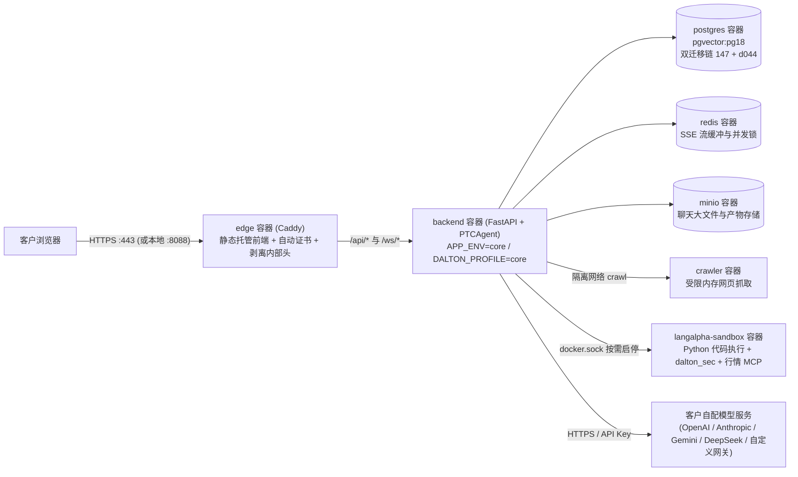
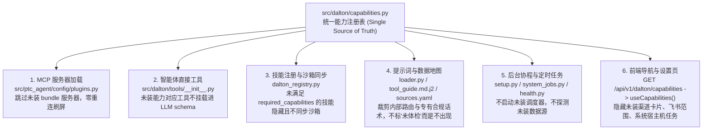
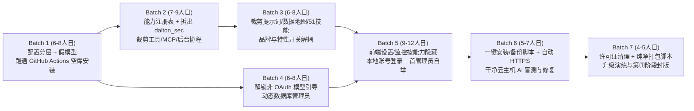

# 独立核心版本设计方案（产品化第 ① 阶段）

> **基线快照**：分支 `design/standalone-core`（基于 `fb8f2bdaa`）  
> **文档状态**：设计待审阅（待用户确认第 8 节的 5 项决策后进入分批开发）

---

## 一页摘要（给负责人与开发者）

### 1. 做什么

把当前只能在 Everflow 这台 Mac 上运行的 Dalton 系统，整理成**同一份代码仓库下的两种安装方式**：

- **核心安装（`DALTON_PROFILE=core`）**：面向新客户。在一台全新的 Linux 服务器上，从空数据库开始，客户只需填入**自己的域名、首个管理员账号和模型 API Key（Application Programming Interface Key，应用编程接口密钥）**，即可一键启动服务，完成新建工作区、流式对话、代码沙箱分析、上传文件、查看图表与报告。所有专属商业数据源、宿主机桥接程序、飞书/微信/Discord 渠道和本机定时采集任务默认留空；凡未安装的能力，在智能体工具列表、系统提示词、技能目录、设置页和定时任务中统一隐去，全程零报错运行。
- **Everflow 安装（`DALTON_PROFILE=everflow`）**：面向我们现有的 Mac 生产环境。默认开启全部既有数据源、宿主机桥接、团队权限与渠道推送，每一步开发都保证现有生产环境功能完整、数据原地保留、无需停机迁移。

本阶段（第 ① 阶段）聚焦“脱离单台 Mac 独立跑起来 + 未装能力干净隐去”，同时把能力开关注册点抽象成统一接口，为第 ② 阶段把 AlphaEngine、公司资料库（company wiki）等正式拆成独立插件包预留直接替换位。

### 2. 分几批、大概多少人周

全部工作拆成 **7 个独立开发批次（Batch 1 – Batch 7）**。每批改动均控制在开发代理（agy Neon High）单轮可高质量完成的规模，支持独立代码审查（codex `gpt-6.2-sol` + `grok 4.7`）、独立合入主分支并独立发布现网：

- **总体工期估算**：按推荐的“自带本地账号登录”方案计，合计 **43–57 人日（约 8.5–11.5 人周）**；若沿用外部 Supabase（托管式开源认证与后端云平台）服务则缩减至 **38–50 人日（约 7.5–10 人周）**，若首版直接做企业单点登录则约 **45–59 人日（约 9–12 人周）**。
- **最快见效节点**：**Batch 1（6–8 人日）**完成后，GitHub Actions（GitHub 托管的自动化持续集成运行器）就能在全新 Ubuntu Linux 环境上从空数据库跑通安装与假模型对话。
- **客户盲测节点**：**Batch 5** 完成后、**Batch 6** 期间，在一台干净的 Linux 云主机上由独立 AI 代理扮演新客户按文档从零盲装，暴露出的体验卡点当批修完。

### 3. 需要用户拍板的 5 件事（详见第 8.2 节）

| 编号 | 决策事项 | 推荐选项 |
|---|---|---|
| **决策 1** | 核心安装的默认登录方式 | **推荐方案 B：自带轻量本地账号（邮箱/用户名 + 密码 + 首个管理员网页引导 + 邀请链接）**，同时保留 `supabase` 模式供 Everflow 现网照常运行；企业 OIDC（OpenID Connect，开放身份认证单点登录）按后续客户需求追加（+4–6 人日）。 |
| **决策 2** | 核心安装的默认品牌与助手名称 | **推荐：支持 `.env` 配置 `BRAND_NAME`；客户未填时默认展示中性名 `Dalton`**（助手与平台同名，既脱离 `Everflow` 公司品牌，也保持独立产品辨识度）。 |
| **决策 3** | 投研知识层、三情景赔率卡与发布审校是否保留在核心版 | **推荐：保留**。这套投研工作流纯运行在容器与数据库内，是核心产品差异化价值；把固定收益门槛保留为可配参数，审校模型改为自动适配客户已配模型。 |
| **决策 4** | 公开美股财报工具 `dalton_sec` 的归属 | **推荐：从专有包 `plugins/dalton_data/` 拆入独立开源包 `plugins/dalton_sec/`（Apache-2.0 许可证）并随核心安装默认启用**，让客户开箱即有免费的美股财报核验能力。 |
| **决策 5** | 对外交付时是否用打包脚本物理剔除专有目录 | **推荐：同意**。开发主仓保持全量代码同源维护；对外交付时通过脚本导出纯净发行包，剥离 `plugins/dalton_data/`、宿主机桥接及 Everflow 内部运维脚本。 |

---

## 1. 现状清单：核心安装会碰到的“绑在这台 Mac 上”的耦合项

### 1.0 代码规模核对基线（基于 `fb8f2bdaa` 实测）

经对当前分支源码重新统计，关键规模指标如下：

- **Dalton 独占目录规模**：`src/dalton/` 共 **315 个文件**（22 个子目录与 24 个顶层模块）；`plugins/dalton/` 共 **347 个文件、51 份 `SKILL.md`**；`plugins/dalton_data/` 共 **5 个文件**；`scripts/dalton/` 共 **258 个文件、14 份 `launchd` 服务配置（`.plist` / `.plist.template`）**；`integrations/dalton-channel-gateway/` 共 **109 个文件**；前端 `web/` 下带 Dalton 或 Monitor 命名的文件共 **119 个**（含 `web/src/pages/Settings/panels/dalton/` 42 个、`web/src/lib/dalton/` 13 个、`web/src/components/dalton/` 7 个）。
- **宿主机桥接单文件体量**：`scripts/dalton/researchdata_bridge.py` 当前共 **26,636 行**。
- **上游文件挂载点（`DALTON-HOOK`）**：全仓共 **1,068 个文件、5,425 个匹配行**；与上游共同祖先 `e524325a9` 的文件交集为 **891 个上游文件、4,921 个匹配行**（分目录：`web/` 380 文件 / 2,043 行，`src/server/` 172 文件 / 1,268 行，`tests/` 149 文件 / 485 行，`src/ptc_agent/` 106 文件 / 665 行，`src/tools/` 30 文件 / 187 行，`other` 20 文件 / 60 行，`src/data_client/` 14 文件 / 89 行，`plugins/` 12 文件 / 65 行，`src/llms/` 8 文件 / 59 行）。`scripts/dalton/check_hooks.sh` 的 `ALLOWED_HOOKS` 白名单登记了 **182 个**钩子 ID，非文档源码实际引用 **181 个**（本克隆本地 `upstream/main` 领先共同祖先 **18** 个提交，Dalton 分支领先 **1,370** 个提交）。
- **数据库双迁移链**：上游 `migrations/versions/*.py` 共 **146 个脚本**（最新版本号 `147`）；Dalton `src/dalton/migrations/versions/*.py` 共 **43 个脚本**（`d001`–`d044`，无 `d034`），其中 **6 个迁移直接新增或修改了上游表的列、约束或索引**，另有 **1 个迁移向上游密钥表写入记录并外键引用上游表**。

以下按 6 个维度逐项列出耦合位置、现有职责及核心安装的处理方式（处理标签统一分为：**没装时隐藏**、**改成可配置**、**核心剥离/停用**、**拆包保留**、**留到第 ②/③ 阶段插件化**）。

### 1.1 宿主机桥接程序及依赖它的工具、路由与定时任务

| 位置（文件:行号 或目录） | 当前用途与本机耦合点 | 核心安装处理方式 |
|---|---|---|
| `scripts/dalton/researchdata_bridge.py:1-26636`（HTTP〔超文本传输协议〕路由分发位于 `:25375-26135`） | 运行在 Mac 宿主机 `127.0.0.1:8960` 的巨石守护进程。除 `/mcp`（`:25456`）商业研究检索外，同时承载 `/embed`（`:25375,:25626` 向量嵌入）、`/jobs/ops`（`:25645` 宿主机备份/看门狗状态）、`/notify`（`:25659` 卡片推送）、`/wiki/ingest`（`:25679`）、`/sales-notes/ingest`（`:25703`）、`/feishu/*`（`:25728` 飞书文档与知识库代理）、`/transcriptions/*`（`:25773` 火山引擎 Seed-ASR〔Automatic Speech Recognition，自动语音识别〕转写）、`/internal/market-digest/*`（`:25384,:25894-25927`）、`/internal/ai-finance/*`（`:25388-25392,:25958-26051`）及 `/internal/data-tasks/host-run`（`:26129` 宿主机定时任务执行）。 | **核心剥离/停用 + 留到第 ② 阶段拆分**：核心安装仅启动 Linux 容器内服务；所有指向 `:8960` 的客户端入口通过统一能力开关按配置启停，默认保持静默关闭。 |
| `plugins/dalton_data/mcp.json:4-23`、`plugins/dalton_data/plugin.json:9-23` | 整包许可证标为 `Proprietary`（专有），同时声明了两台 MCP（Model Context Protocol，模型上下文协议）服务器：`researchdata`（HTTP 连接 `${DALTON_RESEARCHDATA_URL}`）和 `dalton_sec`（stdio〔标准输入输出本地子进程通道〕服务器，调用公开美国证监会 SEC EDGAR 接口提取 XBRL〔可扩展商业报告语言〕财报数据）。当 `DALTON_RESEARCHDATA_URL` 为空时，`src/server/app/setup.py:950-959` 会启动 `mcp-builtin-reconnect` 后台协程持续尝试重连。 | **拆包保留 + 没装时隐藏**：将 `dalton_sec` 迁入独立开源插件目录 `plugins/dalton_sec/`（`Apache-2.0`）并在核心安装默认开启；`plugins/dalton_data/` 仅保留 `researchdata`，在 `src/ptc_agent/config/plugins.py:268-330` 按能力开关筛选加载，核心安装直接跳过登记。 |
| `scripts/dalton/research_runtime/`（含 `scripts/data_gateway.py:39-97`、`scripts/research_library.py:38`、`scripts/guidepoint_mcp_oauth.py:1`、`skills/company-wiki/scripts/company_wiki_cli.py:87`、`scripts/tmtb_alphaengine_sync.py:4`、`scripts/sales_notes_store.py:1`、`scripts/funda_ai.py:43`） | 宿主机研究数据子系统：AlphaEngine MCP（`127.0.0.1:8950`，依赖 macOS 钥匙串 `security` 命令与桌面客户端登录态，见 `docs/dalton/OPERATIONS.md:168,192`）、Guidepoint 代理（`127.0.0.1:8943` 与本地 OAuth〔开放授权〕回调 `:8942`）及本地 SQLite（轻量单文件数据库）四库检索。 | **留到第 ②/③ 阶段插件化**：核心安装跳过该目录；第 ② 阶段起按“客户自带供应商授权”拆为独立可选连接器。 |
| `integrations/dalton-channel-gateway/`（109 个文件）与 `src/dalton/settings.py:1071-1101`、`src/dalton/app/channels_router.py:43-46`、`src/dalton/notify/dispatch.py:43` | 运行在宿主机 `127.0.0.1:8962` 的 TypeScript 多渠道网关，处理飞书卡片/群聊、Discord 私信/频道与个人微信 iLink 扫码接入。 | **没装时隐藏 + 留到第 ③ 阶段插件化**：核心安装默认关闭渠道网关能力，仅在启用对应渠道时渲染前端绑定卡片与通知目标选择器；渠道容器化放到第 ③ 阶段。 |
| `src/dalton/tools/__init__.py:78-362` 及对应工具模块（`feishu_tools.py:69`、`wiki_tools.py:225`、`ingest_tools.py:72`、`market_digest_tools.py`、`ai_finance_*_tools.py`、`podcast_weekly_tools.py`、`notify_tools.py`、`automation_report_tools.py`、`report_delivery_tools.py`） | 当前 `build_dalton_tools()` 在 `settings.enabled=True` 时，直接向主智能体挂载 `ingest_company_wiki`（`:225,:315`）、`ingest_sales_note` / `ingest_research`（`:239,:328`）和 5 个 `feishu_*` 工具（`:150-156`），并对内部成员挂载 `market_digest_*`、`ai_finance_*`、`podcast_weekly_*`、`dalton_notify_settings` 等内部桥接工具（`:78-149`）。其中 `prepare_transcription`（`:258,:348`）已实现按开关挂载。 | **没装时隐藏**：参照 `is_transcription_enabled()` 的做法，把所有桥接与渠道工具绑定到统一能力注册表，仅在对应能力启用时挂载到智能体工具列表。 |
| `src/dalton/services/transcriptions.py:66,910` 与 `src/server/app/setup.py:909-919` | 录音转写后台 5 分钟对账协程与票据签发服务，依赖 MinIO（开源对象存储服务）与宿主机桥接 `/transcriptions/*` 转发火山 Seed-ASR。 | **没装时隐藏**：核心安装默认关闭 `transcription` 能力，跳过 `setup.py:915` 协程启动、隐藏 `/transcribe` 技能与 `prepare_transcription` 工具。 |
| `src/dalton/data_jobs/manifest.yaml:1-1070`（42 项任务：7 项 `runner: "host"`、35 项 `runner: "container"`）、`host_runner.py:1`、`container_runner.py:34`、`src/server/app/setup.py:921-931` | 确定性定时数据任务层：宿主机任务含 SSH（Secure Shell，远程安全登录协议）远程触发 Windows 机器拉取 Bloomberg 数据（`T1`/`T29`，`:5-26`）、Token 周报（`T61`）等；容器任务把 `var/dalton/openclaw-data` 挂载到容器内 `/Users/everflow/.openclaw/workspace` 跑内部看板脚本。 | **没装时隐藏**：核心安装将 `data_jobs.enabled` 默认设为 `false`，`setup.py:927` 跳过启动调度循环，设置页与自动化页隐去预设脚本任务。 |
| `src/dalton/monitors/data_job_registry.py:28-39` 与 `scripts/dalton/monitor_feeds/run_feeds.py` | 将 6 项内部数据任务（情绪看板、A 股盘中、港股动量等）绑定到监控面板自动发布，并由宿主机 `FeedDaemon` 60 秒轮询写入实时快照。 | **拆包保留 + 没装时隐藏**：保留监控面板平台（`src/dalton/monitors/`）供客户发布工作区生成的交互式 HTML 看板（核心安装默认开启 `artifact_publishing.enabled: true`）；当 `data_jobs` 未安装时隐藏内部数据任务绑定项。 |
| `src/dalton/data_map/health.py:1-102` 与 `src/server/app/setup.py:900-907` | 后端启动时自动触发 `run_startup_health_check_once()`，探测桥接 `researchdata` 全部子路由、`x_search`、`dalton_conversation_cards` 等健康态。 | **改成可配置 + 没装时隐藏**：健康检查改为仅探测能力注册表中“已启用”的数据源（核心安装只探测行情接口、`dalton_sec` 与客户已配的网页搜索）。 |

### 1.2 launchd 定时任务、看门狗、备份与部署脚本

| 位置（文件:行号 或目录） | 当前用途与本机耦合点 | 核心安装处理方式 |
|---|---|---|
| `scripts/dalton/launchd/*.plist.template`（6 份）、`scripts/dalton/ops/launchd/*.plist.template`（3 份）、`scripts/dalton/ops/prod/launchd/*.plist.template`（4 份）、`scripts/dalton/monitor_feeds/com.dalton.monitor-feeds.plist`（1 份），共 **14 份** | macOS 专用的 `launchd`（macOS 系统后台常驻与定时调度服务）配置，托管 Colima 虚拟机、桥接、渠道网关、AlphaEngine、Guidepoint、用量采集、看门狗与三层备份，且依赖宿主机系统时区为 `Asia/Shanghai`。 | **核心剥离/停用**：原样保留在 `scripts/dalton/` 供 Everflow 安装继续使用；Linux 核心安装直接依靠 Docker Compose（多容器编排工具）的 `restart: unless-stopped` 与容器内置 `healthcheck` 实现进程自愈。 |
| `scripts/dalton/ops/prod/deploy_main.sh:1-73`、`wait_backend_idle.sh`、`watchdog.sh`、`colima_launch.sh`、`portwatch.sh` | Everflow 生产发布与巡检脚本：写死快进合并 `origin/dalton/main`、归档日志到 `~/Library/Logs/Dalton/containers`（`:16`）、调用 `launchctl` 触发 `com.dalton.pg-backup`、强制前端带 `--require-supabase` 构建（`:62`）。 | **核心剥离 + 新增通用脚本**：原脚本不动以保护 Everflow 生产发布；面向 Linux 客户新增 `scripts/standalone/{init,upgrade,backup,restore}.sh` 标准脚本集。 |
| `scripts/dalton/ops/dalton_config_git_backup.sh`、`dalton_db_offsite.sh`、`dalton_data_backup.sh`（见 `docs/dalton/OPERATIONS.md:341-345,413`） | 三层异地灾备：强依赖外置固态盘 `/Volumes/EveSSD` 生成 SQLite 快照、`rclone` 上传 Google Drive `DaltonBackup/` 以及推送私人 GitHub 配置仓库。 | **核心剥离 + 新增通用脚本**：核心安装提供无路径绑定的 `scripts/standalone/backup.sh`（导出一致性 PostgreSQL `.dump` 与对象存储归档到指定本地目录或兼容 S3〔Simple Storage Service，通用对象存储接口〕存储桶）。 |
| `scripts/dalton/docker_build_backend.sh:12-25`、`scripts/dalton/Dockerfile.dalton:89-105` | 构建后端镜像时强制校验宿主机 `git rev-parse` 注入 `BUILD_GIT_SHA` / `BUILD_GIT_DIRTY`，并扫描绑定挂载目录生成 `/app/.build_files.sha256` 指纹供 `/api/v1/dalton/openclaw/health` 核验。 | **改成可配置**：核心安装采用自包含生产镜像（代码打入镜像内，无需宿主机挂载 `./src`），支持在构建时自动填入版本标签，脱离客户端宿主机 Git 工作树。 |
| `scripts/dalton/build_frontend_prod.sh:14-44` | 默认加载 `web/.env.dalton`（注入 `Everflow` 品牌）并在 `--require-supabase` 下校验 Supabase 变量，同时构建静态帮助站 `docs-site/` 到 `web/dist/help/`。 | **改成可配置**：在核心安装的容器化多阶段构建中直接编译前端静态包，按客户 `.env` 注入品牌名与认证模式，无需客户宿主机安装 Node.js 或 `pnpm`。 |

### 1.3 写死的路径、账号、固定 ID、域名、品牌与模型账号

| 位置（文件:行号 或目录） | 当前用途与本机耦合点 | 核心安装处理方式 |
|---|---|---|
| `/Users/everflow/.openclaw/workspace`（`src/dalton/data_jobs/manifest.yaml` 56 处、`container_runner.py:34`、`runner_wrapper.py`、`d029_data_tasks.py`、`scripts/dalton/data_assets/scripts/sentiment_dashboard_digest.sh:11`） | 早期 OpenClaw 迁移遗留的工作目录路径，容器内通过挂载把 `var/dalton/openclaw-data` 映射到该 Mac 用户路径。 | **没装时隐藏 + 改成可配置**：核心安装关闭 `data_jobs` 后不触发任何该路径挂载；同时把 `manifest.py` 默认工作目录提取为环境变量可覆盖常量。 |
| `/opt/homebrew/bin/*` 与 `~/Library/*`（`scripts/dalton/Dockerfile.dalton:62-64`、`scripts/dalton/ops/*`、`scripts/dalton/researchdata_bridge.py` 等 60 余处脚本引用） | macOS Homebrew 二进制路径与用户目录（日志、缓存、用量 SQLite 账本 `~/Library/Application Support/Everflow/...`）。 | **核心剥离/改成可配置**：核心容器镜像使用标准 `/app/.venv/bin/python` 与容器卷 `/app/var/dalton`；宿主机专属脚本仅在 Everflow 安装运行。 |
| `src/dalton/company_identity.py:18-20`（`COMPANY_SYSTEM_USER_ID = "system:dalton-company"`、`company-system@dalton.internal`、`Dalton Company System`） | 公司级共享自动化任务的非人类系统属主行（在迁移 `d035:204` 写入 `automations_company_owner_check` 约束，且 `reject_company_system_auth` 禁止外部令牌登录该账号）。 | **保留内部标识 + 显示名可配置**：`system:dalton-company` 是纯内部数据库主键且禁止外部登录，保留该内部键值可完全兼容 `d035` 约束；将展示名称改为跟随客户 `BRAND_NAME`。 |
| `DALTON_PM_USER_IDS`（`src/dalton/settings.py:418,456-473`、`src/dalton/credentials.py:60`、`src/dalton/autonomy/system_jobs.py:105-121`） | 通过 `.env` 逗号分隔写死管理员 UUID（通用唯一识别码），且 `DALTON_PM_USER_IDS[0]` 作为全团队模型凭据唯一持有人。新部署若沿用此机制，会出现“必须先建用户查到 UUID → 再改 `.env` 重建容器”的鸡生蛋死锁。 | **改成数据库动态驱动（兼容环境变量）**：将管理员判定与团队凭据持有人解析改为**数据库 `dalton_members(tier='admin')` ∪ `DALTON_PM_USER_IDS`**；首个管理员在网页引导创建时自动写入数据库并成为默认凭据持有人，Everflow 现有环境变量配置无缝兼容。 |
| `SEC_USER_AGENT` 兜底值（`src/dalton/settings.py:1177-1183`） | 未配 `SEC_USER_AGENT` 与 `EDGAR_IDENTITY` 时，默认回退到 `"DaltonResearch research@everflowinv.com"`。 | **改成可配置**：`init.sh` 引导用管理员邮箱自动生成合规 `SEC_USER_AGENT`（如 `<Brand> <admin_email>`）；代码兜底改为中性占位并在启动日志提示配置，杜绝向美国证监会发送 Everflow 邮箱。 |
| 历史一次性运维/实机脚本中的固定 ID（`scripts/dalton/migrate_owner_identity.py:54-55` `richard.lu@everflowinv.com`、`rebind_workspaces_to_primary.py:87-88` 主计算机 UUID、`realrun/_common.py:58-63` 四个公司工作区 UUID） | 单用户时期向 Supabase 迁移及内部实机验收专用脚本，运行期主服务不调用。 | **核心剥离**：归入内部历史运维脚本，核心安装容器与对外发行包不执行、不打包这些文件。 |
| 邀请合成邮箱域 `team.dalton.local`（`src/dalton/settings.py:1257`、`web/src/config/daltonAuth.ts:15`） | 受邀成员用纯用户名注册时拼接的内部邮箱后缀。 | **改成可配置**：`init.sh` 自动将默认后缀设为 `team.<客户域名>`（本地模式支持直接用邮箱或用户名登录）。 |
| 代理虚拟网段 `network.fake_ip_cidrs: ["198.18.0.0/15"]`（`src/dalton/dalton.yaml:52-60`） | 适配 Everflow 这台 Mac 宿主机透明代理的 Fake-IP（代理返回的虚拟占位 IP）模式，命中后会额外向 `1.1.1.1` / `dns.google` 发 DoH（DNS over HTTPS，加密域名解析）核验真实地址。 | **改成可配置**：在 `dalton.core.yaml` 中默认设为空列表 `[]`，使标准 Linux 云主机直接走系统 DNS 与常规私网防护，避免受限内网因连不上外部 DoH 而误拦正常网页抓取。 |
| 边缘网关 `deploy/dalton/Caddyfile:1-6` 与 `scripts/dalton/check_public_edge.sh:1-25` | 假定前端流量已由宿主机 Tailscale Funnel `:8443` 终止 TLS（加密传输层），因此写死 `auto_https off` 并仅监听回环 `:8088`。 | **改成可配置**：新增 `deploy/standalone/Caddyfile`，读取客户 `.env` 的 `DOMAIN`：填入正式域名时由 Caddy（支持自动管理 HTTPS 证书的反向代理服务器）自动签发并续期 Let's Encrypt HTTPS 证书（监听 `80`/`443`）；填入 `localhost` 或内网地址时自动以 HTTP 模式启动。 |
| 品牌与前端功能开关混绑（`web/.env.dalton`、`web/src/config/brand.ts:12-21`、`web/src/config/supportLinks.ts:40-44`、`src/ptc_agent/agent/prompts/templates/system.md.j2:1`、`src/server/app/share_pages.py:29`） | `brand.ts:21` 写死 `isDaltonBuild = BRAND_MARK === 'everflow'`，把“是否启用 Dalton 前端交互特性”和“是否显示 Everflow 商标”绑死在一起；一旦客户改掉 `VITE_BRAND_MARK`，线程权限与模型选择逻辑就会退回未适配分支。同时系统提示词首行写死 `Everflow's investment research agent`。 | **解耦品牌与特性开关**：将 `isDaltonBuild` 改为独立的构建/运行期特性标志（核心安装与 Everflow 安装均为 `true`），而视觉品牌（`BRAND_NAME`、Logo、Favicon、提示词平台名、分享降级页文案）独立读取客户配置，默认回退中性名 `Dalton`。 |
| **【新核查出的关键阻塞点】模型配置全绑定私有 OAuth 且首次设置向导硬锁死**（`agent_config.dalton.yaml:10-25,58-66`、`src/dalton/dalton.yaml:65-81,106-120`、**`web/src/config/daltonSetup.ts:35-41,66-89,197-210`**） | 1) 后端默认主模型、子智能体、辅助模型与审稿候选列表全部写死 `*-oauth`（`claude-opus-5-5-oauth`、`gemini-4-neon-high-oauth`、`grok-4.7-oauth`、`muse-wonder-1.0-oauth`）；<br>2) **前端 `daltonSetup.ts:35-41` 的 `DALTON_SETUP_CANDIDATES` 仅列了 5 个 `-oauth` 模型，且 `:66-89` 与 `:197-210` 在找不到这 5 个 OAuth 模型时直接返回空对象 `{}` 与 `available: false`**——导致新客户哪怕填好了有效的 OpenAI / Anthropic / Gemini / DeepSeek API Key，首次进入 `/setup/default` 也会被拦死，无法完成初始化！ | **解除硬锁 + 动态跟随可用模型**：核心安装的 `agent_config.core.yaml` 与 `dalton.core.yaml` 清空预设 `*-oauth` 模型名；前端 `daltonSetup.ts` 在核心模式下当精选列表无命中时，自动回退展示客户已接通的全部支持工具调用（tool-calling）的模型（含 BYOK〔Bring Your Own Key，自带密钥〕及自定义 OpenAI 兼容网关模型）；后端辅助模型与审校模型未单独指定时自动复用客户主模型/后台模型。 |

### 1.4 默认假定专属数据源存在的提示词、skill、工具说明、设置页、自动任务模板

| 位置（文件:行号 或目录） | 当前用途与专属假设 | 核心安装处理方式 |
|---|---|---|
| 系统提示词工具指南 `src/ptc_agent/agent/prompts/templates/components/tool_guide.md.j2:23-35` 与加载器 `src/ptc_agent/agent/prompts/loader.py:132-150` | 无条件向系统提示词写入“研究服务提供卖方、专家、管理层原话和内部笔记”、“大盘问题先查 `macro(route="market-regime")`”，并每次注入 `<data_map>`。 | **没装时隐藏**：上述段落按能力注册表条件渲染；未装 `researchdata_bridge` 时，提示词只保留通用金融工具、公开 SEC、网页搜索与代码沙箱指引。 |
| 数据地图配置与渲染器 `src/dalton/data_map/sources.yaml:12-151`、`src/dalton/data_map/builder.py:300-360,472-490` | 缓存未命中或无桥接时，静态回退逻辑会把 `alphaengine`、`guidepoint`、`transcript`、`company-wiki`、`sales-notes`、`tmtb`、`funda-ai`、`gcal` 等 18 条内部路由全部标成 `未体检` 拼进提示词，误导模型去调用不存在的 `tools.researchdata`。 | **没装时隐藏**：在 `sources.yaml` 为每条路由标注所需 `capability`；`builder.py` 渲染前先过滤掉未安装能力的路由与第 2 节标题，确保未装的数据源在 `<data_map>` 中零出现。 |
| 51 项内置技能 `plugins/dalton/skills/*` 与注册表 `src/ptc_agent/agent/middleware/skills/dalton_registry.py:70-166` | 51 个技能中，约 22 个是强绑内部数据源或特定分析师个人的定时简报技能（如 `dalton-ai-finance-daily`、`dalton-market-digest`、`dalton-tmeet-weekly-minutes`、`dalton-richard-earnings`、`dalton-richard-coverage-weekly`、`dalton-mark-weekly-newenergy`、`dalton-wiki-auto-ingest`、`dalton-podcast-weekly`、`dalton-transcript-polish` 等）；核心方法论 `plugins/dalton/skills/dalton-conventions/SKILL.md:75-94` 还写入了 Everflow 内部对专家访谈/Guidepoint 的合规放行声明（“2026-10-18 owner 确认可用、Guidepoint ≤20 词”）和飞书文档读写指引。 | **没装时隐藏 + 通用化剥离**：在 `_DALTON_SKILL_SPECS` 中为每个技能声明依赖的能力键，未满足的技能在核心安装自动设为 `hidden=True` 并跳过向沙箱 `.agents/skills/` 同步；将 `dalton-conventions/SKILL.md` 中的专有合规背书与内部源速查抽到独立参考文件，仅在对应能力启用时注入，保留通用三情景估值与五词结论骨架。 |
| 设置页分组与卡片 `web/src/pages/Settings/sections.ts:77-94,195-243` 及 `web/src/pages/Settings/panels/dalton/*`（42 个文件） | 包含大量专属卡片：飞书/Discord 绑定（`:225`）、个人微信绑定（`:226`）、通知目标（`:224`）、飞书知识空间读取范围（`:237`）、团队微信机器人（`:239`）、飞书团队群（`:240`）、Discord 频道（`:241`）、宿主机/公共系统任务看板（`:242`）、原生 OAuth 目录同步（`:234`）、历史团队对话记忆开关（`:197`）。 | **没装时隐藏**：前端接入后端能力清单接口，`sections.ts` 的 `sectionShown` 与各条目 `visibleWhen` 统一校验能力开关；核心安装下未启用渠道与归档时，上述专属卡片及空的 `teamChannels` 分组自动隐藏，保留个人资料、通用外观、对话、模型、预算、覆盖结构与团队成员/共享模型管理。 |
| 自动任务报告模板 `src/dalton/database/automation_reports.py:87-110`、系统任务视图 `src/dalton/autonomy/system_jobs.py:76-96`、默认覆盖表 `config/dalton/coverage.yaml:1-80` | 硬编码 26 个内部报告 `REPORT_PROFILES`（要求飞书卡片目标与 Discord 失败告警目标）、宿主机运维任务条目（`ops-db-backup`、`ops-backend-watchdog`）以及 Everflow 的 105 家跟踪公司名单（Core 27 + Watch 78）。 | **没装时隐藏 + 空初始态**：核心安装下默认覆盖名单为空（客户自行添加标的），`system_jobs.py` 按能力隐去 `DEFAULT_OPS_JOBS` 宿主机项，用户创建的定时研究任务结果直接保存在平台内（后续接入渠道插件后再开放群推送配置）。 |

### 1.5 `config.dalton.yaml`、`APP_ENV=dalton` 等配置分层

| 位置（文件:行号 或目录） | 当前机制与局限 | 核心安装处理方式 |
|---|---|---|
| `src/ptc_agent/config/file_utils.py:230-255`、`config.dalton.yaml:1-125`、`agent_config.dalton.yaml:1-107` | 当 `APP_ENV=dalton` 时在基准 `config.yaml` / `agent_config.yaml` 之上叠加 `*.dalton.yaml`（字典递归合并、列表整体替换）。但 `agent_config.dalton.yaml` 同时混放了“通用合理配置（Docker 沙箱、关闭内置远程浏览器、爬虫独立容器）”与“Everflow 私有配置（`*-oauth` 模型链、`researchdata` 超时、`gemini_grounding` 搜索、`x_search: true`）”。 | **新增 `core` 叠加层**：Everflow 安装保持 `APP_ENV=dalton` 一字不动；核心安装使用 `APP_ENV=core`，新增 `config.core.yaml` 与 `agent_config.core.yaml`——保留安全与容器配置（Docker 沙箱、关闭内置浏览器与交易、独立 `crawler` 容器），清空私有 OAuth 模型名，搜索默认设为免密钥可用的内置方案（客户填入搜索引擎或 Gemini Key 后自动升级）。 |
| `src/dalton/dalton.yaml:1-179`、`src/dalton/settings.py:27,476-492`、`src/dalton/llm/role_policy.py:349-358` | `settings.py` 固定只读 `src/dalton/dalton.yaml`，忽略 `APP_ENV`；且 `role_policy.py:349` 在 `APP_ENV` 为空时仍强行合并 `agent_config.dalton.yaml`。导致 Fake-IP、`data_jobs.enabled: true`、`conversations.enabled: true` 与 `*-oauth` 审稿/辅助模型在任何环境都生效。 | **引入 `DALTON_PROFILE` 叠加**：在 `settings.py` 增加 `DALTON_PROFILE`（`APP_ENV=dalton` 时默认 `everflow`；`APP_ENV=core` 时默认 `core`）。当 `DALTON_PROFILE=core` 时，在 `dalton.yaml` 之上自动合并 `src/dalton/dalton.core.yaml`（关闭专属能力开关、清空 Fake-IP 与私有模型名、开启 `artifact_publishing` 供工作区看板使用），并修正 `role_policy.py` 按当前 `APP_ENV` 加载对应叠加文件。 |
| `docker-compose.yml` + `docker-compose.dalton.yml:45,51-66` | `docker-compose.dalton.yml:45` 将 `REDIS_URL` 硬编码为容器内 `redis:6379`，且大量依赖宿主机源码目录读写挂载与预构建好的 `./web/dist`。 | **独立核心编排文件**：新增自包含的 `docker-compose.core.yml`，保留 `docker-compose.dalton.yml` 专供 Everflow 宿主机开发与生产使用，互不干扰。 |

### 1.6 两条迁移链在空库上从头跑的情况，以及改到上游表的 Dalton 迁移

#### （1）空库从零执行现状核验

启动入口 `scripts/dalton/docker_entrypoint_dalton.sh:15-21` 按固定顺序依次通过 Alembic（数据库表结构版本迁移工具）执行：
1. 上游迁移链：`uv run alembic upgrade head`（`migrations/versions/`，共 146 个脚本，头节点 `147_shared_workspace_team`，版本记录在 `alembic_version` 表）；
2. Dalton 迁移链：`uv run alembic -c src/dalton/alembic.ini upgrade head`（`src/dalton/migrations/versions/`，共 43 个脚本，头节点 `d044_llm_journal_attempts`，非线性段 `d031 -> d035 -> d036 -> d032 -> d033 -> d037..d044`，版本记录在 `alembic_version_dalton` 表）。

经逐一核查全部 43 个 Dalton 迁移脚本，**在空数据库上从头跑通需满足两个硬前提**（满足后保留全部历史迁移即可一次性跑通）：
- **前提 A（数据库扩展依赖）**：`d009_conversation_archive.py:21-22` 执行 `CREATE EXTENSION IF NOT EXISTS vector` 与 `pg_trgm`，`d030_channel_gateway.py:22` 执行 `CREATE EXTENSION IF NOT EXISTS pgcrypto`（且后续 `d038_monitors.py:109` 依赖 `gen_random_bytes(32)`）。因此核心安装的 PostgreSQL 容器**统一采用预装 `pgvector`（PostgreSQL 向量检索扩展）的 PostgreSQL 18 镜像**（复用 `scripts/dalton/Dockerfile.postgres` 或官方 `pgvector/pgvector:pg18`）。
- **前提 B（严格先后顺序）**：`d035_company_automations.py:62-68` 在升级开头显式校验 `public.users`、`public.workspaces`、`public.automations` 三张上游表已存在，因此任何初始化脚本都必须先跑完上游 `upgrade head` 再跑 Dalton `upgrade head`。

#### （2）触及上游表的 Dalton 迁移完整清单（代码复核修正：6 个结构/索引变更 + 1 个密钥写入/外键 + 3 个纯外键）

前期调研仅统计出 4 个改上游表的迁移，本次全量扫描 SQL 与动态拼接代码后，核实完整清单如下：

| 迁移脚本与行号 | 触及的上游表 | 具体变更内容 | 核心安装处理策略 |
|---|---|---|---|
| `d004_provenance_locator.py:17-20` | `provenance_records` | `ALTER TABLE` 新增可空列 `dalton_source_url`、`dalton_as_of`。 | **原样保留**（支撑研报与 SEC 来源精确定位，纯增量可空列，不影响上游读写）。 |
| **`d020_colleague_dispatch_threads.py:58,161-176,195,216,224`**（调研漏计：使用 `f"ALTER TABLE {table}"` 动态语句） | `conversation_threads`、`wakeups` | 给 `conversation_threads` 新增可空列 `user_id`、批量回填属主并建 2 个并发索引（`idx_conversation_threads_user_updated`、`idx_conversation_threads_ws_user`）；给 `wakeups` 新增可空列 `created_by_run_id`。内部已带 `information_schema.columns` 幂等判断。 | **原样保留**（支撑多成员工作区线程归属隔离，空库执行耗时 < 50ms）。 |
| `d035_company_automations.py:82,155-285` | `users`、`automations` | 向 `users` 插入系统行 `system:dalton-company`；给 `automations` 新增 12 列（`scope`、`notify_enabled`、`notify_routes`、`config_version`、`deleted_at` 等）与 8 个 `CHECK` 约束，将上游唯一索引 `idx_automations_user_file_name` 替换为 `WHERE deleted_at IS NULL` 部分唯一索引，并新建 `idx_automations_scope_deleted`。 | **原样保留**（支撑自动化软删除、版本历史与公司级任务，核心安装直接复用这套增强能力）。 |
| `d038_monitors.py:28,108-111` | `share_links`、`server_keys` | `dalton_monitors.artifact_id` 外键引用 `share_links(artifact_id)`；并执行 `INSERT INTO server_keys (name, secret) VALUES ('monitor_grant', gen_random_bytes(32))` 写入面板签名密钥。 | **原样保留**（支撑工作区 HTML 监控看板安全授权访问）。 |
| `d041_team_coverage_units.py:532-535` | `automation_executions` | `ALTER TABLE` 新增可空列 `coverage_unit_id`、`coverage_unit_version`。 | **原样保留**（纯可空扩展列，支持覆盖单元关联）。 |
| `d042_automation_reasoning_effort.py:43-50` | `automations` | `ALTER TABLE` 新增可空列 `reasoning_effort` 及枚举 `CHECK` 约束。 | **原样保留**（支持定时任务思考强度配置）。 |
| **`d043_automation_executions_thread_index.py:24-33`**（调研漏计：跨行 `CREATE INDEX CONCURRENTLY`） | `automation_executions`、`automations` | 新建并发索引 `idx_automation_executions_thread_created` 与 `idx_automations_user_workspace`。 | **原样保留**（纯查询加速索引，空库瞬间完成）。 |
| `d018:22`、`d028:22`、`d030:84,100` | `workspaces` | 自有表 `dalton_workspace_sharing`、`dalton_workspace_settings`、`dalton_channel_*` 通过 `REFERENCES workspaces(workspace_id)` 建立级联外键。 | **原样保留**（未开启对应能力时表为空，零运行开销，且日后安装插件时无需停机补跑旧迁移）。 |

---

## 2. 目标形态：客户从零安装的架构与体验

### 2.1 核心安装组件架构图

核心安装全部运行在单台 Linux 主机的 Docker 容器网络中，脱离任何外部宿主机守护进程与专有账号：



### 2.2 从 `git clone` 到发出第一条消息的 4 步流程

面向客户的完整冷启动路径控制在 **3 条终端命令 + 1 次浏览器引导**：

1. **拉取代码**
   ```bash
   git clone https://github.com/<org>/<repo>.git dalton && cd dalton
   ```
2. **运行初始化脚本（自动体检环境并生成密钥）**
   ```bash
   bash scripts/standalone/init.sh
   ```
   - 脚本检查 Docker Engine（≥ 24.0）、Docker Compose（≥ v2.24.4）、可用内存（建议 ≥ 8 GB）与磁盘空间（≥ 30 GB）；
   - 自动用 `openssl rand -hex 32` 生成数据库密码、Redis 密码、MinIO 密钥、`INTERNAL_SERVICE_TOKEN`、`BYOK_ENCRYPTION_KEY`、本地登录签名密钥 `JWT_SIGNING_SECRET` 及一次性管理员自举口令 `BOOTSTRAP_SETUP_TOKEN`；
   - 仅提示客户输入 `DOMAIN`（如 `research.client.com`，本地试用直接回车用 `localhost`）和可选的模型 API Key（也可留到网页引导再填）。
3. **一键拉起核心服务栈**
   ```bash
   docker compose -f docker-compose.core.yml up -d
   ```
   - 自动拉取或构建容器镜像，等待数据库就绪，按顺序跑完上游 `147` 与 Dalton `d044+` 迁移，启动 `postgres`、`redis`、`minio`、`crawler`、`backend` 与 `edge`；
   - 终端打印访问地址与一次性 `BOOTSTRAP_SETUP_TOKEN`。
4. **浏览器创建首个管理员并发起第一次对话**
   - 打开 `https://<DOMAIN>`（或 `http://localhost:8088`），系统检测到尚无管理员，自动进入 **`/setup/admin` 首次管理员创建页**；
   - 输入刚打印的一次性自举口令、管理员邮箱/姓名与登录密码，点击完成即自动登录；
   - 若第 2 步未填模型 API Key，在紧随其后的连接步骤填入任意一家模型 Key（或 OpenAI 兼容网关地址 + Key），系统自动将其选为团队默认模型；
   - 进入首页新建工作区（如 `AAPL`），上传一份 PDF 或直接提问，收到首条流式分析回复。

### 2.3 客户需要填写的配置项清单（极简原则）

除下表前 2 项外，其余所有密码、内部通信令牌与安全参数全部由 `init.sh` 自动生成：

| 配置项 | 是否必填 | 填写位置 | 说明 |
|---|---|---|---|
| `DOMAIN` | **必填**（默认 `localhost`） | `init.sh` 或 `.env` | 填正式公网域名时 Caddy 自动申请 HTTPS 证书；填 `localhost` 或内网 IP 时走 HTTP。 |
| 首个管理员账号 + 密码 | **必填** | 浏览器 `/setup/admin` 页面 | 首次启动在网页端输入，配合终端输出的一次性自举口令完成创建。 |
| 至少 1 个模型凭据 | **必填**（二选一位置） | `.env`（如 `OPENAI_API_KEY`）或网页 `/setup` 向导 | 支持 OpenAI、Anthropic、Google Gemini、DeepSeek、xAI、智谱或任意 OpenAI 兼容接口（`base_url` + Key）。 |
| `BRAND_NAME` | 可选（默认 `Dalton`） | `.env` | 客户自定义平台显示名称（用于网页标题、导航与提示词自我介绍）。 |
| `SEC_USER_AGENT` | 可选（默认由管理员邮箱拼装） | `.env` | 美国证监会 EDGAR 接口要求的访问标识（格式：`机构名 联系邮箱`），`/setup/admin` 创建管理员后若未显式配置可自动采用管理员邮箱。 |
| `TAVILY_API_KEY` / `SERPER_API_KEY` / `FIRECRAWL_API_KEY` | 可选 | `.env` 或设置页 | 增强外网新闻搜索与反爬网页抓取；未填时默认使用免密钥内置抓取器（`inhouse`）与公开行情接口（`yfinance`）。 |

### 2.4 首个管理员的产生与防抢注机制

为彻底消除现有架构中“必须先去外部认证系统建号查 UUID，再回头手改 `.env` 里的 `DALTON_PM_USER_IDS` 并重建容器”的割裂流程，首个管理员采用**数据库自举锁**产生：

1. **自举状态判定**：当数据库 `dalton_members` 表中不存在 `tier = 'admin'` 的记录且 `.env` 未显式锁定 `DALTON_PM_USER_IDS` 时，`GET /api/v1/dalton/bootstrap/status` 返回 `{"needs_admin_setup": true}`，前端路由自动将未登录用户引导至 `/setup/admin`。
2. **一次性口令防公网抢注**：`POST /api/v1/dalton/bootstrap/admin` 强制校验请求体中的 `bootstrap_token` 与服务端环境变量 `BOOTSTRAP_SETUP_TOKEN`（常量时间比对 `hmac.compare_digest`）。公网部署从容器启动到管理员打开网页的窗口期内，外部扫描器因没有服务器终端口令，无法抢注管理员。
3. **单事务原子落库与永久关门**：校验通过后，后端获取 PostgreSQL 事务级咨询锁（Advisory Lock），再次确认 `admin` 数量为 0，在单事务内写入 `users`、密码凭据表与 `dalton_members(tier='admin')`。一旦提交成功，`/bootstrap/admin` 永久返回 `409 Conflict`；该管理员自动成为团队模型凭据默认持有人，后续新成员统一由管理员在“设置 → 团队管理 → 成员与权限”生成 7 天有效的一次性邀请链接（`{PUBLIC_APP_URL}/invite#{token}`）加入。
4. **外部认证模式兼容**：若客户选用 OIDC 或 Supabase 模式，支持在 `.env` 配置 `INITIAL_ADMIN_EMAIL=admin@client.com`；该邮箱首次完成验签登录时，后端自动在 `dalton_members` 中将其登记为 `admin`。

---

## 3. “没装就不出现”的统一机制（Capability Registry）

### 3.1 单一权威源设计：`src/dalton/capabilities.py`

新建 `src/dalton/capabilities.py` 作为全栈唯一的“能力是否已安装”判定入口。所有模块只问 `has_capability(cap_id)`，不再各自散落读取环境变量或猜测端口：

```python
# src/dalton/capabilities.py 核心概念结构
class CapabilityId(StrEnum):
    RESEARCHDATA_BRIDGE = "researchdata_bridge"   # 宿主机研究桥接总开关
    ALPHAENGINE         = "alphaengine"           # 卖方研报与纪要（第 ② 阶段独立插件）
    GUIDEPOINT          = "guidepoint"            # 专家访谈库（第 ③ 阶段独立插件）
    COMPANY_WIKI        = "company_wiki"          # 基金内部 Wiki 读写（第 ② 阶段独立插件）
    SALES_NOTES         = "sales_notes"           # 销售笔记库与入库（第 ③ 阶段独立插件）
    TMTB                = "tmtb"                  # TMT 收盘总结（第 ③ 阶段独立插件）
    FUNDA_AI            = "funda_ai"              # FUNDA AI 研究库（第 ③ 阶段独立插件）
    FEISHU_DOCS         = "feishu_docs"           # 飞书文档/知识空间读写工具与权限页
    CHANNEL_FEISHU      = "channel_feishu"        # 飞书消息卡片、群聊与账号绑定
    CHANNEL_DISCORD     = "channel_discord"       # Discord 私信与团队频道绑定
    CHANNEL_WEIXIN      = "channel_weixin"        # 微信个人号与团队机器人扫码绑定
    TRANSCRIPTION       = "transcription"         # 火山 Seed-ASR 录音转写与校对技能
    CONVERSATION_ARCHIVE= "conversation_archive"  # 历史团队对话归档卡片检索
    DATA_JOBS           = "data_jobs"             # 确定性定时数据采集任务与关联看板
    FUND_AUTOMATIONS    = "fund_automations"      # Everflow 内部 26 类定时简报模板与工具
    NATIVE_OAUTH_SYNC   = "native_oauth_sync"     # Everflow 私有订阅模型目录同步面板
```

- **配置来源与多进程安全**：能力状态由 `src/dalton/dalton.yaml`（按 `DALTON_PROFILE` 叠加 `dalton.core.yaml`）及显式环境变量（`DALTON_CAP_<NAME>=true|false`，并兼容现存的 `DALTON_TRANSCRIPTION_ENABLED`、`DALTON_DATA_JOBS_ENABLED`、`DALTON_RESEARCHDATA_URL` 等变量）纯函数解析得出，不在进程内存保存可变跨请求状态，严格符合多进程后端（`--workers N`）规范。
- **第 ① 阶段与第 ② 阶段无缝衔接**：第 ① 阶段 `has_capability("alphaengine")` 从部署配置读取静态开关；进入第 ② 阶段将 AlphaEngine 和 Company Wiki 拆成可上传/可独立安装的插件包时，只需把 `capabilities.py` 内部对应枚举项的判定逻辑切换为查询数据库“已安装且已启用的插件注册表”，下方六个消费层无需改动业务代码。

### 3.2 一处声明、六处自动裁剪



各消费层的具体执行规则：
1. **MCP 服务器层（`plugins.py`）**：在 `plugin.json` 的 `extensions["ai.langalpha"].servers.<key>` 中支持可选字段 `"capability": "researchdata_bridge"`；`bundled_mcp_servers()` 遇到未启用能力直接跳过，沙箱不生成 `tools.researchdata` 包装文件，后端也不发起连接探测。
2. **LangChain 直接工具层（`src/dalton/tools/__init__.py`）**：把所有工具构造函数收敛为一张声明式注册表 `(builder_fn, roles, min_tier, required_capability)`，核心安装下自动只挂载知识层（`knowledge_*`）、发布审校（`check_draft`/`check_language`/`publish_report`/`dalton_check_done`）、研究总监协同与日程（`dalton_coverage*`/`dalton_schedule_automation`）、监控面板（`dalton_monitor`）和对话切模型（`switch_thread_model`），其余内部桥接/飞书/转写/简报工具全部不挂载。
3. **技能层（`dalton_registry.py`）**：将 `_DALTON_SKILL_SPECS` 每项扩充为 `(name, command, requires, required_capabilities)`；核心安装下 20 余个内部简报与转写技能自动归入隐藏态且不复制到工作区沙箱。
4. **提示词与 `<data_map>` 层（`sources.yaml`、`builder.py`、`tool_guide.md.j2`）**：`sources.yaml` 每条路由增加 `capability` 字段；未安装能力的路由在 `merge_catalog_routes()` 阶段直接剔除（当所有第 2 节桥接路由均剔除时，连第 2 节小标题一并省去）。
5. **生命周期与健康探测层（`setup.py`、`health.py`、`system_jobs.py`）**：`setup.py` 按能力决定是否启动 `data_jobs` 与 `transcriptions` 后台循环；`health.py` 只对已安装数据源发探测请求；`system_jobs.py` 隐去宿主机运维条目。
6. **前端界面层（`GET /api/v1/dalton/capabilities` → `web/src/hooks/useCapabilities.ts`）**：后端返回已启用能力数组与公开品牌信息；前端与 `useFeatures.ts` 保持相同的默认关闭（Fail-Closed，加载完成前默认视为未启用，防止专属卡片闪烁）策略，驱动 `Settings/sections.ts` 隐藏飞书/微信/Discord 绑定卡片、原生模型同步卡片、团队历史记忆卡片及整个空的 `teamChannels` 分组。

### 3.3 Everflow 安装如何保持全部开启

- 在 `src/dalton/dalton.yaml`（基准配置，对应 `DALTON_PROFILE=everflow`）中，现有 Everflow 已投产的能力全部保持默认启用；且当 `APP_ENV=dalton` 且未显式指定 `DALTON_PROFILE` 时，`settings.py` 自动将 `DALTON_PROFILE` 设为 `everflow`。
- 因此，**Everflow 生产环境的 `.env`、启动命令与 `deploy_main.sh` 无需修改任何一行参数**，升级后所有桥接工具、51 个技能、飞书/微信/Discord 渠道和 42 项数据任务照常全量开启。

### 3.4 防止未来新增功能漏掉规则的双重自动门禁

为杜绝后续开发中有人新增了一个内部工具、技能或设置项却忘记绑能力开关，在单元测试中加入两条强制静态与运行期门禁（随每次 PR 的 `pr_baseline.sh` 与 GitHub Actions 自动执行）：

1. **显式分类完整性检查（白名单登记制）**：单测自动扫描 `src/dalton/tools/*.py` 导出的全部 `BaseTool` 名称、`plugins/dalton/skills/*/SKILL.md` 目录名、`src/dalton/data_map/sources.yaml` 路由键以及 `web/src/pages/Settings/sections.ts` 中的 `dalton*` 设置项。每一项都必须在注册表中显式标记为 `CORE`（核心通用能力）或至少一个 `CapabilityId`；凡出现未归类的新增条目，测试直接失败并报出具体名称。
2. **核心模式黑名单零残留断言**：在测试进程内以 `APP_ENV=core`、`DALTON_PROFILE=core` 构造完整工具列表、可见技能列表、渲染后的主/子智能体系统提示词及 `<data_map>` 文本，用正则扫描专属词表（`researchdata`、`alphaengine`、`guidepoint`、`sales-notes`、`tmtb`、`funda-ai`、`feishu`、`weixin`、`seed-asr`、`Everflow` 等），任何一处命中即判定门禁失败。

---

## 4. 登录认证方案对比与推荐

当前系统支持两种认证状态：上游默认免登录开发态（`HOST_MODE=oss` 且 `DALTON_AUTH_MODE=oss`，所有请求归属固定单用户 `local-dev-user`，无密码保护，仅限本机开发）与 Dalton 团队 Supabase 认证（`DALTON_AUTH_MODE=supabase`，见 `src/dalton/auth.py` 与 `docs/dalton/dev-guide/AUTH-DEPLOY.md`）。面向客户公网或企业内网从零部署，三种候选登录方案对比如下：

| 对比维度 | 方案 A：继续要求客户配 Supabase | **方案 B（推荐）：自带轻量本地账号（`local`）** | 方案 C：企业 OIDC 单点登录（`oidc`） |
|---|---|---|---|
| **核心做法** | 沿用现有 `DALTON_AUTH_MODE=supabase`，要求客户自行注册境外 Supabase Cloud 项目（并手工关闭公开注册、开启邮箱确认、配置 `SUPABASE_URL` / `PUBLISHABLE_KEY` / `SECRET_KEY`），或在客户服务器额外部署整套自托管 Supabase 容器群。 | 在 `src/dalton/auth/` 新增 `local` 模式：利用现有 PostgreSQL 存密码哈希（`Argon2id`），后端用自动生成的签名密钥签发短期 JWT（JSON Web Token，加密登录令牌）与安全刷新 Cookie；复用现有登录页（邮箱/用户名 + 密码）、首个管理员 `/setup/admin` 引导和 7 天有效的一次性邀请链接。 | 后端实现标准 OIDC（OpenID Connect，开放身份认证协议）授权码 + PKCE（防授权码拦截机制）登录与 JWKS（公钥集合）验签，对接客户已有的 Okta、Microsoft Entra ID（原 Azure AD）、Keycloak 或飞书企业身份源。 |
| **客户安装复杂度** | **高**。客户不仅要跨平台配 3 个密钥和 3 个安全开关（配漏一个整站返回 `503`），若处在内网或受金融合规限制无法连境外 Supabase Cloud，自建全套 Supabase 需额外维护 10 个左右微服务容器。 | **极低（真正开箱即用）**。零外部账号依赖、支持纯内网环境；客户启动容器后直接在网页设置管理员密码，发邀请链接即可拉同事进团队。 | **中高**。客户 IT 管理员需先在企业身份平台注册应用、配回调地址与用户组声明（Group Claim），再填回 `.env`；没有现成统一身份平台的中小买方团队无法直接试用。 |
| **自动化测试友好度** | 公开 GitHub Actions 需另写假 JWKS 服务模拟云端鉴权。 | **极高**。GitHub Actions 直接走真实注册管理员、密码登录、Cookie 刷新与邀请建号全套生产代码路径。 | 需在 CI（Continuous Integration，持续集成流水线）中额外启动模拟 OIDC 提供方（如 `mock-oidc` 容器）测试回调流。 |
| **预估开发工作量** | **1–2 人日**（仅去掉 `DALTON_PM_USER_IDS` 写死并补充配置向导）。 | **6–9 人日（约 1.2–1.8 人周）**（含独立凭据表迁移、登录/刷新/登出/改密接口、首个管理员自举锁、邀请对接与前端本地会话适配）。 | **8–12 人日（约 1.5–2.5 人周）**；若先做好方案 B 的本地会话底座，后续追加 OIDC 仅需 **4–6 人日**。 |
| **对 Everflow 现网影响** | 零影响。 | **零影响**。通过 `DALTON_AUTH_MODE=local \| supabase \| oss` 分支隔离，Everflow 现网保持 `DALTON_AUTH_MODE=supabase` 与 `VITE_DALTON_AUTH=supabase`，现有 JWT 验签、白名单、邀请与会话 Cookie 一行不改。 | 零影响（独立认证分支）。 |

### 推荐结论

**第 ① 阶段推荐采用「方案 B（自带轻量本地账号）作为核心安装默认 + 完整保留方案 A（Supabase）供 Everflow 现网运行」；将认证模块抽象为清晰的模式接口，待第 ② 阶段遇到明确要求对接企业统一账号的机构客户时，再花 4–6 人日追加方案 C（OIDC）。**

理由：第 ① 阶段的核心验收标准是“不需要外部平台账号，客户填自己的域名、管理员账号和模型 Key 就能从空库跑起来”，方案 B 是唯一能同时满足**客户零外部依赖一键启动**、**支持多成员团队协作与邀请**、以及**GitHub Actions 零机密全真测试**的方案，且工期可控。

---

## 5. 测试方案

### 5.1 GitHub Actions 全新 Linux 从零安装测试

新增独立工作流 `.github/workflows/standalone-core-e2e.yml`，在 GitHub 托管的公开 `ubuntu-latest` 运行器上模拟一台刚拿到手的干净 Linux 服务器。

#### （1）公开仓库零凭据安全设计与假模型实现

- **零真实密钥**：工作流声明最小只读权限 `permissions: contents: read`，**不读取任何仓库 Secrets**；测试所用的数据库密码、内部服务令牌、自举口令全部在运行器当次步骤中用 `openssl rand -hex 32` 临时生成，测试模型 Key 固定写明文占位符 `sk-fake-ci-only-not-a-secret`，公开日志无任何敏感信息风险。
- **确定性假模型容器（`tests/fakes/fake_openai_server.py`）**：
  - 实现一个约 150 行的轻量 HTTP 服务，随测试 Compose 栈以 `fake-llm` 容器启动，监听内部地址 `http://fake-llm:8099/v1`；
  - 完整实现 OpenAI 标准协议接口（`GET /v1/models`、`POST /v1/chat/completions` 与 `POST /v1/responses` 的流式 SSE〔Server-Sent Events，服务端事件流〕输出）；
  - 根据用户输入中的确定性测试指令返回预设行为：普通问候直接流式返回文本；包含代码计算请求时，第 1 轮返回 `ExecuteCode` 工具调用（在真实 Docker 沙箱中执行 Python 代码），第 2 轮读取沙箱执行输出并汇总成最终回答；包含上传附件时，读取工作区文件并返回文件行数与校验值；
  - 后端容器通过仓库原生已支持的 `OPENAI_BASE_URL=http://fake-llm:8099/v1`（见 `src/llms/endpoints.py:30` 与 `src/llms/operator_channel.py:275`）连接该容器，**业务代码零测试特例分支**，完整覆盖真实模型客户端、流式事件编解码、Redis 重连缓冲、LangGraph 检查点持久化与美元预算记账链路。

#### （2）流水线执行步骤与 6 项验收检查

| 步骤 | 执行动作 | 验收通过标准 |
|---|---|---|
| **1. 初始化与拉起服务** | 运行 `bash scripts/standalone/init.sh --domain localhost --non-interactive`，拉取 GHCR（GitHub Container Registry，GitHub 容器镜像仓库）沙箱缓存镜像，启动 `docker compose -f docker-compose.core.yml`（叠加挂载 `fake-llm` 服务）。 | 所有容器（`postgres`、`redis`、`minio`、`crawler`、`backend`、`edge`、`fake-llm`）在 90 秒内进入 `healthy` / `running` 状态。 |
| **2. 空库双链迁移与健康检查** | 查询数据库 `alembic_version` 与 `alembic_version_dalton`；运行边缘安全自检。 | 两条迁移链均停在最新 `head`；后端 `/health` 返回 `200`；经 Caddy 访问 `/`、`/version.json` 返回 `200`，伪造 `X-Service-Token` 访问 `/api/v1/users/me` 返回 `401`（请求头已被边缘层剥离）。 |
| **3. 注册首个管理员** | 使用 Playwright（无头浏览器自动化测试工具）打开 `/setup/admin`，填入当次生成的 `BOOTSTRAP_SETUP_TOKEN`、管理员邮箱与密码完成初始化，并在引导页连接 `fake-llm` 模型。随后再次调用 `/api/v1/dalton/bootstrap/admin`。 | 首次提交成功登录并进入主界面，`dalton_members` 表生成 `tier='admin'` 记录；二次抢注请求返回 `409` 拒绝。 |
| **4. 新建工作区与沙箱对话一轮** | 在网页新建工作区 `ACME`，发送一条触发沙箱 Python 计算的消息并等待回复完成；刷新页面触发历史重放。 | Docker 成功拉起 `langalpha-sandbox` 容器执行代码，聊天区完整渲染工具调用卡片与最终流式答案，刷新页面后历史回放与流式结果一致。 |
| **5. 上传文件并在对话中读取** | 在聊天输入框上传一份示例 CSV 文件（另覆盖一次分片大文件上传接口验证 MinIO 通路），发送消息要求智能体核对文件内容。 | 文件成功落入工作区目录，智能体执行代码读出真实行数与字段内容并在回复中正确返回。 |
| **6. 专属能力零出现断言** | 检查 `backend` 容器全量启动与运行日志；用 API 与 Playwright 巡检工具列表、技能目录、系统提示词、设置页各分组与自动化页面。 | 后端日志零 `:8960`/`:8962` 重连报错；接口与页面 DOM（Document Object Model，网页文档对象模型）中 `alphaengine`、`guidepoint`、`researchdata`、`feishu`、`weixin`、`sales-notes`、`tmtb`、`funda-ai` 及宿主机备份/看门狗条目出现次数全部为 **0**，浏览器控制台零未捕获错误。 |

#### （3）预计运行时长

- **日常 PR 常规运行（命中镜像层与依赖缓存）**：**约 6–9 分钟**（Checkout 与环境准备 ~1.5 分钟、后端与前端镜像增量构建 + 拉取沙箱镜像 ~2.5 分钟、空库迁移与服务就绪 ~1 分钟、Playwright 全链路验收 ~2–3 分钟）。
- **无缓存冷构建或修改 `Dockerfile.sandbox` 时**：**约 18–24 分钟**（设 `timeout-minutes: 30` 上限保护）。

### 5.2 Everflow 安装的回归保护

每一批代码合并前与部署后，通过三道防线确保现有 Mac 生产环境不受任何影响：

1. **现有全量基线门禁必过**：每批 PR 强制跑通 `bash scripts/dalton/pr_baseline.sh --baseline-only`（含 `check_hooks.sh --strict --audit`、后端全量单元测试、前端 TypeScript 类型检查 + Vitest 单元测试、以及 `check-critical-path.mjs` 首屏 gzip ≤ 562 KiB 体积门禁）。
2. **Everflow 模式快照锁定单测**：在 `tests/unit/dalton/test_everflow_profile_parity.py` 中固定断言：当 `APP_ENV=dalton`（默认 `DALTON_PROFILE=everflow`）时，主智能体与研究总监挂载的工具集合、51 个技能的可见性、`bundled_mcp_servers` 列表以及 `<data_map>` 路由集合与基线快照逐项一致，防止任何能力裁剪误伤 Everflow 模式。
3. **每批合并后独立发布现网并执行 4 步实机体检**：按 `scripts/dalton/ops/prod/deploy_main.sh` 发布到生产 Mac 后，依次核验 `GET /health`、`GET /api/v1/dalton/openclaw/health`、`bash scripts/dalton/check_bridge.sh`（确认宿主机桥接与声明来源正常）及 `bash scripts/dalton/check_public_edge.sh`。

### 5.3 人工 / AI 代理探索盲测（扮演新客户从零安装）

- **执行时机**：安排在 **Batch 5 合并完成后、Batch 6 收尾阶段**执行（此时核心安装的全部功能裁剪、本地登录与安装脚本初稿均已就绪，盲测发现的文档缺漏与脚本边缘问题直接在 Batch 6 内闭环修复，再进入 Batch 7 封版）。
- **测试环境准备清单**：
  1. **干净的云端 Linux 主机**：1 台全新的 Ubuntu 24.04 LTS 云服务器（规格建议 4 vCPU / 16 GB 内存 / 80 GB SSD，无任何 Everflow 历史配置、无代理 Fake-IP，开放公网 `22`/`80`/`443` 端口）；
  2. **独立测试域名**：1 个已配置 A 记录指向该云主机公网 IP 的二级域名（实测真实公网 DNS、Caddy 自动签发 Let's Encrypt 证书与 HTTPS Cookie 行为）；
  3. **独立低限额模型 Key**：1 个专门新建、设好 $5 消费上限的商业模型 API Key（与生产凭据完全隔离）；
  4. **无上下文盲测规则**：启动一个全新的 AI 代理会话，**只提供公开 GitHub 仓库地址、客户安装文档路径、云主机 SSH 登录凭据、测试域名与那 1 个模型 Key**（绝不提供内部架构文档或维护者提示），要求它扮演客户工程师从零完成部署、注册管理员、新建公司工作区、上传一份财报文件并完成带数据核验的研究问答，原样记录全程所有报错、耗时与卡壳步骤作为验收整改单。

---

## 6. 分批开发计划

所有批次均按 **agy Neon High 单轮可独立交付 + codex（`gpt-6.2-sol`）与 `grok 4.7` 双模型审查 + 可独立合并与部署现网** 的粒度切分：



| 批次 | 核心目标 | 主要改动文件 / 目录 | 验收方式 | 预估工作量 | 前置依赖 |
|---|---|---|---|---:|---|
| **Batch 1：最小可运行闭环与 GitHub Actions 空库首通** | 引入 `DALTON_PROFILE=everflow \| core` 与 `APP_ENV=core` 叠加层；提供自包含 `docker-compose.core.yml` 与 OpenAI 兼容假模型容器；在免登录开发态下率先跑通 GitHub Actions 全新 Ubuntu 空库双链迁移与首轮沙箱对话。 | `src/dalton/settings.py`、`src/dalton/llm/role_policy.py`、`src/dalton/dalton.core.yaml`（新建）、`config.core.yaml`（新建）、`agent_config.core.yaml`（新建）、`docker-compose.core.yml`（新建）、`tests/fakes/fake_openai_server.py`（新建）、`.github/workflows/standalone-core-e2e.yml`（新建） | GitHub Actions 在空库上跑通 `147 + d044` 迁移、`/health`、新建工作区与假模型代码沙箱对话一轮；`pr_baseline.sh` 全绿，Everflow 现网部署无变化。 | **6–8 人日** | 无（第 1 批） |
| **Batch 2：统一能力注册表、拆出 `dalton_sec` 与后端裁剪** | 建立 `src/dalton/capabilities.py` 与 `/api/v1/dalton/capabilities` 接口；将公开美股财报工具拆至 `plugins/dalton_sec/`；按能力裁剪 `researchdata` MCP、全部桥接/飞书/Wiki/简报工具、`setup.py` 后台协程、健康探针与系统任务，并加上防漏网单测门禁。 | `src/dalton/capabilities.py`（新建）、`src/dalton/app/router.py`、`plugins/dalton_sec/`（新建）、`plugins/dalton_data/{mcp,plugin}.json`、`src/ptc_agent/config/plugins.py`、`src/dalton/tools/__init__.py`、`src/dalton/data_map/health.py`、`src/dalton/autonomy/system_jobs.py`、`src/server/app/setup.py`、`tests/unit/dalton/test_core_capabilities_gate.py`（新建） | 防漏网门禁单测与 Everflow 快照一致性单测双绿；CI E2E 确认后端启动零桥接重连报错、智能体仅见核心工具与 `dalton_sec`。 | **7–9 人日** | Batch 1 |
| **Batch 3：提示词、数据地图、技能包裁剪与品牌参数化** | 让 `<tool_guide>`、`<data_map>` 与 51 个技能按能力注册表自动隐藏未装项；剥离 `dalton-conventions` 中的专有合规声明；拆开前端 `isDaltonBuild` 与 `BRAND_NAME` / `BRAND_MARK` 耦合；核心模式默认空覆盖名单。 | `src/dalton/data_map/{sources.yaml,builder.py}`、`src/ptc_agent/agent/prompts/loader.py`、`src/ptc_agent/agent/prompts/templates/{system.md.j2,components/tool_guide.md.j2}`、`src/ptc_agent/agent/middleware/skills/dalton_registry.py`、`plugins/dalton/skills/dalton-conventions/SKILL.md`、`src/server/app/share_pages.py`、`web/src/config/brand.ts`、`src/dalton/coverage/` | 核心模式渲染出的主/子智能体提示词与可见技能中专属词命中数为 **0**；自定义 `BRAND_NAME` 在前后端一致生效；前端首屏体积预算过检。 | **6–8 人日** | Batch 2 |
| **Batch 4：解锁 API Key 首次模型引导与动态管理员机制** | 解除 `daltonSetup.ts` 仅允许 5 个私有 `-oauth` 模型的限制，使任意 API Key 或自定义网关模型均可完成 `/setup` 引导；辅助/审校槽位支持自动跟随客户已配模型；管理员与团队共享凭据持有人改为优先读取数据库 `dalton_members(tier='admin')`（兼容 `DALTON_PM_USER_IDS`）。 | `web/src/config/daltonSetup.ts`、`web/src/pages/Setup/answers/daltonTeamModelsCheck.ts`、`src/dalton/access_tiers.py`、`src/dalton/credentials.py`、`src/dalton/autonomy/system_jobs.py`、`src/dalton/llm/{assist.py,role_policy.py}` | 单测与前端集成测试确认仅配置单个 API Key（零 OAuth）即可顺畅走完首次引导、模型选择、工作区判重与正式审校；Everflow 现网管理员权限不变。 | **6–8 人日** | Batch 1（可与 Batch 2/3 并行） |
| **Batch 5：前端设置页裁剪 + 本地登录与首个管理员自举** | 前端设置页、监控面板与侧栏接入 `useCapabilities()` 隐藏未装渠道和运维卡片；实现 `DALTON_AUTH_MODE=local` 轻量本地密码认证、`/setup/admin` 首个管理员一次性口令自举与邀请链接建号，补齐 GitHub Actions 全部 6 项 Playwright 端到端验收。 | `src/dalton/migrations/versions/d045_local_auth.py`（新建独立表）、`src/dalton/auth/`、`src/dalton/invites.py`、`web/src/hooks/useCapabilities.ts`（新建）、`web/src/contexts/AuthContext.tsx`、`web/src/pages/{Login,Setup,Settings,Monitors}/`、`.github/workflows/standalone-core-e2e.yml` | GitHub Actions 全套 6 项 E2E（含管理员自举、二次抢注拦截、建工作区、对话、上传文件、页面零专属残留）全绿；Everflow `supabase` 模式回归测试通过。 | **9–12 人日**（若选方案 A 约 4–5 人日） | Batch 2、Batch 3、Batch 4 |
| **Batch 6：安装/备份/升级脚本、自动 HTTPS 与云主机盲测** | 交付 `scripts/standalone/{init,backup,restore,upgrade}.sh`、`deploy/standalone/Caddyfile`（支持客户域名自动 HTTPS 与本地 HTTP 切换）及客户安装手册；在干净的 Ubuntu 云主机上执行 AI 代理扮演新客户盲测并修复全部卡点。 | `scripts/standalone/`（新建目录）、`deploy/standalone/Caddyfile`（新建）、`docker-compose.core.yml`、`docs/dalton/dev-guide/STANDALONE-DEPLOY.md`（新建）及盲测问题修补点 | 独立 AI 代理在干净云主机仅凭公开仓库和安装文档一次走通 HTTPS 访问、建管理员、配模型、对话与上传文件，并完成一次备份恢复实测。 | **5–7 人日** | Batch 5 |
| **Batch 7：许可证清查、纯净发行打包与第 ① 阶段封版** | 梳理 Apache-2.0 `LICENSE` 与 `NOTICE`；提供对外纯净发行打包脚本（自动剥离专有目录与历史内部运维脚本）；完成从上一标签平滑升级演练与发版检查单。 | `NOTICE`、`plugins/dalton_sec/plugin.json`、`scripts/standalone/package_release.sh`（新建）、发版文档 | 导出的纯净包中扫描 `Proprietary`、Everflow 私密邮箱/固定 UUID 命中数为 **0**；原地 `upgrade.sh` 升级成功；核心安装与 Everflow 安装全门禁绿灯。 | **4–5 人日** | Batch 6 |

- **合计预估工期**：**43–57 人日（按单人全栈开发口径约 8.5–11.5 人周）**。

---

## 7. 对上游同步（`git merge upstream/main`）的影响与控制策略

### 7.1 总体影响判断：短期微增极窄接缝，中长期显著降低同步冲突

1. **短期（第 ① 阶段合入期）**：90% 以上的新增与重构代码落在 `scripts/dalton/dalton_paths.txt` 登记的 Dalton 独占路径内（`src/dalton/`、`config.core.yaml`、`agent_config.core.yaml`、`docker-compose.core.yml`、`scripts/standalone/`、`web/src/config/`、`plugins/dalton_sec/`）。仅需在 `src/ptc_agent/config/plugins.py` 等 2–3 处上游文件增加单行能力过滤调用，新增钩子 ID 可收敛为 **1 个（`core-capabilities`）**。
2. **中长期（完成后每次追上游同步）**：**冲突率与人工排障成本都会下降**：
   - 把散落在提示词模板和设置页里的内部源判断统一收进 `src/dalton/capabilities.py` 后，上游调整提示词措辞或新增通用工具时，合并只需保留单行委托调用；
   - 新增的 GitHub Actions `standalone-core-e2e` 不依赖外部商业密钥即可在每次同步 PR 上自动实跑 Linux + PostgreSQL + Redis + Docker 沙箱全链路，上游改动一旦影响启动、迁移或流式协议，几分钟内即可自动捕获。

### 7.2 四条硬性控制规则

1. **坚守 4 个受保护上游文件零改动**：`src/llms/manifest/models.json`、`src/llms/manifest/providers.json`、`agent_config.yaml`、`config.yaml` 保持与上游字节级一致（由 `scripts/dalton/check_hooks.sh:704` 自动拦截），核心安装配置全部走 `*.core.yaml` 叠加。
2. **薄接缝原则**：凡必须触碰非独占上游文件时，只写一行导入与函数调用（如 `if not should_load_bundled_server(...): continue`），具体判断逻辑一律放在 `src/dalton/` 或 `web/src/lib/dalton/` 内。
3. **冻结对上游表的结构修改**：保留已发布的 `d004`/`d020`/`d035`/`d038`/`d041`/`d042`/`d043` 迁移不动；自 `d045` 起的新增迁移（如本地认证凭据表）一律只建 `dalton_*` 独立表，避免与上游 `148+` 迁移产生列名或锁冲突。
4. **保持清晰的发行版边界**：鉴于上游自身的团队与组织连接器（`teams` / `org_connectors` / `org_library`）强绑定其闭源 `AUTH_SERVICE_URL`，在 `config.core.yaml` 中同 `config.dalton.yaml` 一样保持这四项为 `false`，产品交付独立推进，不依赖上游合入团队层 PR。

---

## 8. 风险清单与待用户决定的问题

### 8.1 主要风险与应对措施

| 风险项 | 具体表现 | 应对措施 |
|---|---|---|
| **1. Everflow 现网回归风险** | 裁剪专属工具或调整默认配置时，若开关默认值写反，可能导致现网生产环境丢失某项内部工具或定时任务。 | `APP_ENV=dalton` 自动绑定 `DALTON_PROFILE=everflow`（现网无需改 `.env`）；在 Batch 2 建立 `everflow` 模式工具/技能/提示词全量快照对比单测，每批部署后跑完 4 步实机核查再推进下一批。 |
| **2. 单一模型 Key 与多家族审稿规则冲突** | 现有正式报告发布流程（`src/dalton/llm/role_policy.py:587-603`）要求审稿模型与主模型分属不同厂商家族；而新客户首次安装通常只填 1 家模型（如仅填 `OPENAI_API_KEY`）。 | 在核心模式下调整策略：当客户已接通 ≥ 2 个模型家族时继续执行异族独立复核；当仅配置单一家族时，数字核验与语言审校自动复用该可用模型并在审阅摘要中注明“单家族模式”，保证全流程顺畅可用。 |
| **3. 大文件上传在单域名下的浏览器直传兼容** | 聊天大文件上传（`d033`）使用对象存储分片预签名 URL；若 MinIO 仅绑容器内网地址，客户浏览器无法直接访问 `http://minio:9000`。 | 在 `deploy/standalone/Caddyfile` 中通过同源路径（如 `/_storage/*`）受控反代本地 MinIO 分片上传请求并自动对齐 `STORAGE_BROWSER_ENDPOINT_URL`，让客户只需配 1 个主域名即可完成大文件直传。 |
| **4. 公开仓库 CI 运行时长与镜像拉取抖动** | 每次从零编译 `Dockerfile.sandbox` 耗时超过 20 分钟，容易拖慢日常 PR 反馈。 | 在 GitHub Actions 中使用 Docker Buildx 注册表缓存（`type=gha` / GHCR 缓存），仅在 `Dockerfile.sandbox` 或依赖锁变更时重打沙箱层，常规运行控制在 6–9 分钟。 |
| **5. 专有代码与内部信息随源码流出** | 当前仓库内的 `plugins/dalton_data/` 声明为 `Proprietary`，部分历史运维脚本含内部邮箱与旧工作区 UUID。 | 第 ① 阶段在 Batch 7 提供 `package_release.sh` 导出纯净客户发行包与独立容器镜像；第 ② 阶段将专有连接器正式迁入独立私有仓库。 |

### 8.2 待用户拍板的 5 个问题（附推荐选项）

请逐条确认以下决策，确认后即可按第 6 节启动 Batch 1 开发：

1. **核心安装的登录方案（对应已定决定 5）**
   - 选项 1（**推荐**）：采用 **方案 B（自带轻量本地账号 `DALTON_AUTH_MODE=local` 作为核心安装默认）**，同时完整保留 `supabase` 模式供 Everflow 现网继续运行；企业 OIDC 单点登录留待后续有明确机构客户需求时追加（+4–6 人日）。
   - 选项 2：继续只支持 Supabase（`DALTON_AUTH_MODE=supabase`），要求新客户自行申请境外 Supabase Cloud 或自建 Supabase 容器群（省 5–7 人日，但客户部署门槛高）。
   - 选项 3：第 ① 阶段同时交付本地账号 + OIDC 单点登录（工期增加 4–6 人日）。

2. **核心安装的默认品牌名称**
   - 选项 1（**推荐**）：支持客户在 `.env` 自定义 `BRAND_NAME`；未填时默认使用 **`Dalton`**（助手与平台统一叫 `Dalton`，去除 `Everflow` 字样，也不回退为上游 `LangAlpha`）。
   - 选项 2：客户未填 `BRAND_NAME` 时回退显示 `LangAlpha`。

3. **Dalton 投研知识层、三情景赔率卡与发布审校是否保留在核心安装中**
   - 选项 1（**推荐**）：**保留**。公司知识层版本管理、三情景估值推导与草稿数字/语言审校全部运行在容器与 PostgreSQL 内，无任何专有数据耦合，能直接体现产品核心投研能力（将其中的年化回报门槛保持为可改配置，审校模型自动适配客户已配模型）。
   - 选项 2：核心安装关闭知识层与发布门（`knowledge.enabled: false`、`publish.enabled: false`），退回纯通用聊天工作区。

4. **公开美股财报工具 `dalton_sec` 的拆分与默认启用**
   - 选项 1（**推荐**）：在 Batch 2 将 `dalton_sec` 从专有的 `plugins/dalton_data/` 拆入独立开源目录 **`plugins/dalton_sec/`（Apache-2.0）**，并在核心安装默认开启，让客户无需购买任何商业数据源即可核验美股官方 XBRL 财报。
   - 选项 2：暂不拆分，核心安装仅保留上游基础 `get_sec_filing` 直接工具。

5. **对外交付时的纯净包物理裁剪**
   - 选项 1（**推荐**）：在 Batch 7 提供 `scripts/standalone/package_release.sh`，在向客户交付源码包或构建对外镜像时，**物理剔除** `plugins/dalton_data/`、`scripts/dalton/researchdata_bridge.py`、`scripts/dalton/research_runtime/` 及 Everflow 内部运维脚本（我们自己的主仓库保留全量代码不变）。
   - 选项 2：第 ① 阶段直接以完整公开仓库原样交付，等到第 ② 阶段拆独立插件仓库时再做物理隔离。
