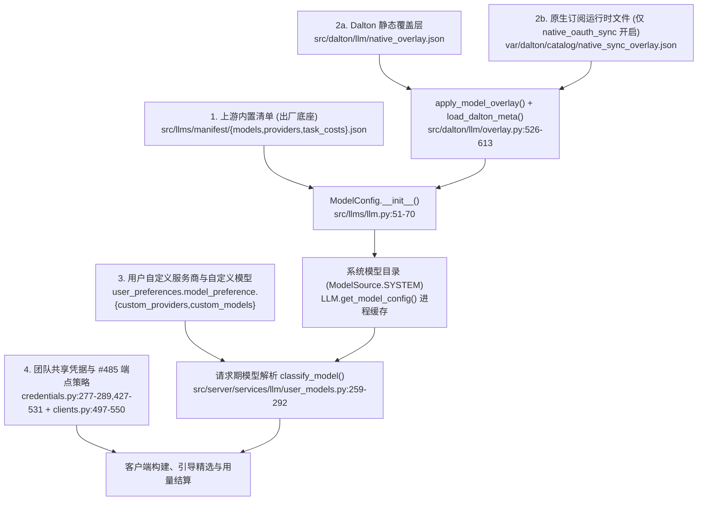
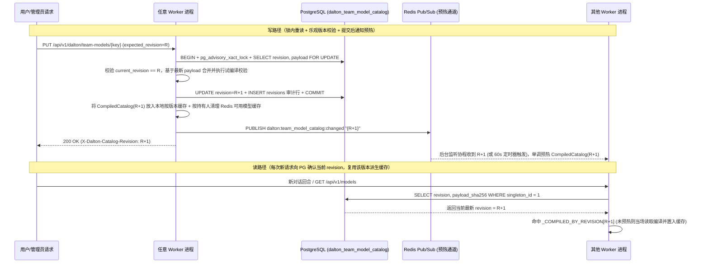

# 团队模型目录设计方案（管理员网页增改模型，版本化在线生效）

> **设计定位**：面向 Everflow 与独立核心（Standalone Core）双安装形态的团队级模型目录管理能力
> **目标体验**：管理员在 **设置 → 团队管理 → 模型与供应商** 页面自助完成新模型与兼容提供商变体接入、价格与评分修订、可见性切换、退役替换与一键回滚；每次新请求向 PostgreSQL 确认当前目录版本号，在途对话回合全程使用回合启动时持久化的有效配置快照，中断恢复时在构造客户端前校验当前路由与快照指纹一致后放行，配置变更时明确提示用户重新发送消息。

---

## 一页摘要

1. **解决什么问题**：日常上线新模型、修订输入/缓存/输出费率、调整上下文窗口与思考档位、维护"智能 / 速度 / 说人话"评分，原先需要手工修改代码仓库内的 `src/dalton/llm/native_overlay.json`（或受门禁保护的上游清单）并重新发版部署（如智谱 `GLM 5.4` 近期由独立静态配置 PR 先行接入）。本方案将日常模型目录运维收敛到网页管理端，与代码发布解耦。
2. **核心架构**：保留上游 `src/llms/manifest/*.json` 与 `src/dalton/llm/native_overlay.json` 作为随镜像发布的**出厂默认基线**；在 PostgreSQL 建立单行当前目录表 `dalton_team_model_catalog`（迁移预置 `revision = 0` 初始空目录）、事务审计与回滚表 `dalton_team_model_catalog_revisions`（含基于配置版本号的关联任务改写明细 `side_effects`）以及目录变体专属加密凭据表 `dalton_catalog_provider_credentials`；并将原本地文件 `native_sync_overlay.json` 在第一批一次性收口入库，形成清晰的**三层系统目录**。
3. **版本真相、回合快照与恢复路由比对**：PostgreSQL 是当前目录版本号 `revision` 的唯一真相源，进程内存仅按不可变版本号缓存派生结果（`revision → CompiledCatalog`），Redis Pub/Sub 与 60 秒定时轮询负责后台单调预热；每个对话回合和子智能体启动时将所涉模型的**有效配置快照（`effective_catalog_snapshot`：费率、模态、思考参数、固定路由，以及目录变体原绑定的非密钥标识 `bound_base_url` 与 `key_fingerprint`）**随运行记录持久化用于回合内结算与审计。恢复已中断运行时，系统按当前目录正常解析模型与路由，在构造客户端前经统一入口 `verify_resume_route` 与原运行快照的路由指纹（模型键、提供商、型号、绑定地址、凭据指纹、计费方式）逐项比对：一致则按当前目录继续执行（路由与计费均与快照一致），任一项变更则直接返回错误码 `catalog_route_changed` 拒绝恢复并提示用户重新发送消息，避免在多恢复入口上为旧配置重建历史客户端引入复杂分支。
4. **目录变体凭据隔离与全路径出站校验**：目录新增提供商变体只能通过系统目录条目、使用其绑定至完整授权 `bound_base_url` 的专属只写凭据调用（成员个人 `custom_models` 在保存与调用时按**解析后的提供商与地址**检查，含从凭据持有人继承的 `base_url`，凡落在目录变体或其 `bound_base_url` 上一律拒绝，且剥离父组 `env_key`）；在客户端构造期与实际发包期对全部 5 条出站路径双重校验，两种安装形态统一读取 `network.fake_ip_cidrs` 配置自动衔接 Fake-IP DoH 真实公网 IP 直连（保留原主机名做 TLS 证书校验）或 `HeldTransport` 公网单播校验，并固定设置 `follow_redirects=False`。

---

## 1. 现状盘点：模型清单加载、合并优先级与字段作用点

### 1.1 五类模型配置的现有加载链路与合并优先级

现行代码在"系统目录构建期合并"与"请求期按用户解析"两个阶段处理模型配置：



各层代码位置、现行合并行为与演进切入点如下：

| 层级 | 核心代码位置（`文件:行号`） | 现行加载与合并机制 | 现行边界与待演进点 |
|---|---|---|---|
| **① 内置模型清单** | `src/llms/llm.py:51-70,101-153`<br>`src/llms/manifest/models.json:452-579`<br>`src/llms/manifest/providers.json:469-540,992-1026`<br>`src/llms/task_costs.py:52,169-179` | `ModelConfig.__init__` 读取 `models.json` 与 `providers.json`，经 `_flatten_providers`（`src/llms/llm.py:101-153`）将品牌组字段（含 `env_key`）合入组内各 `variants` 并展平至 `flat_providers`；`task_costs.json` 由 `_shipped()`（`src/llms/task_costs.py:169-179`）通过 `@lru_cache(maxsize=1)` 加载。 | 受 `scripts/dalton/check_hooks.sh:6-7` 保护只读；修改其余上游文件须在改动块上下 25 行窗口内附带已注册的 `DALTON-HOOK` 标记（`check_hooks.sh:638-648`）。 |
| **② Dalton 覆盖层（静态 + 原生同步文件）** | `src/llms/llm.py:62-65,658-664`<br>`src/dalton/llm/overlay.py:18-47,234-380,404-613`<br>`src/dalton/llm/native_overlay.json:1-1644`<br>`src/dalton/llm/notional_pricing.py:121-166,203-228` | • `apply_model_overlay` 在 `CapabilityId.NATIVE_OAUTH_SYNC`（`src/dalton/llm/overlay.py:43-47`）开启时合并 `native_overlay.json` 与 `native_sync_overlay.json`，随后执行 `_drop_retired_models`（`:404-448`）、`_enforce_pinned_overlay_routes`（`:450-475`）与 `inherit_antigravity_gemini_ratings`（`:493-523`）；关闭时经 `_filter_generic_overlay`（`:54-163,551-575`）剥离全部 `*-oauth` 条目。<br>• `load_dalton_meta()`（`:594-613`）独立读取两份文件并整条替换字典；`build_notional_price_index`（`notional_pricing.py:121-165`）以裸模型键和裸 `model_id` 建表。 | 1) 同名 `models` 键与同 `id` 价格卡默认跳过（`:242-254,326-344`），改已有项须走 `model_overrides`；<br>2) `load_dalton_meta` 整条替换会丢失未重申的子字段，名义价格以裸 `model_id` 建索引在多渠道同名型号下会产生碰撞；<br>3) `z-ai-cn-coding` 与 `muse-oauth` 无列表接口（`src/dalton/llm/native_catalog.py:114-128`）。 |
| **③ 用户自定义服务商与模型** | `web/src/components/modelAccess/useCustomProviderForm.ts:114-155`<br>`src/server/services/llm/user_models.py:100-135,259-292`<br>`src/server/services/llm/custom_catalog.py:13-25,342-421` | 存储在个人 `user_preferences.model_preference` 中。`classify_model`（`user_models.py:259-292`）优先匹配个人 `custom_models` 再查系统目录；同名个人条目通过 `inherited_declarations`（`src/llms/model_spec.py:287-316`）继承内置同名模型的引导、压缩档位、窗口及同协议思考声明。 | 仅作用于单个用户自身，模态限于 `{"text", "image", "pdf"}`（`custom_catalog.py:13`）；在团队凭据共享模式下，个人自定义模型仍解析至团队凭据持有人的密钥并受 #485 端点规则约束。 |
| **④ 团队凭据、直接调用分支与容器网络代理** | `src/dalton/credentials.py:252-289,427-531`<br>`src/server/database/api_keys.py:340-367`<br>`src/server/services/llm/byok.py:13-73`<br>`src/server/services/llm/clients.py:497-551`<br>`src/server/services/llm/service.py:82-115`<br>`src/server/app/api_keys.py:525-570`<br>`src/dalton/dalton.yaml:46-60`<br>`src/tools/web/inhouse/guard.py:60-185` | • **凭据与 #485 保护**：团队共享开启时，`get_byok_config_for_provider`（`api_keys.py:350`）通过 `credential_user_id()` 读取持有人密钥；`key_fits`（`byok.py:44-53`）在密钥附带 `has_base_url` 时默认放行；`enforce_shared_byok_endpoint_policy`（`credentials.py:427-531`）只允许连向持有人保存的 `base_url` 或 `mc.get_provider_info` 中的 `manifest_base_url`。<br>• **旁路构造点**：`LLMService.complete`（`service.py:82-115`）在 `user_id=None` 或未拿到客户端时直接调 `create_llm`（`src/llms/llm.py:1502-1539` → `_resolve_api_key` `:1006-1021` 读取 `env_key`）；旧 `/api/v1/keys/test`（`api_keys.py:525-570`）在 `egress.enforced()` 为假时默认无受控传输。<br>• **Fake-IP 网络**：Everflow 容器配置了 `network.fake_ip_cidrs: ["198.18.0.0/15"]`（`dalton.yaml:46-60`），`egress_guard.py:163-172` 会拒绝该段地址，站内抓取守卫通过 `src/dalton/network.py:35-145` 与 `guard.py:60-185` 用 DoH 解析真实公网 IP 后直连。 | 目录新增变体必须阻断 `env_key` 继承、`key_fits` 放行、个人 `custom_models` 借道及 `manifest_base_url` 信任，在全部客户端构造与发送路径强制核验专属凭据，并兼容 `network.fake_ip_cidrs` 的 DoH 真实地址校验。 |
| **⑤ 首次设置 `deployment_settings`** | `migrations/versions/148_deployment_settings.py:20-25`<br>`src/server/services/setup_settings/__init__.py:23-33`<br>`src/server/services/setup_settings/apply.py:162-205`<br>`src/server/services/setup_settings/follow.py:18-90` | 单机向导将沙箱/搜索/行情密钥加密存入 `deployment_settings`，通过 Redis `setup_settings:changed` 与 60 秒轮询同步各进程；Dalton 下该向导路由关闭（`setup_settings/__init__.py:23-33`）。 | 复用其 Redis Pub/Sub + 60 秒轮询做后台缓存预热，同时遵循 `src/server/AGENTS.md:38-47`，新请求以 PostgreSQL 版本号为真相。 |

### 1.2 核心字段如何驱动计费、能力分类、选择器展示与预算

| 业务维度 | 决定字段与所在结构 | 读取与生效代码位置（`文件:行号`） | 现行作用机制与回合一致性要点 |
|---|---|---|---|
| **现金计费（Cash USD）** | `providers.models.<provider>[].{id, alias, pricing}`（含 `input`、`cached_input`、`cache_5m`、`cache_1h`、`output` 或阶梯项） | `src/llms/llm.py:942-985`<br>`src/llms/pricing_utils.py:244-365`<br>`src/utils/tracking/core.py:242-295`<br>`src/server/services/persistence/usage.py:136-147` | 客户端仅在 `client.metadata` 打上 `pricing_model_id` 与 `pricing_provider`（`llm.py:965-971`），结算时由 `find_model_pricing` 查找并经 `_stamp_applied_rates` 写入记录。缺失现金卡时，聊天用量追踪（`core.py:273-287`）按零成本记录 Token 并标记 `pricing_failed=True`；Dalton 预算与准入记账（`src/dalton/budget/service.py:372-378`、`src/dalton/llm/complete.py:200-208`）按保守底价 `admission_floor_usd`（`$0.25`）折算。 |
| **订阅与套餐名义计费（Notional USD）** | `providers.provider_config.<p>.billing: "subscription"`<br>`dalton_meta.<key>.{billing, notional_pricing, notional_ref}` | `src/llms/pricing_utils.py:279-291`<br>`src/dalton/llm/notional_pricing.py:121-268`<br>`src/utils/tracking/core.py:201-240`<br>`src/dalton/budget/service.py:378-395` | 订阅或 Coding Plan 现金成本记 `$0.00`，按 `(pricing_provider, norm_id(pricing_model_id))` 唯一匹配名义价格卡写入 `notional_cost` 并汇总至 `subscription_notional_usd`。 |
| **预算水位与提供商分项汇总** | 现金价格卡四项费率 + 已持久化用量记录印章 | `src/llms/pricing_utils.py:455-544`<br>`src/dalton/budget/service.py:266-395` | 准入预留按 `blended_rate` 与 `chunk_multiplier` 估算步长；今日预算分项 `compute_provider_breakdown` 优先累加已落库的 `cost`、`notional_cost` 与 `pricing_provider`。 |
| **任务成本（Task Cost）** | `task_costs.json` 的 `baseline`、`models`、`bounds` + 目录标价 `get_list_rates` | `src/llms/task_costs.py:86-155,195-266`<br>`src/llms/llm.py:307-334,434-443` | 有实测值或 `bounds` 绑定时输出各思考档位相对基线（`claude-sonnet-5-5` `medium` = `1.0`）的 `task_cost`；其余模型按 `0.75 * input + 0.25 * output` 相对基线折算 `task_cost_estimate`。 |
| **思考强度（Reasoning Effort）** | `models.<key>.reasoning.{efforts, default, write, on, off}` + `parameters` / `extra_body` | `src/llms/reasoning.py:25-60,73-138,172-233`<br>`src/llms/model_spec.py:34-95,194-201`<br>`src/llms/llm.py:398-403,733-759` | `efforts` 取自有序枚举 `("none", "minimal", "low", "medium", "high", "xhigh", "max")`；请求期经 `clamp_reasoning_effort` 向下钳制后写入目标 SDK 协议路径。 |
| **输入模态与回合内附件裁剪** | `models.<key>.input_modalities`（打标于 `client.metadata["manifest_model"]`） | `src/llms/llm.py:453-464,969,1655-1845`<br>`src/ptc_agent/agent/middleware/file_operations/multimodal_strip.py:688-715` | `MultimodalStripMiddleware._target` 在每次模型调用前查询 `get_input_modalities` 决定保留或剥离多模态块，回合启动时持久化的快照保证跨部署恢复后依然一致。 |
| **上下文窗口与自动压缩** | `models.<key>.{context, compaction_profile}` + `parameters.{max_tokens, max_output_tokens}` | `src/llms/model_spec.py:97-106`<br>`src/llms/llm.py:414-423,511-517` | `context` 决定 `max_input_tokens` 容量上限，`compaction_profile` 控制自动摘要触发阈值。 |
| **工具调用、家族与角色准入** | `dalton_meta.<key>.{tool_calling, family, forbidden_for_roles}` | `src/dalton/llm/role_policy.py:60-105,144-177`<br>`src/dalton/llm/model_family.py:9-37`<br>`src/server/app/api_keys.py:808-810` | `tool_calling` 用于 Core 引导与后台槽位筛选，`family` 用于正式发布异族独立审校判定，`forbidden_for_roles` 用于隔离训练数据贡献线路。 |
| **选择器展示、评分与系列折叠** | `visible`、`display_name`、`intelligence`、`speed`、`plain_language` + `antigravity_series.py` | `src/llms/llm.py:335-395`<br>`src/server/app/api_keys.py:749-847`<br>`src/dalton/llm/antigravity_series.py:28-35,192-250` | `listed_models()` 筛出 `visible: true` 模型下发至 `GET /api/v1/models`；三项 1–5 分评分展示于模型详情与首次引导；`build_antigravity_series_catalog` 将多强度模型键折叠为单一系列条目。 |

---

## 2. 总体方案：数据库"团队模型目录"、版本生效与安全隔离

### 2.1 数据库表设计与初始行（新增 Dalton 迁移）

Batch 1 迁移 `d051_team_model_catalog.py` 创建团队模型目录核心表并幂等插入 `revision = 0` 初始空目录行与初始审计行；Batch 3 迁移 `d055_drop_model_price_alerts.py` 删除未启用的价格提醒空表。全部新建表均为 Dalton 自有表：

1. **当前生效目录单行表 `dalton_team_model_catalog`**：
   ```sql
   CREATE TABLE IF NOT EXISTS dalton_team_model_catalog (
       singleton_id               SMALLINT PRIMARY KEY DEFAULT 1 CHECK (singleton_id = 1),
       revision                   BIGINT NOT NULL DEFAULT 0 CHECK (revision >= 0),
       schema_version             INTEGER NOT NULL DEFAULT 1,
       payload                    JSONB NOT NULL DEFAULT '{"schema":"dalton-team-model-catalog/1"}'::jsonb,
       payload_sha256             TEXT NOT NULL,
       legacy_sync_import_status  TEXT NOT NULL DEFAULT 'pending'
                                  CHECK (legacy_sync_import_status IN (
                                      'pending', 'not_applicable', 'imported', 'failed', 'abandoned'
                                  )),
       legacy_sync_imported_at    TIMESTAMPTZ NULL,
       legacy_sync_import_error   TEXT NULL,
       last_known_legacy_retired  TEXT[] NOT NULL DEFAULT '{}',
       updated_by                 TEXT NOT NULL DEFAULT 'system:migration',
       updated_at                 TIMESTAMPTZ NOT NULL DEFAULT NOW()
   );
   ```
2. **事务内权威变更审计与回滚历史表 `dalton_team_model_catalog_revisions`**：
   ```sql
   CREATE TABLE IF NOT EXISTS dalton_team_model_catalog_revisions (
       revision        BIGINT PRIMARY KEY CHECK (revision >= 0),
       action          TEXT NOT NULL CHECK (action IN (
                           'init_empty', 'bootstrap_import', 'abandon_legacy_file',
                           'create_model', 'update_model', 'hide_model', 'unhide_model',
                           'retire_model', 'restore_model', 'native_sync', 'native_retire',
                           'native_restore', 'upsert_provider_variant', 'update_curated',
                           'confirm_price', 'rollback'
                       )),
       target_keys     TEXT[] NOT NULL DEFAULT '{}',
       payload         JSONB NOT NULL,
       payload_sha256  TEXT NOT NULL,
       diff_summary    JSONB NOT NULL DEFAULT '{}'::jsonb,
       side_effects    JSONB NOT NULL DEFAULT '[]'::jsonb,
       comment         TEXT NULL,
       restored_from   BIGINT NULL REFERENCES dalton_team_model_catalog_revisions(revision),
       actor_user_id   TEXT NOT NULL,
       actor_label     TEXT NULL,
       created_at      TIMESTAMPTZ NOT NULL DEFAULT NOW()
   );
   CREATE INDEX IF NOT EXISTS ix_dalton_team_catalog_revisions_created
       ON dalton_team_model_catalog_revisions (created_at DESC);
   ```
   > 迁移建表后立即执行 `INSERT ... ON CONFLICT DO NOTHING` 预置 `revision = 0`（`action = 'init_empty'`，`actor_user_id = 'system:migration'`，空载荷 `{"schema": "dalton-team-model-catalog/1"}`），使首次业务变更（`revision = 1`）拥有可回滚基准，且启动与定时预热始终读到有效行。

3. **目录新增提供商变体专属凭据表 `dalton_catalog_provider_credentials`**（只写加密存储，与版本历史表物理隔离，`canonical_bound_url` 由 `canonical_url_key(bound_base_url)` 生成，保留完整规范化 `scheme://host:port/wire_path`）：
   ```sql
   CREATE TABLE IF NOT EXISTS dalton_catalog_provider_credentials (
       provider_slug        TEXT PRIMARY KEY,
       encrypted_api_key    BYTEA NOT NULL,
       bound_base_url       TEXT NOT NULL,
       canonical_bound_url  TEXT NOT NULL,
       key_fingerprint      TEXT NOT NULL,
       updated_by           TEXT NOT NULL,
       updated_at           TIMESTAMPTZ NOT NULL DEFAULT NOW()
   );
   ```
   > 注：`d051_team_model_catalog.py` 曾预建空表 `dalton_model_price_alerts`，已由迁移 `d055_drop_model_price_alerts.py` 删除；价格由管理员直接录入并标注来源。

**`payload` JSONB 结构（`schema: "dalton-team-model-catalog/1"`）**：仅存放公开模型声明、价格评分、退役列表与引导精选增量（密钥字段独立存于 `dalton_catalog_provider_credentials`）：

```json
{
  "schema": "dalton-team-model-catalog/1",
  "models": {
    "glm-99-preview-plan": {
      "prompt_guidance": "lean",
      "model_id": "glm-99-preview",
      "provider": "z-ai-cn-coding",
      "display_name": "GLM-99 Preview (Coding Plan)",
      "visible": true,
      "intelligence": 5,
      "speed": 3,
      "plain_language": 4,
      "context": 1000000,
      "compaction_profile": "expansive",
      "input_modalities": ["text", "image", "pdf"],
      "parameters": {
        "max_tokens": 128000,
        "thinking": { "type": "enabled" }
      },
      "reasoning": {
        "efforts": ["low", "high", "max"],
        "default": "high",
        "write": "parameters.output_config.effort",
        "on": { "parameters.thinking.type": "enabled" }
      }
    }
  },
  "model_overrides": {
    "glm-5.4-plan": { "plain_language": 5 }
  },
  "retired": [
    { "key": "glm-5.3-plan", "provider": "z-ai-cn-coding", "retired_at": "2026-11-24T10:00:00Z", "retired_by": "admin-uid" }
  ],
  "providers": {
    "provider_variants": {
      "openai": {
        "acme-corp-gateway": {
          "display_name": "Acme 企业聚合网关",
          "sdk": "openai",
          "access_type": "api_key",
          "billing": "cash",
          "base_url": "https://llm-gw.example.com/v1"
        }
      }
    },
    "models": {
      "z-ai-cn-coding": [
        {
          "id": "glm-99-preview",
          "alias": ["glm-99-preview-plan"],
          "name": "GLM-99 Preview (Coding Plan)",
          "is_reasoning": true,
          "pricing": { "input": 0.0, "cached_input": 0.0, "output": 0.0, "unit": "per_1m_tokens" },
          "pricing_meta": { "source_kind": "official", "estimated": false, "verified_at": "2026-11-24" },
          "context_window": 1000000,
          "max_output": 128000
        }
      ]
    },
    "model_overrides": {}
  },
  "dalton_meta": {
    "glm-99-preview-plan": {
      "family": "zai-glm",
      "billing": "subscription",
      "tool_calling": true,
      "notional_pricing": {
        "input": 1.4,
        "cached_input": 0.29,
        "output": 4.4,
        "estimated": true,
        "source_kind": "estimated",
        "source": "内部预估参考同系直连单价",
        "verified_at": "2026-11-24"
      }
    }
  },
  "task_costs": {
    "models": {},
    "bounds": {
      "glm-99-preview-plan": { "model": "glm-5.3", "times": 1.0 }
    }
  },
  "series_overrides": {},
  "curated_setup": null
}
```

### 2.2 三层合并范围、名义价格唯一键、冲突规则与固定路由/退役顺序

`NativeModelsCard` 在 Batch 1 一次性收口入库后（见 §2.6），系统目录收敛为**三层结构**，每次编译某个版本 `R` 的 `CompiledCatalog` 时，同步产出 `ModelConfig`、合并后的 `dalton_meta`、名义价格索引 `notional_price_index`、任务成本表 `task_costs`、系列目录 `antigravity_series` 与派生提供商目录：

1. **三层合并全覆盖与名义价格二元组唯一键（含 `load_dalton_meta` 与 `notional_pricing.py`）**：
   - **第 1 层**：上游内置清单（`src/llms/manifest/{models,providers,task_costs}.json`）；
   - **第 2 层**：Dalton 代码静态覆盖层 `src/dalton/llm/native_overlay.json`；
   - **第 3 层（最高系统目录优先级）**：数据库 `dalton_team_model_catalog`（`revision = R`）快照。
   - **扩展 `load_dalton_meta(catalog_revision=R)`（`src/dalton/llm/overlay.py:594-613`）**：将第 2 层与第 3 层的 `dalton_meta.<key>` 改为**按模型键执行深度字段合并（`_deep_merge_patch`，子字段值为 `null` 时显式删除该可选子键，例如从 `notional_ref` 切换为直接填写 `notional_pricing`）**，并在收尾时同步剔除最终已退役的模型键及（当 `CapabilityId.NATIVE_OAUTH_SYNC` 关闭时）全部 `*-oauth` 键。选择器元数据、角色策略（`role_policy.py`）与计费共享同一份编译结果。
   - **扩展 `build_notional_price_index` 与 `resolve_notional_card`（`src/dalton/llm/notional_pricing.py:121-165,203-228`，纳入 Batch 1）**：
     - 名义费率索引以规范化二元组 **`(pricing_provider.lower(), norm_id(pricing_model_id))`** 为主键（辅以精确 `model_key` 二级索引供未打标调用先解析出所属 `(provider, model_id)` 再取值），替代原先的裸 `model_id` 键，使不同提供商或套餐变体复用同一 `model_id` 时各自持有独立的名义价格卡；
     - **共享计费标识防歧义规则**：若同一 `pricing_provider` 下存在多个存活系统模型键映射到同一个 `norm_id(pricing_model_id)`，保存前校验要求它们解析后的有效名义费率完全一致；出现不同名义费率时直接返回 `400 ambiguous_notional_pricing` 并列出冲突模型键，提示管理员统一该计费标识的名义费率或拆分独立标识。

2. **四维标识符归一化与冲突判定规则**：
   对齐 `find_model_pricing`（`src/llms/pricing_utils.py:258-341`）与 `_flatten_providers`（`src/llms/llm.py:101-153`）的匹配语义，定义归一化函数 `norm_id(s) = s.strip().lower().replace(".", "-")`：

   | 维度 | 唯一性与边界规则 |
   |---|---|
   | **① 模型键（`model_key`）** | 在合并后的 `llm_config` 中按大小写不敏感（`key.lower()`）全局唯一。管理员调用"新增模型"提交已存在于第 1–2 层的键时返回 `409 Conflict` 并引导使用"编辑模型"（写入 `model_overrides`）。若后续代码升级使第 1–2 层新增了与数据库 `models` 同名的键，合并器自动将数据库条目及对应价格卡转为深度覆盖补丁（详见 §7.2）。 |
   | **② 跨组提供商标识（`provider_slug`）与剥离父组 `env_key`** | `_flatten_providers` 将全部顶层组键与组内 `variants` 展平到同一 `flat_providers`。新增 `provider_variants[group][v_name]` 时，校验 `v_name.lower()` 与第 1–3 层全部顶层组名及跨组变体名均无重名，注入只读属性 `catalog_defined: True`、`own_api_key: True`，并在 `_flatten_providers`（`src/llms/llm.py:122-130`）展开时**显式剥离从父组 `shared` 继承的 `env_key`、`models_url` 与 `platform` 字段**，确保目录变体永远脱离父提供商的部署环境变量密钥。 |
   | **③ 同提供商价格卡 `(provider, model_id)` 与 `alias`** | 同一 `provider` 的存活价格卡列表 `manifest["models"][provider]` 内，每张卡片的 `norm_id(id)` 与全部 `norm_id(alias)` 构成的标识集合两两互不相交；编辑已有模型价格时自动写入 `providers.model_overrides[provider][card_id]` 原地深度更新（`overlay.py:348-380`）。 |
   | **④ 团队目录模型 vs 成员个人 `custom_models`（按解析后提供商与地址检查）** | • **针对内置提供商**：团队共享开启（`credentials.sharing == "team"`）时，成员保存的同名个人 `custom_models` 解析至团队凭据持有人密钥（`src/server/database/api_keys.py:350`），并严格遵循 #485 `enforce_shared_byok_endpoint_policy`（`src/dalton/credentials.py:513-531`）——仅允许连向持有人已保存的 `base_url`（前提是不与任何目录变体地址重叠，见下条）或**出厂内置提供商**默认端点；关闭团队共享时使用成员个人密钥。<br>• **针对目录新增变体（保存与调用均按解析后结果拒绝借道）**：由于个人模型即使声明为内置提供商，解析时也会优先采用凭据持有人（或个人）已保存的 `base_url` 及变体跳转端点（`src/server/services/llm/clients.py:130-175`），因此在**偏好保存校验（`src/server/services/llm/custom_catalog.py`）与请求期调用解析（`clients.py:130-175,497-570`、`LLM.from_custom_config`）**两个阶段，统一按**解析后的最终生效提供商与解析后的最终生效地址（含从凭据持有人保存的 `base_url` 继承来的地址及参数端点）**检查：凡解析后的提供商属于 `catalog_defined: True` 的目录变体，或解析后的地址落在任何目录变体的 `bound_base_url` 上（按 `canonical_url_key` / `endpoint_matches_prefix` 判定），一律拒绝并返回 `400 catalog_variant_custom_model_forbidden`——目录变体只能经系统目录条目、使用该变体自身的绑定凭据调用。 |

3. **编译管线收尾四步固定顺序（固定路由与分层退役边界）**：
   每次构建 `CompiledCatalog` 时按以下顺序收尾：
   - **步骤 A（三层正向合并）**：依次合并第 1 层内置清单 → 第 2 层 `native_overlay.json` → 第 3 层数据库载荷（含 `models`、`model_overrides`、`providers`、`dalton_meta`、`task_costs`、`series_overrides`）；
   - **步骤 B（专有固定路由窄字段锁定）**：对 `PINNED_OVERLAY_MODEL_KEYS`（`grok-4.7-oauth`，`src/dalton/llm/overlay.py:27,450-475`）仅锁定底层路由与协议连接字段（`provider = "xai-oauth"`、`model_id` 及核心连接参数），保留管理员在数据库 `model_overrides` 与 `dalton_meta` 中对其展示名、`visible`、三项评分、默认思考档位及名义价格所做的修订；
   - **步骤 C（出厂硬退役、只读遗产退役集与团队可恢复退役）**：
     - **出厂硬退役名单**（`native_overlay.json` 的 `retired` 数组）属于不可逆平台基线，管理列表默认隐藏，恢复接口对其返回 `400 factory_retired_immutable`；
     - **只读遗产退役集**（`legacy_sync_import_status == 'failed'` 期间汇总的遗产退役键，详见 §2.6）：在该故障未解除期间处于冻结下线态，普通「恢复」操作对其直接返回 `409 legacy_retired_locked_until_import_resolved`、模型保持下线；只有执行 `retry_import` 成功或 `abandon_legacy_file` 完成后才允许按普通退役项恢复；
     - **团队退役名单**（数据库 `dalton_team_model_catalog.retired` 数组，且不在上述只读遗产冻结集内）承载管理员手动退役及已入库的原生同步下线模型，管理员点击「恢复」即从数据库 `retired` 移除该键并即时生效；
     - `_drop_retired_models` 对上述三类退役集合的并集统一执行移除；
   - **步骤 D（能力门禁最终裁剪与评分继承）**：无论触发源是常规合并、启动导入还是历史版本回滚，当 `CapabilityId.NATIVE_OAUTH_SYNC` 关闭时，统一强制剥离全部 `*-oauth` 模型键、`*-oauth` 提供商及对应 `dalton_meta`；开启时最后执行 `inherit_antigravity_gemini_ratings`。

### 2.3 多 Worker 版本确认、只读派生缓存与写锁防覆盖

遵循 `src/server/AGENTS.md:38-47` 跨进程准则——**PostgreSQL 是当前生效版本号的唯一真相源，进程内存仅按版本号缓存不可变的派生数据**：



1. **新请求向 PostgreSQL 确认版本 + 进程内 `revision → CompiledCatalog` 只读缓存**：
   - 每个新进入的业务请求（对话回合准入、独立 `dalton_complete`、`GET /api/v1/models`、可用模型查询、自动化调度触发）执行主键点查 `SELECT revision, payload_sha256, legacy_sync_import_status, last_known_legacy_retired FROM dalton_team_model_catalog WHERE singleton_id = 1` 确认当前版本 `R`；
   - 每个进程维护容量为 8 的只读有序缓存 `_COMPILED_BY_REVISION: OrderedDict[tuple[int, str, bool, str], CompiledCatalog]`（键含 `revision`、静态覆盖文件 stamp、`oauth_sync_enabled` 及遗产退役指纹；并将 `src/server/app/api_keys.py:49,62,71,167,320` 的 `_BYOK_PROVIDERS_CACHE` 与 `ModelConfig()` 调用统一收口至当前请求版本的 `CompiledCatalog`）；缓存命中时零编译复用，未命中时当场拉取 `payload` 编译写入，保证保存返回后落到任意 worker 的新请求立即看到 `R+1`。
2. **后台预热协程与单调水位保护**：
   - 在 `src/server/app/setup.py` lifespan 启动预热任务 `dalton-team-model-catalog-follow`（对齐 `src/server/services/setup_settings/follow.py:46-90`），订阅 `dalton:team_model_catalog:changed` 并每 `60.0` 秒兜底核对数据库版本；仅当 `db_revision > _highest_prewarmed_revision` 时推进预热水位，杜绝慢查询覆盖新版本。
3. **写路径锁内重读与防覆盖**：
   - 写接口要求传入 `expected_revision`；事务内先取排他咨询锁 `pg_advisory_xact_lock(hashtext('dalton_team_model_catalog'))`，再 `SELECT ... FOR UPDATE` 重读当前行；版本失配返回 `409 Conflict` 附最新快照，版本匹配时基于最新 `payload` 校验试编译后提交 `revision = current_revision + 1`。
4. **按凭据持有人精准失效 Redis 可用模型缓存**：
   - 依据 `available_models_key(user_id)`（`src/server/services/llm/provider_models/service.py:136-142,223-233`），写操作提交后传入 `holder_id = get_team_credential_holder_id()`（及当前操作人 `actor_user_id`）调用 `await invalidate_available_models(...)`，并同步删除涉及网关的 `model_catalog:{url_key}:{provider}` 键（`service.py:203`）。

### 2.4 回合内固定版本、快照审计与恢复路由比对

为同时保证单回合内部计费与审计一致性以及跨中断恢复的清晰边界，系统在回合启动时**固定目录版本并将有效配置快照随运行记录落库**，并在恢复时执行**先比对后放行**规则：

1. **回合启动持久化自包含快照 `effective_catalog_snapshot`（含原凭据绑定标识）**：
   - 对话回合在 START 事务写入 `conversation_responses.metadata`（`src/server/database/runs/lifecycle.py:599-621`）以及子智能体启动写入 `subagent_runs.replay_facts`（`src/server/database/runs/subagent_runs.py`）时，记录 `catalog_revision: R` 并同步持久化**本回合候选模型的自包含有效配置快照 `effective_catalog_snapshot`**（包含现金费率卡 `pricing`、名义费率卡 `notional_card`、`billing`、`input_modalities`、窗口与输出上限、`reasoning` 阶梯与协议路径、固定路由 `provider` / `model_id`，以及目录变体原绑定的非密钥凭据标识 **`bound_base_url` 与 `key_fingerprint`**，体积仅数 KB）。
2. **回合内全链路结算与审计消费快照**：
   - **本回合运行与结算**：主客户端、`ModelResilienceMiddleware` 备用客户端、子智能体、回合内 `dalton_complete`、`MultimodalStripMiddleware._target`（`src/ptc_agent/agent/middleware/file_operations/multimodal_strip.py:688-715`）、准入与分块预算预留、以及 `UsagePersistence`（`src/server/services/persistence/usage.py:136-147`）调用的 `calculate_cost_from_per_call_records`（`src/utils/tracking/core.py:209-270` → `find_model_pricing` / `resolve_notional_card`），一律优先从当前回合绑定的 `effective_catalog_snapshot` 读取费率与能力（独立于对话回合的后台单次 `dalton_complete` 在入口固定当次快照）。
3. **中断恢复的「比对后放行 / 变更即拒绝」规则**：
   - **单一校验入口 `verify_resume_route`**（`src/dalton/services/team_model_catalog/snapshot.py`）：任何继续已中断运行的入口——主回合重启恢复（`restart.py` → `messaging.py`）、`/retry`（服务端重试与客户端重试）、网页 HITL 续跑（`hitl_response`）、自动化重跑（`automation_executor.py` → `ptc_run.py`）以及子智能体恢复（`task_actions.py` `_handle_resume`）——均按当前实时目录正常解析模型与路由，随后在**构造任何 LLM 客户端之前**调用 `verify_resume_route(run_id, resolved_route)`，将当前解析出的 6 项路由指纹（`model_key`、`provider`、`model_id`、`bound_base_url`、`key_fingerprint`、`billing`）与原运行快照逐项比对。
   - **一致放行、变更拒绝**：6 项指纹全部一致时，恢复回合按当前实时目录继续执行（路由与计费方式均与快照一致，结算金额相同）；任一项发生变化时，立即返回 HTTP 400（错误码 `catalog_route_changed`，中文提示：「这个回合中断期间团队模型配置发生了变化，请重新发送消息」），由前端展示提示横幅并解锁输入框供用户重新发起新消息。快照仅用于比对、审计与结算，系统始终按当前实时目录构造客户端，从而让每条恢复链路保持简单且可证明。
   - **无快照的存量运行兼容**：对于本功能上线前已存在、运行记录中尚无 `effective_catalog_snapshot` 的历史运行，恢复路径直接按既有流程继续执行；Abandoned Sweep 与 `UsagePersistence` 补结算历史账单时保留条件补写快照用于审计。
4. **预算汇总读取已持久化账单**：
   - `compute_provider_breakdown`（`src/dalton/budget/service.py:313-395`）优先累加每笔调用已持久化的 `cost`、`notional_cost` 与 `pricing_provider` 印章。

### 2.5 目录变体凭据强绑定、全发送路径双重校验与改址策略

1. **内置提供商模型**：继续复用团队凭据持有人的 `user_api_keys` 与 `oauth_tokens`（`src/dalton/credentials.py:252-289`），列表接口返回 `provider_connected: bool`。
2. **目录新增变体（`catalog_defined: True`）的凭据隔离与全路径双重门禁**：
   - **专属凭据绑定与零继承**：管理员创建目录变体时必须提交该变体专属 API Key，加密存入 `dalton_catalog_provider_credentials` 并绑定至完整带路径的 `bound_base_url` 与 `canonical_bound_url = canonical_url_key(bound_base_url)`（`src/dalton/llm/egress_policy.py:114-122`）。对 `catalog_defined: True` 的变体：
     - `_flatten_providers`（`src/llms/llm.py:122-130`）剥离父组 `env_key`；
     - `byok_candidates`（`src/server/services/llm/byok.py:13-42`）返回空列表，`key_fits`（`byok.py:44-53`）固定返回 `False`（即使持有人密钥自身带有 `has_base_url=True` 也不放行）；
     - `enforce_shared_byok_endpoint_policy`（`src/dalton/credentials.py:513-531`）与 `clients.py:130-175,512-533` 将 `catalog_defined: True` 变体的地址排除在可信 `manifest_base_url` 之外，且个人模型解析后的地址（含从持有人已存 `base_url` 继承的地址）一旦匹配任一目录变体的 `bound_base_url` 即按 §2.2 维度④拒绝；
   - **客户端构造期 + 实际发送期双重强制校验，覆盖全部 5 条出站路径**：
     1. 常规对话与自动化客户端（`src/server/services/llm/clients.py:497-570`）；
     2. `LLMService.complete` 直接调用 `create_llm` 的系统调用与回退分支（`src/server/services/llm/service.py:82-115`、`src/llms/llm.py:1502-1539`）；
     3. `ModelResilienceMiddleware` 备用客户端（`fallback_models`）与辅助槽位客户端；
     4. 提供商可用模型列表拉取（`src/server/services/llm/provider_models/service.py:116-128`、`wire.py:119-156`、`src/server/app/api_keys.py:575-610`）；
     5. 旧密钥测试接口 `POST /api/v1/keys/test`（`src/server/app/api_keys.py:525-570`）：当 `body.provider` 为目录新增变体或 `body.base_url` 命中目录变体 `bound_base_url` 时，在该个人/通用接口直接返回 `400` 拒绝（引导管理员使用专属 `POST /api/v1/dalton/team-models/test-call`）；
   - **双重门禁不变量**：在 `LLM.__init__` / `LLM.get_llm`（`src/llms/llm.py:780-941`）构造出口与 `CatalogVariantTransport` 每次发包入口同时核验：① 凭据来源标记精确等于 `catalog_variant:{provider_slug}`；② 最终请求 URL 满足 `endpoint_matches_prefix(url, bound_base_url)`（`egress_policy.py:124-139`）；③ 客户端已成功挂载 `CatalogVariantTransport`。缺少专属凭据、地址绑定不符或目标 SDK 无法挂载受控传输时，立即拒绝构造或终止发包。
3. **变体改址、换凭据或删凭据时对在途及恢复调用的处置规则**：
   - 管理员修改目录变体的 `base_url`（或轮换其凭据）时，`dalton_catalog_provider_credentials[provider_slug]` 更新为新的 `(canonical_bound_url, key_fingerprint)`，旧绑定立即撤销；
   - 同进程在途回合在每次发包前，将 `effective_catalog_snapshot` 中持久化的原绑定非密钥标识 `(canonical_url_key(bound_base_url), key_fingerprint)` 与数据库当前 `dalton_catalog_provider_credentials[provider_slug]` 的 `(canonical_bound_url, key_fingerprint)` 精确比对，发现凭据删除、地址更改或密钥轮换时立即以 `CatalogVariantCredentialRevokedError` 终止发包；跨部署恢复的回合与子智能体在构造客户端前先经 `verify_resume_route` 比对路由与凭据指纹，发现变更直接返回 `catalog_route_changed` 拒绝恢复。

### 2.6 原生模型同步（`NativeModelsCard`）收口、导入顺序与损坏修复

在 **Batch 1 同一发布批次**内完成 `NativeModelsCard` 的读取、写入、退役、恢复及历史本地文件导入：

1. **读写同批切换**：`src/dalton/services/native_admin.py` 的 `run_native_check`、`run_native_sync`（`:233-363`）、`run_native_retire`（`:365-481`）与 `run_native_restore`（`:483-520`）统一改为在 `dalton_team_model_catalog` 排他锁内读写数据库并记录 `revisions` 审计行（保留写入 `dalton_openclaw_sync_runs` 供前端展示历史状态）。
2. **识别"曾使用旧目录文件的部署"与先提交再归档的崩溃安全顺序**：
   - **旧目录使用历史判定（`used_legacy_sync`）**：满足以下任一条件即识别为"曾使用旧目录文件的部署"：① 数据库 `dalton_openclaw_sync_runs`（`src/dalton/database/native_sync.py:53-58`、`src/dalton/services/native_admin.py:335-342,449-460`）中存在 `source = 'native'` 且 `dry_run = FALSE`（即 `sync`、`retire` 或 `restore`）且 `status = 'succeeded'` 的历史记录；② 磁盘存在 `var/dalton/catalog/native_sync_overlay.json`、临时文件 `.json.tmp` 或历史归档/备份标记（`.migrated.*` / `.corrupt.*`）；③ `dalton_team_model_catalog` 中 `legacy_sync_imported_at IS NOT NULL` 或 `last_known_legacy_retired` 非空；
   - 旧版进程滚动退出后，新版进程在 `setup.py` 启动阶段于 `dalton_team_model_catalog` 排他锁内按显式状态列推进：
     - 若 `legacy_sync_import_status == 'imported'` 或 `'abandoned'`：导入已终结；若原路径仍残留 `native_sync_overlay.json`（如上次事务提交后进程中断未完成重命名），幂等补做归档重命名；
     - 若 `legacy_sync_import_status == 'pending'`：
       - **仅在确认 `used_legacy_sync == False`（从未使用过旧目录文件）时**，才在事务内提交 `legacy_sync_import_status = 'not_applicable'`；若磁盘缺失原文件但 `used_legacy_sync == True`（如数据库已有成功退役/同步记录而挂载卷丢失），转入 `'failed'` 状态以保护历史退役模型；
       - 当 `native_sync_overlay.json` 存在且通过 JSON、Schema 与 `assert_no_credentials` 校验时，**第一步先在单个 PostgreSQL 事务内原子提交合并后的 `models` / `dalton_meta` / `retired`、`last_known_legacy_retired`、`revisions(action='bootstrap_import')` 审计行以及 `legacy_sync_import_status = 'imported', legacy_sync_imported_at = NOW()`**；**第二步在事务 `COMMIT` 成功之后**，再执行幂等可重试的文件归档重命名（`native_sync_overlay.json.migrated.<timestamp>`），归档完成后本地文件退出运行时读取。
3. **退役名单无法确认或文件损坏时的降级准入、恢复锁定与修复出口**：
   - 当识别为 `used_legacy_sync == True` 的部署遇到旧文件缺失、截断（如在 `retired` 段前截断，`src/dalton/llm/native_catalog.py:856-881`）或校验失败时，事务将 `legacy_sync_import_status` 记为 `'failed'` 并保存脱敏错误摘要，执行严格降级保护：
     - **已知退役汇总与保守模型准入**：汇总 `dalton_openclaw_sync_runs` 历史成功 `retire`/`restore` 记录（`native_admin.py:449-460,507-513`）、`last_known_legacy_retired` 及旧文件只读可解析的退役项形成**只读遗产退役集**；在退役名单无法从旧文件完整确认期间，**所有由原生同步新增的模型一律暂停服务，系统仅允许调用出厂可用（内置清单与 `native_overlay.json` 中非出厂退役）且不在任何已知退役记录里的模型**；
     - **锁定原生同步写入与只读遗产键恢复**：`'failed'` 期间，`NativeModelsCard` 的同步写入接口返回 `503 legacy_overlay_import_failed`；对仍处于只读遗产退役集内的模型键，任何普通「恢复」请求（团队目录恢复或原生恢复接口）均返回明确的 `409 legacy_retired_locked_until_import_resolved` 错误，**模型保持下线**，只有下述 `retry_import` 成功或 `abandon_legacy_file` 完成后才可恢复；
     - **离开 `failed` 状态的管理员修复入口**（`POST /api/v1/dalton/team-models/legacy-import/resolve`）：
       - **`retry_import`（修复文件后重试导入）**：管理员修复或补回磁盘文件后触发，锁内重读校验通过后提交 `bootstrap_import` 修订，状态由 `'failed'` 转为 `'imported'` 并归档文件；
       - **`abandon_legacy_file`（确认放弃损坏旧文件）**：管理员核实后确认放弃旧文件（默认将已知退役记录一并固化写入数据库 `retired`），同一事务写入 `action = 'abandon_legacy_file'` 审计行并将状态由 `'failed'` 转为终态 `'abandoned'`，若存在损坏文件则重命名为 `.corrupt.<timestamp>`，系统解除冻结恢复正常读写。

### 2.7 "隐藏"与"退役"：六源引用分类、最外层锁顺序与默认模型行为

1. **隐藏（`visible: false`）**：保留在 `ModelConfig` 中，`listed_models()`（`src/llms/llm.py:335-350`）将其从选择器与引导候选收起；`model_resolves()` 仍为 `True`，存量对话线程、定时自动化、备用链与后台角色槽位继续正常运行。
2. **退役（加入数据库 `retired`）的六源引用分类矩阵与对话线程行为**：

   | 引用类别（采集函数位置） | 能否事务内改写 | 退役处置规则 |
   |---|---|---|
   | **① `agent_config`（`src/dalton/services/model_references.py:58-122`）**<br>`agent_config*.yaml` 的 `llm:` 与内置 `subagents.definitions` | 否（只读配置文件） | **硬阻止退役**：返回 `409 model_in_use_by_config` 并列出配置键路径；任一源读取失败按 `ReferenceSourceUnavailable` 返回 `503`。 |
   | **② `dalton_settings`（`model_references.py:124-200`）**<br>`dalton.yaml` 与环境变量中的 `*_model` / `*_models` / `assist_fallback_models` | 否（配置文件 / 环境变量） | **硬阻止退役**：返回 `409 model_in_use_by_config` 并列出配置项。 |
   | **③ `plugin_subagents`（`model_references.py:237-300`）**<br>镜像内置 `plugins/*/agents/*.md` vs 数据库安装表 `plugin_subagents`（含 `user_subagents` 中的 `plugin:<plugin>/<name>` 覆盖行，`plugin_subagents.py:37-40,79-83`） | 内置 `.md` 否；数据库表是 | • 镜像内置 `.md` 引用：**硬阻止退役**（`409 model_in_use_by_bundle`）；<br>• 数据库 `plugin_subagents` 基础行及对应的插件 `override` 行：默认拦截列出清单，支持在退役事务内按所属 `user_id` 校验后**批量替换为继任模型或清除模型覆盖**。 |
   | **④ `user_subagents`（`model_references.py:213-234`）**<br>数据库表 `user_subagents.fields.model` | 是（PostgreSQL 表） | 默认拦截列出清单，支持在退役事务内按所属 `user_id` 校验后**批量替换为继任模型或清除模型绑定（继承父智能体模型）**。 |
   | **⑤ `automations`（`model_references.py:303-323`）**<br>数据库表 `automations.llm_model`（非空显式绑定） | 是（PostgreSQL 表） | 默认拦截列出清单；指定继任模型后在同一事务内按任务所有者逐条校验可用性、调和 `reasoning_effort` 并批量替换；`llm_model IS NULL` 的任务自动跟随所有者默认模型。 |
   | **⑥ `user_preferences`（`src/dalton/database/openclaw_sync.py:19-75`）**<br>`fallback_models`、Dalton 角色偏好、账户默认槽位（`_MODEL_PREF_KEYS`）及 `agent_preference.subagent_models` | 是（PostgreSQL 表 + 运行期兜底） | **支持运行期跳过与可选一键迁移**：<br>• `fallback_models` 与 Dalton 角色列表运行期由 `drop_dead_models`（`availability.py:203-239`）和 `_without_models_missing_from_catalog`（`model_prefs.py:334-356`）自动跳过失效项；<br>• 对将该模型设为主默认槽位或 `subagent_models` 的用户，退役弹窗提供两项选择：<br>  **(a) 推荐：同事务按各用户校验可用性并一键迁移默认槽位至继任模型**（同步钳制该模型对应的 `profiles.<model>.reasoning_effort` 并调用 `invalidate_user_prefs_cache`）；<br>  **(b) 仅退役保持用户偏好待重选**：若被退役模型正是某用户的账户默认模型，该用户下次发消息进入 `resolve_llm_config`（`src/server/services/llm/config.py:635-645`）时，系统执行 `cleanup_stale_model_preferences` 清空失效偏好并返回一次 `400 model_removed` 横幅引导用户重选。 |
   | **附：已有对话线程 `conversation_threads.llm_model`**（不在六源内） | 运行期惰性清理 | 存量线程下次发消息未显式点名旧模型时，`turn_model()`（`src/server/services/llm/thread_model.py:50-93`）自动清空线程上的失效 `llm_model` 并回退至账户默认模型；显式点名已退役模型则返回 `400 model_removed`。 |
   | **附：成员同名个人 `custom_models`** | 保持内置提供商契约 | 系统条目移除后，若成员在内置提供商下建有同名个人 `custom_models`，且解析后的提供商与地址未落入任何目录变体（§2.2 维度④），`model_resolves()`（`availability.py:172-175`）仍返回 `True`（受 #485 约束）。 |

3. **全模型引用写入口的最外层目录锁顺序与锁内校验**：
   - **全局严格锁顺序**：**`目录咨询锁（dalton_team_model_catalog） → 覆盖单元锁（get_active_unit_by_workspace FOR SHARE） → 用户自动化锁 / 子智能体锁 / 业务表行锁（lock_user_automations / overrides_locked / FOR UPDATE）`**。具体挂载点如下：
     1. **Dalton 自动化调度写入**（`src/dalton/autonomy/schedule.py:79-120,1449,1589-1609`）：在 `user_automations_lock` 开启数据库事务后的**最外层、覆盖单元 `get_active_unit_by_workspace(..., for_share=True)`（`:106-108`）与 `auto_db.lock_user_automations`（`:109`）之前**获取目录共享咨询锁 `pg_advisory_xact_lock_shared(hashtext('dalton_team_model_catalog'))`，并在锁内校验写入的 `llm_model` 未退役；
     2. **自动化文件挂载保存**（`src/server/services/automations/file.py:780-827,1091-1108`）：在文件保存事务的最外层（`prelock` 获取覆盖单元 `for_share` 锁 `:823` 与 `lock()` 获取 `auto_db.lock_user_automations` `:825-826` **之前**）获取目录共享咨询锁，并在锁内重校验模型；
     3. **公司代理写入与 REST 自动化写入**（`src/dalton/services/company_agent_writes.py:278-382`、`src/server/services/automations/lifecycle.py:980-1022`）：按完全一致的最外层顺序（在任何覆盖单元锁与 `automations` 行锁之前，同连接可重入）先获取目录共享咨询锁，并在锁内（`_reconcile` `:332-355` 与 `lifecycle.py:988-1022`）验证最终生效模型未退役；
     4. **用户子智能体保存与插件安装/升级**（`src/server/database/user_subagents.py:33-43`、`src/server/services/plugins/subagent_fanout.py:72-91,156-210` 的 `install_subagents`、`reconcile_subagents`、`relink_subagents`）：在获取 `lock_user_subagents` / `overrides_locked(user_id)` 之前先获取目录共享咨询锁，并在锁内验证包内 `plan.fields.model` 与合并用户 `override` 后的实际生效模型未退役；
   - **退役排他锁与按所有者校验**：管理员执行退役时在事务最外层先取同一咨询锁的**排他锁** `pg_advisory_xact_lock(...)`，再按同一顺序锁定受影响行；批量替换时对每条记录所属 `user_id` 逐一验证继任模型的账户策略、凭据连通性与工作区宿主约束（`check_claude_code_hosted`，`lifecycle.py:997-999`），并对存有思考档位的记录调用 `_reconcile_reasoning_effort`（`lifecycle.py:1001-1022`）向下钳制或置 `NULL`。

---

## 3. 校验、测试调用、审计与安全回滚

### 3.1 管理员门禁、严格字段白名单与只写凭据

1. **三认证模式统一的管理员权限规则（前后端同源）**：全部团队目录管理、测试调用、旧文件修复与回滚接口统一通过后端守卫 `require_catalog_admin(user_id)`（位于 `src/dalton/credentials.py:291-322` 与 `src/dalton/access_tiers.py:165-220`）鉴权，并与前端导航准入（`web/src/hooks/useTeamCredentials.ts:58-73` → `web/src/pages/Settings/components/SettingsRail.tsx:57-59` → `web/src/pages/Settings/sections.ts:99` `minTier: 'admin'`）共用同一条规则：
   - **`DALTON_AUTH_MODE=local`（独立核心多用户认证）**：直查 PostgreSQL `dalton_user_roles.tier == 'admin'`（`src/dalton/auth/roles.py:54-79`），数据库异常返回 `503`（Fail-Closed）；
   - **`DALTON_AUTH_MODE=supabase`（Everflow 团队认证）**：校验 `user_id` 属于 `DALTON_PM_USER_IDS`（`credentials.py:303`）；
   - **`DALTON_AUTH_MODE=oss`（独立核心默认回环试用模式，`scripts/standalone/init.sh:1005-1009` 启用 `DALTON_ALLOW_DEV_OSS_AUTH=1`）**：本机所有者（已通过鉴权且非 `COMPANY_SYSTEM_USER_ID` 的当前用户）视为管理员（`admin`），前后端一致展示目录管理入口并放行接口；其余非管理员请求一律返回 `403 Forbidden`。
2. **显式 Pydantic 字段白名单（`extra="forbid"`）**：
   - 提供商变体仅允许字段：`display_name`、`sdk`、`parent_provider`、`access_type`（`api_key` 或 `coding_plan`）、`billing`（`cash` 或 `subscription`）、`base_url`（校验为纯 `https://host[:port][/path]`，拒绝 `userinfo`、`?query`、`#fragment`、反斜杠与编码路径穿越 `%2e/%2f/%5c`，复用 `src/dalton/llm/egress_policy.py:65-112`）；
   - 模型条目仅允许声明式白名单字段，全面拦截 `ENDPOINT_PARAM_KEYS`、`CONNECTION_PARAM_KEYS`、`VERTEX_PARAM_KEYS`、自定义请求头容器（`default_headers` / `extra_headers` / `additional_headers`，`src/dalton/credentials.py:355-414`）及任何凭据关键字（`assert_no_credentials`，`src/dalton/llm/native_catalog.py:37-50`）。
3. **凭据只写单向存储（Write-Only）**：变体凭据字段仅存在于管理端写请求的专用输入体中，落库时直接加密写入 `dalton_catalog_provider_credentials`，与 `dalton_team_model_catalog.payload`、`dalton_team_model_catalog_revisions` 版本载荷及全部前端响应完全隔离；版本审计仅记录脱敏摘要（如 `credential_updated: true, key_fingerprint: "sk-...9a2f"`），读取接口仅返回布尔状态 `credential_configured: bool`。

### 3.2 保存前校验与兼容 Fake-IP 的全形态连接期地址校验

1. **保存前四项确定性校验**：
   - **命名与冲突校验**：符合 `CUSTOM_MODEL_NAME_RE`（`src/llms/llm.py:642`），满足 §2.2 四维唯一性及名义价格二元组无歧义规则；`CapabilityId.NATIVE_OAUTH_SYNC` 关闭时拦截任何 `*-oauth` 条目；
   - **价格与窗口数值校验**：费率均为 `0 <= rate <= 10000` 有限实数，阶梯 `max_tokens` 严格递增且末档为 `null`，`billing == "cash"` 必须具备现金价格卡；`1_000 <= context <= 100_000_000`，`max_tokens <= context`，三项评分为 `1..5` 整数或 `null`；
   - **思考强度与 SDK 协议兼容校验**：通过 `validate_surface`（`src/llms/reasoning.py:73-138`）及目标提供商 `wire_api`（`src/llms/model_spec.py:194-201`）路径匹配；
   - **内存 `CompiledCatalog` 试编译**：在锁内完整试构建 `ModelConfig`、`ModelSpec.from_manifest`、`load_dalton_meta`、`build_notional_price_index` 与 `parse_task_costs`。
2. **全安装形态统一读取 `network.fake_ip_cidrs` 的发送前与连接期校验（`CatalogVariantTransport`）**：
   - 目录新增变体的 `base_url` 独立于 `DALTON_OPERATOR_LLM_ENDPOINTS` 之外，且 `src/server/services/llm/egress.py:118-138` 的 `is_operator_endpoint()` 显式排除 `info.get("catalog_defined") == True` 条目；
   - **Everflow 与 Core 共享同一套基于配置的连接期守卫**（统一读取 `src/dalton/dalton.yaml:46-60` 与 `src/dalton/settings.py` 的 `get_fake_ip_networks()`，按实际网络配置而非 `DALTON_PROFILE` 选择解析路径），覆盖保存前预检、「测试调用」、模型列表拉取及全部正式模型调用：
     1. 强制核验 `scheme == "https"`、URL 前缀匹配凭据绑定的 `bound_base_url`、客户端 `follow_redirects=False` 且未配置外部 HTTP `proxy`（防止代理解析绕过 IP 绑定）；
     2. 解析目标主机名获取候选地址列表 `addresses`：
        - **路径 A（配置了 `network.fake_ip_cidrs` 且 `addresses` 命中 `is_fake_ip_exempt`，对应 Everflow Fake-IP 容器环境）**：复用站内抓取守卫 `src/dalton/network.py:35-145`（`fake_ip_block_reason`）与 `src/tools/web/inhouse/guard.py:60-185` 的机制——通过 `network.fake_ip_real_resolver`（DNS-over-HTTPS，超时 3 秒）查询目标主机名的真实 `A` 与 `AAAA` 记录，对返回的每一条真实 IP 执行 `is_public_address`（`src/server/utils/egress_guard.py:163-172`）公网单播检查（任一真实地址落在私网/回环/链路本地/云元数据/保留段或 DoH 查询失败即 Fail-Closed 拒绝），验证通过后**将底层连接直接拨向已核实的真实公网 IP**（TUN 透明转发流量），同时保留原始 `Host` 请求头并设置 `extensions["sni_hostname"] = host` 完成标准 TLS 证书校验；
        - **路径 B（未配置 `network.fake_ip_cidrs` 或未命中 Fake-IP，对应常规直连 / Core 环境）**：走 `HeldTransport`（`src/server/services/llm/egress.py:583-613`、`egress_guard.py:174-261`）连接期公网单播锁定路径，验证全部解析 IP 满足 `is_public_address(ip) == True` 并直连已校验 IP（保留原主机名做 TLS 校验）。

### 3.3 "测试调用"按钮安全边界

管理员接口 `POST /api/v1/dalton/team-models/test-call`（按管理员限流每 10 秒最多 3 次，总超时 15 秒）：
- **目录新增变体**：仅允许使用本次请求体随附的新填凭据，或 `dalton_catalog_provider_credentials` 中已绑定至同一规范化 `base_url` 的该变体专属凭据，全程通过 `CatalogVariantTransport`（`https` + Fake-IP DoH / `HeldTransport` 真实公网 IP 直连 + 原主机名 TLS 校验 + `follow_redirects=False`）发出最小探测；
- **内置提供商**：仅使用团队凭据持有人已保存的该内置提供商凭据（或服务端环境变量密钥），目的地址固定为出厂默认端点或持有人已保存的授权端点；
- **最小探测与脱敏诊断**：发送最大输出 32 tokens、附带单工具 `dalton_probe_ping`（`src/dalton/llm/tool_probe.py:76-125`）的探测请求，异常经 `sanitize_error_text` 脱敏后返回。

### 3.4 事务内权威版本审计与关联任务安全回滚

1. **事务内权威审计主账本**：所有目录写操作在同一事务内向 `dalton_team_model_catalog_revisions` 写入不可变版本行；其中 `side_effects` 精确记录批量替换涉及的每条外部记录主键、改前值 `before`、改后值 `after` 以及**替换前后的版本号对**——对 `automations` 记录 `(before_config_version, after_config_version)`（对齐 `src/server/database/automation.py:755` 与 `src/dalton/database/company_automations.py:884-891`），对 `user_subagents`、`plugin_subagents` 与 `user_preferences` 记录 `(before_updated_at, after_updated_at)`。`activity.record()`（`src/server/services/activity.py:316-365`）仅作组织动态流补充通知。
2. **回滚四步严格顺序（完整地址凭据校验 → 沿替换链向目标版本整体还原 → 恢复后引用检查 → 提交）**：
   管理员调用 `POST /api/v1/dalton/team-models/rollback` 指定恢复至 `target_revision = T`（含 `revision = 0`）时，在排他咨询锁与同一事务连接内按以下顺序执行：
   - **步骤 1（候选能力裁剪与完整 `base_url` 变体凭据校验）**：取出版本 `T` 的 `payload`，执行当前安装形态校验与 `CapabilityId.NATIVE_OAUTH_SYNC` 裁剪；遍历版本 `T` 中的全部目录新增变体，按完整带路径 URL 规则比对 `dalton_catalog_provider_credentials[provider_slug]` 是否存在且满足 `canonical_url_key(variant_T.base_url) == cred.canonical_bound_url` 及 `endpoint_matches_prefix(variant_T.base_url, cred.bound_base_url)`（`src/dalton/llm/egress_policy.py:114-139`）——若缺失或路径/主机不匹配（例如该变体在 `T` 之后曾改过主机或路径），且本次回滚请求未随附匹配版本 `T` 完整 `base_url` 的新凭据，立即拒绝回滚并返回 `409 variant_credential_required`（若请求随附了新凭据，先对该地址+新凭据完成 §3.2 连接期公网预检，通过后在同一事务内更新凭据绑定）；
   - **步骤 2（沿替换记录链按目标版本整体还原关联任务，保护用户修改）**：将 `(T, C]` 区间内所有 `side_effects` 按外部任务/记录主键聚合成从新到旧的替换记录链 `[e_k, e_{k-1}, ..., e_1]`（如连续两次目录替换 `A → B`、`B → C`），逐个对象判定：
     1. 先核对当前数据库行的 `config_version == e_k.after_config_version`（其他表核对 `updated_at == e_k.after_updated_at` 且当前值等于 `e_k.after`）；若不相等，说明用户在最后一次目录替换后主动修改过该任务，保持不动并记入 `skipped_user_modified_tasks`；
     2. 再沿链逆序比对相邻两次目录改写之间有无用户介入：只要每一跳均满足 `e_i.before_config_version == e_{i-1}.after_config_version`（两次目录改写之间 `config_version` 连续衔接、零用户修改）且目标模型在版本 `T` 中可用，**直接以单次原子更新将该任务整体还原至目标版本 `T` 时的模型与思考档位 `e_1.before`**（不会因逐跳更新改变 `config_version` 而中断后续还原；若链中某两跳之间曾有用户修改，即 `e_i.before_config_version != e_{i-1}.after_config_version`，则仅还原末端无用户修改的连续段至用户当时的配置，或保持不动并列入 `skipped_user_modified_tasks`）；
   - **步骤 3（基于恢复后的事务内状态执行删减模型引用检查）**：在步骤 2 完成整体还原后，计算将被移除的模型集合 `dropped_keys = active_models(C) - active_models(T)`；若 `dropped_keys` 非空，基于当前事务连接内的恢复后状态执行 §2.7 六源引用检查——已整体还原至版本 `T` 原模型的任务顺畅通过，而期间新建或因用户修改而保持引用 `dropped_keys` 的任务准确触发 `409` 拦截（或由管理员确认继任模型后替换）；
   - **步骤 4（递增版本号落库与通知）**：写入 `new_revision = C + 1`（`action = 'rollback', restored_from = T`），提交事务，按持有人失效可用模型缓存并发布 Redis 预热通知，响应返回 `restored_tasks` 与 `skipped_user_modified_tasks` 明细。

---

## 4. 价格来源标注

### 4.1 价格来源结构化标注

每张现金价格卡（`providers.models.<p>[].pricing_meta`）与订阅名义价格卡（`dalton_meta.<key>.notional_pricing`）记录：
- `source_kind`：`"official"`（管理员对照厂商官方文档核实录入）| `"estimated"`（内部预估）| `"third_party"`（管理员参考 OpenRouter、LiteLLM 等第三方公开目录手动录入）；
- `estimated`：`boolean`（`source_kind == "estimated"` 或显式勾选估算时为 `true`，兼容 `src/dalton/llm/native_overlay.json:1622`；前端在管理员目录列表与对话模型选择浮窗（含右侧调优面板）按同一判定规则展示 `官方 / 估算 / 第三方` 徽标）；
- `source_url`、`verified_at`（`YYYY-MM-DD`）与 `note`（`<= 280` 字）。

---

## 5. 界面设计、移动端适配与全链路联动

### 5.1 设置页入口与前端能力判断

- **挂载位置与三模式一致准入**：在 **设置 → 团队管理 → 模型与供应商**（`web/src/pages/Settings/panels/dalton/DaltonTeamModelsPanel.tsx:7-22`，区块准入 `minTier: 'admin'`，`web/src/pages/Settings/sections.ts:99`）挂载 `TeamModelCatalogCard`（锚点 `#dalton-team-model-catalog`），并在 `sections.ts:302-304` 注册双语搜索词条。前端可见性由 `useTeamCredentials`（`web/src/hooks/useTeamCredentials.ts:58-73`）与 `useDaltonSettingsVisibility`（`web/src/pages/Settings/components/SettingsRail.tsx:57-59`）按 §3.1 同一条三模式规则求值（`local` 与 `supabase` 读取服务端 `caller_tier === 'admin'`，`DALTON_AUTH_MODE=oss` 回环试用模式将本机所有者映射为 `effectiveTier = 'admin'`）。
- **能力判断统一通过 `useCapabilities()`**（`web/src/hooks/useCapabilities.ts:131-179`）：`TeamModelCatalogCard` 在双形态下常驻开放；OAuth 订阅提供商分组、Antigravity 系列聚合配置与 `NativeModelsCard` 统一由 `hasCapability('native_oauth_sync')` 控制显隐。

### 5.2 列表与五分组编辑抽屉设计

1. **目录列表卡片（`TeamModelCatalogCard`）**：
   - 顶部设搜索框、提供商筛选、状态胶囊（`全部` / `可见` / `已隐藏` / `团队已退役` / `团队新增或改写`）、「版本历史（当前 `vN` · 一键回滚）」、「+ 新增提供商变体」与「+ 新增模型」；当 `legacy_sync_import_status == 'failed'` 时，首行展示带修复动作按钮（「重试导入」/「确认放弃旧文件」）的告警横幅；
   - 行内展示提供商与凭据就绪徽标、显示名与 `model_key`、现金/名义单价及来源徽标（`官方` / `估算` / `第三方`）、窗口与模态、思考档位与三项评分，行尾提供 `编辑`、`复制新建`、`隐藏/显示`、`退役/恢复`（处于 `'failed'` 只读遗产退役集内的行将「恢复」置为禁用并提示先完成旧文件修复）。
2. **新增 / 编辑抽屉（同提供商复制默认值 + 5 大分组）**：
   - 选择提供商后自动匹配同提供商现有同族模型预填窗口、输出上限、模态、思考协议写法、计费类型与家族；
   - 分设 **① 身份与提供商**（目录变体内嵌只写凭据输入框与 `https://` 绑定地址框）、**② 价格、来源与任务成本**、**③ 窗口与输入模态**、**④ 思考强度与协议写法**、**⑤ 三项评分、所属系列与引导精选**（扩展 `src/dalton/llm/antigravity_series.py:192-250` 优先读取目录 `series_overrides` / `dalton_meta.<key>.series`）；底部固定「测试调用」、「恢复出厂默认」与「保存生效」。

### 5.3 手机端响应式适配

- `< 768px` 手机视口下列表自动切换为单列卡片流，次要操作收纳至底部 Action Sheet；编辑抽屉以全屏层展开并支持五分组手风琴折叠，底部操作栏适配 `env(safe-area-inset-bottom)`，输入框字号保持 `>= 16px`。

### 5.4 选择器跨会话主动刷新、首次引导全入口联动与预算展示

1. **跨会话目录版本感知与前台 5 分钟主动刷新机制**：
   - `GET /api/v1/models` 响应体与对话/偏好接口响应头统一携带 `catalog_revision`（`X-Dalton-Catalog-Revision`）；
   - 发起保存的管理员会话立即失效本地 `queryKeys.models.all` 与 `queryKeys.providerModels.all`；
   - 其他在线成员会话：在 `web/src/hooks/useModels.ts:9-17`（及 `useTeamModelsAvailable.ts:54-60`）中同时配置 `staleTime: 5 * 60_000`、**`refetchInterval: 5 * 60_000`（`refetchIntervalInBackground: false`）** 与 `refetchOnWindowFocus: true`，并由响应拦截器在收到更高 `X-Dalton-Catalog-Revision` 头或 `400 model_removed` / `model_unavailable` 时立即失效 `queryKeys.models.all`——保证即使成员页面持续停留在前台且无任何鼠标键盘交互，也在 **5 分钟上限内由定时器主动拉取更新**，有交互或切回窗口时即时同步。
2. **首次引导全入口同版本对齐与空精选兜底**：
   - `GET /api/v1/models` 按同一 `catalog_revision = R` 取团队 `curated_setup`（未设置时取默认 5 项 `DALTON_SETUP_CANDIDATES`），剔除版本 `R` 中已退役或 `visible == False` 的模型（Core 同步剔除 `tool_calling == False`），输出 `dalton_setup_candidates` 与 `dalton_curated_providers`；
   - 前端 `useSetupFacts.ts:57-65`、`setupSteps.ts:18-22`、`useTeamModelsAvailable.ts:54-90`、`daltonTeamModelsCheck.ts:11`、`defaultChoices.ts:305-332` 与 `daltonSetup.ts:280-361` 统一消费该服务端字段；
   - 精选候选全部隐藏或退役时：Everflow 保持严格精选策略（`hasAvailableDaltonModels = false`，引导停留在 `/setup/model` 并提示联系管理员；管理端隐藏/退役最后一个可见精选前弹出风险确认）；Core 自动回退至 `resolveDaltonCoreFallbackModels`（`daltonSetup.ts:308-360`）。
3. **预算与账单显示联动**：`/api/v1/dalton/budget/today` 优先汇总每笔调用已落库的 `cost`、`notional_cost` 与 `pricing_provider`，新增变体显示名从当前 `CompiledCatalog` 解析。

---

## 6. 安装形态适配：Everflow 与独立核心（Core）

### 6.1 双形态能力注册与上游 `DALTON-HOOK` 规范

1. **能力注册与三认证模式覆盖（`src/dalton/capabilities.py:811-865`）**：
   - 将全部 `/api/v1/dalton/team-models/*` 路由处理函数登记入 `DALTON_ROUTE_CAPABILITY_REGISTRY`（归属 `CORE_CAPABILITY`），将 `"dalton-team-model-catalog-follow"` 登记入 `BACKGROUND_LOOP_REGISTRY`（归属 `CORE_CAPABILITY`），通过 `tests/unit/dalton/test_core_capabilities_gate.py:759-795` 门禁校验；Core 默认回环试用安装（`DALTON_AUTH_MODE=oss`，`scripts/standalone/init.sh:1005-1009`）与公网多用户安装（`DALTON_AUTH_MODE=local`）统一按 §3.1 规则向管理员/本机所有者开放目录管理；
   - OAuth 订阅专属路由继续归属 `CapabilityId.NATIVE_OAUTH_SYNC`；团队目录在写入校验、合并、启动导入与版本回滚四处统一执行 `CapabilityId.NATIVE_OAUTH_SYNC` 裁剪（关闭时直调 API 提交任何 `*-oauth` 键返回 `400 oauth_capability_disabled`）。
2. **上游文件 `DALTON-HOOK` 合规（`scripts/dalton/check_hooks.sh`）**：
   - 受保护清单 `src/llms/manifest/*.json` 保持零改动；
   - 所有修改的上游文件（`src/llms/{llm.py,pricing_utils.py,task_costs.py}`、`src/utils/tracking/core.py`、`src/ptc_agent/agent/middleware/file_operations/multimodal_strip.py`、`src/server/services/llm/{byok.py,clients.py,custom_catalog.py,egress.py,service.py,provider_models/service.py}`、`src/server/services/automations/{file.py,lifecycle.py}`、`src/server/services/plugins/subagent_fanout.py`、`src/server/database/runs/{lifecycle.py,subagent_runs.py}`、`src/server/services/report_back/restart.py`、`src/server/app/{setup.py,api_keys.py}` 及前端上游引导/选择器文件）在每处 diff hunk 25 行窗口内标注已在 `scripts/dalton/check_hooks.sh:25-115` `ALLOWED_HOOKS` 注册的钩子名（复用既有钩子并在 `ALLOWED_HOOKS` 新增登记 `"team-model-catalog"`），保证 `scripts/dalton/check_hooks.sh --strict --audit` 通过。

### 6.2 核心安装首次设置与 `deployment_settings` 表的关系

- 上游 `deployment_settings` 专用于单机向导存储沙箱/搜索/行情环境变量，在 Dalton 下保持关闭（`src/server/services/setup_settings/__init__.py:23-33`）；
- Core 安装与 Everflow 统一使用 `dalton_team_model_catalog`、`dalton_team_model_catalog_revisions` 与 `dalton_catalog_provider_credentials` 三张结构化表管理团队模型目录与目录变体专属凭据。

---

## 7. 现有静态覆盖层 `native_overlay.json` 的迁移与升级策略

1. **`native_overlay.json` 保留为"出厂默认基线"，数据库只存团队增量**：新环境在 `revision = 0` 空增量下开箱即用；管理员改写过的内置模型可随时点击「恢复出厂默认」移除数据库补丁键回到出厂定义。
2. **代码升级同名晋升的全字段对齐规则**：
   - 当网页曾新增的模型在后续版本升级中正式进入 `models.json` / `providers.json` 或 `native_overlay.json`（如独立 PR 接入的 `glm-5.4`）时，第 3 层合并器按 `key.lower()` 将数据库 `models[key]` 转为对新版出厂底座的 `_deep_merge_patch`，同时在 `manifest["models"][provider]` 中按 `norm_id` 将对应数据库价格卡转为对出厂价格卡的深度覆盖补丁，并按字段深度合并 `dalton_meta[key]`（若共享 `(provider, norm_id(model_id))` 则保留管理员设定的名义费率），使运行参数、现金费率与名义费率同步保留；管理页提示管理员一键审阅收敛。
3. **孤立改写补丁清理**：若新版上游移除了某内置模型而数据库仍存有其 `model_overrides` 补丁，合并器记录 `INFO` 日志并跳过该孤立补丁，管理页支持一键清理或转为团队独立新增模型。

---

## 8. 分批实施计划与验收测试

拆分为 **3 个边界闭合、每批独立可上线的批次**：

| 批次 | 范围与核心交付物 | 关键改动模块（含 `DALTON-HOOK` 登记） | 验收与自动化门禁测试 |
|---|---|---|---|
| **Batch 1：数据库目录与专属凭据表、跨部署回合快照、全路径出站与 Fake-IP 守卫、`NativeModelsCard` 收口及管理/回滚 API** | 1) 新增 Dalton 迁移（接合入时唯一头，当前为 `d046`）建表（`dalton_catalog_provider_credentials` 存完整规范化 `canonical_bound_url`）并幂等插入 `revision = 0` 初始行；<br>2) 实现三层合并全覆盖（含 `ModelConfig`、`load_dalton_meta` 深度合并、`notional_pricing.py` 按 `(provider, norm_id(model_id))` 唯一索引与歧义拒绝、`task_costs.py`、系列扩展、剥离变体 `env_key`、按**解析后提供商与继承地址**拒绝个人 `custom_models` 落入目录变体、窄字段固定路由、出厂硬退役与只读遗产退役恢复锁定、升级同名晋升及 `CapabilityId.NATIVE_OAUTH_SYNC` 裁剪）；<br>3) 实现新请求向 PostgreSQL 点查 `revision` + `revision -> CompiledCatalog` 只读缓存 + 单调预热 + **回合启动随运行记录持久化含 `(bound_base_url, key_fingerprint)` 的 `effective_catalog_snapshot`（含首次上线旧运行补写快照兼容）**；<br>4) 实现三认证模式管理员守卫（含 `DALTON_AUTH_MODE=oss` 本机所有者）、目录变体专属凭据绑定、全 5 条发送路径构造期+发送期双重校验、改址/换凭据在途与恢复调用终止，以及兼容 `network.fake_ip_cidrs`（DoH 核验真实公网 IP 直连 + 原主机名 TLS 校验）与 `HeldTransport` 的 `CatalogVariantTransport`；<br>5) 同批完成 `NativeModelsCard` 读写切库、`used_legacy_sync` 历史识别、先提交再可重试归档、退役名单无法确认时暂停同步新增模型并仅放行出厂非已知退役模型、只读遗产键禁普通恢复及 `retry_import` / `abandon_legacy_file` 修复接口；<br>6) 实现管理员 CRUD、隐藏、退役（六源分类 + 在 `schedule.py` `user_automations_lock`、`file.py`、`company_agent_writes.py`、`lifecycle.py`、`user_subagents.py`、`subagent_fanout.py` 最外层覆盖单元锁之前加目录共享锁并锁内校验模型 + 按所有者校验批量替换与 `reasoning_effort` 调和）、测试调用、版本列表及带完整 `base_url` 凭据校验 + 沿替换链按目标版本整体还原任务 + 恢复后引用检查的一键回滚 API。 | • 新建：`src/dalton/migrations/versions/d05X_team_model_catalog.py`、`src/dalton/database/team_model_catalog.py`、`src/dalton/services/team_model_catalog/`<br>• Dalton 模块：`src/dalton/llm/{overlay.py,notional_pricing.py,antigravity_series.py}`、`src/dalton/autonomy/schedule.py`、`src/dalton/services/{native_admin.py,company_agent_writes.py}`、`src/dalton/{access_tiers.py,credentials.py,settings.py,capabilities.py}`、`src/dalton/budget/service.py`、`src/dalton/app/router.py`<br>• 带已登记 `DALTON-HOOK` 的上游模块：`src/llms/{llm.py,pricing_utils.py,task_costs.py}`、`src/utils/tracking/core.py`、`src/ptc_agent/agent/middleware/file_operations/multimodal_strip.py`、`src/server/services/llm/{byok.py,clients.py,custom_catalog.py,egress.py,service.py,provider_models/service.py}`、`src/server/services/automations/{file.py,lifecycle.py}`、`src/server/services/plugins/subagent_fanout.py`、`src/server/database/runs/{lifecycle.py,subagent_runs.py}`、`src/server/services/report_back/restart.py`、`src/server/app/{setup.py,api_keys.py}`、`scripts/dalton/check_hooks.sh` | 1) **双固定端口多进程与三认证模式验收**：在 `8001` 与 `8002` 验证 `X-Dalton-Catalog-Revision` 即时跃升、Redis 断连兜底与旧 `expected_revision` `409`；分别验证 `local`、`supabase` 与 `oss`（回环试用本机所有者为 `admin`）的权限准入；<br>2) **回合中途改价、跨镜像恢复与旧运行补写验收**：验证在途回合中途改价/退役按启动快照结算；模拟镜像静态清单变更及同地址更换变体凭据后由 `restart.py` 恢复回合，断言沿用快照费率并因 `key_fingerprint` 变化终止旧绑定调用；验证无快照旧运行自动补写快照后恢复/结算；<br>3) **解析后地址拦截与全路径 Fake-IP 出站验收**：验证个人模型通过持有人已存 `base_url` 间接落到目录变体 `bound_base_url` 时在保存与调用均返回 `400`；断言全部 5 条路径零继承 `env_key` 或持有人密钥；验证 Fake-IP DoH 真实公网 IP 直连与 `HeldTransport` 阻断内网/`http`/`302`；<br>4) **计费与名义价格唯一键验收**：用本地假端点与记账函数断言现金与订阅名义计费精确，同 `(provider, model_id)` 异价返回 `400 ambiguous_notional_pricing`；<br>5) **最外层退役锁、连续替换链回滚与原生导入容错**：验证 `schedule.py`、`file.py`、`company_agent_writes.py`、`subagent_fanout.py` 最外层锁与退役并发无死锁；验证连续两次目录替换 `A → B → C` 回滚至初始目标版本时一步整体还原为 `A`（有用户修改的保持不动）；验证只改路径 `/v1 → /v2` 后回滚旧地址缺匹配凭据返回 `409 variant_credential_required`；验证曾使用旧文件的部署在文件截断/缺失时暂停同步新增模型、仅放行出厂非已知退役模型、普通恢复只读遗产键返回 `409` 及修复后正常退出 `failed`；`test_core_capabilities_gate.py` 与 `check_hooks.sh --strict --audit` 全绿。 |
| **Batch 2：管理网页界面、手机端适配与选择器/首次引导全入口联动** | 1) 交付 `TeamModelCatalogCard`、5 分组编辑抽屉（同提供商复制默认值、变体只写凭据录入、「测试调用」诊断、恢复出厂默认）、退役批量替换弹窗、版本历史与回滚弹窗（支持回滚旧地址补填凭据）及原生文件导入异常修复弹窗；<br>2) 在 `useModels.ts` 与 `useTeamModelsAvailable.ts` 接入 `refetchInterval: 5 * 60_000` 定时主动刷新与 `X-Dalton-Catalog-Revision` 响应头即时失效；<br>3) 打通服务端同版本过滤的 `dalton_setup_candidates` / `dalton_curated_providers` 与前端 `useSetupFacts.ts`、`setupSteps.ts`、`daltonTeamModelsCheck.ts`、`defaultChoices.ts`、`daltonSetup.ts` 全入口联动；<br>4) 完成 `< 768px` 手机端卡片流与吸底全屏抽屉适配。 | `web/src/pages/Settings/panels/dalton/{DaltonTeamModelsPanel.tsx,TeamModelCatalogCard.tsx,TeamModelEditSheet.tsx,TeamModelHistoryDialog.tsx}`、`web/src/pages/Settings/sections.ts`、`web/src/config/daltonSetup.ts`、`web/src/pages/Setup/answers/{useSetupFacts.ts,setupSteps.ts,useTeamModelsAvailable.ts,daltonTeamModelsCheck.ts,defaultChoices.ts}`、`web/src/hooks/useModels.ts`、`web/src/locales/{zh-CN,en-US}.json` | 1) **端到端与前台空闲会话刷新（Playwright）**：管理员保存新模型后当前页立即可选；保持另一成员页面**始终停留在前台且零交互**，使用可控时钟断言其在 5 分钟 `refetchInterval` 上限内主动发请求拿到新目录；<br>2) **首次引导全入口验收**：隐藏或退役默认精选模型后，断言 `/setup/model` 准入与 `/setup/default` 推荐同步剔除，精选全空时 Everflow 与 Core 分别按契约兜底；<br>3) **双形态与手机端验收**：Core 零 `*-oauth` 露出，`375x812` 视口无溢出遮挡。 |
| **Batch 3：价格来源徽标展示与清理未启用提醒表** | 在对话模型选择浮窗（含调优面板）和管理员目录列表统一显示 `官方 / 估算 / 第三方` 徽标；`/api/v1/models` 仅公开只读 `source_kind` 与 `estimated`；删除未启用的价格提醒表。 | `src/dalton/migrations/versions/d055_drop_model_price_alerts.py`、`src/dalton/llm/notional_pricing.py`、`src/dalton/services/team_model_catalog/service.py`、`src/server/app/api_keys.py`、`web/src/pages/Settings/utils/priceSource.ts`、`web/src/pages/Settings/panels/dalton/TeamModelCatalogCard.tsx`、`web/src/components/ui/{chat-input.modelPicker.tsx,chat-input.modelTuning.tsx}`、`web/src/hooks/useFilteredModels.ts` | 1) **共享来源判定与界面验收**：共享判定函数单测通过；对话模型选择浮窗（含调优面板）与管理员目录列表按统一规则展示 `官方 / 估算 / 第三方` 徽标，有来源元数据才渲染；<br>2) **接口与迁移验收**：匿名 `GET /api/v1/models` 仅携带只读 `source_kind` / `estimated`（不含订阅名义单价），Dalton 关闭时完整响应与改动前一致，回退价格卡与 `notional_ref` 来源与费率同卡；`d055` 迁移正确升降级并保持 Dalton 迁移链唯一头节点。 |

---

## 9. 已定案的设计决策

首轮五项业务选项及第 2、3 轮全部安全与一致性规则已锁定定案，直接作为 Batch 1–3 的实施规范：

| 编号 | 定案主题 | 最终定案内容 |
|---|---|---|
| **定案 1** | **`GLM 5.4` 接入与静态基线关系** | `GLM 5.4` 由独立静态配置 PR 并行接入 `native_overlay.json`；`native_overlay.json` 保留为出厂默认基线，数据库仅存团队增量，升级遇到同名模型时同步保留模型参数、现金价格卡与 `dalton_meta`。 |
| **定案 2** | **目录变体凭据隔离、解析后地址禁借道与全路径 Fake-IP 出站守卫** | 目录新增变体必须录入绑定至完整 `bound_base_url`（`canonical_url_key`）的专属只写凭据，剥离父组 `env_key`，排除出 `is_operator_endpoint`、`DALTON_OPERATOR_LLM_ENDPOINTS` 与 #485 `manifest_base_url`，`key_fits` 不放行持有人密钥，成员个人 `custom_models` 按解析后的提供商与地址（含继承的持有人 `base_url`）检查，凡落在目录变体 `bound_base_url` 上一律拒绝；在全部 5 条客户端构造与发送路径双重校验，两种安装形态统一按 `network.fake_ip_cidrs` 自动执行 Fake-IP DoH 真实公网 IP 直连（保留原主机名做 TLS 校验）或 `HeldTransport` 公网单播校验，固定 `follow_redirects=False`；改址或换凭据使旧绑定失效，在途及恢复调用比对快照中的 `(bound_base_url, key_fingerprint)` 后以明确错误终止。 |
| **定案 3** | **退役引用分类、最外层锁顺序与事务批量替换** | 磁盘配置与内置插件 `.md` 引用硬阻止退役；数据库表引用以及 `schedule.py` `user_automations_lock`、`file.py`、`company_agent_writes.py`、`lifecycle.py`、`user_subagents.py`、`subagent_fanout.py` 统一在最外层（覆盖单元锁与用户任务/覆盖锁之前）加目录共享咨询锁并在锁内验证生效模型，与退役排他锁严格同序；批量替换按所有者校验继任模型并调和 `reasoning_effort`，记录带 `(before_config_version, after_config_version)` / `(before_updated_at, after_updated_at)` 的 `side_effects`。 |
| **定案 4** | **`NativeModelsCard` 同批收口、历史识别与只读遗产退役锁定** | Batch 1 同批切换读写与导入：先在事务内提交数据与 `'imported'` 完成标记，再执行可重试文件归档，`not_applicable` 仅在确认从未使用旧文件时提交；曾使用旧目录文件的部署在退役名单无法确认时暂停同步新增模型，仅允许调用出厂可用且不在任何已知退役记录里的模型，普通「恢复」对只读遗产退役集返回 `409` 保持下线，只有 `retry_import` 成功或 `abandon_legacy_file` 后才可恢复。 |
| **定案 5** | **三模式管理权限、跨部署快照（含旧运行补写）与连续替换链整体回滚** | `local`、`supabase` 与 `oss`（回环试用本机所有者视为管理员）前后端共用同一管理权限规则；新请求向 PostgreSQL 确认 `revision` 并复用只读派生缓存，前端配置 5 分钟 `refetchInterval` 主动刷新；回合启动持久化含 `(bound_base_url, key_fingerprint)` 的 `effective_catalog_snapshot`，首次发布前的旧运行补写快照后恢复/结算；名义费率以 `(pricing_provider, norm_id(pricing_model_id))` 为唯一键；回滚先用完整 `base_url` 的 `canonical_url_key` / `endpoint_matches_prefix` 校验凭据，再沿替换记录链将无用户修改的任务一步整体还原至目标版本配置，最后基于恢复后状态做引用检查提交。 |
| **定案 6** | **价格来源与维护方式** | 不做定时第三方价格比对；价格由管理员录入并标注来源。 |

---

## 附录：迁移修订号记录

1. **Dalton 迁移修订号**：Batch 1 目录建表迁移为 `d051_team_model_catalog.py`；Batch 3 清理未启用空表的迁移为 `d055_drop_model_price_alerts.py`（合入主分支时按当时唯一 Dalton `head` 顺位对齐）。
