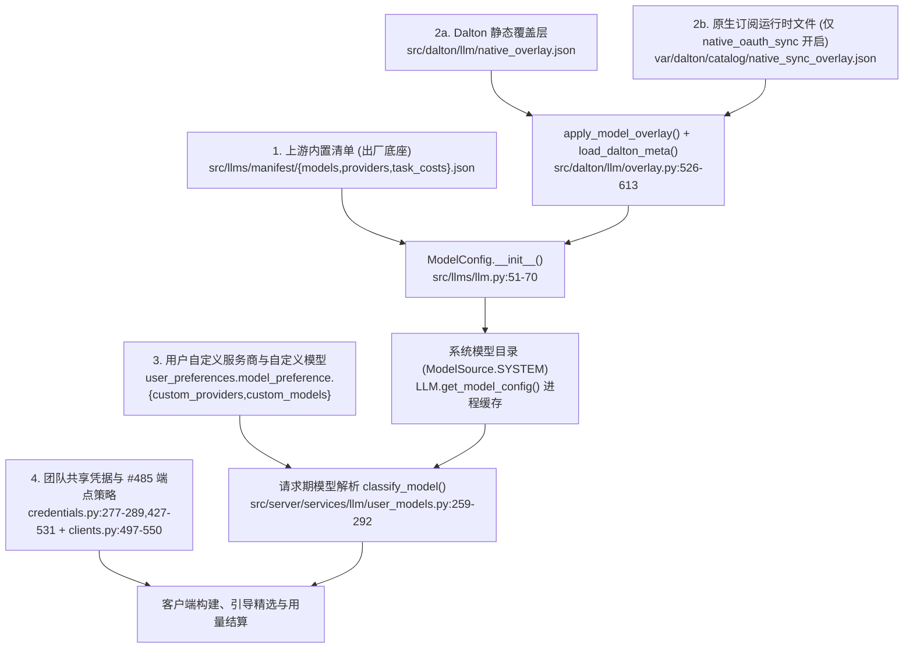
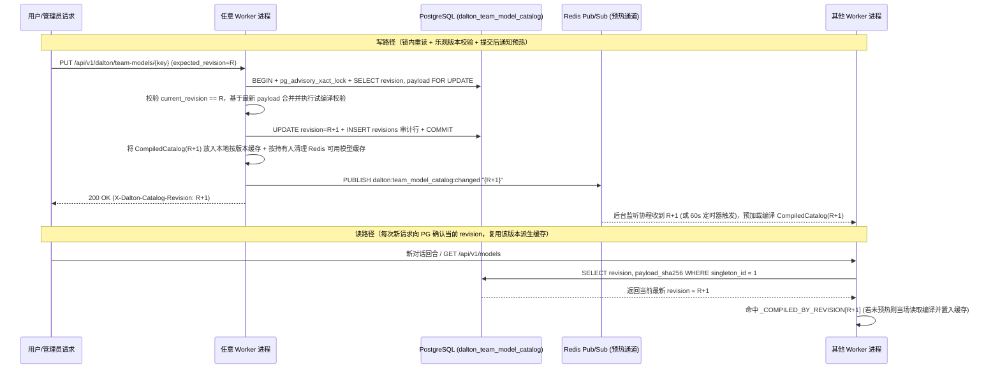

# 团队模型目录设计方案（管理员网页增改模型，版本化在线生效）

> **设计定位**：面向 Everflow 与独立核心（Standalone Core）双安装形态的团队级模型目录管理能力  
> **目标体验**：管理员在 **设置 → 团队管理 → 模型与供应商** 页面自助完成新模型与兼容提供商变体接入、价格与评分修订、可见性切换、退役替换与一键回滚；每次请求按 PostgreSQL 版本号确认生效目录，在途对话回合全程锁定启动时的目录版本。

---

## 一页摘要

1. **解决什么问题**：日常上线新模型、修订输入/缓存/输出费率、调整上下文窗口与思考档位、维护"智能 / 速度 / 说人话"评分，原先需要手工修改代码仓库内的 `src/dalton/llm/native_overlay.json`（或受门禁保护的上游清单）并重新发版部署（如智谱 `GLM 5.4` 近期由独立静态配置 PR 先行接入）。本方案将日常模型目录运维收敛到网页管理端，与代码发布解耦。
2. **核心架构**：保留上游 `src/llms/manifest/*.json` 与 `src/dalton/llm/native_overlay.json` 作为随镜像发布的**出厂默认基线**；在 PostgreSQL 建立单行当前目录表 `dalton_team_model_catalog`（迁移预置 `revision = 0` 初始空目录）、事务审计与回滚表 `dalton_team_model_catalog_revisions`（含关联任务改写明细 `side_effects`）以及目录变体专属加密凭据表 `dalton_catalog_provider_credentials`；并将原本地文件 `native_sync_overlay.json` 在第一批一次性收口入库，形成清晰的**三层系统目录**。
3. **版本真相与回合隔离**：PostgreSQL 是当前目录版本号 `revision` 的唯一真相源，进程内存仅按不可变版本号缓存派生结果（`revision → CompiledCatalog`，覆盖 `ModelConfig`、`dalton_meta`、名义价格索引、任务成本与系列目录），Redis Pub/Sub 与 60 秒定时轮询负责后台预热；每个对话回合（及顶层 `dalton_complete` 调用）在入口锁定 `turn_catalog_revision`，回合内的模型能力、附件模态、备用链、预算预留与最终结算统一读取同一版本。
4. **凭据与出站安全**：目录新增提供商变体强制录入**该变体专属的只写凭据**并严格绑定至经授权的 `base_url`，与团队凭据持有人现有密钥及父提供商密钥完全隔离；全安装形态（含 Everflow 与 Core）在实际发包与底层建连阶段统一校验 `https` 公网单播地址并关闭重定向（`follow_redirects=False`）。

---

## 1. 现状盘点：模型清单加载、合并优先级与字段作用点

### 1.1 五类模型配置的现有加载链路与合并优先级

现行代码在"系统目录构建期合并"与"请求期按用户解析"两个阶段处理模型配置：



各层代码位置、现行合并行为与演进切入点如下：

| 层级 | 核心代码位置（`文件:行号`） | 现行加载与合并机制 | 现行边界与待演进点 |
|---|---|---|---|
| **① 内置模型清单** | `src/llms/llm.py:51-70,101-153`<br>`src/llms/manifest/models.json:452-579`<br>`src/llms/manifest/providers.json:469-540,992-1026`<br>`src/llms/task_costs.py:52,169-179` | `ModelConfig.__init__` 读取 `models.json` 与 `providers.json`，经 `_flatten_providers`（`src/llms/llm.py:101-153`）将各品牌组与 `variants` 展平到同一 `flat_providers` 字典；`task_costs.json` 由 `_shipped()`（`src/llms/task_costs.py:169-179`）通过 `@lru_cache(maxsize=1)` 加载。 | 受 `scripts/dalton/check_hooks.sh:7` 保护只读；触碰其余上游 Python/TS 文件须在改动上下 25 行窗口内附带已注册的 `DALTON-HOOK` 标记（`check_hooks.sh:638-648`）。 |
| **② Dalton 覆盖层（静态 + 原生同步文件）** | `src/llms/llm.py:62-65,658-664`<br>`src/dalton/llm/overlay.py:18-47,234-380,404-613`<br>`src/dalton/llm/native_overlay.json:1-1644`<br>`src/dalton/llm/notional_pricing.py:121-166` | • `apply_model_overlay` 在 `CapabilityId.NATIVE_OAUTH_SYNC`（`src/dalton/llm/overlay.py:43-47`）开启时依次合并 `native_overlay.json` 与 `native_sync_overlay.json`，再执行 `_drop_retired_models`（`:404-448`）、`_enforce_pinned_overlay_routes`（`:450-475`，整条回写 `grok-4.7-oauth`）与 `inherit_antigravity_gemini_ratings`（`:493-523`）；关闭时经 `_filter_generic_overlay`（`:54-163,551-575`）剥离全部 `*-oauth` 条目。<br>• `load_dalton_meta()`（`:594-613`）独立于 `ModelConfig` 读取两份文件并按模型键整条替换字典；`build_notional_price_index`（`notional_pricing.py:121-165`）直接扫描 `native_overlay.json` 的 `models` 映射 `model_id`。 | 1) `_merge_single_overlay` 对同名 `models` 键（除固定键外）及同 `id` 价格卡记录错误并跳过（`:242-254,326-344`），改已有项须分开写 `model_overrides` 与 `providers.model_overrides`；<br>2) `load_dalton_meta` 整条替换会冲掉底层未重申的字段，且与 `notional_pricing.py` 均只读磁盘文件；<br>3) `z-ai-cn-coding` 与 `muse-oauth` 缺少远端列表接口（`src/dalton/llm/native_catalog.py:114-128`），需手工维护目录。 |
| **③ 用户自定义服务商与模型** | `web/src/components/modelAccess/useCustomProviderForm.ts:114-155`<br>`src/server/services/llm/user_models.py:100-135,259-292`<br>`src/server/services/llm/custom_catalog.py:13-25,342-421` | 存储在个人 `user_preferences.model_preference` 中。`classify_model`（`user_models.py:259-292`）优先匹配个人 `custom_models` 再查系统目录；同名个人条目通过 `inherited_declarations`（`src/llms/model_spec.py:287-316`）继承内置同名模型的引导、压缩档位、窗口及同协议思考声明。 | 仅作用于单个用户自身，模态限于 `{"text", "image", "pdf"}`（`custom_catalog.py:13`）；在团队凭据共享模式下，个人自定义模型依然使用团队凭据持有人的密钥并受 #485 端点策略严格约束（见下栏）。 |
| **④ 团队凭据、角色路由与引导精选** | `src/dalton/credentials.py:252-289,427-531`<br>`src/server/database/api_keys.py:340-367`<br>`src/server/services/llm/byok.py:13-73`<br>`src/server/services/llm/clients.py:497-551`<br>`src/dalton/llm/model_prefs.py:291-365`<br>`web/src/config/daltonSetup.ts:43-49,280-361`<br>`web/src/pages/Setup/answers/useTeamModels.ts:107-260` | • **凭据解析与 #485 端点保护**：团队共享开启时，`get_byok_config_for_provider`（`api_keys.py:350`）通过 `credential_user_id()` 将全部成员的密钥查询统一指向凭据持有人；`byok_candidates`（`byok.py:13-42`）在同族提供商间查找可用密钥（独立 Coding Plan 除外）；`enforce_shared_byok_endpoint_policy`（`credentials.py:427-531`，由 `clients.py:534` 调用）限制共享密钥只能发往持有人已保存的 `base_url` 或内置提供商默认端点，且客户端固定 `follow_redirects=False`（`clients.py:550`）。<br>• **Dalton 后台角色解析**（`model_prefs.py:291-365`）：依次按"调用者偏好 → 凭据持有人偏好 → `dalton.yaml`"查找，每一步先用 `_filter_shadowed_by_custom_models` 剔除被调用者个人 `custom_models` 遮蔽的候选、再用 `_without_models_missing_from_catalog` 剔除不在系统目录中的模型名后继续向后回退。<br>• **首次引导**：`useSetupFacts.ts:57-65`、`setupSteps.ts:18-22`、`defaultChoices.ts:305-332` 与 `daltonSetup.ts:43-49` 共同消费精选候选规则。 | 若把网页新增提供商变体直接放入普通内置清单，既会让 `byok_candidates` 把持有人父级密钥继承过去，又会让 `egress.is_operator_endpoint`（`src/server/services/llm/egress.py:118-138`）将其视为可信运营端点（且 Everflow 下 `egress.enforced()` 为假，`egress.py:107-116`），因此目录新增变体必须采用独立凭据与独立连接期校验。 |
| **⑤ 首次设置 `deployment_settings`** | `migrations/versions/148_deployment_settings.py:20-25`<br>`src/server/services/setup_settings/__init__.py:23-33`<br>`src/server/services/setup_settings/apply.py:162-205`<br>`src/server/services/setup_settings/follow.py:18-90` | 单机开源向导将搜索/行情/沙箱配置加密存入 `deployment_settings`，写入后通过 Redis 频道 `setup_settings:changed` 与 60 秒 `_TICK_SECONDS` 定时重读同步各 worker；Dalton 启用时该向导路由关闭（`setup_settings/__init__.py:23-33`）。 | 其 Redis Pub/Sub + 60 秒轮询适合作为多进程**缓存预热通道**；同时遵循 `src/server/AGENTS.md:38-47` 跨进程准则，新请求须以 PostgreSQL 版本号为准，避免进程内过期快照成为请求真值。 |

### 1.2 核心字段如何驱动计费、能力分类、选择器展示与预算

| 业务维度 | 决定字段与所在结构 | 读取与生效代码位置（`文件:行号`） | 现行作用机制与回合一致性要点 |
|---|---|---|---|
| **现金计费（Cash USD）** | `providers.models.<provider>[].{id, alias, pricing}`（含 `input`、`cached_input`、`cache_5m`、`cache_1h`、`output` 或 `input_tiers` / `output_tiers`） | `src/llms/llm.py:942-985`<br>`src/llms/pricing_utils.py:244-365`<br>`src/utils/tracking/core.py:242-295`<br>`src/server/services/persistence/usage.py:136-147` | 客户端构造时仅在 `client.metadata` 打上身份印章 `pricing_model_id` 与 `pricing_provider`（`llm.py:965-971`），实际费率在结算时由 `find_model_pricing` 查找并经 `_stamp_applied_rates` 写入记录。查找顺序为：大小写不敏感精确 `id` → `alias` → 点横线归一化（`s.lower().replace('.', '-')`）→ 去日期后缀基座模型。现金模型缺失价格卡时，聊天用量追踪（`core.py:273-287`）按零成本记录 Token 并标记 `pricing_failed=True`；Dalton 预算与准入记账（`src/dalton/budget/service.py:372-378`、`src/dalton/llm/complete.py:200-208`）对 `pricing_failed` 调用按保守底价 `admission_floor_usd`（`$0.25`）折算。 |
| **订阅与套餐名义计费（Notional USD）** | `providers.provider_config.<p>.billing: "subscription"`<br>`dalton_meta.<key>.{billing, notional_pricing, notional_ref}` | `src/llms/pricing_utils.py:279-291`<br>`src/dalton/llm/notional_pricing.py:121-268`<br>`src/utils/tracking/core.py:201-240`<br>`src/dalton/budget/service.py:378-395` | 订阅或 Coding Plan（如 `z-ai-cn-coding`）现金成本记 `$0.00`，通过 `load_dalton_meta()` 与 `build_notional_price_index()` 解析自身 `notional_pricing` 或同款现金卡 `notional_ref`，由 `_stamp_applied_notional_rates` 写入 `notional_cost` 并汇总至 `subscription_notional_usd`。 |
| **预算水位与提供商分项汇总** | 现金价格卡四项费率 + 已持久化用量记录印章 | `src/llms/pricing_utils.py:455-544`<br>`src/dalton/budget/service.py:266-395` | 准入预留按 `blended_rate` 与 `chunk_multiplier` 估算步长；今日预算分项 `compute_provider_breakdown` 读取 `conversation_usages` 的 `per_call_costs` 与 `dalton_complete` 账本，优先消费每条记录已持久化的 `cost`、`notional_cost` 与 `pricing_provider`。 |
| **任务成本（Task Cost）** | `task_costs.json` 的 `baseline`、`models`、`bounds` + 目录标价 `get_list_rates` | `src/llms/task_costs.py:86-155,195-266`<br>`src/llms/llm.py:307-334,434-443` | 有实测值或 `bounds` 绑定时输出各思考档位相对基线（`claude-sonnet-5-5` `medium` = `1.0`）的 `task_cost`；其余模型按 `0.75 * input + 0.25 * output` 相对基线折算 `task_cost_estimate`。 |
| **思考强度（Reasoning Effort）** | `models.<key>.reasoning.{efforts, default, write, on, off}` + `parameters` / `extra_body` | `src/llms/reasoning.py:25-60,73-138,172-233`<br>`src/llms/model_spec.py:34-95,194-201`<br>`src/llms/llm.py:398-403,733-759` | `efforts` 取自有序枚举 `("none", "minimal", "low", "medium", "high", "xhigh", "max")`；请求期经 `clamp_reasoning_effort` 向下钳制后写入目标 SDK 协议路径（如智谱直连写 `extra_body.reasoning_effort`，智谱 Coding Plan 写 `parameters.output_config.effort` 并置 `parameters.thinking.type="enabled"`）。 |
| **输入模态与回合内附件裁剪** | `models.<key>.input_modalities`（打标于 `client.metadata["manifest_model"]`） | `src/llms/llm.py:453-464,969,1655-1845`<br>`src/ptc_agent/agent/middleware/file_operations/multimodal_strip.py:688-715` | `MultimodalStripMiddleware._target` 在每次模型调用前读取 `model.metadata["manifest_model"]` 并查询 `get_input_modalities` 决定保留或剥离图片/PDF/音视频块，因此回合内必须固定目录版本以保持客户端配置与中间件判断一致。 |
| **上下文窗口与自动压缩** | `models.<key>.{context, compaction_profile}` + `parameters.{max_tokens, max_output_tokens}` | `src/llms/model_spec.py:97-106`<br>`src/llms/llm.py:414-423,511-517` | `context` 决定 `max_input_tokens` 容量上限，`compaction_profile`（如 `expansive`）控制自动摘要触发阈值。 |
| **工具调用、家族与角色准入** | `dalton_meta.<key>.{tool_calling, family, forbidden_for_roles}` | `src/dalton/llm/role_policy.py:60-105,144-177`<br>`src/dalton/llm/model_family.py:9-37`<br>`src/server/app/api_keys.py:808-810` | 均从 `load_dalton_meta()` 读取：`tool_calling` 用于 Core 引导与后台槽位筛选，`family` 用于正式发布异族独立审校判定，`forbidden_for_roles` 用于隔离训练数据贡献线路。 |
| **选择器展示、评分与系列折叠** | `visible`、`display_name`、`intelligence`、`speed`、`plain_language` + `antigravity_series.py` | `src/llms/llm.py:335-395`<br>`src/server/app/api_keys.py:749-847`<br>`src/dalton/llm/antigravity_series.py:28-35,192-250` | `listed_models()` 筛出 `visible: true` 模型下发至 `GET /api/v1/models`；三项 1–5 分评分展示于选择器详情与首次引导；`build_antigravity_series_catalog` 将多强度模型键折叠为单一系列条目。 |

---

## 2. 总体方案：数据库"团队模型目录"、版本生效与安全隔离

### 2.1 数据库表设计与初始行（新增 Dalton 迁移）

本分支当前唯一的 Dalton Alembic 迁移头为 **`d046`**（`src/dalton/migrations/versions/d046_scoped_data_map_cache.py:23-24`，其 `down_revision = "d048"`）。并行开发中微信多账号占用 `d049`、研究桥拆分从 `d050` 起；本方案 Batch 1 目录迁移（及 Batch 3 价格提醒迁移，若分批合入）均紧接合入时刻主分支唯一的 Dalton `head`（下文记作 `d05X_team_model_catalog.py`，合入前核对唯一头节点）。全部新建表均为 Dalton 自有表，迁移内幂等预置 `singleton_id = 1, revision = 0` 初始空目录行与初始审计行：

1. **当前生效目录单行表 `dalton_team_model_catalog`**：
   ```sql
   CREATE TABLE IF NOT EXISTS dalton_team_model_catalog (
       singleton_id              SMALLINT PRIMARY KEY DEFAULT 1 CHECK (singleton_id = 1),
       revision                  BIGINT NOT NULL DEFAULT 0 CHECK (revision >= 0),
       schema_version            INTEGER NOT NULL DEFAULT 1,
       payload                   JSONB NOT NULL DEFAULT '{"schema":"dalton-team-model-catalog/1"}'::jsonb,
       payload_sha256            TEXT NOT NULL,
       legacy_sync_import_status TEXT NOT NULL DEFAULT 'pending'
                                 CHECK (legacy_sync_import_status IN ('pending', 'not_applicable', 'imported', 'failed')),
       legacy_sync_import_error  TEXT NULL,
       updated_by                TEXT NOT NULL DEFAULT 'system:migration',
       updated_at                TIMESTAMPTZ NOT NULL DEFAULT NOW()
   );
   ```
2. **事务内权威变更审计与回滚历史表 `dalton_team_model_catalog_revisions`**：
   ```sql
   CREATE TABLE IF NOT EXISTS dalton_team_model_catalog_revisions (
       revision        BIGINT PRIMARY KEY CHECK (revision >= 0),
       action          TEXT NOT NULL CHECK (action IN (
                           'init_empty', 'bootstrap_import', 'create_model', 'update_model',
                           'hide_model', 'unhide_model', 'retire_model', 'restore_model',
                           'native_sync', 'native_retire', 'native_restore',
                           'upsert_provider_variant', 'update_curated', 'confirm_price', 'rollback'
                       )),
       target_keys     TEXT[] NOT NULL DEFAULT '{}',
       payload         JSONB NOT NULL,
       payload_sha256  TEXT NOT NULL,
       diff_summary    JSONB NOT NULL DEFAULT '{}'::jsonb,
       side_effects    JSONB NOT NULL DEFAULT '[]'::jsonb,
       comment         TEXT NULL,
       restored_from   BIGINT NULL REFERENCES dalton_team_model_catalog_revisions(revision),
       actor_user_id   TEXT NOT NULL,
       actor_label     TEXT NULL,
       created_at      TIMESTAMPTZ NOT NULL DEFAULT NOW()
   );
   CREATE INDEX IF NOT EXISTS ix_dalton_team_catalog_revisions_created
       ON dalton_team_model_catalog_revisions (created_at DESC);
   ```
   > 迁移脚本建表后立即执行 `INSERT ... ON CONFLICT DO NOTHING` 写入 `revision = 0`（`action = 'init_empty'`，`actor_user_id = 'system:migration'`，空载荷 `{"schema": "dalton-team-model-catalog/1"}`），保证首次业务修改（`revision = 1`）拥有可回滚的初始基准版本，且服务启动与定时预热始终读到有效行。

3. **目录新增提供商变体专属凭据表 `dalton_catalog_provider_credentials`**（只写加密存储，与版本历史表物理分离）：
   ```sql
   CREATE TABLE IF NOT EXISTS dalton_catalog_provider_credentials (
       provider_slug           TEXT PRIMARY KEY,
       encrypted_api_key       BYTEA NOT NULL,
       bound_base_url          TEXT NOT NULL,
       canonical_origin_prefix TEXT NOT NULL,
       key_fingerprint         TEXT NOT NULL,
       updated_by              TEXT NOT NULL,
       updated_at              TIMESTAMPTZ NOT NULL DEFAULT NOW()
   );
   ```
4. **第三方价格变动提醒表 `dalton_model_price_alerts`**（Batch 3 启用）：
   ```sql
   CREATE TABLE IF NOT EXISTS dalton_model_price_alerts (
       alert_id              UUID PRIMARY KEY DEFAULT gen_random_uuid(),
       model_key             TEXT NOT NULL,
       provider              TEXT NOT NULL,
       model_id              TEXT NOT NULL,
       card_target           TEXT NOT NULL CHECK (card_target IN ('cash', 'notional')),
       alert_kind            TEXT NOT NULL CHECK (alert_kind IN ('public_price_listed', 'public_price_changed')),
       match_confidence      TEXT NOT NULL CHECK (match_confidence IN ('exact_route', 'reference_only')),
       base_catalog_revision BIGINT NOT NULL,
       current_pricing       JSONB NOT NULL,
       detected_pricing      JSONB NOT NULL,
       source_name           TEXT NOT NULL CHECK (source_name IN ('openrouter', 'litellm')),
       source_url            TEXT NULL,
       fingerprint           TEXT NOT NULL UNIQUE,
       status                TEXT NOT NULL DEFAULT 'pending'
                             CHECK (status IN ('pending', 'applied', 'dismissed')),
       applied_revision      BIGINT NULL REFERENCES dalton_team_model_catalog_revisions(revision),
       detected_at           TIMESTAMPTZ NOT NULL DEFAULT NOW(),
       resolved_by           TEXT NULL,
       resolved_at           TIMESTAMPTZ NULL
   );
   CREATE INDEX IF NOT EXISTS ix_dalton_price_alerts_status
       ON dalton_model_price_alerts (status, detected_at DESC);
   ```

**`payload` JSONB 结构（`schema: "dalton-team-model-catalog/1"`）**：仅存放公开模型声明、价格评分、退役列表与引导精选增量（密钥字段独立存于 `dalton_catalog_provider_credentials`）：

```json
{
  "schema": "dalton-team-model-catalog/1",
  "models": {
    "glm-99-preview-plan": {
      "prompt_guidance": "lean",
      "model_id": "glm-99-preview",
      "provider": "z-ai-cn-coding",
      "display_name": "GLM-99 Preview (Coding Plan)",
      "visible": true,
      "intelligence": 5,
      "speed": 3,
      "plain_language": 4,
      "context": 1000000,
      "compaction_profile": "expansive",
      "input_modalities": ["text", "image", "pdf"],
      "parameters": {
        "max_tokens": 128000,
        "thinking": { "type": "enabled" }
      },
      "reasoning": {
        "efforts": ["low", "high", "max"],
        "default": "high",
        "write": "parameters.output_config.effort",
        "on": { "parameters.thinking.type": "enabled" }
      }
    }
  },
  "model_overrides": {
    "glm-5.4-plan": { "plain_language": 5 }
  },
  "retired": [
    { "key": "glm-5.3-plan", "provider": "z-ai-cn-coding", "retired_at": "2026-11-24T10:00:00Z", "retired_by": "admin-uid" }
  ],
  "providers": {
    "provider_variants": {
      "openai": {
        "acme-corp-gateway": {
          "display_name": "Acme 企业聚合网关",
          "sdk": "openai",
          "access_type": "api_key",
          "billing": "cash",
          "base_url": "https://llm-gw.example.com/v1"
        }
      }
    },
    "models": {
      "z-ai-cn-coding": [
        {
          "id": "glm-99-preview",
          "alias": ["glm-99-preview-plan"],
          "name": "GLM-99 Preview (Coding Plan)",
          "is_reasoning": true,
          "pricing": { "input": 0.0, "cached_input": 0.0, "output": 0.0, "unit": "per_1m_tokens" },
          "pricing_meta": { "source_kind": "official", "estimated": false, "verified_at": "2026-11-24" },
          "context_window": 1000000,
          "max_output": 128000
        }
      ]
    },
    "model_overrides": {}
  },
  "dalton_meta": {
    "glm-99-preview-plan": {
      "family": "zai-glm",
      "billing": "subscription",
      "tool_calling": true,
      "notional_pricing": {
        "input": 1.4,
        "cached_input": 0.29,
        "output": 4.4,
        "estimated": true,
        "source_kind": "estimated",
        "source": "内部预估参考同系直连单价",
        "verified_at": "2026-11-24"
      }
    }
  },
  "task_costs": {
    "models": {},
    "bounds": {
      "glm-99-preview-plan": { "model": "glm-5.3", "times": 1.0 }
    }
  },
  "series_overrides": {},
  "curated_setup": null
}
```

### 2.2 三层合并范围、归一化冲突规则与固定路由/退役执行顺序

`NativeModelsCard` 在 Batch 1 一次性收口入库后（详见 §2.6），系统目录收敛为确定的**三层结构**，每次编译某个版本 `R` 的 `CompiledCatalog` 时，同步产出 `ModelConfig`、合并后的 `dalton_meta`、名义价格索引 `notional_price_index`、任务成本表 `task_costs`、系列目录 `antigravity_series` 与派生提供商目录：

1. **三层合并全覆盖（含 `load_dalton_meta` 与 `notional_pricing.py`）**：
   - **第 1 层**：上游内置清单（`src/llms/manifest/{models,providers,task_costs}.json`）；
   - **第 2 层**：Dalton 代码静态覆盖层 `src/dalton/llm/native_overlay.json`；
   - **第 3 层（最高系统目录优先级）**：数据库 `dalton_team_model_catalog`（`revision = R`）快照。
   - **扩展 `load_dalton_meta(catalog_revision=R)`（`src/dalton/llm/overlay.py:594-613`）**：将第 2 层与第 3 层的 `dalton_meta.<key>` 改为**按模型键执行深度字段合并（`_deep_merge_patch`，字段值为 `null` 时显式删除该可选子键，例如从 `notional_ref` 切换为直接填写 `notional_pricing`）**，并在收尾时同步剔除最终已退役的模型键及（当 `CapabilityId.NATIVE_OAUTH_SYNC` 关闭时）全部 `*-oauth` 键。管理员只修改某模型的 `notional_pricing` 或 `tool_calling` 时，底层原有的 `family` 与 `forbidden_for_roles` 完整保留；选择器元数据、角色策略（`role_policy.py`）与计费共享同一份编译结果。
   - **扩展 `build_notional_price_index(catalog_revision=R)`（`src/dalton/llm/notional_pricing.py:121-165`，纳入 Batch 1）**：基于版本 `R` 合并完成后的完整 `ModelConfig.llm_config` 与合并后的 `dalton_meta` 构建 `{model_key -> card}` 与 `{model_id -> card}` 映射（其中 `notional_ref` 同样查询版本 `R` 的现金价格卡），使网页新增的 Coding Plan 模型与订阅名义改价立即计入 `subscription_notional_usd`。

2. **四维标识符归一化与冲突判定规则**：
   对齐 `find_model_pricing`（`src/llms/pricing_utils.py:258-341`）与 `_flatten_providers`（`src/llms/llm.py:101-153`）的实际匹配语义，定义标准归一化函数 `norm_id(s) = s.strip().lower().replace(".", "-")`：

   | 维度 | 唯一性与覆盖规则 |
   |---|---|
   | **① 模型键（`model_key`）** | 在合并后的 `llm_config` 中按大小写不敏感（`key.lower()`）全局唯一。管理员调用"新增模型"提交已存在于第 1–2 层的键时返回 `409 Conflict` 并引导使用"编辑模型"（自动写入 `model_overrides`）。若后续版本升级使第 1–2 层新增了与数据库 `models` 同名的键，合并器自动将数据库条目转为对新版出厂底座的深度补丁（详见 §7.2）。 |
   | **② 跨组提供商标识（`provider_slug`）** | `_flatten_providers` 将所有 `provider_config` 顶层组键与所有组内 `variants` 展平到同一 `flat_providers` 空间。管理员新增 `provider_variants[group][v_name]` 时，校验 `v_name.lower()` 与第 1–3 层**全部顶层组名及全部跨组变体名**均无重名，并为数据库新增变体自动注入内部只读属性 `catalog_defined: True`、`own_api_key: True`。 |
   | **③ 同提供商价格卡 `(provider, model_id)` 与 `alias`** | 在同一 `provider` 的存活价格卡列表 `manifest["models"][provider]` 内，每张卡片的 `norm_id(id)` 与全部 `norm_id(alias)` 构成的标识集合须两两互不相交（覆盖大小写及点号/连字符等价匹配），且当该 `provider` 存在父提供商回退查找链（`pricing_utils.py:273-277`）时，校验本提供商卡片内部无歧义；编辑已有模型价格时自动写入 `providers.model_overrides[provider][card_id]` 原地深度更新，避免被新增列表跳过（`overlay.py:326-380`）。 |
   | **④ 团队目录模型 vs 成员个人 `custom_models`** | 团队目录模型属于 `ModelSource.SYSTEM`。在团队凭据共享开启（`credentials.sharing == "team"`）时，成员保存的同名个人 `custom_models` 依然解析到团队凭据持有人的密钥（`src/server/database/api_keys.py:350`），并严格受 #485 `enforce_shared_byok_endpoint_policy`（`src/dalton/credentials.py:427-531`）约束——仅允许连向持有人已保存的 `base_url` 或内置提供商默认端点，自定义端点/连接参数/路由头一律以 `400 base_url_blocked` 拦截；若指向目录新增变体（`catalog_defined: True`），则固定锁定于该变体的 `bound_base_url`。仅当部署关闭团队凭据共享（个人密钥模式）时，个人自定义模型使用该成员自己的密钥。 |

3. **编译管线收尾四步固定顺序（固定路由与分层退役边界）**：
   每次构建 `CompiledCatalog` 时，严格按以下四步收尾：
   - **步骤 A（三层正向合并）**：依次合并第 1 层内置清单 → 第 2 层 `native_overlay.json` → 第 3 层数据库载荷（含 `models`、`model_overrides`、`providers`、`dalton_meta`、`task_costs`、`series_overrides`）；
   - **步骤 B（专有固定路由窄字段锁定）**：对 `PINNED_OVERLAY_MODEL_KEYS`（`grok-4.7-oauth`，`src/dalton/llm/overlay.py:27,450-475`）由出厂整条覆盖改为**仅锁定底层路由与协议连接字段**（强制 `provider = "xai-oauth"`、`model_id` 及核心连接参数与 `native_overlay.json` 一致），保留管理员在数据库 `model_overrides` 与 `dalton_meta` 中对其展示名、`visible`、三项评分、默认思考档位及名义价格所做的修订；
   - **步骤 C（出厂硬退役 vs 团队可恢复退役）**：
     - **出厂硬退役名单**（`native_overlay.json` 的 `retired` 数组，如平台明确不提供的上游 `grok-4.6-oauth`、`grok-4.3-oauth`）定义为**不可逆平台基线**，管理列表默认过滤隐藏，恢复接口对其返回 `400 factory_retired_immutable`；
     - **团队退役名单**（数据库 `dalton_team_model_catalog.retired` 数组）承载管理员手动退役及原生同步下线的模型，管理员点击「恢复」即从数据库 `retired` 移除该键并即时生效；
     - `_drop_retired_models` 对 `出厂 retired ∪ 数据库 retired` 统一执行移除（因步骤 C 在步骤 B 之后运行，管理员若在网页退役 `grok-4.7-oauth` 同样正常生效）；
   - **步骤 D（能力门禁最终裁剪与评分继承）**：无论触发源是常规合并、启动导入还是历史版本回滚，当 `CapabilityId.NATIVE_OAUTH_SYNC` 未启用时，统一强制剥离全部 `*-oauth` 模型键、`*-oauth` 提供商及对应 `dalton_meta`；开启时最后执行 `inherit_antigravity_gemini_ratings` 补齐未显式打分的 Gemini 系列分值。

### 2.3 多 Worker 版本确认、只读派生缓存与写锁防覆盖

严格遵循 `src/server/AGENTS.md:38-47` 跨进程准则——**PostgreSQL 是当前生效版本号的唯一真相源，进程内存仅按版本号缓存不可变的派生数据**：



1. **新请求从 PostgreSQL 确认版本 + 进程内 `revision → CompiledCatalog` 只读缓存**：
   - 每个新进入的业务请求（对话回合准入、`dalton_complete` 顶层调用、`GET /api/v1/models`、可用模型查询、自动化调度触发）通过主键点查 `SELECT revision, payload_sha256 FROM dalton_team_model_catalog WHERE singleton_id = 1` 确认当前生效版本 `R`；
   - 每个 worker 进程维护容量上限为 8 的只读有序缓存 `_COMPILED_BY_REVISION: OrderedDict[tuple[int, str, bool], CompiledCatalog]`（键为 `(revision, static_overlay_file_stamp, oauth_sync_enabled)`，值封装该版本冻结的 `ModelConfig`、`dalton_meta`、`notional_price_index`、`task_costs`、`antigravity_series`、`provider_catalog`、`key_candidates` 与 BYOK 提供商集合；并将 `src/server/app/api_keys.py:49,62,71,167,320` 中全局单次缓存 `_BYOK_PROVIDERS_CACHE` 与散落的 `ModelConfig()` 调用统一收口至读取当前请求版本的 `CompiledCatalog`）；
   - 只要缓存已存在键 `(R, stamp, oauth_on)`，请求直接以内存引用复用派生对象；若因 Redis 瞬断尚未预热，该 worker 立即查询完整 `payload` 编译生成 `CompiledCatalog(R)` 放入缓存，**保证管理员保存返回 `200 OK` 后的下一毫秒起，落到任何 worker 的新请求都 100% 看到新版本 `R+1`**。
2. **后台预热协程与单调版本保护（复用 `setup_settings/follow.py` 模式）**：
   - 在 `src/server/app/setup.py` lifespan 启动预热任务 `dalton-team-model-catalog-follow`（结构对齐 `src/server/services/setup_settings/follow.py:46-90`），订阅 `dalton:team_model_catalog:changed` 并每 `_TICK_SECONDS = 60.0` 秒兜底核对一次数据库 `revision`；
   - 维护单调水位 `_highest_prewarmed_revision`：仅当读取到的 `db_revision > _highest_prewarmed_revision` 时才执行预编译并推进水位，彻底杜绝慢查询或乱序通知用旧版本覆盖高版本缓存。
3. **写路径锁内重读与并发防覆盖**：
   - 全部目录写接口接受 `expected_revision: int` 参数；写事务内先获取排他事务级咨询锁 `pg_advisory_xact_lock(hashtext('dalton_team_model_catalog'))`，再执行 `SELECT revision, payload FROM dalton_team_model_catalog WHERE singleton_id = 1 FOR UPDATE`；
   - 当 `expected_revision != current_revision` 时立即中止事务并返回 `409 Conflict`（附最新目录快照供前端合并重提）；一致时基于锁内重读的最新 `payload` 生成候选快照，完整跑通 §3.2 校验与试编译后提交 `revision = current_revision + 1`。
4. **按凭据持有人精准清理 Redis 可用模型缓存**：
   - `invalidate_available_models(user_id)`（`src/server/services/llm/provider_models/service.py:136-142,223-233`）以 `provider_models:{credential_user_id(user_id)}` 为 Redis 键；
   - 因此每次目录变更或目录变体凭据更新提交后，若团队凭据共享开启，直接取 `holder_id = get_team_credential_holder_id()` 调用 `await invalidate_available_models(holder_id)`（另对当前操作管理员 `actor_user_id` 调用一次以覆盖个人模式），并清理变更涉及网关的 `model_catalog:{url_key}:{provider}` 键（`service.py:203`）。

### 2.4 回合内固定目录版本（Turn-Pinned Catalog Revision）

为消除回合中途改价、退役或修改模态导致的预留金额、附件裁剪与最终账单不一致，系统**以"回合（Turn）"为单位固定目录版本**：

1. **回合入口一次绑定，全链路透传**：
   - 对话回合（用户发消息、重试、唤醒回合、定时自动化回合）在准入入口向 PostgreSQL 读取当前 `catalog_revision = R`，写入协程上下文变量 `turn_catalog_revision` 并记录在运行上下文中；
   - 该 `turn_catalog_revision = R` 自动贯穿本回合内的：
     - **主模型与备用链（`ModelResilienceMiddleware`）**：主客户端与全部 `fallback_models` 客户端均从 `CompiledCatalog(R)` 构建，并在 `client.metadata["catalog_revision"] = R` 打标；
     - **子智能体与回合内 `dalton_complete`**：`arun_subagent_streaming` 派生的子智能体运行以及回合内触发的审校/核验/提取 `dalton_complete` 调用直接继承父回合的 `turn_catalog_revision = R`（脱离对话回合独立运行的后台 `dalton_complete` 在自身入口读取一次当前 `R` 并在单次调用内固定）；
     - **附件多模态裁剪（`MultimodalStripMiddleware`）**：`_target`（`src/ptc_agent/agent/middleware/file_operations/multimodal_strip.py:688-715`）读取 `model.metadata["catalog_revision"]`（回退至 `turn_catalog_revision`）对应的 `CompiledCatalog(R)` 查询 `get_input_modalities` 与文档页数上限，确保客户端构建与中间件判断严格同源；
     - **预算预留与最终用量结算**：准入与运行中分块预留（`blended_rate` / `chunk_multiplier`）、每条 `CallRecord` 印章（新增 `catalog_revision: R` 字段）、以及回合结束时 `UsagePersistence`（`src/server/services/persistence/usage.py:136-147`）调用的 `calculate_cost_from_per_call_records`（`src/utils/tracking/core.py:209-270`），其底层 `find_model_pricing`、`is_subscription_model` 与 `resolve_notional_card` 一律按记录携带的 `catalog_revision = R` 从 `CompiledCatalog(R)` 查表计费（若长回合跨越进程重启使内存缺失版本 `R`，按主键从 `dalton_team_model_catalog_revisions` 只读回填编译版本 `R`）。
2. **预算汇总读取已持久化账单**：
   - `compute_provider_breakdown`（`src/dalton/budget/service.py:313-395`）优先直接累加历史记录已落库的 `cost`、`notional_cost` 与 `pricing_provider` 印章；仅当兜底查询缺失历史名称的提供商显示名时，才查询目录映射。

### 2.5 目录变体凭据强绑定与团队共享凭据隔离

1. **内置提供商模型**：继续复用团队凭据持有人名下的 `user_api_keys` 与 `oauth_tokens`（经 `src/dalton/credentials.py:252-289` 解析），列表接口返回布尔状态 `provider_connected: bool`，未连接时前端提供快捷入口唤起 `ModelAccessSection scope="team"` 连接抽屉。
2. **目录新增提供商变体（`catalog_defined: True`）的专属凭据强绑定**：
   - 管理员在目录中新增提供商变体时，**必须同时填写该变体专属的 API 凭据**，后端将其加密存入 `dalton_catalog_provider_credentials` 并锁定至规范化后的 `bound_base_url`（`canonical_url_key`，`src/dalton/llm/egress_policy.py:114-122`）；若管理员后续修改该变体的 `base_url`，必须同时重新提交凭据，原凭据与旧地址绑定关系同步失效；
   - **零密钥继承**：在 `byok_candidates` / `walk_byok_candidates`（`src/server/services/llm/byok.py:13-42,89-100`）、聊天客户端构建（`src/server/services/llm/clients.py:497-550`）、提供商可用模型拉取（`src/server/services/llm/provider_models/service.py:100-128`、`wire.py:81-156`）及「测试调用」中，凡 `provider_info.get("catalog_defined")` 为真的变体，**唯一合法的凭据来源是 `dalton_catalog_provider_credentials[provider_slug]`，且实际请求 URL 必须匹配 `endpoint_matches_prefix(url, bound_base_url)`**；团队持有人在 `user_api_keys` 中保存的任何密钥、父提供商/同族变体密钥以及服务端环境变量密钥，均与目录新增变体物理隔绝。

### 2.6 原生模型同步（`NativeModelsCard`）一次性收口方案

在 **Batch 1 同一发布批次**内一次性完成 `NativeModelsCard` 的读取、写入、退役、恢复及历史本地文件导入：

1. **读写同批切换**：`src/dalton/services/native_admin.py` 的 `run_native_check`、`run_native_sync`（`:233-363`）、`run_native_retire`（`:365-481`）与 `run_native_restore`（`:483-520`）在同一批直接改为在 `dalton_team_model_catalog` 排他锁下读写数据库表并生成 `revisions` 审计行（同时继续记录 `dalton_openclaw_sync_runs` 运行摘要，前端现有 `NativeModelsCard` 接口契约保持兼容），不再读写 `var/dalton/catalog/native_sync_overlay.json`。
2. **上线切换时点与显式导入状态机**：
   - 部署发布 Batch 1 时，滚动停掉旧版 worker 后启动新版 worker；新版 worker 在 `setup.py` 启动阶段于 `dalton_team_model_catalog` 事务锁内检查 `legacy_sync_import_status` 列（通过显式状态列判定，即使其他新 worker 已写入业务修订也不会遗漏导入）：
     - 若 `legacy_sync_import_status == 'pending'` 且本地不存在 `native_sync_overlay.json`：状态置为 `'not_applicable'`；
     - 若文件存在且通过 JSON 语法、Schema 与 `assert_no_credentials` 校验：将其 `models`、`dalton_meta` 与 `retired` 幂等合并进 `dalton_team_model_catalog`（写入 `action = 'bootstrap_import'` 修订），将 `legacy_sync_import_status` 置为 `'imported'`，并将原文件原子重命名为 `native_sync_overlay.json.migrated.<timestamp>` 归档，此后文件不再参与任何目录合并；
     - **文件损坏或导入失败容错（Fail-Closed 保护退役名单）**：若文件存在但 JSON 损坏、I/O 报错或校验未通过，记录 `ERROR` 告警日志，将 `legacy_sync_import_status` 置为 `'failed'` 并保存脱敏错误说明；常规内置模型与已有数据库目录继续正常服务对话，而原生同步的写入/恢复接口在 `'failed'` 状态下拒绝执行并返回 `503 legacy_overlay_import_failed`（管理页顶部展示修复/确认归档引导按钮），防止因漏读损坏文件中的 `retired` 名单而误将已下线模型重新放开。

### 2.7 "隐藏"与"退役"：六源引用分类、并发控制与默认模型行为

1. **隐藏（`visible: false`）**：保留在 `ModelConfig` 中，`listed_models()`（`src/llms/llm.py:335-350`）将其从选择器与引导候选收起；`model_resolves()` 仍为 `True`，存量对话线程、定时自动化、备用链与后台角色槽位均按原模型无感继续运行，适合平滑过渡期或仅供后台槽位使用的内部模型。
2. **退役（加入数据库 `retired`）的六源引用分类矩阵与对话线程行为**：

   | 引用类别（采集函数位置） | 能否事务内改写 | 退役处置规则 |
   |---|---|---|
   | **① `agent_config`（`src/dalton/services/model_references.py:58-122`）**<br>`agent_config*.yaml` 的 `llm:` 与内置 `subagents.definitions` | 否（只读配置文件） | **硬阻止退役**：返回 `409 model_in_use_by_config` 并列出配置键路径；任一源读取异常按 `ReferenceSourceUnavailable` 返回 `503`。须先改用「隐藏」或发版更新 YAML。 |
   | **② `dalton_settings`（`model_references.py:124-200`）**<br>`dalton.yaml` 与环境变量中的 `*_model` / `*_models` / `assist_fallback_models` | 否（配置文件 / 环境变量） | **硬阻止退役**：返回 `409 model_in_use_by_config` 并列出具体配置项。 |
   | **③ `plugin_subagents`（`model_references.py:237-300`）**<br>分两子类：镜像内置 `plugins/*/agents/*.md` vs 数据库表 `plugin_subagents` | 内置 `.md` 否；数据库表 `plugin_subagents` 是 | • 镜像内置 `.md` 引用：**硬阻止退役**（`409 model_in_use_by_bundle`）；<br>• 数据库表 `plugin_subagents` 引用：默认拦截列出清单，支持在退役事务内**批量替换为继任模型或置空继承主模型**。 |
   | **④ `user_subagents`（`model_references.py:213-234`）**<br>数据库表 `user_subagents.fields.model` | 是（PostgreSQL 表） | 默认拦截列出清单，支持在退役事务内**批量替换为指定继任模型或清除模型绑定（继承父智能体模型）**。 |
   | **⑤ `automations`（`model_references.py:303-323`）**<br>数据库表 `automations.llm_model`（非空显式绑定） | 是（PostgreSQL 表） | 默认拦截列出受影响自动化清单；管理员指定继任模型后，在同一事务内按任务所有者逐条校验并**批量替换 `llm_model` 及调和 `reasoning_effort`**；`llm_model IS NULL` 的任务自动跟随所有者默认模型。 |
   | **⑥ `user_preferences`（`src/dalton/database/openclaw_sync.py:19-75`）**<br>个人 `fallback_models`、Dalton 角色偏好、账户默认槽位（`_MODEL_PREF_KEYS`）及 `agent_preference.subagent_models` | 是（PostgreSQL 表 + 运行期兜底） | **允许回退或一键迁移（不构成死锁阻止）**：<br>• `fallback_models` 与 Dalton 角色列表在运行期由 `drop_dead_models`（`availability.py:203-239`）和 `_without_models_missing_from_catalog`（`model_prefs.py:334-356`）自动跳过失效项；<br>• 对把该模型设为主默认槽位（如 `llm_model`、`fast_model`）或 `subagent_models` 的用户，退役弹窗展示受影响人数并提供两项选择：<br>  **(a) 推荐：同时指定继任模型一键迁移受影响用户的默认槽位**（同事务更新 `user_preferences` 并调用 `invalidate_user_prefs_cache`，用户无感衔接到新模型）；<br>  **(b) 仅退役不迁移用户默认**：此时若被退役模型恰好是某用户的账户默认模型，该用户下次发消息进入 `resolve_llm_config`（`src/server/services/llm/config.py:635-645`）时，系统自动执行 `cleanup_stale_model_preferences` 清除失效偏好并返回一次 `400 model_removed` 提示横幅，引导用户在设置中重选当前可用模型。 |
   | **附：已有对话线程 `conversation_threads.llm_model`**（不在六源内） | 运行期惰性清理 | 存量线程下次发消息未显式点名旧模型时，`turn_model()`（`src/server/services/llm/thread_model.py:50-93`）自动清空线程上的失效 `llm_model` 并回退至账户默认模型（配合上栏选项 (a) 迁移账户默认后全程无报错续聊）；若客户端请求显式点名已退役模型，返回 `400 model_removed`。 |
   | **附：成员同名个人 `custom_models`** | 保持个人条目语义 | 系统条目移除后，若成员在个人 `custom_models` 中建有同名条目，`model_resolves()`（`availability.py:172-175`）对该成员仍返回 `True`（解析至其个人自定义配置，不再继承已退役系统条目的声明，且在团队共享下继续受 #485 端点策略约束）。 |

3. **退役与自动化写入的并发锁协同、按所有者校验与思考强度调和**：
   - **并发锁协同**：自动化新建/修改模型（`src/server/services/automations/lifecycle.py`）与子智能体保存模型时，在自身写事务内获取共享咨询锁 `pg_advisory_xact_lock_shared(hashtext('dalton_team_model_catalog'))` 校验目标模型仍在当前数据库目录中；管理员执行退役时获取同一键的**排他咨询锁** `pg_advisory_xact_lock(...)`，并在**同一个事务连接 `conn`** 内执行全部数据库源引用扫描与 `SELECT ... FOR UPDATE` 行锁更新，消除检查与落库之间的并发竞态；
   - **按所有者校验继任模型 + 调和 `reasoning_effort`**：批量替换 `automations` 时，针对每条任务的所属 `user_id` 校验继任模型对该用户策略与凭据真实可用（含工作区宿主约束 `check_claude_code_hosted`，`lifecycle.py:997-999`），并调用 `_reconcile_reasoning_effort`（`lifecycle.py:1001-1022`）——将超出继任模型思考阶梯的原 `reasoning_effort` 按 `clamp_reasoning_effort` 向下钳制到最近支持档位，若继任模型无思考档位则置为 `NULL`。

---

## 3. 校验、测试调用、审计与安全回滚

### 3.1 管理员门禁、严格字段白名单与只写凭据

1. **仅管理员可操作**：全部团队目录管理、测试调用、价格确认与回滚接口前置管理员鉴权（`supabase` 模式校验 `DALTON_PM_USER_IDS`；`local` 模式直查 PostgreSQL `dalton_user_roles.tier == 'admin'`，数据库异常返回 `503` Fail-Closed，对齐 `src/dalton/credentials.py:84-115,291-322`），其余角色一律返回 `403 Forbidden`。
2. **显式 Pydantic 字段白名单（`extra="forbid"`）**：
   - 提供商变体仅允许字段：`display_name`、`sdk`（限于已支持的标准客户端家族）、`parent_provider`、`access_type`（`api_key` 或 `coding_plan`）、`billing`（`cash` 或 `subscription`）、`base_url`（校验为纯 `https://host[:port][/path]`，拒绝 `userinfo`、`?query`、`#fragment`、反斜杠与编码路径穿越 `%2e/%2f/%5c`，复用 `src/dalton/llm/egress_policy.py:65-112`）；
   - 模型条目仅允许声明式白名单字段（`model_id`、`provider`、`display_name`、`visible`、`prompt_guidance`、`context`、`compaction_profile`、`input_modalities`、`reasoning`、三项评分及受控生成参数如 `max_tokens` / `max_output_tokens` / `temperature` / `thinking` / `include_thoughts`），全面拒绝 `ENDPOINT_PARAM_KEYS`、`CONNECTION_PARAM_KEYS`、`VERTEX_PARAM_KEYS` 及任何自定义请求头容器（`default_headers` / `extra_headers` / `additional_headers`，复用 `src/dalton/credentials.py:355-414`）与凭据关键字（`assert_no_credentials`，`src/dalton/llm/native_catalog.py:37-50`）。
3. **凭据只写单向存储（Write-Only）**：变体凭据字段仅存在于管理端写请求的专用输入体中，落库时直接加密写入 `dalton_catalog_provider_credentials`，与 `dalton_team_model_catalog.payload`、`dalton_team_model_catalog_revisions` 版本载荷及全部前端响应完全隔离；版本审计仅记录脱敏摘要（如 `credential_updated: true, key_fingerprint: "sk-...9a2f"`），读取接口仅返回布尔状态 `credential_configured: bool`。

### 3.2 保存前校验与全形态发送前连接期地址校验

1. **保存前四项确定性校验**：
   - **命名与跨组冲突校验**：`model_key`、`model_id`、`alias` 与 `provider_slug` 符合 `CUSTOM_MODEL_NAME_RE`（`src/llms/llm.py:642`），并满足 §2.2 的四维归一化唯一性；`CapabilityId.NATIVE_OAUTH_SYNC` 关闭时拦截任何 `*-oauth` 条目；
   - **价格与窗口数值校验**：费率字段均为 `0 <= rate <= 10000` 有限实数，阶梯定价 `max_tokens` 严格递增且末档为 `null`，`billing == "cash"` 的模型必须具备可解析的现金价格卡；`1_000 <= context <= 100_000_000`，`max_tokens <= context`，三项评分为 `1..5` 整数或 `null`；
   - **思考强度与 SDK 协议兼容校验**：通过 `validate_surface`（`src/llms/reasoning.py:73-138`）及目标提供商 `wire_api`（`src/llms/model_spec.py:194-201`）路径匹配（`anthropic` 对应 `parameters.output_config.effort` / `parameters.thinking.type`；`gemini` 对应 `parameters.thinking_level`；Responses 模式 `openai` 对应 `parameters.reasoning.effort`；Chat Completions 对应 `parameters.reasoning_effort` / `extra_body.reasoning_effort`）；
   - **内存 `CompiledCatalog` 全量试编译**：在锁内基于最新数据库快照合并候选变更，完整试构建 `ModelConfig`、遍历执行 `ModelSpec.from_manifest`、`load_dalton_meta`、`build_notional_price_index` 与 `parse_task_costs`。
2. **全安装形态（Everflow + Core）发送前与连接期强制地址安全校验**：
   - 目录新增变体的 `base_url` 独立于 `DALTON_OPERATOR_LLM_ENDPOINTS` 之外，且 `src/server/services/llm/egress.py:118-138` 的 `is_operator_endpoint()` 仅对出厂内置提供商生效（显式排除 `info.get("catalog_defined") == True` 条目）；
   - **跨越 `egress.enforced()` 开关限制**：无论运行在 `DALTON_PROFILE=everflow`（当前 `egress.enforced()` 为假）还是 `DALTON_PROFILE=core`，凡目标为目录新增变体（`catalog_defined: True`）的请求——包括保存前预检、「测试调用」、常规对话/`dalton_complete` 以及 `/models` 列表拉取——一律强制挂载受控传输层 `CatalogVariantHeldTransport`（复用 `src/server/services/llm/egress.py:583-613` 的 `HeldTransport` 连接期 DNS 锁定机制）：
     1. 强制校验 `scheme == "https"`；
     2. 每次实际发起请求与底层 Socket 建连时，通过独立解析池将域名解析为 IP 列表，验证**全部解析结果均为全局公网单播 IP**（严格拦截 `127.0.0.0/8`、`::1`、RFC1918 私网、链路本地与云元数据 `169.254.169.254`、保留/多播地址以及公私混合 DNS 响应，并将 Socket 直接连向已校验通过的公网 IP 以防御 DNS Rebinding）；
     3. 客户端固定设置 **`follow_redirects=False`**，遇到任何 `3xx` 响应直接按上游协议错误终止请求。

### 3.3 "测试调用"按钮安全边界

管理员接口 `POST /api/v1/dalton/team-models/test-call`（按管理员限流每 10 秒最多 3 次，总超时 15 秒）：
- **凭据严格匹配目标类型**：
  - 若测试目标属于**目录新增提供商变体**，仅允许使用本次请求体随附的新填凭据，或 `dalton_catalog_provider_credentials` 中已绑定至同一规范化 `base_url` 的该变体专属凭据，并经 `CatalogVariantHeldTransport`（`https` + 连接期公网 IP 锁定 + `follow_redirects=False`）发出请求；
  - 若测试目标属于**内置提供商**，仅使用团队凭据持有人已配置的该内置提供商凭据（或服务端内置密钥），且目的地址固定为内置提供商出厂默认端点或持有人已在 `user_api_keys` 保存的授权端点，草稿参数受 §3.1 白名单约束无法篡改目的地址。
- **最小探测与脱敏诊断**：发出最大输出 32 tokens、附带单工具 `dalton_probe_ping`（复用 `src/dalton/llm/tool_probe.py:76-125`）的探测请求，返回连通状态、延迟、思考参数受理情况、`tool_calling` 实测结果与 `usage` 字段摘要；异常消息经 `sanitize_error_text` 脱敏（剥离任何潜在密钥或内部路径）后返回。

### 3.4 事务内权威版本审计与关联任务安全回滚

1. **事务内权威审计主账本**：所有目录写操作均在同一数据库事务内向 `dalton_team_model_catalog_revisions` 写入不可变版本行（包含操作人、动作类型、目标键、完整快照、字段级 `diff_summary` 及外部表批量改写明细 `side_effects`），作为完整、零丢失的合规审计真值；同时补充调用 `activity.record()`（`src/server/services/activity.py:316-365`）同步至组织活动流。
2. **回滚双向校验与条件恢复（CAS）**：管理员调用 `POST /api/v1/dalton/team-models/rollback` 指定恢复至 `target_revision = T`（含恢复至初始空目录 `revision = 0`）时，在排他咨询锁与同一事务连接内依次执行：
   - **步骤 1（候选能力裁剪与重校验）**：取出版本 `T` 的 `payload`，执行当前安装形态校验与 `CapabilityId.NATIVE_OAUTH_SYNC` 裁剪及试编译；
   - **步骤 2（对将被移除的新模型执行引用检查）**：计算当前版本 `C` 相对目标版本 `T` 将被删减的模型集合 `dropped_keys = active_models(C) - active_models(T)`；若 `dropped_keys` 非空，执行 §2.7 同款六源引用检查（若期间已有新建自动化或配置文件引用了这些模型，默认返回 `409` 列出冲突项，或由管理员指定继任模型一并替换）；
   - **步骤 3（关联任务的 CAS 条件恢复，保护用户后续主动修改）**：若 `(T, C]` 区间内曾执行过带 `side_effects` 的退役替换，而原模型在版本 `T` 中恢复可用，事务按逆序扫描这些 `side_effects` 执行条件更新——例如对 `automations` 仅在 `WHERE automation_id = %s AND llm_model = %s AND reasoning_effort IS NOT DISTINCT FROM %s`（当前行仍保持当时批量替换写入的 `after` 值）时恢复为原 `before` 值；若任务所有者此后已主动修改过该任务的模型或思考强度，CAS 条件未命中则自动保留用户的最新设置，并在响应中明细展示 `restored_tasks` 与 `skipped_user_modified_tasks`；
   - **步骤 4（递增版本号落库与通知）**：以 `new_revision = C + 1`（`action = 'rollback', restored_from = T`）更新 `dalton_team_model_catalog`、写入审计行、清理持有人可用模型缓存并发布 Redis 预热通知。

---

## 4. 价格来源标注与第三方价格变动提醒

### 4.1 价格来源结构化标注

每张现金价格卡（`providers.models.<p>[].pricing_meta`）与订阅名义价格卡（`dalton_meta.<key>.notional_pricing`）支持记录：
- `source_kind`：`"official"`（管理员对照厂商官方文档核实录入）| `"estimated"`（内部预估）| `"third_party"`（来自 OpenRouter / LiteLLM 等第三方公开目录）；
- `estimated`：`boolean`（当 `source_kind == "estimated"` 或显式勾选估算时为 `true`，兼容 `src/dalton/llm/native_overlay.json:1622` 既有字段；前端在模型浮窗、管理列表与预算明细旁展示「估算」徽标）；
- `source_url`、`verified_at`（`YYYY-MM-DD`）与 `note`（`<= 280` 字）。

### 4.2 定时第三方价格检查、按渠道分类提示与原子确认

1. **第三方公开数据源与默认周期（已定案）**：
   - 后台常驻任务 `dalton-model-price-watch` 默认开启（`dalton.yaml` 配置键 `llm.price_watch.enabled: true`），每 **24 小时**在分布式锁守护下向免密钥公开接口 **OpenRouter Models API（主）** 与 **LiteLLM 公开价格表（备）** 发起只读拉取（单次超时 10 秒，固定 `follow_redirects=False`），管理员也可在管理页点击「立即检查公开价格参考」手动触发；
   - **断网与离线容错**：核心安装处于内网隔离环境或外部网络不可达时，拉取失败仅记录一条脱敏 `WARNING` 日志并更新最近一次检查状态为失败，**线上生效价格保持原值，应用启动、对话请求与预算计费全程正常推进**。
2. **诚实标注来源 + 按提供商与端点类别区分匹配置信度**：
   - OpenRouter 与 LiteLLM 数据统一标注为第三方来源（`source_kind = "third_party"`）；
   - 鉴于同一型号在国际直连、国内区域变体（`*-cn`）、Coding Plan 套餐（现金 `$0` + 订阅名义价）及自定义网关上的实际定价常有差异，比对器按提供商属性输出两档置信度：
     - **`exact_route`（渠道匹配，可生成预填改价表单）**：目标模型属于 `openrouter` 自身或国际标准直连现金提供商（如 `openai`、`anthropic`、`gemini`、`xai`）时，若估算模型首次出现公开报价（`public_price_listed`）或单价变动 `>= 1%`（`public_price_changed`），生成带检测单价预填的待确认提醒；
     - **`reference_only`（范围待核实，仅提示变动、不生成自动费率建议）**：目标模型属于区域变体（如 `z-ai-cn`）、Coding Plan 套餐（如 `z-ai-cn-coding` 的名义价）或目录新增变体时，仅生成参考提醒条，界面提示管理员前往所属区域或套餐官方文档核实后手填单价。
3. **CAS 核对与单事务原子确认更新**：
   - 检查任务仅写 `dalton_model_price_alerts`（`status = 'pending'`，按 `fingerprint` 去重，已 `dismissed` 的同一价格指纹保持静默），运行期计费单价维持原状；
   - 管理员点击「核对并更新」（表单默认 `source_kind = "third_party"`，若管理员自行核对了官网文档可切为 `"official"` 并附官网链接）提交时，后端在 `dalton_team_model_catalog` 事务锁内**同时核对三项前置条件**：① `expected_revision == current_revision`；② 目标模型的计费 `provider` 与提醒记录一致；③ 当前生效单价仍等于提醒生成时的 `current_pricing`（若期间已被手工改过价，返回 `409 stale_price_alert` 展示最新单价避免误覆盖）；
   - 核对通过后，在**同一个数据库事务**中提交 `dalton_team_model_catalog` 新修订、写入 `revisions` 审计行，并将该条提醒更新为 `status = 'applied', applied_revision = new_revision`。

---

## 5. 界面设计、移动端适配与全链路联动

### 5.1 设置页入口与前端能力判断

- **挂载位置**：在 **设置 → 团队管理 → 模型与供应商**（`web/src/pages/Settings/panels/dalton/DaltonTeamModelsPanel.tsx:7-22`，权限 `minTier: 'admin'`，`web/src/pages/Settings/sections.ts:99`）挂载 `TeamModelCatalogCard`（锚点 `#dalton-team-model-catalog`），并在 `sections.ts:302-304` 注册中英文搜索关键词。
- **统一使用 `useCapabilities()` 控制能力边界**（`web/src/hooks/useCapabilities.ts:131-179`）：`TeamModelCatalogCard` 在 Everflow 与 Core 形态下均展示；表单内的 OAuth 订阅提供商选项、Antigravity 系列折叠配置及 `NativeModelsCard` 统一通过 `hasCapability('native_oauth_sync')` 控制显隐。

### 5.2 列表与五分组编辑抽屉设计

1. **目录列表卡片（`TeamModelCatalogCard`）**：
   - 顶部提供搜索框、提供商筛选、状态胶囊（`全部` / `可见` / `已隐藏` / `团队已退役` / `团队新增或改写`）、「版本历史（当前 `vN` · 一键回滚）」按钮、「+ 新增提供商变体」与「+ 新增模型」按钮；有 `pending` 价格提醒或损坏文件导入告警时在卡片首行醒目展示操作横幅；
   - 每行展示提供商与连接状态徽标（内置提供商显示 `团队凭据就绪 / 待连接`，目录新增变体显示 `专属凭据已绑定`）、显示名与 `model_key`、现金/名义单价与来源徽标（`官方` / `估算` / `第三方`）、窗口与模态、思考档位及三项评分（`智 / 速 / 话`），行尾提供 `编辑`、`复制新建`、`隐藏/显示`、`退役/恢复`。
2. **新增 / 编辑抽屉（同提供商一键复制默认值 + 5 大分组）**：
   - 选定提供商后，自动匹配同提供商下现有同族模型预填上下文窗口、最大输出、模态、思考协议路径（`write` / `on` / `parameters`）、计费类型与厂商家族（支持顶部切换「从现有模型复制默认值」）；
   - **5 个字段分组**：① **身份与提供商**（若选目录新增变体，内嵌只写 API Key 输入框与 `https://` 绑定地址框，已保存凭据仅显示状态与「更换专属凭据」开关）；② **价格、来源与任务成本**（含输入/缓存输入/输出单价、来源类型与链接、相对基线任务成本预览及高级 `bounds` 设置）；③ **窗口与输入模态**（`32K`–`1M` 快捷预设与多模态芯片）；④ **思考强度与协议写法**（按提供商 SDK 自动匹配标准参数落点）；⑤ **三项评分、所属系列与首次引导精选**（支持配置多强度模型的 `series_prefix`、系列显示名与默认档位，扩展 `src/dalton/llm/antigravity_series.py:192-250` 优先读取目录 `series_overrides` / `dalton_meta.<key>.series`）；
   - 底部吸底栏提供「测试调用」、「恢复出厂默认」（编辑改写过的内置模型时展示）与「保存生效」。

### 5.3 手机端响应式适配

- `< 768px` 视口下，列表自动切换为双行摘要卡片流，筛选器收纳进抽屉，行级次要操作放入底部 Action Sheet；编辑表单采用全屏抽屉与手风琴分组折叠，底部操作栏适配 `env(safe-area-inset-bottom)`，输入框字号保持 `>= 16px`。

### 5.4 选择器跨会话同步、首次引导全入口联动与预算展示

1. **跨会话目录版本感知与刷新时限**：
   - `GET /api/v1/models` 响应体与对话/偏好接口响应头统一附带 `catalog_revision`（`X-Dalton-Catalog-Revision`）；
   - 当前操作管理员保存成功后立即失效本地 `queryKeys.models.all` 与 `queryKeys.providerModels.all`，选择器零延迟更新；
   - 其他在线成员会话：`useModels`（`web/src/hooks/useModels.ts:10-16`）保持 `staleTime = 5 分钟` 后台过期刷新，同时开启 `refetchOnWindowFocus: true`，并在客户端收到更高 `X-Dalton-Catalog-Revision` 响应头或 `400 model_removed` / `model_unavailable` 时立即主动失效 `queryKeys.models.all`——因此其他空闲停留会话最迟在 **5 分钟**内自动刷新，而发生切屏或发送消息交互时**即时**追平最新目录。
2. **首次引导全入口同版本对齐与空精选兜底**：
   - **服务端同版本过滤**：`GET /api/v1/models` 基于同一 `catalog_revision = R` 计算精选候选——取团队自定义 `curated_setup`（未设置时取默认 5 项 `DALTON_SETUP_CANDIDATES`），**先过滤掉版本 `R` 中已退役或 `visible == False` 的模型**（Core 形态同步过滤 `tool_calling == False`），再输出 `dalton_setup_candidates` 及对应提供商集合 `dalton_curated_providers`；
   - **前端全消费点统一对齐**：应用壳引导准入判定（`web/src/pages/Setup/answers/useSetupFacts.ts:57-65`、`setupSteps.ts:18-22`、`useTeamModelsAvailable.ts:54-90`、`daltonTeamModelsCheck.ts:11`）与默认模型推荐页（`defaultChoices.ts:305-332`、`web/src/config/daltonSetup.ts:280-361`）统一消费同一响应下发的 `dalton_setup_candidates`、`dalton_curated_providers` 与 `model_metadata`；
   - **精选候选全部隐藏或退役时的行为**：
     - **Everflow 形态**：维持严格精选策略，当过滤后可用精选为空时，`hasAvailableDaltonModels` 为 `false`，新成员引导停留在 `/setup/model` 并展示联系管理员提示；管理界面在隐藏或退役最后一个可见精选候选前弹出明确风险确认提示；
     - **Core 形态**：自动衔接 `resolveDaltonCoreFallbackModels`（`daltonSetup.ts:308-360`），展示所有已连接、`visible: true` 且支持工具调用的模型并按 `intelligence`、`speed` 排序推荐。
3. **预算与账单显示联动**：`/api/v1/dalton/budget/today` 汇总优先使用每笔调用已落库的 `cost`、`notional_cost` 与 `pricing_provider`，新增提供商变体的显示名从当前版本 `CompiledCatalog` 解析，估算价格项展示「估算」标记。

---

## 6. 安装形态适配：Everflow 与独立核心（Core）

### 6.1 双形态能力注册与上游 `DALTON-HOOK` 规范

1. **能力注册（`src/dalton/capabilities.py:811-865`）**：
   - 团队模型目录属于双形态共享的基础治理能力（`CORE_CAPABILITY`）：在 `DALTON_ROUTE_CAPABILITY_REGISTRY` 中将全部 `/api/v1/dalton/team-models/*` 路由处理函数登记为 `CORE_CAPABILITY`，在 `BACKGROUND_LOOP_REGISTRY` 中将 `"dalton-team-model-catalog-follow"` 与 `"dalton-model-price-watch"` 登记为 `CORE_CAPABILITY`，确保 `tests/unit/dalton/test_core_capabilities_gate.py:759-795` 门禁测试全量通过；
   - OAuth 订阅专属路由（`/api/v1/dalton/models/native/*`）继续登记在 `CapabilityId.NATIVE_OAUTH_SYNC` 名下；且团队目录在写入校验、合并、启动导入与版本回滚四个入口统一执行 `CapabilityId.NATIVE_OAUTH_SYNC` 过滤（关闭时直调 API 提交任何 `*-oauth` 键直接返回 `400 oauth_capability_disabled`）。
2. **上游文件 `DALTON-HOOK` 严格合规（`scripts/dalton/check_hooks.sh`）**：
   - 受保护清单 `src/llms/manifest/*.json` 保持零改动；
   - 所有触碰的上游文件（`src/llms/{llm.py,pricing_utils.py,task_costs.py}`、`src/utils/tracking/core.py`、`src/ptc_agent/agent/middleware/file_operations/multimodal_strip.py`、`src/server/services/llm/{byok.py,clients.py,egress.py,provider_models/service.py}`、`src/server/services/automations/lifecycle.py`、`src/server/app/{setup.py,api_keys.py}` 及前端上游引导/选择器文件）的每一处修改块 25 行窗口内，均标注已在 `scripts/dalton/check_hooks.sh:25-115` `ALLOWED_HOOKS` 登记的钩子注释（复用 `"llm-overlay"`、`"catalog-cache"`、`"team-credentials"`、`"notional-pricing"`、`"dalton-setup"`、`"settings-section"`，并在 `ALLOWED_HOOKS` 新增登记 `"team-model-catalog"` 供本特性专用挂载点使用），确保 `scripts/dalton/check_hooks.sh --strict --audit` 零告警通过。

### 6.2 核心安装首次设置与 `deployment_settings` 表的关系

- 上游 `deployment_settings` 表专用于单机向导加密存储沙箱/搜索/行情环境变量，在 Dalton 下路由保持关闭（`src/server/services/setup_settings/__init__.py:23-33`）；
- 团队模型目录使用独立的明文元数据表 `dalton_team_model_catalog` + 审计表 `dalton_team_model_catalog_revisions` + 变体加密凭据表 `dalton_catalog_provider_credentials`；Core 首次管理员引导（`/setup/admin` → `/setup` → `/setup/default`）配置好内置提供商密钥后即可直接使用出厂目录，如需在首次引导或日常运维中接入新的兼容网关与新模型，统一写入本套团队目录表，全团队受邀成员登录即享。

---

## 7. 现有静态覆盖层 `native_overlay.json` 的迁移与升级策略

1. **`native_overlay.json` 保留为"出厂默认基线"，数据库只存团队增量**：
   - 代码仓库内的 `src/dalton/llm/native_overlay.json` 继续承载随版本交付的默认模型覆盖与出厂硬退役名单；新环境启动在 `revision = 0` 空增量下开箱即用，被管理员改写过的内置模型可随时点击「恢复出厂默认」（移除对应的数据库 `model_overrides` / `providers.model_overrides` / `dalton_meta` 补丁键）回到出厂定义。
2. **代码升级同名晋升的全字段对齐规则（模型参数 + 价格卡 + `dalton_meta` 同步保留）**：
   - 当管理员先在网页新增了某模型（如先前未内置的模型键 `foo-1`），后续版本升级使上游 `models.json` / `providers.json` 或 `native_overlay.json` 也正式内置了同名模型（如近期独立 PR 接入的 `glm-5.4`）时：
     - **模型声明层**：第 3 层合并器检测到数据库 `models[key]` 与第 1–2 层同名（按 `key.lower()`），以新版出厂条目为底座，将数据库 `models[key]` 作为 `_deep_merge_patch` 叠加在上方；
     - **价格卡层**：合并器在 `manifest["models"][provider]` 中按 `norm_id` 查找同 `id` 或同 `alias` 的出厂价格卡；若命中，自动将数据库 `providers.models[provider]` 中对应的价格卡转为对该出厂价格卡的深度覆盖补丁（保留管理员设定的费率与 `pricing_meta`），**确保运行参数与自定义费率一致保留，杜绝参数留存而费率静默跳回出厂值**；
     - **`dalton_meta` 层**：按字段深度合并保留管理员设定的名义单价、评分与角色开关；管理界面在该行展示「出厂清单已内置同名模型 · 点击审阅对齐」提示，供管理员一键审阅并简化为纯差异补丁或切换采用出厂值。
3. **孤立改写补丁清理**：若新版上游移除了某内置模型而数据库仍存有其 `model_overrides` 补丁，合并器记录 `INFO` 日志并跳过该孤立补丁，管理页提示管理员一键清理或转为团队独立新增模型。

---

## 8. 分批实施计划与验收测试

拆分为 **3 个边界闭合、每批独立可上线的批次**（其中 `notional_pricing.py` 扩展与 `NativeModelsCard` 读写导入收口全部集中在 **Batch 1** 一次性完成，消除跨批双写）：

| 批次 | 范围与核心交付物 | 关键改动模块（含 `DALTON-HOOK` 登记） | 验收与自动化门禁测试 |
|---|---|---|---|
| **Batch 1：数据库目录与专属凭据表、按版本生效与回合锁定、`NativeModelsCard` 一次性收口及管理/回滚 API** | 1) 新增 Dalton 迁移（接当前唯一头 `d046` 或合入时唯一头）建表 `dalton_team_model_catalog`、`dalton_team_model_catalog_revisions`、`dalton_catalog_provider_credentials`，并幂等插入 `revision = 0` 初始空目录行与初始审计行；<br>2) 实现三层合并全覆盖（含 `ModelConfig`、`load_dalton_meta` 按字段深度合并、`notional_pricing.py` 名义索引、`task_costs.py`、系列 `series_overrides`、四维 `norm_id` 冲突校验、窄字段固定路由、出厂硬退役不可逆保护、升级同名全字段晋升及 `CapabilityId.NATIVE_OAUTH_SYNC` 收尾裁剪）；<br>3) 实现每次新请求向 PostgreSQL 确认 `revision` + 进程内 `revision -> CompiledCatalog` 只读缓存 + Redis Pub/Sub 与 60s 单调预热 + 回合级 `turn_catalog_revision` 全链路锁定（覆盖客户端、备用链、`MultimodalStripMiddleware`、预算预留、`find_model_pricing` 与 `UsagePersistence`）；<br>4) 实现目录变体专属凭据加密读写、零密钥继承与全形态连接期 `CatalogVariantHeldTransport`（`https` + 公网单播 IP 绑定 + `follow_redirects=False`）；<br>5) **同批完成 `NativeModelsCard`（`native_admin.py`）读写/退役/恢复切库与 `native_sync_overlay.json` 一次性状态机导入（含损坏文件 `503` 保护）**；<br>6) 实现管理员 CRUD、隐藏、退役（六源分类检查 + 共用咨询锁 + 按所有者校验批量替换任务与 `reasoning_effort` 调和）、测试调用、版本列表与带 `side_effects` CAS 条件恢复的一键回滚 API；登记 `capabilities.py` 与 `check_hooks.sh`。 | • 新建：`src/dalton/migrations/versions/d05X_team_model_catalog.py`、`src/dalton/database/team_model_catalog.py`、`src/dalton/services/team_model_catalog/`<br>• Dalton 模块：`src/dalton/llm/{overlay.py,notional_pricing.py,antigravity_series.py}`、`src/dalton/services/native_admin.py`、`src/dalton/budget/service.py`、`src/dalton/capabilities.py`、`src/dalton/app/router.py`<br>• 带已登记 `DALTON-HOOK` 的上游模块：`src/llms/{llm.py,pricing_utils.py,task_costs.py}`、`src/utils/tracking/core.py`、`src/ptc_agent/agent/middleware/file_operations/multimodal_strip.py`、`src/server/services/llm/{byok.py,clients.py,egress.py,provider_models/service.py}`、`src/server/services/automations/lifecycle.py`、`src/server/app/{setup.py,api_keys.py}`、`scripts/dalton/check_hooks.sh` | 1) **双固定端口多进程与并发验收**：在固定端口 `8001` 与 `8002` 启动两个共享 PG/Redis 的独立后端进程，向 `8001` 新增未占用的测试模型键 `glm-99-catalog-test` / `glm-99-catalog-plan`（同时另设用例专门测试对已内置 `glm-5.4` 的改写与同名晋升），立即直连 `8002` 请求 `GET /api/v1/models` 断言响应头 `X-Dalton-Catalog-Revision` 与新模型即时一致；断开 `8002` 的 Redis Pub/Sub 后重复写入，验证 `8002` 新请求仍经 PG 版本点查立即读到最新版本；验证双管理员旧 `expected_revision` 并发保存返回 `409`；<br>2) **回合中途改价/退役隔离验收**：启动固定 `R=1` 的在途回合后，中途提交 `R=2` 改价并退役该模型，断言该在途回合内的 `MultimodalStripMiddleware`、备用模型与最终 `UsagePersistence` 账单严格按 `R=1` 结算，随后新开的回合按 `R=2` 生效；<br>3) **凭据绑定与连接期出站门禁**：验证目录新增变体在 Everflow（`egress.enforced()==False`）与 Core 下均拦截 `http://`、内网/元数据/回环解析及 `302` 重定向，且绝不携带团队持有人或父提供商密钥；验证响应与 `revisions` 表零凭据泄露；<br>4) **本地假端点确定性计费验收**：用本地 Mock HTTPS/传输桩及直接调用 `PerCallTokenTracker` / `calculate_cost_from_per_call_records` / `compute_provider_breakdown` 断言现金计费与 Coding Plan `subscription_notional_usd` 精确匹配新费率（零外部厂商真实密钥依赖）；<br>5) **退役、CAS 回滚、原生导入与门禁脚本**：验证六源分类拦截与按所有者批量替换自动化（含 `reasoning_effort` 钳制）、用户随后改过任务模型时回滚保留用户修改、回滚至 `revision = 0`、损坏同步文件 `503` 保护、`test_core_capabilities_gate.py` 与 `check_hooks.sh --strict --audit` 全绿。 |
| **Batch 2：管理网页界面、手机端适配与选择器/首次引导全入口联动** | 1) 交付 `TeamModelCatalogCard`、5 分组编辑抽屉（同提供商复制默认值、变体只写凭据录入、「测试调用」诊断、恢复出厂默认）、退役引用批量替换弹窗、版本历史与一键回滚弹窗及原生导入异常提示条；<br>2) 接入客户端 `X-Dalton-Catalog-Revision` 版本比对自动失效缓存；<br>3) 打通服务端同版本过滤的 `dalton_setup_candidates` / `dalton_curated_providers` 与前端 `useSetupFacts.ts`、`setupSteps.ts`、`daltonTeamModelsCheck.ts`、`defaultChoices.ts`、`daltonSetup.ts` 全入口联动及空候选兜底；<br>4) 完成 `< 768px` 手机端响应式卡片与吸底全屏抽屉适配。 | `web/src/pages/Settings/panels/dalton/{DaltonTeamModelsPanel.tsx,TeamModelCatalogCard.tsx,TeamModelEditSheet.tsx,TeamModelHistoryDialog.tsx}`、`web/src/pages/Settings/sections.ts`、`web/src/config/daltonSetup.ts`、`web/src/pages/Setup/answers/{useSetupFacts.ts,setupSteps.ts,daltonTeamModelsCheck.ts,defaultChoices.ts}`、`web/src/hooks/useModels.ts`、`web/src/locales/{zh-CN,en-US}.json` | 1) **端到端交互（Playwright）**：管理员复制现有 Coding Plan 模型默认值新建测试模型并保存，切至聊天框选择器立即可选，另一个模拟成员会话在收到新 `X-Dalton-Catalog-Revision` 或切回焦点时自动刷新；<br>2) **首次引导全入口验收**：隐藏或退役默认精选模型后，断言服务端 `dalton_setup_candidates` 立即将其剔除，`/setup/model` 准入与 `/setup/default` 推荐完全一致，精选全空时 Everflow 与 Core 分别按既定契约兜底；<br>3) **双形态与手机端视口验收**：Core 形态零 `*-oauth` 露出，`375x812` 手机视口下列表、抽屉与吸底操作栏完整可用。 |
| **Batch 3：价格来源徽标展示与定时第三方价格检查提醒** | 1) 启用 `dalton_model_price_alerts`（若随 Batch 3 单独建表则接当时唯一 Dalton 迁移头）与 OpenRouter（主）/ LiteLLM（备）24 小时后台比对协程、手动点检接口；<br>2) 实现按渠道区分 `exact_route` 与 `reference_only`、确认更新时核对 `expected_revision` + `provider` + `current_pricing` 的同事务原子提交及离线静默容错；<br>3) 在 `TeamModelCatalogCard` 顶部接入价格提醒横幅，并在模型浮窗与预算卡片展示 `官方 / 估算 / 第三方` 徽标。 | `src/dalton/services/team_model_catalog/price_watch.py`、`src/dalton/database/team_model_catalog.py`、`web/src/pages/Settings/panels/dalton/{PriceAlertsBanner.tsx,DaltonBudgetCard.tsx}` | 1) **第三方标注与渠道分类验收**：验证提醒默认标为 `third_party`，区域变体与 Coding Plan 生成 `reference_only` 提示且不自动带入错误费率；<br>2) **CAS 原子确认与离线容错**：模拟提醒生成后另一管理员先手工改价，验证确认旧提醒返回 `409 stale_price_alert`；模拟断网拉取失败，断言线上费率不变、启动与对话零受阻。 |

---

## 9. 已定案的设计决策

首轮五项业务选项与第 2 轮安全/一致性架构规则已全部锁定定案，直接作为 Batch 1–3 的实施依据：

| 编号 | 定案主题 | 最终定案内容 |
|---|---|---|
| **定案 1** | **`GLM 5.4` 接入与本方案推进节奏** | `GLM 5.4` 已由独立静态配置 PR 并行接入 `native_overlay.json`；本方案将 `native_overlay.json` 保留为出厂基线，上线后对 `GLM 5.4` 的评分/价格微调及未来新模型（如后续版本或新渠道模型）的增改退役直接通过网页完成。 |
| **定案 2** | **目录新增提供商变体的凭据与出站边界** | 支持管理员新增基于现有 SDK（OpenAI / Anthropic / Gemini 兼容）的提供商变体；每个目录变体**必须录入专属只写凭据并严格绑定至授权 `base_url`**，与团队持有人现有密钥及父提供商密钥完全隔离，不加入 `DALTON_OPERATOR_LLM_ENDPOINTS`；Everflow 与 Core 全形态在发送前与连接期强制校验 `https` 公网单播地址并设置 `follow_redirects=False`。 |
| **定案 3** | **模型退役引用分类与事务内批量替换** | 磁盘配置（`agent_config`、`dalton_settings`、镜像内置插件 `.md`）引用硬阻止退役；数据库表引用（`automations`、`user_subagents`、`plugin_subagents` 及可选的 `user_preferences` 默认槽位）与目录退役共用排他咨询锁与同一事务连接，按任务所有者校验继任模型可用性、自动钳制调和 `reasoning_effort` 并批量替换，同时把改前/改后明细记入 `revisions.side_effects`。 |
| **定案 4** | **`NativeModelsCard` 一次性收口入库** | 在 Batch 1 同一批将 `NativeModelsCard` 的读取、写入、退役、恢复及历史 `native_sync_overlay.json` 导入一次性切换至 `dalton_team_model_catalog`（通过显式状态列管理导入，损坏文件按 `503` Fail-Closed 保护已退役名单），导入后本地文件归档并不再参与目录合并。 |
| **定案 5** | **版本真相、回合固定版本与回滚保护** | 新请求向 PostgreSQL 确认当前 `revision` 并复用进程内 `revision -> CompiledCatalog` 只读缓存；以回合为单位固定 `turn_catalog_revision` 统领模型、模态、预算与结算；迁移预置 `revision = 0` 空目录行，回滚前执行引用检查并用 CAS 条件更新保护用户随后的主动修改。 |
| **定案 6** | **第三方价格变动检查机制** | 默认开启每 24 小时比对 OpenRouter（主）与 LiteLLM（备）公开目录，统一诚实标注为 `third_party`，按提供商渠道区分 `exact_route` 与 `reference_only`，确认更新时在同一事务内核对版本、提供商与原费率后生效；断网或核心离线拉取失败时保持原价、记录日志，不影响启动与对话。 |

---

## 附录：待核实事项清单

1. **合入时刻主分支唯一的 Dalton 迁移修订号（待核实）**：当前工作树已核实唯一 Dalton Alembic 头节点为 `d046`（`src/dalton/migrations/versions/d046_scoped_data_map_cache.py:23-24`，其 `down_revision = "d048"`）。鉴于并行分支中微信多账号占用 `d049`、研究桥拆分从 `d050` 起，Batch 1 与 Batch 3（若拆分为独立迁移）合入主分支创建迁移文件时，需对齐当时主分支唯一的 Dalton `head` 顺位号。
