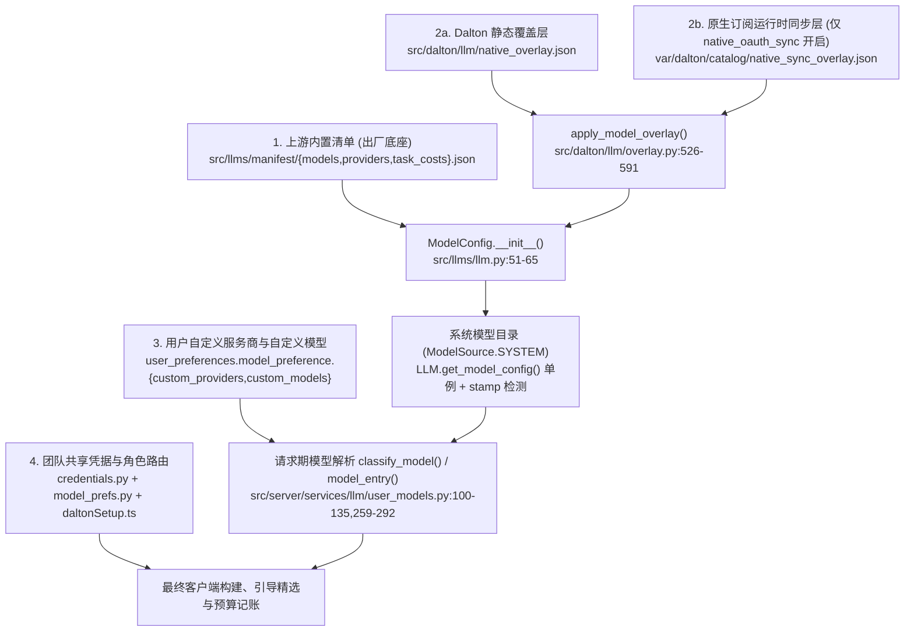
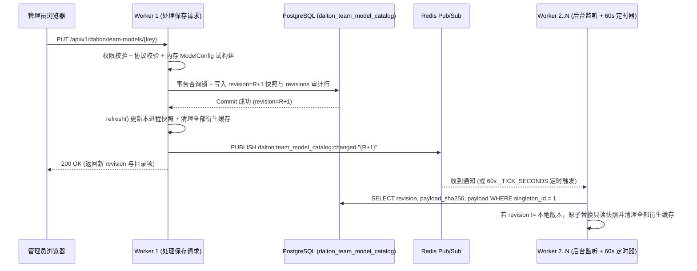

# 团队模型目录设计方案（管理员网页增改模型，在线热加载生效）

> **设计定位**：面向 Everflow 与独立核心（Standalone Core）双安装形态的团队级模型目录管理能力  
> **目标体验**：管理员在 **设置 → 团队管理 → 模型与供应商** 页面直接完成新模型（如智谱 `GLM 5.4`）接入、价格与评分修订、可见性切换、退役下线与一键回滚，保存后全部后端 worker 进程秒级热同步生效。

---

## 一页摘要

1. **解决什么问题**：当前在 Dalton 中接入一个新模型（例如 `GLM 5.4` 直连版与 Coding Plan 版）或调整模型价格、上下文窗口、"智能 / 速度 / 说人话"评分，需要手工编辑代码库内的 `src/dalton/llm/native_overlay.json`（或受保护的上游清单文件），再走代码审查、构建镜像与滚动重启流程。本方案将日常模型目录运维从代码发布中解耦，交由管理员在网页端自助完成。
2. **核心做法**：保留上游 `src/llms/manifest/*.json` 与 `src/dalton/llm/native_overlay.json` 作为随版本发布的**出厂默认基线**，在 PostgreSQL 新增 Dalton 自有表 `dalton_team_model_catalog`（单行当前快照）与 `dalton_team_model_catalog_revisions`（只追加版本审计与一键回滚历史），存放团队相对出厂基线的**增量新增、字段补丁与退役列表**。
3. **多进程生效与安全**：复用上游 `deployment_settings`（`src/server/services/setup_settings/`）已验证的 **"PostgreSQL 唯一真值 + 写事务落库后本进程即刻刷新 + Redis Pub/Sub 通知 + 60 秒定时重读兜底"** 机制，保持请求路径零新增进程内可变真值依赖；保存前执行提供商存在性、价格非负、推理参数与客户端 SDK 协议兼容校验及内存预构建演练，提供复用团队共享凭据的"测试调用"按钮，凭据全程隔离在服务端加密表中。

---

## 1. 现状盘点：模型清单加载、合并优先级与字段作用点

### 1.1 五类模型配置的加载链路与合并优先级

当前系统的模型配置分散在五类来源中，按"系统目录构建期合并 + 请求期按用户遮蔽"两阶段求值：



各层具体加载位置与合并规则如下：

| 层级 | 核心代码位置（`文件:行号`） | 当前加载与合并机制 | 现行优先级与局限 |
|---|---|---|---|
| **① 内置模型清单** | `src/llms/llm.py:51-60`<br>`src/llms/manifest/models.json:452-579`<br>`src/llms/manifest/providers.json:469-540,992-1026`<br>`src/llms/task_costs.py:52,169-179` | `ModelConfig.__init__` 依次读取 `models.json`（模型运行参数与展示元数据）与 `providers.json`（提供商 SDK/地址及按提供商分组的现金价格卡），并由 `_flatten_providers`（`src/llms/llm.py:101-153`）展平区域与 Coding Plan 变体；`task_costs.json` 由 `_shipped()`（`src/llms/task_costs.py:169-179`）通过 `@lru_cache(maxsize=1)` 每进程只读一次。 | 上游受保护清单（由 `scripts/dalton/check_hooks.sh:7` 门禁保护），Dalton 侧通过覆盖层扩展。 |
| **② Dalton 覆盖层（静态 + 原生同步）** | `src/llms/llm.py:62-65,658-664`<br>`src/dalton/llm/overlay.py:18-47,225-380,404-591`<br>`src/dalton/llm/native_overlay.json:1-1644`<br>`src/dalton/llm/native_catalog.py:35,903-1045` | `apply_model_overlay` 根据能力 `CapabilityId.NATIVE_OAUTH_SYNC`（`src/dalton/llm/overlay.py:43-47`）分流：<br>• **开启时（Everflow）**：按 `OVERLAY_SOURCES`（`:32-35`）依次合并静态 `native_overlay.json` 与运行时 `var/dalton/catalog/native_sync_overlay.json`，随后执行 `_drop_retired_models`（`:404-448`）、固定路由回写 `_enforce_pinned_overlay_routes`（`:450-475`，锁定 `grok-4.7-oauth`）及 Antigravity Gemini 评分继承 `inherit_antigravity_gemini_ratings`（`:493-523`）；<br>• **关闭时（Core）**：经 `_filter_generic_overlay`（`:54-163,551-575`）剥离全部 `*-oauth` 条目，仅保留通用 BYOK 模型与评分覆盖。<br>`LLM.get_model_config()`（`src/llms/llm.py:658-664`）通过 `overlay_changed()`（`overlay.py:177-209`，2 秒节流 `os.stat`）比较文件 `mtime_ns:size` 决定重建。 | 1) `models` 仅允许新增键（除 `PINNED_OVERLAY_MODEL_KEYS` 外同名冲突记录错误并跳过，`overlay.py:240-255`），改已有模型需手写 `model_overrides`（`:259-272`）与 `providers.model_overrides`（`:348-380`）；<br>2) `native_sync_overlay.json` 仅覆盖 4 家带模型列表接口的 OAuth 提供商（`native_catalog.py:114-128` 将 `muse-oauth` 与 `z-ai-cn-coding` 标为缺少列表接口），且仅限增量加模型与退役，商业 API 接入、价格修订与评分维护仍依赖改代码文件。 |
| **③ 用户自定义服务商与模型** | `web/src/components/modelAccess/useCustomProviderForm.ts:114-155`<br>`src/server/services/llm/user_models.py:20-58,100-135,185-292`<br>`src/server/services/llm/custom_catalog.py:18-227,342-421` | 保存在每位用户自己的 `user_preferences.model_preference` 列（`custom_providers` 与 `custom_models`）。`classify_model`（`user_models.py:259-292`）默认先查用户 `custom_models`，再查系统 `ModelConfig`；同名自定义模型会遮蔽（Shadow）系统内置模型，并通过 `inherited_declarations`（`src/llms/model_spec.py:287-316`）继承内置同名模型的 `prompt_guidance`、`compaction_profile`、`context` 及同协议 `reasoning`。 | 作用域限定在单个用户自身，团队级共享模型目录、价格卡、任务成本与"智能 / 速度 / 说人话"评分仍需由系统层统一提供；且自定义模型仅放行 `{"text", "image", "pdf"}` 三种模态（`custom_catalog.py:13`）。 |
| **④ 团队凭据、团队模型与引导精选** | `src/dalton/credentials.py:252-289,427-531`<br>`web/src/hooks/useTeamCredentials.ts:23-97`<br>`web/src/pages/Setup/answers/useTeamModels.ts:107-260`（`useDaltonTeamModels`）<br>`web/src/config/daltonSetup.ts:43-49,280-361`<br>`src/dalton/llm/model_prefs.py:3-7,291-310,359-412` | • **凭据归属**：`credentials.sharing == "team"` 时，`credential_user_id()`（`credentials.py:277-289`）将全体成员的模型密钥与 OAuth 查询统一指向凭据持有人（`supabase` 模式取 `DALTON_PM_USER_IDS[0]`，`local` 模式直读 `dalton_credential_holder`，`:252-270`）；<br>• **后台角色模型优先级**（`model_prefs.py:359-412`）：调用者个人 `model_preference` → 团队凭据持有人 `model_preference` → `dalton.yaml` 默认值（自动过滤被个人 `custom_models` 遮蔽的键，`:291-310`）；<br>• **首次引导精选**：`daltonSetup.ts:43-49` 静态写死 5 个 `DALTON_SETUP_CANDIDATES`，Everflow 严格限定此 5 项（`:72-75`），Core 在空命中时回退至已接通且支持工具调用的模型池并按 `intelligence`、`speed` 排序（`:308-361`）。 | 团队共享实现了共用一把密钥或订阅，而团队模型目录与引导精选仍固化在代码文件 `native_overlay.json` 和前端常量 `DALTON_SETUP_CANDIDATES` 中。 |
| **⑤ 首次设置 `deployment_settings`** | `migrations/versions/148_deployment_settings.py:20-25`<br>`src/server/database/deployment_settings.py:20-96`<br>`src/server/services/setup_settings/__init__.py:23-57`<br>`src/server/services/setup_settings/apply.py:162-205`<br>`src/server/services/setup_settings/follow.py:18-90` | 单机开源向导将 `SANDBOX_PROVIDER`、`FMP_API_KEY`、搜索密钥等用 `pgp_sym_encrypt` 存入 `deployment_settings(name, value, updated_at)`。启动时 `environment.py:30-56` 先记录进程启动环境变量（外部环境变量优先级高于库内值）；每次 `save()`（`apply.py:198-205`）先写库、本 worker 调 `refresh()` 更新配置，再向 Redis 频道 `setup_settings:changed`（`follow.py:18`）发通知；其余 worker 通过 `_listen()`（`follow.py:46-60`）实时唤醒，同时每 `_TICK_SECONDS = 60.0`（`follow.py:20`）定时重读全表兜底。 | `setup_settings.self_hosted()`（`__init__.py:23-33`）在 `is_dalton_enabled()` 为真时关闭该无鉴权路由，但其**多 worker 终态收敛机制**成熟简洁，适合作为团队模型目录跨进程同步的标准范式。 |

### 1.2 核心字段如何驱动计费、能力分类、选择器展示与预算

| 业务维度 | 决定字段与所在结构 | 读取与生效代码位置（`文件:行号`） | 具体作用规则 |
|---|---|---|---|
| **现金计费（Cash USD）** | `providers.models.<provider>[].{id, alias, pricing}`（含 `input`、`cached_input`、`cache_5m`、`cache_1h`、`output` 或阶梯 `input_tiers` / `output_tiers`） | `src/llms/pricing_utils.py:108-170,199-365`<br>`src/utils/tracking/core.py:34-84`<br>`src/dalton/llm/complete.py:200-208,346-436` | 按 `(pricing_provider, pricing_model_id)` 精确匹配 `id` → `alias` → 点横线归一化 → 去日期后缀基座模型；当次调用结算后由 `_stamp_applied_rates` 将价格卡快照写入记录。若现金模型缺失价格卡，单次调用与日预算对账按保守底价 `admission_floor_usd`（默认 `$0.25`）记账并打 `pricing_failed=True` 告警。 |
| **订阅与套餐名义计费（Notional USD）** | `providers.provider_config.<p>.billing: "subscription"`<br>`dalton_meta.<key>.{billing, notional_pricing, notional_ref}` | `src/llms/pricing_utils.py:34-58,282-291`<br>`src/dalton/llm/notional_pricing.py:121-268`<br>`src/dalton/budget/service.py:161-263` | 订阅或 Coding Plan（如 `z-ai-cn-coding`）现金消耗记 `$0.00`，同时用自身 `notional_pricing`（支持 `estimated`、`source`、`verified_at` 及阶梯单价）或引用同款现金模型 `notional_ref` 计算名义美元值，计入 `subscription_notional_usd` 供团队成本核算。 |
| **预算水位与信用预留倍率** | 现金价格卡四项费率 + 提供商归属 | `src/llms/pricing_utils.py:455-544`<br>`src/dalton/budget/service.py:266-477` | `blended_rate` 按实测生产缓存混合比（隐式缓存 `17%/81%/0%/2%`，Anthropic 显式断点 `0%/73%/23%/4%`）计算综合单价，`chunk_multiplier` 相对 `$0.34/1M` 基线决定运行期预留步长；`compute_provider_breakdown` 按提供商聚合今日现金与名义消耗。 |
| **任务成本（Task Cost）** | `task_costs.json` 的 `baseline`、`models`、`bounds` + 目录标价 `get_list_rates` | `src/llms/task_costs.py:86-155,195-266`<br>`src/llms/llm.py:307-334,434-443` | 有基准实测或 `bounds` 倍率绑定时输出各思考档位相对基线（`claude-sonnet-5-5` `medium` = `1.0`）的 `task_cost`；未实测模型按 `0.75 * input + 0.25 * output` 相对基线自动折算 `task_cost_estimate`。 |
| **思考强度（Reasoning Effort）** | `models.<key>.reasoning.{efforts, default, write, on, off}` + `parameters` / `extra_body` | `src/llms/reasoning.py:25-60,73-138,172-233`<br>`src/llms/model_spec.py:34-95,115-135`<br>`src/llms/llm.py:398-403,733-759` | `efforts` 取自有序枚举 `("none", "minimal", "low", "medium", "high", "xhigh", "max")`；未声明时前端隐藏思考强度控件（`llm.py:395-398`）。请求期超界档位经 `clamp_reasoning_effort` 向下取最近可用档，再由 `apply_reasoning_effort` 写入指定 SDK 字段（如智谱 PaaS 写 `extra_body.reasoning_effort`，智谱 Coding Plan 写 `parameters.output_config.effort` 并置 `parameters.thinking.type="enabled"`）。 |
| **输入模态与文档/图片限制** | `models.<key>.input_modalities` + 提供商根家族 `_provider_family` | `src/llms/llm.py:453-464,1655-1845`<br>`src/llms/model_spec.py:107-112` | 决定前端附件上传允许类型及模型 `ModelProfile`（`text_inputs` / `image_inputs` / `audio_inputs` / `video_inputs`）；PDF 页数上限与图片像素边长按提供商根家族（如 `z-ai` 最大边长 `6000px`，`llm.py:1730`）自动套用。 |
| **上下文窗口与自动压缩** | `models.<key>.{context, compaction_profile}` + `parameters.{max_tokens, max_output_tokens}` | `src/llms/model_spec.py:97-106`<br>`src/llms/llm.py:414-423,511-517` | `context` 写入 `max_input_tokens` 供压缩器计算摘要容量，`compaction_profile`（如 `expansive`）决定触发上下文摘要的阈值档位。 |
| **工具调用、家族与角色准入** | `dalton_meta.<key>.{tool_calling, family, forbidden_for_roles}` + `model_family.py` | `src/dalton/llm/role_policy.py:60-98,144-177,326-350`<br>`src/dalton/llm/model_family.py:9-37`<br>`src/server/app/api_keys.py:808-810` | `tool_calling` 标注模型支持函数调用，供 Core 引导与后台槽位筛选（`daltonSetup.ts:122-140,386-394`）；`family` 供正式发布异族独立审校判定；`forbidden_for_roles` 阻止训练数据贡献版进入后台角色。 |
| **选择器展示、评分与系列折叠** | `visible`、`display_name`、`intelligence`、`speed`、`plain_language` + `antigravity_series.py` | `src/llms/llm.py:335-395`<br>`src/server/app/api_keys.py:749-847`<br>`src/dalton/llm/antigravity_series.py:28-35,192-250`<br>`web/src/pages/Setup/steps/DefaultStep.tsx:633-634` | `listed_models()` 筛出 `visible: true` 条目发布至 `GET /api/v1/models`；三项 1–5 分评分渲染在模型详情与首次引导卡片；`build_antigravity_series_catalog` 将带强度后缀的 `antigravity-oauth` 条目折叠为单一系列行并输出默认档位。 |

> **以接入 `GLM 5.4` 为例看现状卡点**：智谱在系统中已有 `z-ai`（国际 API Key）、`z-ai-cn`（国内 API Key）、`z-ai-coding` 与 `z-ai-cn-coding`（Anthropic 兼容 Coding Plan）四个提供商定义（`src/llms/manifest/providers.json:992-1025`）。现网若要上线 `GLM 5.4`，工程师必须手改 `native_overlay.json` 的 `models`（分别写 `extra_body.reasoning_effort` 与 `parameters.output_config.effort` 两种思考协议）、`providers.models`（补价格卡与别名）、`dalton_meta`（补 `zai-glm` 家族、`billing` 与 `tool_calling`），且因 `z-ai-cn-coding` 在 `native_catalog.py:126-128` 属于无模型列表接口提供商，现有的"原生模型同步卡片"也无法覆盖。

---

## 2. 总体方案：数据库"团队模型目录"覆盖层与多 Worker 协同

### 2.1 数据库表设计（新增 Dalton 迁移）

合入时紧接当时主分支唯一的 Dalton 迁移头新增迁移脚本（当前分支头为 `src/dalton/migrations/versions/d048_invite_admin_tier.py:21`；并行开发中微信多账号占 `d049`，研究桥拆分从 `d050` 起，本迁移合入前对齐当时唯一头节点，下文记作 **`d05X_team_model_catalog.py`〔待核实具体顺位号〕**）。全部新建表均为 Dalton 自有表，遵循 Expand-Contract 向后兼容原则，滚动升级期间旧版后端进程完全无感：

1. **当前生效快照单行表 `dalton_team_model_catalog`**：
   ```sql
   CREATE TABLE IF NOT EXISTS dalton_team_model_catalog (
       singleton_id    SMALLINT PRIMARY KEY DEFAULT 1 CHECK (singleton_id = 1),
       revision        BIGINT NOT NULL DEFAULT 1 CHECK (revision >= 1),
       schema_version  INTEGER NOT NULL DEFAULT 1,
       payload         JSONB NOT NULL DEFAULT '{}'::jsonb,
       payload_sha256  TEXT NOT NULL,
       updated_by      TEXT NULL,
       updated_at      TIMESTAMPTZ NOT NULL DEFAULT NOW()
   );
   ```
2. **只追加变更审计与回滚历史表 `dalton_team_model_catalog_revisions`**：
   ```sql
   CREATE TABLE IF NOT EXISTS dalton_team_model_catalog_revisions (
       revision        BIGINT PRIMARY KEY,
       action          TEXT NOT NULL CHECK (action IN (
                           'bootstrap_import', 'create_model', 'update_model',
                           'hide_model', 'unhide_model', 'retire_model',
                           'restore_model', 'update_curated', 'confirm_price',
                           'create_provider_variant', 'rollback'
                       )),
       target_keys     TEXT[] NOT NULL DEFAULT '{}',
       payload         JSONB NOT NULL,
       payload_sha256  TEXT NOT NULL,
       diff_summary    JSONB NOT NULL DEFAULT '{}'::jsonb,
       comment         TEXT NULL,
       restored_from   BIGINT NULL REFERENCES dalton_team_model_catalog_revisions(revision),
       actor_user_id   TEXT NOT NULL,
       actor_label     TEXT NULL,
       created_at      TIMESTAMPTZ NOT NULL DEFAULT NOW()
   );
   CREATE INDEX IF NOT EXISTS ix_dalton_team_catalog_revisions_created
       ON dalton_team_model_catalog_revisions (created_at DESC);
   ```
3. **价格变动提醒表 `dalton_model_price_alerts`**（支撑第 4 节价格检查提醒，可在同迁移或第 3 批迁移建表）：
   ```sql
   CREATE TABLE IF NOT EXISTS dalton_model_price_alerts (
       alert_id          UUID PRIMARY KEY DEFAULT gen_random_uuid(),
       model_key         TEXT NOT NULL,
       provider          TEXT NOT NULL,
       model_id          TEXT NOT NULL,
       alert_kind        TEXT NOT NULL CHECK (alert_kind IN ('official_published', 'price_changed')),
       current_pricing   JSONB NOT NULL,
       detected_pricing  JSONB NOT NULL,
       source_name       TEXT NOT NULL,
       source_url        TEXT NULL,
       fingerprint       TEXT NOT NULL UNIQUE,
       status            TEXT NOT NULL DEFAULT 'pending'
                         CHECK (status IN ('pending', 'applied', 'dismissed')),
       detected_at       TIMESTAMPTZ NOT NULL DEFAULT NOW(),
       resolved_by       TEXT NULL,
       resolved_at       TIMESTAMPTZ NULL
   );
   CREATE INDEX IF NOT EXISTS ix_dalton_price_alerts_status
       ON dalton_model_price_alerts (status, detected_at DESC);
   ```

**`payload` JSONB 结构（`schema: "dalton-team-model-catalog/1"`）**：与现有 `overlay.py` 数据结构保持同构，并在顶层补充任务成本与引导精选增量块：

```json
{
  "schema": "dalton-team-model-catalog/1",
  "models": {
    "glm-5.4-plan": {
      "prompt_guidance": "lean",
      "model_id": "glm-5.4",
      "provider": "z-ai-cn-coding",
      "display_name": "GLM-5.4 (Coding Plan)",
      "visible": true,
      "intelligence": 5,
      "speed": 3,
      "plain_language": 4,
      "context": 1000000,
      "compaction_profile": "expansive",
      "input_modalities": ["text", "image", "pdf"],
      "parameters": {
        "max_tokens": 128000,
        "thinking": { "type": "enabled" }
      },
      "reasoning": {
        "efforts": ["low", "high", "max"],
        "default": "high",
        "write": "parameters.output_config.effort",
        "on": { "parameters.thinking.type": "enabled" }
      }
    }
  },
  "model_overrides": {
    "gemini-4-neon-high-oauth": { "plain_language": 5 }
  },
  "retired": [
    { "key": "glm-5.3-plan", "provider": "z-ai-cn-coding", "retired_at": "2026-11-24T10:00:00Z", "retired_by": "admin-uid" }
  ],
  "unretired_keys": [],
  "providers": {
    "provider_variants": {},
    "models": {
      "z-ai-cn-coding": [
        {
          "id": "glm-5.4",
          "alias": ["glm-5.4-plan"],
          "name": "GLM-5.4 (Coding Plan)",
          "is_reasoning": true,
          "pricing": { "input": 0.0, "cached_input": 0.0, "output": 0.0, "unit": "per_1m_tokens" },
          "pricing_meta": { "source_kind": "official", "estimated": false, "verified_at": "2026-11-24" },
          "context_window": 1000000,
          "max_output": 128000
        }
      ]
    },
    "model_overrides": {}
  },
  "dalton_meta": {
    "glm-5.4-plan": {
      "family": "zai-glm",
      "billing": "subscription",
      "tool_calling": true,
      "notional_pricing": {
        "input": 1.4,
        "cached_input": 0.29,
        "output": 4.4,
        "estimated": true,
        "source_kind": "estimated",
        "source": "参考 GLM-5.3 价格预估（待核实）",
        "verified_at": "2026-11-24"
      }
    }
  },
  "task_costs": {
    "models": {},
    "bounds": {
      "glm-5.4-plan": { "model": "glm-5.3", "times": 1.0 }
    }
  },
  "series_overrides": {},
  "curated_setup": null
}
```
> 注：上例中 `GLM 5.4` 的具体线上参数、模态与官方费率为示意值（**待核实**，实际录入时以智谱开放平台正式文档或管理员估算为准）。

### 2.2 四层合并顺序与同名冲突规则

在 `src/dalton/llm/overlay.py:526-591` 中，系统目录按以下固定顺序从低到高叠加：

1. **第 1 层**：上游内置清单（`src/llms/manifest/models.json`、`providers.json`、`task_costs.json`）；
2. **第 2 层**：Dalton 代码静态覆盖层 `src/dalton/llm/native_overlay.json`（Core 形态先经 `_filter_generic_overlay` 剔除 `*-oauth`）；
3. **第 3 层**：原生订阅运行时同步文件 `var/dalton/catalog/native_sync_overlay.json`（仅在 `CapabilityId.NATIVE_OAUTH_SYNC` 启用时合并）；
4. **第 4 层（新增，最高系统目录优先级）**：数据库 `dalton_team_model_catalog` 快照。

**同名冲突与覆盖规则**：

| 冲突场景 | 处理规则 |
|---|---|
| **管理员新增模型 vs 系统已有模型（第 1–3 层）** | 管理员调"新增模型"接口提交已存在于第 1–3 层的 `model_key` 时，接口返回 `409 Conflict` 并提示直接编辑现有模型条目；管理员调"编辑模型"接口修改第 1–3 层已有模型时，后端自动把差异字段写入数据库 `model_overrides` / `providers.model_overrides` / `dalton_meta`，通过 `_deep_merge_patch`（`src/dalton/llm/overlay.py:225-231`）精准覆盖。 |
| **同一提供商下价格卡 `id` 或 `alias` 重名** | 保存前遍历合并后的 `manifest["models"][provider]`，若新增模型卡的 `id` 或任一 `alias` 已被该提供商下另一张卡片占用，返回 `400 Bad Request` 指明冲突卡片，保证 `find_model_pricing`（`src/llms/pricing_utils.py:301-341`）查找结果唯一确定。 |
| **团队目录模型 vs 成员个人自定义模型（`custom_models`）** | 保持 `src/server/services/llm/user_models.py:100-135,259-292` 与 `src/dalton/llm/model_prefs.py:291-310` 既有契约：团队目录模型属于 `ModelSource.SYSTEM`。开启个人 BYOK 的成员若保存了同名 `custom_models`，其个人对话请求路由至个人密钥并继承团队模型的窗口与引导声明；而 Dalton 后台审校/核验/提取角色（`dalton_audit_model` 等）始终忽略个人 `custom_models`，严格运行团队目录定义。 |
| **专有固定路由键保护（`grok-4.7-oauth`）** | `PINNED_OVERLAY_MODEL_KEYS`（`src/dalton/llm/overlay.py:27`）继续锁定底层 `provider` 与 `model_id` 走 `xai-oauth`，同时放行管理员在数据库 `model_overrides` / `dalton_meta` 中修改其展示名、三项评分、默认思考强度与名义价格。 |

### 2.3 多 Worker 在线生效机制（复用 `setup_settings` 协调范式）

严格遵循 `AGENTS.md:103` 多 worker 原则（PostgreSQL 存唯一真值，Redis 做跨进程即时唤醒，进程内存仅存只读派生配置快照）：



1. **启动期预热（`load_at_boot`）**：在 `src/server/app/setup.py:425` 数据库池初始化完成后、`load_from_files` 与 `verify_credit_gate_wiring`（`setup.py:885`）之前，读取 `dalton_team_model_catalog` 单行载入当前 worker 的只读快照变量，使启动角色策略校验直接看到团队目录。
2. **后台跟随协程（`follow.py`）**：完全对齐 `src/server/services/setup_settings/follow.py:46-90`，每个 worker 在 lifespan 启动 `team_model_catalog_follow` 任务，复用 `get_shared_pubsub_client()` 订阅 `dalton:team_model_catalog:changed`，并保留 `_TICK_SECONDS = 60.0` 定时核对 `SELECT revision FROM dalton_team_model_catalog WHERE singleton_id = 1`。即使 Redis 重连或通知丢失，所有 worker 也在 60 秒内自动追平到同一 `revision`。
3. **全链路衍生缓存原子清理**：每次 `refresh()` 应用新 `revision` 时，统一触发 `invalidate_worker_catalog_caches()`（扩展自 `src/dalton/services/openclaw_admin.py:283-300`）：
   - 将 `team_db:{revision}:{sha256[:12]}` 拼入 `current_overlay_stamp()`（`src/dalton/llm/overlay.py:177-205`），并置 `LLM._model_config = None`（`src/llms/llm.py:658-664`）；
   - 清空 `provider_catalog.cache_clear()` 与 `key_candidates.cache_clear()`（`src/server/services/llm/provider_catalog.py:15,106`）；
   - 重置 `src/server/app/api_keys.py:49` 的 `_BYOK_PROVIDERS_CACHE = None`，并将 `api_keys.py:62,71,167,320` 中直接调用 `ModelConfig()` 的位置统一改为 `LLM.get_model_config()`，确保新增提供商变体立即出现在密钥管理列表；
   - 刷新合并后的任务成本快照（扩展 `src/llms/task_costs.py:169` 使数据库 `task_costs` 叠加在 `_shipped()` 之上）及 `_known_cash_model_ids.cache_clear()`（`src/dalton/llm/native_catalog.py:673`）；
   - 调用 `clear_tool_capability_cache()`（`src/dalton/llm/role_policy.py:100-105`），并对本次变更涉及的 `provider` 调用 `invalidate_available_models`（`src/server/app/api_keys.py:38`）刷新 Redis 可用模型缓存。
4. **在途请求隔离**：已开始流式输出的对话轮次持有该轮初始化时构造的 `LLM` 客户端与价格卡印章（`src/llms/llm.py:942-950`），与中途目录刷新彼此独立运行；下一轮请求自动使用新目录。

### 2.4 与团队共享凭据的协作边界

- **目录与凭据物理解耦**：`dalton_team_model_catalog` 仅存公开模型声明与价格评分；API Key、自定义网关 `base_url` 与 OAuth 令牌仍存储在团队凭据持有人名下的 `user_api_keys` 与 `oauth_tokens` 表（经 `src/dalton/credentials.py:252-289` 统一解析）。
- **连接状态联动提示**：后端在团队目录管理列表接口中，结合团队凭据持有人的 `get_user_api_keys` / `get_oauth_connection` 与服务端 `deployment_key`（`src/server/services/llm/config.py:154-175`）附加布尔字段 `provider_connected: bool`。管理员新增模型若指向尚未配置团队密钥的提供商，保存成功后界面直接展示快捷按钮唤起 `ModelAccessSection scope="team"`（`web/src/pages/Settings/panels/dalton/DaltonTeamModelsPanel.tsx:17`）的对应提供商连接抽屉，填入密钥后全队即刻可用。

### 2.5 "隐藏"与"退役"对已有线程、自动化与备用链的影响

系统提供两级下架手段，行为边界清晰可预期：

| 维度 | **隐藏（`visible: false`）** | **退役（加入 `retired` 列表）** |
|---|---|---|
| **`ModelConfig` 与解析态** | 保留在 `llm_config` 中，`listed_models()`（`src/llms/llm.py:335-350`）将其从公开列表隐藏；`model_resolves()`（`availability.py:180-187`）仍为 **`True`**。 | `_drop_retired_models`（`src/dalton/llm/overlay.py:404-448`）将其从 `llm_config` 移除；`model_resolves()` 返回 **`False`**。 |
| **模型选择器与引导页** | 聊天输入框、设置下拉菜单、引导页与 Antigravity 系列切换胶囊中立即收起。 | 同左，全面移除。 |
| **已有对话线程（`conversation_threads.llm_model`）** | **继续按原模型正常运行**，存量长对话平稳过渡。 | 下次发消息未显式指定模型时，`turn_model()`（`src/server/services/llm/thread_model.py:50-93`）自动清空失效 `llm_model` 并**无缝回退至账户默认主模型**；若客户端显式提交已退役模型名，返回 `400 model_removed` 横幅并触发 `cleanup_stale_model_preferences`（`availability.py:488-579`）清理陈旧偏好。 |
| **定时自动化（`automations.llm_model`）** | **继续按原模型正常触发执行**。 | 退役前执行严格引用检查（复用 `src/dalton/services/model_references.py:303-323`）：若存在自动化引用，默认拦截并列出任务清单，同时提供**「一键批量替换为指定继任模型并退役」**原子操作；跟随账户默认的自动化（`llm_model IS NULL`）自动随默认模型切换。 |
| **备用链与后台角色槽位** | **保留在备用链与后台角色中正常生效**（适配"主选择器隐藏轻量后台模型、仅留给后台槽位使用"的场景，`src/llms/llm.py:503-504`）。 | 个人 `fallback_models` 与辅助槽位由 `drop_dead_models`（`availability.py:203-239`）在每轮解析时自动跳过失效项、顺延至链上下一个存活模型；Dalton 核验/审校/辅助角色由 `_without_models_missing_from_catalog`（`src/dalton/llm/model_prefs.py:334-356`）自动跳过并顺延至下一级配置。 |

---

## 3. 校验、测试调用、审计与安全回滚

### 3.1 权限门禁与凭据隔离

1. **仅管理员可写**：所有团队模型目录写接口、测试调用接口与回滚接口前置管理员鉴权守卫（`supabase` 模式下校验 `DALTON_PM_USER_IDS`，`local` 模式下直查 PostgreSQL `dalton_user_roles.tier == 'admin'`，数据库查询异常时按 Fail-Closed 返回 `503`，对齐 `src/dalton/credentials.py:84-115`）。普通内部成员与外部成员调用一律返回 `403 Forbidden`。
2. **凭据零落库、零下发**：所有写入路径强制调用扩展后的 `assert_no_credentials(payload)`（基于 `src/dalton/llm/native_catalog.py:37-50,75-85`），拦截任何层级的 `api_key`、`apiKey`、`token`、`secret`、`password`、`bearer`、`credentials` 字段以及 `default_headers` 中的 `Authorization` / `X-Api-Key` / `Cookie` / `Proxy-Authorization` 请求头；同时复用 `find_disallowed_routing_param_keys` 与 `find_disallowed_routing_header_keys`（`src/dalton/credentials.py:355-392`）阻断危险连接参数注入。前端读取的所有响应仅含公开模型元数据与布尔态 `provider_connected`。

### 3.2 保存前四道确定性校验

写事务落库前依次执行以下四道校验，对越界或格式异常的字段返回带定位路径的 `400 Bad Request`：

1. **标识符与提供商合法性**：`model_key`、`model_id` 与每条 `alias` 均须匹配 `CUSTOM_MODEL_NAME_RE = r"^[a-zA-Z0-9][a-zA-Z0-9._:/-]{0,62}$"`（`src/llms/llm.py:642`）；`provider` 须属于合并后的公开可选提供商集合（排除内部 `platform` 代理变体）；在 `CapabilityId.NATIVE_OAUTH_SYNC` 关闭时仅接受 API Key / Coding Plan / 本地服务类提供商。若管理员新增兼容提供商变体，自定义 `base_url` 须通过 `egress_policy.py`（`src/server/app/api_keys.py:278-300`）地址安全规则（仅放行公网地址或 `DALTON_OPERATOR_LLM_ENDPOINTS` 显式白名单）。
2. **价格与窗口数值约束**：
   - 所有费率字段（`input`、`cached_input`、`cache_5m`、`cache_1h`、`output`）须为有限非负实数（`0 <= rate <= 10000`）；阶梯定价 `input_tiers` / `output_tiers` 须按 `max_tokens` 严格递增且末档为 `null`；
   - `billing == "cash"` 的模型必须具备可解析的现金价格卡（本条目附带 `pricing` 或复用同提供商已有同 `model_id` 价格卡），确保上线后计费精确；
   - `context` 为整数且满足 `1_000 <= context <= 100_000_000`（对齐 `src/server/services/llm/custom_catalog.py:14-15`）；`max_tokens` / `max_output_tokens` 为正整数且上限为 `context`；三项评分为 `1..5` 整数或 `null`。
3. **思考强度与提供商 SDK 协议兼容矩阵**：先调 `validate_surface(model_key, reasoning)`（`src/llms/reasoning.py:73-138`）验证 `efforts`、`default`、`write`、`on`、`off` 自洽，再按目标提供商的 `wire_api`（`src/llms/model_spec.py:194-201`）核验协议匹配：
   - `anthropic` SDK（含 `z-ai-coding`、`z-ai-cn-coding`、`minimax-coding`、`doubao-coding`）：允许 `parameters.output_config.effort`、`parameters.thinking.type` 及 `extra_body.*`；
   - `gemini` / `antigravity` SDK：允许 `parameters.thinking_level`；
   - 启用 `use_response_api` 的 `openai` / `codex` / `dashscope` / `grok` / `muse` SDK：允许 `parameters.reasoning.effort`；
   - Chat Completions 模式的 `openai` / `glm` / `deepseek` / `qwq` / `openrouter` SDK：允许 `parameters.reasoning_effort`、`extra_body.reasoning_effort`、`extra_body.reasoning.effort` 及 `extra_body.thinking.*`。
4. **内存沙盒全量试构建（Dry-Run Build）**：在内存副本上执行完整四层合并，实例化临时 `ModelConfig`，对变更涉及的所有模型执行 `ModelSpec.from_manifest(staged_mc, key)`（`src/llms/model_spec.py:350-370`）并运行 `parse_task_costs`（`src/llms/task_costs.py:86-133`），保证落库快照在全部 worker 上 100% 可正常加载。

### 3.3 可选"测试调用"按钮

提供管理员接口 `POST /api/v1/dalton/team-models/test-call`（按管理员限流每 10 秒最多 3 次，总超时 15 秒）：
- **请求内容**：前端仅提交当前编辑抽屉中的草稿模型配置与待测思考档位，全程无需传递任何密钥；
- **执行流程**：后端读取团队凭据持有人在服务端保存的对应提供商密钥/OAuth 令牌（或服务端环境变量密钥），基于内存临时 `ModelSpec` 发出一次最小请求（最大输出 32 tokens，附带单工具 `dalton_probe_ping` 定义，复用 `src/dalton/llm/tool_probe.py:76-125` 探测结构）；
- **返回诊断**：返回连通状态、端到端首字/完成耗时、思考参数受理情况、工具调用（`tool_calling`）实测结果及上游回传的 `usage` 字段结构摘要；若上游报错，经 `sanitize_error_text` 脱敏后展示具体原因（如"模型 ID 不存在"或"该网关需开启 Responses 格式"）。

### 3.4 变更审计与一键回滚

- **完整审计链**：每次写操作在同一事务中向 `dalton_team_model_catalog_revisions` 写入不可变版本行，记录操作人、动作分类、目标模型键列表、字段级前后对比 `diff_summary` 与管理员备注，并同步调用 `activity.record` 写入审计事件。
- **一键回滚**：管理员点击「恢复到上一版本」（或从版本历史列表选择任意 `target_revision`）调用 `POST /api/v1/dalton/team-models/rollback`：后端在事务级咨询锁下取出目标修订的 `payload`，重新通过当前部署形态校验后，以递增新版本号 `new_revision = current_revision + 1`（标记 `action = 'rollback', restored_from = target_revision`）更新 `dalton_team_model_catalog` 并广播至所有 worker，秒级修复误配且审计历史完整连续。

---

## 4. 价格来源标注与官方价格变动提醒

### 4.1 价格来源结构化标注

支持为每张现金价格卡（`providers.models.<p>[].pricing_meta`）与每张订阅名义价格卡（`dalton_meta.<key>.notional_pricing`）录入结构化来源信息：

| 字段 | 取值范围 | 展示与计费语义 |
|---|---|---|
| `source_kind` | `"official"` \| `"estimated"` \| `"third_party"` | 标注单价来自厂商官方文档、内部估算或第三方公开目录。 |
| `estimated` | `boolean` | 当 `source_kind` 为 `"estimated"` 或管理员勾选"估算值"时为 `true`（兼容 `src/dalton/llm/native_overlay.json:1144` 现有字段）；模型详情浮窗、管理列表与预算明细旁渲染「估算」标签。 |
| `source_url` | `https://...` 或 `null` | 官方定价页或公告链接，供后续人工复核一键打开。 |
| `verified_at` | `YYYY-MM-DD` | 最近一次人工核对日期，保存价格时默认填入当日日期。 |
| `note` | 字符串（≤ 280 字） | 备注信息（如首发优惠期截止说明、阶梯计价口径说明）。 |

### 4.2 定时价格变动检查与人工确认更新

1. **数据源与检查机制**：
   - 采用公开免密钥机器可读价格目录——以 **OpenRouter 公开模型接口（`GET https://openrouter.ai/api/v1/models`）** 为主源、**LiteLLM 公开模型价格清单**为备选源，按归一化厂商前缀与 `model_id`（如 `z-ai/glm-5.4` ↔ `glm-5.4`）匹配每百万输入/输出/缓存 Token 美元单价；
   - 在 `dalton.yaml` 提供配置项 `llm.price_watch.enabled`（默认开启，检查周期 24 小时，由单实例分布式锁守护运行；管理员也可在管理页点击「检查官方价格更新」即时触发）。
2. **两类提醒触发条件**：
   - **`official_published`（新公布官方/公开价）**：当前团队目录中某模型标记为 `estimated: true`，而公开价格源首次收录了该 `model_id` 的正式单价；
   - **`price_changed`（价格调整）**：已标记为 `official` / `third_party` 的团队目录模型（或出厂内置模型），公开源单价与当前生效单价偏差达到或超过 `1%`。
3. **人工确认闭环**：
   - 检查任务仅将差异写入 `dalton_model_price_alerts`（状态 `pending`，按 `fingerprint` 去重，已忽略的同一价格指纹保持静默），**线上运行期计费单价保持原值，全程由人工掌控**；
   - 管理员进入 **设置 → 团队管理 → 模型与供应商** 时，卡片顶部展示待处理价格提醒条（展示当前单价 vs 新检测单价及来源链接）：
     - 点击 **「核对并更新」**：打开预填好新价格与 `source_kind: "official"` 的编辑确认弹窗，管理员核实确认后提交新 `revision`，同时将该提醒标为 `applied`；
     - 点击 **「忽略本次变动」**：将该提醒标为 `dismissed`。
   - 历史账单稳定性：由于每次已完成调用在结算时均通过 `_stamp_applied_rates`（`src/utils/tracking/core.py:34-84`）和 `_stamp_applied_notional_rates`（`:88-115`）将当次价格卡完整快照在记录中，确认更新新价格后，只有新发生的调用按新价格计费，历史日期与历史对话记录的已结算金额保持原样。

---

## 5. 界面设计、移动端适配与全链路联动

### 5.1 设置页入口与前端能力门禁

- **挂载位置**：在 **设置 → 团队管理 → 模型与供应商**（`web/src/pages/Settings/panels/dalton/DaltonTeamModelsPanel.tsx:7-22`，区块准入 `minTier: 'admin'`，`web/src/pages/Settings/sections.ts:99`）新增核心卡片 `TeamModelCatalogCard`（锚点 `#dalton-team-model-catalog`），并在 `sections.ts:302-304` 注册双语搜索词条。
- **能力判断统一使用 `useCapabilities()`**（`web/src/hooks/useCapabilities.ts:131-179`）：
  - `TeamModelCatalogCard` 本身面向 Everflow 与 Core 双形态全量开放；
  - 表单内的 OAuth 订阅提供商分组、Antigravity 系列聚合配置以及原有的 `NativeModelsCard`（`web/src/pages/Settings/panels/dalton/ProviderStatusCard.tsx:20-22,81`）统一通过 `hasCapability('native_oauth_sync')` 控制显隐。

### 5.2 列表与分组编辑抽屉设计

1. **目录列表卡片（`TeamModelCatalogCard`）**：
   - **顶部筛选与动作栏**：关键词搜索（匹配显示名、`model_key`、`model_id`、别名）、提供商下拉、状态胶囊（`全部` / `可见` / `已隐藏` / `已退役` / `团队自定义或改写`）、「版本历史（当前 vN · 一键回滚）」按钮、「+ 新增模型」主按钮；当存在 `pending` 价格提醒时，卡片首行嵌入黄色提醒横幅。
   - **行信息布局**：左侧显示提供商图标、模型显示名、`model_key` 与状态徽标（`已隐藏` / `已退役` / `团队改写` / `连接就绪` / `待配凭据`）；中部展示单价（如 `$1.40 / $4.40` + `估算` 标签，订阅类显示 `订阅 · 名义 $1.40 / $4.40`）、窗口与模态（如 `1M · 图/PDF`）、思考档位（如 `low/high/max`）及三项评分简写（`智5 速3 话4`）；右侧提供 `编辑`、`复制新建`、`隐藏/显示`、`退役/恢复` 操作。
2. **新增 / 编辑模型抽屉（5 大分组 + 同提供商一键继承默认值）**：
   - **默认继承机制**：选定提供商（例如 `z-ai-cn-coding`）后，前端根据当前目录自动匹配同提供商下最近邻同族模型（例如 `glm-5.3-plan`，复用 `src/dalton/llm/native_catalog.py:687-745` 的同提供商模板推导思想，并允许在顶部切换「从现有模型复制配置」），自动预填上下文长度、最大输出、模态、思考协议路径（`write` / `on` / `parameters` 模板）、计费类型与厂商家族。接入 `GLM 5.4` 时，管理员只需输入 `model_id`、显示名、价格与评分即可保存。
   - **字段五分组结构**：
     1. **身份与提供商**：提供商选择（标注当前团队凭据连接状态）、`model_id`、自动生成且可微调的 `model_key`、选择器显示名 `display_name`、计费匹配别名 `alias`、在选择器中显示开关（`visible`）、支持工具调用开关（`tool_calling`）。
     2. **价格与任务成本**：计费模式（按量现金 / 订阅套餐）；输入、缓存输入、输出单价（`$/1M tokens`，展开高级可配阶梯价格与 5m/1h 缓存写入价）；价格来源（`官方` / `估算` / `第三方` + 来源链接 + 备注）；任务成本估算（实时显示按标价折算的相对基准倍数，高级可设参考模型倍率 `bounds` 或分档实测值）。
     3. **窗口与输入模态**：上下文长度（含 `32K` / `128K` / `200K` / `256K` / `1M` 快捷预设胶囊，复用 `web/src/components/modelAccess/CustomModelFields.tsx:14-20`）与压缩档位 `compaction_profile`、最大输出长度、输入模态多选芯片（`文本`、`图片`、`PDF`、`视频`、`音频`）。
     4. **思考强度与协议写法**：开启思考强度控制开关、勾选开放档位（`none` 至 `max`）与默认档位；参数落点预设下拉（按提供商 SDK 自动选中对应标准写法，折叠"高级协议 JSON"供有特殊 `extra_body` 需求的模型微调）。
     5. **评分、所属系列与引导精选**：**智能**（1–5）、**速度**（1–5）、**说人话**（1–5，留空则界面省略该项）星级点选器；提示词详略度（`自动` / `精简` / `详尽`）；**所属系列与强度命名**（当提供商按强度拆分为多模型键如 `antigravity-oauth` 时，选择或输入 `series_prefix`、系列显示名、本模型对应档位及系列默认强度，扩展 `src/dalton/llm/antigravity_series.py:192-250` 优先读取目录显式 `series_overrides` / `dalton_meta.<key>.series`，支持任意新系列折叠展示）；「加入首次引导精选候选」开关与排序位。
   - **底部固定操作栏**：「测试调用」按钮（展示实测耗时、思考参数与工具调用校验结果）、「恢复出厂默认」（仅编辑改写过的内置模型时显示）、「保存生效」。

### 5.3 手机端可用性设计

- **响应式双布局**：在 `< 768px` 手机视口下，筛选栏折叠为搜索框 + 筛选抽屉按钮；模型表格自动转为单列卡片流（每张卡片两行展示核心信息，次要动作收纳进底部触控友好的操作抽屉）；
- **全屏安全区抽屉**：编辑抽屉在手机端以全屏模态层打开，五个字段分组支持手风琴折叠定位，顶部标题栏与底部「测试调用 + 保存」操作栏吸底并适配 `env(safe-area-inset-bottom)`，输入框字号保持 `>= 16px` 避免移动端浏览器输入时页面自动缩放。

### 5.4 与选择器、首次引导精选列表、预算显示的联动

1. **模型选择器实时联动**：保存、隐藏、退役或回滚成功后，前端立即失效 `queryKeys.models.all` 与 `queryKeys.providerModels` 缓存；`GET /api/v1/models`（`src/server/app/api_keys.py:749-847`）下发最新 `models`、`model_metadata` 与 `antigravity_series`，聊天框、设置页、子智能体与自动化选择器即时同步（包括新增模型的系列折叠与强度胶囊）。
2. **首次引导精选列表联动**：`GET /api/v1/models` 新增下发字段 `dalton_setup_candidates`（当管理员在团队模型目录中配置或调整了引导精选候选时返回团队列表，未自定义时返回默认 5 项）；前端 `web/src/config/daltonSetup.ts:280-298` 的 `resolveDaltonSetupCandidates` 优先采用服务端下发的候选序列，并在 `/setup/default` 引导卡片上直接渲染管理员填写的"智能 / 速度 / 说人话"三项评分（`web/src/pages/Setup/steps/DefaultStep.tsx:634`）。
3. **预算与账单显示联动**：在 `src/dalton/budget/service.py:266-310` 的 `_resolve_provider_for_model` 中优先查询合并后的 `LLM.get_model_config()`，使管理员新增的任何提供商或 Coding Plan 模型在 `/api/v1/dalton/budget/today` 的 `by_provider` 明细中准确归入对应提供商显示名，现金消耗与订阅名义消耗实时按新费率聚合，估算价格旁附带提示标记。

---

## 6. 安装形态适配：Everflow 与独立核心（Core）

### 6.1 双形态统一支持与行为对照

依托 `src.dalton.profile`（`src/dalton/profile.py:19-24,37-97`）与 `src.dalton.capabilities`（`src/dalton/capabilities.py:44-66,313-445`）：

| 维度 | **Everflow 安装（`DALTON_PROFILE=everflow`）** | **核心安装（`DALTON_PROFILE=core`）** |
|---|---|---|
| **功能可用性** | 默认开启（归属 `CORE_CAPABILITY`，`src/dalton/capabilities.py:38`）。 | 默认开启（归属 `CORE_CAPABILITY`）。 |
| **可选提供商范围** | 全部内置商业 API、Coding Plan、本地推理服务及 OAuth 订阅提供商（`antigravity-oauth`、`claude-oauth`、`codex-oauth`、`xai-oauth`、`muse-oauth`）。 | 全部内置商业 API、Coding Plan、本地推理服务及团队自定义兼容网关；因 `native_oauth_sync` 默认关闭，自动过滤并拦截 `*-oauth` 私有订阅项。 |
| **与 `NativeModelsCard` 关系** | 协同并存：`NativeModelsCard` 负责向订阅端拉取新增/弃用模型，确认入库后可在 `TeamModelCatalogCard` 中一站式编辑评分、名义价格与系列配置。 | `NativeModelsCard` 随 `native_oauth_sync` 关闭而隐藏（`ProviderStatusCard.tsx:22,81`），仅展示简洁的团队凭据、供应商状态与 `TeamModelCatalogCard`。 |
| **上游钩子（`DALTON-HOOK`）** | 复用已注册钩子 `"llm-overlay"`、`"catalog-cache"`、`"settings-section"`、`"dalton-setup"`（`scripts/dalton/check_hooks.sh:27,35,39,76`），零触碰受保护的上游 `src/llms/manifest/*.json`。 | 同左，核心干净包导出脚本 `scripts/standalone/package_release.sh` 原样包含该通用模块。 |

### 6.2 核心安装首次设置与 `deployment_settings` 表的关系

- **数据表保持独立，同步架构模式复用**：
  1. 上游 `deployment_settings` 表（`migrations/versions/148_deployment_settings.py:20-25`）设计为按字段名 `pgp_sym_encrypt` 加密的键值对表，专门保存搜索/行情/沙箱环境变量密钥，且其路由在 Dalton 下处于关闭状态（`src/server/services/setup_settings/__init__.py:23-33`）；
  2. 团队模型目录承载公开模型元数据，需要存储结构化 JSONB、快速比较单调 `revision`、记录字段级 `diff_summary` 并支持多版本一键回滚，单独使用明文结构化表 `dalton_team_model_catalog` + `dalton_team_model_catalog_revisions` 最为清晰高效；
  3. 核心安装的首次管理员引导（`/setup/admin` → `/setup` → `/setup/default`，见 `docs/dalton/features/standalone-core.md:191-194`）把模型 API Key 写入团队凭据持有人的 `user_api_keys` 表；若管理员在首次引导阶段添加了自定义网关下的新模型，除写入持有人偏好外可同步注册进 `dalton_team_model_catalog`（或引导完成后随时在「团队管理 → 模型与供应商」中增改），全团队受邀成员首次登录时即可在引导页直接看到并选用该模型。

---

## 7. 现有静态覆盖层 `native_overlay.json` 的迁移与升级策略

### 7.1 `native_overlay.json` 保留为"出厂默认"，数据库只存增量

- **明确定位**：`src/dalton/llm/native_overlay.json` 保留在代码仓库中作为**出厂默认基线**，数据库 `dalton_team_model_catalog` 仅持久化**管理员在网页上产生的新增条目、字段改写补丁与退役操作**。
- **优势**：
  1. 空库启动（新客户部署、CI 端到端测试、本地开发）开箱即具备经过验证的默认模型参数与评分，保持代码与空库初始态一致；
  2. 管理界面可直观对比"当前生效值"与"出厂默认值"，对被改写过的内置模型提供一键「恢复出厂默认」（即从数据库 `model_overrides` 中移除对应键）；
  3. 未来管理员在网页上稳定运行一段时间的新模型，在后续发版时也可视需要沉淀进 `native_overlay.json` 或上游清单，日常紧急上新则直接由网页即时完成。

### 7.2 代码升级时的冲突自动消解规则

当系统随代码升级更新了上游 `src/llms/manifest/*.json` 或 `src/dalton/llm/native_overlay.json` 时，合并器（`src/dalton/llm/overlay.py`）对第 4 层（数据库团队目录）执行平滑兼容处理：

1. **数据库曾"新增"的模型在新版出厂清单中已正式内置（同名晋升）**：
   - 例如管理员今天在网页新增了 `glm-5.4`，下个月上游 `models.json` 也加入了 `glm-5.4`；
   - 第 4 层合并逻辑遇到同名键时，以新版出厂条目为底座，将数据库中的 `models["glm-5.4"]` 作为深度覆盖补丁（`_deep_merge_patch`）叠加在上面，保留管理员设定的评分、可见性与价格，同时在管理页该行展示提示徽标「出厂目录已内置同名模型 · 点击审阅合并」，管理员确认后即可一键转为轻量补丁或直接采用出厂定义，升级全程平滑衔接。
2. **数据库存有 `model_overrides` 补丁的模型在新版上游清单中被移除**：
   - 合并器检测到目标基础模型缺失时，仅记录一条结构化 `INFO` 日志并跳过该孤立补丁，确保服务正常启动；管理页展示「已清理/待确认孤立改写项」供管理员一键移除或转为独立团队新增模型。
3. **存量运行时文件 `var/dalton/catalog/native_sync_overlay.json` 的衔接**：
   - 后端启动或首次执行目录迁移时，若检测到磁盘上已有 `native_sync_overlay.json` 且数据库 `dalton_team_model_catalog` 为空，自动将其中的 `models`、`dalton_meta` 与 `retired` 作为 `revision = 1`（`action = 'bootstrap_import'`）幂等导入数据库，此后统一以 PostgreSQL 为唯一持久化源。

---

## 8. 分批实施计划与验收测试

整体拆分为 **3 个可独立合入、逐批交付价值的批次**：

| 批次 | 范围与核心交付物 | 关键改动模块 | 验收与测试标准 |
|---|---|---|---|
| **Batch 1：数据库目录层、多 Worker 热同步与后端管理/回滚 API** | 1) 新增 Dalton 迁移创建 `dalton_team_model_catalog` 与 `dalton_team_model_catalog_revisions`（及可选幂等导入本地 `native_sync_overlay.json`）；<br>2) 实现四层目录合并（含 `task_costs` 叠加、Antigravity 系列 `series_overrides` 扩展、升级同名平滑合并）；<br>3) 实现复用 `setup_settings` 模式的 `boot` / `save` / `follow`（Redis Pub/Sub + 60s 定时重读）及全衍生缓存清理（修复 `api_keys.py` `_BYOK_PROVIDERS_CACHE`）；<br>4) 实现管理员 CRUD、隐藏、退役（含 6 源引用检查 + 批量替换继任模型）、测试调用、版本列表与一键回滚 API；<br>5) 改进 `budget/service.py` 从合并目录解析新提供商名称。 | `src/dalton/migrations/versions/d05X_team_model_catalog.py`（新建）<br>`src/dalton/database/team_model_catalog.py`（新建）<br>`src/dalton/services/team_model_catalog/`（新建）<br>`src/dalton/llm/{overlay.py,antigravity_series.py}`<br>`src/llms/task_costs.py`<br>`src/server/app/{setup.py,api_keys.py}`<br>`src/dalton/budget/service.py`<br>`src/dalton/app/router.py` | 1) **多 Worker 热生效实测**：拉起 `--workers 2` 后端，向 Worker 1 调 API 新增 `glm-5.4` 与 `glm-5.4-plan`（设定价格、思考强度与评分），零重启立即请求 Worker 2 的 `GET /api/v1/models`，断言新模型、评分、系列与 `task_cost` 完整出现；验证 Redis 断连场景下 60s 定时器自动收敛；<br>2) **计费准确性实测**：用新增模型跑通对话与 `dalton_complete`，断言现金调用按新价格计入 `cash_usd`（无 `$0.25` 保守底价回退），Coding Plan 订阅调用按新名义价格计入 `subscription_notional_usd`；<br>3) **隐藏、退役与回滚实测**：隐藏后选择器消失且存量线程继续按原模型回复；退役后存量线程下一轮自动清空旧模型并回退至默认模型，备用链自动跳过退役项；调回滚接口秒级恢复上一版本；<br>4) **安全门禁**：非 `admin` 账号调全部写接口返回 `403`；含密钥字段或非法推理路径的载荷返回 `400`。 |
| **Batch 2：管理网页界面、移动端适配与引导/选择器全端联动** | 1) 在 `DaltonTeamModelsPanel` 交付 `TeamModelCatalogCard`、5 分组编辑抽屉（含从同提供商现有模型一键复制默认值、「测试调用」即时诊断、恢复出厂默认）、版本历史与一键回滚弹窗、退役引用替换弹窗；<br>2) 注册设置搜索索引（`sections.ts`）与中英文文案；<br>3) 打通 `GET /api/v1/models` 动态 `dalton_setup_candidates` 与 `daltonSetup.ts` 首次引导精选联动；<br>4) 完成 `< 768px` 手机端卡片列表与吸底全屏抽屉适配；<br>5) 收口 `NativeModelsCard` 同步/下线写路径至同一数据库表。 | `web/src/pages/Settings/panels/dalton/{DaltonTeamModelsPanel.tsx,TeamModelCatalogCard.tsx,TeamModelEditSheet.tsx,TeamModelHistoryDialog.tsx}`<br>`web/src/pages/Settings/sections.ts`<br>`web/src/config/daltonSetup.ts`<br>`web/src/locales/{zh-CN,en-US}.json`<br>`tests/unit/dalton/test_core_capabilities_gate.py` | 1) **端到端交互验收（Playwright）**：管理员在页面选择 `z-ai-cn-coding` 复制 `glm-5.3-plan` 默认值创建 `glm-5.4-plan`，点击「测试调用」通过后保存，切到聊天页选择器立即可见可选，评分与价格浮窗展示一致；<br>2) **首次引导联动**：将新模型加入引导精选后，新受邀成员进入 `/setup/default` 按新顺序看到精选卡片与"智能 / 速度 / 说人话"评分；<br>3) **双形态与手机端检查**：Everflow 与 Core 形态下 `useCapabilities()` 裁剪准确（Core 零 `*-oauth` 露出），`375x812` 手机视口下列表、抽屉与吸底按钮无横向溢出或遮挡。 |
| **Batch 3：价格来源徽标展示与定时官方价格变动检查提醒** | 1) 交付 `dalton_model_price_alerts` 存储与公开价格源（OpenRouter / LiteLLM）比对服务、24 小时后台检查协程与手动触发接口；<br>2) 在 `TeamModelCatalogCard` 顶部接入待确认价格变动提醒条与"核对并更新 / 忽略"对比确认框；<br>3) 在模型详情浮窗与预算明细中补齐「估算」价格徽标展示。 | `src/dalton/services/team_model_catalog/price_watch.py`（新建）<br>`src/dalton/database/team_model_catalog.py`<br>`web/src/pages/Settings/panels/dalton/PriceAlertsBanner.tsx`（新建）<br>`web/src/pages/Settings/panels/dalton/DaltonBudgetCard.tsx` | 1) **只提醒、人工确认才改价**：对 `estimated: true` 的模型模拟上游公布官方价，验证检查任务生成 `pending` 提醒期间线上调用仍按原估算价结算；管理员点击确认更新后生成新 `revision`，新调用按新官方价结算，已结算历史记录金额保持不变；<br>2) 忽略某次价格提醒后同一价格重复检查保持静默，价格再次变化时正常重新提醒。 |

---

## 9. 待用户决定的事项

以下 5 项设计决策均已给出推荐方案，确认后即可直接进入 Batch 1 开发：

| 编号 | 决策事项 | 可选方案 | 推荐选项与理由 |
|---|---|---|---|
| **决定 1** | **当下接入 `GLM 5.4` 的过渡方式** | **A.** 先用一个小配置变更把 `GLM 5.4` 加进 `native_overlay.json` 立即投入使用，同时并行开发本方案；<br>**B.** 等本方案 Batch 1–2 上线后直接从网页录入 `GLM 5.4`。 | **推荐 A（若本周急用）或 B（若可等 Batch 1–2）**：两套路径完全兼容——若今天就要用 `GLM 5.4`，先加进 `native_overlay.json` 即可作为出厂基线，本方案上线后后续版本（如 `GLM 5.5`）及所有改价/调分直接走网页完成。 |
| **决定 2** | **网页是否支持新增"兼容提供商变体"（如新的 Coding Plan 或企业聚合网关）** | **A.** 支持在全部已有内置提供商下增改模型，**同时支持新增基于现有 SDK（OpenAI / Anthropic / Gemini 兼容）的团队提供商变体**；<br>**B.** 首期仅限在代码已定义的提供商列表下增改模型。 | **推荐 A**：底层已有成熟的 `provider_variants` 合并逻辑（`src/dalton/llm/overlay.py:291-315`）与出站安全校验（`egress_policy.py`），一并打通后未来接入全新兼容网关或新厂商 Coding Plan 也能在网页一步闭环。 |
| **决定 3** | **退役仍被定时自动化（`automations`）引用的模型时的交互策略** | **A.** 默认拦截并列出全部引用位置，同时在退役弹窗提供**「指定继任模型并一键批量替换引用后退役」**；<br>**B.** 仅做严格拦截，要求管理员逐个去自动化页面手动改完模型后再回来点退役。 | **推荐 A**：模型换代（如 `glm-5.3-plan` 升级为 `glm-5.4-plan`）时往往伴随十余条定时任务切换，在同一个事务中批量替换继任模型并完成退役，既安全又省去逐条手工修改。 |
| **决定 4** | **Everflow 现有 `NativeModelsCard`（写本地文件 `var/dalton/catalog/native_sync_overlay.json`）的去留与融合** | **A.** 保留"一键检查订阅端新增/弃用模型"能力，将其存储层收口写入同一张数据库表 `dalton_team_model_catalog`（启动时自动导入存量本地 JSON）；<br>**B.** 维持本地文件与数据库表两套运行时存储并存。 | **推荐 A**：统一收口至 PostgreSQL 后，消除容器本地磁盘文件依赖与双写源，且订阅同步进来的新模型可直接在团队模型目录表格中补充评分、名义单价与系列配置。 |
| **决定 5** | **定时价格变动检查的数据源与检查周期** | **A.** 默认启用，以免密钥 **OpenRouter Models API（主）+ LiteLLM 公开价格表（备）** 每 **24 小时**检查一次（仅生成待确认提醒，支持配置关闭或页面手动点检）；<br>**B.** 默认关闭后台定时检查，仅保留管理页上的「手动检查官方价格更新」按钮。 | **推荐 A**：24 小时一次的只读公开 JSON 拉取开销极低，能主动帮管理员捕捉"估算价模型正式公布官方价"或"厂商降价"事件，且因严格经过管理员确认才更新，零误改账单风险。 |

---

## 附录：待核实事项清单

1. **`GLM 5.4` 的智谱官方线上参数与定价（待核实）**：当前代码库内智谱模型最高版本为 `glm-5.3` 与 `glm-5.3-flash`（见 `src/llms/manifest/models.json:452-579`、`src/llms/manifest/providers.json:469-531`、`src/dalton/llm/native_overlay.json:812-873`）。`GLM 5.4` 在国际/国内 API（`z-ai` / `z-ai-cn`）及 Coding Plan（`z-ai-coding` / `z-ai-cn-coding`）上的准确 `model_id` 字符串、官方输入/缓存/输出费率、上下文窗口上限与多模态支持列表（是否支持 `image` / `pdf`），需在上线录入时核对智谱最新官方文档。
2. **合入时的确切 Dalton 迁移修订号（待核实）**：本工作树当前 Dalton 迁移链头节点为 `d048`（`src/dalton/migrations/versions/d048_invite_admin_tier.py:21`）。鉴于并行分支中微信多账号占用 `d049`、研究桥拆分从 `d050` 起，本方案实施创建迁移文件时需核对当时主分支唯一的 Dalton `head` 顺位号。
