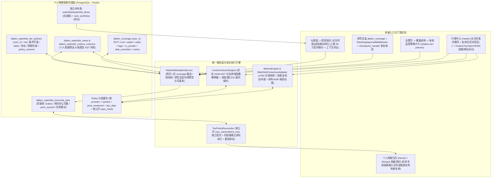

# 统一关注列表（Personal Coverage Watchlist）设计文档（r5 审查修订定案版）

- **状态**：定案版 r5（已纳入全部第 1–12 条用户决定及 Codex / Grok 设计审查修订）
- **分支**：`design/watchlist`
- **适用范围**：Everflow 生产形态与 Standalone Core（独立核心安装）双形态共用

---

## 1. 背景、已拍板决定与总体架构

当前仓库内同时存在多套分散维护的公司列表：数据库层的个人双档覆盖表 `dalton_coverage`、部分定时技能内部维护的静态 `watchlist_universe.json` 或 Python 常量，以及前端点击「行情中心」即直接回退单只股票 K 线（Candlestick Chart，蜡烛图）的浏览路径；同时，各分档运行哪些后台任务及运行频率目前采用全系统固定常量，用户仅能按单家公司整体暂停跟踪。

结合全部第 1–12 条已拍板决定与独立设计审查意见，本设计按以下**十项定案原则**落地：

1. **纯个人名单，成员与会话严格隔离**：关注列表与覆盖名单同源存储于个人主表 `dalton_coverage`；每位用户独立维护本人的关注列表、三档分级、个人自定义列库与各档监控策略，全部表以 `user_id`（`TEXT` 类型）为分区键物理隔离，仅创建者本人在私有会话与个人界面中可读写。
2. **三档命名 `Core / Watch / Radar`（核心 / 跟踪 / 雷达），显示名与存储值分离，首批全链路同步接通**：
   - 数据库存储值采用小写枚举 **`'core'` / `'watch'` / `'radar'`**（存量 `'core'` 与 `'watch'` 原样保留，第三档存储值为 `'radar'`，与平台现有「监控（`/monitors`）」功能清晰区分）；
   - 界面显示文案通过国际化字典独立映射为中文 **「核心 / 跟踪 / 雷达」**（英文 **`Core / Watch / Radar`**）；原 `dalton-<t>-watch` 任务在界面与确认卡片上统一显示为 **「盘中盯盘」**（英文 `Intraday Watch`）；
   - 第 1 批开放 `'radar'` 写入时，原子同步更新模型校验、查询分桶、旧 `/coverage` 接口、工作区初始化、后台排期（`schedule.py`）与财报日历（`calendar_state.py`），确保 `'radar'` 默认关闭后台写稿与盯盘任务，并支持无工作区股票直接进入本人财报日历。
3. **个人可配置的「各档监控策略」与双端同源入口**：
   - `核心（Core）`、`跟踪（Watch）`、`雷达（Radar）` 三档运行哪些后台任务（盘中盯盘、论点增量〔Thesis Delta〕、涨跌异动快评、财报自动写稿）及频率均由个人设置：`Core` 与 `Watch` 默认沿用现网频率，`Radar` 默认关闭后台研究任务；
   - **网页设置界面**：位于设置页「覆盖结构」（`coverage` 分组）内顶部的「各档监控策略」卡片（`#dalton-tier-policies`），支持开关任务、选择常用预设或展开「高级」填写 5 段 Cron（定时时间表达式，按任务生效时区及夏令时〔DST：Daylight Saving Time〕校验盘中盯盘相邻触发间隔 `≥ 30 分钟`、`delta` 每日最多一次且相邻间隔 `≥ 23 小时`），行情中心关注列表页顶部提供快捷跳转按钮；
   - **生效边界**：调档或改策略时，对本人已有研究工作区的公司按单工作区独立加锁事务同步任务（保留 `paused_by_user` 手动暂停与 `replaced_by_tracker` 多空跟踪接替状态）；尚无研究工作区的公司显示 **「待建工作区」**，在后续运行 `dalton-init-company` 初始化工作区时自动挂载当前档位策略任务；运行在本人 `Home` 的财报日历对三档全部上市股票立即生效。
4. **服务端确认快照持久化与事务级待同步补偿（Outbox，事务发件箱）**：
   - 网页端、旧 `/coverage` 写接口、规则组刷新与研究总监（Chief of Staff）`dalton_coverage` 工具**共用同一套预览、校验与执行服务**；
   - 研究总监侧完整接入服务端快照持久化（`StandingApprovalMiddleware`）、恢复端会话与快照核验（`checkpoint_handler.py`）及按 `tool_call_id` 关联的实时与历史四态卡片结算；网页端预览弹窗同样携带服务端签发的版本与范围摘要参与事务复核；
   - 名单或策略写事务同时写入持久化待同步记录 `dalton_watchlist_reconcile_jobs`，后续按单公司独立加锁提交并同步更新排队记录与 `Home/dalton/coverage.yaml`（YAML：结构化配置文件格式），支持进程重启后幂等续跑。
5. **跨股票定时任务迁移边界明确（决定 11、12）**：
   - **迁入任务所有者个人关注列表**：`Richard 覆盖周报`（`richard-2.json`）、`Richard 财报日期周扫`（`richard.json`）以及按账号各自运行的 `dalton-earnings-calendar`；公司级任务通过经逐项核实的 `metadata.watchlist_owner_user_id` 解析所有者，并以**任务专用隔离输入文件**传递名单，保持共享公司 `Home` 纯净；
   - **保持现有名单并存**：`覆盖池公告日报`（`dalton-daily-filing-alert`，实例 `automation-8.json`）面向团队飞书群投递，继续使用技能内置团队覆盖池（`watchlist.txt`、`watchlist_cn_hk.txt`）；`多空跟踪`（`dalton-bullbear-tracker`）针对指定单公司运行，维持单公司配置；已暂停的宿主机 `pt-watchlist` 任务移出改造范围；
   - **双财报技能职责分明、并存运行**：`Richard 财报日期周扫` 仅维护自身台账、写入 Google 日历并输出纯文本汇总；`dalton-earnings-calendar` 独立维护自身台账并专职排期 `T-3 / T0 / T+1` 自动写稿任务链。
6. **主入口为「行情中心」（`/market`），K 线页保留地址参数兼容深链**：`/market` 无 `?symbol=` 参数时打开**关注列表完整页**；点击公司行进入 `/market?symbol=NVDA` **K 线看盘页**并在地址栏保留 `symbol` 与周期标识，完整支持深链接、刷新、`tf/ws/thread/returnTo` 参数及浏览器前进后退。
7. **辅助入口为「仪表盘 → 投资组合」首标签 `[关注列表]`**：按 **`[关注列表] [自选股] [持仓]`** 并列三个独立标签，保持现有「自选股」与「持仓」表结构及已保存的 `defaultTab` 偏好原样运行；新添加卡片在关注列表非空时初始选中 `关注列表`，行情请求上限收敛为前 50 只可见标的，并提供上下文导出与「查看全部 →」跳转。
8. **公开数据源一致预期适配器与分批估值交付**：构建公开数据适配器读取 `yfinance` / 可选 `FMP` 年度一致预期并按实际财年截止日匹配 `FY1/FY2`（当前及下一财年），仅在确认每股收益（EPS：Earnings Per Share）与报价对应的股份单位后执行跨币种与存托凭证（ADR：American Depositary Receipt）折算，明确区分正常、亏损（`NM`：Not Meaningful）、无覆盖、单位待确认、缓存过期、上游限流与未上市七种状态。
9. **强类型自定义指标列引擎**：右侧对话区在本人私有会话内支持统计问答与生成自定义列；后端仅接收封闭强类型 JSON（JavaScript Object Notation，轻量级数据交换格式）抽象语法树（AST：Abstract Syntax Tree），通过固定白名单纯函数解释执行并施加节点数、深度、回看窗口、标的数与超时上限，仅对纯公开行情算子启用跨用户共享缓存。
10. **双形态规范与门禁闭环**：形态判断统一走 `src.dalton.profile`，能力门控统一走 `src.dalton.capabilities` 与前端 `useCapabilities()`，品牌走 `brand.ts`；在 `check_hooks.sh` 登记 `watchlist` 钩子、在 `DALTON_ROUTE_CAPABILITY_REGISTRY` 登记全部新路由为 `CORE_CAPABILITY`，确保独立核心发行包与镜像无私有依赖地完整跑通。



---

## 2. 现状调研（附精确代码位置）

### 2.1 现有个人覆盖表物理结构、后台调度常量、设置页与研究总监工具现状

1. **Dalton 个人覆盖表真实物理列与 JSONB 元数据映射**：
   - `src/dalton/migrations/versions/d015_user_coverage.py:21-69` 创建了 `dalton_coverage_groups`（第 `21-33` 行，`group_id UUID PRIMARY KEY` 第 `22` 行，`user_id TEXT NOT NULL`，`default_tier TEXT NOT NULL DEFAULT 'watch' CHECK (default_tier IN ('core', 'watch'))` 第 `26-27` 行）与 `dalton_coverage`（第 `36-55` 行，联合主键 `(user_id, ticker)` 第 `53-54` 行，`user_id TEXT NOT NULL`，`CHECK (tier IN ('core', 'watch'))` 第 `40-41` 行）。
   - `dalton_coverage` 的真实物理列为：`user_id`、`ticker`、`name`（公司名称）、`tier`、`market`、`peer_group`、`peers`（JSONB〔二进制 JSON 结构化存储〕数组）、`aliases`（JSONB）、`earnings`（JSONB，含 `fiscal_year_end`、`group` 等）、`extra`（JSONB）、`source`、`group_id`、`created_at`、`updated_at`（`d015_user_coverage.py:37-52`；查询与更新 SQL〔Structured Query Language，结构化查询语言〕位于 `src/dalton/database/coverage.py:70-74, 184-187`）。
   - YAML 与数据库行互转逻辑位于 `src/dalton/coverage/models.py:27-41, 89-131, 151-168, 231-288`：`sheet_section`、`etfs`（Exchange-Traded Funds，交易型开放式指数基金列表）、`workspace`、`coverage_stage`、`note`（备注）、`group_ids`、`group_stale_ids` 以及内部工作区绑定指针 `_synced_unit_id`、`_synced_workspace_id`、`_synced_ws_written`、`_manual_workspace_id` 均存放在 `extra` JSONB 内，由 `DEDICATED_COMPANY_KEYS` 与 `preserve_row_internal_extra` 维护往返一致性。单用户覆盖表事务级咨询锁位于 `src/dalton/database/coverage.py:44-53`（`acquire_coverage_advisory_lock`），多用户排序加锁封装位于 `src/dalton/coverage/units.py:44-56`。
   - 应用层两档硬编码位置：`src/dalton/coverage/models.py:12, 64-68`（`VALID_TIERS = {"core", "watch"}`，`normalize_tier` 对未知分档抛 `ValueError`）、`models.py:319, 328, 353-369`（非 `core` 统一写入 `sheet_section = "Watch"`、`earnings.group = "B"`，且 `build_coverage_doc` 仅统计 `core` 与 `watch`）、`src/dalton/coverage/service.py:861`（`get_user_tier` 仅识别 `core`/`watch`，其余返回 `None`，进而使 `src/dalton/autonomy/tracking.py:47` 的 `resolve_default_tier` 回退为 `"watch"`）、`service.py:1587-1591`（`list_user_coverage_summary` 将非 `core` 行归入 `watch_list`），以及 HTTP（Hypertext Transfer Protocol，超文本传输协议）路由 `src/dalton/app/router.py:117-133, 2670-2723` 透传至上述校验。
   - **「105 家公司」与形态种子差异**：仓库种子文件 `config/dalton/coverage.yaml:1-3048` 含 27 家 `core` + 78 家 `watch` 共 105 家（含未上市公司 `SPCX`，说明见 `config/dalton/README.md:1-30`；简称字典见 `src/dalton/conversations/extractor.py:608-700`）；在独立核心形态（`is_core_profile()`）下，默认种子加载函数 `src/dalton/coverage/service.py:2844-2899` 直接返回空列表 `[]`。
2. **现有分档后台排期、暂停原因与锁模型现状**：
   - **盘中盯盘（`dalton-<t>-watch`）**：`src/dalton/autonomy/schedule.py:183-215` 按市场设时区（美股 `America/New_York`、中港股 `Asia/Shanghai`），`tier == "core"` 用 `"*/30 6-20 * * 1-5"`，其余所有分档（`schedule.py:185`）统一落入 Watch 频率 `"30 7 * * 1-5"`。
   - **论点增量（`dalton-<t>-delta`）**：`src/dalton/autonomy/schedule.py:30-45, 216-236` 固定 `DELTA_TIMEZONE = "Asia/Shanghai"`，`core` 用 `"0 11 * * 2-6"`，其余所有分档（`schedule.py:41-44`）统一落入 `"0 11 * * 6"`。
   - **涨跌异动快评（`dalton-<t>-move-up` / `move-down`）**：`src/dalton/autonomy/schedule.py:237-306` 采用价格触发器 `trigger_type = "price"`（`next_run_at = None`，条件存于 `trigger_config.conditions[0].value = ±4.0`、冷却 `86400` 秒）。
   - **财报自动写稿链**：`plugins/dalton/skills/dalton-earnings-calendar/scripts/calendar_state.py:32-35, 223-227, 687-688` 定义 `CHAIN_BY_TIER = {"core": ["tm3", "t0", "tp1"], "watch": ["t0"]}`，且 `CHAIN_BY_TIER.get(tier.lower(), ["tm3", "t0", "tp1"])` 对未知分档默认排入三阶段全链写稿。
   - **现存多种暂停原因与锁边界**：除整公司手动暂停 `metadata.paused_by_user` 与单任务暂停（`src/dalton/autonomy/tracking.py:1633-1717, 1791-1800`）外，还存在由多空跟踪接替的 `metadata.replaced_by_tracker = True`（`tracking.py:1685-1698, 2045-2055`，改档时保持暂停）及覆盖单元交接暂停 `handoff_paused_reason`（`schedule.py:1680-1695`）。同时，`user_automations_lock(uid, conn=..., prelock_ws=...)`（`schedule.py:79-128`）在 `conn is None` 时自开事务并按 `acquire_catalog_shared_lock -> dalton_coverage_units FOR SHARE（单工作区，database/coverage_units.py:9-39）-> auto_db.lock_user_automations` 顺序加锁，传入外部 `conn` 时则跳过加锁直接复用连接；排队执行跳过函数 `skip_unstarted_executions_for_automations`（`src/server/database/automation_executions.py:2033-2070`）原生支持传入同一事务连接 `conn`。
3. **设置页「覆盖结构」可见性与研究总监确认恢复现状**：
   - **设置页可见性**：`web/src/pages/Settings/sections.ts:97, 136, 300` 与 `web/src/pages/Settings/Settings.tsx:77, 117, 125-129` 对 `SECTIONS.coverage` 整节设了 `coverageUnitsOnly: true`，且 `web/src/pages/Settings/components/SettingsRail.tsx:25-45` 中 `coverageUnitsEnabled` 直接取自 `useDaltonCoverageUnits` 接口的 `enabled` 字段而非 `useCapabilities()`。
   - **研究总监工具与确认恢复链路**：`dalton_coverage`（`src/dalton/tools/coverage_tools.py:56-233`）目前包含 7 个普通 JSON 返回动作，规则组确认仅靠提示词约定（`:73-87, 113-189`）。而在服务端确认框架中，`StandingApprovalMiddleware.aafter_model`（`src/tools/secretary/approvals.py:159-201, 408-457`）当前仅对工作区创建/归档生成 `approval_snapshots[tool_call_id]`，恢复入口 `src/server/handlers/checkpoint_handler.py:279-298, 345-374` 也通过固定白名单 `WEB_CONFIRM_ACTION_TYPES` 与 `_snapshot_matches_action` 校验网页会话与快照一致性，前端投影则分布于 `web/src/pages/ChatAgent/session/interrupts/buckets.ts:20-60`、`fromLiveEvent.ts:78-120` 与 `fromHistoryEvent.ts:90-160`。

---

### 2.2 全仓公司列表盘点与已拍板处理方案（决定 4、11、12）

全仓公司列表按第 4、11、12 条用户拍板决定明确划分为四类（已暂停的宿主机任务 `pt-watchlist` 已从切换清单移除）：

| 序号 | 模块 / 任务名称 | 精确位置（`文件:行号` 或实例配置） | 当前格式与运行现状 | 已拍板处理方案 |
|---|---|---|---|---|
| 1 | 个人关注列表主表与个人 `Home` YAML | `src/dalton/migrations/versions/d015_user_coverage.py:36-55`；`src/dalton/coverage/service.py:993-1062` | PostgreSQL（关系型数据库）`dalton_coverage` + 本人 `Home/dalton/coverage.yaml` | **同源主表（第 1 批升级）**：原地扩展 `'core'` / `'watch'` / `'radar'` 三档、标签、`is_private` 与 `task_overrides`，连同本人 `tier_policies` 渲染至本人私有 `Home/dalton/coverage.yaml`。 |
| 2 | 通用财报日历（`dalton-earnings-calendar`） | `plugins/dalton/skills/dalton-earnings-calendar/SKILL.md:12-40`；`scripts/calendar_state.py:32-45, 223-227, 687-688` | 按所有者各自一份个人任务（现网 `991a99ad` 与 `0134013f` 账号下各一份），读各自 `Home/dalton/coverage.yaml` | **按各自所有者个人名单运行（第 1 批接通 `radar` 与 `earnings_stages`）**：每位所有者的实例读取本人 `Home/dalton/coverage.yaml` 三档股票（含无工作区股票），维护本人 `Home/dalton/earnings-calendar.json` 并专职排期 `T-3 / T0 / T+1` 写稿任务链。 |
| 3 | Richard 覆盖周报（`dalton-richard-coverage-weekly`） | 实例 `richard-2.json`；`plugins/dalton/skills/dalton-richard-coverage-weekly/scripts/screen_movers.py:51-460, 711`；`scripts/richard_coverage_weekly_cli.py:67-105, 1196-1203` | Python 硬编码 `TICKERS`（27 Core + 78 Watch + 219 同组对比股）与 `CORE` | **迁入任务所有者个人关注列表（第 4 批）**：移除硬编码 `Core/Watch` 列表，通过任务专用隔离输入文件读取经核实的任务所有者个人关注列表三档；219 家外部行业对比股独立保存为静态参考表 `peer_benchmarks.json`。 |
| 4 | Richard 财报日期周扫（`dalton-richard-earnings`） | 实例 `richard.json`；`plugins/dalton/skills/dalton-richard-earnings/SKILL.md:1-45`；`references/watchlist_universe.json:1-107`；`scripts/richard_earnings.py:21-27, 161-193, 249-268` | 技能内静态 105 家 JSON + 工作区 `state/richard-earnings/watchlist.json` | **迁入任务所有者个人关注列表，与通用财报日历独立并存（第 4 批，决定 12）**：改由任务专用隔离输入文件读取任务所有者个人关注列表，继续独立维护 `state/richard-earnings/` 台账、写 Google 日历并提交纯文本汇总，与 `dalton-earnings-calendar` 互不改写（边界详见 §3.2）。 |
| 5 | 每周覆盖复盘、论点增量、异动归因、公司初始化、13F 跟踪 | `plugins/dalton/skills/dalton-weekly-review/scripts/screen_movers.py:42, 169-215`；`dalton-thesis-delta/scripts/collect.py:231-265`；`dalton-stock-move/scripts/move_quant.py:189-198`；`dalton-init-company/scripts/init_company.py:482-518`；`dalton-13f-tracker/scripts/13f_skill.py:919-925, 3241-3254`（13F：美国机构季度持仓披露表） | 读取个人 `../Home/dalton/coverage.yaml` | **平滑兼容三档**：`dalton-init-company` 在第 1 批支持按本人当前三档策略挂载初始任务；其余技能识别 `'radar'` 分档并清理 `screen_movers.py:42` 旧字典。 |
| 6 | 覆盖池公告日报（`dalton-daily-filing-alert`） | 实例 `automation-8.json`；`plugins/dalton/skills/dalton-daily-filing-alert/SKILL.md:14`；`watchlist.txt:1-84`；`watchlist_cn_hk.txt:1-10` | 技能内两份团队覆盖池名单（美股 SEC〔美国证券交易委员会〕与中港公告），投递至团队飞书群 | **保持现有技能内团队覆盖池（决定 11）**：该任务属团队级群发报告，继续读取技能自带的 `watchlist.txt` 与 `watchlist_cn_hk.txt`；后续如需网页化管理，可独立设计「团队覆盖池」。 |
| 7 | 多空跟踪（`dalton-bullbear-tracker`） | `src/dalton/bullbear_tickers.py:15-92`；`plugins/dalton/skills/dalton-bullbear-tracker/scripts/tracker_config.py:25-195` | 针对 AMZN / GOOGL / META / MSFT / ant / spcx 等指定单公司独立配置运行 | **保持现有单公司配置（决定 11）**：每个任务只针对特定单家公司深度跟踪，维持现有单公司工作区 `config.json` 与 `BULLBEAR_TICKER_META`；被其接替的 `delta` 任务继续保留 `replaced_by_tracker` 标记。 |
| 8 | 仪表盘「自选股」与「持仓」 | `migrations/versions/001_initial_schema.py:165-235`；`src/server/app/watchlist.py:41-306`；`src/server/app/portfolio.py:28-151` | PostgreSQL `watchlists` / `watchlist_items` 与 `user_portfolios` | **独立并存（决定 3）**：保持现有数据表、接口与用户数据原样运行，在仪表盘投资组合卡片中与新增首标签 `[关注列表]` 并列。 |
| 9 | 宏观情绪看板与垂直赛道百股级行业周报池 | `scripts/dalton/data_assets/skills/sentiment-dashboard/`；`plugins/dalton/skills/dalton-ai-app-weekly-monitor/references/universe.json:19`（290 家）；`dalton-tob-industry-weekly/references/universe.json:33`（120 家）；`dalton-china-consumer-weekly/SKILL.md:29`；`dalton-global-consumer-weekly/SKILL.md:20`；`dalton-mark-weekly-newenergy/SKILL.md:19`；`dalton-bdc-analyst/SKILL.md:77`（BDC：商业发展公司） | 各看板与赛道技能内独立样本池（合计逾 900 家） | **保持独立样本池 + 一键加入本人 `Radar` 档（决定 4）**：各行业周报继续在技能内维护全集样本池，筛出的重点异动公司支持通过研究总监或快捷入口一键加入本人 `Radar`（雷达）档。 |

---

### 2.3 现有「行情中心」路由行为与「仪表盘 → 投资组合」实现现状

1. **「行情中心」路由解析与地址清理逻辑**：
   - 路由 `market: '/market'` 定义于 `web/src/lib/appRoutes.ts:11` 并挂载于 `web/src/App.tsx:271-274, 516`；侧栏导航项位于 `web/src/components/nav/navItems.ts:24-33`。
   - `web/src/pages/MarketView/MarketView.tsx:107-113` 调用 `readMarketViewRoute`（`web/src/pages/MarketView/utils/marketRoute.ts:58-71`）读取 URL（Uniform Resource Locator，统一资源定位符）：无 `?symbol=` 参数时优先读取本地偏好 `loadPref('symbol', 'GOOGL')` 打开上次浏览的股票 K 线；同时 `MarketView.tsx:303-346` 在挂载后通过 `MARKET_VIEW_ROUTE_PARAMS` 将地址栏中的 `symbol`、`tf`、`ws`、`mode`、`returnTo` 移除（仅保留 `thread`）。因此，改为两级浏览时须让 K 线视图在地址栏保留 `symbol`（及非默认 `tf`），确保深链接、刷新与浏览器前进后退稳定区分列表页与 K 线页。
   - 右侧对话区 `MarketChatPanel`（`web/src/pages/MarketView/components/MarketChatPanel.tsx:399-413, 555-628`）支持切换 `scope`（`'all'` 或指定 `'workspace'`）与恢复 `?thread=`，其 `additionalContext` 会经 `src/server/handlers/chat/ptc_run.py:612-662` 写入会话查询记录。
2. **「仪表盘 → 投资组合」双标签、默认配置与上下文导出现状**：
   - 组件 `PortfolioWatchlistWidget`（`web/src/pages/Dashboard/widgets/definitions/PortfolioWatchlistWidget.tsx:46-312`）在 `web/src/pages/Dashboard/widgets/presets.ts:51, 77, 106` 与 `configSchemas.ts:196-200` 中已将存量预设与配置的 `defaultTab` 写为 `'watchlist'`（`PW_TAB_KEYS = ['watchlist', 'portfolio']`）。
   - 组件内 `useWidgetContextExport`（`PortfolioWatchlistWidget.tsx:66-159`）以及计数 `activeCount`、骨架态 `showSkeleton`（`:187-193, 304`）目前仅包含 `'watchlist'`（自选股，读写 `watchlists` / `watchlist_items`）与 `'portfolio'`（持仓，读写 `user_portfolios`）两个分支。

---

### 2.4 行情、拆股复权日线与前瞻一致预期数据源核实现状

1. **批量快照上限与日线复权口径**：
   - 快照端点 `src/server/app/market_data.py:731, 790-823` 单次请求上限为 **250 个标的**（其中 Yahoo 通道路由在线程池内逐股抓取）；日线接口 `market_data.py:349-372` 与 `src/data_client/yfinance/data_source.py:159-163, 404-439` 按单标的取数并缓存，且固定采用 `auto_adjust=False`（即 **拆股调整价 `split-adjusted`**，保留原始现金分红除息表现，与实时盘中成交价口径一致）。
   - 核心安装配置 `config.core.yaml:4-21` 默认行情链为公开源 `yfinance`（可选配置 `FMP`〔Financial Modeling Prep，金融建模数据服务〕）。
2. **前瞻市盈率（`FY1 / FY2 P/E`）真实数据接口核实**：
   - 通用财务封装 `src/data_client/yfinance/financial_source.py:215-221` 仅返回历史滚动 `trailingPE`、`trailingEps` 与 52 周高低价；`src/data_client/fmp/financial_source.py:40-141` 仅封装财务报表，底层分析师年度预测方法为 `src/data_client/fmp/fmp_client.py:701-707`（`get_analyst_estimates(..., period="annual")`，按年度财年截止日返回预测数组）。
   - 真正获取 `0y`（当前财年）与 `+1y`（下一财年）一致预期 `EPS` 的公开路径为 `yfinance` 的 `Ticker.earnings_estimate` 与 `_analysis._earnings_trend`（已在 `plugins/dalton/skills/dalton-thesis-delta/scripts/collect.py:75-135, 390-409` 验证运行；内部 `scripts/dalton/researchdata_bridge.py:2363-2398, 4753-4795` 受 `CapabilityId.RESEARCHDATA_BRIDGE` 门控且一致预期同样基于 `yfinance`）。
   - 跨币种换算工具 `plugins/dalton/skills/dalton-financial-lenses/scripts/anchors.py:202-213, 246-299` 接收调用方显式传入的 `adr_ratio`（缺省为 `1.0`），本身未内置自动查询全市场存托凭证换算比的数据源。因此关注列表估值模块须单独定义公开一致预期适配器与股份单位核验规则（详见 §6.3）。

---

### 2.5 定时任务归属、预检同步与数据任务边界现状

- `src/dalton/autonomy/preflight.py:677-741` 的 `_sync_home_coverage_for_preflight` 在个人任务（`user_id` 为真实用户）运行时渲染本人 `coverage.yaml` 写入本人 `Home`；在公司任务（`user_id == "system:dalton-company"`，`src/dalton/company_identity.py:18`）运行时当前调用 `render_company_coverage_yaml()` 将全体内部成员名单合集写入公司系统身份的共享 `Home`（`:724-728`）。
- `src/dalton/coverage/units.py:340-420` 负责覆盖单元的工作区绑定、解绑与主分析师个人覆盖行同步；`src/dalton/data_jobs/scheduler.py:3288-3305` 则用于宿主机数据任务的通知接收人资格过滤。不同类型任务的所有者存储与名单输入通道须分别独立定义（详见 §3.2）。

---

## 3. 个人名单隔离、任务所有者机制与双形态架构

### 3.1 个人关注列表隔离、对话区共享会话防护与外部成员规则

1. **存储与接口级个人隔离**：`dalton_coverage`、`dalton_watchlist_tier_policies`、`dalton_watchlist_reconcile_jobs`、`dalton_watchlist_views`、`dalton_watchlist_custom_columns` 全部以 `user_id TEXT` 分区；所有 REST 接口与智能体工具从服务端认证上下文获取本人 `CurrentUserId`（通过 `reject_company_system_auth` `src/dalton/company_identity.py:55-66` 拦截系统身份直接调用）。
2. **行情中心对话区的共享线程与跨人工作区隔离**：
   - **前端挂载条件**：`MarketChatPanel.tsx:399-413, 555-628` 仅在当前选中会话属于用户本人私有工作区（含本人 `Home` / `scope === 'all'`）且当前线程为私有线程（`!isShared`）时附加 `<watchlist_context>` 摘要；切换至共享工作区、他人工作区或共享线程时自动省略个人关注列表上下文。
   - **服务端硬核验**：在 `src/server/handlers/chat/ptc_run.py:612-662`（附 `# DALTON-HOOK(watchlist)`）与智能体工具装配阶段，服务端根据数据库线程归属（`thread.user_id == principal.user_id` 且非共享线程、工作区归属本人且非跨成员接力轮次）复核权限：在共享线程或非本人工作区轮次中自动剥离客户端传入的 `watchlist` 类 `additional_context`，并扣留个人关注列表读写工具（`dalton_coverage`、`watchlist_*`），确保个人分档、标签与备注在实时对话、历史刷新回放及切换工作区时全程留存于本人私有会话内。
3. **外部成员（`external`）同构支持**：外部成员拥有完整的个人关注列表、`Core / Watch / Radar` 三档管理、设置页「各档监控策略」卡片、研究总监 `dalton_coverage` 工具、行情中心完整页、个人自定义列库与仪表盘 `[关注列表]` 标签，初始为空列表；其策略与任务同步严格限定在 `workspaces.user_id = external_uid AND automations.scope = 'personal'` 范围内（遵循 `src/dalton/sharing.py:85-87` 与个人每日预算 `src/dalton/company_identity.py:88-93`）。

---

### 3.2 定时任务所有者存储、隔离输入传递与双财报技能并存边界

#### （1）三类定时任务的所有者定义与隔离输入方式

| 任务类别 | 代表任务 | 所有者（`owner_uid`）存储位置 | 运行时名单传递方式与权限复核 |
|---|---|---|---|
| **1. 公司工作区单元任务** | 单公司 `dalton-<t>-watch`、`delta`、`move-up/down` | 绑定活跃 `dalton_coverage_units` 时取 `lead_analyst_user_id`（回退 `workspace.user_id`，复用 `resolve_workspace_tracking_owner` `src/dalton/autonomy/tracking.py:80-122`） | 按该 `owner_uid` 在 `dalton_coverage` 与 `dalton_watchlist_tier_policies` 中的个人分档与策略直接驱动工作区自动任务配置。 |
| **2. 个人 `Home` 任务（`scope = 'personal'`）** | 每位所有者名下各自的 `dalton-earnings-calendar`（如 `991a99ad`、`0134013f` 各自实例）、`dalton-weekly-review` | 直接取 `automations.user_id` | 预检 `_sync_home_coverage_for_preflight`（`src/dalton/autonomy/preflight.py:727-728`）渲染该 `user_id` 本人的三档 `coverage.yaml` 写入**该用户本人的私有 `Home/dalton/coverage.yaml`**。 |
| **3. 公司级跨股票汇报任务（`scope = 'company'`，执行身份 `system:dalton-company`）** | `Richard 覆盖周报`（`richard-2.json`）、`Richard 财报日期周扫`（`richard.json`） | 显式存储于任务 `automations.metadata.watchlist_owner_user_id`（须为经逐任务核实的活跃 `admin` 或 `internal` 人类账号） | **任务专用隔离输入（保持公司共享 `Home` 零个人名单写入）**：预检阶段复核 `watchlist_owner_user_id` 仍为活跃内部/管理员账号后，将该所有者的名单快照渲染至**本次任务工作区内的隔离输入路径** `<task_workspace>/state/watchlist_input/owner_coverage.yaml`（通过命令行参数 `--coverage-file` 传入技能脚本，单轮只读使用），`system:dalton-company` 的共享 `Home` 不写入任何成员的个人关注列表。 |

- **存量公司任务核实绑定与 `owner_unbound` 安全态**：第 4 批迁移时，仅对已由人工核实归属映射的任务（`richard-2.json`、`richard.json` → 对应核实负责人 `user_id`）写入 `metadata.watchlist_owner_user_id`（生产核实脚本置于 `scripts/dalton/ops/prod/`）；任何未能核实明确人类所有者的公司任务保持 `watchlist_owner_user_id = NULL`（标记状态 `owner_unbound`），预检遇到 `owner_unbound` 或原所有者已停用/降级为 `external`（`owner_inactive`）时跳过个人名单渲染并向管理员发出改绑提示，待管理员在任务设置中显式绑定活跃内部负责人并记入 `audit_history`（`src/dalton/services/company_automations.py:93-153`）后再恢复读取。
- **所有者移交规则**：覆盖单元主分析师移交（`old_lead -> new_lead`）时，`old_lead` 个人列表保留该股票行与个人备注（仅清除 `_synced_unit_id` / `_synced_workspace_id`），`new_lead` 按单元分档同步绑定该工作区并立即按 `new_lead` 本人策略对账该工作区任务；公司级跨股票任务改绑 `watchlist_owner_user_id` 时，新旧所有者的个人关注列表各自保持原样，下次运行直接向隔离输入路径渲染新所有者名单。

#### （2）`Richard 财报日期周扫` 与 `dalton-earnings-calendar` 并存边界（决定 12）

两项技能在职责、状态文件路径、外部写入面与排期权上严格分立、长期并存：

| 维度 | `Richard 财报日期周扫`（`dalton-richard-earnings`，实例 `richard.json`） | `通用财报日历`（`dalton-earnings-calendar`，各账号个人实例） |
|---|---|---|
| **名单输入** | 读取 `richard.json` 的 `metadata.watchlist_owner_user_id` 渲染至该任务工作区 `<workspace>/state/watchlist_input/owner_coverage.yaml`（替代原静态 `references/watchlist_universe.json`） | 读取各实例所属用户本人 `Home/dalton/coverage.yaml`（含每档 `earnings_stages` 策略） |
| **自有状态与台账路径** | 仅读写该任务自身工作区下的 `state/richard-earnings/watchlist.json` 与 `state/richard-earnings/scans/<ET-date>/` | 仅读写对应用户本人 `Home/dalton/earnings-calendar.json` 及数据库镜像 `dalton_earnings_calendar_mirror` |
| **Google 日历写入** | **唯一负责**：调用 `research(route="gcal")` 同步 Google 日历事件并提交纯文本周扫汇总 | **零触碰 Google 日历** |
| **`T-3 / T0 / T+1` 写稿任务排期** | **零创建、零修改自动写稿任务** | **唯一负责**：按所有者本人 `earnings_stages` 策略创建/更新单公司 `dalton-<t>-earn-*` 自动任务 |
| **日期差异处理** | 若同一公司在两边扫描时刻出现日期差异，各自在下一次运行时独立以官方投资者关系（IR：Investor Relations）页面或监管公告为准更新各自台账，互不读取或覆盖对方状态文件。 | 同左 |

---

### 3.3 双形态架构规范与登记清单（对照 `standalone-core.md` 逐项闭环）

1. **形态与能力门控（原则 1、2）**：
   - 后端仅使用 `src.dalton.profile` 判断形态、使用 `src.dalton.capabilities.has_capability` 判断可选能力；`src/dalton/watchlist/` 顶层仅依赖标准库、数据库池与公开行情源接口（`yfinance` / 可选 `FMP`），Everflow 可选的 `researchdata` 增强仅在 `if has_capability(CapabilityId.RESEARCHDATA_BRIDGE):` 分支内按需延迟导入（Lazy Import）。
   - 前端品牌统一读取 `web/src/config/brand.ts`，可选能力统一读取 `useCapabilities()`（`web/src/hooks/useCapabilities.ts:134`）：设置页 `SettingsRail.tsx:28-45` 与 `DaltonCoveragePanel.tsx` 中，个人「各档监控策略」卡片对全部形态开放，而团队覆盖单元卡片 `<DaltonCoverageCard />` 先以 `hasCapability('colleague_sharing')` 作能力门控，再由 `useDaltonCoverageUnits` 接口负责权限与单元数据。
   - **核心安装包与镜像审查（`scripts/standalone/package_release.sh:168-243, 293-313`）**：由于核心打包脚本整目录收录 `src`、`plugins/dalton` 与 `web`，`src/dalton/watchlist/` 与新增前端组件内保持零 Everflow 内部域名、飞书群名或私有配置；依赖内部桥接或飞书渠道的专属技能（`dalton-richard-coverage-weekly`、`dalton-richard-earnings`、`dalton-daily-filing-alert`）在技能注册表 `src/ptc_agent/agent/middleware/skills/dalton_registry.py` 中明确声明 `RESEARCHDATA_BRIDGE` / `CHANNEL_FEISHU` 能力门控，并在打包校验中核查核心发行包与镜像无私有残留。
2. **钩子 ID、路由能力表与后台循环登记（原则 3、6）**：
   - 在 `scripts/dalton/check_hooks.sh:25` 的 `ALLOWED_HOOKS` 数组中新增登记 `"watchlist"`；所有修改的上游 `.py` / `.ts` / `.tsx` 文件逐处附 `# DALTON-HOOK(watchlist): <reason>` 或 `// DALTON-HOOK(watchlist): <reason>`（国际化 `*.json` 资源文件本身无注释语法，按 `check_hooks.sh:493-496` 规则免注释扫描），全仓通过 `bash scripts/dalton/check_hooks.sh --strict`。
   - 在 `src/dalton/capabilities.py:908` 的 `DALTON_ROUTE_CAPABILITY_REGISTRY` 中，将新增的全部关注列表、预览、对账补偿、批量指标、视图预设、自定义列与各档监控策略路由逐条登记为 **`CORE_CAPABILITY`**（双形态共用）。
   - 待同步补偿（`dalton_watchlist_reconcile_jobs`）通过预检钩子与显式 `/reconcile` 端点驱动；若后续在 `setup.py` 挂载定时补偿巡检协程，同步在 `src/dalton/capabilities.py:868-905` 的 `BACKGROUND_LOOP_REGISTRY` 中登记为 `CORE_CAPABILITY`。
3. **迁移链与运维脚本分层（原则 4、5）**：
   - 新迁移仅放入 `src/dalton/migrations/versions/`，按合入当时的唯一迁移头顺接（见 §4.2）；
   - 存量公司任务所有者核实与回填脚本放入 `scripts/dalton/ops/prod/`，独立核心安装无需额外运维脚本，共用服务逻辑统一收敛在 `src/dalton/watchlist/`。

---

## 4. 数据模型与数据库迁移设计

### 4.1 三档枚举存储值、YAML 字段与界面显示名分离映射

| 数据库存储值（持久化契约） | 中文显示名（`zh-CN`） | 英文显示名（`en-US`） | `coverage.yaml` 的 `sheet_section` / `earnings.group` | 徽章视觉样式 |
|---|---|---|---|---|
| `'core'`（沿用存量值） | **核心（Core）** / 简标 **核心** | **Core** | `"Core"` / `"A"` | 琥珀金实心徽章 |
| `'watch'`（沿用存量值） | **跟踪（Watch）** / 简标 **跟踪** | **Watch** | `"Watch"` / `"B"` | 蓝青色描边徽章 |
| `'radar'`（新增第三档） | **雷达（Radar）** / 简标 **雷达** | **Radar** | `"Radar"` / `"C"` | 中性灰徽章 |

### 4.2 数据库迁移与字段优先级规范（顺接合入时唯一迁移头）

> **迁移版本号顺接规则**：当前克隆快照的 Dalton 迁移链头为 `d053`（`src/dalton/migrations/versions/d053_channel_bot_topics.py:23`），待合入集成分支 `integ/batch-1128` 已使用 `d054`（`d054_channel_automation_run_id.py:20`）。实施合入前先核对集成分支的唯一 Alembic（数据库迁移工具）head：若唯一迁移头为 `d054`，本迁移命名为 **`d055_personal_watchlist.py`**（`down_revision = "d054"`），并在提交前验证单 head 线性链、空库 `upgrade head` 及存量样本升级与降级。

```sql
-- 1. 扩展 dalton_coverage 与 dalton_coverage_groups 的三档 CHECK 约束
ALTER TABLE dalton_coverage
    DROP CONSTRAINT IF EXISTS dalton_coverage_tier_check,
    ADD CONSTRAINT dalton_coverage_tier_check
        CHECK (tier IN ('core', 'watch', 'radar'));

ALTER TABLE dalton_coverage_groups
    DROP CONSTRAINT IF EXISTS dalton_coverage_groups_default_tier_check,
    ADD CONSTRAINT dalton_coverage_groups_default_tier_check
        CHECK (default_tier IN ('core', 'watch', 'radar'));

-- 2. 在 dalton_coverage 真实列基础上新增专用列（全部与现有 user_id TEXT 对齐）
ALTER TABLE dalton_coverage
    ADD COLUMN IF NOT EXISTS tags JSONB NOT NULL DEFAULT '[]'::jsonb,
    ADD COLUMN IF NOT EXISTS sort_order INTEGER NOT NULL DEFAULT 0,
    ADD COLUMN IF NOT EXISTS is_pinned BOOLEAN NOT NULL DEFAULT FALSE,
    ADD COLUMN IF NOT EXISTS is_private BOOLEAN NOT NULL DEFAULT FALSE,
    ADD COLUMN IF NOT EXISTS task_overrides JSONB;

-- 回填存量未上市公司标记（如 SPCX 等）与 extra 内历史 tags
UPDATE dalton_coverage
SET is_private = TRUE
WHERE ticker IN ('SPCX', 'OPENAI', 'ANTHROPIC')
   OR UPPER(COALESCE(market, '')) = 'PRIVATE'
   OR COALESCE(extra->>'is_private', '') = 'true';

UPDATE dalton_coverage
SET tags = extra->'tags'
WHERE jsonb_typeof(extra->'tags') = 'array' AND tags = '[]'::jsonb;

CREATE INDEX IF NOT EXISTS idx_dalton_coverage_user_tier_order
    ON dalton_coverage (user_id, is_pinned DESC, tier, sort_order, ticker);
CREATE INDEX IF NOT EXISTS idx_dalton_coverage_tags_gin
    ON dalton_coverage USING GIN (tags);

-- 3. 新建个人各档监控策略表 dalton_watchlist_tier_policies
CREATE TABLE IF NOT EXISTS dalton_watchlist_tier_policies (
    user_id TEXT NOT NULL,
    tier TEXT NOT NULL CHECK (tier IN ('core', 'watch', 'radar')),
    watch_enabled BOOLEAN NOT NULL,
    watch_cron VARCHAR(64) NOT NULL,
    delta_enabled BOOLEAN NOT NULL,
    delta_cron VARCHAR(64) NOT NULL,
    delta_timezone VARCHAR(64) NOT NULL DEFAULT 'Asia/Shanghai',
    move_enabled BOOLEAN NOT NULL,
    move_threshold_pct NUMERIC(5, 2) NOT NULL DEFAULT 4.00
        CHECK (move_threshold_pct >= 1.00 AND move_threshold_pct <= 30.00),
    earnings_stages JSONB NOT NULL DEFAULT '[]'::jsonb,
    policy_version INTEGER NOT NULL DEFAULT 1,
    updated_at TIMESTAMPTZ NOT NULL DEFAULT NOW(),
    PRIMARY KEY (user_id, tier)
);

-- 4. 新建任务同步事务发件箱表 dalton_watchlist_reconcile_jobs（与名单/策略写入同事务落库）
CREATE TABLE IF NOT EXISTS dalton_watchlist_reconcile_jobs (
    job_id UUID PRIMARY KEY,
    user_id TEXT NOT NULL,
    trigger_action VARCHAR(32) NOT NULL,
    target_policy_versions JSONB NOT NULL DEFAULT '{}'::jsonb,
    pending_tickers JSONB NOT NULL DEFAULT '[]'::jsonb,
    completed_tickers JSONB NOT NULL DEFAULT '[]'::jsonb,
    failed_items JSONB NOT NULL DEFAULT '[]'::jsonb,
    override_user_pause BOOLEAN NOT NULL DEFAULT FALSE,
    yaml_synced BOOLEAN NOT NULL DEFAULT FALSE,
    status VARCHAR(24) NOT NULL DEFAULT 'pending'
        CHECK (status IN ('pending', 'running', 'completed', 'partial')),
    created_at TIMESTAMPTZ NOT NULL DEFAULT NOW(),
    updated_at TIMESTAMPTZ NOT NULL DEFAULT NOW()
);

CREATE INDEX IF NOT EXISTS idx_dalton_watchlist_reconcile_pending
    ON dalton_watchlist_reconcile_jobs (user_id, created_at ASC)
    WHERE status IN ('pending', 'running', 'partial') OR yaml_synced = FALSE;

-- 5. 新建个人列视图配置表 dalton_watchlist_views
CREATE TABLE IF NOT EXISTS dalton_watchlist_views (
    view_id UUID PRIMARY KEY,
    user_id TEXT NOT NULL,
    name VARCHAR(80) NOT NULL DEFAULT '默认视图',
    is_default BOOLEAN NOT NULL DEFAULT TRUE,
    columns JSONB NOT NULL,
    view_state JSONB NOT NULL DEFAULT '{}'::jsonb,
    created_at TIMESTAMPTZ NOT NULL DEFAULT NOW(),
    updated_at TIMESTAMPTZ NOT NULL DEFAULT NOW(),
    UNIQUE (user_id, name)
);

CREATE INDEX IF NOT EXISTS idx_dalton_watchlist_views_user
    ON dalton_watchlist_views (user_id, is_default DESC, created_at ASC);

-- 6. 新建个人自定义指标列库表 dalton_watchlist_custom_columns（第 3 批启用）
CREATE TABLE IF NOT EXISTS dalton_watchlist_custom_columns (
    column_id UUID PRIMARY KEY,
    user_id TEXT NOT NULL,
    slug VARCHAR(64) NOT NULL,
    label VARCHAR(64) NOT NULL,
    description TEXT,
    format_type VARCHAR(24) NOT NULL DEFAULT 'number',
    decimals SMALLINT NOT NULL DEFAULT 2,
    formula_spec JSONB NOT NULL,
    spec_hash VARCHAR(64) NOT NULL,
    is_pure_market_spec BOOLEAN NOT NULL DEFAULT TRUE,
    created_at TIMESTAMPTZ NOT NULL DEFAULT NOW(),
    updated_at TIMESTAMPTZ NOT NULL DEFAULT NOW(),
    UNIQUE (user_id, slug)
);

CREATE INDEX IF NOT EXISTS idx_dalton_watchlist_custom_cols_user
    ON dalton_watchlist_custom_columns (user_id, created_at ASC);
```

- **真实列与 `extra` JSONB 的读写优先级及往返契约**：
  1. 公司名称读写现有 `name` 列；财年截止月继续读写现有 `earnings->>'fiscal_year_end'`（保持单一数据源）；备注读写 `extra->>'note'`；规则组归属继续读写 `group_id` 与 `extra.group_ids` / `extra.group_stale_ids`；
  2. 工作区关联解析顺序：优先查活跃覆盖单元 `dalton_coverage_units (kind='company', ticker_key)` 的 `workspace_id` -> 其次读 `extra._synced_workspace_id` -> 再次读手动绑定 `extra._manual_workspace_id` -> 最后匹配本人名下同名公司工作区 `_user_workspace_tickers(uid)`；更新行时通过 `preserve_row_internal_extra`（`models.py:231-247`）完整保留全部内部工作区指针与 `extra` 扩展键；
  3. `tags`、`sort_order`、`is_pinned`、`is_private`、`task_overrides` 纳入 `models.py` 的 `DEDICATED_COMPANY_KEYS`、`CANONICAL_COMPANY_KEY_ORDER` 与 `database/coverage.py` 的 `UPSERT` 列清单，其中 `task_overrides` 采用固定结构 `{"watch_enabled"?: bool, "delta_enabled"?: bool, "move_enabled"?: bool, "earnings_stages"?: list[str]}`（`NULL` 表示完全继承当前分档策略）。
- **含 `'radar'` 存量数据时的 `downgrade()` 安全降级规范**：执行 Alembic `downgrade` 时，先将 `dalton_coverage` 中 `tier = 'radar'` 的行在 `extra` 中记入 `{"downgraded_from_tier": "radar"}`、写入保留原静默语义的备份并在回退两档 `CHECK` 约束前转为 `tier = 'watch'`（`dalton_coverage_groups` 中 `default_tier = 'radar'` 同步转为 `'watch'`），随后删除新增表与新增列、恢复两档 `CHECK (tier IN ('core', 'watch'))`，保证库内已有 `'radar'` 数据时降级平滑成功。

---

## 5. 各档监控策略、单公司独立对账与研究总监确认闭环

### 5.1 三档策略默认值、暂停状态机与夏令时感知 Cron 校验

1. **三档默认策略表**（`core` 与 `watch` 精确沿用 `src/dalton/autonomy/schedule.py:30-45, 183-306` 及 `calendar_state.py:32-35` 现值，`radar` 默认全部关闭）：

| 界面任务名称（底层标识） | 字段名 | `核心 (core)` 默认值 | `跟踪 (watch)` 默认值 | `雷达 (radar)` 默认值 | 频率设置与时区 / 夏令时校验规则 |
|---|---|---|---|---|---|
| **盘中盯盘** (`dalton-<t>-watch`) | `watch_enabled` / `watch_cron` | **开启** · `"*/30 6-20 * * 1-5"`（市场时区） | **开启** · `"30 7 * * 1-5"`（市场时区） | **关闭**（模板 `"30 7 * * 1-5"`） | 预设下拉 + 高级 5 段 Cron；在市场生效 `ZoneInfo`（美股 `America/New_York`、中港股 `Asia/Shanghai`）下用 `croniter` 扫描未来 370 天（覆盖夏令时切换），要求相邻两次 UTC（协调世界时）触发间隔 **`Δt ≥ 30 分钟`** |
| **论点增量** (`dalton-<t>-delta`) | `delta_enabled` / `delta_cron` / `delta_timezone` | **开启** · `"0 11 * * 2-6"`（`Asia/Shanghai`） | **开启** · `"0 11 * * 6"`（`Asia/Shanghai`） | **关闭**（模板 `"0 11 * * 6"`） | 预设下拉 + 高级 5 段 Cron；在 `delta_timezone`（默认 `Asia/Shanghai`）下扫描未来 370 天，要求每个本地日历日最多触发 1 次，且相邻两次 UTC 触发间隔 **`Δt ≥ 23 小时`**（兼容欧美时区夏令时拨快日 23 小时间隔） |
| **涨跌异动快评** (`dalton-<t>-move-up/down`) | `move_enabled` / `move_threshold_pct` | **开启** · `±4.0%` | **开启** · `±4.0%` | **关闭**（模板 `±6.0%`） | 预设（`±4%` / `±6%` / `±8%`）或输入数值，校验范围 `1.0%–30.0%` |
| **财报自动写稿** (`dalton-earnings-calendar`) | `earnings_stages` | `["tm3", "t0", "tp1"]` | `["t0"]` | `[]`（仅在日历与面板展示日期） | 多选阶段有序子集 `tm3` / `t0` / `tp1` 或全空 `[]` |

2. **暂停原因完整枚举与恢复条件矩阵**（统一应用于公司初始化、单任务启停、调档、删票与档位策略更新）：

| 暂停状态标识（存于 `automations.metadata`） | 产生场景 | 档位策略开启或升档时的行为 | 允许恢复为 `active` 的条件 |
|---|---|---|---|
| `replaced_by_tracker == True` | 该公司的 `delta` 任务已由多空跟踪接替（`tracking.py:1685-1698, 2045-2055`） | **保持 `paused` 且 `next_run_at = None`**，仅在元数据记录目标档位最新 Cron 供日后解绑参考 | 仅当多空跟踪任务停用解绑时恢复 |
| `handoff_paused_reason` 非空 | 覆盖单元交接期间暂停（`schedule.py:1680-1695`） | **保持 `paused` 且 `next_run_at = None`**，同步更新触发参数 | 仅当覆盖单元交接完成流程显式清除该原因时恢复 |
| `paused_by_user == True` | 用户通过单公司开关或任务面板手动暂停（`tracking.py:1639, 1791-1800`） | 默认**保持 `paused` 且 `next_run_at = None`**（仅同步新 Cron 或异动阈值） | 用户在单公司/单任务面板手动恢复，或在确认弹窗/工具中显式指定 `override_user_pause = True` |
| `paused_by_policy == True` | 因调入 `radar`、关闭某档任务开关或从关注列表移除公司而由策略自动暂停 | 当目标有效策略重新开启该任务且无上述三类阻塞标记时，**自动清除 `paused_by_policy` 并恢复 `status = 'active'`** | 有效策略为开启态且无 `replaced_by_tracker` / `handoff_paused_reason` / `paused_by_user` |

- **价格触发器与 Cron 触发器分别更新规则**：
  - `next_run_at` 仅对 **`trigger_type == "cron"` 且目标 `status == "active"`** 的任务调用 `AutomationScheduler.calculate_first_run`（`src/server/services/automation_scheduler.py:16-18`）计算；所有处于 `paused` 状态的任务及 `trigger_type == "price"` 的任务始终保持 `next_run_at = None`；
  - 调整 `move_threshold_pct` 时，同步更新 `dalton-<t>-move-up` 与 `move-down` 的 `trigger_config.conditions[0].value`（`+X` / `-X`）、`description` 与 `instruction` 中的涨跌幅文案，并刷新价格监控缓存；目标工作区若尚缺某类已开启受管任务（如从 `Radar` 首次建库后升入 `Core`），调用 `schedule_dalton_automation_helper`（`schedule.py:934`）补建；
  - 从关注列表移除公司时，除将该工作区受管 `watch` / `delta` / `move` 任务标为 `paused_by_policy = True` 外，一并暂停已排期但尚未触发的 `dalton-<t>-earn-*`（`once`）财报任务并跳过未启动执行记录。

---

### 5.2 设置界面设计：设置页「覆盖结构」卡片 + 行情中心快捷入口

1. **设置页「覆盖结构」分组与能力门控改造**：
   - 修改 `web/src/pages/Settings/sections.ts:97, 136, 300`、`Settings.tsx:77, 117, 125-129` 与 `components/SettingsRail.tsx:28-45`（均附 `// DALTON-HOOK(watchlist)`）：移除 `SECTIONS.coverage` 整节的 `coverageUnitsOnly: true` 门控，使 Everflow 与 Standalone Core 全部用户均可打开「设置 → 覆盖结构」；
   - 在 `web/src/pages/Settings/panels/dalton/DaltonCoveragePanel.tsx` 内，顶部渲染个人 **「各档监控策略」卡片（`DaltonTierPolicyCard`，锚点 `id="dalton-tier-policies"`）**；下方仅当 `hasCapability('colleague_sharing') && daltonVisibility.coverageUnitsEnabled` 为真时渲染团队覆盖单元卡片 `<DaltonCoverageCard />`。
2. **网页预览凭据与行情中心入口**：
   - 点击「保存更改」或「恢复默认」时，前端先调用共享预览接口 `POST /api/v1/dalton/watchlist/tier-policies/preview`，获取受影响工作区列表、任务变化统计及服务端计算的 `expected_policy_version` 与 `expected_roster_hash`；确认提交时携带该组摘要进入写事务复核，若期间名单或版本已变则返回 `409 Conflict (code="scope_changed")` 提示刷新确认；
   - 行情中心完整页（`/market`）顶部工具栏右侧提供 **「各档策略」** 按钮，点击跳转 `/settings?tab=coverage#dalton-tier-policies`。

---

### 5.3 事务级待同步记录（Outbox）、单公司取锁顺序与重启恢复

网页端 REST 接口、旧 `/api/v1/dalton/coverage*` 写接口、规则组刷新与研究总监 `dalton_coverage` 工具统一收口至 `WatchlistMutationService` 与 `TierPolicyReconciler`：

1. **阶段一（短写事务：前置快照核验 + 主表写入 + 待同步记录同事务落库）**：
   - 获取本人覆盖咨询锁 `coverage_db.acquire_coverage_advisory_lock(conn, uid)`（`src/dalton/database/coverage.py:44-53`），校验 Cron / 阈值参数合法性；
   - **提交前快照一致性核验**：在事务内比对当前 `dalton_watchlist_tier_policies.policy_version`（含调档涉及的原分档与目标分档版本）、目标股票当前分档及工作区归属集合是否与预览快照一致；若出现任何偏差，**立即回滚事务、零数据写入**，直接返回 `code="scope_changed"`；
   - 核验通过后，在同一事务内更新 `dalton_coverage` 或 `dalton_watchlist_tier_policies`（递增 `policy_version`），同时向 **`dalton_watchlist_reconcile_jobs`** 插入一条 `status = 'pending'`、`yaml_synced = FALSE`、`pending_tickers = [...]` 的待同步记录并提交事务。
2. **阶段二（按单家公司独立进入 `user_automations_lock` 提交与同连接清理排队记录）**：
   - 对 `pending_tickers` 中每家拥有研究工作区的非私有公司，逐家以 `conn=None`、`prelock_ws=ws_id` 调用 `async with user_automations_lock(uid, prelock_ws=ws_id) as conn:`（`src/dalton/autonomy/schedule.py:79-128`），严格遵循既有无死锁加锁顺序：`acquire_catalog_shared_lock(conn)` -> `dalton_coverage_units FOR SHARE`（单工作区预锁，`database/coverage_units.py:9-39`）-> `auto_db.lock_user_automations(conn, uid)`；
   - 在该单公司事务内**二次复核实时状态**：重读 `dalton_coverage` 当前行（确认分档与存在性）、`dalton_watchlist_tier_policies` 最新 `policy_version`（若已有更新版本的策略生效，则直接按最新策略收敛，避免旧批次覆盖新策略）、`resolve_workspace_tracking_owner(ws_id, conn=conn) == uid` 及任务当前暂停标记；
   - 执行任务新建/改频/恢复/暂停；凡将任务转为 `paused` 时，**在同一事务连接 `conn` 内立即调用 `exec_db.skip_unstarted_executions_for_automations(..., conn=conn)`**（`src/server/database/automation_executions.py:2033-2070`），确保跳过排队记录与暂停动作原子生效，不会误跳过后续重新启用产生的新执行；
   - 单公司事务提交后更新 `dalton_watchlist_reconcile_jobs.completed_tickers`（若单家异常则记录固定错误码至 `failed_items`，将任务置为 `partial`，其余公司继续独立提交）。
3. **阶段三（`Home` YAML 同步核验与崩溃重启续跑）**：
   - 调用 `sync_user_coverage_to_home(uid)` 并检查其布尔返回值：仅当返回 `True` 时将 `dalton_watchlist_reconcile_jobs.yaml_synced` 置为 `TRUE`（若全部公司均已完成则置 `status = 'completed'`）；
   - 若进程在阶段一提交后退出或 `Home` 同步暂时超时，下次个人预检（`_sync_home_coverage_for_preflight`）、服务启动恢复扫描或调用幂等端点 `POST /api/v1/dalton/watchlist/reconcile` 时，自动扫描该用户未完成的 `dalton_watchlist_reconcile_jobs` 继续补齐剩余公司与 `Home/dalton/coverage.yaml`。

---

### 5.4 研究总监（Chief of Staff）工具与服务端确认恢复全链路设计

原地扩展 `src/dalton/tools/coverage_tools.py:56-233` 的 `dalton_coverage` 工具，并与网页端共用 `WatchlistMutationService`：

1. **动作集与确认边界**：
   - **只读与轻量直通动作**：`list`、`preview_group`、`get_tier_policy`（只读返回）；`update_tags` 及满足「点名 `≤ 5` 只且当前均不在本人列表中（未触发调档）」的 `add` 免确认直通执行（写库 + 同步 `Home` YAML + 询问是否刷新财报日历）；
   - **强制 `hitl_confirm`（Human-in-the-Loop，人工确认闭环）确认卡片动作（第 1 批起对所有会改变已有任务的操作同步启用服务端确认）**：
     1. `watchlist_batch_add`：`add` 超过 5 只股票（如从行业周报批量转入 `radar`）或 `add_group` 添加动态规则组；
     2. `watchlist_set_tier`：`set_tier` 在 `Core / Watch / Radar` 间调级（或 `add` 命中已在其他分档的股票），卡片列出每只股票 `原分档 -> 新分档` 及已有工作区公司的定时任务启停/频率变化明细；
     3. `watchlist_remove`：`remove` 或 `remove_group` 删除关注股/规则组，卡片明确展示「研究工作区与历史文档完整保留，关联受管定时任务及待执行财报任务同步暂停」；
     4. `watchlist_tier_policy`：`set_tier_policy` 或 `reset_tier_policy` 修改/重置某档监控策略，卡片列出策略前后对比、受影响的已有工作区公司数与预计新建/改频/暂停任务条数。
2. **服务端快照生成、恢复端核验与前端实时/历史结算闭环**：
   - **弹卡前快照落检查点**：扩展 `StandingApprovalMiddleware.aafter_model`（`src/tools/secretary/approvals.py:159-201, 408-457`），识别 `dalton_coverage` 需确认的调用，执行共享只读预览服务生成结构化快照（含 `action_type`、`tool_call_id`、`owner_user_id`、`expected_roster_hash`、源与目标 `expected_policy_version`、受影响工作区列表与任务变更摘要），存入线程私有状态 `approval_snapshots[tool_call_id]`；在 `src/tools/secretary/_commands.py:71-75` 的 `_CARDS` 中登记对应动作。
   - **恢复端安全核验（`src/server/handlers/checkpoint_handler.py:279-298, 345-374`，附 `# DALTON-HOOK(watchlist)`）**：将上述 4 个确认动作加入 `WEB_CONFIRM_ACTION_TYPES` 并扩展 `_snapshot_matches_action`，强制执行 `_verify_web_confirm_resume`（校验发起人登录会话 `session` 或本机回环所有者签名，拦截 `service`/`pat`/`oauth`/`computer` 与外部渠道请求；渠道侧仅发送中文通用提示与网页登录链接）。
   - **执行与按 `tool_call_id` 四态结算**：恢复重入工具后只读 `approval_snapshots[tool_call_id]` 进入阶段一写事务复核；前端在 `src/types/chat.ts`（新增 `watchlistProposals` 分桶）、`web/src/pages/ChatAgent/session/interrupts/buckets.ts:20-60`、`fromLiveEvent.ts:78-120`、`fromHistoryEvent.ts:90-160`、`claims.ts`、`components/messageList/buildRenderBlocks.ts` 与新增组件 `WatchlistConfirmCard.tsx` 中完整接入实时流与历史刷新回放，按 `tool_call_id` 精确展示「待确认 / 执行成功（或部分完成附一键重试） / 已取消 / 情况已变化，请重新发起」。

---

## 6. 指标体系、公开一致预期适配器与强类型自定义列引擎

### 6.1 行情中心完整页内置指标列与口径定义

所有行情与技术面计算统一基于 **`price_treatment = "split_adjusted"`（拆股调整价，与 `yfinance/data_source.py:159-163` 及实时成交价口径一致）**：

| 列标识 (`key`) | 中文列名 | 所属批次与默认状态 | 精确计算口径与边界行为 |
|---|---|---|---|
| `symbol_name` | 公司 / 代码 | 第 1 批 · 固定首列 | 置顶星标 `★` + 代码 + `name` + 只读 `持仓` 微标（前端匹配本人 `user_portfolios`）+ 工作区状态（已绑定直达工作区，无工作区显示「待建工作区」） |
| `tier` | 分档 | 第 1 批 · 默认显示 | `核心` / `跟踪` / `雷达` 胶囊，点击调档先经预览确认任务变化后执行 |
| `price` | 最新价 | 第 1 批 · 默认显示 | 最新成交价 + 交易币种符号（未上市公司显示 `未上市`；美股盘前盘后偏离超 `±1%` 在第 3 批展示微字副标） |
| `chg_1d` / `1w` / `1m` / `3m` | `1D / 1W / 1M / 3M` 涨跌 | 第 1 批 · 默认显示 | 按标的所属市场交易日历取最近 `1 / 5 / 21 / 63` 个有效交易日收盘基准，末端锚定同口径最新成交价（有效历史 K 线不足对应根数时返回 `—`） |
| `chg_ytd` / `chg_1y` | `YTD` / `1Y` 涨跌 | 第 1 批 · 可选开启 | `YTD`（年初至今）锚定上一日历年最后一个交易日拆股调整收盘价；`1Y` 锚定前第 `252` 个交易日收盘价 |
| `range_52w` | `52W` 区间及位置 | 第 1 批 · 默认显示 | 取近 `252` 个交易日日线最高价 `High` 与当日盘中最高价的最大值 `High52`、最低价 `Low` 与当日盘中最低价的最小值 `Low52`，位置百分位 `(Price - Low52) / (High52 - Low52) × 100%`（样本 `< 2` 根或 `High52 <= Low52` 时返回 `—`） |
| `rsi_14d` / `rsi_30d` | `14D RSI` / `30D RSI` | 第 1 批 · 默认显示 | 在 `src/dalton/watchlist/indicators.py` 独立实现 Wilder `RSI`（相对强弱指数）：前 `N` 个相邻交易日涨跌差算术均值作初值，后续按 `(prev × (N - 1) + cur) / N` 递推平滑；有效收盘价少于 `N + 1` 根时返回 `—`（零外部脚本目录依赖） |
| `market_cap` / `vol_ratio_5_20` / `next_earnings` / `peer_group` | 市值 / 量比 / 下次财报 / 赛道标签 | 第 1 批 · 可选开启 | 总市值、近 5 日均量除以近 20 日均量、本人财报台账或公开日历中的下次披露日、`peer_group` 与个人 `tags` |
| `pe_fy1` / `pe_fy2` / `eps_growth_fy2` | `FY1 P/E` / `FY2 P/E` / `FY2 EPS` 增速 | 第 2 批 · 默认/可选 | 由公开一致预期适配器 `WatchlistConsensusAdapter` 输出（口径、跨币种与存托凭证核验见 §6.3） |

---

### 6.2 去重分块、跨进程并发控制与冷/热缓存性能边界

1. **标准化去重与 `≤ 200` 分块取数**：指标服务对请求股票先剔除 `is_private == True` 标的，按标准化代码去重后以每批 **`≤ 200` 个标的**分块调用快照层（低于 `market_data.py:731` 的 250 上限）。
2. **跨进程并发限制与重复刷新合并**：通过 Redis 分布式信号量将全实例对外部行情/预测源的并发抓取控制在 **8 路以内**，并结合单飞锁（Singleflight，合并同一 `symbol` 的并发未命中请求，复用 `src/dalton/yfinance_cache.py` 模式）避免多人或多标签同时刷新触发上游 `429` 限流。
3. **带数据源与复权口径的缓存键及冷/热性能区分**：
   - Redis 缓存键统一编码 `(provider, symbol, price_treatment="split_adjusted", bar_date_or_quote_bucket)`：L1 实时快照（盘中 TTL〔存活有效期〕15 秒、闭市 5 分钟）、L2 260 日收盘历史序列（TTL 4 小时）、L3 财年一致预期与即期汇率（TTL 12 小时，支持过期缓存兜底返回并异步刷新）。
   - **热缓存与冷缓存分层响应**：列表结构与已命中缓存的指标在 **`150ms` 内**直接返回（其中 300 只股票在热缓存下的内存向量计算耗时 `< 50ms`）；首次打开或大批量冷缓存未命中的标的在响应中放入 `pending_symbols`，后台受控并发补齐（300 只冷启动约 `2–6 秒`），前端先渲染完整名单与现价，再按已完成分块渐进填入技术面与估值单元格。

---

### 6.3 公开一致预期适配器、财年匹配与股份单位核验规范（第 2 批）

在 `src/dalton/watchlist/consensus.py` 定义公开数据适配器 `WatchlistConsensusAdapter`，确保独立核心控制在无任何私有服务下完整验证通过：

1. **多源数据获取与实际财年截止日匹配**：
   - **公开主路径（`yfinance`，双形态默认可用）**：读取 `Ticker.earnings_estimate` 与 `_analysis._earnings_trend` 的 `0y` 与 `+1y` 行（对齐 `collect.py:75-135, 390-409`），提取预测均值 `avg`、实际财年截止日 `endDate`、分析师家数 `numberOfAnalysts` 及预测币种 `earningsCurrency` / `financialCurrency`；
   - **公开增强路径（可选 `FMP`）**：当配置了 `FMP` 密钥且主路径缺数时，调用 `fmp_client.get_analyst_estimates(symbol, period="annual")`（`src/data_client/fmp/fmp_client.py:701-707`），将预测数组按财年截止日升序排列，取 `date >= 当前日期`（且晚于最近一期已披露年报截止日）的首条年度记录作为 `FY1`，紧随其后的下一财年记录作为 `FY2`；
   - **Everflow 可选增强**：仅在 `has_capability(CapabilityId.RESEARCHDATA_BRIDGE)` 为真时延迟导入内部桥接补充覆盖。
2. **跨币种与存托凭证（ADR）股份单位显式核验规则**：
   - 适配器统一输出 `{fy1_eps, fy2_eps, fy1_end, fy2_end, estimate_currency, quote_currency, shares_per_quote_unit, unit_verified, analyst_count, provider, as_of, status}`；
   - **同股同币直算**：普通美股、港股或 A 股在 `estimate_currency == quote_currency` 且每股单位一致时直接计算 `P/E = Price / EPS`；
   - **异币种非存托凭证股票**（如港股 `0700.HK` 港元报价、人民币财报 `EPS`，1 股对应 1 股基础股）：按即期汇率折算币种后计算；
   - **存托凭证（ADR）强制核验比例**：对美股交易的存托凭证或外币跨市场挂牌证券，仅当以下任一条件成立时执行折算并输出市盈率：① 数据源已明确按每份 ADR 报价币种给出 `EPS`；② 仓库受控存托凭证元数据表或覆盖行 `aliases.adr_ratio` 中存在已核实的 `shares_per_adr` 换算比（配合即期汇率换算）。若缺少已核实的股份换算比例，返回 `status = "unit_unverified"`，界面显示 `—` 并在悬停说明中提示「待核对存托凭证换算比例」，避免按 `1:1` 误算。
3. **七种估值单元格状态明确区分**：
   - `ok`（正常显示如 `24.5x`，悬停展示财年截止月、数据来源与分析师数）；
   - `loss`（`EPS <= 0`，显示 `NM`）；
   - `no_coverage`（港股中小盘或 A 股无分析师一致预期，显示 `—`，悬停提示「暂无一致预期覆盖」）；
   - `unit_unverified`（存托凭证换算比例待核实，显示 `—`）；
   - `stale`（上游临时不可用时展示缓存过期值并附浅色过期角标）；
   - `rate_limited`（上游 `429` 限流且无缓存时显示加载重试态）；
   - `unlisted`（`is_private == True` 显示 `未上市`）。

---

### 6.4 个人自定义指标列：封闭强类型 JSON AST 与缓存隔离规范（第 3 批）

`CustomColumnEngine`（`src/dalton/watchlist/custom_columns.py`）采用 Pydantic 严格模式（`extra="forbid"`）校验 `formula_spec`，仅接收以下**封闭强类型 JSON 表达式树**并通过固定 Python/NumPy 纯函数表解释执行（无字符串公式解析、无 `eval`/`exec`、无动态导入或属性反射、无文件与网络访问）：

1. **允许的 AST 节点联合类型（`ExprNode`）**：
   - `{"kind": "series_op", "op": <枚举>, "window_days": int, "benchmark"?: str}`：`op` 枚举固定为 `rolling_corr`（滚动相关系数，如与 `TLT` 过去 252 个交易日相关性）、`rolling_beta`、`relative_return`、`relative_rsi`、`sma_deviation`、`ema_deviation`、`drawdown_from_high`、`rebound_from_low`、`realized_volatility`、`volume_ratio`；
   - `{"kind": "col_ref", "ref": str}`：仅允许引用白名单内置数值列（如 `chg_1m`、`rsi_14d`、`pe_fy1`）或当前同一 `user_id` 名下已存在的自定义列 `custom:<slug>`（保存与执行时均做有向无环图〔DAG：Directed Acyclic Graph〕拓扑检测，拦截循环引用与跨用户列引用）；
   - `{"kind": "const", "value": float}`：有限浮点数（范围 `[-1e12, 1e12]`）；
   - `{"kind": "binary_op", "op": "add" | "sub" | "mul" | "div", "left": ExprNode, "right": ExprNode}`：二元四则节点（`div` 在分母 `|right| < 1e-12` 或非有限值时输出 `None`）。
2. **硬性资源与复杂度上限**：单列 AST 节点总数 `≤ 15`、最大嵌套深度 `≤ 4`、`window_days` 范围 `2..756`（最多 3 个交易年）、单公式引用外部基准标的数 `≤ 3`、每位用户自定义列上限 `≤ 25` 列、单次计算标的上限 `≤ 500` 只、单次请求总解释超时 `≤ 2.0 秒`。
3. **缓存键隐私边界**：仅当整棵 AST 全部由公开行情序列与常量构成（`is_pure_market_spec == True`）时，使用跨用户共享缓存键 `(spec_hash, symbol, provider, price_treatment, bar_date)`；凡引用其他自定义列或含用户级参数节点的公式，强制绑定 `(user_id, spec_hash, ...)` 私有缓存键或在内存实时合成。

---

## 7. 前端双入口、地址状态与右侧对话区设计

### 7.1 主入口：行情中心（`/market`）两级地址契约与 K 线深链接兼容

1. **保留页面标识的 URL 路由规则（改造 `MarketView.tsx:107-113, 303-346` 与 `marketRoute.ts:58-71`）**：
   - **列表视图（`/market`，地址栏无 `?symbol=`）**：打开**个人关注列表完整页** `WatchlistWorkspace`（不再读取 `loadPref('symbol', 'GOOGL')` 自动跳入单股 K 线）；
   - **K 线视图（`/market?symbol=NVDA`）**：地址栏存在 `?symbol=` 时直接进入个股 K 线页，并在 `MarketView.tsx:338` 的一次性参数清理列表中**保留 `symbol`（及非默认 `tf`）常驻地址栏**（仅将一次性跳转辅助参数 `ws`、`mode`、`returnTo` 消费进组件状态，继续保留 `?thread=`）。由此保证：
     1. 既有深链接（含 `/market?symbol=NVDA&tf=1W&ws=...&thread=...&returnTo=...`）打开即进对应 K 线并保留完整上下文；
     2. 在 K 线页刷新页面仍停留在当前股票 K 线；
     3. 从 `/market` 点击某公司行 `push` 至 `/market?symbol=NVDA` 后，点击左上角 `← 关注列表` 或浏览器后退/前进按钮可在列表页与 K 线页之间无损往返，并保留列表之前的分档筛选与滚动位置。
2. **完整页布局与视觉一致性**：顶部左侧为 `[全部] [核心 Core] [跟踪 Watch] [雷达 Radar]` 分档胶囊与市场/标签筛选，右侧为 `+ 添加关注`、`各档策略`（跳 `/settings?tab=coverage#dalton-tier-policies`）、`列配置` 与对话区折叠开关；主体采用与平台一致的等宽数字对齐（`tabular-nums`）与超80行固定行高虚拟滚动。

```
+------------------------------------------------------------------------------------------------------+
| [侧栏] | 行情中心 · 关注列表 [全部 105][核心 27][跟踪 78][雷达 0] | [+加关注] [各档策略⚙] [列配置⊞] |
|        +----------------------------------------------------------------------+----------------------+
| 仪表盘 | ★ | 公司 / 代码       | 分档   | 最新价  | 1D%   | 1W%   | FY1 P/E | FY2 P/E | 52W 区间  | 14D RSI | 对话助手 (本人私有会话) |
| 对话   |---+-------------------+--------+---------+-------+-------+---------+---------+-----------+---------+------------------------|
| 行情中心| ★ | NVIDIA · NVDA [持]| [核心▾]| $138.40 | +2.4% | +6.1% |  31.2x  |  24.5x  | ──●─ 78%  |  64.2   | [全空间▾] [新对话] [历史]|
| 自动任务| ★ | 腾讯控股 · 0700.HK| [核心▾]| HK$418  | -0.8% | +1.9% |  16.4x  |  14.2x  | ───● 82%  |  58.0   |                        |
| 监控   | ☆ | SpaceX · SPCX     | [核心▾]|  未上市 |   —   |   —   |    —    |    —    |     —     |    —    | "把 NET 调到跟踪档，并  |
|        | ☆ | Broadcom · AVGO   | [跟踪▾]| $179.20 | +1.1% | +3.0% |  29.8x  |  24.9x  | ───● 84%  |  61.5   |  找出 14D RSI 最低的票" |
|        | ☆ | Cloudflare · NET  | [雷达▾]| $112.50 | +0.5% | -2.1% |  98.4x  |  74.2x  | ─●── 44%  |  39.1   | [调级确认卡片：任务变化]|
+------------------------------------------------------------------------------------------------------+
```

---

### 7.2 辅助入口：仪表盘「投资组合」卡片三标签、默认标签保留与报价上限

1. **保留已保存默认标签，单独决定新卡片初始标签**：
   - 在 `configSchemas.ts:196` 将 `PW_TAB_KEYS` 扩展为 `['coverage', 'watchlist', 'portfolio']`，并将 `defaultTab` 设为可选字段；
   - 存量布局与预设（`presets.ts:51, 77, 106`）中已写入 `defaultTab: 'watchlist'` 的卡片原样读取 `'watchlist'`，确保老用户体验零跳变；新添加到仪表盘且未显式保存 `defaultTab` 的卡片，在本人关注列表非空时初始选中 `'coverage'`（`关注列表`），为空时选中 `'watchlist'`（`自选股`）。
2. **计数、骨架态、上下文导出与 50 只实时报价上限**：
   - 在 `PortfolioWatchlistWidget.tsx:66-159, 187-193, 304` 补齐 `'coverage'` 分支的 `activeCount`（显示本人关注总数）、`showSkeleton`、`useHoldingsSkeletonRows` 以及 `useWidgetContextExport`（含整表 `full` Markdown 序列化与单行 `rows(symbol)` 附加到对话功能）；
   - **仪表盘行情请求收敛**：`'coverage'` 精简标签按置顶与分档排序后，仅对**前 50 只可见已上市标的**向仪表盘 `useQuotes` 订阅实时报价（未上市股票直接渲染 `未上市`），超过 50 只时底部展示「已展示前 50 / 共 N 只 · 查看全部 →」引导跳转 `/market`。

---

### 7.3 行情中心右侧对话区协同（严格限定本人私有会话）

在本人私有会话（`scope === 'all'` 或本人私有工作区线程）内，右侧对话区复用 `MarketChatPanel.tsx`：研究总监通过扩展后的 `dalton_coverage` 完成名单增删、三档调级与各档策略修改（含确认卡片），并通过面板只读/交互工具 `watchlist_query_metrics`（在第 1 批支持对当前个人关注列表执行统计问答，如「找出 14D RSI 最低的 5 只跟踪档股票」）、第 3 批的 `watchlist_apply_table_state` 与 `watchlist_create_custom_column` 联动前端表格排序及创建个人自定义列。

---

## 8. 存量数据升级、回填与兼容验证方案

1. **空库安装与含复杂元数据的存量升级验证**：
   - 空库全新执行 `alembic upgrade head` 一次建齐全部表与三档约束；
   - 存量数据库升级保留全部 `'core'` 与 `'watch'` 值、`name`、`earnings`、规则组 `group_id` 及 `extra` 内的 `_manual_workspace_id`、`_synced_workspace_id`、`note`、`etfs`、`group_ids`；自动将存量 `SPCX` 等未上市公司回填 `is_private = TRUE`；用包含 `SPCX`、手动工作区绑定及动态规则组的存量样本验证升级与含 `'radar'` 行时的 `downgrade` 往返。
2. **默认策略与单股调档平滑衔接**：未自定义 `dalton_watchlist_tier_policies` 时，`core` 与 `watch` 与现网排期完全一致，已有任务零抖动；第 1 批单股调入 `radar` 时立即按默认策略暂停受管任务并保留手动暂停与多空跟踪接替状态。
3. **跨股票公司任务逐项核实绑定**：第 4 批上线前对 `richard-2.json` 与 `richard.json` 逐项核实负责人账号后写入 `metadata.watchlist_owner_user_id`，未核实任务保留 `owner_unbound` 待绑定保护态。

---

## 9. 建议补充（每项价值、成本与归属批次）

| 序号 | 建议补充项 | 业务价值与解决的问题 | 实现成本 | 归属批次 |
|---|---|---|---|---|
| **1** | **关注列表完整页只读联动「持仓」微标（保持两表物理独立）** | 前端直接复用本人已加载的 `portfolioHoldingsQuery` 集合，对实盘持有的关注股展示只读 `持仓` 微标并支持一键筛选「仅看已持仓关注股」。 | **极低**（纯前端集合匹配） | **第 1 批** |
| **2** | **未上市重点公司（如 `SPCX`）的一等兼容与存量自动回填** | 升级迁移自动将 `SPCX` 等回填 `is_private = TRUE`，在完整页与仪表盘精简标签中干净显示 `未上市` 并点击直达研究工作区，自动跳过行情抓取与盘中盯盘创建。 | **极低**（布尔列 + 迁移回填） | **第 1 批** |
| **3** | **K 线页按关注列表排序「上一只 / 下一只」翻票（`Alt+↑/↓`）与左侧抽屉切换** | 从行情中心排好序点进单股 K 线后，支持顺着列表顺序直接翻看上下只股票，左侧 `QuoteList` 抽屉支持在「关注列表」与「自选股」间切换。 | **低**（前端会话状态传递） | **第 1 批** |
| **4** | **经股份单位核验的跨币种与存托凭证（ADR）`FY1/FY2 P/E` 折算** | 对港股异币种财报按即期汇率换算，对已核实 `shares_per_adr` 比例的存托凭证精确折算（未核实比例显示 `—` 提示），并在无私有服务的核心安装下完整跑通。 | **中**（独立公开一致预期适配器与测试） | **第 2 批** |
| **5** | **从「自选股」或「持仓」右键一键「加入关注列表（核心 / 跟踪 / 雷达）」** | 在仪表盘「自选股」或「持仓」右键直接加入关注列表指定分档，原表记录保持原样。 | **低**（右键菜单扩展） | **第 2 批** |
| **6** | **个人多列视图预设、批量粘贴代码入 `Radar` 档、CSV 导出与美股盘前盘后异动副标** | 支持保存多套表头预设、从纪要一次粘贴多只代码导入 `Radar` 档、导出 CSV（逗号分隔值文本）及盘前盘后偏离超 `±1%` 副标提示。 | **低—中**（视图表与快照扩展字段复用） | **第 3 批** |

---

## 10. 分批实施计划（共 4 批，每批独立闭环可上线）

采纳审查建议，将跨币种一致预期估值、对话生成自定义列与跨股票任务迁移解耦，使**第 1 批范围紧凑、三档排期与确认恢复一次闭环**：

### 第 1 批（独立闭环 MVP〔最小可行版本〕）：个人 `Core/Watch/Radar` 全链路基座 + 默认策略任务同步与服务端确认 + 财报日历兼容 + 行情中心基础列与 K 线跳转 + 仪表盘精简标签

- **交付内容**：
  1. **数据库迁移与三档全链路同步**：顺接当时唯一迁移头新增迁移（如 `d055_personal_watchlist.py`），建齐 `dalton_watchlist_tier_policies`、`dalton_watchlist_reconcile_jobs`、`dalton_watchlist_views` 并回填存量 `is_private`；同步更新 `models.py`、`coverage/service.py`、旧 `/coverage` 路由、`dalton-init-company`、`schedule.py`、`tracking.py` 与 `calendar_state.py`（`radar` 默认不跑任务，未知分档默认空链 `[]`，无工作区股票直接进入本人财报日历）。
  2. **默认策略下的单股调档/删票任务同步、服务端确认与失败恢复**：上线共享 `WatchlistMutationService` 与 `TierPolicyReconciler`（同事务 Outbox + 单公司独立取锁提交 + 同连接跳过排队执行 + 完整保留 `paused_by_user` / `replaced_by_tracker` / `handoff_paused_reason` + `/reconcile` 恢复）；网页端与研究总监 `dalton_coverage`（新增 `radar`、批量增删、调档、删票）凡涉及改变已有任务的操作同步启用服务端确认快照（`StandingApprovalMiddleware` + `checkpoint_handler.py` 恢复核验 + 前端 `WatchlistConfirmCard`）。
  3. **行情中心完整页基础指标与 K 线跳转**：上线 `/market` 关注列表完整页（现价、`1D/1W/1M/3M/YTD/1Y`、`52W` 位置、自包含 `14D/30D` Wilder RSI、市值、下次财报日，`≤ 200` 分块与并发限流，热缓存立返 + 冷缓存渐进填充）；K 线地址保留 `?symbol=` 兼容深链接与前进后退；右侧对话区在本人私有会话内支持关注列表统计问答（共享线程硬隔离）。
  4. **仪表盘 `[关注列表][自选股][持仓]` 精简标签与门禁登记**：保留已保存 `defaultTab`，补齐计数、加载态、上下文导出与前 50 只实时报价上限；登记 `ALLOWED_HOOKS`（`watchlist`）与 `DALTON_ROUTE_CAPABILITY_REGISTRY`（`CORE_CAPABILITY`）。
- **主要涉及文件**：
  - 新增：`src/dalton/migrations/versions/<next_head>_personal_watchlist.py`、`src/dalton/watchlist/{__init__,service,reconciler,metrics,indicators,router}.py`、`web/src/pages/MarketView/components/watchlist/{WatchlistWorkspace,WatchlistFullTable,WatchlistColumnPicker,WatchlistAddModal}.tsx`、`web/src/pages/Dashboard/hooks/useCoverageWatchlistData.ts`、`web/src/pages/ChatAgent/components/WatchlistConfirmCard.tsx`。
  - Dalton 路径修改：`src/dalton/coverage/{models,service}.py`、`src/dalton/database/coverage.py`、`src/dalton/autonomy/{schedule,tracking,preflight}.py`、`src/dalton/tools/coverage_tools.py`、`src/dalton/app/router.py`、`src/dalton/capabilities.py`、`scripts/dalton/check_hooks.sh`、`plugins/dalton/skills/dalton-earnings-calendar/scripts/calendar_state.py`、`plugins/dalton/skills/dalton-init-company/scripts/init_company.py`。
  - 上游文件改动（全部标注 `DALTON-HOOK(watchlist)`）：`src/server/handlers/checkpoint_handler.py`、`src/server/handlers/chat/ptc_run.py`、`src/tools/secretary/_commands.py`、`src/tools/secretary/approvals.py`、`src/types/chat.ts`、`web/src/pages/ChatAgent/session/interrupts/{buckets,fromLiveEvent,fromHistoryEvent,claims}.ts`、`web/src/pages/ChatAgent/components/messageList/buildRenderBlocks.ts`、`web/src/pages/MarketView/{MarketView.tsx,utils/marketRoute.ts,components/MarketChatPanel.tsx}`、`web/src/pages/Dashboard/widgets/{definitions/PortfolioWatchlistWidget.tsx,definitions/_holdingsPrimitives.tsx,framework/configSchemas.ts,framework/DashboardDataContext.tsx}`（另含免注释扫描的 `web/src/locales/{zh-CN,en-US}.json` 与 `web/src/locales/dashboard/{zh-CN,en-US}.json`）。

### 第 2 批：个人「各档监控策略」设置页卡片 + 研究总监策略配置闭环 + 公开一致预期跨币种/ADR 估值列

- **交付内容**：
  1. **设置页「覆盖结构 → 各档监控策略」卡片与研究总监策略动作**：使用 `useCapabilities()` 解耦团队覆盖单元门控，上线 `DaltonTierPolicyCard`（`#dalton-tier-policies`）与行情中心「各档策略」跳转入口；开放预设 + 夏令时感知高级 Cron 校验及研究总监 `get/set/reset_tier_policy` 确认卡片；支持「自选股/持仓」右键一键加入关注列表。
  2. **公开一致预期估值适配器（`WatchlistConsensusAdapter`）**：上线 `pe_fy1`、`pe_fy2`、`eps_growth_fy2` 列，按实际财年截止日匹配 `yfinance` / 可选 `FMP` 年度预期，执行经核实股份单位的汇率与 ADR 折算，区分七种单元格状态，并在无私有服务的独立核心安装下用美股、港股、ADR 与缺预测样本完成验收。

### 第 3 批：强类型自定义指标列引擎 + 对话生成列库 + 多视图预设与导入导出

- **交付内容**：启用 `dalton_watchlist_custom_columns` 与封闭 JSON AST 解释器 `CustomColumnEngine`（含深度/节点/窗口/2 秒超时限制与纯公开行情缓存隔离）；上线对话工具 `watchlist_create_custom_column`、`watchlist_apply_table_state`、个人多视图预设、批量粘贴代码导入 `Radar` 档、CSV 导出及美股盘前盘后异动副标。

### 第 4 批：跨股票定时任务迁移（决定 11、12）+ 行业周报一键转入 `Radar` 档

- **交付内容**：落地公司级任务 `metadata.watchlist_owner_user_id` 逐任务核实绑定（未核实保持 `owner_unbound`）与工作区任务专用隔离输入文件传递；将 `Richard 覆盖周报`（`richard-2.json`）与 `Richard 财报日期周扫`（`richard.json`）切换至读取任务所有者个人关注列表，保持与 `dalton-earnings-calendar` 双台账独立并存；保持 `覆盖池公告日报`（团队覆盖池）与 `多空跟踪`（单公司）不变；垂直赛道行业周报接入重点公司一键加入本人 `Radar` 档。

---

## 11. 测试计划与验证门禁

1. **数据库与双形态包验证**：
   - 验证迁移链唯一 head、空库 `upgrade head` 以及含 `SPCX`、手动工作区绑定（`_manual_workspace_id`）、动态规则组与 `'radar'` 行的存量样本升级与 `downgrade`；
   - 在关闭全部私有服务的 Standalone Core 环境下验证构建核心发行包（`package_release.sh`）、后端启动及美股、港股、ADR、无覆盖与未上市样本的指标返回。
2. **后端单测（`tests/unit/dalton/watchlist/`）**：
   - 验证三档在 `models.py`、`coverage/service.py`、`schedule.py`、`tracking.py`、`calendar_state.py` 中的全链路一致性（`radar` 零误排任务、无工作区股票进财报日历）；
   - 验证同事务 Outbox、单公司 `user_automations_lock` 锁序、旧批次遇到新 `policy_version` 不倒退、同连接跳过排队执行、进程中断后 `/reconcile` 幂等恢复；
   - 验证 `replaced_by_tracker`、`handoff_paused_reason`、`paused_by_user`、`paused_by_policy` 四类暂停状态转换、异动价格触发器阈值更新及跨夏令时 Cron 校验；
   - 验证 `StandingApprovalMiddleware` 快照生成、`checkpoint_handler.py` 会话恢复核验、`scope_changed` 零写库中止、共享线程隔离 `<watchlist_context>` 及自定义列 AST 拒绝未知字段/超深树/循环引用/跨用户列引用；
   - 测量 300 只标的在热缓存、冷缓存及模拟上游 `429` 限流下的分块并发与响应表现。
3. **前端测试与仓库门禁**：`vitest` 覆盖 `/market` 与 `/market?symbol=NVDA`（含 `tf/ws/thread/returnTo` 与前进后退）、仪表盘保留已存 `defaultTab` 与 50 只报价上限及上下文导出、确认卡片实时与历史四态回放；全仓通过 `bash scripts/dalton/check_hooks.sh --strict` 与 `pnpm typecheck`。

---

## 12. 剩余待决问题

全部第 1–12 条业务决定及设计审查提出的架构与边界事项均已定案写入正文，**当前无阻塞第 1–4 批开发实施的剩余待决问题**。
