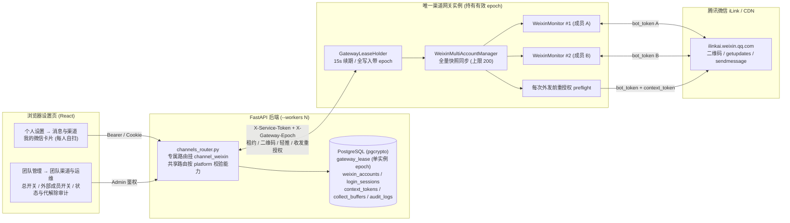

# 团队微信多账号（「每人扫自己的码」）设计方案

> **基线提交**：`34b353a0b`（已合入最新主分支独立核心运维脚本；Dalton 迁移链当前唯一头节点为 `d046`，链路 `d045 -> d047 -> d048 -> d046`，见 `src/dalton/migrations/versions/d046_scoped_data_map_cache.py:23-24`）  
> **文档轮次**：第 3 轮最终定案版（已合入全部拍板决策 D1～D9 与第 1～2 轮技术审查修订）  
> **架构定位**：严格对齐独立核心架构（`docs/dalton/features/standalone-core.md:8-42,64,243-246`）与第 ③ 阶段渠道网关插件化边界——每套部署固定运行 **1 个**渠道网关实例（由后端单行租约与单调 `epoch` 围栏保障单活）；后端以 `--workers N` 运行并掌管全部账号归属、加密凭据、网关租约、材料收集窗口、会话状态、审计日志与权限，网关仅作为纯内存协议适配器按后端契约存取状态与凭据。

---

## 0. 背景与架构边界

### 0.1 问题根因

微信 iLink（微信智能体机器人接入协议，ClawBot〔腾讯微信个人智能体机器人形态〕，`bot_type="3"`，见 `integrations/dalton-channel-gateway/src/channels/weixin/types.ts:10`）通过扫码创建的机器人属于**扫码微信号专属的一对一私聊通道**：只有扫码的那个微信号（`ilink_user_id`）能在微信聊天列表中看到该机器人并收发消息，群聊事件也在协议接入层直接归档拦截（`integrations/dalton-channel-gateway/src/channels/weixin/inbound.ts:147-167`、`src/dalton/database/channel_gateway.py:1601-1619`）。OpenClaw（开源多渠道智能体框架）社区方案同样采取每次扫码创建一个独立机器人账号、按账号与对端隔离会话的做法。

当前实现采用「全局单实例机器人 + 成员一次性绑定码」模型，在团队场景下仅扫码管理员一人可用：

1. **数据库单行约束**：`dalton_channel_weixin_state` 以 `singleton_id = 1` 固定保存全系统唯一一组 `ilink_bot_id` 与 `encrypted_bot_token`（`src/dalton/migrations/versions/d030_channel_gateway.py:256-265`、`src/dalton/migrations/versions/d032_weixin_state.py:23-42`、`src/dalton/database/channel_gateway.py:9795-10031`），另一位管理员扫码会覆盖原在线凭据。
2. **扫码接口限死管理员**：`/weixin/qrcode/start|wait|verify-code` 强制调用 `_require_weixin_admin`（`src/dalton/app/channels_router.py:1035-1039,1099-1157`）与数据库层 `get_user_tier(eff_owner) != "admin"` 校验（`src/dalton/database/channel_gateway.py:10092,10250,10397`）。
3. **网关单实例单账号内存状态**：`WeixinChannelAdapter` 仅维护单个 `this.account` 与单个 `WeixinMonitor` 长轮询协程（`integrations/dalton-channel-gateway/src/channels/weixin/index.ts:92-106,361-407`）。
4. **前端拆成管理员扫码与成员绑定码两套流程**：管理员在 `DaltonTeamOpsPanel`（`web/src/pages/Settings/panels/dalton/DaltonTeamOpsPanel.tsx:50`）使用 `DaltonWeixinBotCard`（`web/src/pages/Settings/panels/dalton/DaltonWeixinBotCard.tsx:39-44`）扫码，普通成员在 `IntegrationsPanel`（`web/src/pages/Settings/panels/IntegrationsPanel.tsx:43`）使用 `DaltonWeixinBindCard`（`web/src/pages/Settings/panels/dalton/DaltonWeixinBindCard.tsx:48-56`）生成 `/bind DLT-XXXX-XXXX` 绑定码，而微信端仅扫码本人拥有机器人会话窗口。

### 0.2 硬性架构约束与三层开关协同规则

1. **后端单一真值与多 worker 安全**：后端以 `--workers N` 多进程模式运行（`AGENTS.md:103`、`src/server/AGENTS.md:38-50`）。账号与成员映射、部署级单行网关租约（`dalton_channel_gateway_lease`）、二维码登录会话、加密后的 `bot_token` / `context_token` / 入站媒体解密材料、长轮询游标 `get_updates_buf`、显式材料收集缓冲、管理审计日志以及账号配置变更代际号 `accounts_revision` 全部持久化在后端 PostgreSQL（开源关系型数据库）自有 `dalton_*` 表中。
2. **每套部署固定运行 1 个无状态网关实例（部署级单一租约 + `epoch` 围栏）**：
   - Everflow 生产通过 macOS `launchd` 托管唯一 `com.dalton.channel-gateway` 守护进程（模板 `scripts/dalton/launchd/com.dalton.channel-gateway.plist.template:18-25`）；独立核心安装在网关进入核心发布包后于 Docker Compose 固定运行 1 个网关容器副本。
   - `integrations/dalton-channel-gateway/` 仅负责协议适配与微信 CDN（Content Delivery Network，内容分发网络）加解密，移除遗留本地目录配置 `weixinCacheDir`（`integrations/dalton-channel-gateway/src/config.ts:24,132-135,195`、`orchestrator.ts:163,180,190`、`server.ts:206`）。
   - 后端通过单行表 `dalton_channel_gateway_lease`（`instance_id`、`epoch`、`expires_at`）保证**任意时刻全系统最多只有 1 个网关进程持有有效 `epoch` 执行轮询、发送与启动恢复**；网关发出的全部写入类内部请求均携带 `epoch`，旧 `epoch` 一律被后端以 HTTP `409` 拒绝，旧进程收到拒绝后立即停止轮询并退出（详见 §2.1 与 §3.2）。
3. **统一配置读取、平台级能力门控与三层开关协同**：
   - 形态解析仅使用 `src.dalton.profile.resolve_profile`（`src/dalton/profile.py:37-96`），能力判定仅使用 `src.dalton.capabilities`（`src/dalton/capabilities.py:56,59,160-191,475-540`），前端统一使用 `useCapabilities()`（`web/src/hooks/useCapabilities.ts:24,129`）；触及上游共享源码的钩子统一标注 `DALTON-HOOK` 注释并受能力门控保护；行为配置（`weixin.allow_external`、`weixin.max_concurrent_accounts`）统一定义在 `src/dalton/settings.py`（合并 `dalton.yaml` 与 `dalton.core.yaml`，见 `src/dalton/settings.py:420-588`），运维脚本严格区分 Everflow 生产（`scripts/dalton/ops/prod/`）与核心安装（`scripts/standalone/`）。
   - **共享路由按实际平台检查子能力**：`/channels` 路由组顶层仅挂 `CapabilityId.CHANNEL_GATEWAY`（`src/dalton/app/channels_router.py:49-53`）；`I-1`～`I-7`、`/bindings`、`/settings`、`/bind-codes` 等共享入口在解析出请求或数据库记录所属平台后调用 `require_channel_platform_capability(platform)`（`src/dalton/capabilities.py:533-540`）或按激活能力裁剪微信字段，确保关闭 `channel_weixin` 时微信入口全部返回 HTTP `404` 且零字段暴露，同时飞书与 Discord 原样运行。
   - **网关是否执行微信长轮询由三层开关共同决定**（网关实例持有有效部署级租约且以下三层同为真时才启动 `WeixinMonitor`）：

| 开关层级 | 配置位置 | 作用域与变更方式 | 为 `false` 时的精确行为 |
|---|---|---|---|
| **第 1 层：网关适配器开关** | 网关环境变量 `DALTON_WEIXIN_ENABLED`（`integrations/dalton-channel-gateway/src/config.ts:212-216`，`mode === "outgoing"` 时固定为 `false`） | 网关进程静态开关 | 网关跳过初始化 `WeixinMultiAccountManager`，仅运行同进程已启用的飞书 / Discord 适配器，零 `/internal/weixin/*` 请求。 |
| **第 2 层：后端部署能力开关** | `DALTON_CAP_CHANNEL_WEIXIN` / `dalton.yaml` `capabilities.channel_weixin`（依赖 `channel_gateway`，`src/dalton/capabilities.py:185-191,325-424`） | 部署级静态能力（Core 默认关闭，Everflow 默认开启） | 后端全部 `/weixin/*` 路由返回 HTTP `404`，共享路由剔除微信数据；若网关误设 `DALTON_WEIXIN_ENABLED=true`，拉取账号列表收到 `404` 后立即停止本地全部微信轮询并进入每 `5 分钟` 静默探测，飞书 / Discord 照常运行。 |
| **第 3 层：数据库运行期总开关** | `dalton_channel_weixin_config.enabled`（管理员在设置页热切换） | 运行期热开关（默认 `TRUE`） | 后端暂停受理新扫码与微信外发授权，账号快照接口返回 `200` 且 `enabled: false, accounts: []`；网关立即中止全部 `WeixinMonitor` 并维持 15 秒心跳，数据库内既有凭据与游标原样保留，重新开启后免重扫自动恢复。 |

4. **停机迁移与简洁回退边界**：迁移 `d049_weixin_multi_account.py` 接在 `d046` 之后，仅操作 `dalton_*` 表；升级执行 `d049` 时后端与网关均处于停止状态（零并发写微信状态），从 `dalton_channel_weixin_state` 复制数据并清空明文 `login_qrcode` 后冻结旧表；`d049.downgrade()` 仅删除 `d049` 新增对象，使系统直接回到升级前的单账号状态（详见 §2.3 与 §6.3）。



---

## 1. 使用流程

### 1.1 团队成员个人操作流程（「个人设置 → 消息与渠道」）

当部署启用 `channel_weixin` 能力，且当前登录用户为在册团队成员（默认覆盖 `admin`、`internal`、`external`；当外部成员接入开关关闭时，对 `external` 成员隐藏卡片与搜索词）时，打开「设置 → 消息与渠道」（`web/src/pages/Settings/panels/IntegrationsPanel.tsx:29,43`，锚点 `#dalton-weixin-bind`，见 `web/src/pages/Settings/sections.ts:295`）可操作重构后的 **「我的微信」卡片**（`web/src/pages/Settings/panels/dalton/DaltonWeixinBindCard.tsx`）：

1. **首次扫码连接（每人限连 1 个微信号）**：
   - 成员点击「扫码连接个人微信」，调用 `POST /api/v1/dalton/channels/weixin/qrcode/start`。当系统当前活跃轮询账号数已达单网关并发上限（默认 `200`）时，直接返回容量已满提示；通过预检后向网关请求二维码，并在后端持有该成员用户锁时再次复核成员资格与运行开关后写入待扫会话，返回脱敏 `session_key` 与二维码图像（`qrcode_url` / `qrcode_img_content`）。
   - 前端沿用串行长轮询状态机（`web/src/pages/Settings/panels/dalton/DaltonWeixinBotCard.tsx:74-114`）调用 `GET /api/v1/dalton/channels/weixin/qrcode/wait?session_key=...`（网关对 iLink 单次长轮询最长约 `35s`，后端代理超时 `45s`，前端超时 `50s`；每次返回未终态后间隔 `1.2s` 发起下一轮）：
     - `wait`：展示二维码与提示「请用本人手机微信扫描二维码」；
     - `scaned`：提示「已扫码，请在手机微信上点击确认登录」（iLink `scaned_but_redirect` 经回写跨区域名后归一展示为 `scaned`）；
     - `verify_code`：风控要求手机端辅助验证码时展示输入框，提交 `POST /api/v1/dalton/channels/weixin/qrcode/verify-code`；
     - `confirmed`：后端在单事务内同时复核登录会话未撤销、当前账号状态、成员在册资格、渠道总开关与外部成员开关，并核查微信号占用：
       - 若该 `ilink_user_id` 已被团队内另一名在职成员（含 `active`、`expired` 或因外部成员开关关闭而暂停的账号）关联，拒绝确认并提示 **「该微信号已关联团队内另一账号，请先在原账号解除连接后再试」**；若原持有者已离开团队（名册判定为 `removed`），则按统一锁序安全释放旧记录并完成当前成员绑定；
       - 若确认响应包含 `ilink_user_id`，账号状态直接置为 **`active`（已连接）**，自动写入 `dalton_channel_identities` 与默认 `dalton_channel_user_settings.apps.weixin`；
       - 若确认响应缺少 `ilink_user_id`，账号状态置为 **`pending_verification`（已连接，待验证）**，待成员在微信发出首条消息回填 `ilink_user_id` 并通过唯一性核验后转为 `active`（若首条消息回填时发现与团队内他人微信号重复，自动解除该新连接并在微信回复原因）；
     - `expired`：超过 5 分钟有效期（TTL，Time-To-Live，存活有效期）、被新码取代或账号已被解除时展示「刷新二维码」按钮。
2. **查看连接与推送状态**：
   - 状态徽章展示五种明确状态：**已连接**（`active`，绿色）、**已连接，待验证**（`pending_verification`，蓝色，待首条消息核验微信号身份）、**登录已过期**（`expired`，黄色，对应 iLink `-14`）、**渠道已暂停**（总开关关闭或外部成员开关收紧）或 **待连接**（`unconfigured`）。
   - 已连接状态下展示微信昵称 `ilink_username`、末 4 位掩码 `ilink_user_id`（如 `****a1b2`）、更新时间 `updated_at`、最近收信时间 `last_inbound_at`、**主动推送激活状态**，以及常驻可见的「聊天记录转发指引」（说明使用 `/collect` 逐条转发收集或发送长截图）。
3. **重新扫码（过期续期或更换微信号，替换原连接）**：
   - 二维码等待期间独立保存在 `dalton_channel_weixin_login_sessions` 表中，原在线连接在手机确认新码前保持正常收发；确认新码后原子递增 `bot_generation`、替换加密凭据与 `base_url`、清理旧代际 `context_token`：
     - **同一微信号重扫续期（`ilink_user_id` 相同）**：保持 `scope_key = 'dm:<ilink_user_id>'` 与会话代数 `generation` 不变，延续原对话线程与工作区选择；
     - **更换另一微信号（`ilink_user_id` 变化）**：替换原连接，推进会话 `generation + 1`、清空工作区覆盖与待决中断、关闭旧监听，开启新线程。
4. **本人解除连接**：
   - 成员在设置页点击「解除连接」二次确认（`DELETE /api/v1/dalton/channels/bindings/weixin`）或在微信发送 `/unbind`。
   - 后端单事务物理删除 `dalton_channel_weixin_accounts` 记录（彻底释放该微信号占用，级联清理 `context_token` 与收集缓冲）、作废该成员所有待扫 `login_sessions`、删除 `dalton_channel_identities (user_id, 'weixin')`、移除 `apps.weixin`、推进会话 `generation + 1`、关闭活跃 `thread_watches`、按固定默认文案写入 `dalton_channel_weixin_audit_logs` 并递增 `accounts_revision`，通知网关立即终止轮询。

### 1.2 管理员视图与管理权限（「团队管理 → 团队渠道与运维」）

管理员打开「设置 → 团队管理 → 团队渠道与运维」（`web/src/pages/Settings/panels/dalton/DaltonTeamOpsPanel.tsx:50`，重构 `DaltonWeixinBotCard.tsx` 为 **「团队微信渠道管理」卡片**，仅 `callerTier === 'admin'` 可见，见 `web/src/pages/Settings/sections.ts:309`）：

1. **渠道运行期总开关与外部成员接入开关**：
   - **「启用团队个人微信接入」总开关**（`dalton_channel_weixin_config.enabled`，默认开启）：关闭后暂停新扫码与外发，网关停止全部微信长轮询，数据库保留凭据与游标；重开后免重扫按原游标恢复。
   - **「允许外部受邀成员（`external`）连接个人微信」开关**（默认开启）：关闭后隐藏 `external` 成员微信入口、拦截其扫码与收发，并将已绑定的 `external` 成员账号置为暂停态（`status = 'disabled', disabled_reason = 'external_access_disabled'`，保留微信号占用，重开开关后自动恢复）。
   - 顶部提供「去管理我自己的个人微信 →」跳转链接（`#dalton-weixin-bind`）。
2. **成员状态总览与单实例容量监控**：
   - 顶部统计栏展示：`在线轮询账号数 / 已连接总数`、`待验证 / 已过期数`、`单网关实例轮询槽位（当前活跃 / 上限 200）`。
   - 列表展示已绑定账号成员及当前持有待扫二维码会话的成员：姓名与邮箱、层级（`admin` / `internal` / `external`）、**微信昵称 `ilink_username` 与末 4 位掩码 `ilink_user_id`**、状态（`已连接` / `已连接，待验证` / `扫码等待中` / `登录已过期` / `外部暂停` / `离职已停用`）、最近收信时间 `last_inbound_at` 与更新时间 `updated_at`。
3. **管理员随时代任意成员解除或撤销待扫会话（二次确认 + 预设原因落表审计）**：
   - 对已有账号行提供「代为解除」（调用 `DELETE /weixin/admin/accounts/{account_id}`），对尚无账号行但处于「扫码等待中」的成员及按成员操作统一提供按成员撤销入口（`DELETE /weixin/admin/users/{target_user_id}/weixin`）。
   - 二次确认弹窗要求选择预设原因（`离职交接` / `手机遗失应急` / `误绑微信号` / `其他原因`，支持附加说明），在同一数据库事务内物理删除微信账号（释放微信号）、作废待扫二维码、关闭监听并写入 **`dalton_channel_weixin_audit_logs`**（完整记录操作人、目标成员、时间、原因）。

### 1.3 扫码后微信侧呈现与开始对话方式

1. **微信端表现**：手机微信确认扫码后，聊天列表立即新增该 **ClawBot 机器人**的一对一私聊窗口。
2. **首条带令牌消息激活推送（与待验证身份核验）**：iLink `get_qrcode_status` 返回 `bot_token`、`ilink_bot_id`、`baseurl` 及可选的 `ilink_user_id`（`integrations/dalton-channel-gateway/src/channels/weixin/types.ts:217-228`），而出站 `sendmessage` 强制要求非空 `context_token`（`send.ts:209-218,281-290`），该字段随入站 `WeixinMessage.context_token`（可选字段，`types.ts:147`）下发。扫码成功页常驻展示引导：**「请打开手机微信，向机器人发送一句话（如『你好』或 `/workspace`），收到携带会话令牌的消息后即可激活主动推送。如需转发聊天记录分析，可发 `/collect` 开启逐条收集（转完发 `/done`），或直接发送聊天长截图。」**
3. **支持的消息类型与指令全集**：
   - **入站已支持**（`integrations/dalton-channel-gateway/src/channels/weixin/inbound.ts:185-212,332-449`）：文字、引用消息、开启微信语音转文字的语音、图片（`IMAGE`）、文档文件（`FILE`）及视频（`VIDEO`，下载解密为工作区 `.mp4` 文件）。
   - **出站已支持**（`integrations/dalton-channel-gateway/src/channels/weixin/send.ts:227-240,299-386`）：经 `filterWeixinMarkdown` 清洗的分段纯文本（`TEXT`）、经魔数校验的图片气泡（`IMAGE`）及通用文件气泡（`FILE`，承载 PDF〔Portable Document Format，便携式文档格式〕、Office、CSV〔Comma-Separated Values，逗号分隔值表格〕等各类非图片附件）。
   - **斜杠指令全集**：`/workspace`、`/<工作区名称>`、`/main`、`/new`、`/stop`、`/unbind`，以及新增的 `/collect`（别名 `/收集`）、`/done`（别名 `/完成`）、`/cancel`（别名 `/取消`）与 `/help`（常驻查看使用与转发说明）。

---

## 2. 数据模型与迁移

### 2.1 多账号表结构设计（迁移 `d049_weixin_multi_account.py`）

新增 Alembic（数据库表结构版本迁移工具）脚本 `src/dalton/migrations/versions/d049_weixin_multi_account.py`（`revision = "d049"`，`down_revision = "d046"`），仅操作 `dalton_*` 表，每个 DDL（Data Definition Language，数据定义语言）步骤开头执行 `SET LOCAL lock_timeout = '5s'`（对齐 `src/dalton/migrations/versions/d046_scoped_data_map_cache.py:30`）：

#### （1）部署级单一网关实例租约表 `dalton_channel_gateway_lease`

```sql
CREATE TABLE IF NOT EXISTS dalton_channel_gateway_lease (
    singleton_id SMALLINT PRIMARY KEY DEFAULT 1 CHECK (singleton_id = 1),
    instance_id  VARCHAR(128) NOT NULL,               -- 当前持有租约的唯一网关进程 ID
    epoch        BIGINT NOT NULL DEFAULT 1,           -- 每次新实例接管单调 +1，全写入接口强制校验
    acquired_at  TIMESTAMPTZ NOT NULL DEFAULT NOW(),
    expires_at   TIMESTAMPTZ NOT NULL,                -- 租约到期时间（45s TTL，15s 心跳续期）
    updated_at   TIMESTAMPTZ NOT NULL DEFAULT NOW()
);
```

#### （2）团队微信运行期配置表 `dalton_channel_weixin_config`

```sql
CREATE TABLE IF NOT EXISTS dalton_channel_weixin_config (
    singleton_id      SMALLINT PRIMARY KEY DEFAULT 1 CHECK (singleton_id = 1),
    enabled           BOOLEAN NOT NULL DEFAULT TRUE,  -- 管理员运行期渠道总开关
    allow_external    BOOLEAN,                        -- 非空时覆盖 settings.py 的 weixin.allow_external
    accounts_revision BIGINT NOT NULL DEFAULT 1,      -- 账号/开关每次变更在事务最末尾单调 +1
    updated_by        VARCHAR(255),
    updated_at        TIMESTAMPTZ NOT NULL DEFAULT NOW()
);
```

#### （3）个人微信多账号凭据与游标主表 `dalton_channel_weixin_accounts`

```sql
CREATE TABLE IF NOT EXISTS dalton_channel_weixin_accounts (
    account_id          UUID PRIMARY KEY DEFAULT gen_random_uuid(), -- UUID（Universally Unique Identifier，通用唯一识别码）
    user_id             VARCHAR(255) NOT NULL UNIQUE                -- 每人限连 1 个微信号
                        CHECK (user_id <> 'system:dalton-company'),
    ilink_bot_id        VARCHAR(255) NOT NULL UNIQUE,               -- iLink 机器人唯一标识
    ilink_user_id       VARCHAR(255),                               -- 扫码微信号 iLink 用户 ID（待验证阶段可为空）
    prev_ilink_user_id  VARCHAR(255),                               -- 上一次已核验的微信号 ID（供待验证首包判断是否换号）
    ilink_username      VARCHAR(255),                               -- 扫码微信号昵称
    encrypted_bot_token BYTEA NOT NULL,                             -- pgp_sym_encrypt(bot_token, get_encryption_key())
    base_url            VARCHAR(512) NOT NULL DEFAULT 'https://ilinkai.weixin.qq.com',
    cdn_base_url        VARCHAR(512) NOT NULL DEFAULT 'https://novac2c.cdn.weixin.qq.com/c2c',
    get_updates_buf     TEXT NOT NULL DEFAULT '',                   -- 该账号独立 getupdates 长轮询游标
    status              VARCHAR(32) NOT NULL DEFAULT 'active'
                        CHECK (status IN ('active', 'pending_verification', 'expired', 'disabled')),
    disabled_reason     VARCHAR(64)                                 -- 仅 status='disabled' 时非空
                        CHECK (disabled_reason IS NULL OR disabled_reason IN ('member_not_in_roster', 'external_access_disabled')),
    bot_generation      BIGINT NOT NULL DEFAULT 1,                  -- 账号内重登代际号
    last_inbound_at     TIMESTAMPTZ,
    last_error_code     VARCHAR(64),
    last_error_at       TIMESTAMPTZ,
    created_at          TIMESTAMPTZ NOT NULL DEFAULT NOW(),
    updated_at          TIMESTAMPTZ NOT NULL DEFAULT NOW()
);

-- 微信号占用与释放唯一索引（D6）：
-- 在职连接（active / pending_verification / expired）及「外部成员开关关闭」暂停（external_access_disabled）保留微信号占用；
-- 本人解除、管理员代解除（直接删除行）与离开团队（disabled_reason = 'member_not_in_roster'）释放微信号占用。
CREATE UNIQUE INDEX IF NOT EXISTS idx_dalton_wx_accounts_ilink_user_occupied
    ON dalton_channel_weixin_accounts (ilink_user_id)
    WHERE ilink_user_id IS NOT NULL
      AND (status IN ('active', 'pending_verification', 'expired') OR disabled_reason = 'external_access_disabled');

CREATE INDEX IF NOT EXISTS idx_dalton_wx_accounts_status
    ON dalton_channel_weixin_accounts (status, updated_at DESC);
```

#### （4）二维码登录会话表 `dalton_channel_weixin_login_sessions`

```sql
CREATE TABLE IF NOT EXISTS dalton_channel_weixin_login_sessions (
    session_key             VARCHAR(255) PRIMARY KEY,
    user_id                 VARCHAR(255) NOT NULL CHECK (user_id <> 'system:dalton-company'),
    target_account_id       UUID REFERENCES dalton_channel_weixin_accounts(account_id) ON DELETE SET NULL,
    login_version           BIGINT NOT NULL DEFAULT 1,       -- 会话中间态与跨区域名更新 CAS（Compare-And-Swap，比较并交换）版本号
    expected_bot_generation BIGINT,                          -- 发起重登时原账号的 bot_generation（首次扫码为 NULL）
    status                  VARCHAR(64) NOT NULL DEFAULT 'wait'
                            CHECK (status IN ('wait', 'scaned', 'verify_code', 'confirmed', 'expired', 'superseded')),
    encrypted_qrcode        BYTEA NOT NULL,                  -- pgp_sym_encrypt(qrcode, get_encryption_key())
    qrcode_img_content      TEXT,                            -- 仅在 wait/scaned/verify_code 保留，终态立即置 NULL
    redirect_base_url       VARCHAR(512) NOT NULL DEFAULT 'https://ilinkai.weixin.qq.com',
    expires_at              TIMESTAMPTZ NOT NULL,
    confirmed_result        JSONB,                           -- 严格限 5 字段白名单: {account_id, connected, already_connected, bot_generation, accounts_revision}
    created_at              TIMESTAMPTZ NOT NULL DEFAULT NOW(),
    updated_at              TIMESTAMPTZ NOT NULL DEFAULT NOW()
);

CREATE UNIQUE INDEX IF NOT EXISTS uq_dalton_wx_login_sessions_user_pending
    ON dalton_channel_weixin_login_sessions (user_id)
    WHERE status IN ('wait', 'scaned', 'verify_code');
```

#### （5）`context_token` 表与热表扩展（外键采用 `NOT VALID` + 独立校验）

所有向既有业务表新增的外键均分两步执行：第一步在 `SET LOCAL lock_timeout = '5s'` 下以 `ADD CONSTRAINT ... NOT VALID` 瞬时添加，第二步在独立语句中执行 `VALIDATE CONSTRAINT ...`（仅持 `SHARE UPDATE EXCLUSIVE` 弱锁，避免全表强锁）：

```sql
ALTER TABLE dalton_channel_weixin_context_tokens
    ADD COLUMN IF NOT EXISTS account_id UUID,
    ADD COLUMN IF NOT EXISTS token_version BIGINT NOT NULL DEFAULT 1,
    ADD COLUMN IF NOT EXISTS stale_at TIMESTAMPTZ,
    ADD COLUMN IF NOT EXISTS stale_reason VARCHAR(64);

ALTER TABLE dalton_channel_weixin_context_tokens
    ADD CONSTRAINT fk_dalton_wx_ctx_tokens_account
    FOREIGN KEY (account_id) REFERENCES dalton_channel_weixin_accounts(account_id)
    ON DELETE CASCADE NOT VALID;

CREATE INDEX IF NOT EXISTS idx_dalton_wx_ctx_tokens_account
    ON dalton_channel_weixin_context_tokens (account_id, bot_generation);

ALTER TABLE dalton_channel_identities
    ADD COLUMN IF NOT EXISTS weixin_account_id UUID;

ALTER TABLE dalton_channel_identities
    ADD CONSTRAINT fk_dalton_identities_wx_account
    FOREIGN KEY (weixin_account_id) REFERENCES dalton_channel_weixin_accounts(account_id)
    ON DELETE SET NULL NOT VALID;

ALTER TABLE dalton_channel_inbound_events
    ADD COLUMN IF NOT EXISTS weixin_account_id UUID,
    ADD COLUMN IF NOT EXISTS encrypted_weixin_media_meta BYTEA; -- 加密保存微信附件 CDN 参数与 AES 密钥

ALTER TABLE dalton_channel_inbound_events
    ADD CONSTRAINT fk_dalton_inbound_wx_account
    FOREIGN KEY (weixin_account_id) REFERENCES dalton_channel_weixin_accounts(account_id)
    ON DELETE SET NULL NOT VALID;

ALTER TABLE dalton_channel_thread_watches
    ADD COLUMN IF NOT EXISTS weixin_account_id UUID;

ALTER TABLE dalton_channel_thread_watches
    ADD CONSTRAINT fk_dalton_watches_wx_account
    FOREIGN KEY (weixin_account_id) REFERENCES dalton_channel_weixin_accounts(account_id)
    ON DELETE SET NULL NOT VALID;

ALTER TABLE dalton_channel_background_runs
    ADD COLUMN IF NOT EXISTS weixin_account_id UUID;

ALTER TABLE dalton_channel_background_runs
    ADD CONSTRAINT fk_dalton_bg_runs_wx_account
    FOREIGN KEY (weixin_account_id) REFERENCES dalton_channel_weixin_accounts(account_id)
    ON DELETE SET NULL NOT VALID;

ALTER TABLE dalton_channel_deliveries
    ADD COLUMN IF NOT EXISTS weixin_account_id UUID,
    ADD COLUMN IF NOT EXISTS weixin_bot_id VARCHAR(255),
    ADD COLUMN IF NOT EXISTS weixin_bot_generation BIGINT,
    ADD COLUMN IF NOT EXISTS weixin_recipient_id VARCHAR(255); -- 持久化实际收件 ilink_user_id

ALTER TABLE dalton_channel_deliveries
    ADD CONSTRAINT fk_dalton_deliveries_wx_account
    FOREIGN KEY (weixin_account_id) REFERENCES dalton_channel_weixin_accounts(account_id)
    ON DELETE SET NULL NOT VALID;

-- 数据回填完成后逐条执行低锁校验：
-- ALTER TABLE <table_name> VALIDATE CONSTRAINT <fk_name>;
```

#### （6）微信渠道管理与解绑审计表 `dalton_channel_weixin_audit_logs`

审计表保存当时的账号与掩码快照，无级联删除外键，账号物理删除后审计记录完整保留；每种 `action` 均规定非空默认 `reason` 文案（见 §4.3）：

```sql
CREATE TABLE IF NOT EXISTS dalton_channel_weixin_audit_logs (
    audit_id             UUID PRIMARY KEY DEFAULT gen_random_uuid(),
    action               VARCHAR(64) NOT NULL,  -- 'admin_unbind' | 'member_unbind' | 'admin_toggle_channel' | 'admin_toggle_external' | 'member_removed_revoke' | 'member_reinstated_restore' | 'disabled_account_reclaimed' | 'conflict_auto_unbound'
    operator_user_id     VARCHAR(255) NOT NULL, -- 操作人 user_id（后台自动对账写 'system:roster-reconciler'）
    target_user_id       VARCHAR(255),          -- 目标成员 user_id
    weixin_account_id    UUID,
    ilink_bot_id         VARCHAR(255),
    masked_ilink_user_id VARCHAR(32),           -- 仅保存末 4 位掩码（如 '****a1b2'）
    reason               TEXT NOT NULL,         -- 非空原因（<= 500 字符）
    metadata             JSONB NOT NULL DEFAULT '{}'::jsonb,
    created_at           TIMESTAMPTZ NOT NULL DEFAULT NOW()
);

CREATE INDEX IF NOT EXISTS idx_dalton_wx_audit_logs_target_time
    ON dalton_channel_weixin_audit_logs (target_user_id, created_at DESC);

CREATE INDEX IF NOT EXISTS idx_dalton_wx_audit_logs_time
    ON dalton_channel_weixin_audit_logs (created_at DESC);
```

#### （7）逐条转发材料收集表（含附件分步上传状态跟踪）

```sql
CREATE TABLE IF NOT EXISTS dalton_channel_weixin_collect_buffers (
    buffer_id           UUID PRIMARY KEY DEFAULT gen_random_uuid(),
    account_id          UUID NOT NULL REFERENCES dalton_channel_weixin_accounts(account_id) ON DELETE CASCADE,
    bot_generation      BIGINT NOT NULL,
    dalton_user_id      VARCHAR(255) NOT NULL,
    scope_key           VARCHAR(255) NOT NULL,
    session_generation  INTEGER NOT NULL,
    workspace_id        UUID NOT NULL,          -- 无覆盖工作区时锁存 get_home_workspace_id(dalton_user_id)
    initial_prompt      TEXT NOT NULL DEFAULT '',
    status              VARCHAR(32) NOT NULL DEFAULT 'collecting'
                        CHECK (status IN ('collecting', 'flushing', 'completed', 'cancelled', 'expired')),
    item_count          INTEGER NOT NULL DEFAULT 0,
    total_text_chars    INTEGER NOT NULL DEFAULT 0,
    attachment_count    INTEGER NOT NULL DEFAULT 0,
    expires_at          TIMESTAMPTZ NOT NULL,
    max_expires_at      TIMESTAMPTZ NOT NULL,
    flushed_message_id  VARCHAR(255),
    created_at          TIMESTAMPTZ NOT NULL DEFAULT NOW(),
    updated_at          TIMESTAMPTZ NOT NULL DEFAULT NOW()
);

CREATE UNIQUE INDEX IF NOT EXISTS uq_dalton_wx_collect_active
    ON dalton_channel_weixin_collect_buffers (account_id, bot_generation, scope_key, session_generation)
    WHERE status IN ('collecting', 'flushing');

CREATE TABLE IF NOT EXISTS dalton_channel_weixin_collect_items (
    buffer_id                 UUID NOT NULL REFERENCES dalton_channel_weixin_collect_buffers(buffer_id) ON DELETE CASCADE,
    message_id                VARCHAR(255) NOT NULL,
    protocol_seq              BIGINT,
    platform_time_ms          BIGINT,
    receive_order             INTEGER NOT NULL,
    text_content              TEXT NOT NULL DEFAULT '',
    expected_attachment_count INTEGER NOT NULL DEFAULT 0,
    upload_status             VARCHAR(32) NOT NULL DEFAULT 'ready'
                              CHECK (upload_status IN ('pending_upload', 'ready', 'failed')),
    uploaded_attachments      JSONB NOT NULL DEFAULT '[]'::jsonb,
    upload_error              TEXT,
    created_at                TIMESTAMPTZ NOT NULL DEFAULT NOW(),
    updated_at                TIMESTAMPTZ NOT NULL DEFAULT NOW(),
    PRIMARY KEY (buffer_id, message_id)
);
```

#### （8）全局统一事务加锁顺序与跨成员接管/恢复两阶段加锁规程

所有跨表事务严格遵守以下单向递增锁层级（继承并对齐 `src/dalton/database/channel_gateway.py:6-14` 与 `src/dalton/auth/roles.py:206-220`）：

- **Level 0a（角色表锁，仅本地角色增删改事务涉及）**：`dalton_user_roles`（按 `user_id` 升序 `FOR UPDATE`）→ `dalton_credential_holder`（`singleton_id = 1 FOR SHARE`）。
- **Level 0b（网关单实例 `epoch` 校验与单消息 / 单投递幂等咨询锁）**：读取 `dalton_channel_gateway_lease` 核对当前有效 `epoch`（仅网关租约申请/续期/释放接口单独取 `FOR UPDATE`）→ `pg_advisory_xact_lock(hashtext('dalton_inbound:<platform>:<message_id>'))` / `dalton_delivery:<delivery_key>`。
- **Level 1（用户级门闩咨询锁与个人设置行锁——首次扫码无账号行时的锁定对象）**：`pg_advisory_xact_lock(hashtext('dalton_user_settings:' || user_id))` +（修改频道设置时）`dalton_channel_user_settings FOR UPDATE`，**涉及多名成员时严格按 `user_id` 字典序升序加锁**（`src/dalton/database/channel_gateway.py:219-235`）。
- **Level 2（群聊咨询锁，飞书 / Discord 群事务保留）**：`_acquire_group_chat_lock`（按平台与群地址升序）。
- **Level 3（微信账号行锁与微信号唯一性咨询锁）**：
  - **3a**：`dalton_channel_weixin_accounts`（**涉及多个账号时严格按 `account_id` 升序加锁**：确认、重登、接管、解绑、停用/恢复取 `FOR UPDATE`；入站 `I-1`/`I-3`、游标提交 `/cursor`、状态上报 `/status` 取 `FOR NO KEY UPDATE`，消除锁升级死锁；只读校验取 `FOR SHARE` 或无锁快照）；
  - **3b**：`pg_advisory_xact_lock(hashtext('dalton_weixin_bot:' || ilink_bot_id))` →（当 `ilink_user_id` 非空时）`pg_advisory_xact_lock(hashtext('dalton_weixin_ilink_user:' || ilink_user_id))`。
- **Level 4（二维码登录会话行锁）**：`dalton_channel_weixin_login_sessions FOR UPDATE`（按 `session_key` 升序）。
- **Level 5（微信 `context_token` 发送方咨询锁与行锁）**：`dalton_weixin_context:<bot>:<gen>:<sender>`（按三元组升序）→ `dalton_channel_weixin_context_tokens FOR UPDATE`。
- **Level 6（绑定、身份、会话代数与收集缓冲行锁）**：`dalton_channel_chat_bindings` → `dalton_channel_identities FOR UPDATE` → `dalton_channel_session_generations FOR UPDATE`（按主键升序）→ `dalton_channel_weixin_collect_buffers` / `collect_items FOR UPDATE`。
- **Level 7（事件、监听、后台运行、投递行锁与审计表插入）**：`dalton_channel_inbound_events` → `dalton_channel_thread_watches` → `dalton_channel_background_runs` → `dalton_channel_deliveries`（`FOR UPDATE`）→ `INSERT INTO dalton_channel_weixin_audit_logs`。
- **Level 8（微信全局配置单行锁——固定为事务最后一步）**：`UPDATE dalton_channel_weixin_config ... WHERE singleton_id = 1 RETURNING accounts_revision`。

**接管已停用账号与自动恢复的统一两阶段加锁协议（D5）**：
当扫码 `confirm`、首条消息身份回填或名册对账**自动恢复**涉及跨成员微信号核查（可能删除离职成员 `disabled_reason = 'member_not_in_roster'` 的旧账号行，或与原持有人同时重扫/恢复竞争）时，统一执行以下步骤（复用 `_run_tx_with_retry` + `_WeixinSettingsLockSetChanged` 重试机制，见 `src/dalton/database/channel_gateway.py:158-165,286-320`）：
1. **无锁预发现**：无锁查询当前匹配目标 `user_id`、`ilink_user_id`、`ilink_bot_id` 的全部 `dalton_channel_weixin_accounts` 行与 `dalton_channel_identities` 行，汇总全部受影响的 `affected_user_ids` 与 `affected_account_ids`；
2. **按 `user_id` 升序加 Level 1 用户设置锁**：锁定排序后的全部 `affected_user_ids`；
3. **按 `account_id` 升序加 Level 3a 账号排他行锁**：`SELECT * FROM dalton_channel_weixin_accounts WHERE account_id = ANY(%s) ORDER BY account_id ASC FOR UPDATE`；
4. **加 Level 3b 微信号咨询锁并重新核验集合**：获取 `ilink_bot_id` 与 `ilink_user_id` 咨询锁后，再次查询匹配该 `user_id` / `ilink_user_id` / `ilink_bot_id` 的全部账号行与身份行——若发现新出现的用户或账号不在已锁集合内，立即抛出 `_WeixinSettingsLockSetChanged` 回滚事务并按扩大后的集合从第 1 步重新执行；集合一致后在锁内安全执行接管删除或自动恢复，彻底消除逆序死锁。

### 2.2 现有单行表存量数据迁移与精确历史回填

`d049.upgrade()` 在后端与网关均已停止的静默窗口内执行：

1. **初始化配置表**：插入 `dalton_channel_weixin_config (singleton_id = 1, enabled = TRUE, accounts_revision = 1)`。
2. **擦除旧表明文扫码票据并冻结旧表**：执行 `UPDATE dalton_channel_weixin_state SET login_qrcode = NULL, login_qrcode_img_content = NULL, login_session_key = NULL, login_status = NULL, login_confirmed_result = NULL WHERE singleton_id = 1`；其余列（原管理员凭据、游标、代际等）**原封保留在 `dalton_channel_weixin_state` 中作为升级前快照，新代码不再读写该表**。
3. **原管理员账号复制入新表**：若 `dalton_channel_weixin_state (singleton_id = 1)` 含有效凭据（`ilink_bot_id IS NOT NULL AND encrypted_bot_token IS NOT NULL AND owner_user_id IS NOT NULL AND owner_user_id <> 'system:dalton-company'`）：
   - 确定有效微信号 `eff_ilink_user_id`：优先取 `dalton_channel_weixin_state.ilink_user_id`；若为空，仅当 `dalton_channel_identities (owner_user_id, 'weixin')` 的 `platform_user_id` 在 `dalton_channel_weixin_context_tokens` 存在同 `ilink_bot_id` 记录时取用，否则为 `NULL`；
   - 插入 `dalton_channel_weixin_accounts`（生成 `new_account_id`；当 `eff_ilink_user_id` 为空且原状态为活跃时置 `status = 'pending_verification'`，过期态归一为 `'expired'`，其余活跃态为 `'active'`）；
   - 删除 `dalton_channel_identities` 中 `platform = 'weixin'` 且无对应 `dalton_channel_weixin_accounts`（或曾借用同一 `eff_ilink_user_id` 的非属主成员）的孤立行；当 `eff_ilink_user_id` 非空时，确保 `(owner_user_id, 'weixin')` 指向 `eff_ilink_user_id` 且关联 `weixin_account_id = new_account_id`；将 `dalton_channel_bind_codes` 中未使用的微信绑定码标为 `used_at = NOW(), revoked_reason = 'migrated_to_qr_login'`。
4. **逐类精确回填运行态与历史记录（按原记录实际来源回填，保持已有会话不换线程）**：
   - **① 私聊会话键与运行态（`dalton_channel_session_generations`）**：微信私聊继续采用 `scope_key = 'dm:<ilink_user_id>'` 与 `external_thread_id = 'weixin:dm:<ilink_user_id>:gen:<generation>'`（`src/dalton/database/channel_gateway.py:360-375`、`inbound.ts:472`）。原管理员的 `generation`、`override_workspace_id`、`pending_interrupt` 原样保留，升级后直接在原线程续聊；其余孤立成员微信会话行推进 `generation = generation + 1` 并清空覆盖工作区与待处理中断。
   - **② 上下文令牌（`dalton_channel_weixin_context_tokens`）**：按 `ilink_bot_id = account.ilink_bot_id`（且当 `eff_ilink_user_id` 非空时 `platform_user_id = eff_ilink_user_id`）回填 `account_id = new_account_id`，取 `MAX(updated_at)` 回填 `last_inbound_at`，清理其余孤立微信令牌。
   - **③ 入站事件（`dalton_channel_inbound_events`）**：严格按原事件实际属性回填——仅对 `platform = 'weixin'` 且 `COALESCE(weixin_context_bot_id, raw_payload->>'ilink_bot_id') = account.ilink_bot_id` **且**（`eff_ilink_user_id IS NULL` 或 `raw_payload->>'platform_user_id' = eff_ilink_user_id`）的记录回填 `weixin_account_id = new_account_id`，保留原行的 `weixin_context_bot_generation` 与 `session_generation`；未完成事件中的 `raw_payload.weixin_attachments` 加密迁入 `encrypted_weixin_media_meta`，再统一剥离全表 `raw_payload` 中的明文 AES 密钥与 CDN 下载参数；无主孤立未完成微信事件收敛为 `status = 'ignored', fallback_pending = FALSE`。
   - **④ 线程监听与后台唤醒（`dalton_channel_thread_watches` / `dalton_channel_background_runs`）**：对 `platform = 'weixin' AND dalton_user_id = owner_user_id`（且 `scope_key = 'dm:' || eff_ilink_user_id`）回填 `weixin_account_id = new_account_id`；其余孤立微信监听置 `watch_active = FALSE`、后台运行置 `fallback_pending = FALSE`。
   - **⑤ 历史与在途投递（`dalton_channel_deliveries`，D8）**：按每条投递关联的源事件（通过 `run_id` / `thread_id` 反查 `dalton_channel_inbound_events`）精确提取当时的 `(weixin_context_bot_id, weixin_context_bot_generation, raw_payload->>'platform_user_id')` 回填至 `weixin_bot_id`、`weixin_bot_generation` 与 `weixin_recipient_id`（若 `target_address` 形如 `weixin:user:<id>` 则直接取 `<id>` 为 `weixin_recipient_id`），仅当其 `weixin_bot_id = account.ilink_bot_id` 且收件人与 `eff_ilink_user_id` 一致时回填 `weixin_account_id = new_account_id`；无源代际可查的纯历史已完成行保持 `weixin_bot_generation = NULL`，保留真实历史来源。
5. **外键校验收尾**：依次对 §2.1 (5) 的 6 条 `NOT VALID` 外键执行 `VALIDATE CONSTRAINT`。

### 2.3 降级回退规程与未来旧表清理规则（D2）

1. **`d049.downgrade()` 只删新增对象，不写旧表**：
   - 降级必须在**后端与网关均已停止**的静默窗口内执行（需要保留新审计日志时先将 `dalton_channel_weixin_audit_logs` 导出为 JSONL〔JSON Lines，按行分隔的 JSON 文本格式〕文件）。
   - `d049.downgrade()` 在 `SET LOCAL lock_timeout = '5s'` 下仅按逆序删除 `d049` 新增的 6 条外键约束、新增列与 7 张新表（`collect_items`、`collect_buffers`、`login_sessions`、`audit_logs`、`weixin_accounts`、`weixin_config`、`gateway_lease`），**不对 `dalton_channel_weixin_state` 执行任何写操作**。
2. **回退后的明确系统状态与后果**：
   - 切回上一版本后端与网关镜像启动后，系统直接回到**升级前冻结在 `dalton_channel_weixin_state` 中的单账号状态**：
     - 原管理员微信机器人使用升级前保存的游标与令牌（游标可能落后于升级期间已收到的消息；若升级期间原管理员重新扫过码使旧令牌失效，在旧管理页重新扫码一次即可恢复）；
     - 升级后新扫码连接的其他成员微信账号随新表删除而移除（若再次升级多账号版本，各成员重新扫码连接即可）；
     - 如需在极端故障下连同升级前旧绑定码记录百分百精确还原至升级前一秒状态，直接使用升级前已落盘的全量数据库备份恢复（Everflow 用 `pg_restore`，核心安装用 `scripts/standalone/restore.sh`）。
3. **旧表未来移除规则**：
   - `dalton_channel_weixin_state` 在多账号方案线上稳定运行一段时间后，由后续单独的清理迁移执行 `DROP TABLE IF EXISTS dalton_channel_weixin_state`；**该清理迁移的 `downgrade()` 直接抛出 `RuntimeError("dalton_channel_weixin_state was permanently dropped after multi-account stabilization; downgrading past this revision is not supported.")` 并说明原因**。

---

## 3. 网关与后端契约

### 3.1 接口总览与共享路由按平台能力门控

#### （1）网关与后端内部契约表（挂于 `/api/v1/dalton/channels/internal/*`，鉴权 `X-Service-Token`）

所有写入类接口及 `recover` 均要求请求头 `X-Gateway-Epoch: <epoch>`（或请求体 `gateway_epoch`）与 `dalton_channel_gateway_lease` 当前有效 `epoch` 一致，过期或失配一律返回 HTTP `409`（`code: "stale_gateway_epoch"`）：

| 方向 | 方法与路由 | 能力守卫 | 关键请求字段 | 关键响应字段 |
|---|---|---|---|---|
| 网关 → 后端 | `POST .../gateway-lease/acquire` | `CHANNEL_GATEWAY` | `{instance_id, ttl_seconds: 45}` | `{granted: true\|false, epoch, expires_at?, retry_after_ms?}` |
| 网关 → 后端 | `POST .../gateway-lease/heartbeat` | `CHANNEL_GATEWAY` | `{instance_id, epoch, ttl_seconds: 45}` | `{ok: true, epoch, expires_at}`（失租返回 `409`） |
| 网关 → 后端 | `POST .../gateway-lease/release` | `CHANNEL_GATEWAY` | `{instance_id, epoch}` | `{ok: true, released: true\|false}` |
| 网关 → 后端 | `POST .../weixin/accounts/reconcile` | `CHANNEL_GATEWAY` + `CHANNEL_WEIXIN` | 请求头 `X-Gateway-Epoch` + `{since_revision?}` | `{changed, enabled, allow_external, max_concurrent_accounts, accounts_revision, accounts: [{account_id, user_id, ilink_bot_id, ilink_user_id, bot_token, base_url, cdn_base_url, get_updates_buf, bot_generation, status}]}`（`changed: true` 时固定为全量快照） |
| 网关 → 后端 | `GET .../weixin/accounts/{account_id}` | `CHANNEL_GATEWAY` + `CHANNEL_WEIXIN` | 查询参数：`recipient_platform_user_id?`、`inbound_message_id?`（纯只读） | `{account_id, user_id, ilink_bot_id, ilink_user_id, bot_token, base_url, cdn_base_url, bot_generation, status, weixin_context_token?, weixin_context_token_version?}` |
| 后端 → 网关 | `POST /internal/weixin/accounts/sync` | `X-Service-Token` | `{accounts_revision: 42, reason: "account_confirmed"}` | `{ok: true, accepted_revision: 42}` |
| 网关 → 后端 | `POST .../weixin/accounts/{account_id}/cursor` | `CHANNEL_GATEWAY` + `CHANNEL_WEIXIN` | `X-Gateway-Epoch` + `{expected_bot_generation, expected_ilink_bot_id, expected_get_updates_buf, get_updates_buf}` | `{ok, updated, stale_generation, cas_mismatch, bot_generation, get_updates_buf, status}` |
| 网关 → 后端 | `POST .../weixin/accounts/{account_id}/status` | `CHANNEL_GATEWAY` + `CHANNEL_WEIXIN` | `X-Gateway-Epoch` + `{action: "mark_session_expired" \| "mark_context_token_stale" \| "reset_corrupt_cursor", expected_bot_generation, expected_ilink_bot_id, error_code?, recipient_platform_user_id?, expected_token_version?}` | `{ok, updated, stale_generation, version_mismatch, accounts_revision}` |
| 网关 → 后端 | `POST` / `GET` / `PATCH` `.../weixin/login-sessions[/{session_key}]` | `CHANNEL_GATEWAY` + `CHANNEL_WEIXIN` | `POST` 创建待扫会话；`GET` 读取待扫票据或复核有效已确认快照；`PATCH` 执行 `action="update" \| "confirm"`（二维码代理操作不受网关轮询租约阻塞，由 `login_version` CAS 保护） | 见 §3.2 #2 |
| 网关 → 后端 | `POST .../inbound/register-and-resolve`（`I-1`） | `CHANNEL_GATEWAY` + 按 `body.platform` 校验子能力 | `X-Gateway-Epoch` + 原字段 + 可选 `weixin_account_id`、`weixin_bot_id`、`weixin_bot_generation`、`weixin_context_token`、`weixin_context_seq`、`weixin_media_meta?`、`unsupported_item_types?` | 原字段 + `collection_mode?: "appended" \| "limit_reached"`、`collect_buffer_id?`、`workspace_id`、`has_usable_weixin_context_token?`（名册 `lookup_error` 时返回 `503`） |
| 网关 → 后端 | `POST .../weixin/collect-buffers/{buffer_id}/items/{message_id}/attachments` | `CHANNEL_GATEWAY` + `CHANNEL_WEIXIN` | `X-Gateway-Epoch` + `{uploaded_attachments, upload_failed?: boolean, error_message?: string}` | `{ok: true, upload_status: "ready" \| "failed"}` |
| 网关 → 后端 | `POST .../bind-code/consume`（`I-2`） | `CHANNEL_GATEWAY` + 按 `body.platform` 校验子能力（含 `unbind`） | `X-Gateway-Epoch` + 原字段 + 可选 `weixin_account_id`、`weixin_bot_id`、`weixin_bot_generation` | 原字段 +（微信 `/unbind` 时）一次性告别凭据 `farewell_weixin_dispatch?` |
| 网关 → 后端 | `POST .../session/command`（`I-3`） | `CHANNEL_GATEWAY` + 按 `body.platform` 校验子能力 | `X-Gateway-Epoch` + 原字段（`cmd` 含 `collect`、`done`、`cancel`、`help`）+ 可选微信账号/代际/令牌字段 | 原字段 + `collect_status?`、`flushed_inbound?` |
| 网关 → 后端 | `POST .../deliveries/authorize-and-claim`（`I-6`） | `CHANNEL_GATEWAY` + 解析 `resolved_platform` 后校验子能力 | `X-Gateway-Epoch` + 原字段 | 原字段 + `weixin_account_id?`、`weixin_bot_id?`、`weixin_bot_generation?`、`weixin_context_token?`、`weixin_context_token_version?` |
| 网关 → 后端 | `POST .../deliveries/{delivery_key}/preflight-send` | `CHANNEL_GATEWAY` + 按投递行 `platform` 校验子能力 | `X-Gateway-Epoch` + `{delivery_attempt, chunk_index}` | `{authorized: true\|false, deny_code?, bot_token?, base_url?, cdn_base_url?, recipient_id?, weixin_context_token?, weixin_context_token_version?}` |
| 网关 → 后端 | `POST .../deliveries/progress`、`.../inbound/progress`、`.../steers/reconcile`（`I-7`） | `CHANNEL_GATEWAY` + 按请求或数据库行 `platform` 校验子能力 | `X-Gateway-Epoch` + 原字段 | 原字段（旧 `epoch` 返回 `409`） |
| 网关 → 后端 | `GET .../recover`（`I-7`） | `CHANNEL_GATEWAY`（按已启用渠道子能力过滤返回行） | `X-Gateway-Epoch` + 查询参数 `mode=startup\|watch_reconnect`、`thread_id?` | 沿用现有结构，在微信未完成入站行顶层附带解密后的 `decrypted_weixin_attachments`（及 `raw_payload.weixin_attachments`） |

#### （2）公开路由、混合平台设置守卫与统一设置读取

- **管理端路由**（挂 `CapabilityId.CHANNEL_WEIXIN` 且校验 `is_admin_user`）：
  - `GET /weixin/admin/overview`：返回 `enabled`、`allow_external`、`max_concurrent_accounts`、`active_poller_count`、网关租约状态、全员脱敏微信状态列表（含待扫会话成员、昵称与末 4 位掩码 ID）及最近 50 条审计记录；
  - `PUT /weixin/admin/config`：更新 `enabled` / `allow_external`；
  - `DELETE /weixin/admin/accounts/{account_id}` 与 **`DELETE /weixin/admin/users/{target_user_id}/weixin`**（请求体 `{"reason": "..."}`，支持对尚无 `account_id` 的待扫成员直接执行撤销）。
- **共享公开与内部路由的逐项子能力门控**：
  - `GET /bindings` 与 `I-4` `GET /internal/state`（`src/dalton/app/channels_router.py:563-584,891-940`）：仅当 `has_capability(CapabilityId.CHANNEL_WEIXIN)` 为真时才输出 `bindings.weixin`、`identities.weixin` 与 `settings.apps.weixin`；`channel_weixin` 关闭时完全省略微信键；
  - `PUT /settings` 与 `I-5` `PUT /internal/settings`（`src/dalton/app/channels_router.py:586-619,942-975`）：当 `channel_weixin` 关闭时，若请求显式新增或变更 `settings.apps.weixin`（或传 `platform == "weixin"`）返回 `404`；若仅保存 `feishu` / `discord` 配置，后端保留数据库既有非激活键原状并正常提交飞书 / Discord 变更；
  - `I-7` `POST /internal/deliveries/progress`（`src/dalton/app/channels_router.py:654-682`）：在 `update_delivery_progress` 内读取 `dalton_channel_deliveries.platform` 后调用 `require_channel_platform_capability(row["platform"])`；
  - `POST /bind-codes` 与 `DELETE /bindings/{platform}`（`src/dalton/app/channels_router.py:881-889,1017-1033`）：首行调用 `require_channel_platform_capability(platform)`。
- **Everflow 与 Core 共用同一套设置读取**：在 `src/dalton/settings.py:420-460` 的 `DaltonConfig` 新增 `weixin: DaltonWeixinConfig`（`allow_external: bool = True`、`max_concurrent_accounts: int = 200`），提供 `is_weixin_external_allowed(db_override)`（`!has_capability(CHANNEL_WEIXIN)` 时固定返回 `False`）与 `get_weixin_max_concurrent_accounts()`（支持后端 `DALTON_WEIXIN_MAX_CONCURRENT_ACCOUNTS` 覆盖），`/api/v1/dalton/capabilities` 在 `channel_weixin` 关闭时零微信字段暴露。

### 3.2 关键数据流详解

1. **部署级单实例租约、长轮询批次前 `epoch` 确认与全量快照同步（D1）**：
   - **网关启动获取租约**：网关启动后循环调用 `POST .../gateway-lease/acquire`（`TTL = 45s`）；若另一实例仍持有未过期租约（`granted: false`），新实例每隔 `3s` 等待重试，期间不轮询、不恢复、不发送。一旦获租拿到 `epoch`，启动每 `15s` 的 `heartbeat` 定时续期；收到 `SIGTERM`/`SIGINT` 时先停止本地协程并调 `release` 立即释放租约。
   - **长轮询返回双检与旧 `epoch` 即停**：每次 `WeixinMonitor` 从腾讯 `getupdates` 长轮询返回后，在处理这批 `msgs` 之前**先检查本进程租约仍有效**（最近一次心跳成功且距离本地记录的 `expiresAt` 剩余 `> 5s`）；随后在处理每条消息（`I-1` / `I-2` / `I-3`）与提交 `/cursor` 时均附带 `X-Gateway-Epoch`。若旧实例在心跳中断期间被新实例接管（`epoch` 已递增），旧实例发出的第一笔内部写请求即收到 HTTP `409 stale_gateway_epoch`：**被拒的入站批次不推进 `get_updates_buf` 游标**，旧实例立即 `abort()` 全部分支并退出进程，由新实例从持久化游标完整重拉该批消息。
   - **全量快照对账**：每 `15s`（或收到 `POST /internal/weixin/accounts/sync` 轻推后单飞合并），持有租约的网关调用 `POST .../weixin/accounts/reconcile`：后端先在比较 `since_revision` 之前运行实时名册核验（§4.2），若 `changed: true` 则下发**全量活跃与待验证账号快照**（`status IN ('active', 'pending_verification')`）及 `max_concurrent_accounts`。网关对比本地监控表：快照中已不存在或 `enabled == false` 的账号立即 `abort()` 轮询并清空内存 `botToken`，新增或 `bot_generation` 变化的账号启动/重启 `WeixinMonitor`。
2. **二维码登录全流程（无撤销空窗 + 跨区跳转 + 已确认重试复核，D6 & D7）**：
   - **`start` 持锁复核防撤销空窗**：后端预检活跃轮询账号数 `< max_concurrent_accounts` 后代理至网关调 iLink `get_bot_qrcode`；网关回调 `POST .../weixin/login-sessions` 落库时，**后端在获取 Level 1 `dalton_user_settings:<user_id>` 锁后，再次在锁内核验 `check_team_member_status_live == "active"`、`weixin_config.enabled == True` 与有效 `allow_external`**——若在调 iLink 期间该成员刚被管理员撤销或移出名册，直接拒绝写入待扫会话并返回 `403`。
   - **`wait` 长轮询与跨区 `redirect_host` 回写**：网关调 `GET .../weixin/login-sessions/{session_key}`：
     - **已确认会话重试先核对账号仍有效（D7）**：若该登录会话 `status == 'confirmed'` 且存有 5 字段 `confirmed_result`，后端**先核查 `confirmed_result.account_id` 在 `dalton_channel_weixin_accounts` 中仍存在、属主一致、`status IN ('active', 'pending_verification')` 且 `bot_generation == confirmed_result.bot_generation`**——核查通过才拼装返回 `connected: true, already_connected: true`；若账号已被解绑、代解除或停用，将该登录会话更新为 `expired` 并返回 `connected: false`，杜绝解除后仍显示「已连接」；
     - 待扫态下，网关向 `redirect_base_url` 发起约 `35s` 的 `get_qrcode_status` 长轮询（`integrations/dalton-channel-gateway/src/channels/weixin/login-qr.ts:585-696`）；收到 `redirect_host` 或中间态变更时，经 `safeResolveRedirectBaseUrl` 校验后以 `PATCH`（`action="update"`）更新 `redirect_base_url` 与 `status`。
   - **`confirm` 全条件原子提交**：iLink 返回 `confirmed` 后，网关提取 `bot_token`、`ilink_bot_id` 与专属 `confirmedBaseUrl`（取自 `statusResp.baseurl`，见 `login-qr.ts:727-733`）调用 `PATCH`（`action="confirm"`）：
     - 后端按 §2.1 (8) 两阶段锁序锁定全部受影响用户与账号，在锁内同时校验：① 登录会话仍处待扫态且未过期；② 原账号（若有）`bot_generation` 未变；③ 成员实时在册 `"active"`；④ 微信号占用规则（若命中其他成员的在职或 `external_access_disabled` 账号则拒绝；若命中 `member_not_in_roster` 离职旧行则物理删除接管并写审计）；⑤ 事务末尾 Level 8 `UPDATE dalton_channel_weixin_config` 的 `WHERE` 子句同时校验 `enabled = TRUE` 及外部成员开关开启；
     - 若 `ilink_user_id` 非空，账号置 `status = 'active'` 并同步写入 `dalton_channel_identities` 与默认 `apps.weixin`；若 `ilink_user_id` 缺失，账号置 `status = 'pending_verification'`（前端显示「已连接，待验证」）；`confirmed_result` 仅写入 `{account_id, connected: true, already_connected: false, bot_generation, accounts_revision}` 五个字段，擦除 `qrcode_img_content`。
3. **入站全入口（`I-1` / `I-2` / `I-3`）账号隔离、待验证身份首包核验与 `lookup_error` 5xx 保护**：
   - `I-1`、`I-2`（`/unbind`）与 `I-3`（全部斜杠指令）统一先校验 `X-Gateway-Epoch` 有效，再锁定 `dalton_channel_weixin_accounts`（`FOR NO KEY UPDATE` / `FOR UPDATE`）校验总开关、外部开关、账号 `status IN ('active', 'pending_verification')` 及 `(ilink_bot_id, bot_generation)` 匹配。
   - 实时调用三态函数 `check_team_member_status_live`（§4.2）：若返回 **`"lookup_error"`，接口直接返回 HTTP `503`**，网关不推进游标并在退避后重拉重试；若返回 `"removed"` 则归档拒绝。
   - 当账号处于 `'pending_verification'`（`ilink_user_id IS NULL`）且收到首条单聊事件（含普通消息或斜杠指令）时，按 §2.1 (8) 两阶段锁序核验入站 `platform_user_id`：
     - **未冲突**：回填 `ilink_user_id`、将账号状态更新为 `'active'`、建立 `dalton_channel_identities`（若与 `prev_ilink_user_id` 不同则推进会话 `generation + 1`），继续正常处理该条消息或指令；
     - **与团队内其他占用微信号冲突（D6）**：物理删除本条 `pending_verification` 账号行、写入 `conflict_auto_unbound` 审计记录、递增 `accounts_revision`，并在本条入站携带非空 `context_token` 时一次性向微信回复冲突解除原因。
4. **出站选号、每次外部发送前重授权 `preflight-send` 与已发请求结算（D8）**：
   - **首次抢占（`I-6`）**：原会话关联投递（当前回合回复、重放、HITL〔Human-in-the-Loop，人工介入确认〕提问、指令回执、线程监听）严格核对源事件的 `(weixin_account_id, platform_user_id, session_generation)` 与当前活跃账号完全一致，改绑微信号后以 `weixin_account_rebound` 拒绝；新建主动推送按目标成员当前 `status == 'active'` 账号选取（具名 `weixin:user:<id>` 额外要求 `account.ilink_user_id == <id>`）。抢占时在 `dalton_channel_deliveries` 固化 `weixin_account_id`、`weixin_bot_id`、`weixin_bot_generation` 与 `weixin_recipient_id`。
   - **每次调用 iLink 前实时重授权（`preflight-send`）**：网关在发送每一段文本分片前、文件上传前及上传完成后的 `sendmessage` 前，均调用 `POST .../deliveries/{delivery_key}/preflight-send` 实时复核：`gateway_epoch` 有效、收件成员实时在册 `"active"`、账号 `status == 'active'`、`account.bot_generation == delivery.weixin_bot_generation`、总开关与外部成员开关均开启，并取回最新有效 `context_token`。一旦中途发生解绑、停用、代际切换或开关关闭，立即阻断后续分段/附件向腾讯发出。
   - **已发 iLink 请求的独立结算**：调用 `sendWeixinMessage` 前连接失败或收到明确业务错误码时按 `failed`（已有成功前序分片则为 `partial`）结算；**当请求已向 iLink 发出（`requestSent === true`）但遇到响应超时、连接断开、进程收到 `409 stale_gateway_epoch` 或信号退出时，单独结算为 `status = 'unknown'`**，不重发结果未明的分片。

### 3.3 单实例多账号长轮询容量上限与退避策略

1. **单实例容量上限 `200`（D1）**：默认并发活跃账号上限 `200` 唯一定义在后端 `DaltonConfig.weixin.max_concurrent_accounts`（可通过后端 `DALTON_WEIXIN_MAX_CONCURRENT_ACCOUNTS` 调整）；后端在扫码准入时按当前活跃/待验证账号数拦截超限请求，网关直接读取 `reconcile` 返回的 `max_concurrent_accounts` 初始化**长轮询专用连接池**（`connections = max_concurrent_accounts + 16`）与独立的**控制/出站发送专用连接池**（`connections = 64`），网关本地不另设独立上限环境变量。
2. **错峰启动与三级退避**：批量恢复账号按 **每秒最多启动 10 个账号 + `0 ~ 500ms` 随机抖动** 错峰建连；单账号网络或 5xx 异常（含名册 `lookup_error` 触发的 `503`）按 `min(2000ms * 2^min(failures - 1, 4), 30000ms) + random(0..500ms)` 独立退避且保持原游标；10 秒内 `>= 3` 个账号收到 HTTP 429 时触发出口 IP（Internet Protocol，网络协议地址）级协同冷却。

### 3.4 唯一网关实例的启动恢复与附件解密续传（D1 & D9）

1. **获租后执行全局 `mode=startup` 恢复**：网关成功取得 `dalton_channel_gateway_lease` 租约后，调用 `reconcile` 拉起微信长轮询，并调用 `GET /api/v1/dalton/channels/internal/recover?mode=startup`（携带 `X-Gateway-Epoch`）。因全部署同一时刻仅这一个网关实例运行，后端校验 `epoch` 后直接沿用现有 `recover_channel_state(mode="startup")`（`src/dalton/database/channel_gateway.py:9279-9420`）统一将前代进程遗留的全部平台 `in_flight` 投递标为 `unknown / gateway_restarted`，并恢复未完成的入站回合、后台监听与自动化结算。
2. **微信入站附件恢复字段与优先读取顺序（D9）**：
   - 后端在 `GET /internal/recover` 返回未完成微信入站行（`encrypted_weixin_media_meta IS NOT NULL`）时，在内存中解密 `WeixinPersistedAttachmentMeta[]`（含 `id`、`filename`、`mimeType`、`sizeBytes`、`kind`、`encryptQueryParam`、`fullUrl`、`aesKeyHex`、`aesKeyBase64`），同时填入返回行顶层字段 **`row.decrypted_weixin_attachments`** 及返回副本的 **`row.raw_payload.weixin_attachments`**（数据库列不改写）。
   - 网关升级 `recoverSingleInboundRow` 与 `parseRecoveredAttachments`（`integrations/dalton-channel-gateway/src/orchestrator.ts:7893-7903,7970-7973`）：对 `row.platform === "weixin"`，**优先读取解密材料 `row.decrypted_weixin_attachments ?? row.raw_payload?.weixin_attachments`**，仅在二者均为空时回退读取普通描述 `row.raw_payload?.attachments`，并将解密数组同步写入 `syntheticEvent.rawPayload.weixin_attachments`，使 `downloadAndUploadAttachments` 跳过 `row.uploaded_attachments` 中已完成的附件、用解密密钥续传剩余附件。
3. **离线消息保留边界与游标容错**：网关仅在整批消息全部经后端落库成功后提交 `/cursor`（`monitor.ts:215-255`），重拉时由 `(platform, message_id)` 主键保证单次触发；腾讯服务端离线消息保留时长归入 §7.4 实机测定，遇到非 `-14` 的损坏游标错误码时通过 `reset_corrupt_cursor` 重置游标恢复轮询。

---

## 4. 会话、权限、安全与转发收集

### 4.1 成员级严格会话隔离

1. **物理通道与入站强校验**：单账号专属 `bot_token` 长轮询 + `I-1`/`I-2`/`I-3` 强核对 `(weixin_account_id, ilink_bot_id, bot_generation)` 与单聊 `platform_user_id == account.ilink_user_id`。
2. **私聊会话键与用户级线程隔离**：统一保持 `scope_key = 'dm:<ilink_user_id>'` 与 `external_thread_id = 'weixin:dm:<ilink_user_id>:gen:<generation>'`（`src/dalton/database/channel_gateway.py:360-375`），由 `dalton_channel_session_generations` 主键 `(platform, scope_key, dalton_user_id)` 与 `lookup_thread_by_external_id` 的 `user_id` 过滤（`src/server/database/conversation/threads_read.py:41-44`）实现跨成员隔离与同微信号重扫无缝续聊。
3. **工作区写权限校验**：切换工作区实时调用 `_verify_workspace_write_permission`（`src/dalton/database/channel_gateway.py:424-451`）。

### 4.2 三态名册核验、微信号释放边界与零空窗撤销（D3, D6, D7）

1. **严格复用现有在册定义的三态核验函数（D3）**：
   - 在 `src/dalton/access_tiers.py` 新增 `check_team_member_status_live(user_id, *, email=None, conn=None) -> Literal["active", "removed", "lookup_error"]`，直接复用 `src.dalton` 既有在册定义，显式透传数据库异常（不调用吞异常返回空集的 `_fetch_db_member_emails_live`，见 `src/dalton/invites.py:89-109`）：
     - **核心安装 / 本地认证模式（`is_dalton_local_auth_enabled() == True`）**：复用 `src.dalton.auth.roles.get_user_role(uid, conn=conn)`（`src/dalton/auth/roles.py:54-80`）——返回 `"admin" | "internal" | "external"` 判为 `"active"`；查询正常返回 `None` 判为 `"removed"`；数据库抛异常判为 `"lookup_error"`。
     - **Everflow / Supabase 模式（`is_dalton_local_auth_enabled() == False`）**：严格沿用 **`DALTON_ALLOWED_EMAILS ∪ dalton_members`**（`src/dalton/invites.py:1`）——先取用户邮箱（未传 `email` 时调 `src.server.database.user.get_user`，数据库抛错立即返回 `"lookup_error"`，正常查无用户或无邮箱返回 `"removed"`）；随后**先检查内存允许名单 `get_dalton_allowed_emails()`（`src/dalton/settings.py:29`），命中即直接返回 `"active"`**；未命中允许名单时调用 `src.dalton.database.members.get_member_by_email(email, conn=conn)`（`src/dalton/database/members.py:57-78`）直查 `dalton_members` 主键，有行返回 `"active"`，正常无行返回 `"removed"`，数据库抛错返回 `"lookup_error"`。
   - **三态行为矩阵**：
     - `"active"`：正常放行；若原处于 `disabled` 且原微信号未被他人占用，按 §2.1 (8) 锁序自动恢复为 `active`；
     - `"lookup_error"`：**对账保持全部账号状态与 `accounts_revision` 不变**（防抖动误停）；**`I-1` / `I-2` / `I-3` 返回 HTTP `503` 使网关保留游标稍后重试**；`preflight-send` 暂缓当次外发；
     - `"removed"`：15 秒对账（在判断 `changed: false` 前执行）将其置为 `status = 'disabled', disabled_reason = 'member_not_in_roster'`、删除 `dalton_channel_identities (user_id, 'weixin')`、作废待扫会话、关闭监听并写审计；本地认证 `delete_user_role`（`src/dalton/auth/roles.py:194-237`）同事务执行撤销。
2. **微信号占用与释放边界汇总（D6）**：

| 触发场景 | 数据库账号行处置 | 是否释放 `ilink_user_id` 占用 | 其他成员扫同一微信号的结果 |
|---|---|---|---|
| 本人解除（网页或 `/unbind`） | 物理删除 `weixin_accounts` 行 | **释放** | 允许绑定 |
| 管理员代解除 / 按成员撤销 | 物理删除 `weixin_accounts` 行 | **释放** | 允许绑定 |
| 离开团队（名册核验 `"removed"` / `delete_user_role`） | `status='disabled', disabled_reason='member_not_in_roster'` | **释放** | 允许绑定（确认时按 D5 锁序删除该旧停用行） |
| 外部成员接入开关关闭（`allow_external=False`） | `status='disabled', disabled_reason='external_access_disabled'` | **保留占用** | **拒绝**（提示已关联团队内另一账号） |
| 名册查询异常（`lookup_error`）或渠道总开关关闭 | 账号行保持原 `status` 不变 | **保留占用** | **拒绝**（提示已关联团队内另一账号） |

### 4.3 静态加密、日志脱敏与审计默认文案（D9）

1. **静态加密与即时擦除**：`encrypted_bot_token`、`encrypted_qrcode`、`encrypted_context_token` 与 `encrypted_weixin_media_meta` 全部经 `pgp_sym_encrypt(..., get_encryption_key())`（`src/server/database/encryption.py:10-18`）存储；`d049` 当场清空旧表明文 `login_qrcode`；新登录会话进入终态即清空 `qrcode_img_content`，`confirmed_result` 严格限定为 `{account_id, connected, already_connected, bot_generation, accounts_revision}` 五个字段；入站附件上传完成或事件进入终态即清空 `encrypted_weixin_media_meta`，`raw_payload` 递归剥离全部令牌、票据、验证码与 AES/CDN 参数。
2. **日志与公开错误白名单**：网关 `assertIlinkBusinessOk`（`integrations/dalton-channel-gateway/src/channels/weixin/api.ts:172-193`）移除外部 `payload.errmsg` 拼接；网关 `logger.ts` 与后端新增 `redact_weixin_secrets`（配合 `src/dalton/settings.py:1209-1220`）确保日志仅输出 `account_id`、`user_id`、`ilink_bot_id`、`session_key` 前缀、端点、状态码、`ret`/`errcode` 与耗时。
3. **审计表 `dalton_channel_weixin_audit_logs.reason` 固定默认文案规范（D9）**：
   - `admin_unbind`：管理员二次确认选择的预设原因（`离职交接` / `手机遗失应急` / `误绑微信号` / `其他原因`；附带备注时记为 `<预设原因>：<备注>`）；
   - `member_unbind`：`"成员本人主动解除微信连接"`（微信内触发记为 `"成员通过微信 /unbind 指令主动解除连接"`）；
   - `admin_toggle_channel`：`"管理员开启团队个人微信接入"` / `"管理员暂停团队个人微信接入"`；
   - `admin_toggle_external`：`"管理员允许外部成员连接个人微信"` / `"管理员关闭外部成员连接个人微信"`；
   - `member_removed_revoke`：`"成员移出团队名册或角色移除，系统自动回收微信连接"`；
   - `member_reinstated_restore`：`"成员恢复团队名册资格，系统自动恢复微信连接"`；
   - `disabled_account_reclaimed`：`"在职成员扫码接管已离职成员释放的微信号"`；
   - `conflict_auto_unbound`：`"首条消息核验发现微信号已被团队内其他成员关联，自动解除待验证连接"`。

### 4.4 微信合并转发提示与逐条转发显式材料收集模式（D4 & D9）

#### （1）合并转发探测、混合事件保留与按令牌条件提示（D9）

先通过 §7.4 实机抓包确认合并转发在 `getupdates` 中的线上表现，代码同时按以下确定性规则处理 `inbound.ts:326-450`：

1. **混合事件保留有效内容**：当同一条 `WeixinMessage.item_list` 中既包含可识别条目（`TEXT`、`IMAGE`、`FILE`、带转写的 `VOICE`、`VIDEO`）又包含未知 `item.type` 时，**可识别的文字与附件照常提取、上传并送入对话回合（或当前 `/collect` 窗口）处理**，仅忽略不支持的条目并在模型输入末尾附注 `[系统注：此消息还包含暂不支持解析的微信特殊条目]`。
2. **纯不支持条目事件（仅含未知 `item.type`，无任何可识别文字或媒体）**：
   - 调用 `I-1` 保存可能携带的 `context_token` 并将事件幂等归档为 `status = 'ignored', deny_reason = 'unsupported_merged_forward'`（不启动模型回合）；
   - **`I-1` 返回 `has_usable_weixin_context_token: true` 时**：经 `I-6` 回复固定中文提示：「暂无法直接解析微信『合并转发』的聊天记录，请改用『逐条转发』（发 `/collect` 开始收集、转完发 `/done` 统一分析）或发送聊天长截图。」；
   - **入站未带 `context_token` 且当前代际也无可用令牌（`has_usable_weixin_context_token: false`）或腾讯侧根本不推送事件时**：跳过出站回复，依靠始终可见的**网页扫码成功引导、个人微信卡片使用帮助与微信端 `/help` 指令**提供完整指引。

#### （2）逐条转发的显式材料收集模式（先登记、再上传、再补登，D4）

1. **开启与续期 `/collect [说明]`（别名 `/收集`）**：
   - `I-3` 先将该会话下已超时的旧窗口（`status = 'collecting' AND expires_at <= db_now`）置为 `'expired'`；
   - 若已存在未过期的 `'collecting'` 窗口，仅刷新 `expires_at = LEAST(db_now + INTERVAL '5 minutes', max_expires_at)`（追加新说明）并回复「已在收集中，已刷新有效期（当前已收集 N 条），发 `/done` 结束提交」；
   - 若无活跃窗口，解析目标工作区——存在 `override_workspace_id` 时校验写权限，**无覆盖工作区时调用 `get_home_workspace_id(dalton_user_id)`（`src/server/database/home_workspace.py:36-42`）锁定非空 Home 工作区 UUID**，创建新 `collecting` 窗口（空闲 5 分钟、绝对上限 15 分钟）。
2. **收集期内单条消息三步入库（无孤儿文件、重启可续传）**：
   - **第 1 步（先 `I-1` 登记授权）**：网关收到普通消息后先调 `I-1`。若窗口已超期，后端先将其置为 `'expired'` 并把本条消息按普通对话处理（附一行提示告知上次超时收集已自动关闭）；若窗口有效且未超容量上限（`50` 条 / `60,000` 字符 / `20` 个附件；超限返回 `collection_mode = "limit_reached"` 提示发 `/done`），后端校验该成员对锁定 `workspace_id` 仍具写权限后，按 `(buffer_id, message_id)` 幂等插入 `collect_items`（无附件置 `upload_status = 'ready'`，有附件置 `upload_status = 'pending_upload'` 且附件密钥存入 `inbound_events.encrypted_weixin_media_meta`），返回 `{ collection_mode: "appended", collect_buffer_id, workspace_id }`；网关不启动对话回合。
   - **第 2 步（上传附件）**：若该消息带附件，网关使用 `I-1` 返回的 `workspace_id` 下载解密微信 CDN 媒体并上传至该工作区。
   - **第 3 步（幂等补登附件）**：网关调用 `POST .../weixin/collect-buffers/{buffer_id}/items/{message_id}/attachments`，按 `(buffer_id, message_id)` 幂等写入 `uploaded_attachments` 并将 `upload_status` 置为 `'ready'`（失败置 `'failed'`），同时擦除 `encrypted_weixin_media_meta`。
3. **`/done` 等待未完成上传（最多 30 秒）与单回合合成提交**：
   - 成员发送 `/done [补充提问]`（别名 `/完成`）时：若窗口为空（0 条）则置 `cancelled`/退出并提示无材料；若窗口已有条目（含刚超期尚未被普通消息关闭的窗口），`I-3` 先原子将窗口置为 `status = 'flushing'`；
   - 若该窗口下仍有 `upload_status = 'pending_upload'` 的条目，等待其完成补登，**最长等待 `30 秒`**（每 `500ms` 检查一次）；满 30 秒仍未完成或标为 `'failed'` 的附件，在合成文本对应条目处注明 **`[注：附件 <文件名> 上传超时或失败，缺失未附带]`**；
   - 按 `(protocol_seq IS NULL) ASC, protocol_seq ASC, platform_time_ms ASC, receive_order ASC, message_id ASC` 全序拼装全部材料与已就绪 `uploaded_attachments`，生成合成入站事件 `message_id = 'collect:' || buffer_id` 启动单次智能体回合，登记完成后窗口置为 `'completed'`。发送 `/cancel`、`/new`、切换工作区、解绑或重扫时自动将未完成窗口置为 `'cancelled'`。

---

## 5. 主动推送、研报与测试投递

### 5.1 研报 `payload_json["text"]`、测试推送计划授权与普通通知逐目标传输（D9）

1. **智能体主动发信与工作区自动化**：`send_message(target="weixin:@me")`（`src/tools/messaging/tools.py:775`）与 `automation_delivery.py`（`src/server/services/automation_delivery.py:181-248,568-638`）经 `I-6` 与 `preflight-send` 选取活跃 `weixin_account_id` 投递文本及工作区 PNG / PDF 附件。
2. **研报目标保存与正文读取**：
   - 在 `src/dalton/database/automation_reports.py:153-156,1053-1059` 新增 `_WEIXIN_USER_TARGET_RE = re.compile(r"^weixin:user:[^\s:]{1,255}$")` 纳入 `_target_allowed(target, outcome="text")`，同步更新 `src/dalton/services/report_delivery.py:404-418,455,2042`（`supports_text_targets` 含 `"weixin"`）与 `report_delivery_tools.py:56`；
   - 研报纯文本批次（`source = "automation_report"`, `content_kind = "text"`）从 **`dalton_notify_deliveries.payload_json["text"]`** 读取不可变正文（`src/dalton/database/automation_reports.py:270,1232`），经网关 `filterWeixinMarkdown`（`send.ts:227`）清洗分段发送；数据任务通知在 `src/dalton/database/data_task_notifications.py:1456-1492` 实时查询收件成员活跃微信账号与有效 `context_token`。
3. **测试推送走通知计划授权**：
   - `send_dalton_notify_test`（`src/dalton/notify/dispatch.py:2148,2194-2232`）对 `weixin:user:<id>` 目标直接调用 `_send_claimed_notify_test` 写入 `source="notify_test", transport="gateway"` 行并调 `post_automation_gateway_notify`；网关回调后端执行 **`decide_automation_notification_plan`**（`src/dalton/database/automation_notifications.py:106-143,323-337,382-520`：扩展 `_parse_target` 解析 `weixin:user:<id>`，对 `platform == "weixin"` 直接读取 `payload_json["text"]` 构造 `kind="text"` 计划项并校验本人通知开关与目标列表），授权通过后再经 `I-6` 与 `preflight-send` 发送并结算。
4. **普通自动化完成通知按每个目标（per-target）选择传输方式**：
   - 改造 `src/dalton/notify/dispatch.py:5292-5382`：对同一次通知的 `targets` 列表逐目标求值 `target_via_gateway = cleaned_tgt.startswith("weixin:") or via_gateway`。`weixin:` 目标始终写入 `transport = "gateway"` 并通过 `claim_target_delivery_with_attempt` + `post_automation_gateway_notify` 经渠道网关发送；同批次飞书与 Discord 目标按原有 `via_gateway` 规则走网关或宿主机 `post_bridge_notify` 桥接，互不干扰。
   - 前端在 `IntegrationsPanel.tsx:28`、`DaltonNotifyTargetsCard.tsx:29,65-66`、`AutomationNotifyTargets.tsx:94` 与 `sections.ts:293` 扩展包含 `'channel_weixin'`。

### 5.2 缺少或过期 `context_token` 的版本围栏与带令牌恢复闭环

1. **白名单错误码 + `token_version` CAS**：仅当 `sendmessage` 返回实机确认填入 `CONTEXT_TOKEN_STALE_ERRCODES`（初始为空集）的错误码且 `bot_generation` 与 `token_version` 均匹配本次发送所用版本时，才写入 `stale_at = NOW()`；其余非 `-14` 普通业务错误仅记单次投递失败，保持 `stale_at` 为空。
2. **禁止旧副本复活与唯一清除条件**：`dalton_channel_weixin_context_tokens` 为当前令牌唯一真值，`stale_at IS NOT NULL` 时直接返回 `weixin_context_token_stale`（不回退读取 `identities` 或 `inbound_events` 旧副本，`src/dalton/database/channel_gateway.py:1080-1185`）；**仅当收到首次登记、携带非空有效 `context_token` 且通过序号水位校验的新入站消息时**，才递增 `token_version` 并清除 `stale_at`（与 §1.3 激活条件完全一致），网页卡片、测试推送与执行记录三处同步展示中文引导。

---

## 6. 兼容与上线

### 6.1 旧「管理员扫码 + 成员绑定码」下线清单

| 模块 | 旧实现位置 | 下线与替换处理方式 |
|---|---|---|
| 旧单行内部路由 | `src/dalton/app/channels_router.py:808-874`（`/internal/weixin-state`） | 直接删除该路由及 `get_weixin_state` / `upsert_weixin_state`，切换为 `/internal/gateway-lease/*` 与 `/internal/weixin/*` 多账号契约。 |
| 微信绑定码接口 | `src/dalton/app/channels_router.py:881-889`（`POST /channels/bind-codes`） | 先校验 `require_channel_platform_capability`；`platform == "weixin"` 返回 HTTP `400`（`code: "weixin_uses_qr_login"`）；飞书与 Discord 保持原样。 |
| 微信端 `/bind` 指令 | `integrations/dalton-channel-gateway/src/orchestrator.ts:263-271,592-622` | 微信私聊发 `/bind` 直接提示已自动关联；保留 `/unbind` 自助解绑。 |
| 个人与团队微信卡片 | `DaltonWeixinBindCard.tsx`、`DaltonWeixinBotCard.tsx` | 分别升级为个人扫码连接卡片与管理员状态/开关/代解除审计卡片，同步更新 `zh-CN.json` / `en-US.json`。 |

### 6.2 核心发布包边界与网关后续入包改动清单（D9）

1. **当前独立核心发布包边界**：`scripts/standalone/package_release.sh:164` 当前显式将 `integrations/dalton-channel-gateway/` 排除在核心发布包之外，`docker-compose.core.yml` 不含网关容器，且 `DALTON_PROFILE=core` 下 `channel_gateway` 与 `channel_weixin` 默认关闭（`src/dalton/capabilities.py:164,189`）。因此在网关进入核心发布包之前，核心安装执行 `d049` 仅完成数据库空表对齐，`channel_weixin` 默认关闭、全部微信路由返回 `404`、前端零暴露。
2. **网关进入核心发布包所需的配套改动（作为后续独立批次实施）**：
   - ① 在 `integrations/dalton-channel-gateway/` 新增生产多阶段 `Dockerfile`；
   - ② 在 `docker-compose.core.yml` 增加可选 `profiles: ["channel-gateway"]` 的单副本服务 `channel-gateway`（固定 1 个容器实例，`env_file: .env`，`DALTON_BACKEND_URL=http://backend:8000`），并在 `backend` 注入 `CHANNEL_GATEWAY_URL=http://channel-gateway:8962`；
   - ③ 将 `integrations/dalton-channel-gateway` 纳入 `scripts/standalone/package_release.sh:168-227` 发布白名单并通过 `SCAN_TERMS` 专有词扫描；
   - ④ 在 `scripts/standalone/init.sh`、`.env.core.example`、`upgrade.sh`、`restore.sh` 与 `STANDALONE-DEPLOY.md` 补齐 `channel-gateway` 开关、镜像打标与启停编排。

### 6.3 分形态部署、停机迁移与回退步骤（D2 & D9）

#### （1）Everflow 生产部署（`launchd` + Docker Compose，脚本目录 `scripts/dalton/ops/prod/`）

1. **预演校验**：在集成测试环境用含活跃多线程会话（`generation > 1`、非 Home 工作区、`pending_interrupt`）、活跃监听、未完成附件入站与在途投递的数据集跑通 `d046 -> d049 -> 多人收发 -> downgrade d046`。
2. **停止网关**：执行 `launchctl bootout gui/$(id -u)/com.dalton.channel-gateway`（对应 `scripts/dalton/launchd/com.dalton.channel-gateway.plist.template:18-25`），切断网关对微信状态的写入。
3. **备份、重启后端并在停写态执行 `d049`**：执行 `bash scripts/dalton/ops/prod/deploy_main.sh --expect-migration d049`（`deploy_main.sh:824-943`：自动调 `wait_backend_idle.sh` 等待活跃回合结束 → 触发 `com.dalton.pg-backup` 运行 `scripts/dalton/ops/prod/backup.sh:13-16` 生成新鲜 `pg_dump -Fc` 备份 → 拉取代码并构建前端 → 重启 `dalton-langalpha-backend-1`，在旧后端已退出、无任何进程写微信状态时由容器入口 `scripts/dalton/docker_entrypoint_dalton.sh:15-21` 执行 `d049` 迁移 → 校验 `/health` 与版本到达 `d049`）。
4. **构建并启动唯一新网关实例**：执行 `(cd integrations/dalton-channel-gateway && pnpm install --frozen-lockfile && pnpm build)`，确认 plist 中 `DALTON_WEIXIN_ENABLED=true`，执行 `launchctl bootstrap gui/$(id -u) ~/Library/LaunchAgents/com.dalton.channel-gateway.plist`；验证网关获租（`epoch >= 1`）、原管理员免重扫原线程续聊、新成员扫码独立对话。
5. **回退步骤（如需）**：遵循 `scripts/dalton/ops/prod/deploy_main.sh:630-665` 规程——先 `launchctl bootout` 停 `backend-watchdog`、`channel-gateway` 等宿主服务并 `docker stop dalton-langalpha-edge-1 dalton-langalpha-crawler-1 dalton-langalpha-backend-1` 确认活跃连接归零 → 触发备份并导出 `dalton_channel_weixin_audit_logs` → 用维护容器执行 `docker compose run --rm --no-deps --entrypoint "" backend sh -c "cd /app && uv run alembic -c src/dalton/alembic.ini downgrade d046"` → 复位旧代码、重编前端与旧网关产物后重新启动服务（回到升级前的单账号状态）。

#### （2）独立核心安装部署（Docker Compose，脚本目录 `scripts/standalone/`）

1. **`scripts/standalone/upgrade.sh` 现状核实与具体改法（D2）**：
   - **现状核实**：`scripts/standalone/upgrade.sh:764` 当前在旧 `backend` 容器仍运行时执行 `compose_cmd run --rm migrate`，直到第 `794` 行才重建 `backend`。
   - **具体改法**：改造 `scripts/standalone/upgrade.sh:752-795`——保留第 `617-641` 行在线运行 `scripts/standalone/backup.sh` 完成升级前零停机全量备份、第 `644-734` 行旧镜像打标快照与新镜像构建；**在读取迁移前版本（第 `756` 行）与执行 `compose_cmd run --rm migrate`（第 `764` 行）之前，先查询当前运行服务并执行 `compose_cmd stop` 停止 `channel-gateway`（若已配置）、`backend`、`crawler`**，待应用连接排空后运行 `compose_cmd run --rm migrate`（调用 `scripts/standalone/migrate.sh:49-82`）与 `minio-init`，迁移成功后再执行 `compose_cmd up -d` 启动新版 `backend`、`crawler`、`edge`（及启用时的单副本 `channel-gateway`）并校验健康；同步更新 `print_rollback_steps()`（`upgrade.sh:553-557`），使迁移前失败分支可通过 `docker compose up -d` 直接恢复刚停止的旧容器。
2. **核心安装回退**：若需在升级后回退，停止 `channel-gateway`、`backend`、`crawler` 容器后，通过一次性维护容器执行 `alembic -c src/dalton/alembic.ini downgrade d046` 并恢复 `pre-upgrade-<ts>` 镜像标签与快照文件（或按 `upgrade.sh:530-552` 调用 `scripts/standalone/restore.sh` 从升级前备份完整还原）。

### 6.4 对飞书与 Discord 零影响保证

1. **能力与绑定流独立**：`CHANNEL_FEISHU`、`CHANNEL_DISCORD`、`CHANNEL_WEIXIN` 独立求值（`src/dalton/capabilities.py:168-191`），共享路由按实际平台检查能力；飞书与 Discord 的绑定码（`POST /channels/bind-codes` + `/bind`）、群绑定表与 Discord 确认线程列（`d036`）原封保留。
2. **热表无阻塞迁移与通知独立结算**：`d049` 对共享表外键采用 `NOT VALID` + 独立校验，普通通知按每个目标独立选择传输通道且各目标独立结算。

---

## 7. 测试方案

### 7.1 后端单测与数据库集成测试

覆盖文件：`tests/unit/dalton/test_weixin_multi_account.py`（新建）、`tests/unit/dalton/test_channel_gateway.py`、`tests/unit/dalton/test_core_capabilities_gate.py`、`tests/integration/dalton/test_channel_gateway_db.py`、`tests/integration/dalton/test_weixin_full_stack.py`：

1. **停机迁移、历史来源回填与只删新增对象降级**：构造含 `generation > 1`、非 Home 工作区、`pending_interrupt`、活跃监听、未完成附件入站、多代际历史投递与空 `ilink_user_id` 边界的 `d046` 库，执行 `d046 -> d049 -> downgrade d046`：验证 `d049` 后原管理员不换线程、历史投递保留真实来源代际与收件人、旧表 `login_qrcode` 清空而原凭据与游标冻结未改、`NOT VALID` 外键全部 `convalidated = true`；验证 `downgrade d046` 干净移除全部新增对象且旧表保持升级前快照无报错。
2. **部署级单行网关租约与全写入 `epoch` 围栏**：验证双实例竞选 `gateway-lease/acquire` 仅 1 个获租，未获租方返回 `granted: false`；模拟实例 1 过期后实例 2 接管递增 `epoch`，断言实例 1 迟到的 `I-1`、`I-2`、`I-3`、`/cursor`、`/status`、`I-6`、`I-7`、`recover` 全部返回 `409 stale_gateway_epoch` 且游标保持未推进。
3. **全局锁序与「接管与原持有人重扫或恢复同时发生」双连接交错测试（D5）**：使用双真实 PostgreSQL 连接与屏障钩子交错执行：① 同一无账号新成员双并发 `qrcode/start`；② 同一账号双并发入站更新 `last_inbound_at`；③ **在职成员 A 扫码 `confirm` 接管已离职成员 B（`disabled_reason = 'member_not_in_roster'`）释放的同一 `ilink_user_id`，与成员 B 重新入册触发自动恢复或重扫 `confirm` 同时并发交错**（断言严格按 `user_id` 升序 → `account_id` 升序 → 微信号锁执行，零死锁 `40P01`，最终唯一 1 人成功持有该微信号）。
4. **三态名册判定、微信号释放边界与撤销零空窗（D3, D6, D7）**：验证 `DALTON_ALLOWED_EMAILS` 成员在数据库查询异常时仍判为 `"active"`，仅在 `dalton_members` 的成员遇数据库异常判为 `"lookup_error"`（对账保持原状态不变，`I-1` 返回 `503` 不推进游标），确切不在册判为 `"removed"` 停用并释放微信号；验证 `external_access_disabled` 暂停态仍阻止他人扫同一微信号；验证 `start` 调 iLink 期间被管理员调用 `DELETE /weixin/admin/users/{uid}/weixin` 撤销时落库被拒、`confirm` 同时受总开关与外部开关约束、解除后重试已确认 `session_key` 返回未连接；验证空 `ilink_user_id` 确认进入 `pending_verification`（「已连接，待验证」），首条消息发现重复微信号时自动删除新连接并写审计；验证全部 8 种审计 `action` 的默认/预设 `reason` 非空落表。
5. **每次外发前重授权 `preflight-send`、通知三路径与共享路由能力门控（D8, D9）**：验证多段回复发完第 1 段后账号被代解除、停用、重扫换代或关闭总开关/外部开关时，第 2 段在 `preflight-send` 被即时阻断；验证混合 `/settings` 请求与 `I-7` `/deliveries/progress` 按平台能力门控；验证研报读取 `payload_json["text"]`、测试推送经 `decide_automation_notification_plan` 计划授权、普通通知按每个目标分别走网关（微信）与桥接/网关（飞书/Discord），覆盖单开微信、单关微信与同批混发隔离。
6. **`context_token` 版本围栏与凭据/日志脱敏**：验证非失效业务错误不写 `stale_at`、旧 `token_version` 迟到错误不覆盖新令牌、`stale_at` 非空不读旧副本、仅新有效带令牌入站清除 `stale_at`；验证 `confirmed_result` 仅含 5 个白名单字段、公开接口可正常展示二维码且日志/错误零敏感泄露。
7. **材料收集模式三步附件与并发边界（D4）**：验证默认会话 `/collect` 锁定 `get_home_workspace_id`、收集中再发 `/collect` 刷新有效期、超期后再发 `/collect` 先归档旧窗口不撞唯一索引；验证 `I-1` 返回 `collection_mode="appended"` 与 `workspace_id` → 上传重试 → 幂等补登附件；验证 **最后一笔附件上传与 `/done` 并发（在 30 秒内完成补登成功合入，超过 30 秒在合成材料中注明缺失）** 以及超期后直接发 `/done` 的处理。

### 7.2 网关测试

覆盖文件：`integrations/dalton-channel-gateway/test/weixin.test.ts`、`integrations/dalton-channel-gateway/test/weixin-real-backend.integration.test.ts`：

1. **单实例租约等待、`getupdates` 返回后 `epoch` 检查与 `409` 退场**：验证未获租实例保持静默等待；模拟长轮询挂起期间租约过期被新实例接管，旧实例在 `getupdates` 返回后检测到租约失效（或首条 `I-1` 收到 `409`）时立即丢弃该批消息、不提交 `/cursor` 并退出进程，新实例按原游标完整接续处理。
2. **每次外发前重授权与已发 iLink 请求 `unknown` 结算**：验证分段发送与文件上传后发送均调用 `preflight-send`；模拟向 iLink 发出 `sendmessage` 后网络超时，断言该投递结算为 `status = 'unknown'` 且不重复发送。
3. **上传中途重启恢复与解密材料优先读取（D9）**：构造含 2 个微信附件的未完成入站事件（第 1 个已在 `uploaded_attachments`，`raw_payload.attachments` 仅含无密钥描述，`decrypted_weixin_attachments` 含完整 AES 密钥），模拟网关重启执行 `mode=startup` 恢复，断言 `parseRecoveredAttachments` 优先读取解密材料、跳过第 1 个附件并成功下载上传第 2 个附件（覆盖普通回合与收集模式待补登条目）。
4. **合并转发混合事件与无令牌静默处理（D9）**：测试 ① 同一消息含文字/图片 + 未知 `item.type` 时文字图片照常处理；② 纯未知 `item.type` 且有可用 `context_token` 时回复指引；③ 纯未知 `item.type` 且无可用 `context_token` 时静默归档不报错；④ 重复投递幂等。

### 7.3 前端测试

覆盖文件：`web/src/pages/Settings/panels/dalton/__tests__/DaltonWeixinChannelCard.test.tsx`、`web/src/pages/Settings/__tests__/sections.capabilities.test.ts`、`web/src/pages/Settings/__tests__/SettingsRail.capabilities.test.tsx`：

1. **个人「我的微信」卡片**：测试 `wait -> scaned -> verify_code -> confirmed` 全流转、「已连接」与「已连接，待验证」徽章、跨成员冲突提示、常驻转发指引、重扫替换、二次确认解绑，以及 `allow_external === false` 时对 `external` 成员隐藏入口。
2. **管理员「团队微信渠道管理」卡片**：验证总开关与外部成员开关切换、单实例槽位（`活跃 / 200`）、昵称与末 4 位掩码 ID 展示，以及对已绑定成员和「扫码等待中」无账号 ID 成员执行预设原因二次确认解除。
3. **能力门控**：验证 `channel_weixin` 关闭时全部微信组件与搜索词零渲染，`test_core_capabilities_gate.py` 扫描通过。

### 7.4 需要真实微信号才能验证的实机清单（上线前必测）

使用 **至少 2 个不同真实个人微信号** 在上线前完成实测：

1. **双微信号并发扫码、跨区跳转与重复微信号冲突**：两人同时扫码确认（覆盖 `redirect_host`、`baseurl`、`verify_code` 及核实 `confirmed` 是否返回 `ilink_user_id`）；再用成员 B 扫成员 A 已绑定的微信号，验证成员 B 被拒绝提示且成员 A 原在线连接不受影响。
2. **双人并发私聊、斜杠指令与同号重扫续聊**：两人并发对话、切工作区、发 `/new`，其中一人重扫同一微信号后验证原线程与工作区无缝延续。
3. **合并转发线上表现测定**：实测发送「合并转发聊天记录」及「合并转发 + 附言文字」，验证有无事件、混合内容保留、有令牌提示与无事件时页面/`/help` 指引可达。
4. **逐条转发 `/collect` → `/done` 含附件并发实测**：发 `/collect` 后连续逐条转发多条文字、高清大图与大体积 PDF 并立即发 `/done`，验证等待附件上传完成后单轮完整综合分析。
5. **多账号 CDN 媒体收发**：实测入站图片、PDF、转写语音、视频（存为工作区 `.mp4`）与出站 PNG 图片气泡、PDF 文件气泡。
6. **首条带令牌消息激活推送与过期错误码采集**：新扫码后发 `/workspace` 激活令牌，验证网页「发送测试」（经计划授权）与研报推送正常送达；采集长期静默后过期 `context_token` 的真实 `errcode` 填入 `CONTEXT_TOKEN_STALE_ERRCODES`。
7. **即时撤销与代解除审计**：实测管理员对「扫码等待中」和「已连接」成员分别执行代解除，验证二维码即刻失效、在途分段外发即时阻断、`dalton_channel_weixin_audit_logs` 落表准确。
8. **网关重启单实例接管与离线消息续拉**：重启 `launchd` 网关服务，核验新进程接管 `epoch` 并拉回停机窗口（1 分钟 / 15 分钟）离线消息单次回复。

---

## 8. 拍板决策汇总（已全部定案）

| 编号 | 决策事项 | 状态 | 定案内容与落地位置 |
|---|---|---|---|
| **决策 1** | **每人微信号数量与重扫策略** | **已定** | 每人限连 **1 个**微信号（`dalton_channel_weixin_accounts(user_id)` 与 `dalton_channel_identities(user_id, platform)` 唯一约束）；重扫替换原连接，同号保持原线程，换号推进 `generation + 1`（§1.1、§2.1）。 |
| **决策 2** | **管理员代解除、无账号待扫撤销与审计** | **已定** | 管理员可随时代任意成员解除连接或按 `user_id` 撤销待扫会话，二次确认选预设原因，写入 `dalton_channel_weixin_audit_logs`（操作人、目标成员、时间、原因；全部 8 类 `action` 均设固定非空默认文案，§1.2、§2.1 (6)、§4.3）。 |
| **决策 3** | **同一微信号冲突、停用释放边界与待验证态** | **已定** | 同一微信号被另一成员扫时拒绝并提示先在原账号解除；仅「本人解除」「管理员代解除」「离开团队（名册 `removed`）」释放微信号占用，「外部成员开关关闭」与 `lookup_error` 保留占用；扫码缺 `ilink_user_id` 显示「已连接，待验证」，首包发现重复自动解除并回复原因；跨成员接管与自动恢复遵守统一两阶段锁序（§1.1、§2.1 (3)(8)、§4.2）。 |
| **决策 4** | **外部成员开关与跨形态统一设置** | **已定** | 默认向外部成员开放，收紧开关定义于 `src/dalton/settings.py` `DaltonConfig.weixin.allow_external`（支持 `dalton_channel_weixin_config.allow_external` 覆盖），Everflow 与核心安装从同一套设置读取，`channel_weixin` 关闭时零暴露（§0.2、§3.1）。 |
| **决策 5** | **管理页掩码展示与单实例 200 上限** | **已定** | 管理页展示微信昵称与末 4 位掩码 `ilink_user_id`；单网关并发轮询上限默认 **200**，由后端统一配置拦截并下发网关，网关本地不另设上限（§1.2、§3.1、§3.3）。 |
| **决策 6** | **部署级单网关实例与 `epoch` 围栏（D1）** | **已定** | 每套部署固定运行 **1 个**网关实例（Everflow `launchd` 单进程 / 核心 Compose 单副本），后端单行表 `dalton_channel_gateway_lease` 维护租约与 `epoch`；全量写入请求与长轮询批次均校验 `epoch`，旧实例遇 `409` 不推进游标并立即退出；启动恢复由持租实例按 `mode=startup` 统一执行（§0.2、§2.1 (1)、§3.2、§3.4）。 |
| **决策 7** | **停机迁移与只删新增对象回退（D2）** | **已定** | 执行 `d049` 时后端与网关均停止（核心 `upgrade.sh` 改为先停 `channel-gateway`/`backend`/`crawler` 再 `migrate`）；`d049` 复制数据并清空 `login_qrcode` 后不再写旧表；`d049.downgrade()` 只删新增表/列/索引/外键回到升级前单账号状态；热表外键用 `NOT VALID` + `lock_timeout`；旧表由未来独立迁移删除且其 `downgrade()` 直接报错（§2.1 (5)、§2.2、§2.3、§6.3）。 |
| **决策 8** | **三态名册判定与每次外发重授权（D3, D7, D8）** | **已定** | 复用现有在册定义（`DALTON_ALLOWED_EMAILS ∪ dalton_members` / 本地角色）返回 `active` / `removed` / `lookup_error`（异常不动账号、`I-1` 返 5xx 保留游标）；`start`/`confirm`/重试全链路复核防撤销空窗；每次向 iLink 外发前经 `preflight-send` 重授权，已发出而结果未明的标 `unknown`；历史投递保留实际来源代际与收件人（§2.2、§3.2、§4.2）。 |
| **决策 9** | **材料收集三步附件与通知/部署对齐（D4, D9）** | **已定** | 收集模式先 `I-1` 登记返回 `workspace_id`、上传后再补登附件，`/done` 最多等 30 秒未完上传；恢复优先读解密附件材料；合并转发无令牌不回复且保留混合事件有效内容；研报读 `payload_json["text"]`、测试推送走计划授权、普通通知逐目标选传输通道；核心发布包在网关入包前默认关闭 `channel_weixin`（§3.4、§4.4、§5.1、§6.2、§6.3）。 |
