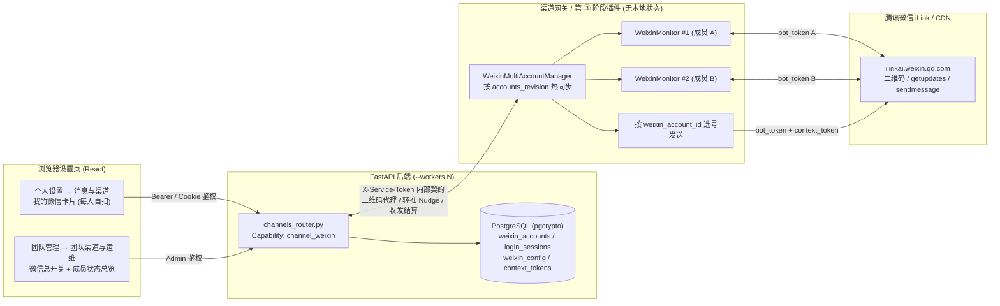

# 团队微信多账号（「每人扫自己的码」）设计方案

> **基线提交**：`34b353a0b`（Dalton 迁移链当前头节点为 `d046`，见 `src/dalton/migrations/versions/d046_scoped_data_map_cache.py:23-24`）  
> **架构定位**：直接对齐独立核心架构（`docs/dalton/features/standalone-core.md:8-42,64,243-246`）与第 ③ 阶段渠道网关插件化边界——后端掌管全部账号归属、加密凭据、会话状态与权限，网关（未来的渠道插件）仅作为纯内存协议适配器，每次启动与运行均直接按后端契约存取状态与凭据。

---

## 0. 背景与架构边界

### 0.1 问题根因

微信 iLink（微信智能体机器人接入协议，ClawBot〔腾讯微信个人智能体机器人形态〕，`bot_type="3"`，见 `integrations/dalton-channel-gateway/src/channels/weixin/types.ts:10`）通过扫码创建的机器人属于**扫码微信号专属的一对一私聊通道**：只有扫码的那个微信号（`ilink_user_id`）能在微信聊天列表中看到该机器人并收发消息，其他微信号无法搜索添加该机器人，也无法将其拉入微信群聊（群消息判定与拦截见 `integrations/dalton-channel-gateway/src/channels/weixin/inbound.ts:147-167`、`src/dalton/database/channel_gateway.py:1601-1619`）。OpenClaw（开源多渠道智能体框架）社区方案同样采取每次扫码新增一个独立账号、按「账号—渠道—对端」（`per-account-channel-peer`）隔离会话的做法。

当前实现采用「全局单实例机器人 + 成员一次性绑定码」模型，导致团队场景下只有扫码的那一位管理员能正常对话：

1. **数据库单行约束**：`dalton_channel_weixin_state` 以 `singleton_id = 1` 固定存储全系统唯一一个 `ilink_bot_id` 与 `encrypted_bot_token`（`src/dalton/migrations/versions/d030_channel_gateway.py:256-265`、`src/dalton/migrations/versions/d032_weixin_state.py:23-42`、`src/dalton/database/channel_gateway.py:9795-10031`）；另一位管理员扫码会直接覆盖上一位管理员的在线凭据。
2. **扫码接口限死管理员**：`/weixin/qrcode/start|wait|verify-code` 强制调用 `_require_weixin_admin`（`src/dalton/app/channels_router.py:1035-1039,1099-1157`）与数据库层 `get_user_tier(eff_owner) != "admin"` 拦截（`src/dalton/database/channel_gateway.py:10092,10250,10397`）。
3. **网关单实例内存状态**：`WeixinChannelAdapter` 仅维护单个 `this.account` 与单个 `WeixinMonitor` 长轮询协程（`integrations/dalton-channel-gateway/src/channels/weixin/index.ts:92-106,361-407`）。
4. **前端拆成管理员扫码与成员绑定码两套割裂流程**：管理员在 `DaltonTeamOpsPanel`（`web/src/pages/Settings/panels/dalton/DaltonTeamOpsPanel.tsx:50`）使用 `DaltonWeixinBotCard`（`web/src/pages/Settings/panels/dalton/DaltonWeixinBotCard.tsx:39-44`）扫码，普通成员在 `IntegrationsPanel`（`web/src/pages/Settings/panels/IntegrationsPanel.tsx:43`）使用 `DaltonWeixinBindCard`（`web/src/pages/Settings/panels/dalton/DaltonWeixinBindCard.tsx:48-56`）生成 `/bind DLT-XXXX-XXXX` 绑定码，而成员在微信端只有扫码本人才能打开机器人会话窗口。

### 0.2 硬性架构约束（对齐第 ①～③ 阶段产品化边界）

本方案直接按第 ③ 阶段渠道插件化后的最终职责边界一步到位落地：

1. **后端单一真值与多进程安全**：后端以 `--workers N` 多进程模式运行（`AGENTS.md:103`、`src/server/AGENTS.md:38-50`）。账号与成员映射、二维码登录会话、加密后的 `bot_token` / `context_token`、长轮询游标 `get_updates_buf`、渠道运行期总开关及账号列表变更代际号 `accounts_revision` 全部存储在后端 PostgreSQL（开源关系型数据库）自有 `dalton_*` 表中，进程内存仅作单次请求执行上下文。
2. **网关（渠道插件）纯协议适配与零本地状态**：`integrations/dalton-channel-gateway/` 仅负责调用腾讯 iLink HTTP（Hypertext Transfer Protocol，超文本传输协议）JSON（JavaScript Object Notation，JavaScript 对象表示法）接口与微信 CDN（Content Delivery Network，内容分发网络）媒体加解密，所有业务状态与凭据均通过带 `X-Service-Token`（内部服务鉴权请求头）校验的内部 HTTP 契约向后端拉取与回报；同步移除网关遗留的本地目录配置 `weixinCacheDir`（`integrations/dalton-channel-gateway/src/config.ts:24,132-135,195`、`integrations/dalton-channel-gateway/src/orchestrator.ts:163,180,190`、`integrations/dalton-channel-gateway/src/server.ts:206`）。第 ③ 阶段网关改为独立插件或容器时，只需替换进程宿主与配置注入，契约保持原样。
3. **统一形态与能力门控**：Everflow 生产形态（`DALTON_PROFILE=everflow`）与独立核心形态（`DALTON_PROFILE=core`）共用同一套源码；安装形态解析统一走 `src.dalton.profile.resolve_profile`（`src/dalton/profile.py:37-96`），能力判定统一走 `src.dalton.capabilities` 的 `CapabilityId.CHANNEL_GATEWAY` 与 `CapabilityId.CHANNEL_WEIXIN`（`src/dalton/capabilities.py:56,59,160-191,475-488`），前端统一通过 `useCapabilities()`（`web/src/hooks/useCapabilities.ts:21-24,129`）控制面板与搜索条目显隐；当 `channel_weixin` 关闭时，全部相关后端路由返回 HTTP `404`、前端入口隐藏。
4. **数据库增量迁移规范**：新增 Dalton 迁移 `d049_weixin_multi_account.py` 接在当前头节点 `d046` 之后，仅操作 `dalton_*` 自有表并遵守「扩展—收缩（Expand-Contract）」平滑升级原则（`docs/dalton/features/standalone-core.md:126,407`）。



---

## 1. 使用流程

### 1.1 团队成员个人操作流程（「个人设置 → 消息与渠道」）

当部署启用 `channel_weixin` 能力时，所有有效团队成员打开「设置 → 消息与渠道」（`web/src/pages/Settings/panels/IntegrationsPanel.tsx:29,43`，搜索锚点 `#dalton-weixin-bind`，见 `web/src/pages/Settings/sections.ts:295`）均可看到升级后的 **「我的微信」卡片**（重构自 `web/src/pages/Settings/panels/dalton/DaltonWeixinBindCard.tsx`）：

1. **首次扫码登录**：
   - 成员点击「扫码连接个人微信」，前端调用 `POST /api/v1/dalton/channels/weixin/qrcode/start` 获取一次性登录会话键 `session_key` 与脱敏后的二维码图像（`qrcode_url` / `qrcode_img_content`）。
   - 前端复用 `web/src/pages/Settings/panels/dalton/DaltonWeixinBotCard.tsx:74-114` 的轮询状态机，每 `1.2s` 调用 `GET /api/v1/dalton/channels/weixin/qrcode/wait?session_key=...`：
     - `wait`：展示二维码图片与提示「请用本人手机微信扫描二维码」；
     - `scaned`：提示「已扫码，请在手机微信上点击确认登录」；
     - `verify_code`：当微信安全风控要求输入手机端辅助验证码时，展示验证码输入框并提交 `POST /api/v1/dalton/channels/weixin/qrcode/verify-code`；
     - `confirmed`：后端在单事务内保存该成员加密后的 `bot_token` 与 `ilink_bot_id`，并**自动写入 `dalton_channel_identities`（`platform='weixin'`）与默认 `dalton_channel_user_settings.apps.weixin` 配置**，全程一步完成个人身份与路由初始化；
     - `expired`：二维码超过 5 分钟有效期（TTL，Time-To-Live，存活有效期）时展示「刷新二维码」按钮。
2. **查看连接与推送状态**：
   - 卡片右上角状态徽章实时展示四种状态：**已连接**（`active`，绿色）、**登录已过期**（`expired`，黄色，对应 iLink 错误码 `-14`）、**渠道已暂停**（管理员关闭运行期总开关时展示中性徽章）或 **待连接**（`unconfigured`）。
   - 已连接状态下展示：微信昵称 `ilink_username`（缺省展示掩码后的 `ilink_user_id`〔ID，Identifier，唯一标识符〕）、连接时间 `updated_at`、最近微信互动时间 `last_inbound_at`，以及 **主动推送激活状态**（指示当前是否持有可用的入站 `context_token`）。
3. **重新登录（过期续期或更换微信号）**：
   - 当状态变为 `expired` 或成员希望改绑另一个个人微信号时，点击「重新扫码登录」。
   - 二维码等待期间存储在独立的 `dalton_channel_weixin_login_sessions` 表中，成员若中途关闭页面，原有在线连接保持继续工作；一旦手机端确认新码，后端原子递增该账号的 `bot_generation`、替换凭据、清理旧代际 `context_token`，并在检测到 `ilink_user_id` 变更时自动推进会话代数 `generation` 开启全新对话上下文（对齐 `src/dalton/database/channel_gateway.py:2125-2128,2409-2420`）。
4. **解除连接**：
   - 成员点击「解除连接」并通过二次确认弹窗（`DaltonActionConfirmButton`，见 `web/src/pages/Settings/panels/dalton/DaltonWeixinBindCard.tsx:163-175`），调用 `DELETE /api/v1/dalton/channels/bindings/weixin`；也可直接在微信聊天框发送 `/unbind`。
   - 后端单事务删除该成员的微信机器人凭据、`dalton_channel_identities` 记录与全部 `context_token`，移除 `dalton_channel_user_settings.apps.weixin`，推进会话 `generation` 并关闭活跃后台监听 `dalton_channel_thread_watches`（对齐 `src/dalton/database/channel_gateway.py:2889-3035`），同时通知网关立即中止该账号的长轮询。

### 1.2 管理员视图与管理权限（「团队管理 → 团队渠道与运维」）

管理员打开「设置 → 团队管理 → 团队渠道与运维」（`web/src/pages/Settings/panels/dalton/DaltonTeamOpsPanel.tsx:50`，重构 `web/src/pages/Settings/panels/dalton/DaltonWeixinBotCard.tsx` 为 **「团队微信渠道管理」卡片**，保持仅 `callerTier === 'admin'` 可见，见 `web/src/pages/Settings/sections.ts:309`）：

1. **渠道运行期总开关**：
   - 卡片顶部提供「启用团队个人微信接入」开关（对应 `dalton_channel_weixin_config.enabled`，默认开启）。
   - 关闭开关后：后端暂停受理新的微信扫码请求与微信出站投递，网关收到配置变更后立即停止全部成员账号的 iLink 长轮询；各成员已绑定的加密凭据原地保留，管理员重新打开开关后网关自动按原游标恢复全部 `active` 账号长轮询，全员免重扫即可续用。
   - 卡片内附带快捷链接「去绑定/管理我自己的个人微信 →」（跳转 `#dalton-weixin-bind`），明确管理员本人同样在个人设置页扫码连接自己的微信。
2. **各成员登录状态总览**：
   - 顶部统计栏展示：`在线账号数 / 已连接总数`、`登录过期数`、`网关长轮询槽位占用（当前活跃 / 上限）`。
   - 成员列表按状态与最近更新时间排序，每行展示：成员显示名与邮箱、权限等级（`admin` / `internal` / `external`）、微信账号标识（昵称与掩码 ID）、连接状态（`在线` / `登录已过期` / `推送待激活` / `账号已停用`）、最近收信时间 `last_inbound_at` 与绑定更新时间 `updated_at`。接口严格按白名单字段返回运维元数据。
3. **管理员代成员解除连接**：
   - 每行右侧提供「代为解除」操作按钮（带二次确认弹窗），调用管理员专属接口 `DELETE /api/v1/dalton/channels/weixin/admin/accounts/{account_id}`。
   - 适用场景：成员离职交接、手机丢失需紧急切断微信会话、或成员误绑测试微信号。执行后写入结构化审计日志（记录操作管理员 `admin_user_id`、目标成员 `target_user_id`、`account_id` 与时间戳），立即销毁凭据并断开网关长轮询。（关于是否限制为仅可代停用成员解除，见第 8 节待定问题 #2，默认建议允许管理员代任意成员强制解除。）

### 1.3 扫码后微信侧呈现与开始对话方式

1. **微信端界面表现**：成员在手机微信确认扫码登录瞬间，微信首页聊天列表自动新增与该 **ClawBot 机器人**的一对一私聊窗口。
2. **首条消息激活机制**：iLink 扫码确认接口 `get_qrcode_status` 仅返回 `bot_token`、`ilink_bot_id` 与 `ilink_user_id`（`integrations/dalton-channel-gateway/src/channels/weixin/types.ts:217-228`），当成员在微信向该机器人发出第一条消息时，`getupdates` 返回的 `WeixinMessage` 即携带出站必需的 `context_token`（`integrations/dalton-channel-gateway/src/channels/weixin/types.ts:147`）。网页端在扫码变为 `confirmed` 时展示明确引导：**「个人微信已连接！请打开手机微信，在刚出现的机器人对话窗口发送任意一句话（如『你好』或 `/workspace`），即可开始对话并激活自动推送。」**
3. **日常对话与指令交互**：
   - 成员发出第一句话后，网关通过该成员专属长轮询收到消息，默认路由至该成员本人的 **Home（研究总监 Chief of Staff）** 线程流式处理并把回答发回微信。
   - 支持文字、引用消息（`extractInlineQuote`，`integrations/dalton-channel-gateway/src/channels/weixin/inbound.ts:185-212`）、开启微信语音转文字的语音消息（`integrations/dalton-channel-gateway/src/channels/weixin/inbound.ts:340-348`）、图片 / PDF（Portable Document Format，便携式文档格式）/ Office 办公文档 / CSV（Comma-Separated Values，逗号分隔值表格）/ 视频附件双向收发（`integrations/dalton-channel-gateway/src/channels/weixin/inbound.ts:350-449`、`integrations/dalton-channel-gateway/src/channels/weixin/send.ts:266-425`）。
   - 原生支持全套斜杠指令（`integrations/dalton-channel-gateway/src/orchestrator.ts:263-271`）：`/workspace` 列出本人可写工作区、`/<工作区名称>` 切换到指定工作区分析师、`/main` 切回研究总监、`/new` 开启新对话线程、`/stop` 停止当前回复生成、`/unbind` 解绑当前微信号。

---

## 2. 数据模型与迁移

### 2.1 多账号表结构设计（迁移 `d049_weixin_multi_account.py`）

新增 Alembic（数据库表结构版本迁移工具）脚本 `src/dalton/migrations/versions/d049_weixin_multi_account.py`（`revision = "d049"`，`down_revision = "d046"`），仅操作 `dalton_*` 表：

#### （1）团队微信运行期配置表 `dalton_channel_weixin_config`

```sql
CREATE TABLE IF NOT EXISTS dalton_channel_weixin_config (
    singleton_id      SMALLINT PRIMARY KEY DEFAULT 1 CHECK (singleton_id = 1),
    enabled           BOOLEAN NOT NULL DEFAULT TRUE,         -- 管理员运行期渠道总开关
    accounts_revision BIGINT NOT NULL DEFAULT 1,             -- 账号集合或总开关每次变更单调 +1
    updated_by        VARCHAR(255),
    updated_at        TIMESTAMPTZ NOT NULL DEFAULT NOW()
);
```

#### （2）个人微信多账号凭据与游标主表 `dalton_channel_weixin_accounts`

```sql
CREATE TABLE IF NOT EXISTS dalton_channel_weixin_accounts (
    account_id          UUID PRIMARY KEY DEFAULT gen_random_uuid(), -- 账号主键 UUID（Universally Unique Identifier，通用唯一识别码）
    user_id             VARCHAR(255) NOT NULL CHECK (user_id <> 'system:dalton-company'),
    ilink_bot_id        VARCHAR(255) NOT NULL UNIQUE,        -- iLink 机器人唯一标识，全局确保单实例轮询
    ilink_user_id       VARCHAR(255),                        -- 扫码微信号的 iLink 用户 ID
    ilink_username      VARCHAR(255),                        -- 扫码微信号昵称
    encrypted_bot_token BYTEA NOT NULL,                      -- pgp_sym_encrypt(bot_token, get_encryption_key())
    base_url            VARCHAR(512) NOT NULL DEFAULT 'https://ilinkai.weixin.qq.com',
    cdn_base_url        VARCHAR(512) NOT NULL DEFAULT 'https://novac2c.cdn.weixin.qq.com/c2c',
    get_updates_buf     TEXT NOT NULL DEFAULT '',            -- 该账号独立 getupdates 长轮询游标
    status              VARCHAR(32) NOT NULL DEFAULT 'active'
                        CHECK (status IN ('active', 'expired', 'disabled')),
    bot_generation      BIGINT NOT NULL DEFAULT 1,           -- 账号内重登代际号，用于 CAS（Compare-And-Swap，比较并交换乐观锁）与代际围栏（Fencing，用单调递增代际号拦截旧实例写入的并发保护机制）
    last_inbound_at     TIMESTAMPTZ,                         -- 最近一次收到有效入站消息的时间
    last_error_code     VARCHAR(64),
    last_error_at       TIMESTAMPTZ,
    created_at          TIMESTAMPTZ NOT NULL DEFAULT NOW(),
    updated_at          TIMESTAMPTZ NOT NULL DEFAULT NOW()
);

-- 默认每人限绑 1 个微信号（未来若放开一人多号，移除此唯一索引即可直接复用同一表主键与网关契约）
CREATE UNIQUE INDEX IF NOT EXISTS idx_dalton_wx_accounts_user_single
    ON dalton_channel_weixin_accounts (user_id);

-- 同一微信号在全系统唯一对应一个活跃账号，保证入站与出站路由唯一确定
CREATE UNIQUE INDEX IF NOT EXISTS idx_dalton_wx_accounts_ilink_user_unique
    ON dalton_channel_weixin_accounts (ilink_user_id)
    WHERE ilink_user_id IS NOT NULL;

CREATE INDEX IF NOT EXISTS idx_dalton_wx_accounts_status
    ON dalton_channel_weixin_accounts (status, updated_at DESC);
```

#### （3）二维码登录会话表 `dalton_channel_weixin_login_sessions`

将原混在 `dalton_channel_weixin_state` 上的 `login_*` 临时列（`src/dalton/migrations/versions/d032_weixin_state.py:32-42`）拆为独立会话表，支持多人并发扫码且扫码等待期间保持原在线账号持续收发，同时将可换取 `bot_token` 的 `qrcode` 票据改为 `pgp_sym_encrypt` 密文存储：

```sql
CREATE TABLE IF NOT EXISTS dalton_channel_weixin_login_sessions (
    session_key             VARCHAR(255) PRIMARY KEY,
    user_id                 VARCHAR(255) NOT NULL CHECK (user_id <> 'system:dalton-company'),
    target_account_id       UUID REFERENCES dalton_channel_weixin_accounts(account_id) ON DELETE SET NULL,
    login_version           BIGINT NOT NULL DEFAULT 1,       -- 会话中间状态更新 CAS 版本号
    expected_bot_generation BIGINT,                          -- 发起重登时原账号的 bot_generation
    status                  VARCHAR(64) NOT NULL DEFAULT 'wait'
                            CHECK (status IN ('wait', 'scaned', 'verify_code', 'confirmed', 'expired', 'superseded')),
    encrypted_qrcode        BYTEA NOT NULL,                  -- pgp_sym_encrypt(qrcode, get_encryption_key())
    qrcode_img_content      TEXT NOT NULL,                   -- 经校验的 data:image/* 或官方 HTTPS（Hypertext Transfer Protocol Secure，安全超文本传输协议）二维码地址
    redirect_base_url       VARCHAR(512) NOT NULL DEFAULT 'https://ilinkai.weixin.qq.com',
    expires_at              TIMESTAMPTZ NOT NULL,
    confirmed_result        JSONB,                           -- 幂等重入返回的脱敏结果
    created_at              TIMESTAMPTZ NOT NULL DEFAULT NOW(),
    updated_at              TIMESTAMPTZ NOT NULL DEFAULT NOW()
);

CREATE INDEX IF NOT EXISTS idx_dalton_wx_login_sessions_user_active
    ON dalton_channel_weixin_login_sessions (user_id, updated_at DESC)
    WHERE status IN ('wait', 'scaned', 'verify_code');
```

#### （4）`context_token` 表与渠道关联表按账号隔离扩展

现有 `dalton_channel_weixin_context_tokens` 主键已为 `(ilink_bot_id, bot_generation, platform_user_id)`（`src/dalton/migrations/versions/d032_weixin_state.py:63-74`），天然按 `ilink_bot_id` 区分不同成员的机器人。在此基础上补充显式 `account_id` 级联外键与失效标记列，使解绑或删号时由数据库自动级联清理关联令牌，并记录推送被拒收时的令牌失效态：

```sql
ALTER TABLE dalton_channel_weixin_context_tokens
    ADD COLUMN IF NOT EXISTS account_id UUID
        REFERENCES dalton_channel_weixin_accounts(account_id) ON DELETE CASCADE,
    ADD COLUMN IF NOT EXISTS stale_at TIMESTAMPTZ,
    ADD COLUMN IF NOT EXISTS stale_reason VARCHAR(64);

CREATE INDEX IF NOT EXISTS idx_dalton_wx_ctx_tokens_account
    ON dalton_channel_weixin_context_tokens (account_id, bot_generation);

ALTER TABLE dalton_channel_identities
    ADD COLUMN IF NOT EXISTS weixin_account_id UUID
        REFERENCES dalton_channel_weixin_accounts(account_id) ON DELETE SET NULL;

ALTER TABLE dalton_channel_inbound_events
    ADD COLUMN IF NOT EXISTS weixin_account_id UUID;
```

#### （5）全局事务锁顺序（继承并推广 `src/dalton/database/channel_gateway.py:6-14`）

多进程并发读写统一按以下固定层级顺序加锁：
0. 单消息 / 单投递咨询锁（`dalton_inbound:weixin:<message_id>`、`dalton_delivery:<delivery_key>`）；
1. 个人频道设置咨询锁与行锁（`dalton_user_settings:<user_id>` + `dalton_channel_user_settings FOR UPDATE`，多用户按 `user_id` 字典序升序）；
2. 微信全局配置行锁（仅修改总开关或递增 `accounts_revision` 时置于账号锁之后统一更新，或使用 `UPDATE dalton_channel_weixin_config SET accounts_revision = accounts_revision + 1 WHERE singleton_id = 1` 置于事务末尾）；
3. **微信单账号行锁**（`dalton_channel_weixin_accounts` 按 `account_id` 升序：扫码确认、重登、解绑、游标更新取排他行锁 `FOR UPDATE`；入站注册读取当前 `bot_generation` 取共享行锁 `FOR SHARE`，各成员账号行彼此独立并发读写）；
4. 微信 `context_token` 发送方咨询锁（`dalton_weixin_context:<ilink_bot_id>:<bot_generation>:<platform_user_id>`，按三元组字典序）；
5. `dalton_channel_identities` / `dalton_channel_session_generations` 行锁；
6. `dalton_channel_inbound_events` / `dalton_channel_thread_watches` / `dalton_channel_deliveries` 行锁。

### 2.2 现有单行表存量数据迁移逻辑

在 `d049` 的 `upgrade()` 中通过纯 SQL（Structured Query Language，结构化查询语言）原地完成存量迁移（直接在数据库内搬运 `BYTEA`〔PostgreSQL 二进制字节数组类型〕密文，迁移脚本独立于应用层密钥 `BYOK_ENCRYPTION_KEY`〔Bring Your Own Key，自带密钥对称加密主密钥〕完成数据结转）：

1. 初始化 `dalton_channel_weixin_config (singleton_id = 1, enabled = TRUE, accounts_revision = 1)`。
2. 若 `dalton_channel_weixin_state` 存在 `singleton_id = 1` 且 `ilink_bot_id IS NOT NULL AND encrypted_bot_token IS NOT NULL AND owner_user_id IS NOT NULL`（即原扫码管理员的在线或过期机器人）：
   - 将该行插入 `dalton_channel_weixin_accounts`：`user_id = owner_user_id`，原样复制 `ilink_bot_id`、`ilink_user_id`、`ilink_username`、`encrypted_bot_token`、`base_url`、`get_updates_buf`、`COALESCE(bot_generation, 1)`，将 `status IN ('expired', 'session_expired')` 归一为 `'expired'`、其余归一为 `'active'`；
   - 按 `ilink_bot_id` 回填 `dalton_channel_weixin_context_tokens.account_id`，并取最新 `updated_at` 回填该账号的 `last_inbound_at`；
   - 若 `ilink_user_id` 非空，确保 `dalton_channel_identities` 中 `(owner_user_id, 'weixin')` 记录关联该 `weixin_account_id`。
3. 归档并清理旧绑定码模式遗留的孤立记录：
   - 将 `dalton_channel_bind_codes` 中 `platform = 'weixin' AND used_at IS NULL` 的待用绑定码更新为 `used_at = NOW(), revoked_reason = 'migrated_to_qr_login'`；
   - 删除 `dalton_channel_identities` 中 `platform = 'weixin'` 且在 `dalton_channel_weixin_accounts` 缺少对应账号的孤立行，并同步推进这些用户的 `dalton_channel_session_generations.generation`。
4. **原样保留 `dalton_channel_weixin_state` 旧表结构与数据**，支撑过渡期双读与一键快速回退。

### 2.3 回滚方式

1. **应用层无损快速回滚（首选）**：因 `d049` 完整保留了 `dalton_channel_weixin_state` 原表与原管理员数据，若上线验证阶段需回退，直接将后端与网关切回上一版本镜像即可立即恢复管理员单实例微信通道，数据库保持在 `d049` 正常运行。
2. **数据库版本回滚（`uv run alembic -c src/dalton/alembic.ini downgrade d046`）**：
   - `downgrade()` 先将 `dalton_channel_weixin_accounts` 中原管理员（匹配 `dalton_channel_weixin_state.owner_user_id` 或首个管理员账号）最新的 `encrypted_bot_token`、`get_updates_buf`、`bot_generation`、`status` 同步回写至 `dalton_channel_weixin_state (singleton_id = 1)`；
   - 移除 `dalton_channel_inbound_events.weixin_account_id`、`dalton_channel_identities.weixin_account_id` 以及 `dalton_channel_weixin_context_tokens` 新增的 `account_id` / `stale_at` / `stale_reason` 列；
   - 依次删除 `dalton_channel_weixin_login_sessions`、`dalton_channel_weixin_accounts`、`dalton_channel_weixin_config`。

---

## 3. 网关与后端契约

所有内部接口均挂载在 `/api/v1/dalton/channels/internal/*` 下，统一要求双守卫：`require_capability_dep(CapabilityId.CHANNEL_GATEWAY, CapabilityId.CHANNEL_WEIXIN)`（`src/dalton/capabilities.py:511-518`）与常量时间比对 `require_channel_service_token`（`X-Service-Token: <INTERNAL_SERVICE_TOKEN>`，见 `src/dalton/app/channels_router.py:61-72`）；网关侧监听接口同样校验 `verifyServiceToken`（`integrations/dalton-channel-gateway/src/server.ts:219`）。

### 3.1 接口总览表

| 方向 | 方法与路由 | 用途 | 关键请求字段 | 关键响应字段 |
|---|---|---|---|---|
| 网关 → 后端 | `GET /api/v1/dalton/channels/internal/weixin/accounts` | 批量拉取账号快照（按 `since_revision` 增量判断）或按 `account_id` 单查凭据与 `context_token` | 查询参数：`since_revision?`、`account_id?`、`user_id?`、`include_token=true\|false`、`recipient_platform_user_id?`、`inbound_message_id?` | `changed`、`enabled`、`accounts_revision`、`accounts: [{account_id, user_id, ilink_bot_id, ilink_user_id, bot_token?, base_url, cdn_base_url, get_updates_buf, bot_generation, status, weixin_context_token?}]` |
| 后端 → 网关 | `POST /internal/weixin/accounts/sync` | 账号新增/重登/解绑/停用或总开关变更后的即时轻推通知（Nudge，轻量唤醒信号） | `{"accounts_revision": 42, "reason": "account_confirmed"}` | `{"ok": true, "accepted_revision": 42}` |
| 网关 → 后端 | `POST /api/v1/dalton/channels/internal/weixin/accounts/{account_id}/cursor` | 提交单账号 `getupdates` 游标（CAS + 代际围栏 Fencing〔代际围栏校验〕） | `get_updates_buf`、`expected_get_updates_buf`、`expected_bot_generation`、`expected_ilink_bot_id` | `ok`、`updated`、`stale_generation`、`cas_mismatch`、`bot_generation`、`get_updates_buf`、`status` |
| 网关 → 后端 | `POST /api/v1/dalton/channels/internal/weixin/accounts/{account_id}/status` | 回报单账号 `-14` 登录失效（`expired`）或对端 `context_token` 拒收失效（`context_token_stale`） | `status`（`"expired"` \| `"error"`）、`expected_bot_generation`、`expected_ilink_bot_id`、`error_code?`、`stale_recipient_id?` | `ok`、`updated`、`stale_generation`、`accounts_revision` |
| 浏览器 → 后端 → 网关 | `POST /api/v1/dalton/channels/weixin/qrcode/start` → 网关 `POST /internal/weixin/qrcode/start` | 任一有效团队成员发起个人扫码登录 | 后端校验登录态与 `is_team_member_user` 后透传 `X-User-Id` | 脱敏白名单：`session_key`、`status: "wait"`、`qrcode_url`、`qrcode_img_content`、`expires_at` |
| 浏览器 → 后端 → 网关 | `GET /api/v1/dalton/channels/weixin/qrcode/wait` → 网关 `GET /internal/weixin/qrcode/wait` | 轮询本人扫码状态 | `session_key`（后端透传 `X-User-Id`） | `session_key`、`status`、`connected`、`account_id?`、`ilink_bot_id?`、`ilink_username?`、`bot_generation?` |
| 浏览器 → 后端 → 网关 | `POST /api/v1/dalton/channels/weixin/qrcode/verify-code` → 网关 `POST /internal/weixin/qrcode/verify-code` | 提交微信端辅助验证码 | `session_key`、`verify_code` | 同 `qrcode/wait` |
| 网关 → 后端 | `POST` / `GET` / `PATCH` `/api/v1/dalton/channels/internal/weixin/login-sessions[/{session_key}]` | 网关读写二维码会话状态与原子确认切换（`action="confirm"`） | `user_id`、`qrcode`、`qrcode_img_content`、`login_version`、`action`、确认凭据等 | 解密后的会话详情（供网关调 iLink）或原子确认后的 `account_id`、`bot_generation`、`accounts_revision` |
| 网关 → 后端 | `POST /api/v1/dalton/channels/internal/inbound/register-and-resolve`（扩展 `I-1`） | 入站消息幂等登记、校验账号归属与解析目标会话 | 原字段 + **`weixin_account_id`**、`weixin_bot_id`、`weixin_bot_generation`、`weixin_context_token`、`weixin_context_seq` | `linked`、`allowed`、`deny_reason`、`dalton_user_id`、`workspace_id`、`external_thread_id`、`generation` |
| 网关 → 后端 | `POST /api/v1/dalton/channels/internal/deliveries/authorize-and-claim`（扩展 `I-6`） | 出站投递鉴权、按目标成员选取微信账号并原子抢占 `in_flight` | 原字段（`delivery_key`、`kind`、`user_id`、`thread_id`、`run_id`、`target` 等） | 原字段 + **`weixin_account_id`**、`weixin_bot_id`、`weixin_bot_generation`、`weixin_context_token` |

同时在面向浏览器的管理端路由新增两个接口（挂在 `/api/v1/dalton/channels` 下，要求 `CapabilityId.CHANNEL_WEIXIN`）：
- `GET /weixin/admin/overview`（仅 `admin`）：返回运行期 `enabled`、`accounts_revision` 及全员脱敏微信账号状态列表；
- `PUT /weixin/admin/config`（仅 `admin`）：更新 `{"enabled": true | false}`，递增 `accounts_revision` 并轻推网关；
- `DELETE /weixin/admin/accounts/{account_id}`（仅 `admin`）：强制代解除指定成员的微信账号，递增 `accounts_revision` 并轻推网关。
- `GET /bindings`（`src/dalton/app/channels_router.py:891-940`）：为当前登录成员在 `bindings.weixin` 中补充本人微信账号的 `status`（`active` / `expired` / `unconfigured`）、`channel_enabled`、`has_context_token` 与 `last_inbound_at` 字段。

### 3.2 关键数据流详解

1. **账号列表下发与新增 / 删除通知（「即时轻推 + 周期版本号对账」双保险）**：
   - 遵循 `src/server/AGENTS.md:46` 多进程原则，任何瞬时通知均配备持久化轮询兜底：
   - **变更写入与轻推**：当任意后端 worker 完成扫码 `confirm`、成员 `unbind`、管理员代解除、成员停用或总开关变更时，在同一数据库事务中将 `dalton_channel_weixin_config.accounts_revision` 加 1，事务提交后向网关发送 `POST /internal/weixin/accounts/sync`（超时 `3s`，仅传最新 `accounts_revision` 整数）。
   - **网关单飞收敛（Single-flight Reconcile，合并并发对账请求为单次执行）**：网关 `WeixinMultiAccountManager` 维护本地 `localRevision`。收到轻推通知发现 `incomingRevision > localRevision`，或每 **15 秒**定时心跳触发时，调用 `GET /api/v1/dalton/channels/internal/weixin/accounts?since_revision=<localRevision>&include_token=true`：
     - 若返回 `changed: false`，后端仅执行一次单行主键读取即直接返回，网关维持现状；
     - 若返回 `changed: true`：当 `enabled === false` 时立即 `abort()` 全部运行中的 `WeixinMonitor`；当 `enabled === true` 时，对比本地 `Map<accountId, ManagedWeixinAccount>`——新增或 `bot_generation` 升高的 `active` 账号启动/重启对应的 `WeixinMonitor`；状态转为 `expired` / `disabled`、成员停用或已删除的账号立即调用 `abort()` 终止轮询并清空内存中的 `botToken`。
2. **二维码登录全流程**：
   - 成员请求 `POST /weixin/qrcode/start` → 后端校验 `is_team_member_user(user_id)` 与 `weixin_config.enabled == True` 后代理至网关 → 网关调用 iLink `get_bot_qrcode`（`integrations/dalton-channel-gateway/src/channels/weixin/api.ts:399-414`）拿到 `qrcode` 与 `qrcode_img_content`，调用后端 `POST /internal/weixin/login-sessions` 加密落库（同时将同一 `user_id` 先前的待扫会话归档为 `superseded`）并返回 `session_key`。
   - 成员轮询 `GET /weixin/qrcode/wait?session_key=...`（可落到任意后端 worker）→ 网关通过 `GET /internal/weixin/login-sessions/{session_key}` 读取解密后的 `qrcode` 与 `redirect_base_url`，向 iLink 发起 `get_qrcode_status`（同进程同 `(userId, sessionKey)` 复用 `inFlightWaits` 单飞合并，`integrations/dalton-channel-gateway/src/channels/weixin/login-qr.ts:210,327-343`）。
   - 手机确认扫码后，网关调用 `PATCH /internal/weixin/login-sessions/{session_key}`（`action="confirm"`）：后端确认 `ilink_user_id` 归属唯一后，在单事务中创建或更新该成员的 `dalton_channel_weixin_accounts`（`bot_generation + 1`、`get_updates_buf = ''`）、清理该账号旧代际 `context_token`、同步 `dalton_channel_identities` 与默认 `dalton_channel_user_settings`、递增 `accounts_revision`，网关随即本地就地拉起该 `account_id` 的 `WeixinMonitor`。
3. **入站消息按账号路由到成员和会话**：
   - 每个 `WeixinMonitor` 持有创建时固定的 `{ accountId, ownerUserId, ilinkBotId, botGeneration }`，解析入站消息时生成带 `ilinkBotId` 命名空间的幂等 `messageId`（`${ilinkBotId}:${rawId}`，复用 `integrations/dalton-channel-gateway/src/channels/weixin/inbound.ts:128-145`），并将 `threadScopeKey` 设为 `dm:${ilinkBotId}:${fromUserId}`。
   - 调用 `I-1` `register_and_resolve_inbound` 时，后端锁读 `dalton_channel_weixin_accounts WHERE account_id = %s FOR SHARE`，执行四重校验：① 渠道总开关开启且账号 `status == 'active'`；② `ilink_bot_id` 与 `bot_generation` 匹配；③ 若账号已有 `ilink_user_id`，强制要求入站 `platform_user_id == account.ilink_user_id`（首次入站且扫码阶段缺省 `ilink_user_id` 时原子回填）；④ 校验 `is_team_member_user(account.user_id)` 为真。
   - 校验通过后，将加密后的 `context_token` 按 `(account_id, ilink_bot_id, bot_generation, platform_user_id)` 写入 `dalton_channel_weixin_context_tokens`（保留现有的 `protocol_seq_high` / `platform_time_high` 双水位顺序保护机制，`src/dalton/database/channel_gateway.py:825-1052`），更新 `last_inbound_at = NOW()` 并重置 `stale_at = NULL`，直接解析到 `account.user_id` 名下的目标工作区与对话线程。
4. **出站消息按成员选账号**：
   - 无论是当前回合流式/回放回复（`Scenario A2`，入站触发回复场景）、`send_message(target="weixin:@me")`（`Scenario C`，工具主动发信场景）、定时自动化结算（`Scenario B` / `automation_notify`，后台任务推送场景）还是入站拒绝提示（`Scenario A1`），网关统一先调后端 `I-6` `authorize_and_claim_delivery`（`integrations/dalton-channel-gateway/src/delivery-service.ts:133-149`）。
   - 后端在 `authorize_and_claim_delivery`（`src/dalton/database/channel_gateway.py:7659-7688`）中按 `resolved_user_id`（`Scenario A1` 按原入站记录的 `weixin_account_id`）查询 `dalton_channel_weixin_accounts`，校验 `status == 'active'` 且存在可用 `context_token`，在 `claimed` 响应中一并返回 `weixin_account_id`、`weixin_bot_id`、`weixin_bot_generation`、`recipient_id`（即 `ilink_user_id`）与最新 `weixin_context_token`。
   - 网关 `WeixinChannelAdapter` 按 `weixin_account_id` 从 `accountsById` 取出对应成员的 `botToken` 与 `baseUrl` 执行发送；大文件上传耗时完成后，`refreshAfterUpload`（`integrations/dalton-channel-gateway/src/channels/weixin/send.ts:331-361`）按同一 `account_id` 重查后端最新 `context_token` 并核对 `bot_generation` 与发起前一致后再调用 `sendmessage`。
5. **登录失效回报（单账号故障隔离）**：
   - 当某个账号在 `getupdates` 长轮询（`integrations/dalton-channel-gateway/src/channels/weixin/monitor.ts:259-263`）、`getuploadurl` 上传或 `sendmessage` 发送（`integrations/dalton-channel-gateway/src/channels/weixin/send.ts:118-126,166-174`）收到 iLink 错误码 `-14`（`SESSION_EXPIRED_ERRCODE`）时，仅停止该 `account_id` 对应的 `WeixinMonitor`，并调用 `POST .../internal/weixin/accounts/{account_id}/status`（携带 `expected_bot_generation` 围栏）将该账号在数据库中标为 `expired`。其余所有成员的微信长轮询与消息收发持续正常运行。

### 3.3 多账号并发长轮询资源上限与退避策略

1. **资源开销与并发上限**：
   - 单个活跃微信账号占用 1 个挂起时长 `35s`（服务端动态调整范围 `1s ~ 60s`，见 `integrations/dalton-channel-gateway/src/channels/weixin/monitor.ts:14-15,201-213`）的 HTTPS 长轮询请求与约 `32 KB` 内存上下文，等待期间保持极低 CPU（Central Processing Unit，中央处理器）占用。
   - 新增网关环境变量 `DALTON_WEIXIN_MAX_CONCURRENT_ACCOUNTS`（默认 **`200`**，后端同步读取该阈值用于新扫码准入预检：当前 `active` 账号数达到上限时，新成员扫码返回明确容量提示）。
   - **双连接池物理隔离**：在网关为微信模块建立两个独立的 HTTP 连接调度器 `Dispatcher`（Node.js 官方 HTTP 客户端库 `undici.Agent`）——**长轮询专用池**（`connections = maxConcurrentAccounts + 16`，`pipelining = 1`）与 **控制/出站发送专用池**（`connections = 64`，专供二维码登录、CDN 上传下载与 `sendmessage` 使用），保证数十个 `getupdates` 长连接挂起期间，出站回复与扫码请求始终拥有独立可用连接槽位。
2. **错峰启动与三级退避**：
   - **批量启动错峰（Startup Pacing & Jitter，启动限速与随机抖动）**：网关启动或总开关重开批量恢复 N 个账号时，通过速率限制器按 **每秒最多启动 10 个账号 + `0 ~ 500ms` 均匀随机抖动** 分批发起首轮 `getupdates`，使网关出口 IP（Internet Protocol，网络协议地址）建连速率平滑处于腾讯侧限流阈值之内。
   - **单账号独立退避（带随机抖动）**：网络波动、HTTP 5xx 或后端 `I-1` 瞬时异常时，该账号独立按 `min(2000ms * 2^min(failures - 1, 4), 30000ms) + random(0..500ms)` 指数退避（升级 `integrations/dalton-channel-gateway/src/channels/weixin/monitor.ts:272-278`），将多账号恢复时间均匀打散。
   - **出口 IP 级 429 协同退避**：单账号收到 HTTP 429 时遵守 `Retry-After`（默认 `5s`、上限 `60s`，`integrations/dalton-channel-gateway/src/channels/weixin/api.ts:148-170`）；若 10 秒滑窗内有 `>= 3` 个不同账号同时收到 429，管理器设置全局冷却时间戳 `globalCooldownUntil = now + retryAfterMs`，其余账号在下一轮发起 `getupdates` 前自动等待至冷却结束并叠加随机抖动。

### 3.4 网关重启后的无状态恢复流程

网关进程本地纯内存运行，重启后按固定三步完整恢复（升级 `integrations/dalton-channel-gateway/src/server.ts:501-521` 与 `integrations/dalton-channel-gateway/src/orchestrator.ts:7869-7891`）：

1. **拉取全量活跃账号与游标**：调用 `GET /api/v1/dalton/channels/internal/weixin/accounts?include_token=true` 获取 `enabled`、`accounts_revision` 及全部 `active` 账号的 `bot_token` 与各自的 `get_updates_buf`。
2. **按持久化游标错峰续接长轮询**：为每个 `active` 账号按错峰速率启动 `WeixinMonitor`。网关停机期间成员在微信发送的消息由腾讯 iLink 服务端保留，重连后从各自的 `get_updates_buf` 精确续拉；每批消息全部经 `I-1` 落库成功后才调用 `/cursor` 推进游标（继承 `integrations/dalton-channel-gateway/src/channels/weixin/monitor.ts:216-255`），保证至少一次拉取且经 `I-1` 幂等去重。
3. **后台执行全通道恢复对账**：HTTP 服务就绪后异步调用 `GET /api/v1/dalton/channels/internal/recover?mode=startup`（`src/dalton/database/channel_gateway.py:9279-9420`），将重启前处于 `in_flight` 的投递收敛为 `unknown / gateway_restarted` 终态以保障最多投递一次语义，并按每条记录归属的 `dalton_user_id` 与 `weixin_account_id` 恢复进行中的入站流式回合、`/watch` 监听与自动化结算。

---

## 4. 会话与权限

### 4.1 成员级严格会话隔离

每位成员通过个人微信收发的一切消息均由四层机制锁定在其本人权限范围内：

1. **物理通道层**：每个 `WeixinMonitor` 仅持有对应成员扫码所得的 `bot_token`，从源头只拉取该成员自己微信号的消息。
2. **入站账号与发送者强绑定层**：后端 `register_and_resolve_inbound` 强制核对 `(weixin_account_id, ilink_bot_id)` 对应行在 `dalton_channel_weixin_accounts` 中的 `ilink_user_id == platform_user_id`，仅放行单聊且发送者与账号属主一致的事件；发送者异动或带有群聊标识（`group_id` / `@chatroom`，`integrations/dalton-channel-gateway/src/channels/weixin/inbound.ts:147-167`）的事件统一归档为 `ignored`（`deny_reason = "account_sender_mismatch"` 或 `"weixin_group_unsupported"`）并终止后续调度。
3. **会话键与线程归属层**：`dalton_channel_session_generations` 主键为 `(platform, scope_key, dalton_user_id)`（`src/dalton/migrations/versions/d030_channel_gateway.py:103`）；新生成的 `external_thread_id` 形如 `weixin:dm:<ilink_bot_id>:<ilink_user_id>:gen:<generation>`（对于存量迁移的原管理员账号，当 `generation` 保持初始值且旧线程存在时兼容匹配原 `weixin:dm:<ilink_user_id>:gen:<generation>`，无缝延续当前对话）；上游线程反查 `lookup_thread_by_external_id` 进一步强制过滤 `COALESCE(ct.user_id, w.user_id) = user_id`（`src/server/database/conversation/threads_read.py:41-44`）。
4. **工作区与跨区协同权限层**：成员在微信中默认进入自己的 Home（研究总监），通过 `/<工作区名>` 切换工作区时实时调用 `_verify_workspace_write_permission`（`src/dalton/database/channel_gateway.py:1798-1800`）校验本人拥有写权限（自有工作区，或开启 `colleague_sharing` 能力且被授予 `rw` 权限的同事共享工作区）。

### 4.2 成员离职 / 被停用时的账号自动止血

同时覆盖两种认证模式（通过 `src.dalton.access_tiers.is_team_member_user` 统一判定，见 `src/dalton/access_tiers.py:324-370`）：

1. **本地认证模式（`DALTON_AUTH_MODE=local`）主动清理**：管理员移除成员角色（`delete_user_role`，`src/dalton/auth/roles.py:194-237`）或停用账号时，在同一数据库事务中调用 `revoke_user_weixin_accounts(user_id, reason="member_removed", conn=conn)`：删除该成员的 `dalton_channel_weixin_accounts` 记录（级联清理 `context_tokens` 与待扫 `login_sessions`）、删除 `dalton_channel_identities (user_id, 'weixin')`、停用 `dalton_channel_thread_watches`、推进 `session_generations`、递增 `accounts_revision`，事务提交后轻推网关立即断开其 `WeixinMonitor`。
2. **外部名册模式（`DALTON_AUTH_MODE=supabase`）实时双门禁**：当成员从 `DALTON_ALLOWED_EMAILS` 与 `dalton_members`（`src/dalton/invites.py:152-204`）移除后：
   - 网关每 15 秒对账或拉取 `GET /internal/weixin/accounts` 时，后端对 `active` 账号批量核验成员有效态；对已移出名册的成员，后端自动将其微信账号置为 `disabled`、收回 `bot_token` 下发并递增 `accounts_revision`，使网关在最多 15 秒内断开长轮询；
   - 在 15 秒对账窗口内若收到入站消息或触发定时自动化出站，`register_and_resolve_inbound` 与 `authorize_and_claim_delivery` 实时校验 `is_team_member_user` 后立即以 `deny_reason="member_deactivated"` 拦截归档。
3. **研究资产留存**：成员离职清理仅回收微信凭据与活跃监听，成员历史工作区与已归档对话记录原封保留。

### 4.3 凭据加密与全链路日志脱敏

1. **数据库静态加密**：`dalton_channel_weixin_accounts.encrypted_bot_token`、`dalton_channel_weixin_login_sessions.encrypted_qrcode`、`dalton_channel_weixin_context_tokens.encrypted_context_token`、`dalton_channel_identities.encrypted_weixin_context_token` 与 `dalton_channel_inbound_events.encrypted_weixin_context_token` 统一通过 PostgreSQL `pgcrypto`（PostgreSQL 官方密码学扩展）执行 `pgp_sym_encrypt(..., get_encryption_key())`（对称密钥 `BYOK_ENCRYPTION_KEY`，见 `src/server/database/encryption.py:10-18`）存储；`raw_payload` 写入前调用 `_strip_sensitive_from_raw_payload` 与 `_sanitize_native_payload_dict`（`src/dalton/database/channel_gateway.py:586-604,3102-3139`）剥离全部令牌字段。
2. **API（Application Programming Interface，应用程序编程接口）边界与请求头隔离**：面向前端的所有响应均经白名单投影与 `_sanitize_public_url`（`src/dalton/app/channels_router.py:346-439`）处理，`bot_token`、`context_token`、`qrcode` 原始票据与 `get_updates_buf` 仅在后端与网关之间的 `X-Service-Token` 内部通道传输；网关向腾讯服务器发请求时通过 `buildIlinkApiHeaders`（`integrations/dalton-channel-gateway/src/channels/weixin/api.ts:111-137`）剥离内部服务头，并通过 `validateSafeTargetUrlWithDns`（含 DNS〔Domain Name System，域名系统〕解析校验，`integrations/dalton-channel-gateway/src/channels/weixin/api.ts:240-246,281-287`）限定仅访问 `OFFICIAL_ILINK_API_DOMAINS` 与 `OFFICIAL_WEIXIN_CDN_DOMAINS`（防御 SSRF，Server-Side Request Forgery，服务端请求伪造）。
3. **日志脱敏**：在网关 `SENSITIVE_KEY_PATTERN` 与 `redactCredentialString`（`integrations/dalton-channel-gateway/src/shared/logger.ts:26-73`）基础上补充 `qrcode|aeskey|aes_key|get_updates_buf` 键名匹配，自动将所有令牌、密钥及消息正文脱敏为 `[REDACTED]`；后端异常与外部响应摘要统一经 `redact_managed_tokens`（`src/dalton/settings.py:1209-1220`）清洗后记录，日志仅保留 `account_id`、`user_id`、`ilink_bot_id` 与数值状态码。

---

## 5. 主动推送

### 5.1 打通全路径个人微信主动推送

在支持多账号后，将系统中全部主动推送入口统一收口至「按目标成员 `user_id` 解析其活跃 `weixin_account_id` + 最新 `context_token`」：

1. **智能体主动消息与工作区/Home 自动化**（已有底座，直接升级多账号）：`send_message(target="weixin:@me")`（`src/tools/messaging/tools.py:775`）与 `automation_delivery.py`（`src/server/services/automation_delivery.py:181-248,568-638`）经 `I-6` 选取该任务属主本人的 `weixin_account_id` 投递。
2. **Dalton 自动推送开关、测试推送与研报投递**（补齐微信个人目标）：
   - 后端在 `src/dalton/database/automation_notifications.py:106-143` 的 `_parse_target` 与 `src/dalton/database/data_task_notifications.py:1456-1492` 中补齐 `weixin:user:<ilink_user_id>` 解析与实时 `weixin_context_token` / `weixin_account_id` 查询（替换原 `src/dalton/database/data_task_notifications.py:1491` 的空值占位），并在 `src/dalton/services/report_delivery.py:455` 将 `"supports_text_targets"` 扩展为 `plat in {"feishu", "discord", "weixin"}`（飞书卡片载荷在微信侧自动转换为经 `filterWeixinMarkdown`〔Markdown，轻量级标记语言〕清洗的纯文本 + PDF / PNG〔Portable Network Graphics，便携式网络图形〕独立附件发送，`integrations/dalton-channel-gateway/src/channels/weixin/send.ts:227,266-425`）。
   - 前端在 `web/src/pages/Settings/panels/IntegrationsPanel.tsx:28`、`web/src/pages/Settings/panels/dalton/DaltonNotifyTargetsCard.tsx:29,65-66,100-120`、`web/src/pages/Settings/panels/dalton/AutomationNotifyTargets.tsx:94` 及 `web/src/pages/Settings/sections.ts:293` 将能力判定扩展为 `['channel_feishu', 'channel_discord', 'channel_weixin']`，使已扫码连接个人微信的成员可直接勾选「微信私聊」接收自动推送并点击「发送测试」。

### 5.2 长期未发消息（缺少或过期 `context_token`）的处理与提示闭环

iLink `sendmessage` 要求携带该微信号发给该机器人的有效 `context_token`（`integrations/dalton-channel-gateway/src/channels/weixin/send.ts:209-218,237`）。当成员刚扫码尚待发出首条消息，或长期静默导致旧 `context_token` 在腾讯侧过期时，按以下四步优雅降级与引导恢复：

1. **精准错误分类与确定性快速短路**：
   - **情况 A（尚待首条消息激活令牌）**：账号刚扫码或重登后尚待生成当前 `bot_generation` 的 `context_token`——后端 `I-6` 直接返回 `claim_status = "denied"`、`code = "missing_weixin_context_token"`（`src/dalton/database/channel_gateway.py:7681-7687`），跳过外部请求。
   - **情况 B（历史令牌过期被拒）**：持有旧 `context_token` 调 `sendmessage` 时收到 iLink 业务错误（`err.kind === "business_error"`，与 `-14` 登录过期区分处理，见 `integrations/dalton-channel-gateway/src/channels/weixin/api.ts:172-193`）——网关调用 `POST .../internal/weixin/accounts/{account_id}/status` 标记该收件人的 `context_token` 行 `stale_at = NOW(), stale_reason = <errcode>`，并将本次投递结算为确定性失败 `error_code = "weixin_context_token_stale"`；后续定时推送在成员重新发言前直接命中 `stale_at IS NOT NULL` 走本地快速短路结算。
2. **多通道独立结算与站内完整留存**：
   - 同一自动化任务或报告若同时配置了飞书、Discord 与个人微信，各目标在 `dalton_notify_deliveries` 与 `dalton_channel_automation_runs.targets` 中独立结算，微信因 `context_token` 短路时飞书与 Discord 照常送达；所有自动化产出与唤醒回复始终完整保存在 Dalton 对应工作区与对话线程中。
3. **三处清晰中文提示引导成员一句话恢复**：
   - **「消息与渠道 → 我的微信」卡片**：当 `status == 'active'` 且 `has_context_token == false`（含刚扫码待发言或 `stale_at` 非空）时，展示醒目黄色提示条：**「微信主动推送待激活：受微信机器人协议限制，请打开微信向机器人发送任意一条消息（如『1』），即可恢复接收自动任务与报告推送。」**
   - **「发送测试」即时指引**：成员在 `DaltonNotifyTargetsCard` 点击微信目标的「发送测试」（`POST /api/v1/dalton/notify/test`，见 `src/dalton/notify/dispatch.py:2068-2191`）遇到上述两类错误码时，直接提示「请先在微信向机器人发任意一句话激活会话后再点测试」。
   - **自动化执行记录可读原因**：在 `src/dalton/services/execution_delivery_status.py:141-191` 将 `missing_weixin_context_token` 与 `weixin_context_token_stale` 映射为「微信会话待互动激活（在微信向机器人发任意消息后自动恢复）」。
4. **发信即刻自动恢复**：成员任何时候在微信向机器人发送任意消息（如一个字或 `/workspace`），`register_and_resolve_inbound` 写入新 `context_token` 时自动将 `stale_at` 重置为 `NULL`，主动推送通道即刻恢复。

---

## 6. 兼容与上线

### 6.1 旧「管理员扫码 + 成员绑定码」下线清单

| 模块 | 旧实现位置 | 下线与替换处理方式 |
|---|---|---|
| 微信绑定码生成接口 | `src/dalton/app/channels_router.py:881-889`（`POST /channels/bind-codes`） | 当 `platform == "weixin"` 时直接返回 HTTP `400`（`code: "weixin_uses_qr_login"`），引导改用个人扫码连接；`feishu` 与 `discord` 保持原样。 |
| 微信端 `/bind` 指令 | `integrations/dalton-channel-gateway/src/orchestrator.ts:263-271,592-622` | 微信私聊收到 `/bind` 时直接返回中文引导：「当前微信号已与你的账号自动关联，直接发消息或发 `/workspace` 即可开始对话。」保留 `/unbind` 自助解绑。 |
| 个人微信绑定卡片 | `web/src/pages/Settings/panels/dalton/DaltonWeixinBindCard.tsx:48-56,186-249` | 移除绑定码生成按钮与指令复制框，升级为个人微信二维码扫码、辅助验证码、连接/推送激活状态展示、重新扫码与二次确认解绑。 |
| 团队微信机器人卡片 | `web/src/pages/Settings/panels/dalton/DaltonWeixinBotCard.tsx:39-340` | 移除「团队共用机器人扫码」入口与文案，升级为管理员专属「团队微信渠道管理」卡片（运行期总开关 + 成员状态表 + 管理员代解除 + 跳转个人微信设置链接）。 |
| 多语言文案字典 | `web/src/locales/zh-CN.json`、`web/src/locales/en-US.json` | 更新微信相关标题、描述与错误提示文案，统一改为「个人微信扫码连接」与「团队成员微信状态管理」指引。 |

### 6.2 已绑定存量数据的平滑承接

1. **原扫码管理员平滑无感衔接**：迁移 `d049` 将 `dalton_channel_weixin_state` 中该管理员的 `ilink_bot_id`、加密 `bot_token`、`get_updates_buf`、`bot_generation`、`ilink_user_id` 及关联 `context_tokens` 原样迁入 `dalton_channel_weixin_accounts`；升级完成后网关直接按原游标恢复该管理员的长轮询，原管理员免重扫即可继续收发消息并无缝延续既有对话线程。
2. **其他成员孤立绑定记录统一归档重置**：`d049` 将旧模式下遗留的待用微信绑定码标记归档，并清理缺少独立 `dalton_channel_weixin_accounts` 凭据的孤立微信身份行，使其余成员打开设置页直接呈现清晰的「待连接 → 扫码连接个人微信」初始状态。

### 6.3 分三步平滑上线与每步验收标准

1. **第 1 步：数据库增量迁移 + 后端双契约上线（扩展阶段 Expand）**
   - **动作**：执行 `d049` 迁移（新建 3 张表、迁移原管理员数据、保留 `dalton_channel_weixin_state` 旧表）；上线新后端进程（`--workers N`），开放 `/internal/weixin/*` 新接口与成员级 `/weixin/qrcode/*` 路由，同时让旧 `/internal/weixin-state` 临时桥接读写新表中原管理员那一行。
   - **验证**：确认 `alembic -c src/dalton/alembic.ini current` 到达 `d049 (head)`；查询 `dalton_channel_weixin_accounts` 核对原管理员行存在且 `status` 正常；升级窗口内旧网关进程继续调用 `/internal/weixin-state` 正常返回 `200`；验证 `APP_ENV=core` 下全部微信路由返回 `404`。
2. **第 2 步：网关多账号调度器 + 新前端上线（切换阶段 Cutover）**
   - **动作**：重启升级 `dalton-channel-gateway` 切换至 `WeixinMultiAccountManager` 与 `/internal/weixin/*` 契约，并发布新版前端静态资源。
   - **验证**：① 原管理员免重扫直接在微信发消息并收到回复；② 另一名普通成员在「消息与渠道」扫码连接自己的微信，发消息进入本人 Home 会话且与管理员各自独立运行；③ 管理员在「团队渠道与运维」查看双人在线列表，切换一次运行期总开关验证网关暂停与自动恢复。
3. **第 3 步：移除过渡兼容层（收缩阶段 Contract，稳定运行 1 个迭代后）**
   - **动作**：删除后端 `/internal/weixin-state` 兼容路由与旧单行读写函数，追加清理迁移 `DROP TABLE IF EXISTS dalton_channel_weixin_state`。
   - **验证**：确认后端与网关监控日志中 `/internal/weixin-state` 请求量为 `0`，全量自动化测试通过。

### 6.4 对飞书与 Discord 零影响保证

1. **能力与配置独立**：`CapabilityId.CHANNEL_FEISHU`、`CHANNEL_DISCORD`、`CHANNEL_WEIXIN` 在 `src/dalton/capabilities.py:168-191` 独立求值，飞书应用凭据与 Discord 机器人令牌（Bot Token）配置流程完全保留原样（`integrations/dalton-channel-gateway/src/config.ts:202-211`）。
2. **数据表与绑定流隔离**：飞书与 Discord 继续使用 `POST /channels/bind-codes` + `/bind DLT-XXXX-XXXX`（`web/src/pages/Settings/panels/dalton/DaltonChannelBindingsCard.tsx:28-30`）、群聊工作区绑定表 `dalton_channel_chat_bindings`（`src/dalton/migrations/versions/d030_channel_gateway.py:79-89`）以及 Discord 专属线程确认阶段列（`src/dalton/migrations/versions/d036_discord_confirmed_thread.py:37-39`）；本方案新增表与外键列均以 `weixin` 限定作用域，飞书与 Discord 的全部读写路径保持原样运行。

---

## 7. 测试方案

### 7.1 后端单测与数据库集成测试

覆盖文件：`tests/unit/dalton/test_weixin_multi_account.py`（新建）、`tests/unit/dalton/test_channel_gateway.py`、`tests/unit/dalton/test_core_capabilities_gate.py`、`tests/integration/dalton/test_channel_gateway_db.py`、`tests/integration/dalton/test_weixin_full_stack.py`：

1. **迁移与回滚**：测试 `d046 -> d049 -> d046` 完整升级与降级；验证原 `dalton_channel_weixin_state` 管理员密文、游标与 `context_tokens` 无损迁入，非管理员孤立微信身份与待用微信绑定码被准确清理。
2. **能力门控与角色权限**：断言 `APP_ENV=core`（及显式 `DALTON_CAP_CHANNEL_WEIXIN=false`）下全部新增与既有微信路由返回 `404`；断言 `internal` / `external` 成员可为本人发起扫码、轮询、提交验证码与解绑，调用 `/weixin/admin/*` 或传入他人 `session_key` 返回 `403`；断言 `system:dalton-company` 在所有入口被拦截。
3. **多进程并发与 CAS 围栏**：模拟双数据库连接并发执行同一成员重登 `confirm` 与旧长轮询 `/cursor`、`/status` 上报，验证 `expected_bot_generation` 围栏精准拦截旧代际写入并清理旧代际 `context_tokens`；验证同一 `ilink_user_id` 跨成员重复扫码冲突拦截；验证每次账号变更单调递增 `accounts_revision`。
4. **会话隔离、离职止血与主动推送**：验证成员 A、B 各自入站消息严格解析到本人 `dalton_user_id` 与独立 `external_thread_id`；伪造异动 `from_user_id` 被 `account_sender_mismatch` 拦截；调用 `delete_user_role` 或移出团队名册后，`GET /internal/weixin/accounts` 立即收回 `bot_token` 且入站/出站同步拦截；验证 `I-6`、`automation_notifications` 与 `data_task_notifications` 按成员选对 `weixin_account_id`，在缺失或 `stale` `context_token` 时返回精确错误码并保持同批次飞书/Discord 投递正常送达。
5. **脱敏守卫**：断言所有公开接口 JSON 与模拟异常日志中全部 `bot_token`、`context_token`、`qrcode` 均已被剥离或替换为 `[REDACTED]`。

### 7.2 网关测试

覆盖文件：`integrations/dalton-channel-gateway/test/weixin.test.ts`、`integrations/dalton-channel-gateway/test/weixin-real-backend.integration.test.ts`：

1. **多账号并发长轮询与故障隔离**：启动 3 个模拟账号并发 `getupdates`，验证各自独立维护游标与指数退避抖动；让账号 1 模拟收到 `-14`（`SESSION_EXPIRED_ERRCODE`），断言仅账号 1 调用 `/status` 标为 `expired` 并退出循环，账号 2、3 持续正常收发。
2. **轻推通知与 15 秒对账收敛**：验证 `POST /internal/weixin/accounts/sync` 触发单飞增量同步，以及在仅靠定时心跳时 15 秒周期轮询 `since_revision` 自动拉起新账号、中止已解绑账号、响应总开关启停。
3. **连接池隔离、并发上限与重启恢复**：验证挂起多个长轮询请求期间，出站 `sendmessage` 与二维码轮询通过独立连接池即时响应；验证批量启动错峰限速与多账号 429 协同冷却；验证网关销毁重建后纯内存启动，从后端完整恢复多账号游标与进行中回合；验证文件上传期间成员重登换代时 `refreshAfterUpload` 准确中止旧代际发送。

### 7.3 前端测试

覆盖文件：`web/src/pages/Settings/panels/dalton/__tests__/DaltonWeixinChannelCard.test.tsx`、`web/src/pages/Settings/__tests__/sections.capabilities.test.ts`、`web/src/pages/Settings/__tests__/SettingsRail.capabilities.test.tsx`：

1. **个人「我的微信」卡片**：测试普通成员（`internal` / `external`）渲染扫码按钮并走通 `wait -> scaned -> verify_code -> confirmed` 全状态流转；验证卡片仅展示扫码连接入口（旧绑定码组件已下线）；验证已连接态、推送待激活黄色提示条、登录过期提示、二次确认解绑弹窗、总开关暂停态以及组件卸载时清理轮询定时器。
2. **管理员「团队微信渠道管理」卡片**：验证仅在 `callerTier === 'admin'` 时挂载渲染总开关、统计摘要与成员列表，测试总开关切换与管理员代解除二次确认交互。
3. **通知目标与能力门控**：验证仅开启 `channel_weixin` 时 `IntegrationsPanel` 与 `DaltonNotifyTargetsCard` 正常展示个人微信推送开关与「发送测试」按钮；验证 `channel_weixin` 关闭时卡片与设置搜索词（`searchableSettings`）全部隐藏，且 `tests/unit/dalton/test_core_capabilities_gate.py` 黑名单扫描保持零命中。

### 7.4 需要真实微信号才能验证的实机清单（上线前必测）

模拟桩（Mock）测试覆盖本地契约，而微信手机客户端与线上 `ilinkai.weixin.qq.com` / `novac2c.cdn.weixin.qq.com` 的真实服务端状态机须在合入上线前使用 **至少 2 个不同真实个人微信号** 完成以下 6 项端到端实机验证：

1. **双微信号并发扫码与区域跳转 / 辅助验证码**：管理员与普通成员同时在各自浏览器发起扫码并用各自手机微信确认（覆盖线上返回的 `redirect_host` 跨区域名跳转与 `verify_code` 辅助验证码），确认双方微信均出现独立机器人窗口且各自保持在线。
2. **双人并发私聊、工作区切换与会话隔离**：两人同时在微信发送消息、引用回复、执行 `/workspace` 切换各自工作区与 `/new` 重置线程，确认模型回答各自准确送达本人微信。
3. **多账号真实微信 CDN 媒体双向加解密**：两个微信号分别向机器人发送手机相册图片、PDF / Excel 电子表格文档与带转写文本的语音，并让智能体调用 `send_message` 向两人分别回传生成的图表 PNG 与研报文件，验证线上 `getuploadurl` 与 AES（Advanced Encryption Standard，高级加密标准）媒体加解密在多账号凭据下完全正常。
4. **首条消息激活与真实 `context_token` 失效表现**：新微信号扫码确认后先静默，在网页点击「发送测试」核验引导文案；随后在微信发送「你好」，再次点击「发送测试」及触发定时自动化推送，确认正常送达；记录长期静默后线上 `sendmessage` 对过期 `context_token` 返回的真实 `ret` / `errcode` 数值，锁入网关错误分类常量表。
5. **单账号失效隔离恢复**：将其中一个微信号的登录态在手机端断开（或重新扫码更换代际），验证仅该账号变为「登录已过期」，另一名成员的微信长轮询与收发持续正常。
6. **网关重启跨停机窗口消息续传**：停止网关进程 1 分钟，期间两个微信号各发送 2 条消息，重新启动网关后确认 4 条离线期间消息全部凭各自持久化的 `get_updates_buf` 完整拉回并单次回复。

---

## 8. 待定问题（请用户拍板）

以下事项已在架构上预留好扩展接缝，并给出推荐默认值，确认后即可直接按定案启动编码：

| 编号 | 待决定事项 | 推荐默认方案 | 备选方案及取舍说明 |
|---|---|---|---|
| **待定 1** | **每人可连接的微信号数量上限** | **每人限绑 1 个个人微信号**（`dalton_channel_weixin_accounts(user_id)` 建唯一索引；重新扫码自动覆盖原连接，`weixin:@me` 指向唯一明确）。 | 允许每人绑定多个微信号（如工作号 + 私人号，上限 2～3 个）。本文档主键 `account_id` 与网关契约已按多账号无关设计，若选备选只需去掉 `user_id` 唯一索引并在前端增加账号列表与默认收信主号选择。 |
| **待定 2** | **管理员代成员解除微信连接的范围** | **允许管理员随时在「团队渠道与运维」代任意成员强制解除**（带二次确认弹窗并记录审计日志，便于员工离职交接、手机丢失或应急排障）。 | 仅允许管理员解除「已停用 / 已离职」或「登录已过期」成员的微信连接，正常在线的在职成员仅限本人解除。 |
| **待定 3** | **同一微信号（相同 `ilink_user_id`）被另一名 Dalton 成员扫码时的处理** | **拒绝确认并明确提示「该微信号已关联团队内另一账号，请先在原账号解除连接后再试」**（防止共用测试手机时误顶掉同事在线会话；本人重扫同一微信号正常续期）。 | 沿用旧版 `_bind_identity_in_tx`（`src/dalton/database/channel_gateway.py:2191-2200`）顶替策略：新成员扫码确认后自动解绑原成员并推进原成员会话代数。 |
| **待定 4** | **外部受邀成员（`tier = 'external'`）是否开放个人微信扫码** | **默认向所有有效团队成员开放（含 `admin`、`internal`、`external`）**，同时在 `dalton.yaml` 提供 `weixin_allow_external: true` 配置项按需收紧（外部成员的工作区与工具权限已在后端严格隔离，微信仅作为其一对一私聊入口）。 | 默认仅向内部成员（`admin` 与 `internal`）开放，外部成员隐藏个人微信卡片。 |
| **待定 5** | **管理端列表对成员微信标识的展示粒度** | **展示成员姓名/邮箱、连接状态、最近互动时间、微信昵称 `ilink_username` 及掩码后的 `ilink_user_id`（仅保留末 4 位）**，兼顾排障辨识度与隐私。 | 仅展示成员姓名/邮箱、连接状态与最近活跃时间，隐藏个人微信昵称与 ID。 |
| **待定 6** | **单网关实例并发活跃微信账号默认上限** | **`DALTON_WEIXIN_MAX_CONCURRENT_ACCOUNTS = 200`**（支持环境变量覆盖；对于百人以内团队充裕，同时防止异常死循环耗尽连接描述符）。 | 设更保守的默认值（如 `50`）或不设软上限。 |
