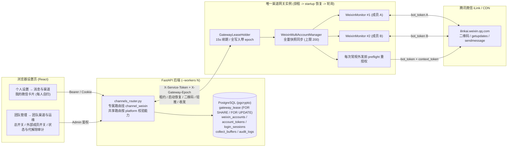

# 团队微信多账号（「每人扫自己的码」）设计方案

> **基线提交**：`34b353a0b`（已合入最新主分支独立核心运维脚本；Dalton 迁移链当前唯一头节点为 `d046`，链路 `d045 -> d047 -> d048 -> d046`，见 `src/dalton/migrations/versions/d046_scoped_data_map_cache.py:23-24`）  
> **文档轮次**：第 5 轮最终定案版（已完整合入拍板决策 D1～D18 与第 1～4 轮技术审查修订）  
> **架构定位**：严格对齐独立核心架构（`docs/dalton/features/standalone-core.md:8-42,64,243-246`）与第 ③ 阶段渠道网关插件化边界——每套部署固定运行 **1 个**渠道网关实例（由后端单行租约与单调 `epoch` 同事务锁围栏保障单活）；后端以 `--workers N` 运行并掌管全部账号归属、加密凭据、网关租约、材料收集窗口、会话状态、审计日志与权限，网关仅作为纯内存协议适配器按后端契约存取状态与凭据。

---

## 0. 背景与架构边界

### 0.1 问题根因

微信 iLink（微信智能体机器人接入协议，ClawBot〔腾讯微信个人智能体机器人形态〕，`bot_type="3"`，见 `integrations/dalton-channel-gateway/src/channels/weixin/types.ts:10`）通过扫码创建的机器人属于**扫码微信号专属的一对一私聊通道**：仅扫码的微信号（`ilink_user_id`）能在微信聊天列表中看到该机器人并收发消息，群聊事件在协议接入层直接归档拦截（`integrations/dalton-channel-gateway/src/channels/weixin/inbound.ts:147-167`、`src/dalton/database/channel_gateway.py:1729-1749`）。OpenClaw（开源多渠道智能体框架）社区方案同样采用每次扫码创建独立机器人账号、按账号与对端隔离会话的模型。

当前实现采用「全局单实例机器人 + 成员一次性绑定码」模型，在团队场景下仅扫码管理员一人可用：

1. **数据库单行约束**：`dalton_channel_weixin_state` 以 `singleton_id = 1` 固定保存全系统唯一一组 `ilink_bot_id` 与 `encrypted_bot_token`（`src/dalton/migrations/versions/d030_channel_gateway.py:256-265`、`src/dalton/migrations/versions/d032_weixin_state.py:23-42`、`src/dalton/database/channel_gateway.py:9795-10031`），另一位管理员扫码会覆盖原在线凭据。
2. **扫码接口限死管理员**：`/weixin/qrcode/start|wait|verify-code` 强制要求 `_require_weixin_admin`（`src/dalton/app/channels_router.py:1035-1039,1099-1157`）与数据库层 `get_user_tier(eff_owner) != "admin"` 校验（`src/dalton/database/channel_gateway.py:10092,10250,10397`）。
3. **网关单实例单账号内存状态**：`WeixinChannelAdapter` 仅维护单个 `this.account` 与单个 `WeixinMonitor` 长轮询协程（`integrations/dalton-channel-gateway/src/channels/weixin/index.ts:92-106,361-407`）。
4. **前端拆为管理员扫码与成员绑定码两套流程**：管理员在 `DaltonTeamOpsPanel`（`web/src/pages/Settings/panels/dalton/DaltonTeamOpsPanel.tsx:50`）操作 `DaltonWeixinBotCard`（`web/src/pages/Settings/panels/dalton/DaltonWeixinBotCard.tsx:39-44`）扫码，普通成员在 `IntegrationsPanel`（`web/src/pages/Settings/panels/IntegrationsPanel.tsx:43`）操作 `DaltonWeixinBindCard`（`web/src/pages/Settings/panels/dalton/DaltonWeixinBindCard.tsx:48-56`）生成 `/bind DLT-XXXX-XXXX` 绑定码，而微信侧仅扫码本人拥有机器人会话窗口。

### 0.2 硬性架构约束与三层开关协同规则

1. **后端单一真值与多 worker 安全**：后端以 `--workers N` 多进程模式运行（`AGENTS.md:103`、`src/server/AGENTS.md:38-50`）。账号与成员映射、部署级单行网关租约（`dalton_channel_gateway_lease`）、二维码登录会话、加密后的 `bot_token` / `context_token` / 入站媒体解密材料、长轮询游标 `get_updates_buf`、显式材料收集缓冲、管理审计日志以及账号配置变更代际号 `accounts_revision` 全部持久化在后端 PostgreSQL（开源关系型数据库）自有 `dalton_*` 表中。
2. **每套部署固定运行 1 个无状态网关实例（部署级单一租约 + 同事务 `epoch` 锁围栏，D1, D12, D13）**：
   - Everflow 生产通过 macOS `launchd` 托管唯一 `com.dalton.channel-gateway` 守护进程（模板 `scripts/dalton/launchd/com.dalton.channel-gateway.plist.template:18-25`）；独立核心安装在网关进入核心发布包后于 Docker Compose 固定配置 1 个网关容器副本。
   - `integrations/dalton-channel-gateway/` 仅负责协议适配与微信 CDN（Content Delivery Network，内容分发网络）加解密，移除遗留本地目录配置 `weixinCacheDir`（`integrations/dalton-channel-gateway/src/config.ts:24,132-135,195`、`orchestrator.ts:163,180,190`、`server.ts:206`）。
   - 后端单行表 `dalton_channel_gateway_lease`（`instance_id`、`epoch`、`expires_at`）保证任意时刻全系统仅 1 个网关进程持有有效 `epoch`。网关发出的**全部受保护写入请求（含入站、指令、游标、状态上报、材料补登、二维码登录会话写入、投递认领/预检/结算与启动恢复）**均在同一数据库事务首步对租约行执行 `SELECT ... FOR SHARE` 并核对 `epoch`；租约交接更新 `epoch` 对该行取 `FOR UPDATE`，从事务锁层面严格互斥。新获租进程先执行 `mode=startup` 完成遗留 `in_flight` 投递结算，成功后再开启长轮询与新投递认领；旧进程收到 HTTP `409` 后直接停止轮询并退出（详见 §2.1、§3.2、§3.4）。
3. **统一配置读取、平台级能力门控与三层开关协同**：
   - 形态解析统一使用 `src.dalton.profile.resolve_profile`（`src/dalton/profile.py:37-96`），能力判定统一使用 `src.dalton.capabilities`（`src/dalton/capabilities.py:56,59,160-191,475-540`），前端统一使用 `useCapabilities()`（`web/src/hooks/useCapabilities.ts:24,129`）；触及上游共享源码的钩子标注 `DALTON-HOOK` 注释并受能力门控保护；行为配置（`weixin.allow_external`、`weixin.max_concurrent_accounts`）统一定义在 `src/dalton/settings.py`（`DaltonConfig`，`src/dalton/settings.py:420-460`），运维脚本分别落在 Everflow 生产（`scripts/dalton/ops/prod/`）与核心安装（`scripts/standalone/`）。
   - **共享路由按实际平台检查子能力**：`/channels` 路由组顶层挂 `CapabilityId.CHANNEL_GATEWAY`（`src/dalton/app/channels_router.py:49-53`）；`I-1`～`I-7`、`/bindings`、`/settings`、`/bind-codes` 等共享入口在解析出目标平台后调用 `require_channel_platform_capability(platform)`（`src/dalton/capabilities.py:533-540`）或按激活能力过滤微信键，确保 `channel_weixin` 关闭时微信入口全部返回 HTTP `404` 且零字段暴露，飞书与 Discord 原样运行。
   - **网关是否执行微信长轮询由三层开关共同决定**（网关实例持有有效部署级租约、已完成 `mode=startup` 恢复且以下三层同为真时才启动 `WeixinMonitor`）：

| 开关层级 | 配置位置 | 作用域与变更方式 | 为 `false` 时的精确行为 |
|---|---|---|---|
| **第 1 层：网关适配器开关** | 网关环境变量 `DALTON_WEIXIN_ENABLED`（`integrations/dalton-channel-gateway/src/config.ts:212-216`，`mode === "outgoing"` 时固定为 `false`） | 网关进程静态开关 | 网关跳过初始化 `WeixinMultiAccountManager`，仅运行同进程已启用的飞书 / Discord 适配器，零 `/internal/weixin/*` 请求。 |
| **第 2 层：后端部署能力开关** | `DALTON_CAP_CHANNEL_WEIXIN` / `dalton.yaml` `capabilities.channel_weixin`（依赖 `channel_gateway`，`src/dalton/capabilities.py:185-191,325-424`） | 部署级静态能力（Core 默认关闭，Everflow 默认开启） | 后端全部 `/weixin/*` 路由返回 HTTP `404`，共享路由省略微信数据；网关若收到 `404` 立即中止本地全部微信轮询并转为每 `5 分钟` 静默探测，飞书 / Discord 照常运行。 |
| **第 3 层：数据库运行期总开关** | `dalton_channel_weixin_config.enabled`（管理员在设置页热切换） | 运行期热开关（默认 `TRUE`） | 后端暂停受理新扫码与常规微信外发授权，账号快照接口返回 `200` 且 `enabled: false, accounts: []`；网关立即中止全部 `WeixinMonitor` 并维持 15 秒心跳，数据库内既有凭据与游标原样保留，重开后免重扫恢复。 |

4. **只复制不改旧行的停机迁移与无损回退边界（D2, D10, D18）**：迁移 `d049_weixin_multi_account.py` 接在 `d046` 之后，在后端与网关均已停止的静默窗口内执行；`d049.upgrade()` 仅创建新表、新列与 `NOT VALID` 外键并将存量数据复制进新表/新列，**对旧单行表 `dalton_channel_weixin_state`（含 `login_*` 扫码字段）及旧代码读取的全部共享表既有行与既有列执行零修改、零删除**，新代码改为只读新表与新列；`VALIDATE CONSTRAINT` 放在部署后独立事务执行；`d049.downgrade()` 仅删除 `d049` 新增对象，在新版尚未产生业务写入时降级后旧代码所读数据（含旧单行表全列）与升级前逐行一致（详见 §2.2、§2.3、§6.3）。



---

## 1. 使用流程

### 1.1 团队成员个人操作流程（「个人设置 → 消息与渠道」）

当部署启用 `channel_weixin` 能力，且当前登录用户通过实时名册与按层级开关判定（`admin` 与 `internal` 仅受总开关控制；`external` 同时受外部成员开关控制，关闭时对 `external` 成员隐藏卡片与搜索词）时，打开「设置 → 消息与渠道」（`web/src/pages/Settings/panels/IntegrationsPanel.tsx:29,43`，锚点 `#dalton-weixin-bind`，见 `web/src/pages/Settings/sections.ts:295`）可操作重构后的 **「我的微信」卡片**（`web/src/pages/Settings/panels/dalton/DaltonWeixinBindCard.tsx`）：

1. **首次扫码连接（每人限连 1 个微信号）**：
   - 成员点击「扫码连接个人微信」，调用 `POST /api/v1/dalton/channels/weixin/qrcode/start`。后端在持有该成员用户锁（Level 1）时先核验成员资格、按成员层级求值运行开关与容量（新占槽位要求活跃轮询数 `< max_concurrent_accounts`，已占槽位账号重扫直接放行），在调用 iLink 前先写入一条 `status = 'starting'` 的待扫会话记录；网关取得二维码后按 `status = 'starting'` 状态条件更新为 `'wait'`（期间若已被撤销则整笔回滚并返回已撤销），向前端返回脱敏 `session_key` 与二维码图像（`qrcode_url` / `qrcode_img_content`）。
   - 前端沿用串行长轮询状态机（`web/src/pages/Settings/panels/dalton/DaltonWeixinBotCard.tsx:74-114`）调用 `GET /api/v1/dalton/channels/weixin/qrcode/wait?session_key=...`（网关对 iLink 单次长轮询最长约 `35s`，后端代理超时 `45s`，前端超时 `50s`；每次返回未终态后间隔 `1.2s` 发起下一轮）：
     - `wait`：展示二维码与提示「请用本人手机微信扫描二维码」；
     - `scaned`：提示「已扫码，请在手机微信上点击确认登录」（iLink `scaned_but_redirect` 回写跨区域名后归一展示为 `scaned`）；
     - `verify_code`：风控要求手机端辅助验证码时展示输入框，提交 `POST /api/v1/dalton/channels/weixin/qrcode/verify-code`；
     - `confirmed`：后端按统一锁序在同一事务内校验登录会话仍处待扫态（`wait` / `scaned` / `verify_code`）、成员实时在册、按该成员层级求值总开关与外部开关、核对轮询槽位容量上限（默认 `200`）并核查微信号占用：
       - 若该 `ilink_user_id` 已被团队内另一名在职成员（含 `active`、`pending_verification`〔含重扫待验证保留的原号 `prev_ilink_user_id`〕、`expired` 或 `external_access_disabled` 暂停账号）关联，拒绝确认并提示 **「该微信号已关联团队内另一账号，请先在原账号解除连接后再试」**；若原持有者已离开团队（`disabled_reason = 'member_not_in_roster'`），按全局统一锁序物理删除旧停用行并完成当前成员绑定；
       - 确认响应包含 `ilink_user_id` 时，账号状态置为 **`active`（已连接）**（清空 `prev_ilink_user_id`），自动初始化默认 `dalton_channel_user_settings.apps.weixin`；
       - 确认响应缺少 `ilink_user_id` 时，账号状态置为 **`pending_verification`（已连接，待验证）**（重扫时将原 `ilink_user_id` 移入 `prev_ilink_user_id` 继续保持唯一占用），待微信首条消息回填 `ilink_user_id` 并通过唯一性核验后转为 `active`（同号时清空 `prev_ilink_user_id`，换号时释放原号；首条消息若发现与团队内他人微信号重复，自动解除该新连接、写入审计并用该条入站携带的 `context_token` 直接回复说明原因）；
     - `expired`：超过 5 分钟有效期（TTL，Time-To-Live，存活有效期）、被新码取代或已被撤销解除时展示「刷新二维码」按钮。
2. **查看连接与推送状态**：
   - 状态徽章展示五种明确状态：**已连接**（`active`，绿色）、**已连接，待验证**（`pending_verification`，蓝色）、**登录已过期**（`expired`，黄色，对应 iLink `-14`）、**渠道已暂停**（总开关关闭，或 `external` 成员遇外部开关收紧）或 **待连接**（`unconfigured`）。
   - 已连接状态下展示微信昵称 `ilink_username`、末 4 位掩码 `ilink_user_id`（如 `****a1b2`）、更新时间 `updated_at`、最近收信时间 `last_inbound_at`、**主动推送激活状态**，以及常驻可见的「聊天记录转发指引」（说明使用 `/collect` 逐条转发收集或发送长截图）。
3. **重新扫码（过期续期或更换微信号，替换原连接）**：
   - 已占轮询槽位的账号（`status IN ('active', 'pending_verification')`）重新扫码在 `200 / 200` 满额时照常放行；新二维码等待期间独立保存在 `dalton_channel_weixin_login_sessions` 表中，原在线连接在手机确认新码前保持正常收发；确认新码后原子递增 `bot_generation`、替换加密凭据与 `base_url`、清理本账号旧代际令牌并将未完成收集窗口置为 `cancelled`（其所属入站行标为已取消退出恢复）：
     - **同一微信号重扫续期（`ilink_user_id` 相同）**：保持 `scope_key = 'dm:<ilink_user_id>'` 与会话代数 `generation` 原值，延续原对话线程与工作区选择（若确认时缺 `ilink_user_id` 进入待验证，期间由 `prev_ilink_user_id` 继续占用原微信号，首包核实同号后清空 `prev_ilink_user_id`）；
     - **更换另一微信号（`ilink_user_id` 变化）**：替换原连接并释放原微信号，推进会话 `generation + 1`、清空工作区覆盖与待决中断、关闭旧监听，开启新线程。
4. **本人解除连接**：
   - 成员在设置页点击「解除连接」二次确认（`DELETE /api/v1/dalton/channels/bindings/weixin`）或在微信发送 `/unbind`。
   - 后端单事务将本账号下未完成的 `collect_buffers` 置为 `cancelled`（保留窗口行至定期清理任务，仅将 `account_id` 置空以保留入站行的 `collect_buffer_id` 关联，同步将所属未完成入站行置为 `status = 'ignored', fallback_pending = FALSE` 退出恢复）、物理删除 `dalton_channel_weixin_accounts` 记录（彻底释放微信号占用并级联清理 `account_tokens`）、将该成员所有未终态 `login_sessions`（含 `starting`）置为 `superseded`、移除 `apps.weixin`、推进会话 `generation + 1`、关闭该账号关联 `thread_watches`、按固定默认文案写入 `dalton_channel_weixin_audit_logs` 并递增 `accounts_revision`，通知网关立即终止轮询；若由微信 `/unbind` 触发且该条入站携带 `context_token`，在同一事务返回一次性回执信封由网关直接发出告别提示（豁免活跃账号预检，见 D16）。

### 1.2 管理员视图与管理权限（「团队管理 → 团队渠道与运维」）

管理员打开「设置 → 团队管理 → 团队渠道与运维」（`web/src/pages/Settings/panels/dalton/DaltonTeamOpsPanel.tsx:50`，重构 `DaltonWeixinBotCard.tsx` 为 **「团队微信渠道管理」卡片**，仅 `callerTier === 'admin'` 可见，见 `web/src/pages/Settings/sections.ts:309`）：

1. **渠道运行期总开关与外部成员接入开关（按层级生效，恢复回暂停前状态，D15）**：
   - **「启用团队个人微信接入」总开关**（`dalton_channel_weixin_config.enabled`，默认开启）：对全体成员（`admin` / `internal` / `external`）生效；关闭后暂停新扫码与常规外发，网关停止全部微信长轮询，数据库保留凭据与游标；重开后免重扫按原游标恢复。
   - **「允许外部受邀成员（`external`）连接个人微信」开关**（默认开启）：仅约束 `external` 层级成员，管理员与内部成员（`admin` / `internal`）始终允许扫码与收发；关闭后隐藏 `external` 成员微信入口、拦截其扫码与收发，并将已绑定的 `external` 成员账号记录暂停前状态 `prev_status`（`active` / `pending_verification` / `expired`）后置为 `status = 'disabled', disabled_reason = 'external_access_disabled'`（保留微信号占用，15 秒对账保持该暂停态，仅在管理员重新打开该开关时按容量上限恢复回各自的 `prev_status`）。
   - 顶部提供「去管理我自己的个人微信 →」跳转链接（`#dalton-weixin-bind`）。
2. **成员状态总览与单实例容量监控**：
   - 顶部统计栏展示：`在线轮询账号数 / 已连接总数`、`待验证 / 已过期数`、`单网关实例轮询槽位（当前占槽 / 上限 200）`。
   - 列表展示已绑定账号成员及当前持有待扫会话（`starting` / `wait` / `scaned` / `verify_code`）的成员：姓名与邮箱、层级（`admin` / `internal` / `external`）、**微信昵称 `ilink_username` 与末 4 位掩码 `ilink_user_id`**、状态（`已连接` / `已连接，待验证` / `扫码等待中` / `登录已过期` / `外部暂停` / `离职已停用`）、最近收信时间 `last_inbound_at` 与更新时间 `updated_at`。
3. **管理员随时代任意成员解除或撤销待扫会话（二次确认 + 预设原因落表审计）**：
   - 对已有账号行提供「代为解除」（`DELETE /weixin/admin/accounts/{account_id}`），对尚无账号行但处于「扫码等待中」（含 `starting`）的成员及按成员操作统一提供按成员撤销接口（`DELETE /weixin/admin/users/{target_user_id}/weixin`）。
   - 二次确认弹窗要求选择预设原因（`离职交接` / `手机遗失应急` / `误绑微信号` / `其他原因`，支持附加说明），在同一事务内将未完成收集窗口置为 `cancelled` 保留至定期清理（所属入站行退出恢复）、物理删除微信账号（释放微信号）、将未终态待扫二维码全部置为 `superseded`、关闭监听并写入 **`dalton_channel_weixin_audit_logs`**（完整记录操作人、目标成员、时间、原因）。

### 1.3 扫码后微信侧呈现与开始对话方式

1. **微信端表现**：手机微信确认扫码后，聊天列表立即新增该 **ClawBot 机器人**的一对一私聊窗口。
2. **首条带令牌消息激活推送（与待验证身份核验）**：iLink `get_qrcode_status` 返回 `bot_token`、`ilink_bot_id`、`baseurl` 及可选的 `ilink_user_id`（`integrations/dalton-channel-gateway/src/channels/weixin/types.ts:217-228`），而出站 `sendmessage` 强制要求非空 `context_token`（`send.ts:209-218,281-290`），该字段随入站 `WeixinMessage.context_token`（可选字段，`types.ts:147`）下发。扫码成功页常驻展示引导：**「请打开手机微信，向机器人发送一句话（如『你好』或 `/workspace`），收到携带会话令牌的消息后即可激活主动推送。如需转发聊天记录分析，可发 `/collect` 开启逐条收集（转完发 `/done`），或直接发送聊天长截图。」**
3. **支持的消息类型与指令全集**：
   - **入站已支持**（`integrations/dalton-channel-gateway/src/channels/weixin/inbound.ts:185-212,332-449`）：文字、引用消息、开启微信语音转文字的语音、图片（`IMAGE`）、文档文件（`FILE`）及视频（`VIDEO`，下载解密为工作区 `.mp4` 文件）。
   - **出站已支持**（`integrations/dalton-channel-gateway/src/channels/weixin/send.ts:227-240,299-386`）：经 `filterWeixinMarkdown` 清洗的分段纯文本（`TEXT`）、经魔数校验的图片气泡（`IMAGE`）及通用文件气泡（`FILE`，承载 PDF〔Portable Document Format，便携式文档格式〕、Office、CSV〔Comma-Separated Values，逗号分隔值表格〕等各类非图片附件）。
   - **斜杠指令全集**：`/workspace`、`/<工作区名称>`、`/main`、`/new`、`/stop`、`/unbind`，以及新增的 `/collect`（别名 `/收集`）、`/done`（别名 `/完成`）、`/cancel`（别名 `/取消`）与 `/help`（常驻查看使用与转发说明）。

---

## 2. 数据模型与迁移

### 2.1 多账号表结构设计（迁移 `d049_weixin_multi_account.py`）

新增 Alembic（数据库表结构版本迁移工具）脚本 `src/dalton/migrations/versions/d049_weixin_multi_account.py`（`revision = "d049"`，`down_revision = "d046"`），仅操作 `dalton_*` 表，每个步骤开头执行 `SET LOCAL lock_timeout = '5s'`（对齐 `src/dalton/migrations/versions/d046_scoped_data_map_cache.py:30`）：

#### （1）部署级单一网关实例租约表 `dalton_channel_gateway_lease`

```sql
CREATE TABLE IF NOT EXISTS dalton_channel_gateway_lease (
    singleton_id SMALLINT PRIMARY KEY DEFAULT 1 CHECK (singleton_id = 1),
    instance_id  VARCHAR(128) NOT NULL,               -- 当前持有租约的唯一网关进程 ID
    epoch        BIGINT NOT NULL DEFAULT 1,           -- 每次新实例接管单调 +1，全写入同事务 FOR SHARE 校验
    acquired_at  TIMESTAMPTZ NOT NULL DEFAULT NOW(),
    expires_at   TIMESTAMPTZ NOT NULL,                -- 租约到期时间（45s TTL，15s 心跳续期）
    updated_at   TIMESTAMPTZ NOT NULL DEFAULT NOW()
);
```

#### （2）团队微信运行期配置表 `dalton_channel_weixin_config`

```sql
CREATE TABLE IF NOT EXISTS dalton_channel_weixin_config (
    singleton_id      SMALLINT PRIMARY KEY DEFAULT 1 CHECK (singleton_id = 1),
    enabled           BOOLEAN NOT NULL DEFAULT TRUE,  -- 管理员运行期渠道总开关（全体层级生效）
    allow_external    BOOLEAN,                        -- 非空时覆盖 settings.py 的 weixin.allow_external（仅约束 external 层级）
    accounts_revision BIGINT NOT NULL DEFAULT 1,      -- 账号/开关每次变更在事务最末尾单调 +1
    updated_by        VARCHAR(255),
    updated_at        TIMESTAMPTZ NOT NULL DEFAULT NOW()
);
```

#### （3）个人微信多账号凭据、身份与游标主表 `dalton_channel_weixin_accounts`

新代码以本表作为微信账号与成员微信身份的唯一真值来源（替代旧代码对 `dalton_channel_identities WHERE platform = 'weixin'` 的读写，保持旧身份行原样不动）：

```sql
CREATE TABLE IF NOT EXISTS dalton_channel_weixin_accounts (
    account_id          UUID PRIMARY KEY DEFAULT gen_random_uuid(), -- UUID（Universally Unique Identifier，通用唯一识别码）
    user_id             VARCHAR(255) NOT NULL UNIQUE                -- 每人限连 1 个微信号
                        CHECK (user_id <> 'system:dalton-company'),
    ilink_bot_id        VARCHAR(255) NOT NULL UNIQUE,               -- iLink 机器人唯一标识
    ilink_user_id       VARCHAR(255),                               -- 当前已核验微信号 ID（pending_verification 阶段为空）
    prev_ilink_user_id  VARCHAR(255),                               -- 重扫进入待验证时保留的原微信号 ID（继续参与唯一占用，首包核验后清空）
    ilink_username      VARCHAR(255),                               -- 扫码微信号昵称
    encrypted_bot_token BYTEA NOT NULL,                             -- pgp_sym_encrypt(bot_token, get_encryption_key())
    base_url            VARCHAR(512) NOT NULL DEFAULT 'https://ilinkai.weixin.qq.com',
    cdn_base_url        VARCHAR(512) NOT NULL DEFAULT 'https://novac2c.cdn.weixin.qq.com/c2c',
    get_updates_buf     TEXT NOT NULL DEFAULT '',                   -- 该账号独立 getupdates 长轮询游标
    status              VARCHAR(32) NOT NULL DEFAULT 'active'
                        CHECK (status IN ('active', 'pending_verification', 'expired', 'disabled')),
    prev_status         VARCHAR(32),                                -- 仅 status='disabled' 时非空，记录暂停前状态以供精确恢复
    disabled_reason     VARCHAR(64),
    bot_generation      BIGINT NOT NULL DEFAULT 1,                  -- 账号内重登代际号
    last_inbound_at     TIMESTAMPTZ,
    last_error_code     VARCHAR(64),
    last_error_at       TIMESTAMPTZ,
    created_at          TIMESTAMPTZ NOT NULL DEFAULT NOW(),
    updated_at          TIMESTAMPTZ NOT NULL DEFAULT NOW(),
    CHECK (prev_ilink_user_id IS NULL OR ilink_user_id IS NULL),
    CHECK (
        (status = 'disabled'
         AND disabled_reason IN ('member_not_in_roster', 'external_access_disabled')
         AND prev_status IN ('active', 'pending_verification', 'expired'))
        OR (status <> 'disabled' AND disabled_reason IS NULL AND prev_status IS NULL)
    )
);

-- 微信号占用与释放唯一索引（D6 + 重扫待验证原号保护）：
-- COALESCE(ilink_user_id, prev_ilink_user_id) 同时覆盖已核验微信号与重扫进入待验证期间保留的原微信号；
-- 在职连接（active / pending_verification / expired）及「外部成员开关关闭」暂停（external_access_disabled）保留微信号占用；
-- 本人解除、管理员代解除（直接删除行）与离开团队（disabled_reason = 'member_not_in_roster'）释放微信号占用。
CREATE UNIQUE INDEX IF NOT EXISTS idx_dalton_wx_accounts_ilink_user_occupied
    ON dalton_channel_weixin_accounts (COALESCE(ilink_user_id, prev_ilink_user_id))
    WHERE COALESCE(ilink_user_id, prev_ilink_user_id) IS NOT NULL
      AND (status IN ('active', 'pending_verification', 'expired') OR disabled_reason = 'external_access_disabled');

CREATE INDEX IF NOT EXISTS idx_dalton_wx_accounts_status
    ON dalton_channel_weixin_accounts (status, updated_at DESC);
```

#### （4）多账号上下文令牌表 `dalton_channel_weixin_account_tokens` 与二维码登录会话表 `dalton_channel_weixin_login_sessions`

多账号令牌独立建表（`d049` 从旧表 `dalton_channel_weixin_context_tokens` 复制存量记录，旧表保持原样不动，满足 D10）；登录会话表包含调用 iLink 前预写的 `'starting'` 状态（满足 D14）：

```sql
CREATE TABLE IF NOT EXISTS dalton_channel_weixin_account_tokens (
    account_id              UUID NOT NULL REFERENCES dalton_channel_weixin_accounts(account_id) ON DELETE CASCADE,
    ilink_bot_id            VARCHAR(255) NOT NULL,
    bot_generation          BIGINT NOT NULL,
    platform_user_id        VARCHAR(255) NOT NULL,
    encrypted_context_token BYTEA NOT NULL,
    seq                     BIGINT NOT NULL DEFAULT 0,
    seq_source              VARCHAR(32) NOT NULL DEFAULT 'protocol',
    protocol_seq_high       BIGINT NOT NULL DEFAULT 0,
    platform_time_high      BIGINT NOT NULL DEFAULT 0,
    token_version           BIGINT NOT NULL DEFAULT 1,
    stale_at                TIMESTAMPTZ,
    stale_reason            VARCHAR(64),
    updated_at              TIMESTAMPTZ NOT NULL DEFAULT NOW(),
    PRIMARY KEY (account_id, bot_generation, platform_user_id)
);

CREATE TABLE IF NOT EXISTS dalton_channel_weixin_login_sessions (
    session_key             VARCHAR(255) PRIMARY KEY,
    user_id                 VARCHAR(255) NOT NULL CHECK (user_id <> 'system:dalton-company'),
    target_account_id       UUID REFERENCES dalton_channel_weixin_accounts(account_id) ON DELETE SET NULL,
    login_version           BIGINT NOT NULL DEFAULT 1,       -- 会话状态流转 CAS（Compare-And-Swap，比较并交换）版本号
    expected_bot_generation BIGINT,                          -- 发起重登时原账号的 bot_generation（首次扫码为 NULL）
    status                  VARCHAR(64) NOT NULL DEFAULT 'starting'
                            CHECK (status IN ('starting', 'wait', 'scaned', 'verify_code', 'confirmed', 'expired', 'superseded')),
    encrypted_qrcode        BYTEA,                           -- starting 阶段为空，写入票据后为 pgp_sym_encrypt(qrcode, key)
    qrcode_img_content      TEXT,                            -- 仅在 wait/scaned/verify_code 保留，终态立即置 NULL
    redirect_base_url       VARCHAR(512) NOT NULL DEFAULT 'https://ilinkai.weixin.qq.com',
    expires_at              TIMESTAMPTZ NOT NULL,
    confirmed_result        JSONB,                           -- 严格限 5 字段白名单: {account_id, connected, already_connected, bot_generation, accounts_revision}
    created_at              TIMESTAMPTZ NOT NULL DEFAULT NOW(),
    updated_at              TIMESTAMPTZ NOT NULL DEFAULT NOW(),
    CHECK (status IN ('starting', 'expired', 'superseded') OR encrypted_qrcode IS NOT NULL)
);

CREATE UNIQUE INDEX IF NOT EXISTS uq_dalton_wx_login_sessions_user_pending
    ON dalton_channel_weixin_login_sessions (user_id)
    WHERE status IN ('starting', 'wait', 'scaned', 'verify_code');
```

#### （5）微信渠道管理与解绑审计表 `dalton_channel_weixin_audit_logs`

审计表保存当时的账号与掩码快照，账号物理删除后审计记录完整保留；全部 9 种 `action` 均设固定非空默认 `reason` 文案（见 §4.3）：

```sql
CREATE TABLE IF NOT EXISTS dalton_channel_weixin_audit_logs (
    audit_id             UUID PRIMARY KEY DEFAULT gen_random_uuid(),
    action               VARCHAR(64) NOT NULL,  -- 'admin_unbind' | 'member_unbind' | 'admin_toggle_channel' | 'admin_toggle_external' | 'member_removed_revoke' | 'member_reinstated_restore' | 'disabled_account_reclaimed' | 'conflict_auto_unbound' | 'ambiguous_legacy_delivery_blocked'
    operator_user_id     VARCHAR(255) NOT NULL, -- 操作人 user_id（系统后台任务写 'system:roster-reconciler' 或 'system:delivery-guard'）
    target_user_id       VARCHAR(255),          -- 目标成员 user_id
    weixin_account_id    UUID,
    ilink_bot_id         VARCHAR(255),
    masked_ilink_user_id VARCHAR(32),           -- 仅保存末 4 位掩码（如 '****a1b2'）
    reason               TEXT NOT NULL,         -- 非空原因（<= 500 字符）
    metadata             JSONB NOT NULL DEFAULT '{}'::jsonb,
    created_at           TIMESTAMPTZ NOT NULL DEFAULT NOW()
);

CREATE INDEX IF NOT EXISTS idx_dalton_wx_audit_logs_target_time
    ON dalton_channel_weixin_audit_logs (target_user_id, created_at DESC);

CREATE INDEX IF NOT EXISTS idx_dalton_wx_audit_logs_time
    ON dalton_channel_weixin_audit_logs (created_at DESC);
```

#### （6）逐条转发材料收集表（含 `done` 终态、`flush_prompt` 与附件三步状态跟踪，D4 & D17）

```sql
CREATE TABLE IF NOT EXISTS dalton_channel_weixin_collect_buffers (
    buffer_id           UUID PRIMARY KEY DEFAULT gen_random_uuid(),
    account_id          UUID REFERENCES dalton_channel_weixin_accounts(account_id) ON DELETE SET NULL, -- 解绑时置 cancelled 并保留窗口至定期清理，避免入站行 collect_buffer_id 置空落入普通恢复
    bot_generation      BIGINT NOT NULL,
    dalton_user_id      VARCHAR(255) NOT NULL,
    scope_key           VARCHAR(255) NOT NULL,
    session_generation  INTEGER NOT NULL,
    workspace_id        UUID NOT NULL,          -- 无覆盖工作区时先确保创建 Home 工作区再锁存其 UUID
    initial_prompt      TEXT NOT NULL DEFAULT '',
    flush_prompt        TEXT,                   -- /done 传入的补充提问（供 flushing 重启恢复使用）
    status              VARCHAR(32) NOT NULL DEFAULT 'collecting'
                        CHECK (status IN ('collecting', 'flushing', 'done', 'cancelled', 'expired')),
    item_count          INTEGER NOT NULL DEFAULT 0,
    total_text_chars    INTEGER NOT NULL DEFAULT 0,
    attachment_count    INTEGER NOT NULL DEFAULT 0,
    expires_at          TIMESTAMPTZ NOT NULL,
    max_expires_at      TIMESTAMPTZ NOT NULL,
    flushed_message_id  VARCHAR(255),
    created_at          TIMESTAMPTZ NOT NULL DEFAULT NOW(),
    updated_at          TIMESTAMPTZ NOT NULL DEFAULT NOW()
);

CREATE UNIQUE INDEX IF NOT EXISTS uq_dalton_wx_collect_active
    ON dalton_channel_weixin_collect_buffers (account_id, bot_generation, scope_key, session_generation)
    WHERE status IN ('collecting', 'flushing');

CREATE TABLE IF NOT EXISTS dalton_channel_weixin_collect_items (
    buffer_id                 UUID NOT NULL REFERENCES dalton_channel_weixin_collect_buffers(buffer_id) ON DELETE CASCADE,
    message_id                VARCHAR(255) NOT NULL,
    protocol_seq              BIGINT,
    platform_time_ms          BIGINT,
    receive_order             INTEGER NOT NULL,
    text_content              TEXT NOT NULL DEFAULT '',
    expected_attachment_count INTEGER NOT NULL DEFAULT 0,
    upload_status             VARCHAR(32) NOT NULL DEFAULT 'ready'
                              CHECK (upload_status IN ('pending_upload', 'ready', 'failed')),
    uploaded_attachments      JSONB NOT NULL DEFAULT '[]'::jsonb,
    upload_error              TEXT,
    created_at                TIMESTAMPTZ NOT NULL DEFAULT NOW(),
    updated_at                TIMESTAMPTZ NOT NULL DEFAULT NOW(),
    PRIMARY KEY (buffer_id, message_id)
);
```

#### （7）热表新增列与 `NOT VALID` 外键（校验移至部署后独立步骤执行，D18）

由于 Alembic `env.py` 在单一事务中执行迁移（`src/dalton/migrations/env.py:75-76`），`d049.upgrade()` 事务内**仅执行毫秒级元数据变更（`ADD COLUMN` 与 `ADD CONSTRAINT ... NOT VALID`）**；5 条外键的 `VALIDATE CONSTRAINT` 全部移出迁移事务，作为服务启动后的独立上线步骤逐条在单独事务中执行（仅持 `SHARE UPDATE EXCLUSIVE` 弱锁，零读写阻塞）：

```sql
ALTER TABLE dalton_channel_inbound_events
    ADD COLUMN IF NOT EXISTS weixin_account_id UUID,
    ADD COLUMN IF NOT EXISTS encrypted_weixin_media_meta BYTEA,
    ADD COLUMN IF NOT EXISTS collect_buffer_id UUID;

ALTER TABLE dalton_channel_inbound_events
    ADD CONSTRAINT fk_dalton_inbound_wx_account
    FOREIGN KEY (weixin_account_id) REFERENCES dalton_channel_weixin_accounts(account_id)
    ON DELETE SET NULL NOT VALID;

ALTER TABLE dalton_channel_inbound_events
    ADD CONSTRAINT fk_dalton_inbound_wx_collect_buf
    FOREIGN KEY (collect_buffer_id) REFERENCES dalton_channel_weixin_collect_buffers(buffer_id)
    ON DELETE SET NULL NOT VALID;

ALTER TABLE dalton_channel_thread_watches
    ADD COLUMN IF NOT EXISTS weixin_account_id UUID,
    ADD COLUMN IF NOT EXISTS weixin_recipient_id VARCHAR(255),
    ADD COLUMN IF NOT EXISTS weixin_bot_generation BIGINT;

ALTER TABLE dalton_channel_thread_watches
    ADD CONSTRAINT fk_dalton_watches_wx_account
    FOREIGN KEY (weixin_account_id) REFERENCES dalton_channel_weixin_accounts(account_id)
    ON DELETE SET NULL NOT VALID;

ALTER TABLE dalton_channel_background_runs
    ADD COLUMN IF NOT EXISTS weixin_account_id UUID,
    ADD COLUMN IF NOT EXISTS weixin_recipient_id VARCHAR(255),
    ADD COLUMN IF NOT EXISTS weixin_bot_generation BIGINT;

ALTER TABLE dalton_channel_background_runs
    ADD CONSTRAINT fk_dalton_bg_runs_wx_account
    FOREIGN KEY (weixin_account_id) REFERENCES dalton_channel_weixin_accounts(account_id)
    ON DELETE SET NULL NOT VALID;

ALTER TABLE dalton_channel_deliveries
    ADD COLUMN IF NOT EXISTS weixin_account_id UUID,
    ADD COLUMN IF NOT EXISTS weixin_bot_id VARCHAR(255),
    ADD COLUMN IF NOT EXISTS weixin_bot_generation BIGINT,
    ADD COLUMN IF NOT EXISTS weixin_recipient_id VARCHAR(255);

ALTER TABLE dalton_channel_deliveries
    ADD CONSTRAINT fk_dalton_deliveries_wx_account
    FOREIGN KEY (weixin_account_id) REFERENCES dalton_channel_weixin_accounts(account_id)
    ON DELETE SET NULL NOT VALID;
```

#### （8）唯一全局事务加锁顺序（零例外，D5, D11, D12）

所有跨表事务严格遵循以下唯一单向递增锁层级，无任何旁路或逆序例外（继承并对齐 `src/dalton/database/channel_gateway.py:6-14,219-235,286-320` 与 `src/dalton/auth/roles.py:206-220`）：

- **Level 0a（角色表锁，仅本地角色增删改事务涉及）**：`dalton_user_roles`（按 `user_id` 升序 `FOR UPDATE`）→ `dalton_credential_holder`（`singleton_id = 1 FOR SHARE`）。
- **Level 0b（网关租约行同事务锁与单消息 / 单投递幂等咨询锁，D12）**：
  - 网关租约申请 / 续期 / 释放接口单独对 `dalton_channel_gateway_lease (singleton_id = 1)` 取 **`FOR UPDATE`**；
  - 网关发出的**全部受保护写入事务**（含 `I-1`、`I-2`、`I-3`、`/cursor`、`/status`、`reconcile` 写分支、`login-sessions` 写入、收集附件补登与完成、`I-6`、`preflight-send`、`I-7`、`recover`）在同一事务首步执行 `SELECT epoch, expires_at FROM dalton_channel_gateway_lease WHERE singleton_id = 1 FOR SHARE`，核对 `epoch` 相等且 `expires_at > NOW()`（失配立即回滚并返回 HTTP `409 stale_gateway_epoch`；因 `FOR SHARE` 与租约交接的 `FOR UPDATE` 互斥，进行中的写入与租约交接严格串行）；
  - 随后（如适用）获取 `pg_advisory_xact_lock(hashtext('dalton_inbound:<platform>:<message_id>'))` 或 `dalton_delivery:<delivery_key>`。
- **Level 1（用户级门闩咨询锁与个人设置行锁）**：`pg_advisory_xact_lock(hashtext('dalton_user_settings:' || user_id))` +（修改频道设置时）`dalton_channel_user_settings FOR UPDATE`，**涉及多名成员时严格按 `user_id` 字典序升序加锁**。**任何需要用户锁的路径（含 `qrcode/start`、`confirm`、本人/管理员解绑、`I-2 /unbind`、名册对账自动恢复、`I-1`/`I-3` 待验证首包回填与重复微信号冲突解除）一律先取 Level 1 用户锁、再取 Level 3a 账号行锁。**
- **Level 2（群聊咨询锁，飞书 / Discord 群事务保留）**：`_acquire_group_chat_lock`（按平台与群地址升序）。
- **Level 3（微信账号行锁与微信号唯一性咨询锁）**：
  - **3a**：`dalton_channel_weixin_accounts`（**涉及多个账号时严格按 `account_id` 升序加锁**：`confirm`、重登、接管、解绑、停用/恢复、待验证首包回填取 `FOR UPDATE`；已处于 `active` 态的常规 `I-1`/`I-3`、`/cursor`、`/status` 取 `FOR NO KEY UPDATE`）；
  - **3b**：`pg_advisory_xact_lock(hashtext('dalton_weixin_bot:' || ilink_bot_id))` → 对所涉全部非空微信号（含 `ilink_user_id` 与 `prev_ilink_user_id`）按字典序升序获取 `pg_advisory_xact_lock(hashtext('dalton_weixin_ilink_user:' || wx_uid))`。
- **Level 4（二维码登录会话行锁）**：`dalton_channel_weixin_login_sessions FOR UPDATE`（按 `session_key` 升序）。
- **Level 5（微信 `account_tokens` 发送方咨询锁与行锁）**：`dalton_weixin_context:<bot>:<gen>:<sender>`（按三元组升序）→ `dalton_channel_weixin_account_tokens FOR UPDATE`。
- **Level 6（绑定、会话代数与收集缓冲行锁）**：`dalton_channel_chat_bindings` → `dalton_channel_session_generations FOR UPDATE`（按主键升序）→ `dalton_channel_weixin_collect_buffers` / `collect_items FOR UPDATE`。
- **Level 7（事件、监听、后台运行、投递行锁与审计表插入）**：`dalton_channel_inbound_events` → `dalton_channel_thread_watches` → `dalton_channel_background_runs` → `dalton_channel_deliveries`（`FOR UPDATE`）→ `INSERT INTO dalton_channel_weixin_audit_logs`。
- **Level 8（微信全局配置单行锁——固定为变更账号/配置/槽位事务的最后一步）**：`SELECT / UPDATE dalton_channel_weixin_config WHERE singleton_id = 1 FOR UPDATE`。

**两阶段统一取锁与 `I-1`/`I-3` 待验证首包回滚重取规程（D5 & D11）**：
1. **常规多用户/单用户变更路径**（`confirm`、解绑、名册对账自动恢复、首包重入）：① 无锁预查询匹配目标 `user_id`、`ilink_user_id`（含 `COALESCE(ilink_user_id, prev_ilink_user_id)` 命中目标微信号的行）、`ilink_bot_id` 的全部 `weixin_accounts` 行，汇总受影响 `affected_user_ids` 与 `affected_account_ids`；② 取 Level 0b 锁；③ 按 `user_id` 升序取全部 `affected_user_ids` 的 Level 1 锁；④ 按 `account_id` 升序取全部 `affected_account_ids` 的 Level 3a `FOR UPDATE` 锁；⑤ 取 Level 3b 咨询锁并重新查询核验——若出现新用户或新账号未在已锁集合内，立即抛出 `_WeixinSettingsLockSetChanged` 回滚事务并按扩大后的集合从步骤 ① 重试。
2. **`I-1` / `I-3` 发现 `pending_verification` 时的强制回滚重取**：常规 `I-1`/`I-3` 快路径跳过 Level 1 直接取 Level 3a `FOR NO KEY UPDATE`；**一旦读到该账号 `status == 'pending_verification'`（需要回填 `ilink_user_id` 或执行重复微信号冲突解绑，涉及 Level 1 用户锁），立即抛出 `_NeedsTwoPhaseVerificationLock` 回滚当前事务以释放已持有的账号行锁，随后按上述步骤 ①～⑤ 从头先取 Level 1 用户锁、再取 Level 3a 账号行锁执行**。

### 2.2 存量数据只复制迁移与精确回填（只写新表新列、保留旧表旧行全列原样，D10 & D18）

`d049.upgrade()` 在后端与网关均已停止的静默窗口内执行，**全程只建新表、加新列并将存量数据复制填充至新表与新列，保持 `dalton_channel_weixin_state`（含 `login_session_key`、`login_status`、`login_qrcode` 等全部列，见 `src/dalton/database/channel_gateway.py:9819-9845`）、`dalton_channel_identities`、`dalton_channel_bind_codes`、`dalton_channel_session_generations`、`dalton_channel_weixin_context_tokens`、`dalton_channel_inbound_events.raw_payload`、`dalton_channel_thread_watches`、`dalton_channel_background_runs` 与 `dalton_channel_deliveries` 的既有行与既有列逐行原封未动**：

1. **初始化配置表**：插入 `dalton_channel_weixin_config (singleton_id = 1, enabled = TRUE, accounts_revision = 1)`。
2. **原样冻结旧单行表 `dalton_channel_weixin_state`（零写操作，D10）**：对 `dalton_channel_weixin_state` 执行只读读取，保留包含机器人凭据、游标、代际及待扫会话字段（`login_session_key`、`login_status`、`login_qrcode`、`login_qrcode_img_content`、`login_confirmed_result` 等）在内的全部列原值；新代码停止读写该表，历史明文二维码留待未来删旧表迁移一并清除。
3. **原管理员账号与上下文令牌复制入新表**：当 `dalton_channel_weixin_state (singleton_id = 1)` 含有效凭据（`ilink_bot_id IS NOT NULL AND encrypted_bot_token IS NOT NULL AND owner_user_id IS NOT NULL AND owner_user_id <> 'system:dalton-company'`）时：
   - 确定有效微信号 `eff_ilink_user_id`：优先取 `dalton_channel_weixin_state.ilink_user_id`；若为空，只读查询 `dalton_channel_identities (owner_user_id, 'weixin')` 的 `platform_user_id`，当其在 `dalton_channel_weixin_context_tokens` 存在同 `ilink_bot_id` 记录时采用，否则置为 `NULL`；
   - 插入新表 `dalton_channel_weixin_accounts`（生成 `new_account_id`；`eff_ilink_user_id` 为空且原状态活跃时置 `'pending_verification'`，原 `session_expired` 置 `'expired'`，其余置 `'active'`）；
   - 从 `dalton_channel_weixin_context_tokens` 将匹配 `ilink_bot_id = account.ilink_bot_id`（且 `eff_ilink_user_id IS NULL` 或 `platform_user_id = eff_ilink_user_id`）的记录复制插入新表 `dalton_channel_weixin_account_tokens`，取 `MAX(updated_at)` 填入 `weixin_accounts.last_inbound_at`。`dalton_channel_identities`、`dalton_channel_bind_codes`、`dalton_channel_session_generations` 与 `dalton_channel_weixin_context_tokens` 的全部既有行保持原状。
4. **4 张共享热表仅回填新增列（既有列原封保留）**：
   - **① 私聊会话键延续**：微信私聊保持 `scope_key = 'dm:<ilink_user_id>'` 与 `external_thread_id = 'weixin:dm:<ilink_user_id>:gen:<generation>'`（`src/dalton/database/channel_gateway.py:360-375`），`dalton_channel_session_generations` 原行原样保留，原管理员升级后直接在原线程与原工作区续聊。
   - **② 入站事件新增列回填（`dalton_channel_inbound_events`）**：对 `platform = 'weixin'` 且 `COALESCE(weixin_context_bot_id, raw_payload->>'ilink_bot_id') = account.ilink_bot_id` 且（`eff_ilink_user_id IS NULL` 或 `raw_payload->>'platform_user_id' = eff_ilink_user_id`）的记录回填新列 `weixin_account_id = new_account_id`；对其中未完成且 `raw_payload ? 'weixin_attachments'` 的行，将附件密钥加密写入新列 `encrypted_weixin_media_meta`（既有 `raw_payload`、`status`、`fallback_pending` 保持原值，待未来删旧表迁移统一清理历史 `raw_payload`）。
   - **③ 线程监听新增列回填（`dalton_channel_thread_watches`）**：对 `platform = 'weixin' AND dalton_user_id = owner_user_id AND eff_ilink_user_id IS NOT NULL AND scope_key = 'dm:' || eff_ilink_user_id` 且同 `thread_id` 下微信入站事件具有唯一 `(account.ilink_bot_id, bot_generation)` 的记录，回填 `weixin_account_id = new_account_id`、`weixin_recipient_id = eff_ilink_user_id` 及当时的 `weixin_bot_generation`（`eff_ilink_user_id` 为空时若原属主同 `thread_id` 最新入站来自 `account.ilink_bot_id` 则先回填 `weixin_account_id` 与 `weixin_bot_generation`，待首包核验补齐收件人）；来源无法唯一确定的历史监听保持 `weixin_bot_generation = NULL`，既有 `watch_active` 原值不变。
   - **④ 后台运行新增列回填（`dalton_channel_background_runs`，D18 + 监听代际继承）**：因该表无 `scope_key` 列（`src/dalton/migrations/versions/d030_channel_gateway.py:175-188`），严格对齐现有 `_resolve_thread_scope_key_for_thread`（`src/dalton/database/channel_gateway.py:6284-6339`）通过 `thread_id` 关联解析会话键与来源——优先关联已回填来源的 `dalton_channel_thread_watches(thread_id)`（取其 `scope_key`、`weixin_account_id`、`weixin_recipient_id`、`weixin_bot_generation`），否则关联 `dalton_channel_inbound_events` 中同 `thread_id` 且 `created_at <= background_runs.created_at` 具有唯一 `(weixin_account_id, raw_payload->>'platform_user_id', weixin_context_bot_generation)` 的记录：
     - 能够唯一确定原属主来源时（含 `eff_ilink_user_id IS NULL` 但同 `thread_id` 源入站明确归属 `(account.ilink_bot_id, bot_generation)` 的原属主记录），回填 `weixin_account_id`、`weixin_recipient_id` 与 `weixin_bot_generation`；
     - **无法唯一确定来源或匹配不到会话键的记录保持新列为 `NULL`、既有列原样保留**（`fallback_pending` 与 `status` 原值不变）：降级回旧版时由旧恢复逻辑（`src/dalton/database/channel_gateway.py:9240-9273`）无损恢复；在新版中若触发微信 `I-6` 外发认领，因缺少可核验来源代际将被标为 `unknown`、阻断外发并写入审计（见 §3.2 #4）。
   - **⑤ 历史与在途投递新增列回填（`dalton_channel_deliveries`，D8 & D18）**：优先当 `run_id IS NOT NULL` 时精确匹配源 `dalton_channel_inbound_events (platform = 'weixin', run_id)` 或源 `dalton_channel_background_runs (run_id)`，无 `run_id` 时仅当同 `thread_id` 下 `created_at <= deliveries.created_at` 的微信入站事件具有唯一 `(weixin_context_bot_id, weixin_context_bot_generation, raw_payload->>'platform_user_id')` 时取用，填入新列 `weixin_account_id`、`weixin_bot_id`、`weixin_bot_generation`、`weixin_recipient_id`；来源无法唯一确定的行保持新列为 `NULL`（既有 `status` 列在 `d049` 中原样保留；在途遗留行在新网关 `mode=startup` 或 `I-6` 认领时统一标为 `status = 'unknown'`）。

### 2.3 降级回退规程、可恢复状态说明与未来旧表清理规则（D2 & D10）

1. **`d049.downgrade()` 只删新增对象，无业务写入时全库逐行一致**：
   - 降级在**后端与网关均已停止**的静默窗口内执行（需留存新审计日志时先将 `dalton_channel_weixin_audit_logs` 导出为 JSONL〔JSON Lines，按行分隔的 JSON 文本格式〕文件）。
   - `d049.downgrade()` 在 `SET LOCAL lock_timeout = '5s'` 下仅按逆序删除 `d049` 新增的 5 条外键约束、4 张表上的 13 个新增列以及 8 张新表（`collect_items`、`collect_buffers`、`login_sessions`、`account_tokens`、`audit_logs`、`weixin_accounts`、`weixin_config`、`gateway_lease`）。
2. **回退后的明确系统状态、何时重扫与何时使用全量备份恢复（§6.3 两套回退同步遵循）**：
   - **新版尚未产生业务写入即回退（逐行一致边界）**：因 `d049` 对 `dalton_channel_weixin_state`（含待扫会话全部列）与全部共享表执行零删改，`downgrade d046` 后旧版代码看到的 `dalton_channel_weixin_state`、`dalton_channel_identities`、`dalton_channel_bind_codes`、`dalton_channel_session_generations`、`dalton_channel_weixin_context_tokens`、`dalton_channel_inbound_events`（含未完附件 `raw_payload`）、`dalton_channel_thread_watches`、`dalton_channel_background_runs` 与 `dalton_channel_deliveries` **与升级前逐行完全一致**。
   - **新版已产生业务写入后的回退处置**：若多账号新版上线后已发生会话推进、设置变更、新线程/投递落库或原管理员重扫等业务写入，优先按标准灾备规程使用**升级前已落盘的全量备份恢复**（Everflow 执行 `pg_restore`，核心安装执行 `scripts/standalone/restore.sh`）；若评估决定保留运行期新增对话线程而仅执行 `downgrade d046` 切回旧版，当原管理员曾在多账号期间重扫过码（使冻结旧令牌在腾讯侧失效）时，在旧版管理页重新扫码一次恢复单机器人收发。
3. **未来旧表与遗留数据清理迁移规则（D2 & D10）**：
   - 多账号方案线上稳定运行一段时间后，由后续独立的清理迁移一并执行：`DROP TABLE dalton_channel_weixin_state`（彻底移除旧表中的历史明文 `login_qrcode` 等字段）、`DROP TABLE dalton_channel_weixin_context_tokens`、清理 `dalton_channel_identities` / `dalton_channel_bind_codes` 中的历史微信旧行，并剥离历史已完成 `dalton_channel_inbound_events.raw_payload` 中的旧版微信媒体字段；**该清理迁移的 `downgrade()` 直接抛出 `RuntimeError("Legacy single-account WeChat tables and rows were permanently removed; downgrading past this revision is unsupported.")` 并说明原因**。

---

## 3. 网关与后端契约

### 3.1 接口总览与共享路由按平台能力门控

#### （1）网关与后端内部契约表（挂于 `/api/v1/dalton/channels/internal/*`，鉴权 `X-Service-Token`）

除租约申请接口 `gateway-lease/acquire` 外，网关发出的**全部写入类内部接口与 `recover`（含二维码登录会话写入 `POST`/`PATCH .../weixin/login-sessions`）**均强制携带请求头 `X-Gateway-Epoch: <epoch>`（例外：`I-5` `PUT /internal/settings` 与 `I-8` 自动化运行登记/完成不涉及微信外发，不携带 `X-Gateway-Epoch`），后端在同一数据库事务首步 `SELECT ... FOR SHARE` 校验租约有效且 `epoch` 一致，失配或过期一律回滚并返回 HTTP `409`（`code: "stale_gateway_epoch"`）：

| 方向 | 方法与路由 | 能力守卫 | 关键请求字段 | 关键响应字段 |
|---|---|---|---|---|
| 网关 → 后端 | `POST .../gateway-lease/acquire` | `CHANNEL_GATEWAY` | `{instance_id, ttl_seconds: 45}` | `{granted: true\|false, epoch, expires_at?, retry_after_ms?}` |
| 网关 → 后端 | `POST .../gateway-lease/heartbeat` | `CHANNEL_GATEWAY` | `{instance_id, epoch, ttl_seconds: 45}` | `{ok: true, epoch, expires_at}`（失租返回 `409`） |
| 网关 → 后端 | `POST .../gateway-lease/release` | `CHANNEL_GATEWAY` | `{instance_id, epoch}` | `{ok: true, released: true\|false}` |
| 网关 → 后端 | `GET .../recover`（`I-7`） | `CHANNEL_GATEWAY`（按已启用子能力过滤） | `X-Gateway-Epoch` + 查询参数 `mode=startup\|watch_reconnect`、`thread_id?` | 现有结构 + 微信未完成入站附带 `decrypted_weixin_attachments`、`collect_buffer_id?`、`workspace_id?` + 顶层 `flushing_collect_buffers` |
| 网关 → 后端 | `POST .../weixin/accounts/reconcile` | `CHANNEL_GATEWAY` + `CHANNEL_WEIXIN` | `X-Gateway-Epoch` + `{since_revision?}` | `{changed, enabled, allow_external, max_concurrent_accounts, accounts_revision, accounts: [...]}`（`changed: true` 时固定下发全量快照） |
| 网关 → 后端 | `GET .../weixin/accounts/{account_id}` | `CHANNEL_GATEWAY` + `CHANNEL_WEIXIN` | 查询参数：`recipient_platform_user_id?`、`inbound_message_id?`（纯只读） | `{account_id, user_id, ilink_bot_id, ilink_user_id, bot_token, base_url, cdn_base_url, bot_generation, status, weixin_context_token?, weixin_context_token_version?}` |
| 后端 → 网关 | `POST /internal/weixin/accounts/sync` | `X-Service-Token` | `{accounts_revision: 42, reason: "account_confirmed"}` | `{ok: true, accepted_revision: 42}` |
| 网关 → 后端 | `POST .../weixin/accounts/{account_id}/cursor` | `CHANNEL_GATEWAY` + `CHANNEL_WEIXIN` | `X-Gateway-Epoch` + `{expected_bot_generation, expected_ilink_bot_id, expected_get_updates_buf, get_updates_buf}` | `{ok, updated, stale_generation, cas_mismatch, bot_generation, get_updates_buf, status}` |
| 网关 → 后端 | `POST .../weixin/accounts/{account_id}/status` | `CHANNEL_GATEWAY` + `CHANNEL_WEIXIN` | `X-Gateway-Epoch` + `{action: "mark_session_expired" \| "mark_context_token_stale" \| "reset_corrupt_cursor", expected_bot_generation, expected_ilink_bot_id, error_code?, recipient_platform_user_id?, expected_token_version?}` | `{ok, updated, stale_generation, version_mismatch, accounts_revision}` |
| 网关 → 后端 | `GET` / `PATCH` `.../weixin/login-sessions/{session_key}` | `CHANNEL_GATEWAY` + `CHANNEL_WEIXIN` | `GET` 读取待扫票据或复核有效已确认快照；`PATCH` 携带 `X-Gateway-Epoch` 执行 `action="save_qr" \| "update" \| "confirm"`（全带状态条件，0 行命中整笔回滚返已撤销） | 见 §3.2 #2 |
| 网关 → 后端 | `POST .../inbound/register-and-resolve`（`I-1`） | `CHANNEL_GATEWAY` + 按 `body.platform` 校验子能力 | `X-Gateway-Epoch` + 原字段 + 可选 `weixin_account_id`、`weixin_bot_id`、`weixin_bot_generation`、`weixin_context_token`、`weixin_context_seq`、`weixin_media_meta?`、`unsupported_item_types?` | 原字段 + `collection_mode?: "appended" \| "limit_reached"`、`collect_buffer_id?`、`workspace_id`、`has_usable_weixin_context_token?`、`one_time_weixin_reply?`（名册 `lookup_error` 返 `503`） |
| 网关 → 后端 | `POST .../weixin/collect-buffers/{buffer_id}/items/{message_id}/attachments` | `CHANNEL_GATEWAY` + `CHANNEL_WEIXIN` | `X-Gateway-Epoch` + `{uploaded_attachments, upload_failed?: boolean, error_message?: string}` | `{ok: true, upload_status: "ready" \| "failed" \| "cancelled"}` |
| 网关 → 后端 | `POST .../weixin/collect-buffers/{buffer_id}/finalize` | `CHANNEL_GATEWAY` + `CHANNEL_WEIXIN` | `X-Gateway-Epoch`（供启动恢复继续完成 `flushing` 窗口最后一步；已 `cancelled` 则跳过合成） | `{ok: true, status: "done" \| "cancelled", flushed_inbound?}` |
| 网关 → 后端 | `POST .../bind-code/consume`（`I-2`） | `CHANNEL_GATEWAY` + 按 `body.platform` 校验子能力（含 `unbind`） | `X-Gateway-Epoch` + 原字段 + 可选 `weixin_account_id`、`weixin_bot_id`、`weixin_bot_generation` | 原字段 +（微信 `/unbind` 时）一次性回执信封 `one_time_weixin_reply?` |
| 网关 → 后端 | `POST .../session/command`（`I-3`） | `CHANNEL_GATEWAY` + 按 `body.platform` 校验子能力 | `X-Gateway-Epoch` + 原字段（`cmd` 含 `collect`、`done`、`cancel`、`help`）+ 可选微信账号/代际/令牌字段 | 原字段 + `collect_status?`、`flushed_inbound?` |
| 网关 → 后端 | `POST .../deliveries/authorize-and-claim`（`I-6`） | `CHANNEL_GATEWAY` + 解析 `resolved_platform` 后校验子能力 | `X-Gateway-Epoch` + 原字段 | 原字段 + `weixin_account_id?`、`weixin_bot_id?`、`weixin_bot_generation?`、`weixin_context_token?`、`weixin_context_token_version?` |
| 网关 → 后端 | `POST .../deliveries/{delivery_key}/preflight-send` | `CHANNEL_GATEWAY` + 按投递行 `platform` 校验子能力 | `X-Gateway-Epoch` + `{delivery_attempt, chunk_index}` | `{authorized: true\|false, deny_code?, bot_token?, base_url?, cdn_base_url?, recipient_id?, weixin_context_token?, weixin_context_token_version?}` |
| 网关 → 后端 | `POST .../deliveries/progress`、`.../inbound/progress`、`.../steers/reconcile`（`I-7`） | `CHANNEL_GATEWAY` + 按请求或数据库行 `platform` 校验子能力 | `X-Gateway-Epoch` + 原字段 | 原字段（旧 `epoch` 返回 `409`） |

#### （2）公开路由、混合平台设置守卫与按成员层级开关函数（D15）

- **管理端路由**（挂 `CapabilityId.CHANNEL_WEIXIN` 且校验 `is_admin_user`）：
  - `GET /weixin/admin/overview`：返回 `enabled`、`allow_external`、`max_concurrent_accounts`、`active_poller_count`、网关租约状态、全员脱敏微信状态列表（含 `starting`/`wait`/`scaned`/`verify_code` 待扫成员、昵称与末 4 位掩码 ID）及最近 50 条审计记录；
  - `PUT /weixin/admin/config`：更新 `enabled` / `allow_external`（当有效 `allow_external` 由 `False` 切为 `True` 时，在同一事务将满足在册条件的 `disabled_reason = 'external_access_disabled'` 账号按容量上限恢复回其暂停前状态 `prev_status`〔`active` / `pending_verification` / `expired`，其中 `expired` 零占槽直接恢复〕并递增 `accounts_revision`）；
  - `DELETE /weixin/admin/accounts/{account_id}` 与 **`DELETE /weixin/admin/users/{target_user_id}/weixin`**（请求体 `{"reason": "..."}`，支持对尚无 `account_id` 的 `starting`/`wait` 待扫成员直接撤销；解绑时同步将未完成 `collect_buffers` 置 `cancelled` 保留至定期清理，并将其所属入站行标为已取消退出恢复）。
- **共享公开与内部路由的逐项子能力门控与新表数据源切换（D10）**：
  - 全仓微信身份读取点（`src/dalton/database/channel_gateway.py`、`automation_reports.py:1609,2803,3145`、`automation_notifications.py:263`、`data_task_notifications.py:656,678,1683`、`report_delivery.py:435`、`model_prefs.py:886,898`）对 `platform == "weixin"` 统一改为读取新表 `dalton_channel_weixin_accounts`（`status = 'active' AND ilink_user_id IS NOT NULL`），飞书与 Discord 继续读取 `dalton_channel_identities`；
  - `GET /bindings` 与 `I-4` `GET /internal/state`（`src/dalton/app/channels_router.py:563-584,891-940`）：仅当 `has_capability(CapabilityId.CHANNEL_WEIXIN)` 为真时才输出由新表投影的 `bindings.weixin`、`identities.weixin` 与 `settings.apps.weixin`；`channel_weixin` 关闭时完全省略微信键；
  - `PUT /settings` 与 `I-5` `PUT /internal/settings`（`src/dalton/app/channels_router.py:586-619,942-975`）：`channel_weixin` 关闭时，显式新增或修改 `settings.apps.weixin`（或传 `platform == "weixin"`）返回 `404`；仅提交 `feishu` / `discord` 配置时保留数据库既有非激活键原状并正常保存；
  - `I-7` `POST /internal/deliveries/progress`（`src/dalton/app/channels_router.py:654-682`）、`POST /bind-codes` 与 `DELETE /bindings/{platform}`（`channels_router.py:881-889,1017-1033`）：解析出目标 `platform` 后调用 `require_channel_platform_capability(platform)`。
- **跨形态统一设置与按成员层级开关求值函数 `evaluate_weixin_member_access`（D15）**：
  - 在 `src/dalton/settings.py:420-460` 的 `DaltonConfig` 新增 `weixin: DaltonWeixinConfig`（`allow_external: bool = True`、`max_concurrent_accounts: int = 200`），提供 `get_weixin_max_concurrent_accounts()`（支持后端 `DALTON_WEIXIN_MAX_CONCURRENT_ACCOUNTS` 覆盖）；
  - 统一定义 **`evaluate_weixin_member_access(user_tier: str, *, channel_enabled: bool, db_allow_external: bool | None) -> tuple[bool, str | None]`**：
    1. `!has_capability(CHANNEL_WEIXIN)` 或 `not channel_enabled` → 返回 `(False, "weixin_channel_disabled")`（总开关约束全体成员）；
    2. `user_tier in ("admin", "internal")` → 直接返回 **`(True, None)`**（内部成员与管理员始终放行，与 `allow_external` 取值无关）；
    3. `user_tier == "external"` → 计算有效值 `eff_ext = db_allow_external if db_allow_external is not None else get_dalton_config().weixin.allow_external`，为真返回 `(True, None)`，为假返回 `(False, "external_access_disabled")`。
  - `qrcode/start`、`confirm`、入站（`I-1`/`I-2`/`I-3`）、对账恢复、`I-6` 与 `preflight-send` 全部调用该函数求值。

### 3.2 关键数据流详解

1. **部署级单实例租约、严格启动顺序与长轮询双检（D1, D12, D13）**：
   - **获租 → 先完成 `mode=startup` → 再开放轮询与投递认领（D13）**：网关启动后（改造 `integrations/dalton-channel-gateway/src/server.ts:501-523`）循环调用 `POST .../gateway-lease/acquire`（`TTL = 45s`）；租约被他人持有且未过期时每 `3s` 等待重试，期间零轮询、零发送。一旦获租取得 `epoch`：① 启动每 `15s` 的 `heartbeat` 续期定时器；② **同步调用 `GET .../recover?mode=startup`（携带 `X-Gateway-Epoch`）并等待其成功返回**，在数据库事务内先行将前代遗留的全部 `in_flight` 投递结算为 `unknown / gateway_restarted`；③ **`mode=startup` 成功后，才开放出站投递认领（`I-6`）、启动飞书/Discord 适配器与微信 `reconcile` + `WeixinMonitor` 长轮询，并分派本次恢复返回的入站行、收集窗口、监听与后台运行**。
   - **长轮询返回双检与同事务 `FOR SHARE` 围栏（D1, D12）**：每次 `WeixinMonitor` 从腾讯 `getupdates` 返回后，处理批次前先确认本地租约仍有效（最近心跳成功且距本地 `expiresAt` 剩余 `> 5s`）；随后每笔写入请求在后端同一事务首步 `SELECT ... FOR SHARE` 网关租约行校验 `epoch`。旧进程一旦在任意心跳或写入请求收到 `409 stale_gateway_epoch`，**保持原 `get_updates_buf` 游标未推进，跳过一切本地 `I-7` 结算，立即 `abort()` 全部协程并退出进程**，由新进程在 `mode=startup` 统一结算旧投递并按原游标重拉消息。
   - **全量快照对账**：每 `15s`（或收到 `POST /internal/weixin/accounts/sync` 轻推后单飞合并），持租网关调用 `POST .../weixin/accounts/reconcile`：`changed: true` 时固定下发**全量活跃与待验证账号快照**（`status IN ('active', 'pending_verification')`）及 `max_concurrent_accounts`，网关据此启停或按新 `bot_generation` 重建 `WeixinMonitor`。
2. **二维码登录全流程（`starting` 预写 + 状态条件防覆盖 + 容量与层级开关校验，D7, D14, D15, D18）**：
   - **`start` 预写 `starting` 会话消除首次扫码撤销空窗（D14）**：后端在调用网关/iLink 之前，先在数据库事务内获取该成员 Level 1 用户锁，核验实时在册 `"active"`、`evaluate_weixin_member_access` 通过以及容量预检（该成员尚无 `active`/`pending_verification` 占槽账号时要求当前占槽数 `< max_concurrent_accounts`；已占槽账号重扫直接放行），将该成员此前未终态的登录会话全部置为 `superseded`，**插入一条 `status = 'starting', login_version = 1, expires_at = NOW() + INTERVAL '60 seconds'` 的待扫会话并提交**。随后通过网关调 iLink `get_bot_qrcode`，网关携 `X-Gateway-Epoch` 回调 `PATCH .../login-sessions/{session_key}`（`action="save_qr"`）：后端在 Level 0b `FOR SHARE` + Level 1 用户锁 + Level 4 会话锁内复核成员资格与开关，并执行**带状态条件更新 `UPDATE dalton_channel_weixin_login_sessions SET status = 'wait', encrypted_qrcode = ..., qrcode_img_content = ..., expires_at = NOW() + INTERVAL '5 minutes', login_version = 2 WHERE session_key = %s AND status = 'starting' AND login_version = 1 AND expires_at > NOW()`——若 `rowcount == 0`（期间已被管理员按成员撤销或本人解绑置为 `superseded`），整笔事务回滚并返回 HTTP `409`（「已撤销」）**。
   - **`wait` 长轮询、`update` 状态条件与已确认重试复核（D7, D14）**：
     - 若 `GET .../login-sessions/{session_key}` 读到 `status == 'confirmed'`，后端先核查 `confirmed_result.account_id` 在 `weixin_accounts` 中仍存在、属主一致、`status IN ('active', 'pending_verification')` 且 `bot_generation == confirmed_result.bot_generation`——核查通过才返回 `connected: true, already_connected: true`，否则将该会话置为 `expired` 并返回 `connected: false`；
     - 待扫态下，网关向 `redirect_base_url` 发起约 `35s` 的 `get_qrcode_status` 轮询（`login-qr.ts:585-696`）；收到中间态（`scaned` / `verify_code`）或跨区 `redirect_host` 时，携 `X-Gateway-Epoch` 调用 `PATCH`（`action="update"`），执行 **`UPDATE dalton_channel_weixin_login_sessions SET ... login_version = login_version + 1 WHERE session_key = %s AND status IN ('wait', 'scaned', 'verify_code') AND login_version = %s AND expires_at > NOW()`——若 `rowcount == 0`，整笔事务回滚并返回 `{revoked: true, status: "superseded"}`（「已撤销」）**。
   - **`confirm` 全条件原子提交与槽位容量门控（D14, D15, D18）**：iLink 返回 `confirmed` 后，网关提取 `bot_token`、`ilink_bot_id` 与专属 `confirmedBaseUrl`（`login-qr.ts:727-733`）携 `X-Gateway-Epoch` 调用 `PATCH`（`action="confirm"`）：
     - 后端按 §2.1 (8) 全局唯一锁序锁定 Level 0b（租约 `FOR SHARE`）→ Level 1（全部受影响 `user_id` 升序）→ Level 3a（全部受影响 `account_id` 升序 `FOR UPDATE`）→ Level 3b（微信号咨询锁并重验集合）→ Level 4（`login_sessions FOR UPDATE`）→ Level 8（`weixin_config FOR UPDATE`）；
     - 在锁内依次校验：① 登录会话条件更新 `WHERE session_key = %s AND status IN ('wait', 'scaned', 'verify_code') AND login_version = %s AND expires_at > NOW()`，**`rowcount == 0` 立即整笔回滚并返回「已撤销」**；② 原账号（若有）`bot_generation` 与 `expected_bot_generation` 一致；③ 成员实时在册 `"active"` 且读取 `weixin_config` 后调用 **`evaluate_weixin_member_access(user_tier, channel_enabled=cfg.enabled, db_allow_external=cfg.allow_external)` 返回 `(True, None)`**（不通过立即回滚）；④ 微信号占用核查（按 `COALESCE(ilink_user_id, prev_ilink_user_id)` 核对其他成员账号：命中他人在职、待验证保留原号或 `external_access_disabled` 账号则回滚拒绝；命中 `member_not_in_roster` 离职旧行则先将其未完成收集窗口置 `cancelled` 再物理删除旧行接管并写审计）；⑤ **轮询槽位容量检查（D18）**：查询除当前成员既有账号外的占槽数 `SELECT COUNT(*) FROM dalton_channel_weixin_accounts WHERE status IN ('active', 'pending_verification') AND user_id <> %s`，若 `>= max_concurrent_accounts` 则整笔回滚并返回容量已满（原已占槽账号重扫自动满足 `< max_concurrent_accounts`，满额时照常替换连接）；⑥ 执行 Level 8 配置行条件更新 `UPDATE dalton_channel_weixin_config SET accounts_revision = accounts_revision + 1, updated_at = NOW() WHERE singleton_id = 1 AND enabled = TRUE AND (%s <> 'external' OR COALESCE(allow_external, %s) = TRUE) RETURNING accounts_revision`，**若影响 `0` 行立即整笔回滚**；
     - `ilink_user_id` 非空时置 `status = 'active', prev_ilink_user_id = NULL`；`ilink_user_id` 缺失时置 `status = 'pending_verification', ilink_user_id = NULL, prev_ilink_user_id = COALESCE(old.ilink_user_id, old.prev_ilink_user_id)`（重扫待验证期间继续保留原微信号唯一占用）；重扫时同步将本账号此前未完成的 `collect_buffers` 置为 `cancelled` 并将所属入站行标为已取消退出恢复；`confirmed_result` 仅保存 `{account_id, connected: true, already_connected: false, bot_generation, accounts_revision}` 五字段并清空 `qrcode_img_content`。
3. **入站全入口（`I-1` / `I-2` / `I-3`）统一锁序、待验证首包回滚重取与回执例外（D11, D16）**：
   - **同事务校验 `epoch` 与开关**：所有入站事务首步在 Level 0b 对 `gateway_lease` 取 `FOR SHARE` 校验 `epoch`；`I-2`（`/unbind`）先无锁预查账号 `user_id`、按顺序先取 Level 1 用户锁再取 Level 3a `weixin_accounts FOR UPDATE`；`I-1` 与 `I-3` 快路径直接取 Level 3a `weixin_accounts FOR NO KEY UPDATE`。
   - **三态名册与层级开关校验**：调用 `check_team_member_status_live`（返回 `"lookup_error"` 时直接回滚返回 HTTP `503`，网关保留游标稍后重试；返回 `"removed"` 则归档拒绝）与 `evaluate_weixin_member_access`。
   - **待验证首包强制回滚重取与冲突回执（D11, D16）**：当 `I-1` 或 `I-3` 读到账号 `status == 'pending_verification'` 时，若当前事务尚未先持有 Level 1 用户锁而已持有 Level 3a 账号锁，**立即回滚当前事务，改为按 §2.1 (8) 两阶段规程从头先按 `user_id` 升序取 Level 1 用户锁、再按 `account_id` 升序取 Level 3a `FOR UPDATE` 锁**：
     - **微信号未冲突**：回填 `ilink_user_id = platform_user_id`、**清空 `prev_ilink_user_id = NULL`**（同号时保持原会话延续；换号即 `platform_user_id <> old.prev_ilink_user_id` 时原子释放原号占用、推进会话 `generation + 1` 并关闭旧监听）、置 `status = 'active'`、初始化默认 `apps.weixin`，继续处理本条消息或指令；
     - **微信号与团队内其他占用记录冲突（D6, D16）**：在同一事务内将该账号未完成收集窗口置 `cancelled`（所属入站行退出恢复）、物理删除该 `pending_verification` 账号行、写入 `conflict_auto_unbound` 审计日志、递增 `accounts_revision`，并在本条入站携带非空 `weixin_context_token` 时在响应中返回一次性 `one_time_weixin_reply` 信封，由网关用该条入站的 `context_token` 直接调用 `sendWeixinMessage` 回复冲突解除原因（与 `/unbind` 告别回执同属 D16 回执例外，跳过活跃账号预检）。
4. **出站选号（源入站事件与线程监听后台运行双路径代际核对）、每次发送前 `preflight-send` 与结算（D8, D13, D16, D18）**：
   - **线程监听写入与后台运行代际继承**：创建或更新微信 `dalton_channel_thread_watches` 时一并写入当前活跃账号的 `(weixin_account_id, weixin_recipient_id = account.ilink_user_id, weixin_bot_generation = account.bot_generation)`；当 `system`、`market_target`、`wakeup` 回合经实时 `/watch`（`src/dalton/database/channel_gateway.py:8786-8821`）或恢复补扫 `_backfill_watch_notification_runs_in_tx`（`src/dalton/database/channel_gateway.py:9101-9160`）创建没有源微信入站的 `dalton_channel_background_runs` 记录时，**直接从创建它的 `dalton_channel_thread_watches` 记录拷贝写入当时的 `(weixin_account_id, weixin_recipient_id, weixin_bot_generation)`**。
   - **首次认领（`I-6`）按源入站或后台运行三元组授权（D18）**：
     - 存在源微信入站事件的会话投递（当前回合回复、重放、HITL〔Human-in-the-Loop，人工介入确认〕提问、普通指令回执）：优先按 `inbound_message_id`、其次按 `run_id` 查出源 `dalton_channel_inbound_events`（`src/dalton/database/channel_gateway.py:6364-6386`），核对 `(weixin_account_id, weixin_context_bot_id, weixin_context_bot_generation, platform_user_id, session_generation)` 与当前活跃账号及当前会话代数完全一致；
     - **监听触发的无源入站后台运行投递（`system` / `market_target` / `wakeup` 回合）**：按 `run_id` 读取 `dalton_channel_background_runs` 记录的 **`(weixin_account_id, weixin_recipient_id, weixin_bot_generation)`**（及所属 `thread_watches.generation`），核对这三项与当前活跃账号 `(account.account_id, account.ilink_user_id, account.bot_generation)` 完全一致且监听会话代数匹配当前 `session_generation`；
     - **历史记录来源不明的阻断与审计**：若历史后台运行或投递缺少可唯一核验的 `(account, recipient, bot_generation)`，在 `I-6` 内直接将其标为 **`status = 'unknown', error_code = 'source_generation_unknown'`**、阻断外发，并写入 `dalton_channel_weixin_audit_logs`（`action = 'ambiguous_legacy_delivery_blocked'`）；同号重扫前的旧代际投递以 `weixin_bot_generation_superseded` 拒绝，换号后以 `weixin_account_rebound` 拒绝；新建主动推送按目标成员当前 `status == 'active'` 账号选取，并在 `dalton_channel_deliveries` 固化 `weixin_account_id`、`weixin_bot_id`、`weixin_bot_generation`、`weixin_recipient_id`。
   - **每次向 iLink 发送前实时重授权（`preflight-send`）**：除 D16 两类一次性解绑/冲突回执外，每一段文本分片、媒体上传前及上传完成后的 `sendmessage` 前均调用 `POST .../deliveries/{delivery_key}/preflight-send`（同事务 `gateway_lease FOR SHARE` 校验 `epoch` + 实时名册 `"active"` + `evaluate_weixin_member_access` 通过 + `account.status == 'active'` + `account.bot_generation == delivery.weixin_bot_generation`），取回最新有效 `context_token` 后再发往腾讯。
   - **已发请求与旧 `epoch` 结算规则（D8, D13）**：当前有效 `epoch` 下，请求已向 iLink 发出（`requestSent === true`）而遇网络超时或连接中断时结算为 `status = 'unknown'`；进程一旦收到 `409 stale_gateway_epoch` 则停止一切 `I-7` 结算并退出，由新获租进程的 `mode=startup` 统一将其遗留 `in_flight` 投递标为 `unknown`。

### 3.3 单实例多账号长轮询容量上限与退避策略

1. **单实例容量上限 `200`（确认与自动恢复时锁内拦截，D1 & D18）**：默认并发占槽上限 `200` 唯一定义在后端 `DaltonConfig.weixin.max_concurrent_accounts`（可通过后端 `DALTON_WEIXIN_MAX_CONCURRENT_ACCOUNTS` 覆盖）；在 `qrcode/start` 预检、`confirm` 提交与自动恢复（名册恢复及外部开关重开恢复）时于 Level 8 配置行锁内校验占槽数 `< max_concurrent_accounts`，已占槽账号重扫替换连接直接放行；网关从 `reconcile` 读取该值初始化长轮询连接池（`max_concurrent_accounts + 16`）与独立控制/发送连接池（`64`）。
2. **错峰启动与三级退避**：批量恢复按 **每秒最多启动 10 个账号 + `0 ~ 500ms` 抖动** 错峰建连；单账号网络或 5xx 异常（含名册 `lookup_error` 触发的 `503`）按指数退避（上限 `30s`）独立重试且保留游标；10 秒内 `>= 3` 个账号遇 HTTP 429 时触发出口 IP（Internet Protocol，网络协议地址）级协同冷却。

### 3.4 唯一网关实例的启动恢复、收集条目续传与 `flushing` 窗口恢复（D1, D9, D13, D17）

1. **严格先恢复后轮询（D13）**：网关获租后首先同步执行 `GET /api/v1/dalton/channels/internal/recover?mode=startup`（同事务 `gateway_lease FOR SHARE` 校验 `epoch`），后端沿用 `recover_channel_state(mode="startup")`（`src/dalton/database/channel_gateway.py:9193,9279-9344`）：① 将前代遗留的全部 `in_flight` 投递统一置为 `unknown / gateway_restarted`；② 将关联到已 `cancelled` / `expired` / `done` 收集窗口的未完成 `inbound_events` 行统一收敛为 `status = 'ignored', fallback_pending = FALSE, encrypted_weixin_media_meta = NULL` 使其直接退出恢复；③ 返回其余未完成入站行、仍处于 `status = 'flushing'` 的 `flushing_collect_buffers`、活跃监听、后台运行与自动化运行；待该请求成功返回后，网关再启动轮询与新投递认领。
2. **入站附件解密续传与收集模式专属恢复分支（D9 & D17）**：
   - 后端在 `GET /internal/recover` 返回未完成微信入站行（`encrypted_weixin_media_meta IS NOT NULL`）时，内存解密出 `WeixinPersistedAttachmentMeta[]` 填入返回行顶层 **`row.decrypted_weixin_attachments`** 及返回副本的 **`row.raw_payload.weixin_attachments`**，并附带 `row.collect_buffer_id` 与 `row.workspace_id`。
   - 网关升级 `recoverSingleInboundRow` 与 `parseRecoveredAttachments`（`integrations/dalton-channel-gateway/src/orchestrator.ts:7893-7903,7970-7973,8607-8634`）：对微信行优先读取解密材料 `row.decrypted_weixin_attachments ?? row.raw_payload?.weixin_attachments`（回退 `row.raw_payload?.attachments`），跳过 `row.uploaded_attachments` 已完成项下载上传剩余附件：
     - **收集窗口条目恢复分支（`row.collect_buffer_id != null`，D17）**：将剩余附件上传至 `row.workspace_id` 后，**仅调用 `POST .../weixin/collect-buffers/{buffer_id}/items/{message_id}/attachments` 幂等补登并直接返回，跳过 `executeRegisteredInboundTurn`（若窗口中途已 `cancelled`，补登接口直接将入站行置为已取消并返回 `upload_status: "cancelled"`）**；
     - **普通对话入站行（`row.collect_buffer_id == null`）**：续传完成后按原有 Case 1～4 恢复对话回合；
     - **`flushing` 收集窗口恢复（`recovery.flushing_collect_buffers`，D17）**：在收集条目附件恢复启动后，对每个窗口调用 `POST .../weixin/collect-buffers/{buffer_id}/finalize`（在事务外等待剩余未完成附件最多 30 秒，随后在单事务内再次检查窗口状态——仍为 `'flushing'` 时才登记合成入站事件 `collect:<buffer_id>` 并置窗口为 `'done'`；若已变为 `'cancelled'` 则直接跳过合成并返回 `status: "cancelled"`）。

---

## 4. 会话、权限、安全与转发收集

### 4.1 成员级严格会话隔离

1. **物理通道与入站分流校验**：每个账号使用独立 `bot_token` 长轮询；入站 `I-1`/`I-2`/`I-3` 强核对 `(weixin_account_id, ilink_bot_id, bot_generation)`——账号处于 `'active'` 时直接要求单聊 `platform_user_id == account.ilink_user_id`，处于 `'pending_verification'`（`ilink_user_id IS NULL`）时先分流进入 §2.1 (8) 两阶段锁序完成微信号回填与唯一性核验。
2. **私聊会话键与用户级线程隔离**：统一保持 `scope_key = 'dm:<ilink_user_id>'` 与 `external_thread_id = 'weixin:dm:<ilink_user_id>:gen:<generation>'`（`src/dalton/database/channel_gateway.py:360-375`），由 `dalton_channel_session_generations` 主键 `(platform, scope_key, dalton_user_id)` 与 `lookup_thread_by_external_id` 的 `user_id` 过滤（`src/server/database/conversation/threads_read.py:41-44`）实现跨成员隔离与同微信号重扫原线程续聊。
3. **工作区写权限校验**：切换工作区与收集材料均实时调用 `_verify_workspace_write_permission`（`src/dalton/database/channel_gateway.py:424-451`）。

### 4.2 三态名册核验、按原因隔离恢复与微信号释放边界（D3, D6, D15, D18）

1. **严格复用现有在册定义的三态核验函数（D3）**：
   - 在 `src/dalton/access_tiers.py` 新增 `check_team_member_status_live(user_id, *, email=None, conn=None) -> Literal["active", "removed", "lookup_error"]`，复用 `src.dalton` 既有定义并显式保留数据库异常（绕开吞异常的 `_fetch_db_member_emails_live`，见 `src/dalton/invites.py:89-109`）：
     - **核心安装 / 本地认证模式（`is_dalton_local_auth_enabled() == True`，`src/dalton/settings.py:925`）**：调用 `src.dalton.auth.roles.get_user_role(uid, conn=conn)`（`src/dalton/auth/roles.py:54-80`）——返回 `"admin" | "internal" | "external"` 判为 `"active"`；正常返回 `None` 判为 `"removed"`；数据库抛异常判为 `"lookup_error"`。
     - **Everflow / Supabase 模式（`is_dalton_local_auth_enabled() == False`）**：严格沿用 **`DALTON_ALLOWED_EMAILS ∪ dalton_members`**（`src/dalton/invites.py:1`）——获取用户邮箱（`src.server.database.user.get_user` 抛错立即返回 `"lookup_error"`，正常无用户或无邮箱返回 `"removed"`）；**先核对内存允许名单 `get_dalton_allowed_emails()`（`src/dalton/settings.py:919`），命中即返回 `"active"`**；未命中时调用 `src.dalton.database.members.get_member_by_email(email, conn=conn)`（`src/dalton/database/members.py:57-78`），有行返回 `"active"`，正常无行返回 `"removed"`，数据库抛错返回 `"lookup_error"`。
   - **三态与两类停用原因的精确行为（恢复回暂停前状态 `prev_status`，D3, D15, D18）**：
     - `"active"`：正常在册；15 秒 `reconcile` 对账**仅对 `status == 'disabled' AND disabled_reason == 'member_not_in_roster'` 的账号**，在 `evaluate_weixin_member_access` 通过、原微信号 `COALESCE(ilink_user_id, prev_ilink_user_id)` 未被他人占用且（当 `prev_status IN ('active', 'pending_verification')` 时当前占槽数 `< max_concurrent_accounts`，`prev_status == 'expired'` 零占槽直接放行）的条件下，按 §2.1 (8) 两阶段锁序**恢复为其暂停前保存的 `status = prev_status`（清空 `disabled_reason` 与 `prev_status`）**；**`disabled_reason == 'external_access_disabled'` 保持暂停，仅在外部成员开关重新打开时按同一规则恢复回 `prev_status`**；
     - `"lookup_error"`：对账保持全部账号状态与 `accounts_revision` 原值；`I-1` / `I-2` / `I-3` 返回 HTTP `503` 使网关保留游标稍后重试；`preflight-send` 暂缓当次外发；
     - `"removed"`：15 秒对账（在判断 `changed: false` 前执行）按统一锁序将其记录 `prev_status = COALESCE(prev_status, status)` 后置为 `status = 'disabled', disabled_reason = 'member_not_in_roster'`、作废未终态 `login_sessions`、将未完成收集窗口置 `cancelled`（所属入站行退出恢复）、关闭监听并写审计；本地认证 `delete_user_role`（`src/dalton/auth/roles.py:194-237`）同事务执行撤销。
2. **微信号占用（含重扫待验证 `prev_ilink_user_id`）、释放与恢复触发边界汇总（D6 & D15）**：

| 触发场景 | 数据库账号行处置 | 是否释放微信号占用（`ilink_user_id` / `prev_ilink_user_id`） | 其他成员扫该微信号 | 原成员恢复触发条件与目标状态 |
|---|---|---|---|---|
| 本人解除（网页或 `/unbind`） | 物理删除 `weixin_accounts` 行 | **释放** | 允许绑定 | 重新扫码 |
| 管理员代解除 / 按成员撤销 | 物理删除 `weixin_accounts` 行 | **释放** | 允许绑定 | 重新扫码 |
| 离开团队（名册 `"removed"` / `delete_user_role`） | `status='disabled', disabled_reason='member_not_in_roster'`，保存 `prev_status` | **释放** | 允许绑定（`confirm` 按统一锁序删除旧行） | 重新入册且微信号未被人接管、槽位允许时由对账自动恢复回 **`prev_status`** |
| 外部成员接入开关关闭（`allow_external=False`） | `status='disabled', disabled_reason='external_access_disabled'`，保存 `prev_status` | **保留占用** | **拒绝**（提示已关联团队内另一账号） | **仅在管理员重新打开外部成员开关时**按容量上限恢复回 **`prev_status`** |
| 重扫确认缺 `ilink_user_id` 进入待验证 | `status='pending_verification', ilink_user_id=NULL, prev_ilink_user_id=<原号>` | **保留原号占用** | **拒绝**（直至首包完成换号才释放原号） | 收到首条消息核实同号（清空 `prev`）或换号为 `active` |
| 名册查询异常（`lookup_error`）或渠道总开关关闭 | 账号行保持原 `status` 原值 | **保留占用** | **拒绝**（提示已关联团队内另一账号） | 查询恢复正常或总开关重开后按原状态恢复 |

### 4.3 静态加密、日志脱敏与审计默认文案（D9 & D10）

1. **静态加密与即时擦除**：`encrypted_bot_token`、`encrypted_qrcode`、`encrypted_context_token`（于 `weixin_account_tokens`）与 `encrypted_weixin_media_meta` 全部经 `pgp_sym_encrypt(..., get_encryption_key())`（`src/server/database/encryption.py:10-18`）存储；旧表 `dalton_channel_weixin_state`（含历史 `login_qrcode`）在 `d049` 中原样冻结不动，留待后续删旧表迁移整表移除；新表登录会话进入终态即清空 `qrcode_img_content`，`confirmed_result` 固定限定为 `{account_id, connected, already_connected, bot_generation, accounts_revision}` 五字段白名单；升级后新产生的入站事件将附件密钥仅写入 `encrypted_weixin_media_meta`（上传完成、窗口取消或事件终态即清空），`raw_payload` 在入库前剥离全部令牌、票据、验证码与 AES/CDN 参数（升级前既有历史行的 `raw_payload` 保持原样至删旧表迁移清理）。
2. **日志与公开错误白名单**：网关 `assertIlinkBusinessOk`（`integrations/dalton-channel-gateway/src/channels/weixin/api.ts:172-193`）移除外部 `payload.errmsg` 拼接；网关 `logger.ts` 与后端新增 `redact_weixin_secrets`（配合 `src/dalton/settings.py:1209-1220`）确保日志仅输出 `account_id`、`user_id`、`ilink_bot_id`、`session_key` 前缀、端点、状态码、`ret`/`errcode` 与耗时。
3. **审计表 `dalton_channel_weixin_audit_logs.reason` 固定默认文案规范（D9 + 历史投递阻断审计）**：
   - `admin_unbind`：管理员二次确认选择的预设原因（`离职交接` / `手机遗失应急` / `误绑微信号` / `其他原因`；附带说明记为 `<预设原因>：<备注>`）；
   - `member_unbind`：`"成员本人主动解除微信连接"`（微信内触发记为 `"成员通过微信 /unbind 指令主动解除连接"`，`metadata` 记录是否发出一次性告别回执）；
   - `admin_toggle_channel`：`"管理员开启团队个人微信接入"` / `"管理员暂停团队个人微信接入"`；
   - `admin_toggle_external`：`"管理员允许外部成员连接个人微信"` / `"管理员关闭外部成员连接个人微信"`；
   - `member_removed_revoke`：`"成员移出团队名册或角色移除，系统自动回收微信连接"`；
   - `member_reinstated_restore`：`"成员恢复团队名册资格，系统自动恢复微信连接"`；
   - `disabled_account_reclaimed`：`"在职成员扫码接管已离职成员释放的微信号"`；
   - `conflict_auto_unbound`：`"首条消息核验发现微信号已被团队内其他成员关联，自动解除待验证连接"`（`metadata` 记录是否发出一次性冲突说明回执）；
   - `ambiguous_legacy_delivery_blocked`：`"历史后台运行或投递缺少唯一来源账号与机器人代际，置为 unknown 并阻断外发"`。

### 4.4 微信合并转发提示与逐条转发显式材料收集模式（D4, D9, D17）

#### （1）合并转发探测、混合事件保留与按令牌条件提示（D9）

先通过 §7.4 实机抓包确认合并转发在 `getupdates` 中的线上表现，同时在 `inbound.ts:326-450` 执行以下确定性处理：

1. **混合事件保留有效内容**：同一条 `WeixinMessage.item_list` 同时含可识别条目（`TEXT`、`IMAGE`、`FILE`、带转写的 `VOICE`、`VIDEO`）与未知 `item.type` 时，可识别的文字与附件照常提取上传并送入对话回合（或当前 `/collect` 窗口），末尾附注 `[系统注：此消息还包含暂不支持解析的微信特殊条目]`。
2. **纯不支持条目事件**：经 `I-1` 保存可能携带的 `context_token` 并归档为 `status = 'ignored', deny_reason = 'unsupported_merged_forward'`；仅当 `I-1` 返回 `has_usable_weixin_context_token: true` 时经 `I-6` 回复中文指引（「暂无法直接解析微信『合并转发』的聊天记录，请改用『逐条转发』（发 `/collect` 开始收集、转完发 `/done` 统一分析）或发送聊天长截图。」），无可用令牌或无事件时直接跳过回复，由网页常驻引导与 `/help` 指令承接。

#### （2）逐条转发的显式材料收集模式（Home 工作区自动创建 + 三步附件 + 事务外等待与重启恢复，D4 & D17）

1. **开启与续期 `/collect [说明]`（别名 `/收集`，首次使用自动创建 Home 工作区）**：
   - 若该会话当前 `override_workspace_id` 为空，在开启收集事务前先调用现有 `get_or_create_home_workspace(dalton_user_id)`（`src/server/database/workspace.py:156`，复用 `resolve_caller_home_workspace_id`，见 `src/dalton/auth/__init__.py:522-550`）确保该成员的 Home 工作区行已在 `workspaces` 表中落盘，再锁定其 UUID；存在 `override_workspace_id` 时校验写权限（`_verify_workspace_write_permission`，`src/dalton/database/channel_gateway.py:424-451`）；
   - `I-3` 先将该会话已超时的旧窗口（`status = 'collecting' AND expires_at <= db_now`）置为 `'expired'`；若已有未过期的 `'collecting'` 窗口，仅刷新 `expires_at = LEAST(db_now + INTERVAL '5 minutes', max_expires_at)` 并回复「已在收集中，已刷新有效期（当前已收集 N 条），发 `/done` 结束提交」；若无活跃窗口则创建新 `collecting` 窗口（空闲 5 分钟、绝对上限 15 分钟）。
2. **收集期内单条消息三步入库**：
   - **第 1 步（先 `I-1` 登记）**：网关先调 `I-1`。窗口已超期时后端将其置为 `'expired'` 并将本条按普通对话处理；窗口有效且未超容量上限（`50` 条 / `60,000` 字符 / `20` 个附件；超限返回 `collection_mode = "limit_reached"`）时，后端校验锁定 `workspace_id` 写权限，在 `dalton_channel_inbound_events` 记录 `collect_buffer_id = buffer_id`、`workspace_id = buffer.workspace_id`（有附件时置 `status = 'pending'` 并加密保存 `encrypted_weixin_media_meta`，无附件置 `status = 'completed'`），按 `(buffer_id, message_id)` 幂等写入 `collect_items`（有附件置 `upload_status = 'pending_upload'`，无附件置 `'ready'`），返回 `{ collection_mode: "appended", collect_buffer_id, workspace_id }`；网关跳过启动对话回合。
   - **第 2 步（上传附件）**：带附件时，网关将微信 CDN 媒体下载解密并上传至 `I-1` 返回的 `workspace_id`。
   - **第 3 步（幂等补登附件）**：网关调 `POST .../weixin/collect-buffers/{buffer_id}/items/{message_id}/attachments`：先锁定 `collect_buffers FOR UPDATE` 检查窗口状态——若窗口已处于 `'cancelled'`（或 `'expired'`），直接将对应 `inbound_events` 置为 `status = 'ignored', fallback_pending = FALSE, encrypted_weixin_media_meta = NULL` 退出恢复并返回 `upload_status: "cancelled"`；窗口有效时按 `(buffer_id, message_id)` 幂等写入 `uploaded_attachments`、置 `collect_items.upload_status = 'ready'`（失败置 `'failed'`），同时将对应 `inbound_events` 置为 `'completed'` 并擦除 `encrypted_weixin_media_meta`。
3. **`/done` 分阶段提交与取消即停机制（事务外零行锁等待最多 30 秒 + 单事务核验状态置 `done` + 重启恢复，D17）**：
   - **阶段 A（短事务提交 `flushing`）**：成员发送 `/done [补充提问]`（别名 `/完成`）时，若窗口为 0 条则置 `cancelled` 并提示无材料；已有条目时，在短事务内将窗口更新为 **`status = 'flushing', flush_prompt = <补充提问>, updated_at = NOW()` 并立即提交事务**；
   - **阶段 B（事务外无锁等待未完成上传，最长 30 秒）**：在数据库事务之外（**期间不持有任何数据库行锁**，使网关补登请求可随时获取 `collect_items` 锁写入 `'ready'`）每 `500ms` 只读检查一次窗口状态与 `pending_upload` 条目数，一旦发现窗口已被置为 `'cancelled'` 或全部条目已完成则立即结束等待，最长等待 `30 秒`；
   - **阶段 C（单事务检查窗口状态、登记合成入站事件并置 `done`）**：开启新短事务（校验 `gateway_lease FOR SHARE` 并 `SELECT ... FROM dalton_channel_weixin_collect_buffers FOR UPDATE`）：
     - 若窗口已为 `'done'`，幂等返回已登记的合成事件；
     - **若窗口已变为 `'cancelled'`（或非 `'flushing'` 状态），立即停止一切后续合成，确保所属未完成 `inbound_events` 全部置为 `status = 'ignored', fallback_pending = FALSE, encrypted_weixin_media_meta = NULL` 退出恢复，直接返回 `status: "cancelled"`（零合成入站事件登记、零回合启动）**；
     - 窗口仍为 `'flushing'` 时，将满 30 秒仍处 `'pending_upload'` 的条目置为 `'failed'`，按 `(protocol_seq IS NULL) ASC, protocol_seq ASC, platform_time_ms ASC, receive_order ASC, message_id ASC` 全序拼装文本与已就绪附件（超时或失败附件注明 **`[注：附件 <文件名> 上传超时或失败，缺失未附带]`**），**在同一数据库事务内登记合成入站事件 `message_id = 'collect:' || buffer_id` 并将 `collect_buffers` 更新为 `status = 'done', flushed_message_id = 'collect:' || buffer_id`**，返回网关启动单次智能体回合。若进程在阶段 A 提交后重启，新网关在 `mode=startup` 调 `POST .../collect-buffers/{buffer_id}/finalize` 执行同样的状态检查与阶段 B/C。
   - **取消窗口的统一收敛与保留规则**：发送 `/cancel`、`/new`、切换工作区、本人/管理员解绑、离开名册或重扫 `confirm` 时，在同一事务将全部 `status IN ('collecting', 'flushing')` 的窗口置为 **`status = 'cancelled'`**，将未完 `collect_items` 置为 `upload_status = 'failed', upload_error = 'buffer_cancelled'`，并将该窗口所属全部未完成 `dalton_channel_inbound_events`（`WHERE collect_buffer_id = buffer_id`）置为 **`status = 'ignored', fallback_pending = FALSE, command_reply_pending = FALSE, encrypted_weixin_media_meta = NULL`** 立即退出恢复（`src/dalton/database/channel_gateway.py:9336-9344`）；**解绑删除账号行时窗口通过 `ON DELETE SET NULL` 保留 `cancelled` 记录直至定期清理任务回收**，确保入站行的 `collect_buffer_id` 始终保留非空、绝不会因级联置空而落入普通入站恢复。

---

## 5. 主动推送、研报与测试投递

### 5.1 研报 `payload_json["text"]`、测试推送计划授权与普通通知逐目标传输（D9）

1. **智能体主动发信与工作区自动化**：`send_message(target="weixin:@me")`（`src/tools/messaging/tools.py:775`）与 `automation_delivery.py`（`src/server/services/automation_delivery.py:181-248,568-638`）经 `I-6` 与 `preflight-send` 选取活跃 `weixin_account_id` 投递文本及工作区 PNG / PDF 附件。
2. **研报目标保存与正文读取**：
   - 在 `src/dalton/database/automation_reports.py:153-156,1053-1059` 新增 `_WEIXIN_USER_TARGET_RE = re.compile(r"^weixin:user:[^\s:]{1,255}$")` 纳入 `_target_allowed(target, outcome="text")`，同步更新 `src/dalton/services/report_delivery.py:404-418,455,2042`（`supports_text_targets` 含 `"weixin"`）与 `report_delivery_tools.py:56`；
   - 研报纯文本批次（`source = "automation_report"`, `content_kind = "text"`）从 **`dalton_notify_deliveries.payload_json["text"]`** 读取不可变正文（`src/dalton/database/automation_reports.py:270,1232,1352-1353`），经网关 `filterWeixinMarkdown`（`send.ts:227`）清洗分段发送；数据任务通知在 `src/dalton/database/data_task_notifications.py:1456-1492` 从新表实时查询收件成员活跃微信账号与有效 `context_token`。
3. **测试推送走通知计划授权**：
   - `send_dalton_notify_test`（`src/dalton/notify/dispatch.py:2148,2194-2232`）对 `weixin:user:<id>` 目标调用 `_send_claimed_notify_test` 写入 `source="notify_test", transport="gateway"` 行并调 `post_automation_gateway_notify`；网关回调后端执行 **`decide_automation_notification_plan`**（`src/dalton/database/automation_notifications.py:106-143,323-337,382-520`：扩展 `_parse_target` 解析 `weixin:user:<id>`，对 `platform == "weixin"` 读取 `payload_json["text"]` 构造 `kind="text"` 计划项并校验本人通知开关与目标列表），授权通过后再经 `I-6` 与 `preflight-send` 发送结算。
4. **普通自动化完成通知按每个目标（per-target）选择传输方式**：
   - 改造 `src/dalton/notify/dispatch.py:5292-5382`：对同一次通知的 `targets` 逐目标求值 `target_via_gateway = cleaned_tgt.startswith("weixin:") or via_gateway`。`weixin:` 目标固定写入 `transport = "gateway"` 并通过 `claim_target_delivery_with_attempt` + `post_automation_gateway_notify` 经网关发送；同批次飞书与 Discord 目标按原有 `via_gateway` 规则走网关或宿主机 `post_bridge_notify` 桥接，各目标独立结算。
   - 前端在 `IntegrationsPanel.tsx:28`、`DaltonNotifyTargetsCard.tsx:29,65-66`、`AutomationNotifyTargets.tsx:94` 与 `sections.ts:293` 扩展包含 `'channel_weixin'`。

### 5.2 缺少或过期 `context_token` 的版本围栏与带令牌恢复闭环

1. **白名单错误码 + `token_version` CAS**：仅当 `sendmessage` 返回实机确认填入 `CONTEXT_TOKEN_STALE_ERRCODES`（初始为空集）的错误码且 `bot_generation` 与 `token_version` 均匹配本次发送所用版本时，才在 `dalton_channel_weixin_account_tokens` 写入 `stale_at = NOW()`；其余非 `-14` 普通业务错误仅记单次投递失败，保持 `stale_at` 为空。
2. **唯一真值与清除条件**：新代码仅从 `dalton_channel_weixin_account_tokens` 读取微信上下文令牌，`stale_at IS NOT NULL` 时直接返回 `weixin_context_token_stale`；**仅当收到首次登记、携带非空有效 `context_token` 且通过序号水位校验的新入站消息时**，才递增 `token_version` 并清除 `stale_at`（与 §1.3 激活条件完全一致），网页卡片、测试推送与执行记录三处同步展示中文引导。

---

## 6. 兼容与上线

### 6.1 旧「管理员扫码 + 成员绑定码」下线清单

| 模块 | 旧实现位置 | 下线与替换处理方式 |
|---|---|---|
| 旧单行内部路由 | `src/dalton/app/channels_router.py:808-874`（`/internal/weixin-state`） | 删除该路由及 `get_weixin_state` / `upsert_weixin_state`，切换为 `/internal/gateway-lease/*` 与 `/internal/weixin/*` 多账号契约。 |
| 微信绑定码接口 | `src/dalton/app/channels_router.py:881-889`（`POST /channels/bind-codes`） | 先校验 `require_channel_platform_capability`；`platform == "weixin"` 返回 HTTP `400`（`code: "weixin_uses_qr_login"`）；飞书与 Discord 保持原样。 |
| 微信端 `/bind` 指令 | `integrations/dalton-channel-gateway/src/orchestrator.ts:263-271,592-622` | 微信私聊发 `/bind` 直接提示已自动关联；保留 `/unbind` 自助解绑（支持一次性告别回执）。 |
| 个人与团队微信卡片 | `DaltonWeixinBindCard.tsx`、`DaltonWeixinBotCard.tsx` | 分别升级为个人扫码连接卡片与管理员状态/开关/代解除审计卡片，同步更新 `zh-CN.json` / `en-US.json`。 |

### 6.2 核心发布包边界与网关后续入包改动清单（D9 & D18）

1. **当前独立核心发布包边界**：`scripts/standalone/package_release.sh:164` 当前将 `integrations/dalton-channel-gateway/` 排除在核心发布包之外，`docker-compose.core.yml` 尚未编排网关容器，且 `DALTON_PROFILE=core` 下 `channel_gateway` 与 `channel_weixin` 默认关闭（`src/dalton/capabilities.py:164,189`）。在网关进入核心发布包之前，核心安装执行 `d049` 仅完成数据库表结构对齐，`channel_weixin` 默认关闭、全部微信路由返回 `404`、前端零暴露。
2. **网关进入核心发布包所需的后续独立批次改动清单（含 Compose 私有网络监听与连通性检查，D18）**：
   - ① 在 `integrations/dalton-channel-gateway/` 新增生产多阶段 `Dockerfile`；
   - ② **容器内私有网络监听配置（解决 `server.ts:512` 硬编码 `127.0.0.1` 跨容器不可达问题）**：在 `integrations/dalton-channel-gateway/src/config.ts` 与 `src/server.ts:512` 增加 `DALTON_GATEWAY_BIND_HOST` 配置项——宿主机 `launchd` 部署保持默认 `"127.0.0.1"`；`docker-compose.core.yml` 中的单副本 `channel-gateway` 服务（`profiles: ["channel-gateway"]`）设 `DALTON_GATEWAY_BIND_HOST=0.0.0.0`、**仅接入 Compose 内部私有网络（零宿主机 `ports:` 映射，宿主机与外网无法直连 `8962` 端口）**，并在 `backend` 注入 `CHANNEL_GATEWAY_URL=http://channel-gateway:8962`；
   - ③ 将 `integrations/dalton-channel-gateway` 纳入 `scripts/standalone/package_release.sh:168-227` 发布白名单并通过 `SCAN_TERMS` 专有词扫描；
   - ④ **健康检查与容器间连通性校验**：为 `channel-gateway` 容器配置自检 `healthcheck`（`http://127.0.0.1:8962/health`），并在 `scripts/standalone/init.sh`、`upgrade.sh`、`restore.sh` 启用 `channel-gateway` profile 时增加从 `backend` 容器执行 `curl -sf http://channel-gateway:8962/health` 的私有网络连通性验收，同步补齐 `.env.core.example` 与 `STANDALONE-DEPLOY.md`。

### 6.3 分形态部署、停机迁移、部署后外键校验与回退步骤（D2, D10, D18）

#### （1）Everflow 生产部署（`launchd` + Docker Compose，脚本目录 `scripts/dalton/ops/prod/`）

1. **预演校验**：在集成测试环境用含活跃多线程会话（`generation > 1`、非 Home 工作区、`pending_interrupt`）、活跃监听、未完成附件入站、无 `scope_key` 后台运行与多代际投递的数据集跑通 `d046 -> d049 -> 部署后外键 VALIDATE -> 多人收发 -> downgrade d046`。
2. **停止网关**：执行 `launchctl bootout gui/$(id -u)/com.dalton.channel-gateway`（对应 `scripts/dalton/launchd/com.dalton.channel-gateway.plist.template:18-25`）。
3. **备份、重启后端并在停写态执行 `d049`**：执行 `bash scripts/dalton/ops/prod/deploy_main.sh --expect-migration d049`（`deploy_main.sh:824-943`：自动调 `wait_backend_idle.sh` 等待活跃回合结束 → 触发 `com.dalton.pg-backup` 运行 `scripts/dalton/ops/prod/backup.sh:13-16` 生成 `pg_dump -Fc` 全量备份 → 拉取代码构建前端 → 重启 `dalton-langalpha-backend-1`，在旧后端已退出、无进程写微信状态时由 `scripts/dalton/docker_entrypoint_dalton.sh:15-21` 执行 `d049` 迁移 → 校验 `/health` 与版本到达 `d049`）。
4. **构建并启动唯一新网关实例**：执行 `(cd integrations/dalton-channel-gateway && pnpm install --frozen-lockfile && pnpm build)`，确认 plist 中 `DALTON_WEIXIN_ENABLED=true`，执行 `launchctl bootstrap gui/$(id -u) ~/Library/LaunchAgents/com.dalton.channel-gateway.plist`；验证网关获租后先完成 `mode=startup` 再开启轮询、原管理员原线程续聊、新成员扫码可用。
5. **部署后独立事务执行外键 `VALIDATE CONSTRAINT`（D18）**：在服务正常对外期间，分 5 条独立 SQL 事务（每条带 `SET lock_timeout = '5s';`）对 §2.1 (7) 的 5 条 `NOT VALID` 外键依次执行 `ALTER TABLE ... VALIDATE CONSTRAINT ...;`，并查询 `pg_constraint.convalidated = true` 确认全部通过。
6. **回退步骤与适用边界（如需，对齐 §2.3）**：遵循 `scripts/dalton/ops/prod/deploy_main.sh:630-665` 规程——先 `launchctl bootout` 停 `backend-watchdog`、`channel-gateway` 等宿主服务并 `docker stop dalton-langalpha-edge-1 dalton-langalpha-crawler-1 dalton-langalpha-backend-1` 确认活跃连接归零 → 备份并按需导出 `dalton_channel_weixin_audit_logs`。**仅在新版尚未产生业务写入时**，用维护容器执行 `docker compose run --rm --no-deps --entrypoint "" backend sh -c "cd /app && uv run alembic -c src/dalton/alembic.ini downgrade d046"` 可使全库（含旧单行表全部字段与共享表）与升级前逐行一致；新版已产生业务写入时，按 §2.3 使用步骤 3 生成的升级前备份执行 `pg_restore` 恢复（若仅执行 `downgrade d046` 且原管理员在运行期重扫过码，则在旧管理页重新扫码一次恢复单机器人收发）。

#### （2）独立核心安装部署（Docker Compose，脚本目录 `scripts/standalone/`）

1. **`scripts/standalone/upgrade.sh` 现状核实、先停后迁与旧镜像恢复分支适用范围（D2 & D18）**：
   - **现状核实**：`scripts/standalone/upgrade.sh:764` 当前在旧 `backend` 仍运行时调用 `compose_cmd run --rm migrate`（第 `794` 行才重建 `backend`）；同时 `scripts/standalone/migrate.sh:60-73` 依次运行上游迁移与 Dalton 迁移，部分上游迁移（如 `migrations/versions/146_shared_workspace_thread_visibility.py:88-90`）使用 `with op.get_context().autocommit_block():` 会在进入块前提交前序变更，若块内校验失败退出，即使 `alembic_version` 版本号未变也已留下部分提交的变更，因此第 `778-784` 行将 `migrate` 已启动而版本未变的失败统一归为 `MIGRATION_STATE="unknown"`。
   - **具体改法与严格适用范围**：
     - 在第 `617-641` 行完成升级前在线备份（`backup.sh`）、第 `644-734` 行完成 `PRE_BACKEND_TAG` / `PRE_EDGE_TAG` / `PRE_CRAWLER_TAG` 镜像打标、`SNAPSHOT_DIR` 文件快照与新镜像构建后，**于第 `756` 行读取迁移前版本与第 `764` 行运行 `compose_cmd run --rm migrate` 之前，先执行 `compose_cmd stop` 停止 `channel-gateway`（若已配置）、`backend`、`crawler` 并确认应用连接排空**；
     - **「版本未变即用升级前镜像执行 `docker compose ... up -d` 恢复」的适用边界**：该快速无损恢复分支（从 `$SNAPSHOT_DIR` 还原旧版文件、将 `$PRE_BACKEND_TAG` / `$PRE_EDGE_TAG` / `$PRE_CRAWLER_TAG` 重新打回 `$BACKEND_IMAGE` / `$EDGE_IMAGE`〔`upgrade.sh:517-528`〕并执行 `docker compose ... up -d`〔`upgrade.sh:553-557`〕重新拉起刚停止的旧容器）**仅适用于可确认上游迁移无需运行（`PRE_MIGRATE_UP` 已等于新包上游 `head`）且本次仅尝试执行了纯事务性 `d049` 迁移、失败后事务已完整回滚且前后版本号均未变的情形**；凡涉及上游迁移执行（如含 `autocommit_block()` 的迁移）或无法确认无部分 DDL 提交的其他失败情况，一律保持现有 `MIGRATION_STATE="unknown"` 升级规程（`upgrade.sh:482-488`）先检查数据库实际表结构，必要时按 `upgrade.sh:530-552` 使用升级前备份运行 `scripts/standalone/restore.sh` 恢复；
     - `migrate` 与 `minio-init` 成功后（`upgrade.sh:790-819`），执行 `compose_cmd up -d` 启动新版 `backend`、`crawler`、`edge`（及启用时的单副本 `channel-gateway`）并通过 `/health` 校验，最后在独立事务中对 §2.1 (7) 的 5 条 `NOT VALID` 外键逐条执行 `VALIDATE CONSTRAINT`。
2. **核心安装升级后回退（对齐 §2.3）**：停止 `channel-gateway`、`backend`、`crawler` 后，**仅在新版尚未产生业务写入时**，通过维护容器执行 `alembic -c src/dalton/alembic.ini downgrade d046`、还原 `$SNAPSHOT_DIR` 与 `pre-upgrade-<ts>` 镜像标签并执行 `docker compose up -d` 可回到与升级前逐行一致的状态；新版已产生业务写入（或需完整还原运行期变更）时，按 §2.3 及 `upgrade.sh:530-552` 执行 `scripts/standalone/restore.sh` 从升级前备份恢复。

### 6.4 对飞书与 Discord 零影响保证

1. **能力、身份与绑定流独立**：`CHANNEL_FEISHU`、`CHANNEL_DISCORD`、`CHANNEL_WEIXIN` 独立求值（`src/dalton/capabilities.py:168-191`），飞书与 Discord 的 `dalton_channel_identities`、绑定码（`POST /channels/bind-codes` + `/bind`）、群绑定表与 Discord 确认线程列（`d036`）原封保留。
2. **热表零长锁迁移与通知独立结算**：`d049` 在迁移事务内仅做元数据级加列与 `NOT VALID` 外键，`VALIDATE CONSTRAINT` 在部署后单独执行；普通通知按每个目标独立选择传输通道并独立结算。

---

## 7. 测试方案

### 7.1 后端单测与数据库集成测试

覆盖文件：`tests/unit/dalton/test_weixin_multi_account.py`（新建）、`tests/unit/dalton/test_channel_gateway.py`、`tests/unit/dalton/test_core_capabilities_gate.py`、`tests/integration/dalton/test_channel_gateway_db.py`、`tests/integration/dalton/test_weixin_full_stack.py`：

1. **只复制迁移、部署后外键独立校验与降级全列逐行一致测试（D10, D18）**：构造含**带有待扫会话全部字段（`login_session_key`、`login_status`、`login_qrcode`、`login_qrcode_img_content` 等）的 `dalton_channel_weixin_state`**、原管理员与绑定码成员的 `dalton_channel_identities`、未用微信 `bind_codes`、`generation > 1` 且带非 Home 工作区与 `pending_interrupt` 的 `session_generations`、`context_tokens`、含 `raw_payload.weixin_attachments` 明文密钥的未完成 `inbound_events`、活跃 `thread_watches`、无 `scope_key` 的各类 `background_runs`（含监听生成、`eff_ilink_user_id` 为空与无法匹配会话键的记录）以及多代际 `deliveries` 的 `d046` 库：
   - 执行 `d049.upgrade()`：断言原管理员会话不换线程、新表与新列回填准确、5 条外键此时 `convalidated = false`，随后执行部署后独立外键校验脚本并断言全部 `convalidated = true`；
   - 执行 `d049.downgrade()` 回到 `d046`：**逐表逐列比对升级前快照，断言 `dalton_channel_weixin_state` 全部字段（含待扫会话字段与 `login_qrcode`）及全部共享表（`identities`、`bind_codes`、`session_generations`、`weixin_context_tokens`、`inbound_events.raw_payload`/`status`、`thread_watches`、`background_runs`、`deliveries`）与升级前逐行完全一致**。
2. **同事务 `epoch` `FOR SHARE`/`FOR UPDATE` 互斥与全写入围栏测试（D12）**：验证未获租实例返回 `granted: false`；覆盖 `I-1`、`I-2`、`I-3`、`/cursor`、`/status`、`login-sessions` 写入、收集补登、`I-6`、`preflight-send`、`I-7`、`recover` 旧 `epoch` 全部返回 `409` 且游标保持原位；使用双真实数据库连接交错测试 **「旧请求已通过前置校验或阻塞在下游锁 / 已持 `FOR SHARE` 尚未写入 vs 新实例 `acquire` 交接递增 `epoch`」**，断言 `FOR SHARE` 与 `FOR UPDATE` 严格串行，交接提交后零旧 `epoch` 数据落库。
3. **零例外全局锁序双连接交错测试（D5, D11）**：使用双真实 PostgreSQL 连接与屏障钩子交错执行：
   - ① 同一无账号新成员双并发 `qrcode/start`；
   - ② 在职成员 A 扫码 `confirm` 接管已离职成员 B（`member_not_in_roster`）释放的同一 `ilink_user_id` **与成员 B 重新入册触发自动恢复或重扫 `confirm` 同时发生**；
   - ③ **成员处于 `pending_verification` 时发来首条微信消息触发 `I-1` 回填/冲突解除，与该成员本人在网页重新扫码 `confirm`（或原微信号持有人重扫）同时发生**（断言 `I-1` 读到 `pending_verification` 后立即回滚释放账号锁、按 Level 1 → Level 3a 统一顺序重取锁，全程零 `40P01` 死锁）。
4. **撤销零空窗、暂停前状态恢复、重扫待验证原号占用、槽位容量与回执例外测试（D3, D6, D7, D14, D15, D16, D18）**：
   - 验证首次扫码 `start` 在调 iLink 前写入 `starting` 会话，在途被管理员调 `DELETE /weixin/admin/users/{uid}/weixin` 撤销后，`save_qr` / `update` / `confirm` 均因状态条件 `rowcount == 0` 整笔回滚并返回已撤销；验证解除后重试已确认 `session_key` 返回未连接；
   - 验证三态名册判定（允许名单优先 `"active"`、查询异常 `"lookup_error"` 不动账号且 `I-1` 返 `503`、`"removed"` 停用释放微信号）；
   - **验证暂停恢复回到暂停前状态 `prev_status`**：分别将处于 `active`、`pending_verification`、`expired` 三种状态的账号因「外部成员开关关闭」或「移出名册」置为 `disabled`，断言外部开关重开（以及名册重新入册对账）时**分别精确恢复回 `active`、`pending_verification`（后续首包正常进入验证分流）与 `expired`（零占槽等待重扫）**；同时验证外部暂停账号在多轮 15 秒 `reconcile` 中保持暂停，且 `admin` / `internal` 成员扫码 `confirm`（含 `allow_external = NULL` 与 `FALSE`）及收发全程正常；
   - **验证重扫进入待验证期间保留原微信号占用**：已绑定成员 A 重扫确认缺少 `ilink_user_id` 进入 `pending_verification`（`prev_ilink_user_id = 原号`），断言在此期间另一名成员 B 扫码该原号被拒绝（提示已关联团队内另一账号），直到成员 A 首包核实为同号（清空 `prev_ilink_user_id` 继续占用）或换为新号（释放原号后成员 B 方可绑定）；
   - 验证容量达 `200 / 200` 时新成员并发 `confirm` 与自动恢复受限，已占槽账号同号重扫照常成功；验证首包重复微信号解除回执与 `/unbind` 告别回执直发及全部 9 种审计 `action` 默认非空 `reason`。
5. **监听触发无源入站后台投递、源事件代际校验、每次外发 `preflight-send` 与通知三路径（D8, D9, D18）**：
   - **验证监听触发的后台投递**：构造由 `system`、`market_target`、`wakeup` 回合产生且无源微信入站的 `dalton_channel_background_runs`，断言创建时从 `thread_watches` 继承 `(weixin_account_id, weixin_recipient_id, weixin_bot_generation)` 并在 `I-6` 正常通过授权（重扫推进 `bot_generation` 后旧监听运行被拒）；**构造无法确定来源的历史后台运行/投递，断言 `I-6` 将其标为 `status = 'unknown'`、阻断外发并写入 `ambiguous_legacy_delivery_blocked` 审计日志**；
   - 验证同号重扫前延迟到达的旧回复因源事件 `weixin_bot_generation` 失配被拒；验证多段回复中途解绑/停用/换代/关开关在第 2 段 `preflight-send` 即时阻断；验证混合 `/settings`、`I-7` 门控及研报 `payload_json["text"]`、测试推送计划授权、普通通知逐目标选传输。
6. **`context_token` 版本围栏与凭据/日志脱敏**：验证非失效错误不写 `stale_at`、旧 `token_version` 迟到错误不覆盖新令牌、仅新有效带令牌入站清除 `stale_at`；验证 `confirmed_result` 严格 5 字段白名单且日志/公开错误零敏感信息泄露。
7. **材料收集模式（无 Home 自动创建 + 事务外 30 秒等待 + `flushing` 重启恢复 + 取消彻底停止，D4, D17）**：
   - 验证首次使用且库中尚无 Home 工作区行的成员发 `/collect` 时自动调 `get_or_create_home_workspace` 创建并锁定 `workspace_id`；验证收集中重发 `/collect` 续期、超期重发先置旧窗口 `expired`；
   - 验证 `/done` 先提交 `flushing`，在 30 秒事务外等待期间并发附件补登无阻塞合入，随后单事务原子登记 `collect:<buffer_id>` 并置窗口为 `done`；验证进入 `flushing` 提交后立即重启可由恢复接口调 `finalize` 完成最后一步；
   - **验证取消的收集窗口停止一切后续处理**：在收集上传中或 `/done` 进入 `flushing` 等待期间分别触发 `/cancel`、解绑与重扫，断言窗口置为 `cancelled`（解绑时窗口行保留且 `account_id = NULL`，入站行 `collect_buffer_id` 保持非空），`/done` 阶段 C 与重启 `finalize` 均检测到 `cancelled` 而跳过登记合成事件，所属入站行标为 `ignored`（`fallback_pending = FALSE`）退出恢复，重启网关既不续传也不落入普通回合恢复。

### 7.2 网关测试

覆盖文件：`integrations/dalton-channel-gateway/test/weixin.test.ts`、`integrations/dalton-channel-gateway/test/weixin-real-backend.integration.test.ts`：

1. **获租严格启动顺序（先 `mode=startup` 后轮询/认领）与 `409` 即停退场（D1, D13）**：断言新获租网关在 `GET /internal/recover?mode=startup` 返回成功之前零 `getupdates` 请求、零 `I-6` 新认领（不会把自身刚认领的投递误标 `unknown`）；模拟长轮询期间失租，旧实例返回后检测到失租或收到 `409` 时不推进游标、不调 `I-7` 结算并立即退出，新实例完成 `mode=startup` 后按原游标接续。
2. **每次常规外发重授权、一次性回执直发与 `unknown` 结算（D8, D16）**：验证常规分段与上传后发送均调 `preflight-send`，向 iLink 发出请求后网络超时结算为 `unknown`；验证 `I-1` 冲突解绑与 `I-2` `/unbind` 返回的 `one_time_weixin_reply` 直接用触发入站的 `context_token` 发出且不重发。
3. **上传中途重启恢复（普通回合 vs 收集条目分流 + `flushing` 恢复 + `cancelled` 退出，D9 & D17）**：
   - 普通未完成入站双附件重启恢复：断言优先读 `decrypted_weixin_attachments`、跳过已完成第 1 附件、续传第 2 附件并恢复对话回合；
   - **收集窗口内未完成附件入站重启恢复**：断言 `row.collect_buffer_id != null` 时仅续传剩余附件并调用 `POST .../collect-buffers/{buffer_id}/items/{message_id}/attachments` 补登，**零 `executeRegisteredInboundTurn` 调用**；
   - **`flushing` 与 `cancelled` 窗口重启恢复**：断言 `flushing` 窗口调 `finalize` 启动唯一一次合成回合；**已取消（含解绑后保留）的收集窗口及所属入站行直接退出恢复，零合成事件、零普通回合触发**。
4. **合并转发混合事件与无令牌静默处理（D9）**：覆盖混合条目保留有效图文、纯未知条目有令牌提示、无令牌静默归档及重复投递幂等。

### 7.3 前端测试

覆盖文件：`web/src/pages/Settings/panels/dalton/__tests__/DaltonWeixinChannelCard.test.tsx`、`web/src/pages/Settings/__tests__/sections.capabilities.test.ts`、`web/src/pages/Settings/__tests__/SettingsRail.capabilities.test.tsx`：

1. **个人「我的微信」卡片**：测试 `wait -> scaned -> verify_code -> confirmed` 全流转、「已连接」与「已连接，待验证」徽章、跨成员冲突提示、常驻转发指引、满额下同号重扫替换、二次确认解绑，以及 `allow_external === false` 时仅隐藏 `external` 成员入口而保留 `admin` / `internal` 入口。
2. **管理员「团队微信渠道管理」卡片**：验证总开关与外部成员开关切换、单实例槽位（`占槽 / 200`）、昵称与末 4 位掩码 ID 展示，以及对已绑定成员和 `starting`/`wait` 无账号 ID 待扫成员执行预设原因二次确认解除。
3. **能力门控**：验证 `channel_weixin` 关闭时全部微信组件与搜索词零渲染，`test_core_capabilities_gate.py` 扫描通过。

### 7.4 需要真实微信号才能验证的实机清单（上线前必测）

使用 **至少 2 个不同真实个人微信号** 在上线前完成实测：

1. **双微信号并发扫码、跨区跳转与重复微信号冲突**：两人同时扫码确认（覆盖 `redirect_host`、`baseurl`、`verify_code` 及核实 `confirmed` 是否返回 `ilink_user_id`）；再用成员 B 扫成员 A 已绑定的微信号，验证成员 B 被拒（或首包核验自动解除并在微信收到原因回复）且成员 A 原连接正常。
2. **双人并发私聊、斜杠指令与同号重扫续聊**：两人并发对话、切工作区、发 `/new`，其中一人重扫同一微信号后验证原线程与工作区无缝延续。
3. **合并转发线上表现测定**：实测发送「合并转发聊天记录」及「合并转发 + 附言文字」，验证有无事件、混合内容保留、有令牌提示与无事件时页面/`/help` 指引可达。
4. **逐条转发 `/collect` → `/done` 含附件并发实测**：新成员首次发 `/collect`（验证自动创建 Home 工作区），连续逐条转发文字、大图与 PDF 后立即发 `/done`，验证无锁等待上传完成后单轮综合分析。
5. **多账号 CDN 媒体收发**：实测入站图片、PDF、转写语音、视频（存为工作区 `.mp4`）与出站 PNG 图片气泡、PDF 文件气泡。
6. **首条带令牌消息激活推送与过期错误码采集**：新扫码后发 `/workspace` 激活令牌，验证网页「发送测试」（经计划授权）与研报推送正常送达；采集长期静默后过期 `context_token` 的真实 `errcode` 填入 `CONTEXT_TOKEN_STALE_ERRCODES`。
7. **即时撤销、告别回执与代解除审计**：实测管理员对刚点扫码（`starting`/`wait`）和已连接成员分别代解除，以及成员微信内发 `/unbind`，验证二维码即刻失效、微信收到告别回执、在途分段外发即时阻断、`dalton_channel_weixin_audit_logs` 落表准确。
8. **网关重启单实例接管与离线消息续拉**：重启 `launchd` 网关服务，核验新进程先完成 `mode=startup` 再开启轮询接管 `epoch`，并拉回停机窗口（1 分钟 / 15 分钟）离线消息单次回复。

---

## 8. 拍板决策汇总（已全部定案）

| 编号 | 决策事项 | 状态 | 定案内容与落地位置 |
|---|---|---|---|
| **决策 1** | **每人微信号数量与重扫策略** | **已定** | 每人限连 **1 个**微信号（`dalton_channel_weixin_accounts(user_id)` 唯一约束）；重扫替换原连接，同号保持原线程，换号推进 `generation + 1`（§1.1、§2.1）。 |
| **决策 2** | **管理员代解除、按成员撤销与审计** | **已定** | 管理员可随时代任意成员解除连接或按 `user_id` 撤销待扫会话（含 `starting`），二次确认选预设原因，写入 `dalton_channel_weixin_audit_logs`（全部 9 类 `action` 均设固定非空默认文案，§1.2、§2.1 (5)、§4.3）。 |
| **决策 3** | **同一微信号冲突、重扫待验证原号占用与回执例外（D6, D16）** | **已定** | 同一微信号被另一成员扫时拒绝；仅「本人解除」「管理员代解除」「离开团队（`member_not_in_roster`）」释放微信号占用，「外部成员开关关闭」与 `lookup_error` 保留占用；重扫确认缺 `ilink_user_id` 进入 `pending_verification` 时由 `prev_ilink_user_id` 继续保持原号唯一占用直至首包核实同号（清空 `prev`）或完成换号（释放原号）；首包重复自动解除并写审计，重复解除回执与 `/unbind` 告别回执直接用触发入站的 `context_token` 发送（§1.1、§2.1 (3)、§3.2 #2–#4、§4.2）。 |
| **决策 4** | **按层级求值开关与恢复回暂停前状态（D15）** | **已定** | 总开关对全员生效；`allow_external`（`NULL` 取 `settings.py` 默认开启）仅约束 `external` 成员，内部成员与管理员始终放行；确认、入站、对账恢复、外发预检统一调用 `evaluate_weixin_member_access`，`confirm` 配置行 `UPDATE` 命中 0 行整笔回滚；账号停用时记录 `prev_status`（`active`/`pending_verification`/`expired`），对账恢复 `member_not_in_roster` 与开关重开恢复 `external_access_disabled` 均恢复回暂停前的 `prev_status`（§1.2、§2.1 (3)、§3.1 (2)、§4.2）。 |
| **决策 5** | **管理页掩码展示与 200 容量门控（D18）** | **已定** | 管理页展示微信昵称与末 4 位掩码 `ilink_user_id`；单网关上限默认 **200**，在 `confirm` 与自动恢复时于锁内检查容量，已占槽位账号重扫不受满额限制（§1.1、§3.2 #2、§3.3）。 |
| **决策 6** | **单网关实例、同事务 `epoch` 锁与启动顺序（D1, D12, D13）** | **已定** | 每套部署固定运行 **1 个**网关实例；全量网关受保护写入（含二维码会话写入）在同一事务首步对 `dalton_channel_gateway_lease` 取 `FOR SHARE` 核对 `epoch`，与租约交接 `FOR UPDATE` 互斥；新获租网关先完成 `mode=startup` 处理遗留投递，成功后再开启长轮询与新投递认领；旧进程收到 `409` 直接退出，交新实例恢复结算（§0.2、§2.1 (1)(8)、§3.1、§3.2 #1、§3.4）。 |
| **决策 7** | **只复制全列无损停机迁移、部署后外键校验与回退边界（D2, D10, D18）** | **已定** | 升级时后端与网关均停止（核心 `upgrade.sh` 先停服务再迁移，仅在可确认只执行了纯事务性 `d049` 且版本未变的失败下用升级前镜像 `up -d` 恢复，其余按现有规程检查数据库/备份恢复）；`d049` 对 `dalton_channel_weixin_state`（含待扫字段与 `login_qrcode`）及全部共享表执行零删改、只建新表新列复制回填，新代码只读新表新列；`VALIDATE CONSTRAINT` 在部署后独立事务执行；新版尚未产生业务写入时 `d049.downgrade()` 后与升级前逐行一致，已有业务写入时按备份恢复；旧表与明文二维码归入未来报错禁退的清理迁移移除（§0.2、§2.1 (7)、§2.2、§2.3、§6.3、§7.1 #1）。 |
| **决策 8** | **三态名册、扫码状态条件、监听代际与外发重授权（D3, D7, D8, D11, D14, D18）** | **已定** | 全局唯一锁序（需用户锁必先锁用户再锁账号，`I-1` 待验证首包已持账号锁则先回滚重取）；`start` 调 iLink 前写 `starting` 会话，`save_qr`/`update`/`confirm` 均带状态条件（0 行回滚返已撤销）；名册三态 `active` / `removed` / `lookup_error`；有源入站投递核对源入站机器人代际，由 `system`/`market_target`/`wakeup` 监听触发的无源入站后台运行在创建时从 `thread_watches` 继承账号、收件人与机器人代际供 `I-6` 核对（来源不明的历史记录标 `unknown`、阻断外发并写审计），常规外发每次调用 iLink 前经 `preflight-send` 重授权（§2.1 (4)(7)(8)、§2.2、§3.2 #2–#4、§4.2）。 |
| **决策 9** | **收集窗口提交/取消/恢复与通知、网关入包对齐（D4, D9, D17, D18）** | **已定** | `/collect` 在 Home 未创建时先调 `get_or_create_home_workspace` 再锁 ID；收集条目先 `I-1` 登记、上传后补登；`/done` 短事务提交 `flushing` → 事务外无锁最多等 30 秒 → 单事务检查窗口仍为 `flushing` 后登记合成事件并置 `done`（重启由恢复接口调 `finalize` 续完）；一旦窗口 `cancelled`（`/cancel`、解绑、重扫；解绑置 `cancelled` 保留窗口避免入站行 `collect_buffer_id` 置空落入普通恢复），阶段 C 与重启恢复均停止合成并将所属入站行标为已取消退出恢复；合并转发、通知三路径与核心网关私有网络监听对齐（§2.1 (6)、§3.4、§4.4、§5.1、§6.2）。 |
