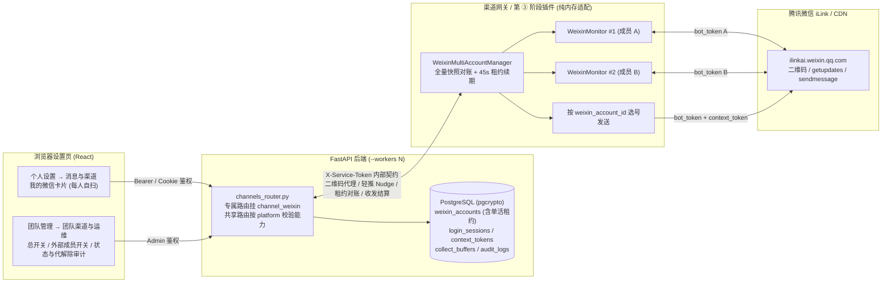

# 团队微信多账号（「每人扫自己的码」）设计方案

> **基线提交**：`34b353a0b`（Dalton 迁移链当前唯一头节点为 `d046`，链路 `d045 -> d047 -> d048 -> d046`，见 `src/dalton/migrations/versions/d046_scoped_data_map_cache.py:23-24`）  
> **文档轮次**：第 2 轮定案版（已合入全部拍板决策与第 1 轮双盲技术审查修订）  
> **架构定位**：直接对齐独立核心架构（`docs/dalton/features/standalone-core.md:8-42,64,243-246`）与第 ③ 阶段渠道网关插件化边界——后端掌管全部账号归属、加密凭据、轮询租约、材料收集窗口、会话状态、审计日志与权限，网关（未来的渠道插件）仅作为纯内存协议适配器，每次启动与运行均直接按后端契约存取状态与凭据。

---

## 0. 背景与架构边界

### 0.1 问题根因

微信 iLink（微信智能体机器人接入协议，ClawBot〔腾讯微信个人智能体机器人形态〕，`bot_type="3"`，见 `integrations/dalton-channel-gateway/src/channels/weixin/types.ts:10`）通过扫码创建的机器人属于**扫码微信号专属的一对一私聊通道**：只有扫码的那个微信号（`ilink_user_id`）能在微信聊天列表中看到该机器人并收发消息，其他微信号无法搜索添加该机器人，群聊事件也在协议接入层直接归档拦截（`integrations/dalton-channel-gateway/src/channels/weixin/inbound.ts:147-167`、`src/dalton/database/channel_gateway.py:1601-1619`）。OpenClaw（开源多渠道智能体框架）社区方案同样采取每次扫码创建一个独立机器人账号、按账号与对端隔离会话的做法。

当前实现采用「全局单实例机器人 + 成员一次性绑定码」模型，在团队场景下仅扫码管理员一人可用：

1. **数据库单行约束**：`dalton_channel_weixin_state` 以 `singleton_id = 1` 固定存储全系统唯一一组 `ilink_bot_id` 与 `encrypted_bot_token`（`src/dalton/migrations/versions/d030_channel_gateway.py:256-265`、`src/dalton/migrations/versions/d032_weixin_state.py:23-42`、`src/dalton/database/channel_gateway.py:9795-10031`），另一位管理员扫码会直接覆盖前一位管理员的在线凭据。
2. **扫码接口限死管理员**：`/weixin/qrcode/start|wait|verify-code` 强制调用 `_require_weixin_admin`（`src/dalton/app/channels_router.py:1035-1039,1099-1157`）与数据库层 `get_user_tier(eff_owner) != "admin"` 校验（`src/dalton/database/channel_gateway.py:10092,10250,10397`）。
3. **网关单实例内存状态**：`WeixinChannelAdapter` 仅维护单个 `this.account` 与单个 `WeixinMonitor` 长轮询协程（`integrations/dalton-channel-gateway/src/channels/weixin/index.ts:92-106,361-407`）。
4. **前端拆成管理员扫码与成员绑定码两套流程**：管理员在 `DaltonTeamOpsPanel`（`web/src/pages/Settings/panels/dalton/DaltonTeamOpsPanel.tsx:50`）通过 `DaltonWeixinBotCard`（`web/src/pages/Settings/panels/dalton/DaltonWeixinBotCard.tsx:39-44`）扫码，普通成员在 `IntegrationsPanel`（`web/src/pages/Settings/panels/IntegrationsPanel.tsx:43`）通过 `DaltonWeixinBindCard`（`web/src/pages/Settings/panels/dalton/DaltonWeixinBindCard.tsx:48-56`）生成 `/bind DLT-XXXX-XXXX` 绑定码，而微信客户端里只有扫码者本人拥有与该机器人的对话入口。

### 0.2 硬性架构约束与三层开关协同规则

本方案直接按第 ③ 阶段渠道插件化后的最终职责边界一步到位落地：

1. **后端单一真值与多进程安全**：后端以 `--workers N` 多进程模式运行（`AGENTS.md:103`、`src/server/AGENTS.md:38-50`）。账号与成员映射、单活轮询租约（Lease，带有效期的排他持有权）、二维码登录会话、加密后的 `bot_token` / `context_token` / 入站媒体解密元数据、长轮询游标 `get_updates_buf`、显式材料收集缓冲、管理审计日志以及配置变更代际号 `accounts_revision` 全部持久化在后端 PostgreSQL（开源关系型数据库）自有 `dalton_*` 表中，后端 worker 内存仅承载单次请求上下文。
2. **网关（渠道插件）纯协议适配与单活轮询归属**：`integrations/dalton-channel-gateway/` 仅负责调用腾讯 iLink HTTP（Hypertext Transfer Protocol，超文本传输协议）JSON（JavaScript Object Notation，JavaScript 对象表示法）接口与微信 CDN（Content Delivery Network，内容分发网络）媒体加解密，所有状态与凭据均通过带 `X-Service-Token`（内部服务鉴权请求头）校验的内部 HTTP 契约向后端存取；同步移除网关未使用的遗留本地目录配置 `weixinCacheDir`（`integrations/dalton-channel-gateway/src/config.ts:24,132-135,195`、`integrations/dalton-channel-gateway/src/orchestrator.ts:163,180,190`、`integrations/dalton-channel-gateway/src/server.ts:206`）。网关多实例滚动替换或容器重启期间，由后端数据库租约保证**同一微信账号在任意时刻只有一个网关实例发起 `getupdates` 长轮询**（详见 §2.1 与 §3.2）。第 ③ 阶段网关拆为独立插件或容器时，只需替换宿主进程与连接配置，HTTP 契约保持不变。
3. **统一配置读取、平台级能力门控与三层开关协同**：
   - Everflow 生产形态（`DALTON_PROFILE=everflow`）与独立核心形态（`DALTON_PROFILE=core`）共用同一套源码；安装形态由 `src.dalton.profile.resolve_profile`（`src/dalton/profile.py:37-96`）解析，能力判定走 `src.dalton.capabilities` 的 `CapabilityId.CHANNEL_GATEWAY` 与 `CapabilityId.CHANNEL_WEIXIN`（`src/dalton/capabilities.py:56,59,160-191,475-540`），行为配置（如外部成员接入开关 `weixin.allow_external`、并发账号上限 `weixin.max_concurrent_accounts`）统一通过 `src/dalton/settings.py`（合并 `dalton.yaml` 与 `dalton.core.yaml`，见 `src/dalton/settings.py:420-588`）读取，前端统一通过 `useCapabilities()`（`web/src/hooks/useCapabilities.ts:24,129`）控制界面与设置搜索词显隐。
   - **共享路由按解析后的实际平台校验能力**：`/channels` 路由组顶层仅挂载 `CapabilityId.CHANNEL_GATEWAY`（`src/dalton/app/channels_router.py:49-53`）；`I-1`～`I-7`、`/bindings`、`/settings`、`/bind-codes` 等多渠道共享入口在解析出平台标识后调用 `require_channel_platform_capability(platform)`（`src/dalton/capabilities.py:533-540`）或按激活能力裁剪微信字段，确保关闭 `channel_weixin` 时微信入口全部返回 HTTP `404` 且零字段暴露，同时飞书与 Discord 保持原样运行（详见 §3.1）。
   - **网关是否执行微信长轮询由三层开关共同决定**（三者同时为真且持有账号租约时才启动对应 `WeixinMonitor`）：

| 开关层级 | 配置位置 | 作用域与变更方式 | 为 `false` 时的精确行为 |
|---|---|---|---|
| **第 1 层：网关适配器开关** | 网关环境变量 `DALTON_WEIXIN_ENABLED`（`integrations/dalton-channel-gateway/src/config.ts:212-216`，`mode === "outgoing"` 时固定为 `false`） | 当前网关进程静态开关 | 该网关进程跳过初始化 `WeixinMultiAccountManager`，仅运行同进程已启用的飞书 / Discord 适配器，零 `/internal/weixin/*` 请求。 |
| **第 2 层：后端部署能力开关** | `DALTON_CAP_CHANNEL_WEIXIN` / `dalton.yaml` `capabilities.channel_weixin`（依赖 `channel_gateway`，`src/dalton/capabilities.py:185-191,325-424`） | 部署级静态能力（Core 默认关闭，Everflow 默认开启） | 后端全部 `/weixin/*` 路由返回 HTTP `404`，共享路由剔除微信数据；若网关误配了 `DALTON_WEIXIN_ENABLED=true`，首次对账收到 `404` 后立即停止本地全部微信监控并转入每 `5 分钟` 静默探测，同进程飞书 / Discord 正常服务。 |
| **第 3 层：数据库运行期总开关** | `dalton_channel_weixin_config.enabled`（管理员在设置页动态热切换） | 运行期热开关（默认 `TRUE`） | 后端暂停受理新扫码与微信出站抢占，对账接口返回 `200` 且 `enabled: false, accounts: []`；网关立即中止全部 `WeixinMonitor` 并维持 15 秒轻量心跳，数据库内既有加密凭据与游标原封保留，重新开启后免重扫自动恢复。 |

4. **数据库增量迁移规范**：新增 Dalton 迁移 `d049_weixin_multi_account.py` 接在当前唯一头节点 `d046` 之后，仅操作 `dalton_*` 自有表并遵守「扩展—切换—收缩（Expand-Cutover-Contract）」平滑升级原则（`docs/dalton/features/standalone-core.md:126,407`）。



---

## 1. 使用流程

### 1.1 团队成员个人操作流程（「个人设置 → 消息与渠道」）

当部署启用 `channel_weixin` 能力，且当前登录用户为有效团队成员（默认覆盖 `admin`、`internal`、`external` 三类成员；若管理员收紧了外部成员微信开关，则仅对 `admin` 与 `internal` 展示，对 `external` 隐藏卡片与设置搜索词）时，成员打开「设置 → 消息与渠道」（`web/src/pages/Settings/panels/IntegrationsPanel.tsx:29,43`，搜索锚点 `#dalton-weixin-bind`，见 `web/src/pages/Settings/sections.ts:295`）即可操作升级后的 **「我的微信」卡片**（重构自 `web/src/pages/Settings/panels/dalton/DaltonWeixinBindCard.tsx`）：

1. **首次扫码连接（每人限连 1 个微信号）**：
   - 成员点击「扫码连接个人微信」，前端调用 `POST /api/v1/dalton/channels/weixin/qrcode/start` 获取一次性登录会话键 `session_key` 与脱敏后的二维码图像（`qrcode_url` / `qrcode_img_content`）。若当前在线活跃账号数已达网关并发上限（默认 `200`），接口直接返回明确容量提示。
   - 前端复用 `web/src/pages/Settings/panels/dalton/DaltonWeixinBotCard.tsx:74-114` 的串行长轮询状态机调用 `GET /api/v1/dalton/channels/weixin/qrcode/wait?session_key=...`（网关对腾讯 iLink 单次长轮询最长挂起约 `35s`，后端代理超时 `45s`，前端单次超时 `50s`；每次请求返回后若仍处未完成态，间隔 `1.2s` 再发起下一轮等待）：
     - `wait`：展示二维码图片与提示「请用本人手机微信扫描二维码」；
     - `scaned`：提示「已扫码，请在手机微信上点击确认登录」（iLink 返回 `scaned_but_redirect` 时由网关更新跨区域名并归一展示为 `scaned`）；
     - `verify_code`：当微信风控要求输入手机端辅助验证码时，展示输入框并提交 `POST /api/v1/dalton/channels/weixin/qrcode/verify-code`；
     - `confirmed`：后端在单事务内实时复核成员资格、外部成员开关与渠道总开关，校验该 `ilink_user_id` 未被团队内其他在职成员占用（若已被另一成员关联，拒绝确认并提示 **「该微信号已关联团队内另一账号，请先在原账号解除连接后再试」**），随后保存加密后的 `bot_token`、`ilink_bot_id` 与专属 `base_url`，写入 `dalton_channel_identities`（`platform='weixin'`）与默认 `dalton_channel_user_settings.apps.weixin` 配置；
     - `expired`：二维码超过 5 分钟有效期（TTL，Time-To-Live，存活有效期）或被新会话取代时展示「刷新二维码」按钮。
2. **查看连接与推送状态**：
   - 卡片右上角状态徽章实时展示四种状态：**已连接**（`active`，绿色）、**登录已过期**（`expired`，黄色，对应 iLink 错误码 `-14`）、**渠道已暂停**（管理员关闭运行期总开关时展示中性徽章）或 **待连接**（`unconfigured`）。
   - 已连接状态下展示：微信昵称 `ilink_username`、掩码后的 `ilink_user_id`（仅保留末 4 位，如 `****a1b2`）、连接更新时间 `updated_at`、最近微信互动时间 `last_inbound_at`、**主动推送激活状态**（指示当前代际是否持有有效入站 `context_token`），以及折叠的「转发聊天记录小贴士」（引导使用 `/collect` 逐条转发收集模式或截图）。
3. **重新扫码（过期续期或更换微信号，替换原连接）**：
   - 每名成员固定持有 1 个个人微信连接槽位。当状态变为 `expired` 或成员希望更换另一个个人微信号时，点击「重新扫码登录」。
   - 二维码等待期间独立存储在 `dalton_channel_weixin_login_sessions` 表中，成员若中途关闭弹窗，原在线连接持续收发；手机确认新码后，后端原子递增该账号的 `bot_generation`、替换加密凭据与 `base_url`、清理旧代际 `context_token`：
     - **同一微信号重扫续期（`ilink_user_id` 相同）**：保持 `scope_key = 'dm:<ilink_user_id>'` 与会话代数 `generation` 原值，无缝延续既有对话线程与工作区选择；
     - **更换为另一微信号（`ilink_user_id` 变化）**：替换原连接，推进会话代数 `generation + 1`、清空工作区覆盖与待处理中断、关闭旧微信号的后台线程监听，开启全新对话上下文。
4. **本人解除连接**：
   - 成员点击「解除连接」并通过二次确认弹窗（`DaltonActionConfirmButton`，见 `web/src/pages/Settings/panels/dalton/DaltonWeixinBindCard.tsx:163-175`），调用 `DELETE /api/v1/dalton/channels/bindings/weixin`；也可直接在微信聊天框发送 `/unbind`。
   - 后端单事务删除该成员的 `dalton_channel_weixin_accounts` 记录（级联清理 `context_token` 与材料收集缓冲）、作废该成员所有待扫 `login_sessions`、删除 `dalton_channel_identities (user_id, 'weixin')`、移除 `dalton_channel_user_settings.apps.weixin`、推进会话 `generation + 1`、关闭活跃 `dalton_channel_thread_watches`、写入 `dalton_channel_weixin_audit_logs`（`action='member_unbind'`）并递增 `accounts_revision`，网关随即终止该账号长轮询并取消在途请求。

### 1.2 管理员视图与管理权限（「团队管理 → 团队渠道与运维」）

管理员打开「设置 → 团队管理 → 团队渠道与运维」（`web/src/pages/Settings/panels/dalton/DaltonTeamOpsPanel.tsx:50`，将 `web/src/pages/Settings/panels/dalton/DaltonWeixinBotCard.tsx` 重构为 **「团队微信渠道管理」卡片**，保持仅 `callerTier === 'admin'` 可见，见 `web/src/pages/Settings/sections.ts:309`）：

1. **渠道运行期总开关与外部成员接入开关**：
   - **「启用团队个人微信接入」总开关**（对应 `dalton_channel_weixin_config.enabled`，默认开启）：关闭后后端暂停新扫码与出站投递，网关停止全部微信长轮询并保留数据库凭据与游标；重新打开后网关按原游标自动恢复全部 `active` 账号长轮询，全员免重扫续用。
   - **「允许外部受邀成员（`external`）连接个人微信」开关**（默认开启，见 §8 已定 #4）：关闭后隐藏 `external` 成员的微信卡片、拦截其扫码与收发，并将已绑定的 `external` 成员微信账号置为停用态（重开后可恢复）；每次切换均写入 `dalton_channel_weixin_audit_logs`。
   - 卡片顶部附快捷入口「去管理我自己的个人微信 →」（跳转 `#dalton-weixin-bind`）。
2. **成员状态总览与容量监控**：
   - 顶部统计栏展示：`在线账号数 / 已连接总数`、`登录过期数`、`网关并发轮询槽位（当前活跃 / 上限 200）`。
   - 成员列表每行按白名单字段展示：成员姓名与邮箱、角色层级（`admin` / `internal` / `external`）、**微信昵称 `ilink_username` 与掩码后的 `ilink_user_id`（仅末 4 位，如 `****a1b2`）**、连接状态（`在线` / `登录已过期` / `推送待激活` / `已停用`）、最近收信时间 `last_inbound_at` 与更新时间 `updated_at`。
3. **管理员随时代任意成员解除连接（二次确认 + 落表审计）**：
   - 每行右侧提供「代为解除」按钮（支持对任意状态的任意成员执行，见 §8 已定 #2）。点击后弹出二次确认框，管理员选择或填写解除原因（预设枚举：`离职交接` / `手机遗失应急` / `误绑微信号` / `其他原因`，支持补充备注文本，必填非空），提交 `DELETE /api/v1/dalton/channels/weixin/admin/accounts/{account_id}`。
   - 后端在同一数据库事务内：校验调用者管理员身份、向持久化审计表 **`dalton_channel_weixin_audit_logs`** 写入操作人 `operator_user_id`、目标成员 `target_user_id`、操作时间 `created_at`、解除原因 `reason` 及账号掩码快照，同步销毁该成员微信账号凭据、作废待扫二维码、关闭后台监听并轻推网关立即断开长轮询。

### 1.3 扫码后微信侧呈现与开始对话方式

1. **微信端界面表现**：成员在手机微信确认扫码登录瞬间，微信首页聊天列表自动出现与该 **ClawBot 机器人**的一对一私聊窗口。
2. **首条带令牌消息激活推送机制**：iLink 扫码确认接口 `get_qrcode_status` 返回 `bot_token`、`ilink_bot_id`、`baseurl`、`ilink_user_id` 与 `ilink_username`（`integrations/dalton-channel-gateway/src/channels/weixin/types.ts:217-228`），而文本与附件出站接口 `sendmessage` 均要求携带非空 `context_token`（`integrations/dalton-channel-gateway/src/channels/weixin/send.ts:209-218,281-290`）；该令牌在入站 `WeixinMessage.context_token`（协议类型为可选字段 `context_token?: string`，见 `types.ts:147`、`inbound.ts:461-464`）中下发。网页端在扫码变为 `confirmed` 时展示引导：**「个人微信已连接！请打开手机微信，在机器人对话窗口发送一句话（如『你好』或 `/workspace`），收到携带会话令牌的首条消息后即可对话并激活自动推送。如需转发多条聊天记录，可先发 `/collect` 开启收集（或直接发长截图）。」**
3. **支持的消息类型与指令交互（准确区分入站与出站能力）**：
   - **默认路由**：成员发出消息后，默认进入本人 **Home（研究总监 Chief of Staff）** 线程流式处理并回传答案。
   - **入站（微信 → Dalton）已支持类型**（`integrations/dalton-channel-gateway/src/channels/weixin/inbound.ts:185-212,332-449`）：纯文本、引用消息（`extractInlineQuote`）、已在微信侧开启语音转文字的语音消息（`voice_item.text`；无转写文本的纯语音回复固定中文提示，见 `orchestrator.ts:240-256`）、图片（`IMAGE`）、各类文档文件（`FILE`，如 PDF〔Portable Document Format，便携式文档格式〕、Office 办公文档、CSV〔Comma-Separated Values，逗号分隔值表格〕）及视频文件（`VIDEO`，下载解密后作为 `video/mp4` 附件存入工作区）。
   - **出站（Dalton → 微信）已支持类型**（`integrations/dalton-channel-gateway/src/channels/weixin/send.ts:227-240,299-386`）：经 `filterWeixinMarkdown` 清洗的分段纯文本消息（`MessageItemType.TEXT`）、经文件头魔数（Magic Bytes）核实的图片消息（`UploadMediaType.IMAGE` + `MessageItemType.IMAGE`），以及按通用文件气泡发送的各类附件（`UploadMediaType.FILE` + `MessageItemType.FILE`，涵盖 PDF、Office、CSV 及其他二进制文件；网关出站仅构造 `IMAGE` 与 `FILE` 两类媒体条目）。
   - **斜杠指令全集**（在 `integrations/dalton-channel-gateway/src/orchestrator.ts:263-271` 基础上扩展）：`/workspace` 列出本人可写工作区、`/<工作区名称>` 切换到指定工作区分析师、`/main` 切回研究总监、`/new` 开启新对话线程、`/stop` 停止当前生成、`/unbind` 解绑当前微信号，以及新增的逐条转发材料收集指令 `/collect`（开始收集）、`/done`（结束并合并提交）、`/cancel`（取消收集）与 `/help`（查看使用与转发指引）。

---

## 2. 数据模型与迁移

### 2.1 多账号表结构设计（迁移 `d049_weixin_multi_account.py`）

新增 Alembic（数据库表结构版本迁移工具）脚本 `src/dalton/migrations/versions/d049_weixin_multi_account.py`（`revision = "d049"`，`down_revision = "d046"`），仅操作 `dalton_*` 自有表：

#### （1）团队微信运行期配置表 `dalton_channel_weixin_config`

```sql
CREATE TABLE IF NOT EXISTS dalton_channel_weixin_config (
    singleton_id         SMALLINT PRIMARY KEY DEFAULT 1 CHECK (singleton_id = 1),
    enabled              BOOLEAN NOT NULL DEFAULT TRUE,   -- 管理员运行期渠道总开关
    allow_external       BOOLEAN,                         -- 非空时覆盖 settings.py 的 weixin.allow_external
    accounts_revision    BIGINT NOT NULL DEFAULT 1,       -- 账号/开关每次变更在事务末尾单调 +1
    legacy_owner_user_id VARCHAR(255),                    -- 记录升级前 dalton_channel_weixin_state 原属主，供精确回写
    updated_by           VARCHAR(255),
    updated_at           TIMESTAMPTZ NOT NULL DEFAULT NOW()
);
```

#### （2）个人微信多账号凭据、游标与单活轮询租约表 `dalton_channel_weixin_accounts`

```sql
CREATE TABLE IF NOT EXISTS dalton_channel_weixin_accounts (
    account_id          UUID PRIMARY KEY DEFAULT gen_random_uuid(), -- 账号主键 UUID（Universally Unique Identifier，通用唯一识别码）
    user_id             VARCHAR(255) NOT NULL UNIQUE                -- 已定 #1：每人限连 1 个微信号
                        CHECK (user_id <> 'system:dalton-company'),
    ilink_bot_id        VARCHAR(255) NOT NULL UNIQUE,               -- iLink 机器人唯一标识
    ilink_user_id       VARCHAR(255),                               -- 扫码微信号 iLink 用户 ID
    prev_ilink_user_id  VARCHAR(255),                               -- 上一次绑定的微信号 ID（供空 ID 首包锚定判断是否换号）
    ilink_username      VARCHAR(255),                               -- 扫码微信号昵称
    encrypted_bot_token BYTEA NOT NULL,                             -- pgp_sym_encrypt(bot_token, get_encryption_key())
    base_url            VARCHAR(512) NOT NULL DEFAULT 'https://ilinkai.weixin.qq.com',
    cdn_base_url        VARCHAR(512) NOT NULL DEFAULT 'https://novac2c.cdn.weixin.qq.com/c2c',
    get_updates_buf     TEXT NOT NULL DEFAULT '',                   -- 该账号独立 getupdates 长轮询游标
    status              VARCHAR(32) NOT NULL DEFAULT 'active'
                        CHECK (status IN ('active', 'expired', 'disabled')),
    disabled_reason     VARCHAR(64),                                -- 如 'member_not_in_roster' | 'external_access_disabled' | 'ilink_user_conflict'
    bot_generation      BIGINT NOT NULL DEFAULT 1,                  -- 账号内重登代际号，用于 CAS（Compare-And-Swap，比较并交换）与代际围栏（Fencing）
    poller_instance_id  VARCHAR(128),                               -- 当前持有长轮询租约的网关实例 ID
    poller_lease_until  TIMESTAMPTZ,                                -- 单活轮询租约到期时间（45s TTL，15s 心跳续期）
    poller_lease_epoch  BIGINT NOT NULL DEFAULT 0,                  -- 每次实例抢占租约单调 +1，拦截旧实例游标写入
    last_inbound_at     TIMESTAMPTZ,
    last_error_code     VARCHAR(64),
    last_error_at       TIMESTAMPTZ,
    created_at          TIMESTAMPTZ NOT NULL DEFAULT NOW(),
    updated_at          TIMESTAMPTZ NOT NULL DEFAULT NOW()
);

-- 已定 #3 & 停用释放规则：仅在职活跃/待续期（active / expired）账号独占该微信号；
-- 成员离职停用（status = 'disabled'）不再阻塞在职成员绑定同一微信号（确认时清理旧 disabled 行）
CREATE UNIQUE INDEX IF NOT EXISTS idx_dalton_wx_accounts_ilink_user_active_unique
    ON dalton_channel_weixin_accounts (ilink_user_id)
    WHERE ilink_user_id IS NOT NULL AND status IN ('active', 'expired');

CREATE INDEX IF NOT EXISTS idx_dalton_wx_accounts_status
    ON dalton_channel_weixin_accounts (status, updated_at DESC);
```

#### （3）二维码登录会话表 `dalton_channel_weixin_login_sessions`

将原混在单行表上的临时列拆为独立会话表，通过部分唯一索引强制每位成员同一时刻最多存在 1 个待扫会话，并对 `qrcode` 原始票据加密存储：

```sql
CREATE TABLE IF NOT EXISTS dalton_channel_weixin_login_sessions (
    session_key             VARCHAR(255) PRIMARY KEY,
    user_id                 VARCHAR(255) NOT NULL CHECK (user_id <> 'system:dalton-company'),
    target_account_id       UUID REFERENCES dalton_channel_weixin_accounts(account_id) ON DELETE SET NULL,
    login_version           BIGINT NOT NULL DEFAULT 1,       -- 会话中间态与跨区域名更新 CAS 版本号
    expected_bot_generation BIGINT,                          -- 发起重登时原账号的 bot_generation（首次扫码为 NULL）
    status                  VARCHAR(64) NOT NULL DEFAULT 'wait'
                            CHECK (status IN ('wait', 'scaned', 'verify_code', 'confirmed', 'expired', 'superseded')),
    encrypted_qrcode        BYTEA NOT NULL,                  -- pgp_sym_encrypt(qrcode, get_encryption_key())
    qrcode_img_content      TEXT,                            -- 仅在 wait/scaned/verify_code 期间保留，confirmed/expired/superseded 立即置 NULL
    redirect_base_url       VARCHAR(512) NOT NULL DEFAULT 'https://ilinkai.weixin.qq.com',
    expires_at              TIMESTAMPTZ NOT NULL,
    confirmed_result        JSONB,                           -- 确认成功后的脱敏幂等快照，应对网络丢包重试
    created_at              TIMESTAMPTZ NOT NULL DEFAULT NOW(),
    updated_at              TIMESTAMPTZ NOT NULL DEFAULT NOW()
);

-- 并发防重：同一成员同时最多持有 1 条有效待扫会话（配合 Level 1 用户咨询锁消除双 start 竞态）
CREATE UNIQUE INDEX IF NOT EXISTS uq_dalton_wx_login_sessions_user_pending
    ON dalton_channel_weixin_login_sessions (user_id)
    WHERE status IN ('wait', 'scaned', 'verify_code');
```

#### （4）`context_token` 表与渠道关联表扩展（含媒体密钥加密列与实例归属列）

```sql
ALTER TABLE dalton_channel_weixin_context_tokens
    ADD COLUMN IF NOT EXISTS account_id UUID
        REFERENCES dalton_channel_weixin_accounts(account_id) ON DELETE CASCADE,
    ADD COLUMN IF NOT EXISTS token_version BIGINT NOT NULL DEFAULT 1, -- 每次有效刷新单调 +1，供失效回报精确比对版本
    ADD COLUMN IF NOT EXISTS stale_at TIMESTAMPTZ,
    ADD COLUMN IF NOT EXISTS stale_reason VARCHAR(64);

CREATE INDEX IF NOT EXISTS idx_dalton_wx_ctx_tokens_account
    ON dalton_channel_weixin_context_tokens (account_id, bot_generation);

ALTER TABLE dalton_channel_identities
    ADD COLUMN IF NOT EXISTS weixin_account_id UUID
        REFERENCES dalton_channel_weixin_accounts(account_id) ON DELETE SET NULL;

ALTER TABLE dalton_channel_inbound_events
    ADD COLUMN IF NOT EXISTS weixin_account_id UUID,
    ADD COLUMN IF NOT EXISTS encrypted_weixin_media_meta BYTEA; -- pgp_sym_encrypt 加密保存微信附件 CDN 参数与 AES 密钥，上传完成即置 NULL

ALTER TABLE dalton_channel_thread_watches
    ADD COLUMN IF NOT EXISTS weixin_account_id UUID
        REFERENCES dalton_channel_weixin_accounts(account_id) ON DELETE SET NULL;

ALTER TABLE dalton_channel_background_runs
    ADD COLUMN IF NOT EXISTS weixin_account_id UUID
        REFERENCES dalton_channel_weixin_accounts(account_id) ON DELETE SET NULL;

ALTER TABLE dalton_channel_deliveries
    ADD COLUMN IF NOT EXISTS weixin_account_id UUID,
    ADD COLUMN IF NOT EXISTS weixin_bot_generation BIGINT,
    ADD COLUMN IF NOT EXISTS claimed_by_instance_id VARCHAR(128), -- 记录抢占该投递的网关实例，支撑按实例作用域恢复
    ADD COLUMN IF NOT EXISTS claimed_at TIMESTAMPTZ;
```

#### （5）微信渠道管理与解绑审计表 `dalton_channel_weixin_audit_logs`（已定 #2）

审计表不向 `dalton_channel_weixin_accounts` 建级联删除外键，确保账号物理删除后审计轨迹永久留存：

```sql
CREATE TABLE IF NOT EXISTS dalton_channel_weixin_audit_logs (
    audit_id             UUID PRIMARY KEY DEFAULT gen_random_uuid(),
    action               VARCHAR(64) NOT NULL,  -- 'admin_unbind' | 'member_unbind' | 'admin_toggle_channel' | 'admin_toggle_external' | 'member_removed_revoke' | 'member_reinstated_restore' | 'disabled_account_reclaimed'
    operator_user_id     VARCHAR(255) NOT NULL, -- 操作人 user_id（系统后台自动对账写 'system:roster-reconciler'）
    target_user_id       VARCHAR(255),          -- 目标成员 user_id（代解除/本人解除/名册变更时必填）
    weixin_account_id    UUID,                  -- 操作时的账号 ID 快照
    ilink_bot_id         VARCHAR(255),          -- 机器人 ID 快照
    masked_ilink_user_id VARCHAR(32),           -- 仅保存末 4 位掩码（如 '****a1b2'）
    reason               TEXT NOT NULL,         -- 操作原因（管理员代解除时为二次确认框提交的非空原因，<= 500 字符）
    metadata             JSONB NOT NULL DEFAULT '{}'::jsonb,
    created_at           TIMESTAMPTZ NOT NULL DEFAULT NOW() -- 操作时间
);

CREATE INDEX IF NOT EXISTS idx_dalton_wx_audit_logs_target_time
    ON dalton_channel_weixin_audit_logs (target_user_id, created_at DESC);

CREATE INDEX IF NOT EXISTS idx_dalton_wx_audit_logs_time
    ON dalton_channel_weixin_audit_logs (created_at DESC);
```

#### （6）逐条转发材料收集表与迁移备份表

```sql
CREATE TABLE IF NOT EXISTS dalton_channel_weixin_collect_buffers (
    buffer_id           UUID PRIMARY KEY DEFAULT gen_random_uuid(),
    account_id          UUID NOT NULL REFERENCES dalton_channel_weixin_accounts(account_id) ON DELETE CASCADE,
    bot_generation      BIGINT NOT NULL,
    dalton_user_id      VARCHAR(255) NOT NULL,
    scope_key           VARCHAR(255) NOT NULL,
    session_generation  INTEGER NOT NULL,
    workspace_id        UUID NOT NULL,
    initial_prompt      TEXT NOT NULL DEFAULT '',
    status              VARCHAR(32) NOT NULL DEFAULT 'collecting'
                        CHECK (status IN ('collecting', 'flushing', 'completed', 'cancelled', 'expired')),
    item_count          INTEGER NOT NULL DEFAULT 0,
    total_text_chars    INTEGER NOT NULL DEFAULT 0,
    attachment_count    INTEGER NOT NULL DEFAULT 0,
    expires_at          TIMESTAMPTZ NOT NULL,
    max_expires_at      TIMESTAMPTZ NOT NULL,
    flushed_message_id  VARCHAR(255),
    created_at          TIMESTAMPTZ NOT NULL DEFAULT NOW(),
    updated_at          TIMESTAMPTZ NOT NULL DEFAULT NOW()
);

CREATE UNIQUE INDEX IF NOT EXISTS uq_dalton_wx_collect_active
    ON dalton_channel_weixin_collect_buffers (account_id, bot_generation, scope_key, session_generation)
    WHERE status IN ('collecting', 'flushing');

CREATE TABLE IF NOT EXISTS dalton_channel_weixin_collect_items (
    buffer_id            UUID NOT NULL REFERENCES dalton_channel_weixin_collect_buffers(buffer_id) ON DELETE CASCADE,
    message_id           VARCHAR(255) NOT NULL,
    protocol_seq         BIGINT,
    platform_time_ms     BIGINT,
    receive_order        INTEGER NOT NULL,
    text_content         TEXT NOT NULL DEFAULT '',
    uploaded_attachments JSONB NOT NULL DEFAULT '[]'::jsonb,
    created_at           TIMESTAMPTZ NOT NULL DEFAULT NOW(),
    PRIMARY KEY (buffer_id, message_id)
);

-- 过渡期升级前归档快照表（仅保存被 d049 归档的旧微信身份/绑定码/会话代数，供阶段 1~2 回退恢复，阶段 3 随旧表删除）
CREATE TABLE IF NOT EXISTS dalton_channel_weixin_migration_backup (
    backup_key  VARCHAR(255) PRIMARY KEY,
    record_kind VARCHAR(64) NOT NULL, -- 'identity' | 'bind_code' | 'session_generation'
    payload     JSONB NOT NULL,
    created_at  TIMESTAMPTZ NOT NULL DEFAULT NOW()
);
```

#### （7）全局统一事务加锁顺序（对齐 `src/dalton/database/channel_gateway.py:6-14` 与 `src/dalton/auth/roles.py:206-220`）

所有跨表写事务严格遵循以下**唯一、单向递增**的 9 层全局锁顺序（任何事务仅获取自身涉及的层级，且一律从低编号向高编号加锁，消除交叉死锁与锁升级死锁）：

- **Level 0a（角色表锁，仅本地角色增删改事务涉及）**：`dalton_user_roles`（按 `user_id` 升序 `FOR UPDATE`）→ `dalton_credential_holder`（`singleton_id = 1 FOR SHARE`）（`src/dalton/auth/roles.py:153-165,206-220`；常规渠道事务仅无锁 `SELECT` 角色，不持有该层行锁）。
- **Level 0b（单消息 / 单投递幂等咨询锁）**：`pg_advisory_xact_lock(hashtext('dalton_inbound:<platform>:<message_id>'))`、`pg_advisory_xact_lock(hashtext('dalton_delivery:<delivery_key>'))`（`src/dalton/database/channel_gateway.py:7`）。
- **Level 1（用户级门闩咨询锁与个人设置行锁——首次扫码尚无账号行时的锁定对象）**：`pg_advisory_xact_lock(hashtext('dalton_user_settings:' || user_id))` +（需修改频道设置时）`dalton_channel_user_settings FOR UPDATE`，多用户严格按 `user_id` 字典序升序获取（`src/dalton/database/channel_gateway.py:8,219-235`）。首次扫码 `start` / `confirm`（此时数据库尚无 `dalton_channel_weixin_accounts` 行）、重登、本人解绑、管理员代解除、成员离职撤销均在此层按目标成员 `user_id` 加排他咨询锁，从源头串行化同一成员的一切扫码与撤销操作。
- **Level 2（群聊咨询锁，飞书 / Discord 群事务保留）**：`_acquire_group_chat_lock`（`dalton_group_chat:<platform>:<chat_address>`，按平台与地址字典序升序，`src/dalton/database/channel_gateway.py:9,454-465`）。
- **Level 3（微信账号行锁与微信号唯一性咨询锁）**：
  - **3a**：`dalton_channel_weixin_accounts`（多行按 `account_id` 升序：扫码确认、重登、解绑、停用/恢复取 `FOR UPDATE`；入站 `I-1`/`I-3` 因需更新同一行的 `last_inbound_at`、游标提交 `/cursor` 与状态上报 `/status` 直接取 `FOR NO KEY UPDATE`，避免先取 `FOR SHARE` 再 `UPDATE` 引发双连接锁升级死锁；仅纯读取账号状态的 `I-6` 取无锁快照或 `FOR SHARE`）；
  - **3b（仅扫码 `confirm` 与空 ID 首包锚定）**：`pg_advisory_xact_lock(hashtext('dalton_weixin_bot:' || ilink_bot_id))` 及（当 `ilink_user_id` 非空时）`pg_advisory_xact_lock(hashtext('dalton_weixin_ilink_user:' || ilink_user_id))`，串行裁决跨成员扫同一微信号的唯一性。
- **Level 4（二维码登录会话行锁）**：`dalton_channel_weixin_login_sessions FOR UPDATE`（按 `session_key` 升序）。
- **Level 5（微信 `context_token` 发送方咨询锁与行锁）**：`pg_advisory_xact_lock(hashtext('dalton_weixin_context:<ilink_bot_id>:<bot_generation>:<platform_user_id>'))`（多锁按三元组字典序升序）→ `dalton_channel_weixin_context_tokens FOR UPDATE`（`src/dalton/database/channel_gateway.py:11,851-865`）。
- **Level 6（渠道绑定、身份、会话代数与材料收集窗口行锁）**：`dalton_channel_chat_bindings` → `dalton_channel_identities FOR UPDATE` → `dalton_channel_session_generations FOR UPDATE`（按 `(platform, scope_key, dalton_user_id)` 升序，`src/dalton/database/channel_gateway.py:12,2990-2997`）→ `dalton_channel_weixin_collect_buffers FOR UPDATE`。
- **Level 7（事件、监听、后台运行、投递行锁与审计表追加）**：`dalton_channel_inbound_events` → `dalton_channel_thread_watches` → `dalton_channel_background_runs` → `dalton_channel_deliveries`（`FOR UPDATE`，`src/dalton/database/channel_gateway.py:13`）→ `INSERT INTO dalton_channel_weixin_audit_logs`。
- **Level 8（微信全局配置单行锁——固定为事务最后一步）**：事务前中段检查 `enabled` / `allow_external` 一律采用普通 MVCC（Multi-Version Concurrency Control，多版本并发控制）无锁快照读；仅当事务需要修改开关或推进 `accounts_revision` 时，在事务最末尾执行 `UPDATE dalton_channel_weixin_config SET accounts_revision = accounts_revision + 1, updated_at = NOW() WHERE singleton_id = 1 ... RETURNING accounts_revision`（其中 `confirm` 在此语句附带 `AND enabled = TRUE` 守卫，若恰逢管理员并发关闭总开关则匹配 0 行并整笔回滚）。

### 2.2 现有单行表存量数据迁移与逐类运行态回填

`d049` 的 `upgrade()` 在停写切换窗口内通过纯 SQL（Structured Query Language，结构化查询语言）原地搬运 `BYTEA`（PostgreSQL 二进制字节数组类型）密文并逐类回填运行态，确保**已有对话不换线程、不丢工作区选择、不丢待确认中断与活跃监听**：

1. **初始化配置行并记录原属主**：读取 `dalton_channel_weixin_state WHERE singleton_id = 1`，将 `legacy_owner_user_id` 设为该行的 `owner_user_id`（若无有效机器人凭据则为 `NULL`），插入 `dalton_channel_weixin_config (singleton_id = 1, enabled = TRUE, accounts_revision = 1, legacy_owner_user_id = ...)`。
2. **当场擦除旧表明文扫码票据**：立即执行 `UPDATE dalton_channel_weixin_state SET login_qrcode = NULL, login_qrcode_img_content = NULL, login_session_key = NULL, login_status = NULL, login_confirmed_result = NULL WHERE singleton_id = 1`，消除旧表明文 `login_qrcode` 泄露面（`src/dalton/migrations/versions/d032_weixin_state.py:32-42`）。
3. **原管理员账号迁入与身份冲突清洗**：若旧表存在有效机器人（`ilink_bot_id IS NOT NULL AND encrypted_bot_token IS NOT NULL AND owner_user_id IS NOT NULL AND owner_user_id <> 'system:dalton-company'`）：
   - 解析有效微信号标识 `eff_ilink_user_id`：优先取 `dalton_channel_weixin_state.ilink_user_id`；若该列为空，仅当 `dalton_channel_identities` 中 `(owner_user_id, 'weixin')` 行的 `platform_user_id` 在 `dalton_channel_weixin_context_tokens` 存在同 `ilink_bot_id` 记录时采用该值，否则保留 `NULL`（待首条单聊消息原子锚定）。
   - 插入 `dalton_channel_weixin_accounts`（生成 `new_account_id`，原样拷贝 `ilink_bot_id`、`eff_ilink_user_id`、`ilink_username`、`encrypted_bot_token`、`base_url`、`get_updates_buf`、`COALESCE(bot_generation, 1)`，将 `status IN ('expired', 'session_expired')` 归一为 `'expired'`、其余归一为 `'active'`）。
   - **处理身份表唯一约束**：先将 `dalton_channel_identities` 中 `platform = 'weixin'` 且 `user_id <> owner_user_id`（含曾借用同一 `eff_ilink_user_id` 绑定的其他成员行）全部快照备份至 `dalton_channel_weixin_migration_backup` 后删除；随后若 `eff_ilink_user_id` 非空，以 `ON CONFLICT (user_id, platform) DO UPDATE` 确保 `(owner_user_id, 'weixin')` 指向 `eff_ilink_user_id` 且关联 `weixin_account_id = new_account_id`；若 `eff_ilink_user_id` 为空，备份并移除 `(owner_user_id, 'weixin')` 旧行，等待首包建立身份。
4. **逐类回填 6 类存量运行态数据**：
   - **① 私聊会话键、会话代数、工作区选择与待确认操作（`dalton_channel_session_generations`）**：微信私聊 `scope_key` 统一保持现有的 `dm:<ilink_user_id>`，外部线程号保持 `weixin:dm:<ilink_user_id>:gen:<generation>`（`src/dalton/database/channel_gateway.py:360-375`、`integrations/dalton-channel-gateway/src/channels/weixin/inbound.ts:472`）。因此原管理员名下 `dalton_user_id = owner_user_id AND platform = 'weixin'`（当 `eff_ilink_user_id` 非空时匹配 `scope_key = 'dm:' || eff_ilink_user_id`）的会话行——无论其此前执行过多少次 `/new`（`generation >= 1`）、是否选择了特定工作区（`override_workspace_id`）或持有待决 HITL（Human-in-the-Loop，人工介入确认）中断（`pending_interrupt`）——**全部原样保留，升级后首条消息直接命中原 `conversation_threads` 线程无缝续聊**；其余无对应账号成员的微信会话行先备份至 `dalton_channel_weixin_migration_backup`，再执行 `generation = generation + 1, override_workspace_id = NULL, pending_interrupt = NULL`。
   - **② 上下文令牌（`dalton_channel_weixin_context_tokens`）**：对 `ilink_bot_id = account.ilink_bot_id`（且当 `eff_ilink_user_id` 非空时 `platform_user_id = eff_ilink_user_id`）的行回填 `account_id = new_account_id`，取其 `MAX(updated_at)` 回填 `dalton_channel_weixin_accounts.last_inbound_at`，删除其余孤立微信令牌行。
   - **③ 入站事件与在途回合（`dalton_channel_inbound_events`）**：对 `platform = 'weixin'` 且属于 `owner_user_id`（或 `weixin_context_bot_id = account.ilink_bot_id` 且发送者匹配 `eff_ilink_user_id`）的记录回填 `weixin_account_id = new_account_id`，同时对历史已完成记录中的 `raw_payload` 剥离明文 `aesKeyBase64` / `aesKeyHex` / `encryptQueryParam` / `fullUrl`（仍处于未完成态的事件将其附件元数据加密迁入 `encrypted_weixin_media_meta`）；对其他孤立成员遗留的未完成微信事件收敛为 `status = 'ignored', fallback_pending = FALSE`。
   - **④ 线程监听与后台唤醒运行（`dalton_channel_thread_watches` / `dalton_channel_background_runs`）**：对 `platform = 'weixin' AND dalton_user_id = owner_user_id` 回填 `weixin_account_id = new_account_id`；对其他孤立成员的微信记录置 `watch_active = FALSE`、`fallback_pending = FALSE`。
   - **⑤ 历史与在途出站投递（`dalton_channel_deliveries`）**：对 `platform = 'weixin' AND user_id = owner_user_id` 回填 `weixin_account_id = new_account_id, weixin_bot_generation = account.bot_generation`。
   - **⑥ 待用微信绑定码（`dalton_channel_bind_codes`）**：将 `platform = 'weixin' AND used_at IS NULL` 的行备份至 `dalton_channel_weixin_migration_backup` 后标记 `used_at = NOW(), revoked_reason = 'migrated_to_qr_login'`。

### 2.3 各阶段唯一写入方与无损回滚规程

1. **各阶段唯一真值写入方（防止双表写入分叉）**：
   - **升级前（`d046` + 旧镜像）**：唯一写入表为 `dalton_channel_weixin_state`。
   - **切换停写窗口（秒级）**：先停止旧 `dalton-channel-gateway` 进程排空在途游标写入，执行 `alembic upgrade d049`，再启动新版后端。
   - **阶段 1（扩展期 Expand）与阶段 2（切换期 Cutover）**：**唯一业务写入表固定为 `dalton_channel_weixin_accounts`、`dalton_channel_weixin_login_sessions` 与 `dalton_channel_weixin_config`**。阶段 1 的 `/internal/weixin-state` 兼容路由仅面向 `legacy_owner_user_id` 对应的 `dalton_channel_weixin_accounts` 行桥接读写，冻结的 `dalton_channel_weixin_state` 旧表保持不写。
   - **阶段 3（收缩期 Contract，独立迁移 `d050`）**：稳定运行满 1 个迭代且确认不再回退单实例后，删除 `/internal/weixin-state` 路由、`dalton_channel_weixin_state` 与 `dalton_channel_weixin_migration_backup`（执行 `d050` 后即锁定多账号架构，不再支持降级回 `d046`）。
2. **阶段 1～2 期间的精确回滚三步规程（停写 → `downgrade d046` 回写 → 切回旧镜像）**：
   - 一旦进入阶段 1 或阶段 2，任何回退均须执行数据库回写降级，以确保最新游标、重扫令牌与解绑状态精确同步回旧表：
   - **步骤 ① 停写**：停止 `dalton-channel-gateway` 进程，并将 `dalton_channel_weixin_config.enabled` 置为 `FALSE`，排空数据库在途事务。
   - **步骤 ② 导出审计并执行 `uv run alembic -c src/dalton/alembic.ini downgrade d046`**：
     - 运维脚本先将 `dalton_channel_weixin_audit_logs` 导出为 JSONL（JSON Lines，按行分隔的 JSON 文本格式）归档留存。
     - `downgrade()` 读取 `dalton_channel_weixin_config.legacy_owner_user_id`（严格按升级前原属主匹配，绝不使用「首个管理员」猜测归属）：
       - **分支 A（原无属主 `legacy_owner_user_id IS NULL`，或原属主在升级期间已解绑 / 被代解除 / 已停用 `status = 'disabled'`）**：执行 `DELETE FROM dalton_channel_weixin_state WHERE singleton_id = 1` 并清理其微信 `identities` 与 `context_tokens`，**严格保留已解除状态，不将其他新扫码成员的凭据写入旧单行表，也不复活旧凭据**；
       - **分支 B（原属主账号仍在 `dalton_channel_weixin_accounts` 且 `status IN ('active', 'expired')`）**：将该行的 `(ilink_bot_id, user_id, encrypted_bot_token, base_url, get_updates_buf, CASE WHEN status = 'expired' THEN 'session_expired' ELSE 'active' END, bot_generation, ilink_user_id, ilink_username, updated_at)` **整套同源字段**通过 `INSERT ... ON CONFLICT (singleton_id) DO UPDATE` 完整回写至 `dalton_channel_weixin_state (singleton_id = 1)`，并将全部 `login_*` 列置 `NULL`；若原属主未更换 `ilink_bot_id`，从 `dalton_channel_weixin_migration_backup` 还原被归档的旧成员 `identities`、`session_generations` 与未过期 `bind_codes`。
     - 清理升级期间其他新扫码成员新增的微信 `context_tokens`（`WHERE account_id IS DISTINCT FROM legacy_account_id`）与 `identities (platform = 'weixin' AND user_id IS DISTINCT FROM legacy_owner_user_id)`，推进这些新成员的 `session_generations.generation + 1` 并关闭其微信 `thread_watches`。
     - **严格按外键逆序删列删表**：**第一步先执行 `ALTER TABLE dalton_channel_weixin_context_tokens DROP COLUMN IF EXISTS account_id, DROP COLUMN IF EXISTS token_version, DROP COLUMN IF EXISTS stale_at, DROP COLUMN IF EXISTS stale_reason`**（先解除 `ON DELETE CASCADE` 外键，确保后续删除 `dalton_channel_weixin_accounts` 时原属主的 `context_tokens` 完好保留），随后删除 `identities`、`inbound_events`、`thread_watches`、`background_runs`、`deliveries` 新增列，最后依次 `DROP TABLE` 删除 `dalton_channel_weixin_collect_items`、`dalton_channel_weixin_collect_buffers`、`dalton_channel_weixin_login_sessions`、`dalton_channel_weixin_accounts`、`dalton_channel_weixin_config`、`dalton_channel_weixin_migration_backup`、`dalton_channel_weixin_audit_logs`。
   - **步骤 ③ 恢复旧服务**：启动上一版本后端与网关镜像，原管理员按回写后的最新游标与凭据无缝继续对话。

---

## 3. 网关与后端契约

### 3.1 接口总览与共享路由按平台能力门控

#### （1）网关与后端内部契约表（均挂于 `/api/v1/dalton/channels/internal/*`，鉴权 `X-Service-Token`）

| 方向 | 方法与路由 | 能力守卫 | 关键请求字段 | 关键响应字段 |
|---|---|---|---|---|
| 网关 → 后端 | `POST .../weixin/accounts/reconcile` | `CHANNEL_GATEWAY` + `CHANNEL_WEIXIN` | `{gateway_instance_id, since_revision?, active_leases: [{account_id, lease_epoch}]}` | `{changed, enabled, allow_external, max_concurrent_accounts, accounts_revision, accounts: [{account_id, user_id, ilink_bot_id, ilink_user_id, bot_token, base_url, cdn_base_url, get_updates_buf, bot_generation, status, lease_owned, lease_epoch, lease_until}]}`（`changed: true` 时必为全量快照） |
| 网关 → 后端 | `POST .../weixin/accounts/release-leases` | `CHANNEL_GATEWAY` + `CHANNEL_WEIXIN` | `{gateway_instance_id, account_ids?: UUID[]}` | `{ok: true, released_count}` |
| 网关 → 后端 | `GET .../weixin/accounts/{account_id}` | `CHANNEL_GATEWAY` + `CHANNEL_WEIXIN` | 查询参数：`recipient_platform_user_id?`、`inbound_message_id?`（纯只读接口） | `{account_id, user_id, ilink_bot_id, ilink_user_id, bot_token, base_url, cdn_base_url, bot_generation, status, weixin_context_token?, weixin_context_token_version?}` |
| 后端 → 网关 | `POST /internal/weixin/accounts/sync` | `X-Service-Token` | `{accounts_revision: 42, reason: "account_confirmed"}` | `{ok: true, accepted_revision: 42}` |
| 网关 → 后端 | `POST .../weixin/accounts/{account_id}/cursor` | `CHANNEL_GATEWAY` + `CHANNEL_WEIXIN` | `{gateway_instance_id, expected_lease_epoch, expected_bot_generation, expected_ilink_bot_id, expected_get_updates_buf, get_updates_buf}` | `{ok, updated, stale_lease, stale_generation, cas_mismatch, bot_generation, lease_epoch, get_updates_buf, status}` |
| 网关 → 后端 | `POST .../weixin/accounts/{account_id}/status` | `CHANNEL_GATEWAY` + `CHANNEL_WEIXIN` | `{action: "mark_session_expired" \| "mark_context_token_stale" \| "reset_corrupt_cursor", expected_bot_generation, expected_ilink_bot_id, error_code?, recipient_platform_user_id?, expected_token_version?}` | `{ok, updated, stale_generation, version_mismatch, accounts_revision}` |
| 网关 → 后端 | `POST .../weixin/login-sessions` | `CHANNEL_GATEWAY` + `CHANNEL_WEIXIN` | `{session_key, user_id, qrcode, qrcode_img_content, redirect_base_url, expires_in_seconds}` | `{ok, session_key, login_version: 1, expected_bot_generation, status: "wait", expires_at}` |
| 网关 → 后端 | `GET .../weixin/login-sessions/{session_key}` | `CHANNEL_GATEWAY` + `CHANNEL_WEIXIN` | 请求头 `X-User-Id` | `{session_key, user_id, status, login_version, expected_bot_generation, qrcode?, qrcode_img_content?, redirect_base_url, expires_at, confirmed_result?}` |
| 网关 → 后端 | `PATCH .../weixin/login-sessions/{session_key}` | `CHANNEL_GATEWAY` + `CHANNEL_WEIXIN` | `action="update"`：`{user_id, expected_login_version, status, redirect_base_url}`；`action="confirm"`：`{user_id, expected_login_version, ilink_bot_id, bot_token, base_url, cdn_base_url, ilink_user_id?, ilink_username?}` | `update`：`{ok, updated, stale_session, login_version, status, redirect_base_url}`；`confirm`：`{ok, updated, idempotent, already_connected, stale_session, deny_code?, account_id?, bot_generation?, accounts_revision?, confirmed_result?}` |
| 网关 → 后端 | `POST .../inbound/register-and-resolve`（`I-1`） | `CHANNEL_GATEWAY` + 按 `body.platform` 校验子能力 | 原字段 + 可选 `weixin_account_id`、`weixin_bot_id`、`weixin_bot_generation`、`weixin_context_token`、`weixin_context_seq`、`weixin_media_meta?`、`unsupported_item_types?`（飞书/Discord 省略微信字段） | 原字段 + `collection_mode?: "appended" \| "limit_reached"`、`deny_reason` |
| 网关 → 后端 | `POST .../bind-code/consume`（`I-2`） | `CHANNEL_GATEWAY` + 按 `body.platform` 校验子能力（覆盖 `bind` 与 `unbind`） | 原字段 + 可选 `weixin_account_id`、`weixin_bot_id`、`weixin_bot_generation` | 原字段 +（微信 `/unbind` 时）一次性告别回执凭据 `farewell_weixin_dispatch?` |
| 网关 → 后端 | `POST .../session/command`（`I-3`） | `CHANNEL_GATEWAY` + 按 `body.platform` 校验子能力 | 原字段（`cmd` 扩展支持 `collect`、`done`、`cancel`、`help`）+ 可选 `weixin_account_id`、`weixin_bot_id`、`weixin_bot_generation`、`weixin_context_token`、`weixin_context_seq` | 原字段 +（`cmd="done"` 封口成功时）合成入站回合 `flushed_inbound?` |
| 网关 → 后端 | `POST .../deliveries/authorize-and-claim`（`I-6`） | `CHANNEL_GATEWAY` + 解析 `resolved_platform` 后校验子能力 | 原字段 + `gateway_instance_id` | 原字段 + `weixin_account_id?`、`weixin_bot_id?`、`weixin_bot_generation?`、`weixin_context_token?`、`weixin_context_token_version?` |
| 网关 → 后端 | `POST .../recover`（扩展 `I-7`） | `CHANNEL_GATEWAY`（自动与已激活子能力求交集） | `{mode: "startup" \| "watch_reconnect", gateway_instance_id, platforms: string[], weixin_account_ids?: UUID[], thread_id?: UUID}` | 本实例负责范围内的 `inbound_events`（含解密后的 `weixin_attachments`）、`background_runs`、`thread_watches`、`automation_runs` |

#### （2）面向前端的公开路由与统一配置读取契约

- **个人扫码路由**（挂 `CapabilityId.CHANNEL_WEIXIN`）：`POST /weixin/qrcode/start`、`GET /weixin/qrcode/wait`、`POST /weixin/qrcode/verify-code`——校验登录态、`check_team_member_status_live(user_id) == "active"`、外部成员开关（当调用者 `tier == 'external'` 时要求 `effective_allow_external == True`）及 `weixin_config.enabled == True` 后，带 `X-User-Id` 异步代理至网关并经 `_shape_public_weixin_qr_response` 白名单脱敏返回。
- **管理端专属路由**（挂 `CapabilityId.CHANNEL_WEIXIN` 且强制 `is_admin_user(user_id)`）：
  - `GET /weixin/admin/overview`：返回 `enabled`、`allow_external`、`max_concurrent_accounts`、`active_poller_count`、`accounts_revision` 及全员脱敏状态列表（含 `ilink_username` 与末 4 位掩码 `masked_ilink_user_id`）与最近 50 条 `dalton_channel_weixin_audit_logs` 记录；
  - `PUT /weixin/admin/config`：更新 `enabled` 和/或 `allow_external`（写入 `dalton_channel_weixin_audit_logs` 并递增 `accounts_revision` 轻推网关）；
  - `DELETE /weixin/admin/accounts/{account_id}`：请求体 `{"reason": "..."}`（必填非空，`1..500` 字符），单事务代成员强制解除连接并写入 `dalton_channel_weixin_audit_logs`。
- **共享公开路由的平台能力裁剪**：
  - `GET /bindings`（`src/dalton/app/channels_router.py:891-940`）：仅返回当前部署已激活渠道子能力的平台条目；当 `has_capability(CapabilityId.CHANNEL_WEIXIN)` 为假时，响应 `bindings` 与 `identities` 完全省略 `"weixin"` 键且不返回任何微信开关字段；当 `channel_weixin` 开启时，在 `bindings.weixin` 中返回本人的 `linked`、`status`、`ilink_username`、`masked_ilink_user_id`、`channel_enabled`、`allow_external`、`has_context_token` 与 `last_inbound_at`。
  - `POST /bind-codes` 与 `DELETE /bindings/{platform}`（`src/dalton/app/channels_router.py:881-889,1017-1033`）：首行调用 `require_channel_platform_capability(platform)`，确保 `channel_weixin` 关闭时两者均返回 `404`；`channel_weixin` 开启时 `POST /bind-codes` 对 `weixin` 返回 `400`（`code: "weixin_uses_qr_login"`），`DELETE /bindings/weixin` 执行本人解绑。
- **Everflow 与 Core 统一设置读取（已定 #4 & #5）**：
  - 在 `src/dalton/settings.py:420-460` 的 `DaltonConfig` 新增 `weixin: DaltonWeixinConfig`（字段：`allow_external: bool = True`、`max_concurrent_accounts: int = Field(default=200, ge=1, le=2000)`），在 `src/dalton/dalton.yaml` 与 `src/dalton/dalton.core.yaml` 中使用完全一致的 `weixin:` 配置结构，并由 `settings.py` 提供统一读取函数：
    - `is_weixin_external_allowed(db_override: bool | None = None) -> bool`：当 `!has_capability(CapabilityId.CHANNEL_WEIXIN)` 时直接返回 `False`；否则按 `db_override`（`dalton_channel_weixin_config.allow_external` 非空值）→ 环境变量 `DALTON_WEIXIN_ALLOW_EXTERNAL` → `get_dalton_config().weixin.allow_external`（默认 `True`）求值；
    - `get_weixin_max_concurrent_accounts() -> int`：按环境变量 `DALTON_WEIXIN_MAX_CONCURRENT_ACCOUNTS` → `get_dalton_config().weixin.max_concurrent_accounts`（默认 `200`）求值，并通过 `POST .../weixin/accounts/reconcile` 下发给网关插件（网关本地若另设 `DALTON_WEIXIN_MAX_CONCURRENT_ACCOUNTS` 则取 `Math.min(backendMax, localMax)`，插件容器无需与后端共享环境变量）。
  - `GET /api/v1/dalton/capabilities`（`src/dalton/capabilities.py:457-472`）保持纯净，在 `channel_weixin` 关闭时不输出任何微信相关字段，通过 `tests/unit/dalton/test_core_capabilities_gate.py` 零泄露校验。

### 3.2 关键数据流详解

1. **单活租约对账与全量快照下发（「即时轻推 + 15 秒租约心跳」双保险）**：
   - **单实例排他租约机制**：网关进程启动时生成进程级唯一 `gatewayInstanceId`。每 **15 秒**定时心跳，或收到后端 `POST /internal/weixin/accounts/sync` 轻推通知后经单飞合并（Single-flight Reconcile），网关调用 `POST /api/v1/dalton/channels/internal/weixin/accounts/reconcile`：
     - **第一步（在对账判断 `changed` 之前先执行实时名册核验）**：后端先调用独立的 `reconcile_weixin_accounts_membership()`（见 §4.2），对名册已移除成员或外部开关收紧影响的 `external` 成员置 `disabled` 并递增 `accounts_revision`；
     - **第二步（租约分配与续期）**：当 `weixin_config.enabled == True` 时，对 `status = 'active'` 且（`poller_instance_id IS NULL` 或 `poller_lease_until <= NOW()`）的账号，原子写入 `poller_instance_id = gateway_instance_id, poller_lease_epoch = poller_lease_epoch + 1, poller_lease_until = NOW() + INTERVAL '45 seconds'`（按 `max_concurrent_accounts` 限制单实例总持租数）；对本实例已持有的账号续期 `poller_lease_until = NOW() + INTERVAL '45 seconds'`；
     - **第三步（全量快照返回）**：仅当 `since_revision == current_revision` 且本实例持租集合无任何增减时返回 `changed: false, accounts: []`；**只要 `changed: true`，后端固定返回当前全量账号快照**。网关将本地 `Map<accountId, ManagedWeixinAccount>` 与全量快照求差集：凡在快照中缺失、`enabled == false`、`status != 'active'` 或 `lease_owned == false` 的账号，立即调用 `abort()` 终止其 `WeixinMonitor`、取消该账号在途 HTTP 请求并擦除内存 `botToken`；仅对 `status == 'active' && lease_owned == true` 的新增或 `(bot_generation, lease_epoch)` 变化的账号启动 `WeixinMonitor`。
     - **滚动部署零等待交接**：网关收到 `SIGTERM` / `SIGINT` 退出信号时，先 `abort()` 全部本地 `WeixinMonitor`，随即调用 `POST .../weixin/accounts/release-leases` 立即清空本实例租约并触发轻推，新网关实例无需等待 45 秒即可无缝接手轮询。
2. **二维码登录全流程（含跨区 `redirect_host`、`baseurl` 落库与丢包重试幂等）**：
   - **发起 `start`**：后端校验成员资格、外部开关、总开关及活跃账号数 `< max_concurrent_accounts` 后代理至网关；网关调用 iLink `get_bot_qrcode`（`integrations/dalton-channel-gateway/src/channels/weixin/api.ts:399-414`），再调用后端 `POST .../weixin/login-sessions`：后端获取 Level 1 用户锁，将该用户既有 `wait|scaned|verify_code` 会话更新为 `superseded`（清空其 `qrcode_img_content`），加密保存新 `encrypted_qrcode` 并返回 `session_key`。
   - **轮询 `wait` 与验证码 `verify-code`**：网关先调 `GET .../weixin/login-sessions/{session_key}`：
     - **确认响应丢失重试自愈**：若数据库该行已处于 `status == 'confirmed'` 且 `confirmed_result` 非空（例如上一轮确认已在后端落库，而返回给网关或浏览器的响应因网络超时丢失），网关**直接返回该 `confirmed_result`**（`connected: true, already_connected: true`），不再向 iLink 重复请求已失效票据；
     - 若处于待扫态，网关以行内保存的 `redirect_base_url` 向 iLink 发起最长约 `35s` 的 `get_qrcode_status` 长轮询（同进程同 `(userId, sessionKey)` 经 `inFlightWaits` 合并，`integrations/dalton-channel-gateway/src/channels/weixin/login-qr.ts:210,327-343`）；当 iLink 返回 `redirect_host` 或状态变为 `scaned` / `scaned_but_redirect`（归一为 `scaned`，见 `login-qr.ts:632-633`）/ `verify_code` 时，网关经 `safeResolveRedirectBaseUrl` 校验官方域名与 DNS 后调用 `PATCH .../login-sessions/{session_key}`（`action="update"`）回写最新 `redirect_base_url` 与 `status`，保证后续请求即使路由到另一实例也直连正确区域节点。
   - **原子确认 `confirm`**：当 iLink 返回 `confirmed` 时，网关解析校验 `bot_token`、`ilink_bot_id` 及专属 `confirmedBaseUrl`（取自 `statusResp.baseurl` 经 `safeResolveRedirectBaseUrl` 校验回退至 `redirect_base_url`，见 `login-qr.ts:718-733`），调用 `PATCH .../login-sessions/{session_key}`（`action="confirm"`）：
     - 若该 `session_key` 已是 `confirmed` 且属主一致，直接幂等返回已存 `confirmed_result`（不二次递增 `bot_generation`）；
     - 后端按全局锁序锁定 Level 1 用户锁 → Level 3a 既有账号行锁 → Level 3b 微信号唯一锁 → Level 4 登录会话锁，**实时无缓存重验成员资格、外部成员开关与总开关**：
       - 若 `ilink_user_id` 已被另一名在职成员（`status IN ('active', 'expired')`）持有，将本登录会话标为 `superseded` 并返回 `deny_code = "weixin_user_bound_to_other_member"`；若命中某条离职停用成员的 `status = 'disabled'` 旧行，先在同事务内物理删除该旧停用行并记录 `disabled_account_reclaimed` 审计日志；
       - 创建或更新当前成员的 `dalton_channel_weixin_accounts`（`bot_generation + 1`、`base_url = confirmedBaseUrl`、`get_updates_buf = ''`、`status = 'active'`、`disabled_reason = NULL`，同时记录 `prev_ilink_user_id`），清理旧代际 `context_tokens` 与未完成收集缓冲 `collect_buffers`，擦除登录会话上的 `qrcode_img_content` 并持久化脱敏 `confirmed_result`；
       - 当 `ilink_user_id` 非空时，同步写入 `dalton_channel_identities` 与默认 `dalton_channel_user_settings.apps.weixin`（仅当 `prev_ilink_user_id` 非空且与新 `ilink_user_id` 不同时才推进 `session_generations.generation + 1`）；最后在 Level 8 推进 `accounts_revision` 并轻推网关启动长轮询。
3. **入站消息、斜杠指令全入口账号隔离与空 `ilink_user_id` 首包身份建立**：
   - 每个 `WeixinMonitor` 在构造 `InboundChannelEvent` 时固定注入 `{ weixinAccountId, weixinBotId, weixinBotGeneration }`，保持 `threadScopeKey = "dm:" + fromUserId`（`integrations/dalton-channel-gateway/src/channels/weixin/inbound.ts:472`）与消息幂等键 `${ilinkBotId}:${rawId}`（`inbound.ts:128-145`）。
   - **统一前置守卫覆盖 `I-1`、`I-2`（`unbind`）与 `I-3`（全部斜杠指令）**：网关在普通消息（`I-1`）、微信端 `/unbind`（`I-2`）以及 `/workspace`、`/main`、`/new`、`/stop`、`/collect`、`/done`、`/cancel`、`/help`（`I-3`）请求中统一传入 `weixin_account_id`、`weixin_bot_id` 与 `weixin_bot_generation`（`integrations/dalton-channel-gateway/src/orchestrator.ts:263-287,934-989`）。后端在三个入口统一先执行 `_verify_and_touch_weixin_inbound_account_in_tx`：
     - ① 锁定 `dalton_channel_weixin_accounts WHERE account_id = %s`（`I-1`/`I-3` 取 `FOR NO KEY UPDATE`，`I-2` 取 `FOR UPDATE`），校验 `weixin_config.enabled == True`、`account.status == 'active'`、`account.ilink_bot_id == weixin_bot_id` 且 `account.bot_generation == weixin_bot_generation`；
     - ② 实时无缓存校验 `account.user_id` 在册且符合外部成员开关；
     - ③ **核对或原子锚定 `ilink_user_id`（覆盖首条消息恰好是斜杠指令的场景）**：
       - 若 `account.ilink_user_id` 非空：强制要求单聊且 `platform_user_id == account.ilink_user_id`，不一致则归档为 `ignored`（`deny_reason = "account_sender_mismatch"`）；
       - 若扫码 `confirm` 时 iLink 未返回 `ilink_user_id`（`account.ilink_user_id IS NULL`）：当收到首条单聊入站事件（无论该消息是普通文本还是 `/workspace`、`/new`、`/unbind` 指令）时，事务确保持有 Level 1 `dalton_user_settings:<account.user_id>` 与 Level 3b `dalton_weixin_ilink_user:<platform_user_id>` 锁（若当前事务尚未持有 Level 1 锁，则抛出 `_WeixinSettingsLockSetChanged` 由 `_run_tx_with_retry` 从 Level 1 重新开启事务，对齐 `src/dalton/database/channel_gateway.py:158-165,286-320`）：核查该 `platform_user_id` 若已被团队内另一在职成员占用，立即将本账号置为 `status = 'disabled', disabled_reason = 'ilink_user_conflict'`、递增 `accounts_revision` 并返回冲突提示「该微信号已关联团队内另一账号，请先在原账号解除连接后再试」；若未被占用，当场原子回填 `account.ilink_user_id = platform_user_id`、建立 `dalton_channel_identities (account.user_id, 'weixin', platform_user_id)` 与默认 `apps.weixin`（若 `account.prev_ilink_user_id` 非空且不等于该 `platform_user_id`，同步推进会话 `generation + 1`），随后无缝继续执行本条消息的对话解析或斜杠指令逻辑；
     - ④ 若本条消息携带非空 `weixin_context_token` 且非重复重投，写入 `dalton_channel_weixin_context_tokens`（递增 `token_version` 并清除 `stale_at`），更新 `account.last_inbound_at = NOW()`。
   - **微信端 `/unbind` 告别回执闭环**：成员在微信发送 `/unbind` 进入 `I-2` 时，后端在同一事务内先为该解绑确认消息生成已授权的 `dalton_channel_deliveries` 记录并提取一次性发送凭据 `{ bot_token, base_url, recipient_id, weixin_context_token }` 随 `I-2` 响应返回，紧接着在同一事务内删除 `dalton_channel_weixin_accounts`、作废待扫 `login_sessions`、写审计表并递增 `accounts_revision`；网关用该一次性凭据发出「已解除个人微信连接」回执后即销毁内存上下文。
4. **出站消息与历史投递的账号及代际隔离（扩展 `I-6`）**：
   - 后端 `authorize_and_claim_delivery`（`src/dalton/database/channel_gateway.py:7659-7759`）将微信出站严格划分为两类校验：
     - **原会话关联投递**（当前回合回复 `is_current=True`、重放/兜底 `fallback`、HITL 提问 `interrupt`、指令回执、`/watch` 线程监听通知、入站拒绝提示）：从源事件（`dalton_channel_inbound_events` / `thread_watches` / `background_runs`）读取发起时的 `(source_account_id, source_platform_user_id, source_session_generation)`。仅当目标成员当前 `dalton_channel_weixin_accounts` 满足 `account_id == source_account_id`、`status == 'active'`、**`account.ilink_user_id == source_platform_user_id` 且当前会话 `generation == source_session_generation`** 时放行（允许同微信号重扫续期并已发出新消息激活新代际 `context_token` 后继续接收本轮回复）；一旦成员已改绑另一个微信号、已执行 `/new` 或已解绑，立即返回 `claim_status = "denied", code = "weixin_account_rebound"`，确保旧微信号的对话回复与重放绝不串入新微信号。
     - **新建主动推送投递**（智能体 `send_message(target="weixin:@me")`、定时自动化 `automation`、通知与研报 `automation_notify`、数据任务 `data_task`）：实时无缓存校验目标 `user_id` 在册与外部开关后，选取该成员当前 `status == 'active'` 的微信账号；若目标地址为具名 `weixin:user:<uid>`，额外要求 `account.ilink_user_id == <uid>`（改绑微信号后旧具名目标以 `target_revoked` 拒绝，同时 `confirm` 换绑时自动将本人通知偏好中的旧个人微信目标同步更新为新 `weixin:user:<new_uid>`）。
   - 抢占成功时，`dalton_channel_deliveries` 记录 `weixin_account_id`、`weixin_bot_generation` 与 `claimed_by_instance_id = gateway_instance_id`，并在响应中返回 `weixin_account_id`、`weixin_bot_id`、`weixin_bot_generation`、`recipient_id`、`weixin_context_token` 与 `weixin_context_token_version`。大文件上传耗时完成后，`refreshAfterUpload`（`integrations/dalton-channel-gateway/src/channels/weixin/send.ts:331-361`）调用只读 `GET .../internal/weixin/accounts/{account_id}?recipient_platform_user_id=...` 重新拉取最新令牌并核对 `bot_generation` 未变后再发 `sendmessage`。
5. **单账号登录失效隔离回报**：
   - 当某账号在 `getupdates`、`getuploadurl` 或 `sendmessage` 收到 iLink 错误码 `-14`（`SESSION_EXPIRED_ERRCODE`，见 `integrations/dalton-channel-gateway/src/channels/weixin/types.ts:11`）时，仅停止该 `account_id` 的 `WeixinMonitor`，调用 `POST .../weixin/accounts/{account_id}/status`（`action="mark_session_expired"`，带 `expected_bot_generation` 围栏）将该账号置为 `expired` 并递增 `accounts_revision`，其余全部成员账号持续正常收发。

### 3.3 多账号并发长轮询资源上限与退避策略

1. **资源开销与并发上限（已定 #5）**：
   - 单个活跃微信账号占用 1 条默认挂起 `35s`（服务端动态调整范围 `1s ~ 60s`，见 `integrations/dalton-channel-gateway/src/channels/weixin/monitor.ts:14-15,201-213`）的 HTTPS 长轮询连接与约 `32 KB` 内存上下文。
   - 默认单网关并发活跃微信账号上限为 **`200`**（由后端 `DaltonWeixinConfig.max_concurrent_accounts` 统一配置并通过 `DALTON_WEIXIN_MAX_CONCURRENT_ACCOUNTS` 支持覆盖，随 `reconcile` 下发网关）。
   - **双连接池物理隔离**：网关微信模块创建两个独立的 `undici.Agent`（Node.js 官方 HTTP 连接池调度器）——**长轮询专用池**（`connections = maxConcurrentAccounts + 16`，`pipelining = 1`）与 **控制/出站发送专用池**（`connections = 64`，服务二维码登录、CDN 上传下载与 `sendmessage`），确保百人级长轮询挂起期间扫码与消息发送始终拥有充裕独立连接。
2. **错峰启动与三级退避**：
   - **批量启动错峰**：网关启动或总开关重开批量恢复 N 个账号时，按 **每秒最多启动 10 个账号 + `0 ~ 500ms` 均匀随机抖动** 分批建连。
   - **单账号独立指数退避**：单账号遇到网络异常、HTTP 5xx 或后端瞬时错误时，独立按 `min(2000ms * 2^min(failures - 1, 4), 30000ms) + random(0..500ms)` 退避（升级 `integrations/dalton-channel-gateway/src/channels/weixin/monitor.ts:272-278`）。
   - **出口 IP（Internet Protocol，网络协议地址）级 429 协同冷却**：单账号收到 HTTP 429 遵守 `Retry-After`（默认 `5s`、上限 `60s`，`integrations/dalton-channel-gateway/src/channels/weixin/api.ts:148-170`）；若 10 秒滑窗内有 `>= 3` 个不同账号收到 429，管理器设置全局冷却 `globalCooldownUntil = now + retryAfterMs`，其余账号在下一轮发起前自动等待冷却结束并叠加随机抖动。

### 3.4 网关重启后的按实例作用域恢复与离线续拉边界

网关重启或滚动升级后按固定三步恢复（升级 `integrations/dalton-channel-gateway/src/server.ts:501-521` 与 `integrations/dalton-channel-gateway/src/orchestrator.ts:7869-7891`）：

1. **首轮租约对账与全量快照拉取**：调用 `POST /api/v1/dalton/channels/internal/weixin/accounts/reconcile` 获取本实例抢占到租约（`lease_owned: true`）的全部 `active` 账号凭据与各自的 `get_updates_buf`。
2. **按持久化游标错峰续接长轮询（明确区分已有保证与待实机验证项）**：
   - **代码层确定性保证**：每批 `getupdates` 返回的消息全部经后端 `I-1` / `I-2` / `I-3` 幂等落库成功后，网关才调用 `/cursor` 推进 `get_updates_buf`（`integrations/dalton-channel-gateway/src/channels/weixin/monitor.ts:215-255`）；若批次中途退出或 `/cursor` 提交失败，重启后从原游标重拉，已落库消息命中 `dalton_channel_inbound_events` 主键 `(platform, message_id)` 直接跳过重复回合触发，确保每条已接收消息最多触发一次处理。
   - **离线窗口与游标容错（待实机验证项，见 §7.4 #6）**：腾讯 iLink 服务端对网关停机期间消息的保留时长上限及旧游标有效期由实机测试测定记录；若线上对超期损坏游标返回特定非 `-14` 游标错误码，网关调用 `POST .../status`（`action="reset_corrupt_cursor"`）清空 `get_updates_buf = ''` 并记录告警，从最新位置恢复轮询，避免监视器停滞。
3. **按实例与启用平台作用域执行精确恢复（保护飞书 / Discord 及其他实例在途投递）**：
   - 调用 `POST /api/v1/dalton/channels/internal/recover`（替换原无过滤全局 `mode=startup` SQL，见 `src/dalton/database/channel_gateway.py:9280-9420`），传入本进程实际启用的 `platforms` 列表、`gateway_instance_id` 以及本实例当前持有租约的 `weixin_account_ids`：
     - 仅将 `platform = ANY(platforms)`（且对 `weixin` 限定 `weixin_account_id = ANY(weixin_account_ids)` 或历史无主记录）且原抢占实例已释放租约或 `claimed_at <= NOW() - INTERVAL '120 seconds'` 的遗留 `in_flight` 投递收敛为 `unknown / gateway_restarted`；**其他存活实例以及独立运行的飞书 / Discord 插件正在发送的 `in_flight` 投递保持原状，零误标**；
     - 仅拉取并恢复归属上述 `platforms` 与持租 `weixin_account_ids` 范围内的未完成 `inbound_events`（后端在内部响应中解密 `encrypted_weixin_media_meta` 回填为 `weixin_attachments`，供网关恢复中断的附件下载）、`background_runs`、`thread_watches` 与 `automation_runs`。

---

## 4. 会话、权限、安全与转发收集

### 4.1 成员级严格会话隔离

每位成员通过个人微信收发的一切消息由四层机制锁定在本人权限边界内，且保持现有私聊会话键格式实现无缝续聊：

1. **物理通道层**：每个 `WeixinMonitor` 仅持有对应成员扫码所得的 `bot_token` 与单活租约，从源头只拉取该成员专属机器人的消息。
2. **入站全入口强绑定校验层**：`I-1`、`I-2`、`I-3` 统一强制核对 `(weixin_account_id, ilink_bot_id, bot_generation)` 有效且单聊发送者 `platform_user_id == account.ilink_user_id`；发送者异动或带群聊字段（`group_id` / `chat_room_id` / `room_id` / `@chatroom`，`integrations/dalton-channel-gateway/src/channels/weixin/inbound.ts:147-167`）的事件立即归档为 `ignored`。
3. **会话键延续与用户主键隔离层**：微信私聊继续使用 `scope_key = 'dm:<ilink_user_id>'` 与 `external_thread_id = 'weixin:dm:<ilink_user_id>:gen:<generation>'`（`src/dalton/database/channel_gateway.py:360-375`）。`dalton_channel_session_generations` 主键为 `(platform, scope_key, dalton_user_id)`（`src/dalton/migrations/versions/d030_channel_gateway.py:103`），配合在职成员间 `ilink_user_id` 全局唯一索引以及上游线程反查 `lookup_thread_by_external_id` 的 `COALESCE(ct.user_id, w.user_id) = user_id` 强过滤（`src/server/database/conversation/threads_read.py:41-44`），既保证跨成员绝对隔离，又保证同一成员重扫同一微信号（即使 `ilink_bot_id` 轮换）时直接命中同一会话行与同一历史线程。
4. **工作区写权限层**：成员默认进入自己的 Home（研究总监），通过 `/<工作区名>` 切换工作区时实时调用 `_verify_workspace_write_permission`（`src/dalton/database/channel_gateway.py:424-451,1798-1800`）校验本人拥有写权限。

### 4.2 撤销与离职即时止血、名册异常保护与重新入册恢复

1. **全撤销入口事务内同步作废待扫二维码并取消在途请求**：
   - 无论是本人解绑（网页或 `/unbind`）、管理员代解除（`DELETE /weixin/admin/accounts/{account_id}`）、本地角色删除（`delete_user_role`，`src/dalton/auth/roles.py:194-237`，在同一 `db_conn` 事务末尾调用 `revoke_user_weixin_accounts`）还是外部名册停用，均在同一数据库事务的 Level 4 显式执行：
     ```sql
     UPDATE dalton_channel_weixin_login_sessions
     SET status = 'superseded', qrcode_img_content = NULL, updated_at = NOW()
     WHERE user_id = %s AND status IN ('wait', 'scaned', 'verify_code');
     ```
   - 这覆盖了首次扫码尚无 `target_account_id` 以及 `ON DELETE SET NULL` 的全部场景，确保成员被解除或离职前打开的二维码无法再完成确认；同时网关在对账收到变更后立即 `abort()` 该账号的轮询与任何未发出的上传/发送请求，后端 `I-6` 同步拒签未发送投递。
2. **绕过每 worker 60 秒正向缓存，实现跨 worker 即时生效**：
   - `src/dalton/invites.py:43,68,189-196` 默认维护每进程 60 秒 TTL 的 `_positive_member_cache`。为消除跨 worker 最长 60 秒的撤销滞后，新增实时三态核验函数 `check_team_member_status_live(user_id, *, conn=None) -> Literal["active", "removed", "lookup_error"]`：在扫码 `start`/`confirm`、`I-1`/`I-2`/`I-3` 入站、`I-6` 出站及 15 秒后台名册对账中**一律显式传入 `bypass_cache=True` 直查 PostgreSQL**（单次索引读取 `< 1ms`），并在成员角色变更或名册删除入口同步调用 `invalidate_team_members_cache()`。
3. **名册查询失败保持原状（Fail-Safe 防误停）与对账前置核验**：
   - `check_team_member_status_live` 与批量对账函数 `reconcile_weixin_accounts_membership()` 严格区分 **「确认不在册（`"removed"`）」** 与 **「查询异常（`"lookup_error"`，如数据库连接瞬断或 SQL 超时）」**：
     - **仅当查询正常完成且明确判定成员已移出名册（或外部成员在 `allow_external=False` 下受限）** 时，才开启写事务将其 `dalton_channel_weixin_accounts` 置为 `status = 'disabled'`（设置对应 `disabled_reason`）、作废待扫二维码、移除 `dalton_channel_identities (user_id, 'weixin')`、关闭活跃 `thread_watches`、写入 `dalton_channel_weixin_audit_logs` 并递增 `accounts_revision`；
     - **当遇到 `"lookup_error"` 查询异常时**：记录告警日志，**保持 `dalton_channel_weixin_accounts` 现有账号状态与 `accounts_revision` 原状不变**，防止瞬时抖动误停全员在线长轮询（单次实时 `I-1` / `I-6` 请求遇异常则仅安全拒绝当次请求）。
     - `POST .../weixin/accounts/reconcile` 固定在比较 `since_revision` 返回 `changed: false` **之前** 执行 `reconcile_weixin_accounts_membership()`，保证外部名册删人后最多 15 秒内必定触发停用与下线。
4. **成员重新入册后的双恢复路径**：
   - **自动恢复**：因 `disabled_reason IN ('member_not_in_roster', 'external_access_disabled')` 被置为 `disabled` 的账号，当成员重新加入团队名册（或管理员重新开启 `allow_external`）后，15 秒对账或成员访问 `GET /bindings` 检测到其资格恢复为 `"active"`，且原 `ilink_user_id` 未被其他在职成员绑定时，后端自动在同一写事务内将其 `status` 恢复为 `'active'`、清空 `disabled_reason`、重建 `dalton_channel_identities`、写入 `member_reinstated_restore` 审计记录并递增 `accounts_revision` 恢复长轮询（若停用期间腾讯侧令牌已过期，首轮 `getupdates` 收到 `-14` 后自动转为 `expired` 引导重扫）。
   - **自助重扫恢复**：重新入册的成员也可随时点击「扫码连接个人微信」完成重扫，`confirm` 直接原地激活其 `dalton_channel_weixin_accounts` 行（`status = 'active', bot_generation + 1`）。
5. **研究资产留存**：成员离职与解绑仅回收微信渠道凭据与活跃监听，成员历史工作区与对话记录完整保留。

### 4.3 凭据与媒体密钥静态加密、日志与公开错误白名单

1. **数据库全量敏感字段静态加密（覆盖扫码票据与入站附件解密材料）**：
   - 以下列统一通过 PostgreSQL `pgcrypto` 执行 `pgp_sym_encrypt(..., get_encryption_key())`（对称主密钥 `BYOK_ENCRYPTION_KEY`，见 `src/server/database/encryption.py:10-18`）加密存储：
     - `dalton_channel_weixin_accounts.encrypted_bot_token`
     - `dalton_channel_weixin_login_sessions.encrypted_qrcode`（且 `qrcode_img_content` 在会话进入 `confirmed` / `expired` / `superseded` 瞬间置 `NULL`；旧表 `dalton_channel_weixin_state.login_qrcode` 在 `d049` 升级时当场置 `NULL`）
     - `dalton_channel_weixin_context_tokens.encrypted_context_token`、`dalton_channel_identities.encrypted_weixin_context_token`、`dalton_channel_inbound_events.encrypted_weixin_context_token`
     - **新增 `dalton_channel_inbound_events.encrypted_weixin_media_meta`**：网关在 `I-1` 上报微信入站附件时，将含 `aesKeyBase64`、`aesKeyHex`、`encryptQueryParam`、`fullUrl` 的 `WeixinPersistedAttachmentMeta[]`（`integrations/dalton-channel-gateway/src/channels/weixin/types.ts:230-240`、`inbound.ts:362-440`）单独放入请求字段 `weixin_media_meta`，由后端加密存入 `encrypted_weixin_media_meta`；当网关重启调用 `POST /internal/recover` 恢复尚未上传完毕的入站事件时，后端在内部 `X-Service-Token` 响应中解密回填至 `weixin_attachments` 供 `parseRecoveredAttachments`（`orchestrator.ts:7970-7973`）读取，一旦附件上传工作区完成（写入 `uploaded_attachments`）或事件进入终态，立即将 `encrypted_weixin_media_meta` 置 `NULL`。
   - **扩展 `raw_payload` 清洗函数**：升级 `_strip_sensitive_from_raw_payload` 与 `_sanitize_native_payload_dict`（`src/dalton/database/channel_gateway.py:586-604,3102-3139`），递归剥离顶层与 `attachments` / `weixin_attachments` / `raw` 嵌套结构中的 `bot_token`、`context_token`、`weixin_context_token`、`qrcode`、`verify_code`、`aesKeyBase64`、`aesKeyHex`、`aes_key`、`aeskey`、`encryptQueryParam`、`encrypt_query_param`、`fullUrl`、`full_url` 字段，`raw_payload.attachments` 仅保存 `{id, kind, filename, mimeType, sizeBytes}`。
2. **公开错误与全链路日志严格字段白名单**：
   - **剥离外部原始 `errmsg` 拼接**：修改网关 `assertIlinkBusinessOk`（`integrations/dalton-channel-gateway/src/channels/weixin/api.ts:172-193`），`WeixinApiError.message` 仅输出 `{endpoint} business error: ret={ret} errcode={errcode}`，不再拼接外部返回的 `payload.errmsg`；网关 `SENSITIVE_KEY_PATTERN` 与 `redactCredentialString`（`integrations/dalton-channel-gateway/src/shared/logger.ts:26-73`）补充匹配 `qrcode|verify_code|verifycode|aeskey|aes_key|aeskeybase64|aeskeyhex|encrypt_query_param|encryptqueryparam|get_updates_buf`。
   - **后端渠道日志脱敏器**：在 `redact_managed_tokens`（仅替换静态管理令牌，见 `src/dalton/settings.py:1209-1220`）之外新增 `redact_weixin_secrets`，确保后端与网关日志仅输出白名单诊断字段：`account_id`、`user_id`、`ilink_bot_id`、`session_key`（前 8 位前缀）、`endpoint`、`http_status`、`ret`、`errcode`、`accounts_revision` 与 `duration_ms`。
   - **公开 HTTP 响应与错误白名单**：面向浏览器的正常响应与错误响应仅返回预定义枚举 `code`、本地化固定文案 `message` 以及脱敏视图字段（`session_key`、`status`、仅在待扫态经 `_sanitize_public_url` 或 `data:image/*` 校验通过的 `qrcode_url` / `qrcode_img_content`、`expires_at`、`account_id`、`ilink_bot_id`、`masked_ilink_user_id`、`ilink_username`、`bot_generation`、`connected`、`already_connected`、`has_context_token`、`channel_enabled`、`allow_external`、`last_inbound_at`、`updated_at`）。

### 4.4 微信合并转发提示与逐条转发显式材料收集模式

针对成员把微信里的外部聊天记录转发给研究助手分析的高频需求，按「合并转发双分支提示 + 逐条转发显式收集模式」设计：

#### （1）微信「合并转发（聊天记录）」探测与提示

`MessageItemType`（`integrations/dalton-channel-gateway/src/channels/weixin/types.ts:31-38`）目前仅列出 `TEXT(1)`、`IMAGE(2)`、`VOICE(3)`、`FILE(4)`、`VIDEO(5)`。上线前先通过 §7.4 实机测试确认合并转发在 iLink `getupdates` 中的线上表现，并同时覆盖两种情况：

1. **当合并转发产生入站 `WeixinMessage` 事件时（含未知 `item.type` 或无已知子载荷的非空消息）**：
   - 网关 `inbound.ts` 在解析 `msg.item_list` 时记录未知类型列表 `unsupportedItemTypes`（区别于纯文本或已知媒体）；
   - `orchestrator.ts` 调用 `I-1` 保存该消息携带的最新 `context_token` 并将入站行归档为 `status = 'ignored', deny_reason = 'unsupported_merged_forward'`（跳过启动智能体回合），随后经 `I-6` 自动回复固定中文提示：**「暂无法直接解析微信『合并转发』的聊天记录，请改用『逐条转发』（先发 `/collect` 开始收集、转完发 `/done` 统一分析）或发送聊天长截图。」**
2. **当 iLink 服务端静默过滤合并转发、不产生任何入站事件时**：
   - 在网页端 **「我的微信」扫码成功引导区与已连接卡片折叠帮助**，以及微信端 **`/help` 指令回复（与 `/workspace` 底部一行简短提示）** 中常驻展示转发指引，确保成员在首次连接或求助时即获知「逐条转发（`/collect` → `/done`）或长截图」用法。

#### （2）逐条转发的「显式材料收集模式（Explicit Collection Mode）」

采用由用户发指令显式开始和结束的收集模式，普通对话保持零额外等待直通，指令与普通消息严格分流：

1. **指令流转与用户体验**：
   - **开始收集 `/collect [分析要求]`（别名 `/收集`）**：成员发送 `/collect`（如 `/collect 帮我提炼以下访谈要点`），`I-3` 在 `dalton_channel_weixin_collect_buffers` 为该 `(account_id, bot_generation, scope_key, session_generation)` 创建 `status = 'collecting'` 窗口（锁存当前目标 `workspace_id` 与 `initial_prompt`），回复：「已开启材料收集模式（空闲 5 分钟内有效，单次最多 50 条）。请逐条转发文字、图片或文件，转完后发送 `/done`（或 `/完成`）统一提交，发送 `/cancel`（或 `/取消`）放弃收集。」
   - **逐条转发入库**：窗口处于 `collecting` 且未过期期间，成员发来的非斜杠指令单聊消息先由网关下载解密微信附件并上传至锁定的 `workspace_id`，随后调用 `I-1`：后端校验通过后将该消息幂等写入 `dalton_channel_weixin_collect_items`、更新 `item_count` / `total_text_chars` / `attachment_count` 并将 `expires_at` 顺延为 `LEAST(db_now + INTERVAL '5 minutes', max_expires_at)`，将该单条 `inbound_events` 标为 `status = 'collected'` 返回 `collection_mode = "appended"`，网关跳过逐条启动模型回合。
   - **合并提交 `/done [补充提问]`（别名 `/完成`）**：后端在 `I-3` 事务内锁定该 `collecting` 窗口置为 `status = 'flushing'`，生成唯一合成入站事件 `message_id = 'collect:' || buffer_id`（若 `item_count == 0` 则直接置 `cancelled` 并回复「未收集到任何材料，已退出收集模式」），按确定性顺序组装全部材料与附件后作为**单次对话回合**投入智能体流式执行，回合登记成功后将窗口置为 `completed`。
   - **放弃收集 `/cancel`（别名 `/取消`）**：将窗口置为 `cancelled`，丢弃缓冲并回复「已取消材料收集，恢复正常对话」。
2. **顺序、去重、结束条件与重启恢复规则**：
   - **确定性排序**：合成材料按 `(CASE WHEN protocol_seq IS NOT NULL THEN 0 ELSE 1 END) ASC, protocol_seq ASC NULLS LAST, platform_time_ms ASC NULLS LAST, receive_order ASC, message_id ASC` 全序排列，拼装为带序号分隔符的 `[转发材料 1/N] ...` 结构化上下文并与 `initial_prompt` + `/done` 附加提问合并，所有已上传附件合并挂载到该合成回合。
   - **幂等去重**：`dalton_channel_weixin_collect_items` 以 `(buffer_id, message_id)` 为主键，网关重拉或网络重试投递同一 `message_id` 时 `ON CONFLICT DO NOTHING`，保证不重不漏。
   - **完备结束与边界条件**：
     - **容量上限**：单窗口上限为 **`50` 条消息、`60,000` 字符或 `20` 个附件**；触顶时新消息不再入桶，回复提示成员发送 `/done` 提交既有材料或 `/cancel` 重来；
     - **超时自动关闭**：每次 `/collect` 设空闲窗口 `5 分钟`、绝对总上限 `15 分钟`；若成员遗忘发送 `/done`，超时后发来的下一条普通消息在 `I-1` 中自动将超期旧窗口归档为 `expired`，本条新消息直接按正常独立对话处理（并附一行提示告知上一段未提交的收集已超时关闭），避免误合并后续正常提问；
     - **状态切换联动关闭**：成员在收集期间发送 `/new`、切换工作区、`/unbind`、重扫更换 `bot_generation`、被管理员代解除或总开关关闭时，同事务自动将未完成收集窗口置为 `cancelled`；收集期间发送 `/stop`、`/workspace`、`/help` 等其他斜杠指令仍按指令执行，绝不混入收集正文。
   - **多进程与网关重启恢复**：全部收集状态与已上传工作区附件路径均保存在 PostgreSQL 中，任意后端 worker 与重启后的网关实例均可无缝继续追加；若网关在 `/done` 转为 `flushing` 后崩溃，`POST /internal/recover` 直接按合成 `inbound_events`（`collect:<buffer_id>`）恢复流式执行并收敛窗口为 `completed`。

---

## 5. 主动推送、研报与测试投递

### 5.1 打通全路径个人微信主动推送、研报 `text_targets` 与网关测试推送

将系统中全部个人微信主动推送入口统一收口至渠道网关链路（按目标成员 `user_id` 解析活跃 `weixin_account_id` + 最新有效 `context_token`）：

1. **智能体主动消息与工作区/Home 自动化**：`send_message(target="weixin:@me")`（`src/tools/messaging/tools.py:775`）与 `automation_delivery.py`（`src/server/services/automation_delivery.py:181-248,568-638`）经 `I-6` 选取任务属主本人的活跃 `weixin_account_id` 发送文本与工作区生成的图表 PNG / 研报 PDF 附件。
2. **研报配置保存、正文来源与多目标投递（补齐完整保存与发送链路）**：
   - **目标校验全链路打通**：
     - 在 `src/dalton/database/automation_reports.py:153-156,1053-1059` 新增 `_WEIXIN_USER_TARGET_RE = re.compile(r"^weixin:user:[^\s:]{1,255}$")`，在 `_target_allowed(target, outcome="text")` 中加入 `_WEIXIN_USER_TARGET_RE`（`outcome="cards"` 保持仅飞书，`outcome="failure_text"` 保持仅 Discord 私信）；
     - 同步更新 `src/dalton/services/report_delivery.py:404-418,455,2042`（将 `supports_text_targets` 扩展为 `plat in {"feishu", "discord", "weixin"}` 并校验调用者本人已绑定匹配的活跃 `ilink_user_id`）及 `src/dalton/tools/report_delivery_tools.py:56`。
   - **正文与附件来源及转换规则**：
     - **研报纯文本批次（`source = "automation_report"`，`content_kind = "text"`）**：正文直接读取 `dalton_notify_deliveries.payload["text"]`（不可变入库 Markdown，上限 `40,000` 字符，见 `src/dalton/database/automation_reports.py:142,573-592`）；
     - **通用通知卡片降级文本（如 `notify_test` 或带 `card` 的系统通知）**：在 `src/dalton/database/automation_notifications.py:94-143` 补齐 `weixin:user:<ilink_user_id>` 目标解析（规范化为 `canonical_target_address = "weixin:@me", recipient_id = <ilink_user_id>`），当 `payload["text"]` 非空时直接使用 `payload["text"]`，若仅提供飞书 `card` 则从 `card.header.title` 与 `card.body.elements` 提取纯文本摘要，交由网关 `filterWeixinMarkdown`（`integrations/dalton-channel-gateway/src/channels/weixin/send.ts:227`）清洗并按每段 `<= 2000` 字符分段发送；
     - **数据采集任务通知（`data_task`）**：在 `src/dalton/database/data_task_notifications.py:1456-1492` 补齐实时查询目标属主活跃 `dalton_channel_weixin_accounts` 与有效 `context_token`（替换第 `1491` 行的 `None` 占位），附带的产物文件经 `load_authorized_data_task_artifact`（`data_task_notifications.py:1495-1525`）读取后按网关 `IMAGE` / `FILE` 附件发送。
3. **测试推送与通知派发强制经由渠道网关（绕开宿主机桥接）**：
   - 在 `src/dalton/notify/dispatch.py:2148-2156` 的 `send_dalton_notify_test`（对应 `POST /api/v1/dalton/notify/test`）及批量通知派发逻辑中，**凡目标前缀为 `weixin:`，一律强制走渠道网关路径（`_send_claimed_notify_test` → `post_automation_gateway_notify` → 网关调 `I-6` 抢占 → iLink `sendmessage` → `mark_target_delivery` 结算）**，无论 `notify_via_gateway_enabled()` 全局开关状态如何均不进入宿主机 `post_bridge_notify` 分支（因微信多账号凭据仅由后端与渠道网关管理）。
   - 前端在 `web/src/pages/Settings/panels/IntegrationsPanel.tsx:28`、`DaltonNotifyTargetsCard.tsx:29,65-66,100-120`、`AutomationNotifyTargets.tsx:94` 及 `sections.ts:293` 将能力判定扩展为 `['channel_feishu', 'channel_discord', 'channel_weixin']`。

### 5.2 缺少或过期 `context_token` 的精准判定、版本围栏与恢复闭环

1. **精准错误分类与 `token_version` 版本围栏**：
   - **情况 A（尚无当前代际令牌）**：账号刚扫码尚待收到携带非空 `context_token` 的首条入站消息——`I-6` 直接返回 `claim_status = "denied", code = "missing_weixin_context_token"`（`src/dalton/database/channel_gateway.py:7681-7687`），跳过外部调用。
   - **情况 B（仅对实机确认的令牌失效码标记 `stale_at`，并校验令牌版本）**：
     - 在网关 `integrations/dalton-channel-gateway/src/channels/weixin/types.ts` 维护显式白名单常量 `CONTEXT_TOKEN_STALE_ERRCODES`（初始为空集，仅填入 §7.4 实机测得的确切过期 `errcode` 数值，支持环境变量 `DALTON_WEIXIN_STALE_TOKEN_ERRCODES` 配置）。**其余非 `-14` 的普通 `business_error`（如内容超长、频控或参数错误，见 `api.ts:172-193`）仅将当次投递记为单次失败，保持 `stale_at` 为空，绝不误停后续推送**。
     - 当 `sendmessage` 命中 `CONTEXT_TOKEN_STALE_ERRCODES` 时，网关调用 `POST .../weixin/accounts/{account_id}/status`（`action="mark_context_token_stale"`），传入本次发送使用的 `expected_bot_generation` 与 `expected_token_version`；后端仅当 `bot_generation = expected_bot_generation AND token_version = expected_token_version` 时写入 `stale_at = NOW(), stale_reason = <errcode>`，确保在途旧发送迟到的错误响应绝不覆盖用户刚发新消息刷新的令牌。
2. **严控读取回退与失效清除条件**：
   - **读取禁止历史副本复活**：升级 `_resolve_latest_weixin_context_token_in_tx`（`src/dalton/database/channel_gateway.py:1080-1185`）——以 `dalton_channel_weixin_context_tokens` 为当前令牌唯一真值；一旦该行 `stale_at IS NOT NULL`，立即判定为 `weixin_context_token_stale` 返回空值，**不再回退读取 `dalton_channel_identities` 或历史 `dalton_channel_inbound_events` 上的旧令牌副本**。
   - **清除 `stale_at` 的唯一条件**：仅当新入站事件为**首次登记（非重复消息）、携带非空 `context_token` 且在 `_upsert_weixin_context_token_in_tx` 中通过 `protocol_seq_high` / `platform_time_high` 水位校验成功更新行**时，才在 SQL `ON CONFLICT DO UPDATE` 中同步执行 `token_version = dalton_channel_weixin_context_tokens.token_version + 1, stale_at = NULL, stale_reason = NULL`；重复拉取消息、乱序迟到旧消息与历史副本均保持 `stale_at` 原状。
3. **多通道独立结算与三处中文恢复提示**：
   - 同批次飞书、Discord 与个人微信在 `dalton_notify_deliveries` 和 `dalton_channel_automation_runs.targets` 中独立结算，微信因缺少或过期 `context_token` 短路时，飞书与 Discord 照常送达，站内工作区与线程完整留存产出。
   - 在 **「我的微信」卡片黄色提示条**、**`DaltonNotifyTargetsCard`「发送测试」即时反馈** 与 **`execution_delivery_status.py:141-191` 自动化执行记录状态映射** 三处统一提示：「微信主动推送待激活：请在手机微信向机器人发送任意一条消息（如『1』），即可自动恢复推送。」

---

## 6. 兼容与上线

### 6.1 旧「管理员扫码 + 成员绑定码」下线清单

| 模块 | 旧实现位置 | 下线与替换处理方式 |
|---|---|---|
| 微信绑定码生成接口 | `src/dalton/app/channels_router.py:881-889`（`POST /channels/bind-codes`） | 先校验 `require_channel_platform_capability(body.platform)`；`channel_weixin` 开启且 `platform == "weixin"` 时返回 HTTP `400`（`code: "weixin_uses_qr_login"`），引导个人扫码；`feishu` 与 `discord` 保持原样。 |
| 微信端 `/bind` 指令 | `integrations/dalton-channel-gateway/src/orchestrator.ts:263-271,592-622` | 微信私聊收到 `/bind` 直接返回中文说明：「当前微信号已与你的账号自动关联，直接发消息或发 `/workspace` 即可开始对话。」保留 `/unbind` 自助解绑。 |
| 个人微信绑定卡片 | `web/src/pages/Settings/panels/dalton/DaltonWeixinBindCard.tsx:48-56,186-249` | 下线绑定码生成控件，升级为个人扫码、辅助验证码、连接/推送激活状态、转发指引、重扫替换与二次确认解绑。 |
| 团队微信机器人卡片 | `web/src/pages/Settings/panels/dalton/DaltonWeixinBotCard.tsx:39-340` | 下线共用机器人扫码入口，升级为管理员「团队微信渠道管理」卡片（总开关 + 外部成员开关 + 成员状态表〔昵称与末 4 位掩码 ID〕+ 二次确认填原因代解除 + 审计记录）。 |
| 多语言文案字典 | `web/src/locales/zh-CN.json`、`web/src/locales/en-US.json` | 更新个人微信连接、冲突提示、材料收集与管理端审计相关中英文文案。 |

### 6.2 已绑定存量数据的平滑承接

1. **原扫码管理员零感续接**：`d049` 将原管理员的凭据、游标、`context_tokens` 及关联监听/事件完整迁入 `dalton_channel_weixin_accounts`，且私聊 `scope_key` 保持 `dm:<ilink_user_id>`，升级后原管理员免重扫即可在原对话线程（无论当前处于第几代 `generation`、选定了哪个工作区或持有待确认中断）直接继续对话。
2. **其他成员孤立旧绑定归档并备份**：旧绑定码模式下无法独立对话的孤立微信身份行与未用绑定码经备份入 `dalton_channel_weixin_migration_backup` 后归档清理，其余成员打开设置页直接呈现清晰的「扫码连接个人微信」入口。

### 6.3 分三步平滑上线、各步唯一写入方与升级/回退演练

1. **上线前预演（在预发/集成环境用带状态数据演练升级与回退）**：
   - 构造预演数据集：原管理员持有 `generation = 3`、已切换至非 Home 工作区且带 `pending_interrupt` 的活跃微信会话、1 条活跃 `dalton_channel_thread_watches`、1 条 `streaming` 入站事件、1 条飞书与 1 条微信 `in_flight` 投递，另有 1 名普通成员存在旧绑定码记录；
   - 依次执行 `d046 -> upgrade d049 -> 原管理员续聊 + 新成员扫码 + 管理员代解除 -> downgrade d046 -> 原管理员续聊`，验证线程号不变、工作区选择与待确认中断不丢、飞书投递不受扰、降级后最新游标与解绑状态准确回写。
2. **第 1 步：停写切换 + 数据库迁移 `d049` + 新后端上线（扩展阶段 Expand）**
   - **动作**：短暂停止旧网关进程（排空游标写入）→ 执行 `alembic -c src/dalton/alembic.ini upgrade d049` → 启动新版后端（`--workers N`）。此阶段**唯一写入表切换为 `dalton_channel_weixin_accounts` 等新表**，兼容路由 `/internal/weixin-state` 桥接读写 `legacy_owner_user_id` 在新表中的账号行。
   - **验证**：确认 `alembic current` 为 `d049 (head)`；核对旧表 `login_qrcode` 已为 `NULL`、新表原管理员行与 `context_tokens.account_id` 回填完整；验证 `DALTON_PROFILE=core` 默认配置下全部微信路由返回 `404` 且 `/bindings`、`/capabilities` 零微信字段暴露。
3. **第 2 步：新网关多账号调度器 + 新前端上线（切换阶段 Cutover）**
   - **动作**：启动新版 `dalton-channel-gateway`（启用 `WeixinMultiAccountManager` 与单活租约对账契约）并发布新版前端资源。如需在阶段 1 或阶段 2 回退，严格执行 §2.3 的「停网关 → 导出审计并 `alembic downgrade d046` → 启旧镜像」三步规程。
   - **验证**：① 原管理员免重扫在原线程发消息正常回复，原有工作区选择保持生效；② 普通成员与外部成员各自扫码连接并独立进入本人 Home 对话；③ 管理员在管理页查看昵称与末 4 位掩码 ID、切换一次总开关验证暂停与恢复、对测试账号执行一次填原因代解除并核验 `dalton_channel_weixin_audit_logs` 落表记录。
4. **第 3 步：移除过渡兼容层（收缩阶段 Contract，稳定运行满 1 个迭代后）**
   - **动作**：确认 `/internal/weixin-state` 请求量持续为 `0` 且无需再退回单实例后，移除兼容路由并合入 `d050` 清理迁移删除 `dalton_channel_weixin_state` 与 `dalton_channel_weixin_migration_backup`。
   - **验证**：全量单元与集成测试通过，飞书、Discord、个人微信三渠道并发收发正常。

### 6.4 对飞书与 Discord 零影响保证

1. **能力与配置独立**：`CapabilityId.CHANNEL_FEISHU`、`CHANNEL_DISCORD`、`CHANNEL_WEIXIN` 在 `src/dalton/capabilities.py:168-191` 独立求值，共享路由按实际请求平台校验子能力；飞书与 Discord 的机器人凭据、绑定码流程（`POST /channels/bind-codes` + `/bind`）、群绑定表 `dalton_channel_chat_bindings` 及 Discord 确认线程列（`d036`）保持原样。
2. **启动恢复与投递账本物理隔离**：`POST /internal/recover` 严格限定本实例 `platforms` 与持租 `weixin_account_ids` 作用域，微信插件重启或故障绝不触碰飞书与 Discord 的 `in_flight` 投递与活跃监听；多目标通知与研报批次按渠道独立结算。

---

## 7. 测试方案

### 7.1 后端单测与数据库集成测试

覆盖文件：`tests/unit/dalton/test_weixin_multi_account.py`（新建）、`tests/unit/dalton/test_channel_gateway.py`、`tests/unit/dalton/test_core_capabilities_gate.py`、`tests/integration/dalton/test_channel_gateway_db.py`、`tests/integration/dalton/test_weixin_full_stack.py`：

1. **存量带状态迁移与精确降级演练**：构造含 `generation > 1`、非 Home `override_workspace_id`、`pending_interrupt`、活跃 `thread_watch`、`streaming` 入站事件、`in_flight` 投递、空 `ilink_user_id` 边界及跨成员身份冲突行的 `d046` 库，执行 `d046 -> d049 -> 收发/重扫/解绑 -> d046`：断言升级后原管理员不换线程且运行态零丢失、旧表 `login_qrcode` 清空；断言降级时严格按 `legacy_owner_user_id` 完整回写同源字段（不误归给其他管理员，且原属主已解绑时保持清空不复活旧凭据，`context_tokens` 不被 `DROP TABLE` 级联误删）。
2. **双连接交错锁序与并发防重测试**：使用两条真实 PostgreSQL 连接通过屏障钩子（对齐 `_weixin_settings_discovery_hook` 模式，`src/dalton/database/channel_gateway.py:168-169`）交错执行：① 同一无账号新成员双并发 `qrcode/start`（断言 `uq_dalton_wx_login_sessions_user_pending` 与 Level 1 锁保证仅 1 条活跃待扫会话）；② 同一账号并发双入站 `I-1` 更新 `last_inbound_at`（断言 `FOR NO KEY UPDATE` 无锁升级死锁）；③ 两名成员并发 `confirm` 同一 `ilink_user_id`（断言 1 人成功、1 人返回 `weixin_user_bound_to_other_member`，且若旧持有者为 `disabled` 则允许新在职成员接管并写审计）；④ 重登 `confirm` 与管理员关闭总开关 / 代解除 / 角色删除并发交错（断言零死锁 `40P01` 且 `accounts_revision` 单调递增）。
3. **即时撤销、名册异常保护与重新入册恢复**：验证本人解绑、管理员代解除（含必填 `reason` 与 `dalton_channel_weixin_audit_logs` 字段完整断言：操作人、目标成员、时间、原因）与 `delete_user_role` 在同事务内将待扫 `login_sessions` 置为 `superseded`，随后提交 `confirm` 被即时拦截；验证预先种入 `_positive_member_cache` 后从 `dalton_members` 移除成员，另一 worker 在 60 秒缓存期内调用 `reconcile`、`confirm`、`I-1`、`I-6` 均通过 `bypass_cache=True` 立即感知移除（且 `reconcile` 在 `since_revision` 未变时仍先执行名册核验完成停用）；模拟名册查询抛异常（`lookup_error`），断言现有 `active` 账号不被误置 `disabled`；验证成员重新加入名册后的自动恢复与重扫恢复。
4. **全入口账号代际隔离与空 `ilink_user_id` 首条指令锚定**：验证 `I-1`、`I-2`（`/unbind` 含一次性告别凭据返回）与 `I-3`（`/workspace`、`/new`、`/stop`）均强制校验 `weixin_account_id` + `bot_generation` + 发送者匹配；验证扫码 `confirm` 未返回 `ilink_user_id` 时，成员首条消息直接发送 `/workspace` 指令即可原子完成 `ilink_user_id` 回填、身份创建、冲突拦截与指令回执；验证成员改绑另一微信号后，旧微信号发起的原会话回复与重放被 `weixin_account_rebound` 拦截，新建 `weixin:@me` 推送路由至新微信号。
5. **按平台能力门控、外部成员开关与研报/测试推送全链路**：验证共享路由（`I-1`～`I-7`、`/bindings`、`/settings`、`/bind-codes`）在仅关闭 `channel_weixin` 时拦截微信请求且飞书/Discord 100% 正常；验证 `weixin.allow_external` 在 `everflow` 与 `core`（开启 `channel_weixin`）下均从 `src/dalton/settings.py` + `dalton_channel_weixin_config` 一致生效，且在 `channel_weixin` 关闭时 `/capabilities` 与 `/bindings` 零暴露；验证 `automation_reports` 保存 `text_targets=["weixin:user:..."]`、`send_dalton_notify_test` 走网关分支（不走 `post_bridge_notify`），覆盖「仅开微信」「仅关微信」「同批微信失败而飞书/Discord 正常送达」三组回归。
6. **`context_token` 失效码白名单、版本围栏与安全脱敏**：验证普通非 `-14` 业务错误不写 `stale_at`；迟到的旧 `expected_token_version` 错误不覆盖已刷新的新令牌；`stale_at` 非空时 `_resolve_latest_weixin_context_token_in_tx` 不从 `identities`/`inbound_events` 旧副本恢复令牌，重复消息与低水位乱序消息不清除 `stale_at`；验证入站附件 AES 密钥仅存于 `encrypted_weixin_media_meta` 密文列、`raw_payload` 无明文密钥、公开 `qrcode/start|wait` 正常返回可扫码图像，且公开错误与捕获日志中零 `qrcode` 原始票据、零 `verify_code`、零令牌与零 `errmsg`。
7. **逐条转发显式材料收集**：验证成员 A、B 同时执行 `/collect` → 乱序与重复投递多条文本/附件 → `/done` 按 `protocol_seq` 排序去重合成单回合；验证触达 50 条上限提示、5 分钟超时后新普通消息自动关闭旧窗口不误合并、收集期间发 `/new` 自动取消窗口，以及 `flushing` 阶段重启恢复。

### 7.2 网关测试

覆盖文件：`integrations/dalton-channel-gateway/test/weixin.test.ts`、`integrations/dalton-channel-gateway/test/weixin-real-backend.integration.test.ts`：

1. **多账号单活租约与全量快照收敛**：启动双 `WeixinMultiAccountManager` 实例对接同一后端，验证同一 `account_id` 仅获租实例启动 `WeixinMonitor`；实例 1 触发 `SIGTERM` 调用 `release-leases`（或模拟失联满 45s）后实例 2 自动接管，旧实例残留 `/cursor` 请求被 `stale_lease` 围栏拒绝；验证 `changed: true` 全量快照删除/停用账号时立即 `abort()` 对应监控与在途发送。
2. **扫码长轮询、跨区跳转与丢包重试幂等**：验证 `wait` `35s` 长轮询与 `inFlightWaits` 合并；模拟 iLink 返回 `scaned_but_redirect` + `redirect_host` 以及 `confirmed` + 自定义 `baseurl`，断言 `redirect_base_url` 与账号 `base_url` 准确落库并用于后续 `getupdates`；模拟首次 `confirm` 后端落库成功但网关收响应超时，断言下一轮 `wait` 直接命中幂等 `confirmed_result` 返回成功。
3. **批次中途中断、游标失败重拉与按作用域启动恢复**：模拟单批 3 条消息处理至第 2 条退出及 `/cursor` 写入失败，重启后重拉同批消息，断言后端幂等保证每条消息仅触发一次智能体回合；验证网关启动调用 `POST /internal/recover` 仅传入本实例 `platforms` 与持租 `weixin_account_ids`，飞书/Discord 在途投递零受影响。
4. **合并转发提示与连接池/限流隔离**：构造含未知 `item.type` 的合并转发模拟消息，断言网关更新 `context_token`、不启动空模型回合并回复固定中文指引；验证双连接池在满载长轮询下扫码与发送低延迟、每秒 10 号错峰启动及多账号 429 协同冷却。

### 7.3 前端测试

覆盖文件：`web/src/pages/Settings/panels/dalton/__tests__/DaltonWeixinChannelCard.test.tsx`、`web/src/pages/Settings/__tests__/sections.capabilities.test.ts`、`web/src/pages/Settings/__tests__/SettingsRail.capabilities.test.tsx`：

1. **个人「我的微信」卡片与外部成员显隐**：测试 `admin` / `internal` / `external` 走通 `wait -> scaned -> verify_code -> confirmed`、跨成员微信号冲突提示展示、推送待激活黄条、转发指引展示、重扫替换与二次确认解绑；验证 `allow_external === false` 时对 `external` 成员隐藏卡片与搜索项，对 `internal` / `admin` 正常显示。
2. **管理员「团队微信渠道管理」卡片**：验证总开关与外部成员开关切换、并发槽位统计（`活跃 / 200`）、成员微信昵称与末 4 位掩码 ID 展示，以及代任意成员解除时的二次确认弹窗与必填原因校验。
3. **通知目标与能力门控**：验证仅开启 `channel_weixin` 时 `DaltonNotifyTargetsCard` 与报告配置页正常展示并保存微信私聊目标；验证 `channel_weixin` 关闭时全部微信入口与搜索词零渲染。

### 7.4 需要真实微信号才能验证的实机清单（上线前必测）

使用 **至少 2 个不同真实个人微信号** 在合入上线前逐项实测并把实测常量回填锁入代码：

1. **双微信号并发扫码、跨区 `redirect_host` / `baseurl` 与 `ilink_user_id` 完整性**：两人同时扫码确认（含触发 `redirect_host` 或 `verify_code`），核验双方均出现独立机器人窗口，同时核实线上 `confirmed` 响应是否固定返回非空 `ilink_user_id`；再用第 2 名成员扫第 1 名成员已绑定的微信号，验证冲突拦截提示。
2. **双人并发私聊、斜杠指令与会话续接**：两人同时发消息、引用回复、执行 `/workspace` 与 `/new`，随后其中一人点击「重新扫码」用同一微信号重扫，确认重扫后在同一对话线程无缝续聊且原有工作区选择保持不变。
3. **微信「合并转发」线上真实行为测定**：在手机微信向机器人发送一段「合并转发的聊天记录」，抓包记录 `getupdates` 是否产生消息及具体 `item_list[].type`：若产生事件，核验机器人立即回复逐条转发/截图提示且不空跑回合；若无事件，核验扫码成功页与 `/help` 指引清晰可达。
4. **「逐条转发」显式材料收集实测**：在微信发 `/collect 总结以下讨论`，选中 5～10 条含文字、图片与 PDF 的历史消息点击「逐条转发」发给机器人，再发 `/done`，核验附件全部解密入工作区且智能体在单轮回答中按原始顺序完整综合全部材料。
5. **多账号微信 CDN 媒体收发**：两人分别发送图片、PDF/Excel、转写语音与视频（核验入站视频下载为工作区 `.mp4`），智能体分别向两人回传 PNG 图表（核验微信以图片气泡展示）与 PDF 报告（核验微信以文件卡片展示）。
6. **首条消息 `context_token` 激活与真实过期错误码采集**：新扫码后先点网页「发送测试」核验引导提示；随后在微信直接发 `/workspace` 指令作为首条消息，验证指令正常回执且网页「发送测试」与研报推送随即打通；观察记录长期静默后 `sendmessage` 对过期 `context_token` 返回的真实 `ret` / `errcode` 数值，填入 `CONTEXT_TOKEN_STALE_ERRCODES`。
7. **单账号失效隔离与管理员代解除审计**：断开其中一人手机端会话（或管理员在后台填写原因执行「代为解除」），验证仅该账号断开且 `dalton_channel_weixin_audit_logs` 准确记录操作人、目标成员、时间与原因，另一人收发持续正常。
8. **网关停机离线消息保留窗口测定**：停止网关 1 分钟与 15 分钟两档窗口，期间两微信号各发消息，重启网关后核验离线消息按 `get_updates_buf` 拉回情况及单次回复幂等性，记录线上离线保留表现。

---

## 8. 拍板决策汇总（已全部定案）

以下 5 项产品与安全策略已由用户拍板定案，全文数据模型、接口契约、前端交互与测试用例均已按此统一：

| 编号 | 决策事项 | 状态 | 定案内容与落地位置 |
|---|---|---|---|
| **决策 1** | **每人可连接的微信号数量与重扫策略** | **已定** | **每人限连 1 个个人微信号；重新扫码直接替换原连接**。落地于 `dalton_channel_weixin_accounts(user_id)` 唯一约束与 `dalton_channel_identities` 的 `UNIQUE (user_id, platform)`（`src/dalton/migrations/versions/d030_channel_gateway.py:38`）；同 `ilink_user_id` 重扫保持原对话线程，换 `ilink_user_id` 自动推进会话 `generation + 1`。（注：未来若需演进为一人多号，除放开 `accounts(user_id)` 唯一约束外，还需同步调整 `dalton_channel_identities` 的 `UNIQUE (user_id, platform)`、扩展 `weixin:@me` 默认主号解析、按 `account_id` 指定解绑及通知目标多选，本版按一人一号闭环实现。） |
| **决策 2** | **管理员代成员解除权限与持久化审计** | **已定** | **管理员可随时在「团队渠道与运维」代任意成员解除微信连接，前端强制二次确认并填写原因，审计记录持久化落表**。新增 `dalton_channel_weixin_audit_logs` 表（见 §2.1 (5)，无级联删除外键），每次代解除在同一数据库事务内记录：**操作人 `operator_user_id`**、**目标成员 `target_user_id`**、**操作时间 `created_at`**、**原因 `reason`** 及账号掩码快照。 |
| **决策 3** | **同一微信号被另一名成员扫码时的冲突处理** | **已定** | **拒绝确认并明确提示「该微信号已关联团队内另一账号，请先在原账号解除连接后再试」**。通过部分唯一索引 `idx_dalton_wx_accounts_ilink_user_active_unique`（覆盖 `status IN ('active', 'expired')`）与 Level 3b 咨询锁强制保障在职成员独占；已离职停用（`status = 'disabled'`）记录释放占用，允许在职成员扫码接管并写入审计表。 |
| **决策 4** | **外部成员开放策略与跨安装形态收紧开关** | **已定** | **默认向包括外部成员（`tier = 'external'`）在内的全体有效团队成员开放，同时提供收紧开关**。开关统一定义在 `src/dalton/settings.py` 的 `DaltonConfig.weixin.allow_external`（默认 `True`，支持环境变量 `DALTON_WEIXIN_ALLOW_EXTERNAL` 及管理端 `dalton_channel_weixin_config.allow_external` 运行期覆盖），Everflow 与开启了 `channel_weixin` 的核心安装均从同一套设置读取；当 `channel_weixin` 能力关闭时，`/capabilities`、`/bindings` 与前端界面均零暴露。 |
| **决策 5** | **管理页成员微信标识粒度与单网关并发上限** | **已定** | **管理页展示成员微信昵称 `ilink_username` 与仅保留末 4 位的掩码 `ilink_user_id`（如 `****a1b2`，后端出参前完成掩码）；单网关并发活跃微信账号默认上限为 `200`**（定义于 `DaltonConfig.weixin.max_concurrent_accounts = 200`，支持 `DALTON_WEIXIN_MAX_CONCURRENT_ACCOUNTS` 覆盖并通过对账接口统一下发网关）。 |
