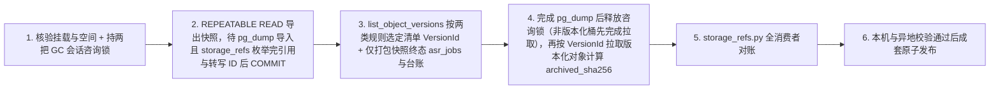

# 工作区文件镜像改存对象存储设计（生产数据库瘦身 · r5）

本文档给出工作区文件镜像从 PostgreSQL（开源关系型数据库）内联列迁入 S3（Simple Storage Service，通用对象存储接口协议）兼容服务 MinIO（开源对象存储服务）的实施方案。内容涵盖上游读写机制、字节级流式脱敏下载、公司系统属主键映射、磁盘预检与 20 GB 存量迁出、两级回滚、`VACUUM`（死元组清理与空间回收命令）窗口、「先快照、后列版本」成套备份及 Standalone Core（独立核心安装形态）默认启用规则。

---

## 0. 背景与目标

2026-11-26 生产只读核查结论如下：

- **备份与磁盘现状**：全量数据库逻辑备份（`pg_dump -Fc`）从 11-08 的 5.2 GB 涨至 11-26 的 **20.6 GB**（日增约 0.8 GB），单次发布前备份耗时达 **25 分钟**。宿主机 `~/.colima` 为指向 `/Volumes/EveSSD/Dalton/colima` 的软链接，Colima（macOS 容器运行时虚拟机）虚拟磁盘上限 300 GiB 位于外置固态盘 `/Volumes/EveSSD`（可用约 1.2 TiB），宿主机内置盘 `/` 可用约 20 GiB。
- **核心膨胀源 `workspace_files`**：共 **15.8 万行、约 20 GB**，全部以 Inline（内联存储，将文件字节存入数据库表列）方式保存在 `content_text` 与 `content_binary` 列，对象指针 `blob_sha256` 与打包指针 `pack_sha256` 均为 0 行。主体为活跃工作区的研究与行情缓存：`cn_screening_*/data`（2.8 GB）、`data/research_cache`（2.7 GB）、`hkus_shr_*/data`（1.8 GB）、`work/uploads`（1.1 GB）、`data/prices_long`（0.8 GB）；超过 10 MB 的 225 个文件合计 4.6 GB。
- **现有存储基础**：上游已内置 Blob（Binary Large Object，二进制大对象）持久化、小文件打包、两阶段回收与双向回填脚本；生产已运行本机 MinIO `dalton-asr` 桶服务语音转写与聊天大文件，全局主桶尚待开启。

**建设目标**：
1. 上线「先导出数据库快照、后固定对象版本」并按快照归档转写终态作业目录的本机及异地成套备份（双形态共用同一协议），将异地 RPO（Recovery Point Objective，恢复点目标）统一收敛至 **<= 24 小时**；
2. 补齐停机工作区与公开分享 `(100 MiB, 256 MiB]` 大文件流式读取、字节级流式脱敏、公司系统用户 `system:dalton-company` 存储键映射及同步上传失败有界内联兜底；
3. 完成磁盘门禁预检、整套备份集冻存、无桶统计预检与 Canary（金丝雀，小范围先行验证样本）演练后，在线迁出存量 20 GB 内联字节并回收物理表空间；
4. 在核心安装默认启用 `dalton-storage` 主桶，统一单模块配置解析与单一引用审计启动门禁。

---

## 1. 上游对象存储机制与生产启用方案

### 1.1 启用开关、同源解析与写入回退

1. **单一配置解析模块（`src/dalton/storage_config.py`，供 `src/utils/storage/__init__.py:37-72`、`src/utils/storage/s3_client.py:84-86` 与双形态运维脚本共用）**：
   - 新增纯标准库（可选用 PyYAML 解析 YAML〔数据序列化配置格式〕）模块 `src/dalton/storage_config.py`。运行时代码经 `# DALTON-HOOK(standalone-core)`（上游源码差异挂载点注释）与 `scripts/standalone/*.py` 导入该模块，`backup.sh` 与 `restore.sh` 调用该模块输出解析结果：
     1. **`STORAGE_PROVIDER` 优先级与形态边界**：环境变量 `STORAGE_PROVIDER` 去空白转小写为 `"none"` 时直接关闭主存储；`agent_config.core.yaml` 写入 `storage: { provider: "" }`，解析返回三态 `(found_key=True, value="")` 覆盖根 `agent_config.yaml:208` 的 `"s3"` 并交由环境变量决定。核心安装的 `STORAGE_PROVIDER` 只接受 `"s3"` 和 `"none"`；`init.sh` 与启动检查遇到 `"oss"` 时退出并提示：「核心安装的主存储请用 S3 兼容服务（内置 MinIO 或外部 S3）」。
     2. **桶名与端点旧别名解析顺序**：环境中已定义键 `"STORAGE_BUCKET_NAME"` 时，采用其去空白后的值（显式设为空串 `STORAGE_BUCKET_NAME=""` 时返回空并关闭主存储）；仅在 `"STORAGE_BUCKET_NAME"` 未定义时回退读取 `S3_BUCKET_NAME`，核心安装缺省补 `"dalton-storage"`（上游非核心安装的 `"oss"` 部署读取 `OSS_BUCKET_NAME`）。端点按同样顺序解析：优先读非空 `STORAGE_ENDPOINT_URL`，未设或为空时回退读取 `S3_ENDPOINT_URL`（`s3_client.py:86`），核心安装缺省补 `"http://minio:9000"`。
2. **传输模式（`src/utils/storage/__init__.py:79-108`、`src/server/services/persistence/transfer.py:249-284`）**：`STORAGE_BLOB_TRANSFER` 保持默认 `"auto"`，本地 Docker 沙箱自动解析为 `"relay"`（中继模式，由后端进程在沙箱与对象存储间流转字节，隔离沙箱与存储内网）。
3. **写入回退开关与上传失败兜底（`src/server/services/persistence/backup.py:456, 594, 627`、`blobs.py:160-180, 614-756`）**：
   - **只改写入去向，保持扫描与历史上限**：`backup.py:456` 的 `blobs_on` 仍只等于 `is_storage_enabled()`，扫描上限 `scan_cap_bytes`、Git（分布式版本控制系统）历史上限 `history_cap_bytes`（`transfer.py:269-290`）、上传上限（`crud.py:1592-1595`）与扫描指纹全部保持不变。在 `backup.py:594, 627` 挂载 `# DALTON-HOOK(workspace-file-write-mode)` 读取 `DALTON_WSFILES_WRITE_INLINE_ONLY`（或 `workspace_files.write_inline_only`，默认 `false`）：置为 `1` 时，`<= INLINE_MAX_BYTES`（`100 MiB`）的普通文件（含原本会打包的小文件）写进数据库内联列；`> 100 MiB` 的文件与 `.git` 历史继续写主桶，既有指针行与其余消费者照常从主桶读取。
   - **上传瞬时失败兜底**：主桶写入期间若对象上传瞬时失败，`.git` 路径维持 `hold_repos()` 整仓保护留待下轮重试；常规文件 `<= INLINE_MAX_BYTES` 在单轮 `64 MiB` 预算内回退写入内联列并打 `WARNING`（后续同步或增量回填再迁入主桶）；`> 100 MiB` 或超出当轮预算的文件留入 `result.unsaved`，下轮同步自动重传。

### 1.2 关键阈值与容量边界

| 参数常量 | 代码位置 | 数值 | 作用说明 |
|---|---|---|---|
| `PACK_CUTOFF` / `PACK_MAX_BYTES` | `persistence/transfer.py:208, 213` | `256 KiB` / `32 MiB` | `<= 256 KiB` 小文件拼入 `<= 32 MiB` 的 Pack（打包分块）写 `pack_sha256`；`> 256 KiB` 存独立对象写 `blob_sha256` |
| `PACK_STAGE_MAX_BYTES` | `persistence/transfer.py:218` | `64 MiB` | `_pack_runs()` 单轮在沙箱 `_internal/packs` 暂存上限（每轮最多 2 个 32 MiB 块，跨轮自动释放） |
| `INLINE_MAX_BYTES` / `RELAY_MAX_BYTES` | `database/blob_keys.py:43, 48` | `100 MiB` / `256 MiB` | 内联列同步上限 `100 MiB`；`relay` 模式单文件同步、流式下载与第 2 级回迁上限 `256 MiB` |
| `INPROCESS_MAX_INFLIGHT_BYTES` | `persistence/transfer.py:226` | `512 MiB` | 单次同步或恢复在后端进程内存中的最大在途字节预算 |
| `INFLIGHT_MAX_BYTES` | `scripts/ops/backfill_workspace_file_blobs.py:75` | `64 MiB` | 回填脚本单批待传字节上限（超 64 MiB 单文件独占一批） |
| `MULTIPART_THRESHOLD_BYTES` | `persistence/transfer.py:234` | `100 MiB` | 直传模式启用 Multipart Upload（分片上传）的起始阈值 |
| `GIT_HISTORY_MAX_BYTES` | `persistence/transfer.py:70` | `1 GiB` | 开启主桶后单个 `.git` 仓库备份体积上限 |
| `SERVE_MAX_BYTES` / `RANGE_MAX_BYTES` | `persistence/resolve.py:23` / `_shared.py:576` | `100 MiB` / `8 MiB` | 整文件内存读取上限 `100 MiB`；`(100 MiB, 256 MiB]` 文件统一按 `8 MiB` 切片流式输出 |
| `UTF8_SNIFF_BYTES` | `services/workspace_file_containment.py:84` | `8 KiB`（8,192 B） | 大文件流式输出前读取首部切片嗅探文本属性的长度 |

### 1.3 同步写入、内联切片、字节级流式脱敏与冷重建

1. **同步写入与冷重建恢复（`backup.py`、`blobs.py`、`restore.py`）**：
   - `sync_to_db` 在工作区级 Advisory Lock（咨询锁，`WSFILES_SYNC:<workspace_id>`，`src/server/database/workspace_file.py:28-32`）内扫描目录，开启主桶后 `ScanRules.of()`（`transfer.py:564`）更新扫描指纹触发一次全量重扫。`> 256 KiB` 文件经 `store_blob()` 按 `CLAIM_SQL -> upload_bytes -> REGISTER_SQL` 写入 `blobs/{storage_user_id}/{sha256}`；`<= 256 KiB` 文件按路径字典序分轮打包上传并记录 `pack_sha256`、`pack_offset` 与单文件 SHA-256（256 位安全哈希摘要算法）`content_hash`，单事务提交 Manifest（文件清单）。
   - 冷重建 `restore.py` 先置位 `files_restore_incomplete_at`，独立文件经 `resolve_file_bytes` 拉取，小文件按 `pack_sha256` 整块拉取一次交沙箱 `wsfiles_transfer.py pull` 切片落盘，完成后清除标志。
2. **统一读取阶梯与 SQL 1 起算内联切片（`src/server/services/persistence/resolve.py:38-120`、`database/workspace_file.py`）**：
   - `resolve_file_bytes` 依次读取 `content_binary -> content_text -> blob_sha256 -> pack_sha256` 并校验摘要。
   - 新增 `resolve_stored_byte_range(workspace_id, file_meta, offset, length, *, user_id)`（参数 `offset` 从 `0` 起算）：指针行调用 `fetch_blob_range`；内联大行调用 `workspace_file.py:get_inline_file_byte_range` 执行 SQL（结构化查询语言）切片——PostgreSQL `substring(bytea FROM n FOR m)` 下标从 `1` 起算，函数固定传入 **`offset + 1`**，对 `content_binary` 执行 `substring(content_binary FROM %s FOR %s)` 走原生 TOAST（The Oversized-Attribute Storage Technique，超大字段分片存储机制）按块读取，对 `content_text` 执行 `substring(convert_to(content_text, 'UTF8') FROM %s FOR %s)`。
3. **字节级流式脱敏器 `StreamingSecretRedactor`（`src/server/utils/secret_redactor.py:25-110`）**：
   - 直接在 `bytes` 流上匹配替换，跳过字符编解码层：
     1. **字面量密钥双编码字节模式**：对全局 MCP（Model Context Protocol，模型上下文协议）密钥 `self._secrets` 与属主 Vault（用户密钥保险箱）`vault_secrets` 中长度 `>= MIN_REDACT_SECRET_LEN`（`8`）的每个密钥值，生成 `value.encode("utf-8")`；若该值可经 Latin-1（单字节西欧字符编码）编码则并入 `value.encode("latin-1")`，统一替换为 `b"[REDACTED:" + name.encode("utf-8") + b"]"`。UTF-8（可变长通用字符编码）具备自同步性，按字节匹配同时覆盖 `redact_bytes`（`secret_redactor.py:92-110`）的 UTF-8 主路径与 Latin-1 回退路径。
     2. **无界令牌 `bytes` 正则与激活态吞并**：将两类令牌规则改为 `rb"gxs[ar]_[A-Za-z0-9_.\-]+"` 与 `rb"sk-ant-oat\d+-[A-Za-z0-9_-]+"`。当令牌体延伸至分片末尾时，立即输出一次 `[REDACTED:...]` 并进入激活态，在后续分片首部连续吞并令牌字符集字节直至遇到非令牌字节或流结束。
     3. **跨块保留窗口**：每片处理后保留末尾 `max(最长密钥字节模式长度 - 1, 0)` 字节及块尾未闭合的令牌前缀（`sk-ant-oat\d+` 数字段上限 `64 KiB`），流结束时冲刷尾部缓冲。
     4. **安全正确性标准**：输出字节流零残留密钥字节模式与两类令牌；无重叠密钥时输出与整块 `redact_bytes` 逐字节相同，有重叠密钥时允许比两遍扫描多替换重叠字符。
4. **停机工作区、公开分享流式下载与 60 秒后端下载票据**：
   - **停机工作区（`src/server/app/workspace_files/backup_reads.py:200`、`src/server/app/workspace_files/_shared.py:529-539, 584-587`）**：先读轻量元数据完成隐藏路径、非属主敏感路径（`404`）与只读同事二进制拦截（`403`）。`> 100 MiB` 文件先读首部 `UTF8_SNIFF_BYTES`（`8 KiB`）并申请进程级 16 路流式槽位（满额返 `503 Retry-After`），按 `8 MiB` 循环调用 `resolve_stored_byte_range`：当 MIME（Multipurpose Internet Mail Extensions，媒体类型标识）为文本，或复用 `_starts_as_text(head, size)`（内部调用 `may_be_utf8(head, whole=len(head) >= size)`，允许首片末尾截断一个多字节 UTF-8 字符）为真时，拉取属主 `vault_secrets` 走 `StreamingSecretRedactor` 流式输出；其余文件透传切片。
   - **公开分享（`src/server/app/share_files.py:353-390`）**：流式分支置于 `download_shared_file` 现有全部校验（`resolve_shared_files(share_token, require_download=True)` 与 `target.visible(normalized_path)`）之后，完整遵循公开分享脱敏方案（`docs/dalton/features/share-redaction.md` §3.1、§3.6、§4）：分享有效但 `allow_files=false` 降权时返回 `403`，响应带 `Cache-Control: no-store` 与 `Clear-Site-Data: "cache"`（分享关闭或令牌失效返 `404`）；正常下载响应带 `Cache-Control: no-store`，首片读取若遇存储异常在发头前折叠为 `404`。`(100 MiB, 256 MiB]` 流式分支不论文件类型一律走 `StreamingSecretRedactor`（二进制文件只在其中出现密钥字节时被改写，属期望结果）。
   - **短期后端下载票据（`download_link.py:32, 87`、`crud.py`、`files.ts`）**：`STORAGE_BROWSER_ENDPOINT_URL` 留空时跳过内部 MinIO Presigned URL（预签名临时直连链接），对 `> 8 MiB` 文件由 `/files/download-url` 签发 60 秒 HMAC（Hash-based Message Authentication Code，哈希消息认证码）票据 `dl_token` 走后端鉴权流式落盘；双形态 Caddy（反向代理边缘网关）访问日志将 `dl_token` 脱敏为 `REDACTED`。

### 1.4 内容寻址去重、公司系统属主键映射与两阶段 GC

1. **Content-Addressed（内容寻址，以内容哈希作为存储键）去重与 `system:dalton-company` 映射**：
   - 同一属主下工作区文件、转录（`thread_transcript_files`）、发布产物（`artifact_version_files`）与网盘（`drive_contents`）共用 `workspace_file_blobs(user_id, sha256)` 登记表与 `blobs/{storage_user_id}/{sha256}` 对象。
   - 公司自动化属主 `COMPANY_SYSTEM_USER_ID = "system:dalton-company"`（`src/dalton/company_identity.py:18`）含冒号，在 `src/server/database/blob_keys.py:65` 挂载 `# DALTON-HOOK(company-system-blob-key)` 新增 `storage_user_id(user_id)`，将其映射为 **`sys_dalton-company`**（与 UUID〔Universally Unique Identifier，通用唯一识别码〕及 `shared-{uuid}` 零碰撞），接入 `blob_keys.blob_key`（`:74`）、`blob_keys.upload_key`（`:91`）、`memo_binary_storage._build_storage_key`（`:81`）与 `skill_archive_storage.build_storage_key`（`:54`），数据库列值保持 `'system:dalton-company'`。
2. **两阶段 GC（Garbage Collection，垃圾回收）与孤儿巡检**：
   - `WorkspaceFileGCService` 在咨询锁 `hashtextextended('workspace_file_blobs:gc', 0)`（`src/server/database/workspace_file_blobs.py:111, 551`）下检查 `REFERENCED_SQL`（`blob_keys.py:158-171`）五处引用：无引用满 7 天标 `condemned_at`，再满 24 小时调用 `delete_object` 写入 Delete Marker（删除标记）并删登记行。`backup_lib.py` 提供 `--older-than-hours 48 --apply` 清理上传后未登记的超龄孤儿对象。

### 1.5 生产主桶 `dalton-main`、版本控制、分桶生命周期与外链收口

1. **Everflow 生产 `.env` 配置（复用本机 MinIO，固定独立私有主桶 `dalton-main`）**：
   - **编排与配额**：`COMPOSE_PROFILES=infra,storage`，`DALTON_MINIO_MEM_LIMIT=2g`（`docker-compose.dalton.yml:168`，核心安装默认 `1g`），`DALTON_BACKUP_DIR=/Volumes/EveSSD/Dalton/backups/pg`。
   - **主桶连接与访问边界**：`STORAGE_PROVIDER=s3`，`STORAGE_BUCKET_NAME=dalton-main`，`STORAGE_KEY_PREFIX=""`（`src/utils/storage/key_prefix.py:22`），容器内 `STORAGE_ENDPOINT_URL=http://minio:9000`（宿主机运维脚本用 `http://127.0.0.1:9000`），凭据复用 `MINIO_ROOT_*`，`STORAGE_REGION=us-east-1`，`STORAGE_ADDRESSING_STYLE=path`，`STORAGE_BLOB_TRANSFER=auto`，`STORAGE_BROWSER_UPLOADS=false`，`STORAGE_BROWSER_ENDPOINT_URL=""`，`STORAGE_PUBLIC_URL_BASE=${PUBLIC_APP_URL}/storage`。
2. **桶策略、Bucket Versioning（存储桶版本控制）与分桶 Lifecycle（存储桶生命周期过期规则）**：
   - 升级 `scripts/dalton/configure_minio.sh` 按桶分别幂等下发：
     1. **访问控制与版本控制**：执行 `mc anonymous set none`；仅对 `dalton-main` 开放匿名 `s3:GetObject`（仅限当前版本，排除 `s3:GetObjectVersion`）读取 `<prefix>avatars/*`；`STORAGE_BROWSER_UPLOADS=false` 时跳过浏览器 `PUT` CORS（Cross-Origin Resource Sharing，跨域资源共享）强校验；两桶均开启 **Bucket Versioning（`Status=Enabled`）**，应用层删除发送无 `VersionId`（对象版本标识）请求生成删除标记，并保持 `MINIO_API_STALE_UPLOADS_EXPIRY=24h`。
     2. **按桶区分生命周期规则**：
        - **`dalton-main`（核心安装 `dalton-storage` 同理）配置三条规则**：① `<prefix>uploads/` 当前版本 2 天过期；② 全桶非当前版本 `NoncurrentVersionExpiration: 30 天`（保障本机拉取窗口与 14 天日备镜像池按需补拉）；③ `ExpiredObjectDeleteMarker: true` 清理孤立删除标记。
        - **`dalton-asr`（核心安装 `chat-uploads` 同理）仅配置后两条规则**（非当前版本 30 天过期、清理孤立删除标记），保留 `uploads/{ws}/` 下的合法转写音频源（`src/dalton/services/transcriptions.py:203-206`）。
   - **边缘网关与浏览器外链收口**：双形态 `Caddyfile` 仅只读反代 `GET/HEAD /storage/avatars/*`（剥离 `versionId` 查询参数），其余 `/storage/*` 返 `404`；通过 `# DALTON-HOOK(storage-private-bucket-urls)`（默认 `workspace_files.public_bucket_urls: false`）收口 `download_link.py`、`image_capture.py`（`src/ptc_agent/agent/middleware/image_capture.py` 与 `src/server/services/persistence/image_capture.py`）及 `multimodal_context.py` 三处浏览器直链。

---

## 2. Everflow 生产迁出、两级回滚与表空间回收

### 2.1 六步前置与迁出顺序（预检先行）

1. **第 0 步：磁盘与虚拟磁盘拓扑门禁预检（`backup_lib.py preflight-disk-space`，在任何写盘前执行）**：
   - 调用 `realpath ~/.colima` 校验虚拟磁盘所在挂载卷：若落在宿主机内置盘 `/` 则立即退出，提示先将 Colima 迁至外置盘；
   - 校验三项固定门禁：**外置盘 `/Volumes/EveSSD` 可用 `>= 150 GB`**、**宿主机内置盘 `/` 可用 `>= 10 GB`**、**Colima 内 `/var/lib/docker` 可用 `>= 55 GB`**，任一低于门禁返回非零码退出。
2. **第 1 步：挂载点核验与新版备份上线（`STORAGE_BUCKET_NAME` 仍留空）**：
   - 运行 `verify-mount` 确认 `/Volumes/EveSSD/Dalton/backups/{pg,frozen,minio-mirror,asr-jobs,sets,.tmp}` 均位于外置卷，将备份配置与 `launchd`（macOS 后台服务与定时任务管理器）目录统一指向外置盘（原 `~/Backups/dalton` 同步后改为软链接）；
   - 发布 Batch 1 代码，运行 `configure_minio.sh` 配置 `dalton-asr` 版本控制与生命周期规则，手动触发本机日备、周基线与异地日备验证通过。
3. **第 2 步：整套已验证备份集双份冻存（`manual-pre-blob-inline`）**：
   - 开启主桶前运行 `scripts/dalton/ops/prod/backup.sh --tag manual-pre-blob-inline` 产出一整套已验证备份集（全内联库 `.dump` + 对象清单与归档字节 + `asr_jobs` 包 + `backup-set` 清单），本机外置盘长期保留，并同步加密上传至 `gdrive:DaltonBackup/frozen/manual-pre-blob-inline-<ts>/`，保留至迁出稳定满 30 天并经用户确认。
4. **第 3 步：无桶统计与属主键全集预检**：
   - 运行 `backfill_workspace_file_blobs.py --stats-only --include-legacy-owners`（只读统计模式，跳过 `is_storage_enabled()` 检查，输出内联总字节、去重字节、非 UUID 属主与 `skipped_lossy` 清单），校验全部消费者表属主经 `storage_user_id()` 转换 100% 合法且零碰撞。
5. **第 4 步：初始化 `dalton-main`、重建后端核验配置与金丝雀演练**：
   - 运行 `configure_minio.sh` 初始化 `dalton-main`；写入 §1.5 `.env` 配置，执行 **`deploy_main.sh --recreate`** 重建后端容器（`scripts/dalton/ops/prod/deploy_main.sh:1102-1112`），在容器内运行探针打印 `(is_storage_enabled(), bucket_name, is_wsfiles_write_inline_only())` 确认生效；
   - 对测试工作区执行 `--workspace <canary_uuid> --include-legacy-owners --apply`，验证文件同步、备忘录上传与停机 150 MiB 下载，随即执行本机与异地备份并在隔离容器完成恢复核验。
6. **第 5 步：活跃工作区灰度与全表 `--include-legacy-owners --apply` 迁出**：
   - 先对 1 个含缓存目录的活跃工作区执行迁出并验证冷重建，再执行全表 `backfill_workspace_file_blobs.py --include-legacy-owners --sleep-ms 30 --apply`（携带 `--include-legacy-owners` 一并迁出 `system:dalton-company` 工作区文件，`scripts/ops/backfill_workspace_file_blobs.py:297-310`）。

### 2.2 存量 20 GB 在线分批迁出与读回校验

在 `scripts/ops/backfill_workspace_file_blobs.py` 挂载 `# DALTON-HOOK(backfill-readback-verify)`：

1. **无桶统计模式与流控分页**：新增 `--stats-only` 支持主桶开启前只读统计（改写 `:599` 门禁）；采用 Keyset Pagination（游标键集分页）查询 `blob_sha256 IS NULL AND pack_sha256 IS NULL AND (content_text IS NOT NULL OR content_binary IS NOT NULL)`，入队前控制 `counts.pending_bytes <= 64 MiB` 并支持 `--sleep-ms`。
2. **「去重跳过上传」与「清列前流式读回校验」解耦**：维护进程内已验证集合 `verified_digests: set[tuple[str, str]]`，每批 `_flush` 按四步执行：① 按 `user_id` 执行 `CLAIM_SQL` 认领；② 查询 `object_size(key)`，长度等于 `len(data)` 时跳过重复 `PUT`，其余项并发 `upload_bytes`；③ 对本进程首次处理的摘要（含跳过 `PUT` 项）调用流式 `sha256_object(key)` 校验全文 SHA-256，遇同长度坏对象时记录告警并重传复核，仍偏离预期时计 `counts.failed += 1` 并保留内联列；④ 校验通过项在单行事务内执行 `REGISTER_SQL` 与 CAS（Compare-And-Swap，乐观并发条件更新）清空内联列。单行异常独立捕获隔离。
3. **复扫收敛与剩余字节验收**：历史上因文本剥离 NUL（空字节 `\x00`）产生哈希差异的行计入 `skipped_lossy` 保留内联。全表跑完后若 `skipped_raced > 0` 或存在可重试跳过行，立即复扫一次 `--include-legacy-owners --apply` 直至 `failed == 0` 且 `skipped_raced == 0`，再执行只读 SQL 核对剩余内联行数与字节数同 `skipped_lossy` 清单 100% 吻合：
   ```sql
   SELECT count(*) AS remaining_inline_rows,
          COALESCE(sum(octet_length(content_binary)), 0)
            + COALESCE(sum(octet_length(content_text)), 0) AS remaining_inline_bytes
     FROM workspace_files
    WHERE content_text IS NOT NULL OR content_binary IS NOT NULL;
   ```

### 2.3 两级安全回滚与容器重建生效规程

主桶有数据后保持开启，只保留以下两级回滚（核心安装仅支持首次启动前关闭主存储，见 §6.1）；每次修改 `.env` 均通过**重建后端容器**加载新环境并打印有效配置确认：

1. **第 1 级（新文件写回内联，保留主桶读取与大文件容量）**：
   - 在 `.env` 设 `DALTON_WSFILES_WRITE_INLINE_ONLY=1`；Everflow 在空闲窗口执行 `deploy_main.sh --recreate`（核心安装执行 `docker compose -f docker-compose.yml -f docker-compose.core.yml up -d --no-deps backend`），运行容器内探针确认 `is_storage_enabled() == True` 且 `is_wsfiles_write_inline_only() == True`。按 §1.1 第 3 点规则，`<= 100 MiB` 普通文件写进内联列，`> 100 MiB` 文件与 `.git` 历史继续写主桶。
2. **第 2 级（`workspace_files` 全量迁回内联，保留主桶服务其余消费者）**：
   - **空间准备**：先执行在线 `VACUUM (VERBOSE, ANALYZE, TRUNCATE FALSE) public.workspace_files;` 让死页进入 FSM（Free Space Map，空闲空间映射表）供原地复用，或确认 Colima 内可用空间 `>= 35 GB`；
   - **停写回迁**：运行 `wait_backend_idle.sh` -> 暂停看门狗，在 `.env` 设 `DALTON_WSFILES_WRITE_INLINE_ONLY=1` 与 `DALTON_WORKSPACE_FILE_GC_DISABLED=1` -> 执行 `docker compose -f docker-compose.yml -f docker-compose.dalton.yml stop backend` -> 在一次性维护容器运行 `backfill_workspace_file_blobs.py --reverse --apply`（`(100 MiB, 256 MiB]` 文件完整写回 `content_binary` 并保留原 `is_binary` 标记，由 §1.3 `resolve_stored_byte_range` 按 `8 MiB` 流式读取）；
   - **验证与重建恢复**：确认退出码为 `0` 且 `workspace_files` 指针行数为 `0`，抽样核验常规文件与 `> 100 MiB` 大文件流式读取摘要一致后，执行 `docker compose -f docker-compose.yml -f docker-compose.dalton.yml up -d --no-deps backend` 重建启动后端、打印有效配置确认生效并恢复看门狗。

### 2.4 `VACUUM` 与表空间物理回收

PostgreSQL 基于 MVCC（Multi-Version Concurrency Control，多版本并发控制），内联列置空提交后 `pg_dump -Fc` 体积立即回落（预计 4–7 GB），物理空间分两步回收：

1. **第 1 步（低峰期在线清理）**：执行 `VACUUM (VERBOSE, ANALYZE, TRUNCATE FALSE) public.workspace_files;`（`SHARE UPDATE EXCLUSIVE` 锁，省去末尾截断排他锁），回收约 20 GB 死页入 FSM。
2. **第 2 步（工作日 01:30–02:30 停机窗口物理缩表）**：先在隔离恢复副本实测 `VACUUM FULL` 耗时；恢复副本实测超过 **40 分钟**时，生产只保留第 1 步在线 `VACUUM`，并将实测结果报给用户。实测在 40 分钟以内时，选取 **工作日 01:30–02:30** 窗口（避开 `03:00` 本机日备、`03:40` 异地日备与周日 `05:00` 周备），运行 `wait_backend_idle.sh`，先在数据库容器内查验 `to_regclass('public.workspace_files')` 非空（容器内展开 `$POSTGRES_USER` 与 `$POSTGRES_DB`，Everflow 生产实际为 `postgres` 库，见 `scripts/dalton/ops/prod/wait_backend_idle.sh:6`，Compose 默认见 `docker-compose.yml:23-25`），记录 Colima 与 `/Volumes/EveSSD` 可用空间，注册 `trap` 自动恢复陷阱后暂停看门狗并 `stop backend`，分独立 `-c` 执行：
   ```bash
   docker compose -f docker-compose.yml -f docker-compose.dalton.yml exec -T postgres \
     sh -c 'test -n "$(psql -U "$POSTGRES_USER" -d "$POSTGRES_DB" -Atqc "SELECT to_regclass('\''public.workspace_files'\'')")"'
   # ↑ 停后端前预检通过后，暂停看门狗、stop backend，再执行物理缩表：
   docker compose -f docker-compose.yml -f docker-compose.dalton.yml exec -T postgres \
     sh -c 'psql -U "$POSTGRES_USER" -d "$POSTGRES_DB" -v ON_ERROR_STOP=1 \
       -c "SET lock_timeout = '\''10s'\''" -c "SET statement_timeout = '\''45min'\''" \
       -c "VACUUM (FULL, VERBOSE, ANALYZE) public.workspace_files"'
   ```
   执行结束后立即启动 `backend`、恢复看门狗并归档双侧回收字节数。

---

## 3. 一致性备份、全消费者引用对账与恢复演练

### 3.1 「先快照、后列版本」切面协议、对象写入入口表与对账矩阵

Everflow 生产（`scripts/dalton/ops/prod/{backup.sh,local_backup_set.py,offsite_sync.py,db_offsite.sh,data_backup.sh}`）与核心安装（`scripts/standalone/backup.sh`）共用同一协议，引用枚举收敛于 **`src/dalton/storage_refs.py`**：



1. **备份期间照常写入的一致性切面步骤**：
   - **第 1 步（持 GC 会话咨询锁）**：打开专用 PostgreSQL 控制连接，执行 `SET idle_in_transaction_session_timeout = 0;` 并获取会话级咨询锁 `SELECT pg_advisory_lock(hashtextextended('workspace_file_blobs:gc', 0)), pg_advisory_lock(hashtextextended('provenance_gc_sweep', 0));`（对齐 `src/server/database/workspace_file_blobs.py:111, 551` 与 `src/server/database/provenance_bodies.py:46, 349`），**保持到第 4 步 `pg_dump` 结束（未开启版本控制的外部桶同时保持到对象拉取结束）**。
   - **第 2 步（导出数据库快照并枚举引用）**：在同一控制连接开启 `BEGIN TRANSACTION ISOLATION LEVEL REPEATABLE READ READ ONLY; SELECT pg_export_snapshot();` 取得 `snapshot_id`。该只读事务保持打开，直到 `pg_dump -Fc --snapshot="<snapshot_id>"` 完成快照导入、且 `storage_refs.py` 在同一快照里枚举完引用键集合与转写终态作业 ID 列表之后才执行 `COMMIT`（会话咨询锁继续保持）。
   - **第 3 步（列版本按两类规则取键 + 按快照终态打包转写目录）**：
     - 对各活跃桶执行 `list_object_versions`，清单键集合等于「**列版本时仍存在的键 ∪ 快照仍引用的键**」，按两类取键：① 当前版本是普通对象的键，取当前 `VersionId`；② 当前版本是删除标记、但第 2 步快照里仍有引用的键，取删除标记之前最近的一个版本；其余键（当前是删除标记且快照不再引用）跳过不入清单。快照引用的任一键在桶内找不到任何版本时，本次备份不发布并以非零码退出；
     - 内置 MinIO 一律开启版本控制（开启前存量对象的 `VersionId` 为 `"null"`，拉取时原样传入 `"null"`）。核心安装可接入未开启版本控制的外部桶，备份照常运行并打 `WARNING`（列举与拉取省略 `VersionId`；缺对象或对账失败时不发布并退出非零）；
     - 按第 2 步同一快照查出的终态（`succeeded`/`failed`/`cancelled`/`indeterminate`，定义见 `src/dalton/database/transcriptions.py:26-41`）ASR（Automatic Speech Recognition，自动语音识别）作业 ID 列表，只打包这些终态作业在 `<DALTON_ASR_JOBS_DIR>/<job_id>/` 下的目录及顶层 `asr_usage.jsonl`（排除 `*.lock`、`*.tmp` 与临时切片目录），生成 `asr-jobs-<backup_set_id>.tar.gz` 并记录大小与 SHA-256（Everflow 生产路径见 `scripts/dalton/launchd/com.dalton.transcription.plist.template:56-59`、`src/dalton/transcription_service/app.py:63-65`；核心安装为 `dalton-asr-jobs` 卷，`docker-compose.core.yml:265, 270, 412`）。
   - **第 4 步（拉取对象与对账）**：等待 `pg_dump` 结束（未开启版本控制的外部桶同时在持锁期内完成对象拉取），随后释放两把会话咨询锁；已开启版本控制的桶在释放咨询锁之后按清单固定的 `VersionId` 拉取对象并计算 `archived_sha256`（按 `VersionId` 读取指定版本，后续删除只写入新删除标记，对象历史版本在非当前版本 30 天保留期内保持可读，同时避免长时间持锁；Everflow 写入外置盘镜像池 `backups/minio-mirror/objects/`，核心安装写入 `minio-objects.tar.gz`），完成后运行 `storage_refs.py` 完成全消费者对账。

2. **全仓对象写入入口、键形态与可变性登记表**：
   > **硬性规则**：新增对象存储写入统一采用内容寻址或一次性随机标识的**不可变键**，先上传对象、后提交数据库记录；确需引入可变键时，先登记入下表并明确备份恢复语义。

   | 对象写入入口（文件:行号） | 所属桶 | 键形态（含可选 `<prefix>`） | 是否可变与说明 |
   |---|---|---|---|
   | `src/server/database/workspace_file_blobs.py:134, 175, 240`<br>`scripts/ops/backfill_workspace_file_blobs.py:182`（键 `blob_keys.py:74`） | 主桶 | `blobs/{storage_user_id}/{sha256}` | 不可变（内容与打包块 SHA-256 寻址） |
   | `src/server/app/workspace_files/uploads.py:207`<br>`src/server/services/drive/uploads.py:297`（键 `blob_keys.py:91`） | 主桶 | `uploads/{storage_user_id}/{upload_id}` | 不可变（单次上传新 UUID，合片入库后删除） |
   | `src/server/database/provenance_bodies.py:108`（定键 `src/ptc_agent/agent/middleware/provenance/middleware.py:657-680`） | 主桶 | `provenance/{result_sha256}` | **可变**（按脱敏前摘要定键且先 PUT 后 `ON CONFLICT DO NOTHING`〔`:156`〕，后写者可覆写成另一份脱敏正文；对账只核对存在） |
   | `src/server/services/memo_binary_storage.py:110`（键 `:81`） | 主桶 | `memo/{storage_user_id}/{uuid}{ext}` | 不可变（每次上传新生成 `uuid4().hex`） |
   | `src/server/services/skill_archive_storage.py:84, 105`（键 `:54, 65`） | 主桶 | `user-skills/{storage_user_id}/{sha256}.zip`<br>`org-library/{org_id}/{sha256}.zip` | 不可变（规范化归档 SHA-256 寻址） |
   | `src/ptc_agent/agent/tools/show_widget.py:303`（键 `:272`） | 主桶 | `widgets/{thread_id}/{sha256}.json` | 不可变（JSON 载荷 SHA-256 寻址） |
   | `src/ptc_agent/agent/middleware/image_capture.py:129`（键 `:88`） | 主桶 | `response-images/{thread_id}/{sha16}/{basename}` | 不可变（图片字节 SHA-256 前 16 位寻址） |
   | `src/server/services/chat_attachments.py:314, 369`（键 `blob_keys.py:107`）<br>`src/server/utils/multimodal_context.py:187`（键 `:171, 184`） | 主桶 | `attachments/{attachment_id}/{safe_name}`<br>`attachments/{thread_id}/{batch_id}/{hex8}/{safe_key}` | 不可变（每次上传新 UUID / 随机批次号） |
   | `src/dalton/services/chat_uploads.py:803, 2124`（经 `chat_upload_storage.py:247`，键 `:222`） | 辅桶 / `chat-uploads` | `chat-uploads/{ws_id}/{upload_id}/{safe_name}` | 不可变（每次分片上传新 `upload_id`） |
   | `src/dalton/services/transcriptions.py:1327`（经 `transcription_storage.py:159`，键 `:164`） | 辅桶 / ASR 桶 | `transcriptions/{ws_id}/{job_id}/source/{safe_name}` | 不可变（每张转写单新 `job_id`） |
   | `src/dalton/channel_snapshot_storage.py:157`（键 `:105`） | 辅桶 / `chat-uploads` | `channel-snapshots/{thread_id}/{sha16}/chart_{layer_id}.png` | 不可变（图表 PNG 字节 SHA-256 前 16 位寻址） |
   | `src/server/app/users.py:1176`（键 `:1172`） | 主桶 | `avatars/{user_id}.{ext}` | **可变**（同用户同扩展名原地覆写；对账核对存在，恢复出较快照略新的头像可接受） |
   | `src/tools/sec/edgar.py:80` | 主桶 | `edgar/{key}` | **可变**（SEC EDGAR〔美国证券交易委员会企业信息披露系统〕纯派生缓存，可自动回源重建） |

3. **全消费者引用对账与恢复收敛矩阵（`src/dalton/storage_refs.py`）**：
   未完成分片仅存在于原桶，恢复后旧 `store_upload_id` 失效（`src/dalton/services/chat_uploads.py:1250`），且恢复环境仅归档终态转写目录（避免转写服务启动扫描自动续跑快照外作业，`src/dalton/transcription_service/jobs.py:513-537`，以及后端轮询遇 `404` 停滞，`src/dalton/services/transcriptions.py:2699-2712`），因此恢复收尾统一运行 `reconcile-restored-inflight-states` 收敛全部在途任务：

   | 消费者 | 待上传 / 内联 / 已清理（跳过对象对账） | 已提交存活强对账规则 | 恢复后收敛规则（`reconcile-restored-inflight-states`） |
   |---|---|---|---|
   | 工作区文件、转录、产物、网盘与 `workspace_file_blobs` | 已回收行；内联文件行；`drive_uploads` 的 `uploading`/`verifying`/`failed`/`aborted` | ① `workspace_file_blobs`（`condemned_at IS NULL`）、`thread_transcript_files`/`artifact_version_files`（`content IS NULL`）、`drive_contents`（`blob_user_id IS NOT NULL`）经 `storage_user_id()` 核对 `size == byte_len`、`archived_sha256 == sha256`；② `workspace_files`（`resolve.py:66-75`）：`blob_sha256` 行核对 `size == file_size`、`archived_sha256 == blob_sha256`；`pack_sha256` 行按 `workspace_file_blobs` 登记行核对整包 `size == byte_len`、`archived_sha256 == pack_sha256`，成员行核对 `pack_offset + file_size <= byte_len` | `drive_uploads` 中 `state IN ('uploading', 'verifying')` 置 `state = 'aborted', cleaned = TRUE, lease_until = NULL, lease_token = NULL` |
   | 溯源溢出体 `provenance_result_bodies` | `object_key IS NULL` | `object_key IS NOT NULL` **只核对对象存在**（清单记录 `archived_sha256`；`size` 与 `byte_len` 不一致时记 `WARNING` 并继续发布） | 先传对象后写库，无中间态 |
   | 备忘录 `store` / 技能 `user_skills`、`org_library_items` / 组件 `widgets` | 内联项 | JSONB（二进制 JSON 列类型）`binary_ref.key` 核对存在；`archive_key` 核对 `archived_sha256 == content_hash`；检查点与切片 `data_ref` 核对 `key`、`size`、`sha256` 一致 | 先传对象后写库，无中间态 |
   | 用户头像与回复图片 | 外部头像或空值 | `users.avatar_url` 本站头像键与消息/`turn_responses` 的 `response-images/*` **核对存在** | 按清单恢复可读图片 |
   | 上游对话附件 `chat_attachments` | `state = 'uploading'`（记 `skipped_pending`）；**`object_key IS NULL` 的内联附件行**（`chat_attachments.py:365-377`）；已清理/已放弃行 | **只有 `cleaned_at IS NULL AND state = 'ready' AND object_key IS NOT NULL` 的行**核对存在且 `size == row.size`；历史消息引用的 `attachments/*` 核对存在 | `state = 'uploading'` 统一置 `state = 'aborted', lease_until = NULL` |
   | 聊天大文件 `dalton_chat_file_uploads` | `state IN ('uploading', 'completing')`（记 `skipped_pending`）；已清理/已终止行 | `cleaned_at IS NULL AND state = 'ready'` 核对存在且 `size == size_bytes`、`archived_sha256 == actual_sha256` | `completing` 且桶内已有大小与摘要匹配对象 → 推进为 `ready`；其余 `uploading`/`completing` → 置 `state = 'aborted'`，清空 `claim_token`、`lease_until`、`pending_claims` |
   | 录音转写 `dalton_transcription_jobs` 与渠道快照 | `status = 'awaiting_upload'` 且 `usage.upload.completed != true`；未传完即终止行；`pending`/`failed` 快照 | ① `queued`..`succeeded`/`indeterminate`（及上传已完成的 `awaiting_upload`）核对辅桶 `source_object_key` 存在且大小、`source_sha256` 匹配；② **`status = 'succeeded'` 核对 `asr-jobs` 包内有 `<job_id>/state.json`（状态为 `succeeded`）与 `result.json`，服务会写 `raw_response.json` 的作业（`whisper_worker.py:677, 705`、`jobs.py:393-418, 974-1030`）一并核对**；③ 已就绪消息 `channel-snapshots/*.png` 核对存在 | 未完成上传的 `awaiting_upload` 置 `status = 'cancelled', stage = 'cancelled', completed_at = NOW()`（`TranscriptionJobStatus.CANCELLED`）；**快照内处于 `queued`..`assembling`（`src/dalton/database/transcriptions.py:26-46`）的作业一律置失败终态 `status = 'failed', stage = 'failed', error_message = '恢复后请重新提交', completed_at = NOW()`（`TranscriptionJobStatus.FAILED`）** |

4. **本机发布与异地周基线 + 日增量同步（`prod/` 实现 + 旧入口薄转发）**：
   - **本机日备（03:00，`prod/backup.sh` + `prod/local_backup_set.py`）**：`pg_dump`、镜像池对象、`asr-jobs-<id>.tar.gz` 与对账全部通过后，同盘 `mv` 转正并更新 `latest-verified-set.json`；按保留期存活备份集（日 14、周 8、部署 5、`manual-*`）的 `archived_sha256` 并集修剪镜像池。
   - **异地周基线（周日 05:00，`prod/data_backup.sh`）**：枚举两桶当前普通对象 `VersionId` 流式打包并生成记录 `archived_sha256` 的 `_minio_manifest.json`，经 AES（高级加密标准）`aes-256-cbc` + PBKDF2（基于口令的密钥派生函数）加密与密文大小/MD5（128 位消息摘要校验算法）核验后上传至 `gdrive:DaltonBackup/weekly/<YYYY-MM-DD>/`，修剪时豁免仍被保留期日备引用的 `baseline_id`。
   - **异地日备（每日 03:40，`prod/db_offsite.sh`）**：读取 `latest-verified-set.json`，将 `.dump`、`asr-jobs` 归档包、目标日清单 `minio-manifest-<id>.json` 及相对于周基线按 `archived_sha256` 计算的差集包 `minio-delta-<run_id>.tar.gz` 分别加密上传为 `.staged`，校验大小与 MD5 后依次 `moveto` 转正并更新 `db/<YYYY-MM-DD>/LATEST.json`。现有 `scripts/dalton/ops/dalton_db_offsite.sh` 与 `dalton_data_backup.sh` 保留为 `exec` 薄转发入口。

### 3.2 隔离沙盘恢复演练

在独立项目 `-p dalton-drill` 与外置盘隔离目录执行端到端演练：

1. **拉取校验与按目标日权威清单精确导入对象**：按 `LATEST.json` 拉取周基线包、日数据库包、日对象清单、日对象增量包与 `asr-jobs` 包并核对密文 MD5；建立周基线与日增量包的 `archived_sha256` 索引，**仅按目标日 `backup-set` 清单逐键写入目标桶**（快照前已删除或仅存于周基线的旧键自动略过），导入后列出桶内全部键，**断言桶内键集合与目标日清单完全相等**。
2. **还原 `asr_jobs` 目录、数据库与收敛在途状态**：将仅含快照终态作业与 `asr_usage.jsonl` 的 `asr-jobs` 包解压至演练空目录/空卷，执行 `pg_restore --clean --if-exists --exit-on-error` 还原数据库，运行 `reconcile-restored-inflight-states`：推进已合片匹配上传至 `ready`，终止其余未完成上传，并将 `queued`..`assembling` 转写作业统一置为 `failed`（`error_message = '恢复后请重新提交'`）。
3. **全消费者核验、转写磁盘读取与沙箱冷重建**：
   - 调用 `storage_refs.py` 核验全部已提交对象存在且长度/摘要一致；确认快照前删除的键在恢复后不存在、快照后删除的技能包恢复出旧字节、快照后覆写的同名头像恢复出可读图片；
   - 启动隔离转写服务挂载恢复后的 `asr_jobs` 目录，调用 `/transcriptions/{job_id}/result` 与 `/transcriptions/{job_id}/result/raw` 确认返回 `200` 且文本与原始响应完整；
   - 对含打包小文件的工作区与 `system:dalton-company` 工作区执行 `restore_to_sandbox()` 确认零误差，记录实际 RTO（Recovery Time Objective，恢复时间目标）与 `VACUUM FULL` 耗时后清理演练环境。

---

## 4. 工作区缓存目录评估与排除配置

**已定策略：首批不排除任何缓存目录**，全部保留镜像，上线观察 1–2 周后再按序评估：

| 目录模式 | 存量 | 评估结论 | 首批策略 |
|---|---|---|---|
| `work/uploads` | 1.1 GB | 用户原始上传文件，唯一输入源 | **硬编码保护保留** |
| `data/prices_long` | 0.8 GB | 公开行情缓存，可确定性免配额重拉 | 首批保留，观察 1–2 周后优先排除 |
| `data/research_cache` | 2.7 GB | 可能含已消耗付费配额拉取的研报切片 | 首批保留，逐脚本核实后再评估 |
| `cn_screening_*/data`、`hkus_shr_*/data` | 4.6 GB | 命名宽泛，可能混有手工股票池与因子权重 | 首批保留，后续引导写入 `*/data/cache/` 后按通配符排除 |

在 `src/ptc_agent/core/sandbox/wsfiles_transfer_runtime.py:288` 的 `_Exclusions` 新增 Glob（通配符路径匹配）字段 `exclude_rel_globs`（硬编码保护 `.git` 与 `work/uploads`），经 `# DALTON-HOOK(workspace-file-exclusions)` 注入 `transfer.py:515` 的 `exclusion_spec()`；在 `dalton.yaml` 与 `dalton.core.yaml` 配置空列表 `workspace_files: { public_bucket_urls: false, write_inline_only: false, exclude_dir_names: [], exclude_rel_dirs: [], exclude_rel_globs: [] }`（支持 `DALTON_WSFILES_EXCLUDE_REL_DIRS` / `DALTON_WSFILES_EXCLUDE_REL_GLOBS` 覆盖）。

---

## 5. 其他大表保留期与清理评估

生产其余 ≥ 1.0 GB 大表独立于本次迁出，后续建议如下：

| 表名 | 大小 | 机制定位与治理结论 |
|---|---|---|
| `checkpoint_blobs` | 1.2 GB | LangGraph（有状态智能体编排框架）Checkpoint（状态检查点）通道值表；DeltaChannel（增量通道）启用前存有冗余快照，可单独立项经 `scripts/ops/thin_message_snapshots.py --rehearse --verify all` 验证后无损瘦身 |
| `checkpoint_writes` / `checkpoints` | 5.0 GB / 3.6 GB | 检查点主链与增量写入；活跃对话完整保留，后续统计超 90 天已结束纯定时任务线程归档清理 |
| `turn_slices` / `task_run_slices` | 2.1 GB / 1.1 GB | 加速历史 SSE（Server-Sent Events，服务端事件流）重放的派生 Slice（回放缓存切片）；后续清理旧 `slice_key` 版本及超 90 天冷线程切片（按需自动重建） |
| `dalton_conversation_cards` | 1.2 GB | 2026-11-19 已封存的只读历史对话归档与 HNSW（分层可导航小世界向量索引），零增长长期保留 |
| `thread_transcript_files` | 1.0 GB | 线程转录片段表；开启主桶后新增 `> 64 KiB` 片段自动写入 `blobs/`，存量可后续按需迁出 |

---

## 6. 独立核心安装默认启用、启动门禁与分离原则

### 6.1 默认启用、Compose 同源解析与启动门禁

1. **默认启用中性主桶 `dalton-storage` 并并入旧别名（`docker-compose.core.yml:102, 130, 188, 200`）**：
   - 将 `minio` 默认 `DALTON_MINIO_MEM_LIMIT` 升至 `1g`；在 `init.sh` 与 `.env.core.example` 默认生成 `STORAGE_PROVIDER=s3`、`STORAGE_BUCKET_NAME=dalton-storage`；`minio_init.py` 按 §1.5 第 2 点对 `dalton-storage` 开启版本控制与三条生命周期规则，对 `chat-uploads` 开启版本控制与后两条规则（省略 `uploads/` 过期）；在 `backend` 容器入口脚本按 `env_file` 派生 `STORAGE_ACCESS_KEY_ID`、`STORAGE_SECRET_ACCESS_KEY` 与 `STORAGE_PUBLIC_URL_BASE`。
   - 核心安装的 `STORAGE_PROVIDER` 只接受 `s3` 与 `none`（遇到 `oss` 按 §1.1 第 1 点退出并提示）。`docker-compose.core.yml` 的 `backend` 与 `minio-init` 服务 `environment` 统一并入端点与桶名旧别名，与 §1.1 `src/dalton/storage_config.py` 保持一致：
     ```yaml
     STORAGE_PROVIDER: ${STORAGE_PROVIDER:-s3}
     STORAGE_ENDPOINT_URL: ${STORAGE_ENDPOINT_URL:-${S3_ENDPOINT_URL:-http://minio:9000}}
     STORAGE_BUCKET_NAME: ${STORAGE_BUCKET_NAME-${S3_BUCKET_NAME-dalton-storage}}
     STORAGE_REGION: ${STORAGE_REGION:-us-east-1}
     STORAGE_ADDRESSING_STYLE: ${STORAGE_ADDRESSING_STYLE:-path}
     ```
     仅设 `S3_ENDPOINT_URL` 或 `S3_BUCKET_NAME` 时容器与运维脚本一致采用旧别名值；显式设 `STORAGE_BUCKET_NAME=` 空值时原样传入空串关闭主存储；均未定义时默认取 `http://minio:9000` 与 `dalton-storage`。
2. **仅支持首次启动前关闭 + 共用引用审计启动门禁（`src/dalton/storage_refs.py` + `src/server/app/setup.py`）**：
   - **首次启动前关闭**：在首次启动栈前于 `.env` 设 `STORAGE_PROVIDER=none`（或 `STORAGE_BUCKET_NAME=`），`minio-init` 仅初始化 `chat-uploads`，主桶消费者从零写内联列；主桶有数据后保持开启。
   - **启动期完整引用门禁**：主存储处于关闭态（`is_storage_enabled()` 为 `False`）时，应用 Lifespan（应用生命周期钩子）启动检查复用 `src/dalton/storage_refs.py` 生成全部主桶消费者的 `EXISTS (...) LIMIT 1` 探测查询（与 §3.1 矩阵同一条件：`chat_attachments` 只查 `object_key IS NOT NULL` 的行，升级前的内联附件跳过不算对象引用）。检出任一对象引用时拒绝启动（紧急排障可设 `DALTON_ALLOW_UNMIGRATED_STORAGE_OFF=1` 降级为 `CRITICAL` 日志），报错写明：「主桶已有数据，请保持 `STORAGE_PROVIDER=s3`；只想让新文件写回数据库，请设 `DALTON_WSFILES_WRITE_INLINE_ONLY=1`」。
3. **核心安装 `backup.sh` 与 `restore.sh` 对齐**：
   - `scripts/standalone/backup.sh` 执行 §3.1 切面与对账协议（接入无版本控制外部桶时照常运行并打 `WARNING`；启用转写时按快照终态打包 `dalton-asr-jobs` 卷），输出 `minio-objects.tar.gz`、`asr-jobs.tar.gz`、`manifest.json` 与 `SHA256SUMS`。
   - `scripts/standalone/restore.sh` 允许目标实例预存 `minio-init` 初始化的空桶，从空卷还原 `dalton-asr-jobs`、对象与数据库后调用 §3.1 `reconcile-restored-inflight-states` 收敛在途上传与进行中转写单，并兼容旧版全内联备份恢复至新版栈。

### 6.2 双形态分离原则清单

| 维度 | 执行准则 |
|---|---|
| **形态与能力门控** | 形态统一走 `src.dalton.profile`；工作区文件对象存储属双形态基础底座（`CORE_CAPABILITY = None`），同事共享权限走 `src.dalton.capabilities.effective_capabilities()` |
| **共享模块与运维脚本分层** | 跨形态共用的 `src/dalton/storage_config.py` 与 `src/dalton/storage_refs.py` 置于 `src/dalton/`（随 `scripts/standalone/package_release.sh:200` 导出）；Everflow 生产编排放入 `scripts/dalton/ops/prod/`，旧路径留薄转发；核心安装脚本放入 `scripts/standalone/`；通用回填留在 `scripts/ops/backfill_workspace_file_blobs.py` |
| **上游挂载点与路径登记** | 上游改动标注 `# DALTON-HOOK`（新增 `storage-private-bucket-urls`、`company-system-blob-key`、`workspace-file-write-mode`、`workspace-file-exclusions`、`backfill-readback-verify` 登记入 `scripts/dalton/check_hooks.sh`），新增测试路径登记入 `scripts/dalton/dalton_paths.txt`，通过 `bash scripts/dalton/check_hooks.sh --strict` |
| **数据库迁移边界** | 全流程零 DDL（数据库模式定义语言）变更；后续若新增迁移统一放入 `src/dalton/migrations/versions/`，从 **`d058`** 起编号（当前链头 `d055`） |

---

## 7. 分批实施与验收测试计划

| 批次 | 改动文件清单 | 验收测试标准 |
|---|---|---|
| **Batch 1：字节流式脱敏、属主键映射、私有桶收口、回填加固与成套一致性备份** | **上游挂钩文件（带 `DALTON-HOOK`）**：<br>- `src/utils/storage/__init__.py`、`src/utils/storage/s3_compatible.py`<br>- `src/server/database/blob_keys.py`、`src/server/database/workspace_file.py`<br>- `src/server/services/memo_binary_storage.py`、`src/server/services/skill_archive_storage.py`<br>- `src/server/services/persistence/{blobs,backup,resolve,transfer,download_link,image_capture}.py`<br>- `src/ptc_agent/agent/middleware/image_capture.py`、`src/ptc_agent/core/sandbox/wsfiles_transfer_runtime.py`<br>- `src/server/utils/{secret_redactor,multimodal_context}.py`<br>- `src/server/app/workspace_files/{_shared,backup_reads,crud}.py`、`src/server/app/{share_files,setup}.py`<br>- `scripts/ops/backfill_workspace_file_blobs.py`、`tests/unit/server/database/test_backfill_workspace_file_blobs.py`、`web/src/pages/ChatAgent/utils/api/files.ts`<br>**Dalton 自有与生产运维文件**：<br>- `src/dalton/{settings.py,dalton.yaml,dalton.core.yaml}`、`src/dalton/storage_config.py`（新增）、`src/dalton/storage_refs.py`（新增）<br>- `src/dalton/{chat_upload_storage,transcription_storage}.py`、`src/dalton/services/{chat_uploads,transcriptions}.py`<br>- `docker-compose.dalton.yml`、`deploy/dalton/Caddyfile`、`scripts/dalton/{configure_minio.sh,check_hooks.sh,dalton_paths.txt}`<br>- `scripts/dalton/ops/backup_lib.py`、`scripts/dalton/ops/prod/{backup.sh,deploy_main.sh,local_backup_set.py,offsite_sync.py,db_offsite.sh,data_backup.sh}`<br>- `scripts/dalton/ops/{dalton_db_offsite.sh,dalton_data_backup.sh}`（薄转发入口）<br>- `scripts/dalton/ops/prod/launchd/com.dalton.pg-backup.plist.template`、`scripts/dalton/ops/launchd/{com.dalton.db-offsite,com.dalton.data-backup}.plist.template`<br>- `tests/unit/dalton/{test_workspace_file_storage,test_consistent_object_backup}.py`（新增）、`web/e2e/workspace-file-storage.spec.js`（新增） | 1. **门禁检查**：`check_hooks.sh --strict`、Ruff（Python 静态代码检查器）、TypeScript（带静态类型的 JavaScript 超集语言）类型检查与前端单测通过。<br>2. **流式脱敏、SQL 偏移与 E2E（End-to-End，端到端）下载**：① 单测覆盖跨 `8 MiB` 边界的 UTF-8 密钥、Latin-1 文件非 ASCII 密钥、重叠密钥、跨块 `16 KiB` 无界令牌，以及**未知 MIME、首片第 `8 KiB` 恰好截断一个多字节 UTF-8 字符（`_starts_as_text` / `may_be_utf8`）且密钥位于后续分片**；② 单测覆盖 `get_inline_file_byte_range`（`offset + 1`）拼接；③ Playwright（浏览器自动化测试框架）验证停机工作区与公开分享下载 150 MiB 文本/二进制文件（公开分享流式分支一律脱敏、带 `Cache-Control: no-store`），验证**分享降权（`allow_files=false`）后访问旧下载地址返回 `403` 且带 `Cache-Control: no-store` 与 `Clear-Site-Data: "cache"`**，分享关闭或令牌失效返回 `404`。<br>3. **属主键映射、第 1 级回退与回填单测**：① `system:dalton-company` 四处存储键读写与 GC 全通；② **开启第 1 级 `DALTON_WSFILES_WRITE_INLINE_ONLY=1` 后改写一个 `150 MiB` 文件和一个 `10 MiB` 文件再冷重建，两者均为新内容，前者是指针行、后者是内联行**；③ 上传失败时 `<= 100 MiB` 有界回退内联；④ 回填 `--stats-only` 在无桶下运行成功，跳过 `PUT` 仍跑 `sha256_object`、同长度坏对象重传修复及失败保留内联。<br>4. **备份切面、打包/内联对账与转写收敛单测**：① **一个键在快照前删除（不进清单、恢复后不存在），一个键在快照后删除（进清单、恢复出旧字节）**，覆写头像恢复出可读图片，快照引用键缺任何版本时退出非零且不发布；② 溯源后写者覆写为不同长度正文时对账打 `WARNING` 并照常发布；③ **用真实 `pack_sha256` 打包行和升级前的内联附件（`object_key IS NULL`）各跑一次备份、恢复和启动门禁**；④ **转写仅打包快照终态目录与 `asr_usage.jsonl`**，`succeeded` 核对 `state.json`、`result.json` 及服务写出的 `raw_response.json`，恢复后 `queued`..`assembling` 置 `failed`（错误信息「恢复后请重新提交」），已合片 `completing` 推至 `ready`，其余未完成上传置 `aborted` / `cancelled`；⑤ `deploy_main.sh` 兼容新版 `prod/backup.sh`。 |
| **Batch 2：Everflow 生产预检、冻存、20 GB 迁出与缩表** | - `docs/dalton/{OPERATIONS.md,dev-guide/AUDIO-STORAGE.md}`、`scripts/dalton/ops/README.md` | 按 §2.1 第 0–5 步依次完成：`preflight-disk-space` 通过 -> 新备份上线 -> `manual-pre-blob-inline` 整套冻存 -> `--stats-only` 预检通过 -> `deploy_main.sh --recreate` 重建后端并打印有效配置确认、金丝雀演练通过 -> 全表 `--include-legacy-owners --apply` 迁出并复扫至 `failed == 0`、`skipped_raced == 0` 且剩余内联与 `skipped_lossy` 完全一致 -> 在线 `VACUUM` 与工作日 `01:30–02:30` 窗口 `VACUUM FULL`（按 §2.4 规则） -> §3.2 沙盘恢复演练（含读 `/result` 与 `/result/raw`）。 |
| **Batch 3：核心安装默认启用、同源解析与备份对齐** | - `agent_config.core.yaml`、`docker-compose.core.yml`、`.env.core.example`<br>- `scripts/standalone/{init.sh,minio_init.py,storage_config.py,backup.sh,restore.sh,upgrade.sh}`<br>- `deploy/standalone/Caddyfile`、`docs/dalton/dev-guide/STANDALONE-DEPLOY.md`、`tests/standalone/checks/b6_tls_backup_upgrade.py` | 1. **分桶初始化验证**：`init.sh` 启动后 `dalton-storage` 开启版本控制、三条生命周期规则与头像只读策略，`chat-uploads` 开启版本控制与后两条规则（无 `uploads/` 2 天过期）。<br>2. **真实 `docker compose config` 同源测试与门禁**：① 调用 `docker compose config` 实测「仅设 `S3_BUCKET_NAME`、仅设 `STORAGE_BUCKET_NAME`、`STORAGE_BUCKET_NAME` 显式为空、两者均未设、**仅设 `S3_ENDPOINT_URL`**」五种组合下容器环境与运维解析一致；② 设 `STORAGE_PROVIDER=oss` 时 `init.sh` 与启动检查退出并提示用 S3 兼容服务；③ 首次启动前设 `STORAGE_PROVIDER=none`（含存在升级前内联附件）正常启动，任一真实对象引用存在时被 `storage_refs.py` 启动门禁拦截。<br>3. **`b6_tls_backup_upgrade.py` 回归**：验证 `backup.sh` 先快照后列版本 + 仅打包快照终态 `dalton-asr-jobs` 目录，快照前删键不恢复、快照后删键恢复出旧字节、无版本外部桶打 `WARNING` 运行，恢复后 `/result` 与 `/result/raw` 可读，`queued`..`assembling` 转写单置 `failed`（错误信息「恢复后请重新提交」），未完成上传置 `aborted` / `cancelled`。 |

**实现备注（定稿后由各批开发任务落实）**
- 转写恢复（Batch 1）：恢复后置 `failed` 的在途转写提供显式「重新提交」入口，从已归档音频创建新尝试，不复用原幂等行；验收走真实接口直到读到结果。
- 技能包对账（Batch 1）：数据库里的技能包摘要形如 `sha256:<hex>`，对账前解析并校验前缀，再与归档摘要比较；用真实对象化技能包跑一次对账与恢复。
- 核心安装混合存储（Batch 3）：外部主桶与内置辅桶并存时，备份与恢复按实际端点、桶和前缀分别归档与还原（`scripts/standalone/storage_config.py` 的 `check-env` 不再按单端点拒绝）；用「外部无版本主桶 + 内置辅桶」跑一次完整备份和恢复。

---

## 8. 需要用户决定的事项

以下 2 项请确认（如认可推荐项，直接按推荐项启动 Batch 1 开发）：

1. **存量有损内联行（`skipped_lossy`，若预检检出）的处理方式**
   - **选项 A（推荐）**：保留原内联行并输出审计清单，待文件在沙箱内后续改写或重打包时自然更新。
   - **选项 B**：确认沙箱已销毁后单独执行带审计记录的重算哈希迁出。
2. **Google Drive 异地备份的对象存储同步方式**
   - **选项 A（推荐）**：每周日流式上传对象周基线字节包 + 每日随数据库备份成套上传权威清单、`asr_jobs` 包与对象差集包（异地 RPO `<= 24 小时`）。
   - **选项 B**：每日仅在本机外置盘成套镜像对账，异地维持每周一次上传。

---

## 9. 一致性自查

| 核查项 | 结论与对应小节 |
|---|---|
| **1. 快照事务边界与两类取键清单** | `REPEATABLE READ` 事务保持至 `pg_dump` 导入与引用枚举完成再 `COMMIT`，清单仅收列版本时现存对象与快照仍引用的已删键旧版本；见 §3.1、§3.2、§7。 |
| **2. 打包对账、溯源可变键与内联附件豁免** | `workspace_files` 分别校验整包与成员切片边界，溯源 `provenance/{sha}` 标为可变键仅核对存在，`chat_attachments` 仅对 `object_key IS NOT NULL` 做对账与启动门禁；见 §3.1、§6.1、§7。 |
| **3. 转写快照终态归档与在途作业收敛** | 备份只打包快照终态转写目录与 `asr_usage.jsonl` 并核对 `state.json`/`result.json`/`raw_response.json`，恢复将 `queued`..`assembling` 置 `failed`；见 §3.1、§3.2、§6.1、§7。 |
| **4. 分桶生命周期、流式脱敏与分享降权响应头** | `uploads/` 2 天过期仅配主桶；停机流式嗅探复用 `_starts_as_text`/`may_be_utf8`，公开分享流式分支全量脱敏且降权返 `403` + `Clear-Site-Data: "cache"`；见 §1.3、§1.5、§6.1、§7。 |
| **5. 第 1 级回退保上限、缩表窗口与核心安装别名** | 第 1 级回退不改 `blobs_on` 与大文件上限；`VACUUM FULL` 定于工作日 `01:30–02:30` 动态读容器库名并设 `45min` 超时；核心安装并入 `S3_ENDPOINT_URL` 且仅接受 `s3`/`none`；见 §1.1、§2.3、§2.4、§6.1、§7。 |
